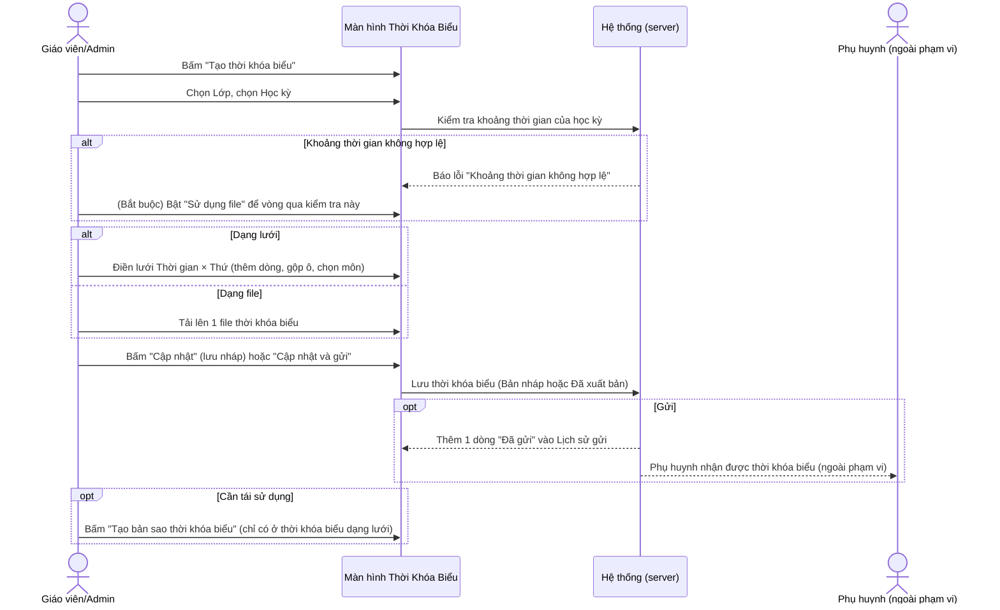
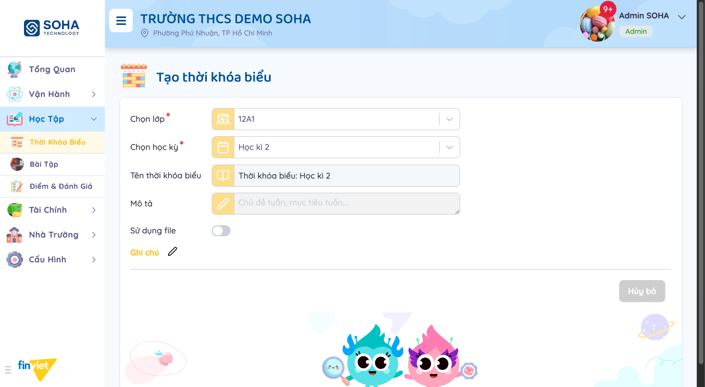
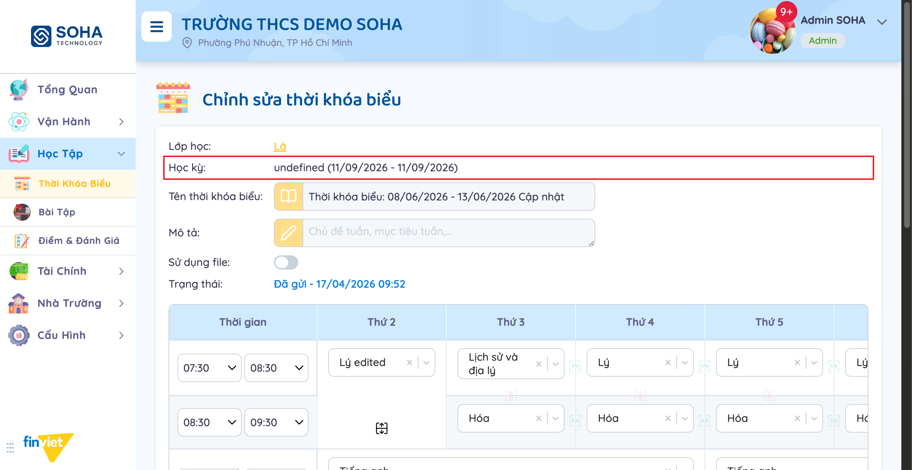
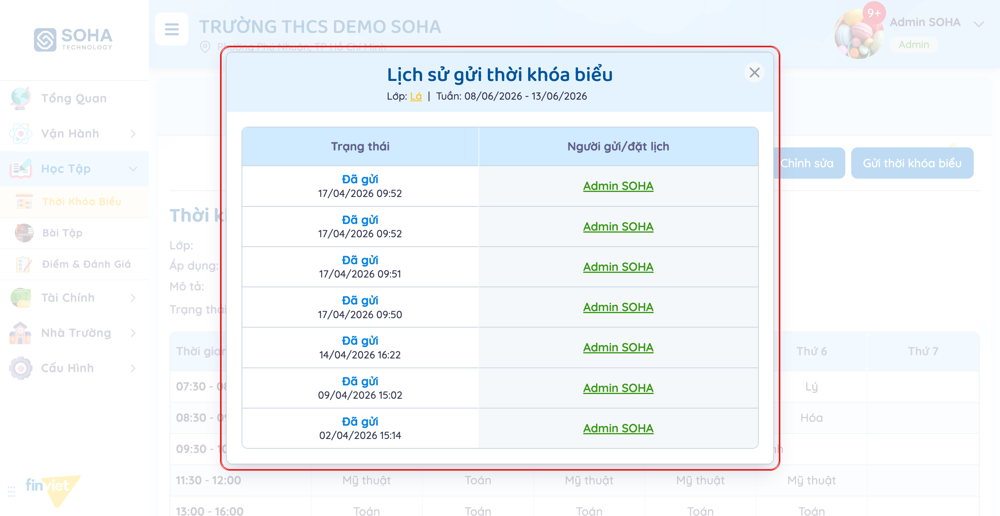
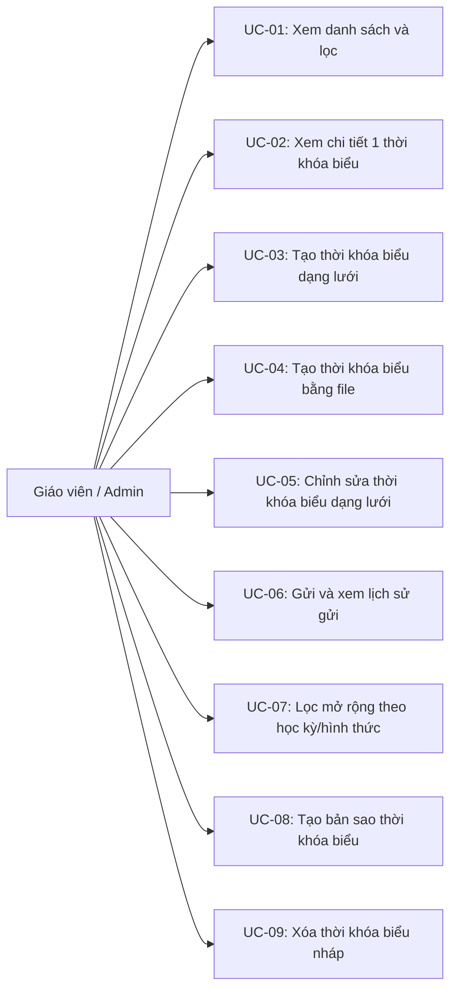
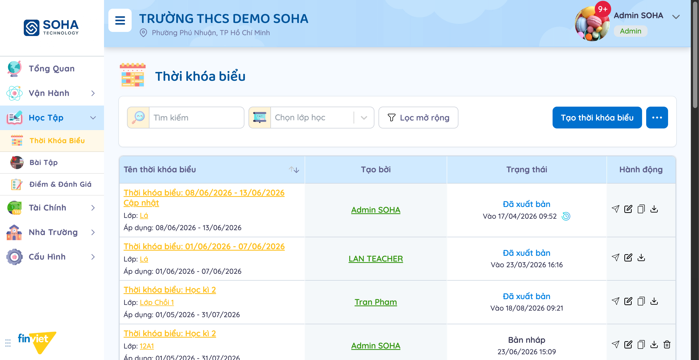
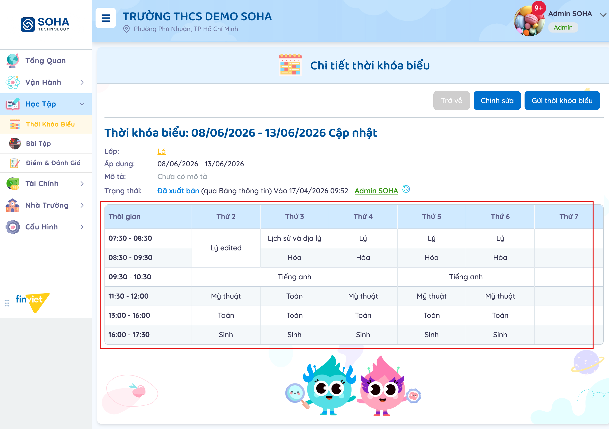
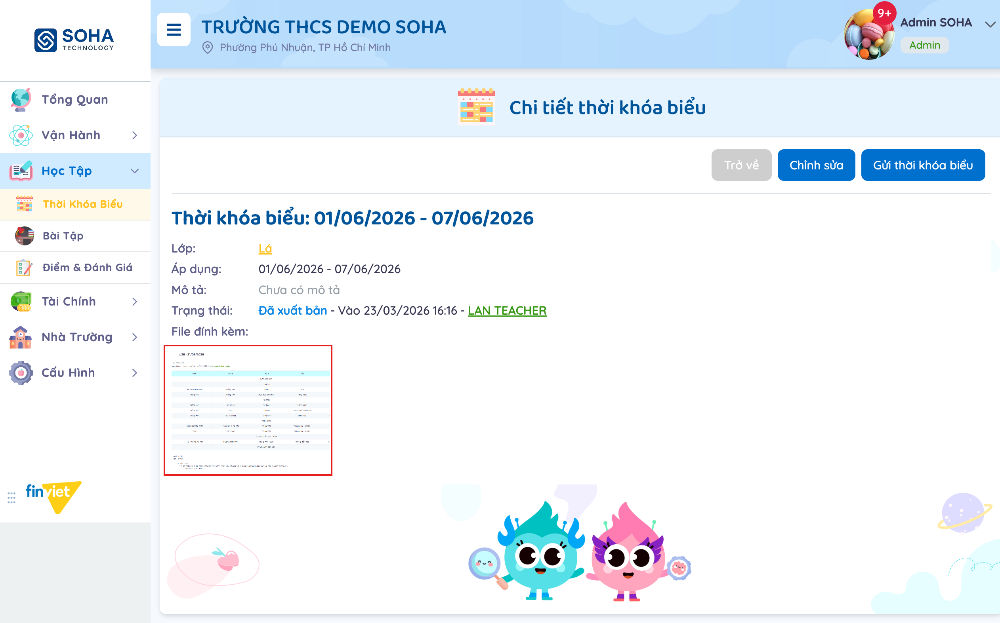
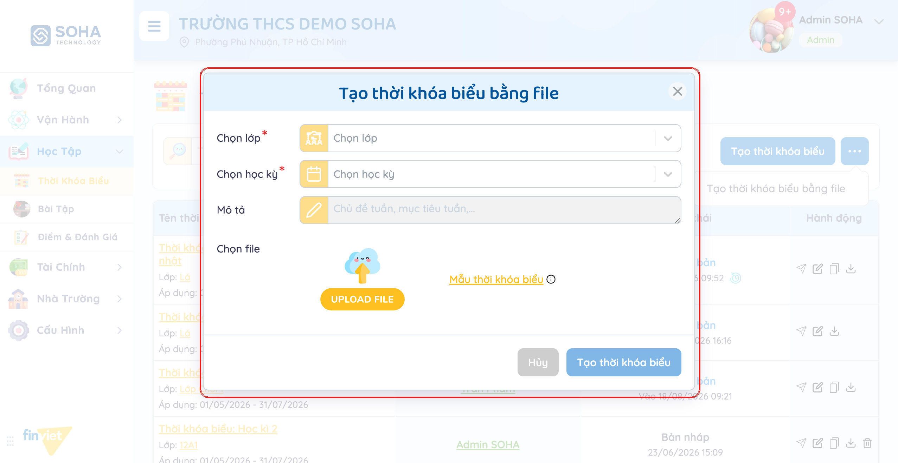
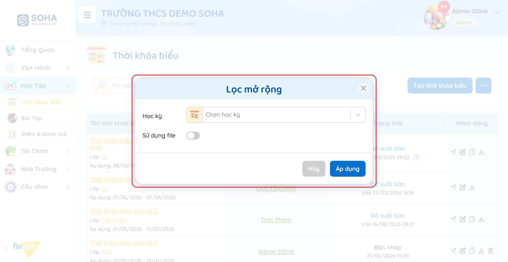

# Tên: Thời khóa biểu (Học tập)

## Mục lục
- [1. Thông tin tổng quan](#1-thông-tin-tổng-quan)
  - [1.1 Giới thiệu chung](#11-giới-thiệu-chung)
  - [1.2 Mục tiêu](#12-mục-tiêu)
  - [1.3 Phạm vi](#13-phạm-vi)
  - [1.4 Tài liệu tham khảo](#14-tài-liệu-tham-khảo)
- [2. Tổng quan nghiệp vụ](#2-tổng-quan-nghiệp-vụ)
  - [2.1 Đối tượng](#21-đối-tượng)
  - [2.2 Luồng nghiệp vụ](#22-luồng-nghiệp-vụ)
  - [2.3 Nguyên tắc nghiệp vụ](#23-nguyên-tắc-nghiệp-vụ)
- [3. Đặc tả tính năng](#3-đặc-tả-tính-năng)
  - [3.1 Phân rã chức năng](#31-phân-rã-chức-năng)
  - [3.2 Acceptance Criteria](#32-acceptance-criteria)
  - [3.3 Use case](#33-use-case)
  - [3.4 Edge Cases & Error Handling](#34-edge-cases--error-handling)
  - [3.5 Non-functional Requirements](#35-non-functional-requirements)
  - [3.6 Quy ước UI chung](#36-quy-ước-ui-chung)

## 1. Thông tin tổng quan

### 1.1 Giới thiệu chung
Thời Khóa Biểu quản lý lịch học theo từng lớp, theo 2 hình thức: dựng lưới thủ công (theo học kỳ, dạng bảng Thời gian × Thứ) hoặc tải lên 1 file có sẵn. Mỗi thời khóa biểu đi qua vòng đời Bản nháp → Đã xuất bản/Đã gửi, có thể gửi lại nhiều lần và lưu đầy đủ lịch sử mỗi lần gửi.

### 1.2 Mục tiêu
- Xây dựng thời khóa biểu cho 1 lớp theo học kỳ, dạng lưới linh hoạt: gộp ô theo ngày/giờ, thêm/xóa dòng khung giờ, chọn môn học cho từng ô.
- Hoặc bỏ qua việc dựng lưới, tải thẳng 1 file thời khóa biểu đã có sẵn (ảnh/PDF) làm nội dung chính thức.
- Gửi thời khóa biểu cho phụ huynh và theo dõi lại đầy đủ lịch sử mỗi lần gửi/gửi lại, biết ai đã gửi và khi nào.
- Tạo bản sao 1 thời khóa biểu dạng lưới có sẵn để dùng lại cấu trúc cho lớp hoặc kỳ khác, không phải dựng lại từ đầu.
- Lọc nhanh danh sách theo lớp, học kỳ, hoặc theo hình thức (lưới/file).

### 1.3 Phạm vi
| In scope | Out of scope |
|---|---|
| Xem danh sách thời khóa biểu (76 bản ghi mẫu), tìm kiếm, lọc theo lớp, "Lọc mở rộng" theo Học kỳ + "Sử dụng file" | Thực hiện "Gửi thời khóa biểu"/"Cập nhật và gửi" thật — hành động gửi bị chính hệ thống phân quyền của phiên làm việc chặn lại (không cho gửi thông báo thật tới phụ huynh trong dữ liệu demo) |
| Xem chi tiết 1 thời khóa biểu — cả 2 dạng: lưới (bảng Thời gian × Thứ 2-7) và file đính kèm (ảnh/PDF hiển thị trực tiếp) | Tạo mới thành công 1 thời khóa biểu dạng lưới — mọi lần thử (2 học kỳ có sẵn × nhiều lớp) đều dừng lại ở lỗi "Khoảng thời gian không hợp lệ" ngay khi chọn học kỳ, trước khi kịp bấm nút tạo |
| Mở form "Tạo thời khóa biểu" (chọn lớp/học kỳ, tên tự gợi ý, mô tả, toggle "Sử dụng file") và modal rút gọn "Tạo thời khóa biểu bằng file" | Xác nhận nguyên nhân chính xác của lỗi "Khoảng thời gian không hợp lệ" — nghi ngờ liên quan cấu hình Học kỳ/Năm học, nhưng cấu hình đó thuộc module khác (Cấu hình → Năm học), ngoài phạm vi khảo sát ở đây |
| Xem cấu trúc trang "Chỉnh sửa" của 1 thời khóa biểu dạng lưới (bảng có thể sửa, nút Thêm dòng, 3 nút submit) | Bấm "Cập nhật"/"Cập nhật và gửi" thật trên trang Chỉnh sửa — không thực hiện để tránh thay đổi dữ liệu mẫu |
| Xem modal "Lịch sử gửi thời khóa biểu" với dữ liệu thật (7 lần gửi) | Xác nhận đầy đủ hành vi của "Tạo bản sao thời khóa biểu" — bấm thử nhưng không quan sát được modal/kết quả rõ ràng trong phiên khảo sát |
| Nhận biết bộ 3-5 hành động khác nhau theo tổ hợp Trạng thái (Bản nháp/Đã xuất bản) × Hình thức (lưới/file) | Thực hiện Xóa 1 thời khóa biểu nháp thật |

### 1.4 Tài liệu tham khảo
- [docs/operating-portal/00-inventory.md](../00-inventory.md) — kiểm kê toàn bộ module Phase 1; mô tả ban đầu "Build/upload weekly or term class timetables; tracks send history to parents" — tài liệu này xác nhận đúng cả 2 nhánh (dựng lưới theo học kỳ, tải file theo tuần/học kỳ) và cơ chế lịch sử gửi.
- Đã thử tạo thời khóa biểu dạng lưới cho lớp "12A1" với cả "Học kì 1" (03/04/2026 - 30/04/2026) và "Học kì 2" (01/05/2026 - 31/07/2026) — cả 2 đều báo lỗi "Khoảng thời gian không hợp lệ" ngay khi chọn học kỳ. Vì cả 2 khoảng học kỳ trong dữ liệu demo đều đã kết thúc từ lâu so với ngày hiện tại của phiên khảo sát, nghi ngờ hệ thống chặn tạo thời khóa biểu dạng lưới cho học kỳ đã qua — nhưng đây chỉ là suy luận, chưa xác nhận được vì màn hình cấu hình Học kỳ/Năm học không thuộc phạm vi tài liệu này.

## 2. Tổng quan nghiệp vụ

### 2.1 Đối tượng
| Actor | Vai trò | Trách nhiệm chính |
|---|---|---|
| Giáo viên / Admin trường | Người tạo và quản lý thời khóa biểu | Dựng lưới hoặc tải file, chỉnh sửa, gửi, tạo bản sao, xóa bản nháp |
| Học sinh (qua Lớp học) | Đối tượng của thời khóa biểu | Mỗi thời khóa biểu gắn với đúng 1 lớp học |
| Phụ huynh | Người nhận (ngoài phạm vi portal này) | Nhận thời khóa biểu khi được gửi — không quan sát trực tiếp được từ tài khoản Admin |
| Hệ thống (server) | Validate + lưu trữ | Kiểm tra khoảng thời gian hợp lệ khi chọn học kỳ; ghi lại từng lần gửi vào lịch sử; có thể đăng song song lên Bảng Thông Tin của trường |

### 2.2 Luồng nghiệp vụ

#### 2.2.1 Mô hình hóa nghiệp vụ

#### 2.2.2 Mô tả các bước nghiệp vụ
| Bước | Người thực hiện | Mô tả | Kết quả |
|---|---|---|---|
| 1 | Giáo viên/Admin | Bấm "Tạo thời khóa biểu", chọn Lớp và Học kỳ | Tên thời khóa biểu tự gợi ý "Thời khóa biểu: {Học kỳ}"; hệ thống kiểm tra khoảng thời gian |
| 2 | Hệ thống | Kiểm tra khoảng thời gian của học kỳ đã chọn | Nếu không hợp lệ, hiện lỗi "Khoảng thời gian không hợp lệ", chặn tiếp tục ở dạng lưới |
| 3 | Giáo viên/Admin | (Nếu cần) Bật "Sử dụng file" | Form đổi sang yêu cầu tải file thay vì dựng lưới; bỏ qua lỗi khoảng thời gian |
| 4 | Giáo viên/Admin | Điền lưới môn học theo từng khung giờ/ngày, hoặc tải file | Nội dung thời khóa biểu sẵn sàng lưu |
| 5 | Giáo viên/Admin | Bấm "Cập nhật" hoặc "Cập nhật và gửi" | Lưu ở trạng thái tương ứng; nếu gửi, thêm 1 dòng vào Lịch sử gửi |
| 6 | Giáo viên/Admin | (Tuỳ chọn) Bấm icon đồng hồ "Xem lịch sử gửi" | Xem toàn bộ các lần đã gửi, kèm người gửi + thời gian |
| 7 | Giáo viên/Admin | (Tuỳ chọn, chỉ dạng lưới) Bấm "Tạo bản sao thời khóa biểu" | [Cần xác nhận] — không quan sát được kết quả rõ ràng trong phiên khảo sát |

### 2.3 Nguyên tắc nghiệp vụ
| ID | Nguyên tắc nghiệp vụ |
|---|---|
| BR01 | Có 2 hình thức thời khóa biểu dùng chung 1 form "Tạo thời khóa biểu": **dạng lưới** (mặc định, dựng bảng Thời gian × Thứ) và **dạng file** (bật toggle "Sử dụng file", tải lên 1 file). Nút "..." cạnh "Tạo thời khóa biểu" mở thêm lối tắt "Tạo thời khóa biểu bằng file" — cùng bản chất, chỉ khác là mở dạng modal với toggle "Sử dụng file" đã bật sẵn. |
| BR02 | Trường "Tên thời khóa biểu" và "Mô tả" bị khóa (disabled) cho tới khi chọn xong "Chọn lớp"; khi chọn thêm "Chọn học kỳ", "Tên thời khóa biểu" tự động điền "Thời khóa biểu: {Học kỳ}" (có thể sửa tay), nhưng "Mô tả" vẫn khóa cho tới khi hoàn tất các bước tiếp theo. |
| BR03 | Ngay khi chọn xong "Chọn học kỳ" (trước khi bấm nút tạo), hệ thống kiểm tra khoảng thời gian và có thể báo lỗi **"Khoảng thời gian không hợp lệ"**. Đã kiểm chứng: cả "Học kì 1" (03/04-30/04/2026) và "Học kì 2" (01/05-31/07/2026) — 2 học kỳ duy nhất có sẵn trong dữ liệu demo — đều báo lỗi này với lớp "12A1", chặn hoàn toàn việc tạo mới dạng lưới trong phiên khảo sát.  |
| BR04 | Bật "Sử dụng file" thay khối "Tên thời khóa biểu/Mô tả/lưới" bằng 1 trường "File đính kèm" (khu vực Upload) — và **bỏ qua được** lỗi "Khoảng thời gian không hợp lệ" ở BR03. Tuy vậy nút submit "Tạo thời khóa biểu" **không xuất hiện trong DOM** cho tới khi đã thực sự tải lên 1 file — chưa tải file thì chỉ có nút "Hủy bỏ". |
| BR05 | Lưới thời khóa biểu là bảng Thời gian × Thứ 2-Thứ 7: mỗi ô môn học là 1 dropdown kèm nút xóa nhanh (x); có thể gộp ô theo chiều dọc (nhiều khung giờ liên tiếp cùng 1 môn) và chiều ngang (nhiều ngày cùng 1 môn) thông qua các icon di chuyển/đổi cỡ (⇕, ⤢) ở góc mỗi ô; nút "Thêm" ở cuối bảng để thêm 1 dòng khung giờ mới; có gợi ý dùng 3 dấu gạch ngang "---" trở lên trong 1 ô để phân chia nội dung hiển thị. |
| BR06 | Trang "Chỉnh sửa thời khóa biểu" (dạng lưới) có 3 nút hành động: **"Hủy bỏ"**, **"Cập nhật"** (lưu, giữ nguyên trạng thái gửi hiện tại), **"Cập nhật và gửi"** (lưu và gửi lại ngay trong 1 bước).  |
| BR07 | "Lịch sử gửi thời khóa biểu" (mở qua icon đồng hồ — chỉ hiện khi thời khóa biểu đã từng được gửi ít nhất 1 lần) liệt kê **mọi lần gửi cộng dồn**, không ghi đè: mỗi dòng gồm Trạng thái "Đã gửi" + thời gian, và "Người gửi/đặt lịch" (link tới người thực hiện). Đã kiểm chứng trực tiếp 1 thời khóa biểu có 7 dòng lịch sử gửi khác nhau, khớp với việc nó đã được sửa và gửi lại nhiều lần (đánh dấu "Cập nhật" ở tiêu đề).  |
| BR08 | Nhãn phụ **"Cập nhật"** xuất hiện ngay sau tiêu đề (cả ở danh sách và trang chi tiết) khi 1 thời khóa biểu đã xuất bản rồi tiếp tục được sửa/gửi lại; thời khóa biểu chỉ xuất bản đúng 1 lần duy nhất không có nhãn này. |
| BR09 | Trạng thái "Đã xuất bản" trên trang chi tiết có thể ghi thêm kênh phát hành trong ngoặc, ví dụ "Đã xuất bản (qua Bảng thông tin)" — cho thấy thời khóa biểu khi gửi có thể đồng thời được đăng lên module Bảng Thông Tin (announcement board) của trường, không chỉ gửi riêng cho phụ huynh của lớp. [Cần xác nhận] nơi chọn/bật kênh phát hành này khi tạo hoặc gửi. |
| BR10 | Bộ "Hành động" ở danh sách thay đổi theo đúng tổ hợp Trạng thái × Hình thức, xác nhận trực tiếp qua tooltip từng icon: • Đã xuất bản + Lưới → Gửi, Chỉnh sửa, **Tạo bản sao**, Tải (4) • Đã xuất bản + File → Gửi, Chỉnh sửa, Tải (3 — không có Tạo bản sao) • Bản nháp + Lưới → Gửi, Chỉnh sửa, **Tạo bản sao**, Tải, **Xóa** (5) • Bản nháp + File → Gửi, Chỉnh sửa, Tải, **Xóa** (4 — không có Tạo bản sao) Quy luật rõ ràng: **"Tạo bản sao" chỉ có ở thời khóa biểu dạng lưới** (không áp dụng cho dạng file); **"Xóa" chỉ có ở Bản nháp** (không áp dụng cho Đã xuất bản), bất kể hình thức. |
| BR11 | Trang "Chỉnh sửa" hiển thị dòng "Học kỳ: {tên} ({ngày bắt đầu} - {ngày kết thúc})". Quan sát được 1 trường hợp hiển thị **"Học kỳ: undefined (11/09/2026 - 11/09/2026)"** — tên học kỳ không phân giải được (hiện chữ "undefined" thô ra giao diện) và khoảng ngày mặc định về đúng ngày hôm nay của phiên truy cập — đây là lỗi hiển thị thật, không phải hành vi mong đợi.  |
| BR12 | "Lọc mở rộng" ở danh sách có 2 trường: "Học kỳ" (chọn 1 trong các học kỳ đã cấu hình) và "Sử dụng file" (toggle) — cho lọc riêng thời khóa biểu dạng file khỏi dạng lưới, khớp với BR01/BR10. |

## 3. Đặc tả tính năng

### 3.1 Phân rã chức năng
| Feature | Platform | Priority | User Story |
|---|---|---|---|
| Xem danh sách, tìm kiếm, lọc theo lớp/học kỳ/hình thức | Web | Must | Là giáo viên, tôi muốn tìm nhanh đúng thời khóa biểu cần xem giữa hàng chục bản ghi |
| Xem chi tiết 1 thời khóa biểu | Web | Must | Là giáo viên, tôi muốn xem lại lịch học đầy đủ của 1 lớp trong 1 khoảng thời gian |
| Tạo thời khóa biểu dạng lưới | Web | Must | Là giáo viên, tôi muốn tự dựng lịch học chi tiết theo từng khung giờ cho lớp mình |
| Tạo thời khóa biểu bằng file | Web | Should | Là giáo viên, tôi muốn tải thẳng file thời khóa biểu đã soạn sẵn thay vì nhập lại từng ô |
| Chỉnh sửa thời khóa biểu | Web | Must | Là giáo viên, tôi muốn sửa lại lịch học khi có thay đổi môn/giờ |
| Gửi thời khóa biểu + xem lịch sử gửi | Web | Must | Là giáo viên, tôi muốn gửi lịch học cho phụ huynh và biết chắc mình đã gửi khi nào |
| Tạo bản sao thời khóa biểu | Web | Could | Là giáo viên, tôi muốn tái sử dụng cấu trúc lưới cho lớp/kỳ khác thay vì dựng lại từ đầu |
| Xóa thời khóa biểu nháp | Web | Should | Là giáo viên, tôi muốn xóa bản nháp tạo nhầm trước khi gửi |

### 3.2 Acceptance Criteria
| User Story | Chức năng | Acceptance Criteria |
|---|---|---|
| Tạo thời khóa biểu dạng lưới | Form Tạo thời khóa biểu | Chọn Lớp + Học kỳ hợp lệ → không báo lỗi khoảng thời gian, có thể tiếp tục điền lưới |
| Tạo thời khóa biểu bằng file | Form/modal Tạo thời khóa biểu (Sử dụng file) | Chọn Lớp + Học kỳ + tải file → nút "Tạo thời khóa biểu" mới xuất hiện và bật |
| Xem lịch sử gửi | Modal Lịch sử gửi thời khóa biểu | Icon chỉ hiện khi đã gửi ≥1 lần; mỗi lần gửi thêm 1 dòng mới, không ghi đè dòng cũ |
| Hành động theo trạng thái | Cột Hành động | "Xóa" chỉ hiện ở Bản nháp; "Tạo bản sao" chỉ hiện ở thời khóa biểu dạng lưới |
| Lọc mở rộng | Modal Lọc mở rộng | Chọn Học kỳ và/hoặc bật "Sử dụng file" → danh sách lọc đúng theo tiêu chí |

### 3.3 Use case

**UC-01**
| Trường | Nội dung |
|---|---|
| Use case ID | UC-01 |
| Use case name | Xem danh sách và lọc |
| Use case description | Giáo viên/Admin xem toàn bộ thời khóa biểu, lọc theo lớp/từ khoá |
| Actor | Giáo viên / Admin |
| Happy path | 1. Vào Học Tập → Thời Khóa Biểu. 2. (Tuỳ chọn) Gõ từ khoá vào "Tìm kiếm" hoặc chọn lớp ở "Chọn lớp học".  3. Đọc từng dòng: tiêu đề (kèm nhãn "Cập nhật" nếu có), Lớp + khoảng "Áp dụng", người tạo, trạng thái + thời gian, bộ icon hành động (thay đổi theo BR10). |
| Exception | Không quan sát được |
| Trigger | Vào trang Thời Khóa Biểu |
| Pre-condition | Không có |
| Post-condition | Danh sách hiển thị đúng bộ lọc |
| Business Rules | BR08, BR10 |

**UC-02**
| Trường | Nội dung |
|---|---|
| Use case ID | UC-02 |
| Use case name | Xem chi tiết 1 thời khóa biểu |
| Use case description | Giáo viên/Admin mở 1 thời khóa biểu để xem đầy đủ lịch học |
| Actor | Giáo viên / Admin |
| Happy path | 1. Bấm vào tiêu đề 1 thời khóa biểu trong danh sách. 2a. Nếu là dạng lưới: xem bảng Thời gian × Thứ 2-7 đầy đủ môn học.  2b. Nếu là dạng file: xem file đính kèm hiển thị trực tiếp (ảnh/PDF).  |
| Exception | Không quan sát được |
| Trigger | Bấm vào tiêu đề thời khóa biểu |
| Pre-condition | Không có |
| Post-condition | Chỉ xem, không đổi dữ liệu |
| Business Rules | BR01, BR09 |

**UC-03**
| Trường | Nội dung |
|---|---|
| Use case ID | UC-03 |
| Use case name | Tạo thời khóa biểu dạng lưới |
| Use case description | Giáo viên/Admin tạo mới 1 thời khóa biểu bằng cách tự dựng lưới |
| Actor | Giáo viên / Admin |
| Happy path | 1. Bấm "Tạo thời khóa biểu". 2. Chọn Lớp, chọn Học kỳ — "Tên thời khóa biểu" tự gợi ý. 3. Điền Mô tả (tuỳ chọn), điền lưới môn học theo từng khung giờ/ngày. 4. Bấm "Tạo thời khóa biểu" để lưu (không thực hiện trong phiên khảo sát). |
| Exception | Chọn xong Học kỳ báo lỗi "Khoảng thời gian không hợp lệ" ngay lập tức — quan sát được với cả 2 học kỳ có sẵn trong dữ liệu demo, cho lớp 12A1. Không có nút submit nào để thử tiếp khi lỗi này còn hiển thị. |
| Trigger | Bấm nút "Tạo thời khóa biểu" |
| Pre-condition | Không có |
| Post-condition | [Cần xác nhận] — không tạo được do lỗi khoảng thời gian trong toàn bộ dữ liệu demo hiện có |
| Business Rules | BR02, BR03, BR05 |

**UC-04**
| Trường | Nội dung |
|---|---|
| Use case ID | UC-04 |
| Use case name | Tạo thời khóa biểu bằng file |
| Use case description | Giáo viên/Admin tạo mới bằng cách tải lên 1 file có sẵn, bỏ qua việc dựng lưới |
| Actor | Giáo viên / Admin |
| Happy path | 1. Bấm "..." cạnh "Tạo thời khóa biểu", chọn "Tạo thời khóa biểu bằng file" (hoặc bật toggle "Sử dụng file" trong form đầy đủ). 2. Chọn Lớp, chọn Học kỳ, điền Mô tả (tuỳ chọn). 3. Bấm "UPLOAD FILE" để tải file, hoặc tải "Mẫu thời khóa biểu" về điền trước.  4. Bấm "Tạo thời khóa biểu" (chỉ xuất hiện sau khi đã có file, không thực hiện trong phiên khảo sát). |
| Exception | Không có lỗi "Khoảng thời gian không hợp lệ" ở luồng này (khác UC-03) |
| Trigger | Bấm "..." → "Tạo thời khóa biểu bằng file", hoặc bật toggle "Sử dụng file" |
| Pre-condition | Không có |
| Post-condition | [Cần xác nhận] — chưa tải file thật để xác nhận |
| Business Rules | BR01, BR04 |

**UC-05**
| Trường | Nội dung |
|---|---|
| Use case ID | UC-05 |
| Use case name | Chỉnh sửa thời khóa biểu dạng lưới |
| Use case description | Giáo viên/Admin sửa lại lịch học của 1 thời khóa biểu dạng lưới đã có |
| Actor | Giáo viên / Admin |
| Happy path | 1. Bấm icon "Chỉnh sửa" trên 1 dòng trong danh sách (hoặc trang chi tiết). 2. Sửa nội dung từng ô môn học, thêm/gộp/xóa dòng khung giờ nếu cần.  3. Bấm "Cập nhật" (chỉ lưu) hoặc "Cập nhật và gửi" (lưu + gửi lại ngay) — không thực hiện trong phiên khảo sát. |
| Exception | Dòng "Học kỳ" phía trên lưới có thể hiển thị lỗi "undefined" thay vì tên học kỳ thật (xem BR11) |
| Trigger | Bấm icon "Chỉnh sửa" |
| Pre-condition | Thời khóa biểu đã tồn tại (nháp hoặc đã xuất bản) |
| Post-condition | [Cần xác nhận] — chưa submit để xác nhận |
| Business Rules | BR05, BR06, BR11 |

**UC-06**
| Trường | Nội dung |
|---|---|
| Use case ID | UC-06 |
| Use case name | Gửi và xem lịch sử gửi |
| Use case description | Giáo viên/Admin gửi thời khóa biểu cho phụ huynh và xem lại các lần đã gửi |
| Actor | Giáo viên / Admin |
| Happy path | 1. Trên trang chi tiết hoặc danh sách, bấm icon đồng hồ "Xem lịch sử gửi" (chỉ có nếu đã từng gửi). 2. Modal "Lịch sử gửi thời khóa biểu" liệt kê từng lần "Đã gửi" kèm thời gian và người gửi.  3. (Để gửi mới) Bấm "Gửi thời khóa biểu" — không thực hiện trong phiên khảo sát vì bị chặn bởi phân quyền của phiên làm việc (hành động gửi thông báo thật). |
| Exception | Icon "Xem lịch sử gửi" không xuất hiện nếu thời khóa biểu chưa từng được gửi lần nào |
| Trigger | Bấm icon đồng hồ, hoặc bấm "Gửi thời khóa biểu" |
| Pre-condition | Với xem lịch sử: đã gửi ≥1 lần |
| Post-condition | Xem lịch sử: chỉ xem, không đổi dữ liệu. Gửi: [Cần xác nhận] — không thực hiện |
| Business Rules | BR07, BR08, BR09 |

**UC-07**
| Trường | Nội dung |
|---|---|
| Use case ID | UC-07 |
| Use case name | Lọc mở rộng theo học kỳ/hình thức |
| Use case description | Thu hẹp danh sách theo học kỳ hoặc theo dạng lưới/file |
| Actor | Giáo viên / Admin |
| Happy path | 1. Bấm nút "Lọc mở rộng". 2. Chọn Học kỳ và/hoặc bật toggle "Sử dụng file".  3. Bấm "Áp dụng". |
| Exception | Không quan sát được |
| Trigger | Bấm nút "Lọc mở rộng" |
| Pre-condition | Không có |
| Post-condition | [Cần xác nhận] — chưa bấm Áp dụng để xác nhận kết quả lọc |
| Business Rules | BR12 |

**UC-08**
| Trường | Nội dung |
|---|---|
| Use case ID | UC-08 |
| Use case name | Tạo bản sao thời khóa biểu |
| Use case description | Giáo viên/Admin tái sử dụng cấu trúc 1 thời khóa biểu dạng lưới có sẵn |
| Actor | Giáo viên / Admin |
| Happy path | [Cần xác nhận] — đã bấm icon "Tạo bản sao thời khóa biểu" trên 1 thời khóa biểu dạng lưới, nhưng không quan sát được modal hay điều hướng nào xuất hiện, và tổng số bản ghi trong danh sách không đổi sau khi bấm. Chưa xác định được hành vi đầy đủ của hành động này trong phiên khảo sát. |
| Exception | Không áp dụng |
| Trigger | Bấm icon "Tạo bản sao thời khóa biểu" |
| Pre-condition | Thời khóa biểu đang ở dạng lưới (không áp dụng cho dạng file, xem BR10) |
| Post-condition | [Cần xác nhận] |
| Business Rules | BR10 |

**UC-09**
| Trường | Nội dung |
|---|---|
| Use case ID | UC-09 |
| Use case name | Xóa thời khóa biểu nháp |
| Use case description | Giáo viên/Admin xóa 1 thời khóa biểu còn ở dạng nháp |
| Actor | Giáo viên / Admin |
| Happy path | [Cần xác nhận] — xác nhận được icon "Xóa" chỉ hiển thị ở dòng "Bản nháp" (cả dạng lưới lẫn file), không bấm để tránh xoá dữ liệu mẫu. |
| Exception | Không áp dụng |
| Trigger | Bấm icon thùng rác trên 1 dòng "Bản nháp" |
| Pre-condition | Thời khóa biểu đang ở trạng thái "Bản nháp" |
| Post-condition | [Cần xác nhận] |
| Business Rules | BR10 |

### 3.4 Edge Cases & Error Handling

#### 3.4.1 Tổng quan
| Nhóm | Tình huống | Xử lý mong đợi |
|---|---|---|
| Không tạo được thời khóa biểu dạng lưới | Chọn bất kỳ học kỳ nào trong 2 học kỳ có sẵn của dữ liệu demo | Luôn báo lỗi "Khoảng thời gian không hợp lệ" — chặn hoàn toàn luồng tạo dạng lưới; chỉ luồng "Sử dụng file" mới tạo được |
| Lỗi hiển thị "undefined" | Mở trang Chỉnh sửa của 1 thời khóa biểu dạng lưới | Dòng "Học kỳ" hiện chữ "undefined" thay vì tên học kỳ thật, kèm khoảng ngày mặc định về đúng hôm nay — lỗi hiển thị thật (xem BR11) |
| Tạo bản sao không rõ kết quả | Bấm icon "Tạo bản sao thời khóa biểu" | Không có modal/điều hướng/thay đổi số lượng bản ghi quan sát được — [Cần xác nhận] |
| Bộ hành động không đối xứng | So sánh Hành động giữa dạng lưới và dạng file, giữa Bản nháp và Đã xuất bản | "Tạo bản sao" chỉ ở dạng lưới; "Xóa" chỉ ở Bản nháp — xem bảng đầy đủ ở BR10 |

#### 3.4.2 Danh sách Thông báo (lỗi/thành công)
| Message ID | Trường hợp lỗi | Rule kiểm tra | Message đề xuất | Hình thức báo | Hành vi hệ thống |
|---|---|---|---|---|---|
| — | Chọn học kỳ có khoảng thời gian không hợp lệ (theo cấu hình Năm học/Học kỳ) | Khoảng thời gian của học kỳ không thoả điều kiện hệ thống yêu cầu (nguyên nhân chính xác ngoài phạm vi tài liệu này) | "Khoảng thời gian không hợp lệ" | Toast/banner đỏ, góc trên bên phải, tự ẩn sau vài giây | Chặn hiển thị phần lưới/nút submit của luồng tạo dạng lưới |

### 3.5 Non-functional Requirements
| ID | Nhóm | Yêu cầu |
|---|---|---|
| NFR01 | Hiệu năng | Gộp/tách ô trong lưới, thêm dòng khung giờ cập nhật ngay không cần tải lại trang |
| NFR02 | Ngôn ngữ | Giao diện tiếng Việt hoàn toàn, trừ lỗi hiển thị "undefined" (rò rỉ giá trị JavaScript thô — xem BR11) |
| NFR03 | Minh bạch | Mọi lần gửi/gửi lại đều được ghi lại đầy đủ trong "Lịch sử gửi", không ghi đè lịch sử cũ |

### 3.6 Quy ước UI chung
- "Tạo thời khóa biểu" mở 1 trang riêng (route `/demo/school/schedule/create/`), trong khi lối tắt "..." → "Tạo thời khóa biểu bằng file" mở cùng nội dung dưới dạng modal — cùng 1 form nhưng 2 cách trình bày khác nhau tuỳ điểm vào.
- Trường bị khóa (disabled) cho tới khi điều kiện tiên quyết được đáp ứng (chọn lớp trước mới mở tên/mô tả) — nhất quán với cách Báo Cáo Mở Rộng khóa "Mô tả" tới khi chọn xong lớp.
- Danh sách dùng chung mẫu hành động dạng icon, ẩn/hiện theo trạng thái dòng dữ liệu (Bản nháp/Đã xuất bản, lưới/file) thay vì luôn hiện đủ rồi disable — nhất quán với cách Báo Cáo Mở Rộng ẩn icon Xóa cho báo cáo đã gửi.
- Modal dùng chung bố cục toàn hệ thống: nút hành động chính bên phải, "Hủy"/"Hủy bỏ" xám bên trái.
