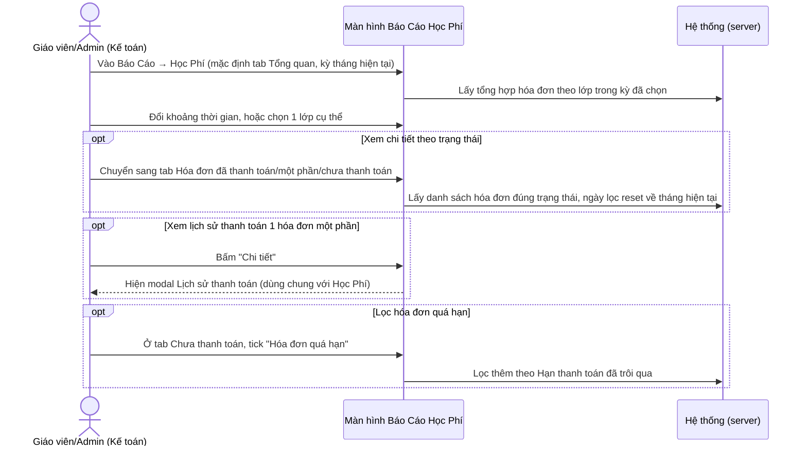
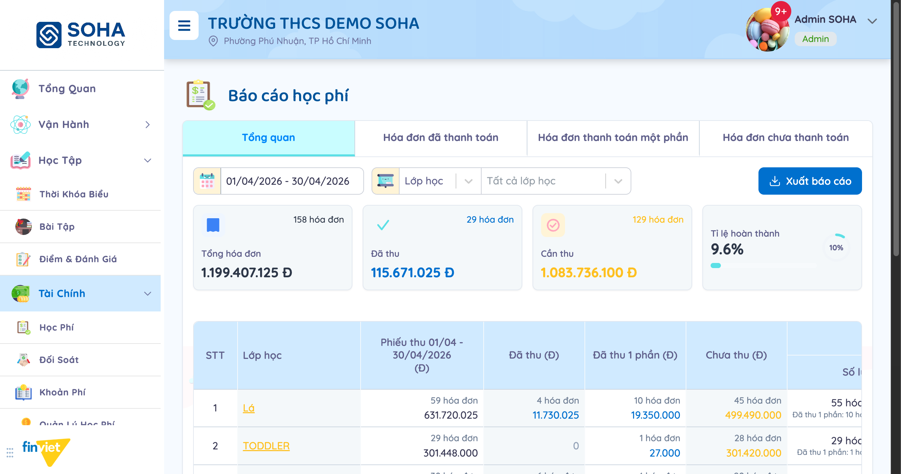
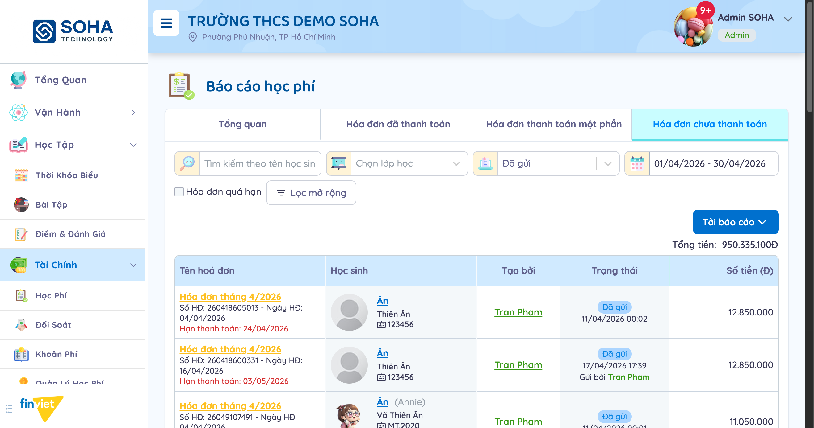
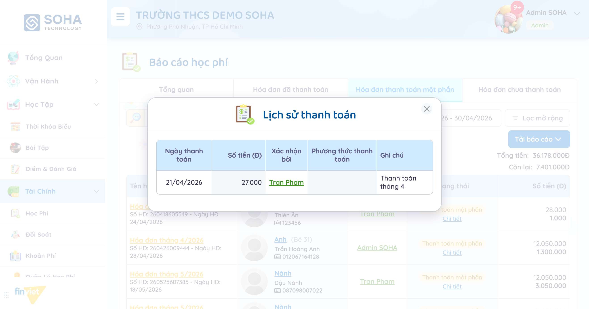
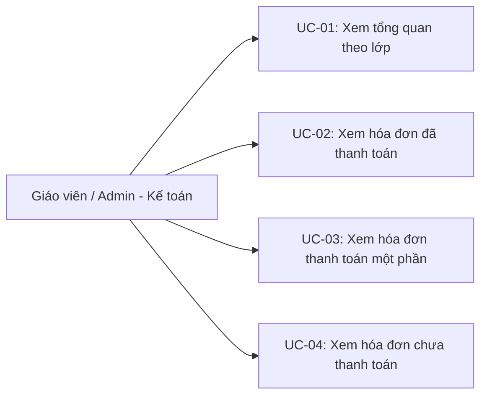
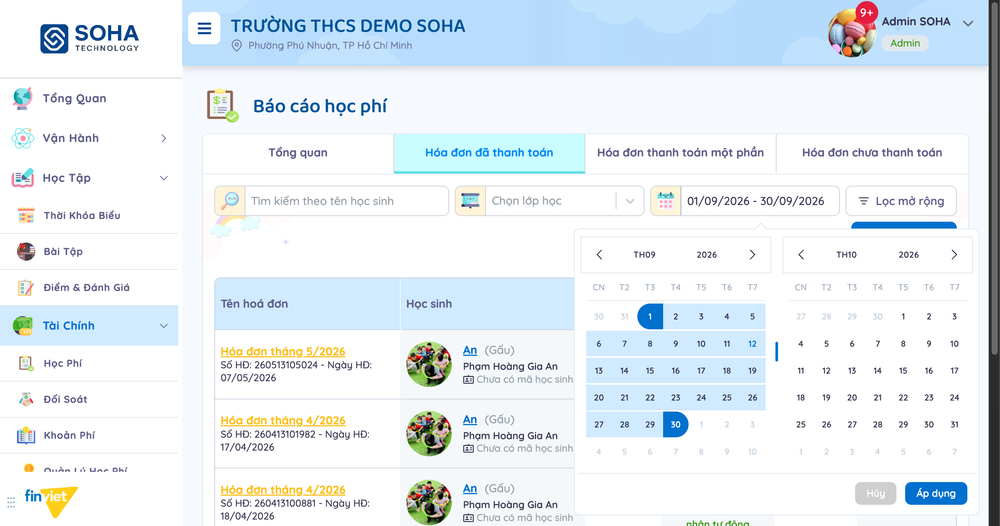
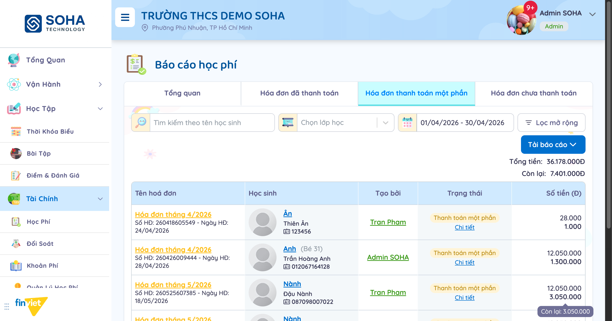

# Tên: Báo Cáo - Học Phí (Báo Cáo)

## Mục lục
- [1. Thông tin tổng quan](#1-thông-tin-tổng-quan)
  - [1.1 Giới thiệu chung](#11-giới-thiệu-chung)
  - [1.2 Mục tiêu](#12-mục-tiêu)
  - [1.3 Phạm vi](#13-phạm-vi)
  - [1.4 Tài liệu tham khảo](#14-tài-liệu-tham-khảo)
- [2. Tổng quan nghiệp vụ](#2-tổng-quan-nghiệp-vụ)
  - [2.1 Đối tượng](#21-đối-tượng)
  - [2.2 Luồng nghiệp vụ](#22-luồng-nghiệp-vụ)
  - [2.3 Nguyên tắc nghiệp vụ](#23-nguyên-tắc-nghiệp-vụ)
- [3. Đặc tả tính năng](#3-đặc-tả-tính-năng)
  - [3.1 Phân rã chức năng](#31-phân-rã-chức-năng)
  - [3.2 Acceptance Criteria](#32-acceptance-criteria)
  - [3.3 Use case](#33-use-case)
  - [3.4 Edge Cases & Error Handling](#34-edge-cases--error-handling)
  - [3.5 Non-functional Requirements](#35-non-functional-requirements)
  - [3.6 Quy ước UI chung](#36-quy-ước-ui-chung)

## 1. Thông tin tổng quan

### 1.1 Giới thiệu chung
Báo Cáo - Học Phí tổng hợp tỉ lệ thu học phí theo lớp học trong 1 kỳ, và cho phép đào sâu vào 3 nhóm hóa đơn riêng biệt (đã thanh toán, thanh toán một phần, chưa thanh toán) với bộ lọc và cột dữ liệu khác nhau cho từng nhóm.

### 1.2 Mục tiêu
- Xem nhanh tổng số hóa đơn, tổng tiền, tỉ lệ hoàn thành thu học phí trong 1 khoảng thời gian, toàn trường hoặc theo từng lớp.
- Xem chi tiết hóa đơn đã thanh toán trong khoảng thời gian (lọc theo ngày xác nhận thanh toán), kèm phương thức thanh toán.
- Xem chi tiết hóa đơn thanh toán một phần, so sánh số tiền hóa đơn với phần còn thiếu, xem lại lịch sử từng lần thanh toán.
- Xem chi tiết hóa đơn chưa thanh toán, lọc theo trạng thái gửi (Đã tạo/Đã gửi) và lọc riêng hóa đơn đã quá hạn thanh toán.
- Xuất báo cáo (Excel) ở từng tab, tìm kiếm theo tên học sinh, lọc theo lớp học.

### 1.3 Phạm vi
| In scope | Out of scope |
|---|---|
| Xem tab "Tổng quan" với dữ liệu thật (kỳ 01/04–30/04/2026: 158 hóa đơn, 1.199.407.125đ), bảng chi tiết theo từng lớp + dòng riêng "Học sinh lưu trữ / đã xoá" | Bấm "Xuất báo cáo"/"Tải báo cáo" thật (tải file) ở bất kỳ tab nào |
| Xem tab "Hóa đơn đã thanh toán" với dữ liệu thật, xác nhận bộ lọc ngày ở đây lọc theo ngày xác nhận thanh toán chứ không phải kỳ hóa đơn | Xác nhận đầy đủ hành vi "Lọc mở rộng" (toggle "Học sinh chưa có lớp", lọc "Phương thức thanh toán") — chỉ xác nhận cấu trúc modal |
| Xem tab "Hóa đơn thanh toán một phần" với dữ liệu thật, mở "Chi tiết" xem đúng modal Lịch sử thanh toán | Không có thao tác tạo/sửa/xóa nào trong toàn bộ module — chỉ xem và lọc |
| Xem tab "Hóa đơn chưa thanh toán" với dữ liệu thật, xác nhận lọc Trạng thái (Đã tạo/Đã gửi) tách biệt với checkbox "Hóa đơn quá hạn" | — |

### 1.4 Tài liệu tham khảo
- [docs/operating-portal/00-inventory.md](../00-inventory.md) — mô tả ban đầu "Fee-collection-rate overview by class (paid / partial / unpaid)" — tài liệu này xác nhận đúng, đồng thời phát hiện thêm 3 tab con có bộ lọc và ngữ nghĩa ngày tháng khác nhau mà mô tả ban đầu chưa nhắc tới.
- [docs/operating-portal/tai-chinh/hoc-phi.md](hoc-phi.md) — modal "Lịch sử thanh toán" mở từ "Chi tiết" của 1 hóa đơn thanh toán một phần là đúng component đã mô tả trong tài liệu Học Phí (cùng cột Ngày thanh toán/Số tiền/Xác nhận bởi/Phương thức thanh toán/Ghi chú) — xác nhận Báo Cáo tái sử dụng thành phần UI từ Học Phí thay vì tự xây dựng lại.

## 2. Tổng quan nghiệp vụ

### 2.1 Đối tượng
| Actor | Vai trò | Trách nhiệm chính |
|---|---|---|
| Giáo viên / Admin trường (kế toán) | Người xem báo cáo | Theo dõi tỉ lệ thu học phí, tìm hóa đơn theo trạng thái để đôn đốc thu |
| Học Phí (module khác) | Nguồn dữ liệu | Cung cấp toàn bộ hóa đơn hiển thị trong báo cáo, bao gồm trạng thái và lịch sử thanh toán |
| Nhà Trường (module khác) | Nguồn dữ liệu lớp học | Cung cấp danh sách lớp để nhóm báo cáo và điều hướng khi bấm tên lớp |

### 2.2 Luồng nghiệp vụ

#### 2.2.1 Mô hình hóa nghiệp vụ

#### 2.2.2 Mô tả các bước nghiệp vụ
| Bước | Người thực hiện | Mô tả | Kết quả |
|---|---|---|---|
| 1 | Giáo viên/Admin | Vào Báo Cáo → Học Phí, xem tab Tổng quan | Bảng hiện tổng hóa đơn/tiền theo từng lớp trong kỳ mặc định (tháng hiện tại) |
| 2 | Giáo viên/Admin | Đổi khoảng thời gian hoặc chọn lớp cụ thể | Số liệu Tổng quan cập nhật theo đúng bộ lọc |
| 3 | Giáo viên/Admin | Chuyển sang 1 trong 3 tab trạng thái (Đã thanh toán/Một phần/Chưa thanh toán) | Danh sách hóa đơn đúng trạng thái đó hiện ra, khoảng thời gian tự reset về tháng hiện tại |
| 4 | Giáo viên/Admin | (Ở tab Một phần) Bấm "Chi tiết" trên 1 hóa đơn | Mở modal Lịch sử thanh toán, xem từng lần đã thu được bao nhiêu |
| 5 | Giáo viên/Admin | (Ở tab Chưa thanh toán) Tick "Hóa đơn quá hạn" hoặc đổi dropdown Trạng thái | Danh sách lọc thêm theo đúng tiêu chí |

### 2.3 Nguyên tắc nghiệp vụ
| ID | Nguyên tắc nghiệp vụ |
|---|---|
| BR01 | Màn hình có 4 tab dùng chung tiêu đề "Báo cáo học phí" nhưng mỗi tab là 1 URL riêng (`/reports/fee/overview/`, `/reports/fee/`, `/reports/fee/partial/`, `/reports/fee/unpaid/`) — chuyển tab luôn **reset khoảng thời gian về tháng hiện tại**, không giữ lại bộ lọc ngày đã chọn ở tab trước. |
| BR02 | Tab "Tổng quan" phân rã theo **kỳ hóa đơn** (dựa trên Ngày HĐ), hiện bảng theo từng lớp học với 4 nhóm cột: Phiếu thu (tổng), Đã thu, Đã thu 1 phần, Chưa thu — mỗi nhóm có Số lượng + Thành tiền, cùng cột Còn lại và Tỉ lệ thu (%). Có thêm 1 dòng riêng **"Học sinh lưu trữ / đã xoá"** gộp hóa đơn của học sinh không còn active, tách khỏi danh sách lớp nhưng vẫn cộng vào "Tổng cộng".  |
| BR03 | Ở tab "Hóa đơn đã thanh toán", bộ lọc "Chọn khoảng thời gian" lọc theo **ngày xác nhận thanh toán**, KHÔNG theo kỳ hóa đơn — đã kiểm chứng: lọc ngày 01–30/09/2026 vẫn trả về đúng các hóa đơn "Hóa đơn tháng 4/2026" và "Hóa đơn tháng 5/2026" vì cả 2 đều được xác nhận thanh toán tự động vào ngày 10/09/2026. Cột "Phương thức thanh toán" chỉ xuất hiện ở tab này. |
| BR04 | Ở tab "Hóa đơn thanh toán một phần", cột "Số tiền (Đ)" hiện 2 số xếp chồng cho mỗi hóa đơn: **số trên = tổng giá trị hóa đơn**, **số dưới = số tiền còn lại** (xác nhận qua tooltip khi hover ghi rõ "Còn lại: X" và khớp với số liệu trong modal Lịch sử thanh toán mở từ "Chi tiết" cùng dòng). |
| BR05 | Ở tab "Hóa đơn chưa thanh toán", dropdown "Trạng thái" chỉ có 2 lựa chọn **Đã tạo** và **Đã gửi** — không có "Quá hạn" trong dropdown này; quá hạn được lọc riêng bằng checkbox **"Hóa đơn quá hạn"** đặt cạnh dropdown. Cột "Hạn thanh toán" hiện màu đỏ cho hóa đơn đã trễ hẹn, không phụ thuộc checkbox có được tick hay không.  |
| BR06 | Modal "Lịch sử thanh toán" mở từ nút "Chi tiết" (tab Một phần) là đúng component đã dùng trong trang chi tiết hóa đơn của module Học Phí — cùng 5 cột: Ngày thanh toán, Số tiền, Xác nhận bởi, Phương thức thanh toán, Ghi chú.  |
| BR07 | Bấm vào tên lớp học ở bảng Tổng quan điều hướng thẳng sang trang thông tin lớp (module Nhà Trường), không phải sang 1 báo cáo lọc theo lớp đó — nghĩa là muốn xem chi tiết hóa đơn của riêng 1 lớp phải dùng dropdown "Chọn lớp học" ở thanh lọc, không bấm vào tên lớp trong bảng. |
| BR08 | Mỗi tab có nút "Xuất báo cáo"/"Tải báo cáo" riêng; nút này tự vô hiệu hóa khi tab đang không có dữ liệu phù hợp bộ lọc (quan sát được ở tab Tổng quan khi kỳ không có hóa đơn nào) — cùng quy ước với các module Tài Chính khác. |

## 3. Đặc tả tính năng

### 3.1 Phân rã chức năng
| Feature | Platform | Priority | User Story |
|---|---|---|---|
| Xem tổng quan tỉ lệ thu theo lớp | Web | Must | Là kế toán trường, tôi muốn biết lớp nào đang thu học phí tốt, lớp nào còn tồn đọng nhiều |
| Xem hóa đơn đã thanh toán | Web | Must | Là kế toán trường, tôi muốn xem các khoản đã thu được trong 1 khoảng thời gian |
| Xem hóa đơn thanh toán một phần + lịch sử | Web | Must | Là kế toán trường, tôi muốn biết hóa đơn nào còn thiếu bao nhiêu tiền và đã thu được những lần nào |
| Xem hóa đơn chưa thanh toán, lọc quá hạn | Web | Must | Là kế toán trường, tôi muốn tìm nhanh các hóa đơn quá hạn để nhắc phụ huynh |
| Xuất báo cáo | Web | Could | Là kế toán trường, tôi muốn tải dữ liệu ra Excel để báo cáo cấp trên |

### 3.2 Acceptance Criteria
| User Story | Chức năng | Acceptance Criteria |
|---|---|---|
| Xem tổng quan theo lớp | Tab "Tổng quan" | Đổi khoảng thời gian/lớp học → bảng cập nhật đúng số liệu từng nhóm trạng thái |
| Xem hóa đơn đã thanh toán | Tab "Hóa đơn đã thanh toán" | Lọc theo ngày xác nhận thanh toán, không phải kỳ hóa đơn (xem BR03) |
| Xem hóa đơn một phần | Tab "Hóa đơn thanh toán một phần" | Bấm "Chi tiết" → hiện đúng lịch sử thanh toán khớp số tiền còn lại hiển thị trong bảng |
| Lọc hóa đơn quá hạn | Tab "Hóa đơn chưa thanh toán" | Tick "Hóa đơn quá hạn" → chỉ còn hóa đơn có Hạn thanh toán đã trôi qua |

### 3.3 Use case

**UC-01**
| Trường | Nội dung |
|---|---|
| Use case ID | UC-01 |
| Use case name | Xem tổng quan theo lớp |
| Use case description | Giáo viên/Admin xem tỉ lệ thu học phí tổng hợp theo từng lớp trong 1 kỳ |
| Actor | Giáo viên / Admin |
| Happy path | 1. Vào Báo Cáo → Học Phí (mặc định tab Tổng quan).  2. Đổi khoảng thời gian, hoặc chọn 1 lớp cụ thể. 3. Đọc từng dòng: Phiếu thu/Đã thu/Đã thu 1 phần/Chưa thu (Số lượng + Thành tiền), Còn lại, Tỉ lệ thu. |
| Exception | Kỳ không có hóa đơn nào hiện "Chưa có hóa đơn", mọi số liệu về 0 |
| Trigger | Vào trang Báo Cáo Học Phí |
| Pre-condition | Không có |
| Post-condition | Bảng hiển thị đúng bộ lọc |
| Business Rules | BR01, BR02, BR07 |

**UC-02**
| Trường | Nội dung |
|---|---|
| Use case ID | UC-02 |
| Use case name | Xem hóa đơn đã thanh toán |
| Use case description | Giáo viên/Admin xem danh sách hóa đơn đã được xác nhận thanh toán |
| Actor | Giáo viên / Admin |
| Happy path | 1. Bấm tab "Hóa đơn đã thanh toán". 2. (Tuỳ chọn) Gõ tên học sinh, chọn lớp, đổi khoảng thời gian (lọc theo ngày xác nhận thanh toán).  3. Đọc từng dòng: Tên hoá đơn, Học sinh, Tạo bởi, Trạng thái + ngày xác nhận, Phương thức thanh toán, Số tiền. |
| Exception | Không quan sát được |
| Trigger | Bấm tab "Hóa đơn đã thanh toán" |
| Pre-condition | Không có |
| Post-condition | Chỉ xem, không đổi dữ liệu |
| Business Rules | BR01, BR03 |

**UC-03**
| Trường | Nội dung |
|---|---|
| Use case ID | UC-03 |
| Use case name | Xem hóa đơn thanh toán một phần |
| Use case description | Giáo viên/Admin xem hóa đơn còn thiếu tiền và lịch sử đã thu |
| Actor | Giáo viên / Admin |
| Happy path | 1. Bấm tab "Hóa đơn thanh toán một phần".  2. Đọc cột Số tiền: số trên là tổng hóa đơn, số dưới là còn lại. 3. Bấm "Chi tiết" trên 1 hóa đơn để xem Lịch sử thanh toán.  |
| Exception | Không quan sát được |
| Trigger | Bấm tab "Hóa đơn thanh toán một phần", hoặc bấm "Chi tiết" trên 1 dòng |
| Pre-condition | Không có |
| Post-condition | Chỉ xem, không đổi dữ liệu |
| Business Rules | BR01, BR04, BR06 |

**UC-04**
| Trường | Nội dung |
|---|---|
| Use case ID | UC-04 |
| Use case name | Xem hóa đơn chưa thanh toán |
| Use case description | Giáo viên/Admin tìm hóa đơn chưa thu, đặc biệt các hóa đơn quá hạn |
| Actor | Giáo viên / Admin |
| Happy path | 1. Bấm tab "Hóa đơn chưa thanh toán". 2. Chọn Trạng thái (Đã tạo/Đã gửi), hoặc tick "Hóa đơn quá hạn".  3. Đọc từng dòng, chú ý Hạn thanh toán hiện màu đỏ nếu đã trễ hẹn. |
| Exception | Không quan sát được |
| Trigger | Bấm tab "Hóa đơn chưa thanh toán" |
| Pre-condition | Không có |
| Post-condition | Chỉ xem, không đổi dữ liệu |
| Business Rules | BR01, BR05 |

### 3.4 Edge Cases & Error Handling

#### 3.4.1 Tổng quan
| Nhóm | Tình huống | Xử lý mong đợi |
|---|---|---|
| Ngày lọc mang ý nghĩa khác nhau giữa các tab | Chuyển từ tab Tổng quan (lọc theo kỳ hóa đơn) sang tab Đã thanh toán (lọc theo ngày xác nhận) mà không để ý | Kết quả trả về đúng nhưng dễ gây hiểu nhầm nếu người dùng mong đợi cùng ngữ nghĩa lọc — không phải lỗi, là khác biệt thiết kế cần lưu ý (xem BR03) |
| Số liệu thoáng qua khi chuyển tab | Chuyển tab trước khi dữ liệu tab mới tải xong | Có thể thấy số liệu cũ của tab trước hiện thoáng qua trong lúc chờ — tự cập nhật đúng ngay sau khi tải xong, không phải lỗi dữ liệu |
| Hóa đơn quá hạn không tick checkbox | Xem tab Chưa thanh toán khi checkbox "Hóa đơn quá hạn" chưa tick | Vẫn thấy Hạn thanh toán tô đỏ cho hóa đơn đã trễ hẹn — checkbox chỉ dùng để LỌC BỚT xuống còn hóa đơn quá hạn, không phải điều kiện để tô màu |

#### 3.4.2 Danh sách Thông báo (lỗi/thành công)
| Message ID | Trường hợp lỗi | Rule kiểm tra | Message đề xuất | Hình thức báo | Hành vi hệ thống |
|---|---|---|---|---|---|
| — | Không quan sát được message lỗi/thành công cụ thể nào — module chỉ đọc, không có thao tác submit nào trong phiên khảo sát | — | — | — | — |

### 3.5 Non-functional Requirements
| ID | Nhóm | Yêu cầu |
|---|---|---|
| NFR01 | Hiệu năng | Đổi bộ lọc (ngày, lớp, trạng thái) cập nhật danh sách ngay, không cần tải lại trang |
| NFR02 | Ngôn ngữ | Giao diện tiếng Việt hoàn toàn, dùng đúng thuật ngữ kế toán (Đã thu, Còn lại, Tỉ lệ thu) |
| NFR03 | Nhất quán dữ liệu | Số tiền hiển thị dạng có dấu chấm phân cách hàng nghìn kèm đơn vị "Đ" — nhất quán với Học Phí và các module Tài Chính khác |
| NFR04 | Tái sử dụng component | Modal Lịch sử thanh toán dùng chung nguyên vẹn với module Học Phí, đảm bảo nhất quán trải nghiệm giữa 2 nơi hiển thị cùng loại dữ liệu |

### 3.6 Quy ước UI chung
- Mỗi tab trạng thái là 1 trang riêng (route riêng) thay vì lọc client-side trên cùng 1 danh sách — khác với các module khác trong Tài Chính thường dùng 1 danh sách + dropdown lọc trạng thái tại chỗ.
- Bộ lọc ngày reset về mặc định (tháng hiện tại) mỗi khi chuyển tab — nhất quán trên cả 4 tab, dù có thể gây bất ngờ nếu người dùng mong giữ nguyên bộ lọc khi so sánh giữa các tab.
- Modal dùng chung bố cục toàn hệ thống, tái sử dụng nguyên component Lịch sử thanh toán từ Học Phí — giảm trùng lặp code và giữ nhất quán trải nghiệm.
- Nhãn trạng thái dạng badge màu (Đã gửi, Thanh toán một phần...) nhất quán với cách hiển thị trạng thái trong danh sách hóa đơn gốc ở Học Phí.
