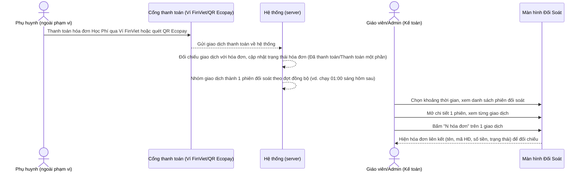
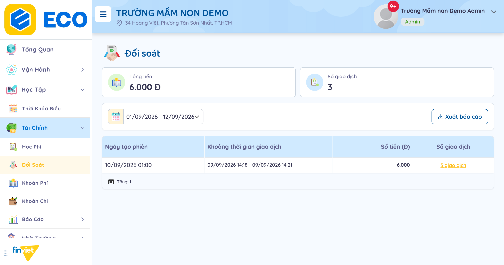
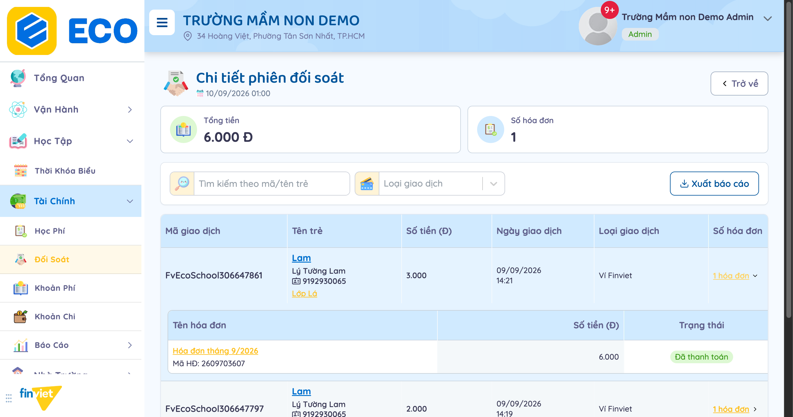
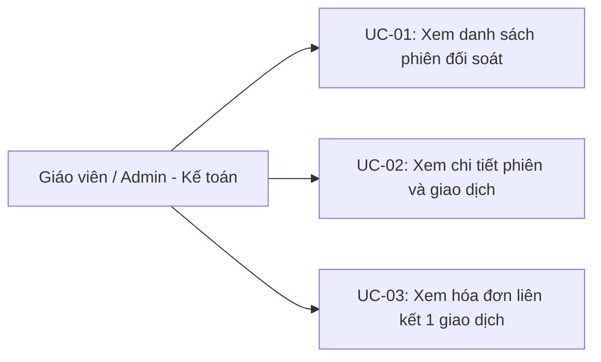

# Tên: Đối Soát (Tài Chính)

## Mục lục
- [1. Thông tin tổng quan](#1-thông-tin-tổng-quan)
  - [1.1 Giới thiệu chung](#11-giới-thiệu-chung)
  - [1.2 Mục tiêu](#12-mục-tiêu)
  - [1.3 Phạm vi](#13-phạm-vi)
  - [1.4 Tài liệu tham khảo](#14-tài-liệu-tham-khảo)
- [2. Tổng quan nghiệp vụ](#2-tổng-quan-nghiệp-vụ)
  - [2.1 Đối tượng](#21-đối-tượng)
  - [2.2 Luồng nghiệp vụ](#22-luồng-nghiệp-vụ)
  - [2.3 Nguyên tắc nghiệp vụ](#23-nguyên-tắc-nghiệp-vụ)
- [3. Đặc tả tính năng](#3-đặc-tả-tính-năng)
  - [3.1 Phân rã chức năng](#31-phân-rã-chức-năng)
  - [3.2 Acceptance Criteria](#32-acceptance-criteria)
  - [3.3 Use case](#33-use-case)
  - [3.4 Edge Cases & Error Handling](#34-edge-cases--error-handling)
  - [3.5 Non-functional Requirements](#35-non-functional-requirements)
  - [3.6 Quy ước UI chung](#36-quy-ước-ui-chung)

> **Lưu ý về môi trường khảo sát:** Tài khoản "demo" (Trường THCS Demo Soha) dùng cho mọi module khác trong bộ tài liệu này không có dữ liệu đối soát thực tế. Theo hướng dẫn của người yêu cầu, module này được khảo sát trên **tài khoản thứ hai** (tenant `FINVIET`, "Trường Mầm Non Demo", domain `ecoschool.com.vn`, thương hiệu hiển thị "ECO") — cùng nền tảng, cùng cấu trúc menu Tài Chính, nhưng có sẵn dữ liệu giao dịch thanh toán thật để khảo sát. Tenant này cũng thiếu hẳn mục "Quản Lý Học Phí" trong sidebar Tài Chính (so với tenant demo) — nhiều khả năng do cấu hình bật/tắt tính năng theo từng trường (xem Open Question về "Cấu hình → Tính Năng" trong [00-inventory.md](../00-inventory.md)), không phải khác biệt về phiên bản phần mềm.

## 1. Thông tin tổng quan

### 1.1 Giới thiệu chung
Đối Soát là module đối chiếu các giao dịch thanh toán học phí qua cổng thanh toán điện tử (Ví FinViet, QR Ecopay) với hóa đơn tương ứng trong Học Phí. Giao dịch được hệ thống tự động nhóm thành từng "phiên đối soát" theo đợt đồng bộ; toàn bộ module chỉ để xem và xuất báo cáo — không có thao tác tạo/sửa/xóa thủ công.

### 1.2 Mục tiêu
- Xem tổng số tiền và tổng số giao dịch thanh toán qua cổng điện tử trong 1 khoảng thời gian tùy chọn.
- Xem danh sách các phiên đối soát (mỗi phiên là 1 đợt đồng bộ), kèm khoảng thời gian giao dịch thực tế và tổng tiền/số giao dịch của từng phiên.
- Vào chi tiết 1 phiên để xem từng giao dịch: mã giao dịch, tên trẻ + lớp, số tiền, thời điểm giao dịch, kênh thanh toán.
- Xem trực tiếp hóa đơn Học Phí mà 1 giao dịch đã thanh toán, ngay tại dòng giao dịch, để xác nhận khớp đúng.
- Lọc giao dịch trong 1 phiên theo mã/tên trẻ hoặc theo kênh thanh toán.
- Xuất báo cáo (Excel) ở cả cấp danh sách phiên và chi tiết phiên.

### 1.3 Phạm vi
| In scope | Out of scope |
|---|---|
| Xem danh sách phiên đối soát trong khoảng ngày tùy chỉnh (mặc định 12 ngày gần nhất), đổi khoảng ngày để tìm phiên khác | Bấm "Xuất báo cáo" thật (tải file Excel) ở cả 2 cấp |
| Xem chi tiết 1 phiên có dữ liệu thật (3 giao dịch của cùng 1 học sinh, tổng 6.000đ), lọc theo mã/tên trẻ và Loại giao dịch | Bất kỳ thao tác tạo/sửa/xóa phiên hay giao dịch — không quan sát thấy control nào cho việc này, module có vẻ hoàn toàn chỉ đọc |
| Mở rộng xem hóa đơn liên kết ngay tại 1 giao dịch (bấm "N hóa đơn"), xác nhận đúng hóa đơn + số tiền + trạng thái | Xác nhận cơ chế đồng bộ giao dịch từ cổng thanh toán vào hệ thống (chạy nền, không quan sát được từ giao diện Admin) |

### 1.4 Tài liệu tham khảo
- [docs/operating-portal/00-inventory.md](../00-inventory.md) — mô tả ban đầu "Reconciliation of payment sessions/transactions (totals, transaction counts)" và đánh dấu là Open Question "unclear what system it reconciles against" — tài liệu này xác nhận: đối soát với chính hóa đơn Học Phí, qua trung gian giao dịch từ 2 cổng thanh toán Ví FinViet và QR Ecopay.
- [docs/operating-portal/tai-chinh/hoc-phi.md](hoc-phi.md) — hóa đơn "Hóa đơn tháng 9/2026" (mã 2609703607, 6.000đ, "Đã thanh toán") xuất hiện trong dữ liệu Đối Soát khớp đúng tổng 3 giao dịch nhỏ (1.000 + 2.000 + 3.000đ) — xác nhận trực tiếp cơ chế "Lịch sử thanh toán cộng dồn" mà tài liệu Học Phí đã mô tả, nhìn từ phía cổng thanh toán thay vì từ phía hóa đơn.

## 2. Tổng quan nghiệp vụ

### 2.1 Đối tượng
| Actor | Vai trò | Trách nhiệm chính |
|---|---|---|
| Giáo viên / Admin trường (kế toán) | Người xem đối soát | Theo dõi, đối chiếu tiền về đúng hóa đơn; xuất báo cáo |
| Phụ huynh | Người thanh toán (ngoài phạm vi portal) | Thanh toán hóa đơn qua Ví FinViet hoặc quét QR Ecopay — nguồn phát sinh giao dịch |
| Cổng thanh toán (Ví FinViet / QR Ecopay) | Hệ thống ngoài | Xử lý thanh toán, đồng bộ giao dịch về hệ thống theo từng phiên |
| Học Phí (module khác) | Nguồn hóa đơn | Cung cấp hóa đơn được liên kết và hiển thị ngay trong từng giao dịch |

### 2.2 Luồng nghiệp vụ

#### 2.2.1 Mô hình hóa nghiệp vụ

#### 2.2.2 Mô tả các bước nghiệp vụ
| Bước | Người thực hiện | Mô tả | Kết quả |
|---|---|---|---|
| 1 | Phụ huynh (ngoài phạm vi) | Thanh toán hóa đơn Học Phí qua Ví FinViet hoặc QR Ecopay | Giao dịch được cổng thanh toán ghi nhận |
| 2 | Hệ thống | Đồng bộ giao dịch về hệ thống, nhóm thành 1 phiên đối soát theo đợt | Phiên đối soát mới xuất hiện với Ngày tạo phiên + khoảng thời gian giao dịch thực tế |
| 3 | Giáo viên/Admin | Chọn khoảng thời gian, xem danh sách phiên đối soát | Danh sách hiện đúng các phiên có "Ngày tạo phiên" nằm trong khoảng đã chọn |
| 4 | Giáo viên/Admin | Bấm vào số lượng giao dịch của 1 phiên | Mở trang chi tiết phiên, liệt kê từng giao dịch |
| 5 | Giáo viên/Admin | Bấm "N hóa đơn" trên 1 giao dịch | Mở rộng ngay tại dòng, hiện hóa đơn liên kết để đối chiếu số tiền/trạng thái |

### 2.3 Nguyên tắc nghiệp vụ
| ID | Nguyên tắc nghiệp vụ |
|---|---|
| BR01 | Phiên đối soát nhóm theo **"Ngày tạo phiên"** (thời điểm hệ thống đồng bộ) — khác với **"Khoảng thời gian giao dịch"** (thời điểm phụ huynh thực sự thanh toán). Đã kiểm chứng: phiên tạo lúc "10/09/2026 01:00" chứa các giao dịch xảy ra "09/09/2026 14:18–14:21" (ngày hôm trước) — cho thấy đồng bộ chạy theo chu kỳ (vd. hằng ngày lúc 01:00 sáng hôm sau), không phải thời gian thực.  |
| BR02 | Toàn bộ module **chỉ đọc** — không quan sát thấy bất kỳ nút Thêm/Sửa/Xóa nào ở cả danh sách phiên lẫn chi tiết phiên; hành động khả dụng duy nhất là xem và "Xuất báo cáo". |
| BR03 | Có 2 kênh thanh toán (**Loại giao dịch**): **Ví FinViet** và **QR Ecopay** — lọc được ở cấp chi tiết phiên. |
| BR04 | Mỗi giao dịch có thể mở rộng ngay tại dòng (bấm nút "N hóa đơn") để xem bảng hóa đơn liên kết (Tên hóa đơn, Mã HĐ, Số tiền, Trạng thái) mà không cần rời trang. Đã kiểm chứng bằng dữ liệu thật: 3 giao dịch riêng biệt (1.000đ, 2.000đ, 3.000đ), cùng 1 học sinh, cùng ngày, đều liên kết tới **cùng 1 hóa đơn** "Hóa đơn tháng 9/2026" (Mã HĐ 2609703607) có tổng đúng bằng 6.000đ = tổng 3 giao dịch cộng lại, trạng thái "Đã thanh toán".  |
| BR05 | Bộ lọc khoảng thời gian ở danh sách phiên là **date-range picker tự do** (chọn ngày bắt đầu + ngày kết thúc bất kỳ, không giới hạn theo từng tháng như Khoản Chi), mặc định 12 ngày gần nhất tính đến hôm nay; **không cho chọn ngày trong tương lai** (các ngày sau hôm nay bị vô hiệu hóa trên lịch). |
| BR06 | Ở cấp chi tiết phiên có thêm bộ lọc riêng (tìm theo mã/tên trẻ, Loại giao dịch) — độc lập với bộ lọc khoảng ngày ở cấp danh sách phiên, chỉ áp dụng cho các giao dịch bên trong phiên đang xem. |

## 3. Đặc tả tính năng

### 3.1 Phân rã chức năng
| Feature | Platform | Priority | User Story |
|---|---|---|---|
| Xem danh sách phiên đối soát, đổi khoảng ngày | Web | Must | Là kế toán trường, tôi muốn biết tổng tiền đã về qua cổng thanh toán trong 1 khoảng thời gian |
| Xem chi tiết giao dịch trong 1 phiên, lọc theo trẻ/kênh thanh toán | Web | Must | Là kế toán trường, tôi muốn xem rõ từng giao dịch nhỏ cấu thành nên phiên đối soát |
| Xem hóa đơn liên kết 1 giao dịch | Web | Must | Là kế toán trường, tôi muốn xác nhận 1 giao dịch tiền về có khớp đúng hóa đơn nào |
| Xuất báo cáo | Web | Could | Là kế toán trường, tôi muốn tải dữ liệu đối soát ra Excel để lưu hồ sơ hoặc đối chiếu ngoại tuyến |

### 3.2 Acceptance Criteria
| User Story | Chức năng | Acceptance Criteria |
|---|---|---|
| Xem danh sách phiên | Danh sách Đối Soát | Đổi khoảng ngày → danh sách phiên lọc đúng theo Ngày tạo phiên nằm trong khoảng đã chọn |
| Xem chi tiết giao dịch | Trang "Chi tiết phiên đối soát" | Gõ mã/tên trẻ hoặc chọn Loại giao dịch → danh sách giao dịch trong phiên lọc đúng |
| Xem hóa đơn liên kết | Nút "N hóa đơn" trên 1 giao dịch | Bấm vào → hiện đúng hóa đơn, số tiền, trạng thái tương ứng ngay tại dòng, không rời trang |

### 3.3 Use case

**UC-01**
| Trường | Nội dung |
|---|---|
| Use case ID | UC-01 |
| Use case name | Xem danh sách phiên đối soát |
| Use case description | Giáo viên/Admin xem tổng quan các phiên đối soát trong 1 khoảng thời gian |
| Actor | Giáo viên / Admin |
| Happy path | 1. Vào Tài Chính → Đối Soát (mặc định hiện 12 ngày gần nhất).  2. Đổi "Chọn khoảng thời gian" nếu cần tìm phiên khác. 3. Đọc từng dòng: Ngày tạo phiên, Khoảng thời gian giao dịch, Số tiền, Số giao dịch. |
| Exception | Khoảng thời gian không có phiên nào → danh sách trống (không quan sát trực tiếp được thông báo cụ thể) |
| Trigger | Vào trang Đối Soát |
| Pre-condition | Không có |
| Post-condition | Danh sách hiển thị đúng theo khoảng ngày đã chọn |
| Business Rules | BR01, BR05 |

**UC-02**
| Trường | Nội dung |
|---|---|
| Use case ID | UC-02 |
| Use case name | Xem chi tiết phiên và giao dịch |
| Use case description | Giáo viên/Admin xem từng giao dịch cấu thành 1 phiên đối soát |
| Actor | Giáo viên / Admin |
| Happy path | 1. Bấm vào số giao dịch (vd. "3 giao dịch") của 1 phiên. 2. Xem Tổng tiền, Số hóa đơn của phiên.  3. (Tuỳ chọn) Gõ mã/tên trẻ vào ô tìm kiếm, hoặc chọn Loại giao dịch (Ví FinViet/QR Ecopay) để lọc. 4. Đọc từng dòng: Mã giao dịch, Tên trẻ + lớp, Số tiền, Ngày giao dịch, Loại giao dịch, Số hóa đơn. |
| Exception | Không quan sát được |
| Trigger | Bấm vào số giao dịch của 1 phiên trong danh sách |
| Pre-condition | Không có |
| Post-condition | Chỉ xem, không đổi dữ liệu |
| Business Rules | BR03, BR06 |

**UC-03**
| Trường | Nội dung |
|---|---|
| Use case ID | UC-03 |
| Use case name | Xem hóa đơn liên kết 1 giao dịch |
| Use case description | Giáo viên/Admin xác nhận 1 giao dịch đã thanh toán đúng hóa đơn nào |
| Actor | Giáo viên / Admin |
| Happy path | 1. Ở trang chi tiết phiên, bấm nút "N hóa đơn" trên 1 giao dịch. 2. Xem bảng mở rộng ngay tại dòng: Tên hóa đơn (kèm link), Mã HĐ, Số tiền, Trạng thái.  |
| Exception | Nhiều giao dịch nhỏ có thể cùng liên kết tới 1 hóa đơn — Số tiền hiện trong bảng hóa đơn là tổng hóa đơn, không phải số tiền của riêng giao dịch đang xem (xem BR04) |
| Trigger | Bấm nút "N hóa đơn" trên 1 giao dịch |
| Pre-condition | Giao dịch đã có hóa đơn liên kết |
| Post-condition | Chỉ xem, không đổi dữ liệu |
| Business Rules | BR04 |

### 3.4 Edge Cases & Error Handling

#### 3.4.1 Tổng quan
| Nhóm | Tình huống | Xử lý mong đợi |
|---|---|---|
| Ngày tạo phiên lệch ngày giao dịch | Giao dịch xảy ra cuối ngày (vd. 14:21) nhưng phiên đối soát lại được tạo vào 01:00 ngày hôm sau | Không phải lỗi — phản ánh đúng chu kỳ đồng bộ theo đợt của hệ thống (xem BR01) |
| Nhiều giao dịch, 1 hóa đơn | 1 hóa đơn được thanh toán qua nhiều giao dịch nhỏ khác nhau (cộng dồn) | Mỗi giao dịch khi mở rộng đều hiện đúng hóa đơn đó với cùng Số tiền tổng và Trạng thái hóa đơn — không gây nhầm lẫn nếu đọc đúng ngữ cảnh (xem BR04) |
| Chọn ngày tương lai | Cố chọn ngày sau hôm nay trong bộ lọc khoảng thời gian | Ngày bị vô hiệu hóa (disabled) trên lịch, không chọn được |

#### 3.4.2 Danh sách Thông báo (lỗi/thành công)
| Message ID | Trường hợp lỗi | Rule kiểm tra | Message đề xuất | Hình thức báo | Hành vi hệ thống |
|---|---|---|---|---|---|
| — | Không quan sát được message lỗi/thành công cụ thể nào — module chỉ đọc, không có thao tác submit nào trong phiên khảo sát | — | — | — | — |

### 3.5 Non-functional Requirements
| ID | Nhóm | Yêu cầu |
|---|---|---|
| NFR01 | Hiệu năng | Mở rộng hóa đơn liên kết ("N hóa đơn") hiện ngay tại dòng, không cần tải lại trang hay rời trang |
| NFR02 | Ngôn ngữ | Giao diện tiếng Việt hoàn toàn, dùng đúng thuật ngữ đối soát (Phiên đối soát, Mã giao dịch, Loại giao dịch) |
| NFR03 | Toàn vẹn dữ liệu | Tổng số tiền của hóa đơn liên kết luôn khớp đúng tổng các giao dịch nhỏ đã đối soát vào hóa đơn đó — đã kiểm chứng bằng dữ liệu thật |
| NFR04 | Nhất quán dữ liệu | Số tiền hiển thị dạng có dấu chấm phân cách hàng nghìn kèm đơn vị "Đ" — nhất quán với các module Tài Chính khác |

### 3.6 Quy ước UI chung
- Module chỉ đọc hoàn toàn — khác biệt rõ với Học Phí/Khoản Phí/Khoản Chi (đều có ít nhất 1 luồng tạo/sửa) — phù hợp với bản chất đối soát là xác minh, không phải nhập liệu.
- Dữ liệu mở rộng ngay tại dòng (accordion inline) thay vì mở modal hoặc điều hướng sang trang khác — giảm thao tác khi chỉ cần đối chiếu nhanh, khác các module khác trong Tài Chính vốn dùng modal cho hầu hết thao tác xem nhanh.
- Bộ lọc khoảng thời gian dùng date-range picker tự do (2 đầu mút) thay vì chọn theo tháng cố định như Khoản Chi/Học Phí — phù hợp với việc các phiên đối soát không nhất thiết rơi đúng vào ranh giới tháng.
- Số tiền hiển thị dạng có dấu chấm phân cách hàng nghìn kèm đơn vị "Đ" ở cuối — nhất quán xuyên suốt mọi module Tài Chính trong portal.
