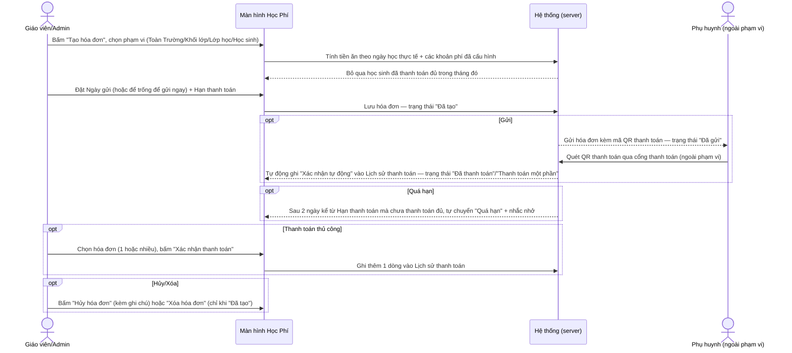
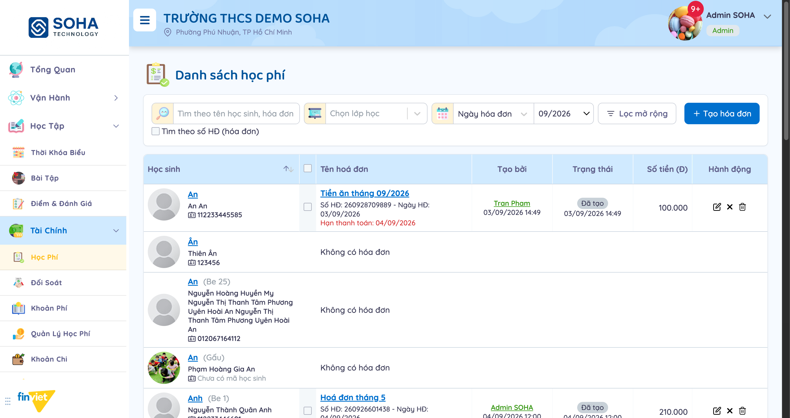
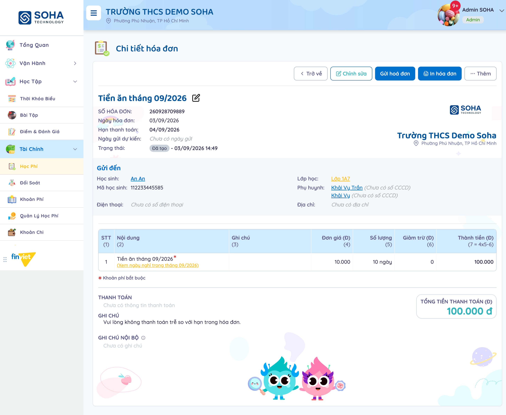
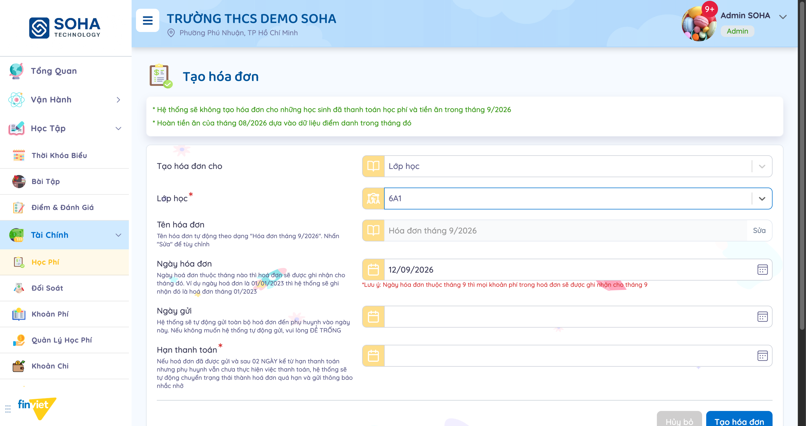
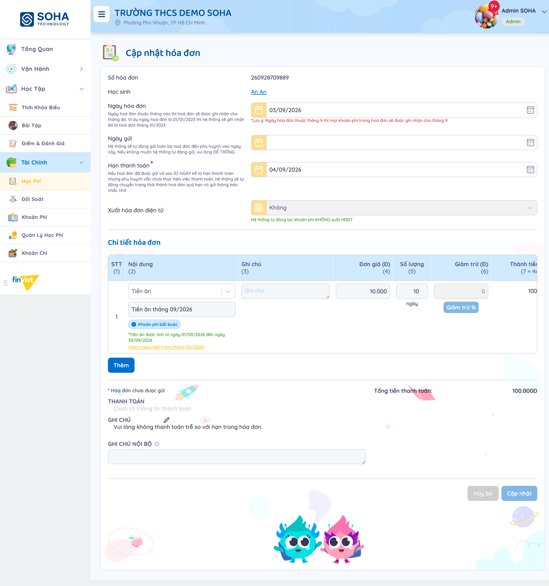
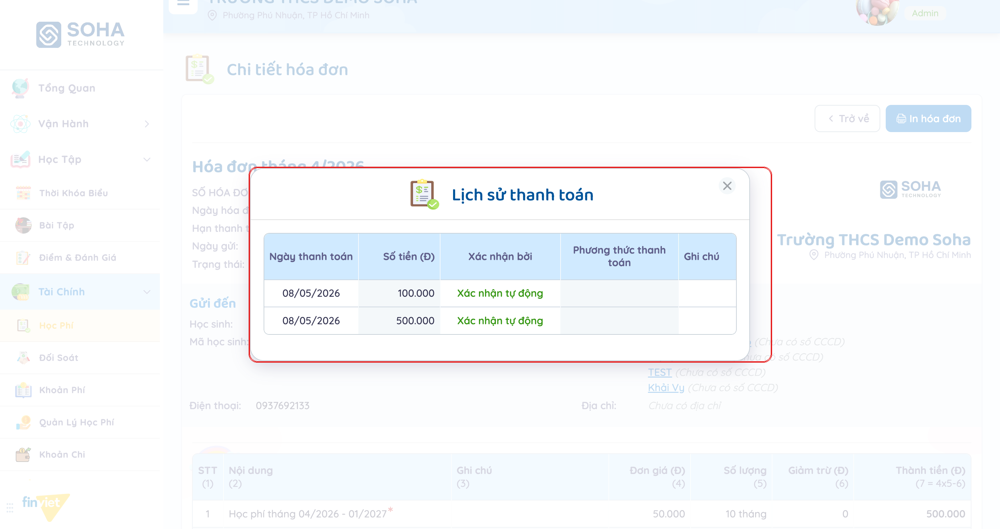
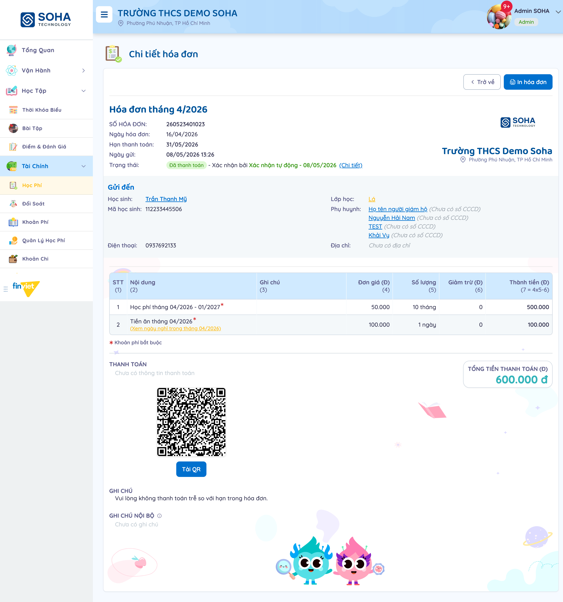
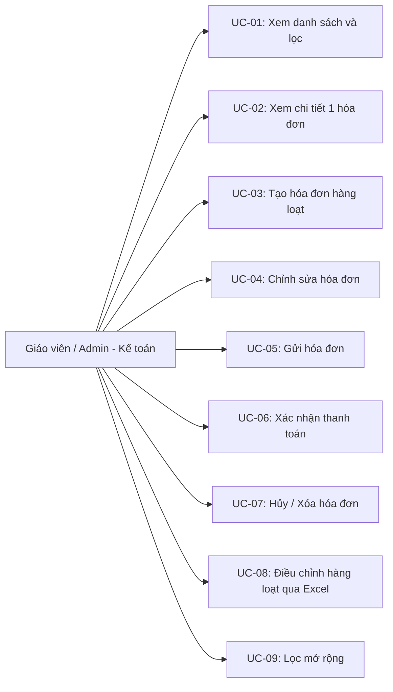

# Tên: Học Phí (Tài Chính)

## Mục lục
- [1. Thông tin tổng quan](#1-thông-tin-tổng-quan)
  - [1.1 Giới thiệu chung](#11-giới-thiệu-chung)
  - [1.2 Mục tiêu](#12-mục-tiêu)
  - [1.3 Phạm vi](#13-phạm-vi)
  - [1.4 Tài liệu tham khảo](#14-tài-liệu-tham-khảo)
- [2. Tổng quan nghiệp vụ](#2-tổng-quan-nghiệp-vụ)
  - [2.1 Đối tượng](#21-đối-tượng)
  - [2.2 Luồng nghiệp vụ](#22-luồng-nghiệp-vụ)
  - [2.3 Nguyên tắc nghiệp vụ](#23-nguyên-tắc-nghiệp-vụ)
- [3. Đặc tả tính năng](#3-đặc-tả-tính-năng)
  - [3.1 Phân rã chức năng](#31-phân-rã-chức-năng)
  - [3.2 Acceptance Criteria](#32-acceptance-criteria)
  - [3.3 Use case](#33-use-case)
  - [3.4 Edge Cases & Error Handling](#34-edge-cases--error-handling)
  - [3.5 Non-functional Requirements](#35-non-functional-requirements)
  - [3.6 Quy ước UI chung](#36-quy-ước-ui-chung)

## 1. Thông tin tổng quan

### 1.1 Giới thiệu chung
Học Phí quản lý hóa đơn thu phí của từng học sinh (học phí, tiền ăn, phí trả trễ, ngoại khóa, cơ sở vật chất, khoản khác), theo vòng đời Đã tạo → Đã gửi → Đã thanh toán/Thanh toán một phần/Quá hạn/Đã hủy, kèm theo dõi lịch sử thanh toán và mã QR thanh toán cho từng hóa đơn.

### 1.2 Mục tiêu
- Tạo hóa đơn hàng loạt cho toàn trường, 1 khối lớp, 1 lớp học, hoặc 1 học sinh cụ thể, tự động tính tiền ăn theo số ngày học thực tế (trừ ngày nghỉ) và các khoản phí đã cấu hình.
- Gửi hóa đơn cho phụ huynh (ngay hoặc lên lịch), kèm mã QR thanh toán riêng cho từng hóa đơn.
- Xác nhận thanh toán thủ công (từng hóa đơn hoặc hàng loạt) hoặc tự động qua cổng thanh toán, giữ lại đầy đủ lịch sử mỗi lần ghi nhận tiền vào.
- Hủy hóa đơn tạo nhầm kèm lý do, hoặc xóa hẳn hóa đơn còn ở dạng nháp.
- Điều chỉnh hàng loạt giá trị hóa đơn qua xuất/nhập file Excel thay vì sửa từng hóa đơn một.
- Lọc nhanh theo lớp, tháng hóa đơn, trạng thái, khối lớp, hóa đơn có hoàn phí/có xuất hóa đơn điện tử.

### 1.3 Phạm vi
| In scope | Out of scope |
|---|---|
| Xem danh sách học phí theo học sinh (111 bản ghi mẫu), tìm kiếm theo tên/số hóa đơn, lọc theo lớp/tháng hóa đơn/"Lọc mở rộng" (trạng thái, khối lớp, hoàn phí, hóa đơn điện tử) | Hoàn tất "Tạo hóa đơn"/"Gửi hoá đơn" thật — chỉ mở form và điền tới bước xác nhận, không bấm nút cuối để tránh tạo hoặc gửi hóa đơn thật cho phụ huynh trong dữ liệu demo |
| Xem chi tiết 1 hóa đơn ở nhiều trạng thái khác nhau (Đã tạo, Đã thanh toán) — bao gồm mã QR thanh toán và "Lịch sử thanh toán" với dữ liệu thật (2 lần ghi nhận tự động) | Thực hiện "Xác nhận thanh toán"/"Hủy hóa đơn"/"Xóa hóa đơn" thật (từng hóa đơn hoặc hàng loạt) — chỉ mở modal quan sát cấu trúc |
| Mở trang "Cập nhật hóa đơn" xem đầy đủ cấu trúc dòng chi phí (Nội dung/Đơn giá/Số lượng/Giảm trừ), 6 loại "Nội dung" khả dụng | Cập nhật hóa đơn thật, hoặc dùng "Giảm trừ %"/"Thêm giảm trừ" để đổi giá trị |
| Mở form "Tạo hóa đơn" với cả 4 phạm vi (Toàn Trường/Khối lớp/Lớp học/Học sinh) | Sử dụng tính năng "Điều chỉnh hóa đơn" (xuất/nhập Excel hàng loạt) thật — chỉ ghi nhận cấu trúc quy tắc màu ô từ mô tả trên giao diện |
| Nhận biết bộ hành động (sửa/gửi/hủy/xóa) thay đổi theo đúng trạng thái hóa đơn, xác nhận qua "Hành động" hàng loạt lẫn icon từng dòng | Xác nhận hành vi đầy đủ của "Thay đổi thanh toán" (đổi tài khoản nhận tiền) — mở modal nhưng không có tài khoản nào để chọn thử trong dữ liệu demo |

### 1.4 Tài liệu tham khảo
- [docs/operating-portal/00-inventory.md](../00-inventory.md) — kiểm kê toàn bộ module Phase 1; mô tả ban đầu "Per-student invoice list (tuition, meals, bus, activities, etc.) with payment status and history" — tài liệu này xác nhận đúng, đồng thời bổ sung thêm cơ chế QR thanh toán và xác nhận tự động qua cổng thanh toán mà mô tả ban đầu chưa nhắc tới.
- Sidebar Tài Chính còn 4 module liền kề chưa khảo sát trong tài liệu này: Đối Soát, Khoản Phí (danh mục khoản phí gốc), Quản Lý Học Phí (khoản phí áp dụng theo lớp), Khoản Chi — các khoản phí xuất hiện trong hóa đơn (Học phí, Tiền ăn...) nhiều khả năng được cấu hình từ 2 module Khoản Phí/Quản Lý Học Phí này.

## 2. Tổng quan nghiệp vụ

### 2.1 Đối tượng
| Actor | Vai trò | Trách nhiệm chính |
|---|---|---|
| Giáo viên / Admin trường | Người tạo và quản lý hóa đơn | Tạo, sửa, gửi, xác nhận thanh toán, hủy/xóa hóa đơn |
| Học sinh | Đối tượng của hóa đơn | Mỗi hóa đơn gắn với đúng 1 học sinh |
| Phụ huynh | Người nhận và thanh toán (ngoài phạm vi portal này) | Nhận hóa đơn khi được gửi, quét mã QR để thanh toán — không quan sát trực tiếp được từ tài khoản Admin |
| Hệ thống (server) | Tính toán + gửi + xác nhận | Tự tính tiền ăn theo ngày học thực tế; tự chuyển "Quá hạn" sau 2 ngày trễ hẹn; tự xác nhận thanh toán khi nhận được giao dịch qua cổng thanh toán (QR/Sepay) |

### 2.2 Luồng nghiệp vụ

#### 2.2.1 Mô hình hóa nghiệp vụ

#### 2.2.2 Mô tả các bước nghiệp vụ
| Bước | Người thực hiện | Mô tả | Kết quả |
|---|---|---|---|
| 1 | Giáo viên/Admin | Bấm "Tạo hóa đơn", chọn phạm vi Toàn Trường/Khối lớp/Lớp học/Học sinh | Hệ thống tự tính các dòng chi phí áp dụng, bỏ qua học sinh đã thanh toán đủ trong tháng |
| 2 | Giáo viên/Admin | Đặt Ngày hóa đơn, (tuỳ chọn) Ngày gửi, Hạn thanh toán | Tên hóa đơn tự gợi ý "Hóa đơn tháng {n}/{năm}"; để trống Ngày gửi = gửi ngay khi tạo |
| 3 | Giáo viên/Admin | Xác nhận ở modal "Xác nhận tạo hóa đơn" | Hóa đơn được tạo ở trạng thái "Đã tạo" (hoặc "Đã gửi" nếu gửi ngay) |
| 4 | Giáo viên/Admin | (Tuỳ chọn) Bấm "Gửi hoá đơn" trên hóa đơn "Đã tạo" | Trạng thái chuyển "Đã gửi", sinh mã QR thanh toán |
| 5 | Hệ thống | Nhận giao dịch thanh toán qua QR/cổng thanh toán | Tự động thêm dòng "Xác nhận tự động" vào Lịch sử thanh toán; đủ tiền → "Đã thanh toán", thiếu → "Thanh toán một phần" |
| 6 | Giáo viên/Admin | (Tuỳ chọn) Chọn 1/nhiều hóa đơn "Đã gửi", bấm "Hành động" → "Xác nhận thanh toán" | Ghi nhận thanh toán thủ công, cùng cơ chế Lịch sử thanh toán như bước 5 |
| 7 | Giáo viên/Admin | (Tuỳ chọn) Bấm "Hủy hóa đơn" kèm ghi chú lý do | Trạng thái chuyển "Đã hủy" |

### 2.3 Nguyên tắc nghiệp vụ
| ID | Nguyên tắc nghiệp vụ |
|---|---|
| BR01 | Danh sách "Danh sách học phí" liệt kê theo **từng học sinh** (không phải theo hóa đơn) — học sinh chưa có hóa đơn nào trong tháng đang lọc hiện dòng "Không có hóa đơn"; học sinh có hóa đơn hiện đầy đủ Tên hóa đơn, Số HĐ, Ngày HĐ, Hạn thanh toán ngay trong ô "Tên hoá đơn".  |
| BR02 | 6 trạng thái hóa đơn: **Đã tạo** (nháp, chưa gửi), **Đã gửi**, **Đã thanh toán**, **Thanh toán một phần**, **Quá hạn** (tự động sau 2 ngày kể từ Hạn thanh toán nếu hóa đơn đã gửi mà chưa thanh toán đủ), **Đã hủy**. |
| BR03 | Bộ hành động ở danh sách/trang chi tiết đổi theo đúng trạng thái: **Đã tạo** → Chỉnh sửa + Hủy hóa đơn (trong menu "Thêm") + Xóa (icon riêng ở danh sách); **Đã gửi** trở đi → không còn Chỉnh sửa/Xóa, chỉ còn In hóa đơn (+ Hủy hóa đơn nếu chưa thanh toán); **Đã thanh toán** → chỉ còn "Trở về"/"In hóa đơn", không còn sửa/gửi/hủy.  |
| BR04 | Trên danh sách, khi chọn checkbox 1 hoặc nhiều hóa đơn, nút **"Hành động"** hàng loạt xuất hiện thay "Lọc mở rộng" và chỉ hiện đúng tuỳ chọn hợp lệ cho trạng thái đang chọn: hóa đơn "Đã tạo" → "Xóa hóa đơn"/"Gửi hoá đơn"; hóa đơn "Đã gửi" → chỉ "Xác nhận thanh toán". Checkbox chỉ chọn được các dòng có hóa đơn thật, tự bỏ qua dòng "Không có hóa đơn". |
| BR05 | Form "Tạo hóa đơn" có 4 phạm vi: **Toàn Trường**, **Khối lớp**, **Lớp học**, **Học sinh** — chọn Khối lớp/Lớp học/Học sinh sẽ hiện thêm 1 dropdown bắt buộc (*) tương ứng. Trường "Hạn thanh toán" luôn bắt buộc (*); "Ngày gửi" để trống = gửi thông báo ngay khi tạo. Ghi chú cố định trên form: hệ thống **không tạo hóa đơn cho học sinh đã thanh toán đủ học phí + tiền ăn trong tháng đó**, và tiền ăn hoàn lại của tháng trước dựa trên dữ liệu điểm danh thực tế của tháng đó.  |
| BR06 | Trang "Cập nhật hóa đơn" (chỉ áp dụng cho hóa đơn "Đã tạo") cho sửa từng dòng chi phí: **Nội dung** (dropdown 6 loại cố định: Học phí, Tiền ăn, Phí trả học sinh trễ, Ngoại khóa, Cơ sở vật chất, Khác), Mô tả, Đơn giá, Số lượng, Giảm trừ (qua nút "Giảm trừ %" riêng từng dòng), có thể "Thêm" dòng chi phí mới. Dòng "Tiền ăn" tự khóa số lượng theo đúng số ngày học trong tháng (trừ ngày nghỉ, có link xem trực tiếp danh sách ngày nghỉ) và luôn đánh dấu "Khoản phí bắt buộc".  |
| BR07 | Trường "Xuất hóa đơn điện tử" (Có/Không) ở trang sửa quyết định hóa đơn có được đẩy sang hệ thống hóa đơn điện tử (HĐĐT) hay không — ghi chú kèm theo: "Hệ thống tự động lọc khoản phí KHÔNG xuất HĐĐT" (một số loại khoản phí luôn bị loại khỏi HĐĐT bất kể lựa chọn này). |
| BR08 | Thanh toán được xác nhận theo 2 cách, cùng ghi vào 1 khung **"Lịch sử thanh toán"** dùng chung: **(a)** tự động khi phụ huynh thanh toán qua mã QR/cổng thanh toán — cột "Xác nhận bởi" ghi "Xác nhận tự động"; **(b)** thủ công qua modal "Xác nhận thanh toán" (Ngày thanh toán, Phương thức thanh toán, Ghi chú) do Admin bấm. Lịch sử **cộng dồn từng lần**, không ghi đè — đã kiểm chứng 1 hóa đơn 600.000đ (Học phí 500.000 + Tiền ăn 100.000) có đúng 2 dòng lịch sử khớp từng khoản, cùng ngày, đều "Xác nhận tự động".  |
| BR09 | Trang chi tiết hóa đơn "Đã thanh toán" vẫn hiển thị nhãn tĩnh **"THANH TOÁN: Chưa có thông tin thanh toán"** ngay phía trên mã QR, dù bên dưới "Trạng thái" đã ghi rõ "Đã thanh toán - Xác nhận bởi Xác nhận tự động" và khung Lịch sử thanh toán có đầy đủ dữ liệu — [Cần xác nhận] đây có phải nhãn cố định của riêng phần mã QR (không phụ thuộc trạng thái) hay là hiển thị sai.  |
| BR10 | Tính năng "Điều chỉnh hóa đơn" (nút riêng, không nằm trong "Tạo hóa đơn") cho xuất toàn bộ hóa đơn hiện có ra file Excel, sửa hàng loạt rồi nhập lại — quy ước màu ô: **ô cam** = mã định danh hóa đơn (không được sửa), **ô xanh** = giá trị cho phép cập nhật, ô không tô màu bị bỏ qua khi nhập lại. |
| BR11 | "Lọc mở rộng" gồm Trạng thái (7 lựa chọn kể cả "Chọn trạng thái" mặc định), Khối lớp, 2 toggle "Hóa đơn có hoàn phí" và "Có hóa đơn điện tử". Khi chọn Trạng thái = "Đã thanh toán", modal tự hiện thêm 1 trường lọc phụ **"Phương thức thanh toán"**. |

## 3. Đặc tả tính năng

### 3.1 Phân rã chức năng
| Feature | Platform | Priority | User Story |
|---|---|---|---|
| Xem danh sách học phí theo học sinh, tìm kiếm, lọc | Web | Must | Là kế toán trường, tôi muốn tìm nhanh hóa đơn của 1 học sinh giữa hàng trăm bản ghi |
| Tạo hóa đơn hàng loạt theo Toàn Trường/Khối/Lớp/Học sinh | Web | Must | Là kế toán trường, tôi muốn tạo hóa đơn tháng cho cả trường chỉ trong 1 lần thao tác |
| Xem/In chi tiết 1 hóa đơn | Web | Must | Là kế toán trường, tôi muốn xem lại đầy đủ nội dung 1 hóa đơn đã tạo |
| Chỉnh sửa hóa đơn (khi còn "Đã tạo") | Web | Must | Là kế toán trường, tôi muốn sửa lại số tiền/dòng chi phí trước khi gửi |
| Gửi hóa đơn + mã QR thanh toán | Web | Must | Là kế toán trường, tôi muốn gửi hóa đơn kèm QR để phụ huynh thanh toán nhanh |
| Xác nhận thanh toán (thủ công/tự động) | Web | Must | Là kế toán trường, tôi muốn ghi nhận đúng khi phụ huynh đã đóng tiền |
| Hủy/Xóa hóa đơn | Web | Should | Là kế toán trường, tôi muốn hủy hóa đơn tạo nhầm hoặc xóa hẳn bản nháp |
| Điều chỉnh hàng loạt qua Excel | Web | Could | Là kế toán trường, tôi muốn sửa số liệu nhiều hóa đơn cùng lúc thay vì sửa từng cái |
| Lọc mở rộng theo trạng thái/khối/hoàn phí/HĐĐT | Web | Should | Là kế toán trường, tôi muốn thu hẹp danh sách theo nhiều tiêu chí tài chính cùng lúc |

### 3.2 Acceptance Criteria
| User Story | Chức năng | Acceptance Criteria |
|---|---|---|
| Tạo hóa đơn hàng loạt | Form Tạo hóa đơn | Chọn phạm vi + điền Hạn thanh toán → tạo được hóa đơn cho mọi học sinh phù hợp, tự loại học sinh đã thanh toán đủ trong tháng |
| Tính tiền ăn tự động | Dòng "Tiền ăn" trong hóa đơn | Số lượng ngày tự khớp đúng số ngày học (đã trừ ngày nghỉ) của tháng ghi trên hóa đơn |
| Hành động theo trạng thái | Nút Chỉnh sửa/Gửi/Hủy/Xóa | Chỉ hiện đúng hành động hợp lệ với trạng thái hiện tại của hóa đơn (xem BR03) |
| Xác nhận thanh toán | Modal Xác nhận thanh toán / Lịch sử thanh toán | Mỗi lần xác nhận (thủ công hoặc tự động) thêm đúng 1 dòng mới, không ghi đè dòng cũ |
| Lọc mở rộng | Modal Lọc mở rộng | Chọn Trạng thái/Khối lớp/toggle rồi Áp dụng → danh sách lọc đúng theo tổ hợp tiêu chí |

### 3.3 Use case

**UC-01**
| Trường | Nội dung |
|---|---|
| Use case ID | UC-01 |
| Use case name | Xem danh sách và lọc |
| Use case description | Giáo viên/Admin xem toàn bộ hóa đơn theo học sinh, lọc theo lớp/tháng/từ khoá |
| Actor | Giáo viên / Admin |
| Happy path | 1. Vào Tài Chính → Học Phí. 2. (Tuỳ chọn) Gõ từ khoá vào ô tìm kiếm, chọn "Chọn lớp học", đổi "Ngày hóa đơn" (tháng/năm).  3. Đọc từng dòng: học sinh, tên hóa đơn + số HĐ + hạn thanh toán, người tạo, trạng thái, số tiền, bộ icon hành động (đổi theo BR03). |
| Exception | Học sinh chưa có hóa đơn trong tháng đang lọc chỉ hiện "Không có hóa đơn", không có icon hành động |
| Trigger | Vào trang Học Phí |
| Pre-condition | Không có |
| Post-condition | Danh sách hiển thị đúng bộ lọc |
| Business Rules | BR01, BR02, BR03 |

**UC-02**
| Trường | Nội dung |
|---|---|
| Use case ID | UC-02 |
| Use case name | Xem chi tiết 1 hóa đơn |
| Use case description | Giáo viên/Admin mở 1 hóa đơn để xem đầy đủ nội dung, trạng thái thanh toán |
| Actor | Giáo viên / Admin |
| Happy path | 1. Bấm vào tên hóa đơn trong danh sách. 2. Xem thông tin hóa đơn (Số HĐ, Ngày HĐ, Hạn thanh toán, Trạng thái), thông tin học sinh + phụ huynh nhận, bảng chi tiết từng khoản phí.  3. Nếu đã gửi, xem thêm mã QR thanh toán; nếu đã thanh toán, xem "Trạng thái" kèm "(Chi tiết)" mở Lịch sử thanh toán.  |
| Exception | Nhãn "THANH TOÁN: Chưa có thông tin thanh toán" vẫn xuất hiện dù hóa đơn đã thanh toán đủ (xem BR09) |
| Trigger | Bấm vào tên hóa đơn |
| Pre-condition | Không có |
| Post-condition | Chỉ xem, không đổi dữ liệu |
| Business Rules | BR02, BR03, BR09 |

**UC-03**
| Trường | Nội dung |
|---|---|
| Use case ID | UC-03 |
| Use case name | Tạo hóa đơn hàng loạt |
| Use case description | Giáo viên/Admin tạo hóa đơn cho toàn trường, 1 khối, 1 lớp, hoặc 1 học sinh |
| Actor | Giáo viên / Admin |
| Happy path | 1. Bấm "Tạo hóa đơn". 2. Chọn phạm vi (Toàn Trường/Khối lớp/Lớp học/Học sinh) — chọn phạm vi hẹp hơn Toàn Trường sẽ hiện thêm dropdown bắt buộc tương ứng.  3. (Tuỳ chọn) Bấm "Sửa" để đổi Tên hóa đơn, điền Ngày hóa đơn/Ngày gửi/Hạn thanh toán. 4. Bấm "Tạo hóa đơn" → xác nhận ở modal "Xác nhận tạo hóa đơn" (không thực hiện trong phiên khảo sát). |
| Exception | Hệ thống tự loại học sinh đã thanh toán đủ học phí + tiền ăn trong tháng đó — không tạo hóa đơn trùng |
| Trigger | Bấm nút "Tạo hóa đơn" |
| Pre-condition | Không có |
| Post-condition | [Cần xác nhận] — không tạo thật để tránh sinh hóa đơn thật trong dữ liệu demo |
| Business Rules | BR05 |

**UC-04**
| Trường | Nội dung |
|---|---|
| Use case ID | UC-04 |
| Use case name | Chỉnh sửa hóa đơn |
| Use case description | Giáo viên/Admin sửa lại dòng chi phí của 1 hóa đơn còn ở trạng thái "Đã tạo" |
| Actor | Giáo viên / Admin |
| Happy path | 1. Ở trang chi tiết hóa đơn "Đã tạo", bấm "Chỉnh sửa". 2. Sửa Ngày hóa đơn/Ngày gửi/Hạn thanh toán/Xuất hóa đơn điện tử. 3. Sửa từng dòng "Chi tiết hóa đơn": đổi Nội dung, Đơn giá, Số lượng, hoặc bấm "Giảm trừ %"; bấm "Thêm" để thêm dòng mới.  4. Bấm "Cập nhật" (không thực hiện trong phiên khảo sát). |
| Exception | Chỉ khả dụng khi hóa đơn còn "Đã tạo" — hóa đơn đã gửi/thanh toán không còn nút "Chỉnh sửa" |
| Trigger | Bấm nút "Chỉnh sửa" trên hóa đơn "Đã tạo" |
| Pre-condition | Hóa đơn đang ở trạng thái "Đã tạo" |
| Post-condition | [Cần xác nhận] — chưa bấm Cập nhật để xác nhận |
| Business Rules | BR03, BR06, BR07 |

**UC-05**
| Trường | Nội dung |
|---|---|
| Use case ID | UC-05 |
| Use case name | Gửi hóa đơn |
| Use case description | Giáo viên/Admin gửi 1 hoặc nhiều hóa đơn "Đã tạo" cho phụ huynh |
| Actor | Giáo viên / Admin |
| Happy path | 1. Bấm nút "Gửi hoá đơn" trên trang chi tiết, hoặc chọn checkbox nhiều hóa đơn "Đã tạo" rồi "Hành động" → "Gửi hoá đơn". 2. Xác nhận gửi (không thực hiện trong phiên khảo sát vì bị chặn bởi phân quyền của phiên làm việc, giống các module thông báo khác trong portal). |
| Exception | Không quan sát được |
| Trigger | Bấm "Gửi hoá đơn" |
| Pre-condition | Hóa đơn đang ở trạng thái "Đã tạo" |
| Post-condition | [Cần xác nhận] — trạng thái dự kiến chuyển "Đã gửi", sinh mã QR thanh toán |
| Business Rules | BR03, BR04 |

**UC-06**
| Trường | Nội dung |
|---|---|
| Use case ID | UC-06 |
| Use case name | Xác nhận thanh toán |
| Use case description | Giáo viên/Admin ghi nhận thanh toán thủ công cho 1 hoặc nhiều hóa đơn đã gửi |
| Actor | Giáo viên / Admin |
| Happy path | 1. Chọn checkbox 1/nhiều hóa đơn "Đã gửi", bấm "Hành động" → "Xác nhận thanh toán". 2. Điền Ngày thanh toán, Phương thức thanh toán, Ghi chú nội bộ. 3. Bấm "Xác nhận" (không thực hiện trong phiên khảo sát). |
| Exception | Tuỳ chọn "Xác nhận thanh toán" chỉ xuất hiện khi (các) hóa đơn đang chọn ở trạng thái "Đã gửi" — không có với "Đã tạo" |
| Trigger | Chọn hóa đơn rồi bấm "Hành động" → "Xác nhận thanh toán" |
| Pre-condition | Hóa đơn đang ở trạng thái "Đã gửi" |
| Post-condition | Thêm 1 dòng mới vào "Lịch sử thanh toán", cộng dồn không ghi đè — đã kiểm chứng qua 1 hóa đơn có 2 dòng lịch sử tự động khớp đúng 2 khoản phí.  |
| Business Rules | BR04, BR08 |

**UC-07**
| Trường | Nội dung |
|---|---|
| Use case ID | UC-07 |
| Use case name | Hủy / Xóa hóa đơn |
| Use case description | Giáo viên/Admin hủy 1 hóa đơn đã tạo nhầm, hoặc xóa hẳn hóa đơn còn ở dạng nháp |
| Actor | Giáo viên / Admin |
| Happy path | [Cần xác nhận] — xác nhận được menu "Thêm" → "Hủy hóa đơn" (kèm ô Ghi chú lý do) luôn có mặt khi hóa đơn chưa thanh toán, và icon Xóa (thùng rác) chỉ ở danh sách khi hóa đơn "Đã tạo"; không bấm Xác nhận để tránh đổi dữ liệu mẫu. |
| Exception | Hóa đơn "Đã thanh toán" không còn cả 2 hành động này |
| Trigger | Bấm "Thêm" → "Hủy hóa đơn", hoặc icon thùng rác ở danh sách |
| Pre-condition | Hủy: hóa đơn chưa thanh toán đủ. Xóa: hóa đơn đang "Đã tạo" |
| Post-condition | [Cần xác nhận] |
| Business Rules | BR03 |

**UC-08**
| Trường | Nội dung |
|---|---|
| Use case ID | UC-08 |
| Use case name | Điều chỉnh hàng loạt qua Excel |
| Use case description | Giáo viên/Admin sửa nhiều hóa đơn cùng lúc bằng cách xuất ra Excel, sửa, rồi nhập lại |
| Actor | Giáo viên / Admin |
| Happy path | [Cần xác nhận] — xác nhận được cấu trúc modal "Điều chỉnh hóa đơn" (quy tắc màu ô cam/xanh, nút "Xuất dữ liệu", khu vực "Chọn file" + "Nhập dữ liệu"); không thực hiện xuất/nhập thật trong phiên khảo sát. |
| Exception | Không quan sát được |
| Trigger | Mở modal "Điều chỉnh hóa đơn" (nút riêng trên trang danh sách) |
| Pre-condition | Không có |
| Post-condition | [Cần xác nhận] |
| Business Rules | BR10 |

**UC-09**
| Trường | Nội dung |
|---|---|
| Use case ID | UC-09 |
| Use case name | Lọc mở rộng |
| Use case description | Thu hẹp danh sách theo trạng thái, khối lớp, hoàn phí, hóa đơn điện tử |
| Actor | Giáo viên / Admin |
| Happy path | 1. Bấm nút "Lọc mở rộng". 2. Chọn Trạng thái và/hoặc Khối lớp, bật toggle "Hóa đơn có hoàn phí"/"Có hóa đơn điện tử". 3. (Nếu chọn Trạng thái = "Đã thanh toán") chọn thêm "Phương thức thanh toán". 4. Bấm "Áp dụng". |
| Exception | Không quan sát được |
| Trigger | Bấm nút "Lọc mở rộng" |
| Pre-condition | Không có |
| Post-condition | Danh sách lọc đúng theo tổ hợp tiêu chí đã chọn — đã kiểm chứng với Trạng thái="Đã thanh toán" (còn đúng 1 hóa đơn khớp) |
| Business Rules | BR11 |

### 3.4 Edge Cases & Error Handling

#### 3.4.1 Tổng quan
| Nhóm | Tình huống | Xử lý mong đợi |
|---|---|---|
| Không tạo hóa đơn trùng | Học sinh đã thanh toán đủ học phí + tiền ăn trong tháng đang tạo hóa đơn | Hệ thống tự loại học sinh đó khỏi lượt tạo hàng loạt, không tạo hóa đơn thứ 2 |
| Quá hạn tự động | Hóa đơn đã gửi, quá Hạn thanh toán 2 ngày mà chưa thanh toán đủ | Tự chuyển trạng thái "Quá hạn", gửi thông báo nhắc nhở (ngoài phạm vi xác nhận trực tiếp) |
| Nhãn thanh toán không khớp trạng thái | Hóa đơn đã "Đã thanh toán" đủ qua xác nhận tự động | Vẫn hiện nhãn tĩnh "Chưa có thông tin thanh toán" phía trên mã QR — [Cần xác nhận] có phải lỗi hiển thị |
| Dữ liệu phụ huynh chưa hoàn chỉnh | Hồ sơ demo có phụ huynh tên "TEST" hoặc "Họ tên người giám hộ" (chưa đặt tên thật) trong danh sách "Gửi đến" của hóa đơn | Hệ thống vẫn liệt kê đầy đủ, không lọc bỏ — rác dữ liệu demo, không phải lỗi chức năng |
| Hành động hàng loạt giới hạn theo trạng thái | Chọn checkbox nhiều hóa đơn khác trạng thái nhau (nếu có) | [Cần xác nhận] — chưa thử tổ hợp chọn hỗn hợp trạng thái trong phiên khảo sát |

#### 3.4.2 Danh sách Thông báo (lỗi/thành công)
| Message ID | Trường hợp lỗi | Rule kiểm tra | Message đề xuất | Hình thức báo | Hành vi hệ thống |
|---|---|---|---|---|---|
| — | Rời trang Tạo hóa đơn/Cập nhật hóa đơn khi có thay đổi chưa lưu | Form có thay đổi chưa submit | "Thay đổi của bạn chưa được lưu. Vui lòng xác nhận rời khỏi khi chưa lưu!" | Modal xác nhận, 2 nút Hủy bỏ/Xác nhận | Chặn điều hướng cho tới khi người dùng xác nhận rời đi hoặc hủy |

### 3.5 Non-functional Requirements
| ID | Nhóm | Yêu cầu |
|---|---|---|
| NFR01 | Hiệu năng | Chọn/bỏ chọn checkbox hóa đơn cập nhật ngay nút "Hành động" phù hợp, không cần tải lại trang |
| NFR02 | Ngôn ngữ | Giao diện tiếng Việt hoàn toàn, dùng đúng thuật ngữ hóa đơn kế toán (Đơn giá, Giảm trừ, Thành tiền, HĐĐT) |
| NFR03 | Minh bạch | Mọi lần xác nhận thanh toán (thủ công lẫn tự động) đều cộng dồn vào Lịch sử thanh toán, không ghi đè |
| NFR04 | Bảo mật thao tác thật | Gửi hóa đơn thật cho phụ huynh bị chặn bởi phân quyền của phiên làm việc, nhất quán với các module thông báo khác trong portal |

### 3.6 Quy ước UI chung
- Danh sách chính liệt kê theo **đối tượng nhận** (học sinh) chứ không theo hóa đơn — nhất quán với việc mỗi học sinh chỉ có 1 dòng, hóa đơn (nếu có) lồng bên trong dòng đó; khác với các module khác (Bài Tập, Thời Khóa Biểu) liệt kê theo từng bản ghi nghiệp vụ.
- Bộ hành động dạng icon ẩn/hiện theo đúng trạng thái dòng dữ liệu thay vì luôn hiện đủ rồi disable — nhất quán với cách Bài Tập/Thời Khóa Biểu ẩn icon theo trạng thái Đã gửi/Đã tạo.
- Chọn checkbox danh sách thay nút lọc bằng nút "Hành động" hàng loạt, chỉ liệt kê thao tác hợp lệ với trạng thái đang chọn — cùng triết lý "chỉ hiện cái làm được" như trên.
- Modal dùng chung bố cục toàn hệ thống: nút hành động chính bên phải, "Hủy"/"Hủy bỏ" xám bên trái.
- Mọi số tiền hiển thị dạng có dấu chấm phân cách hàng nghìn kèm đơn vị "Đ"/"đ" ở cuối, nhất quán xuyên suốt danh sách lẫn chi tiết hóa đơn.
