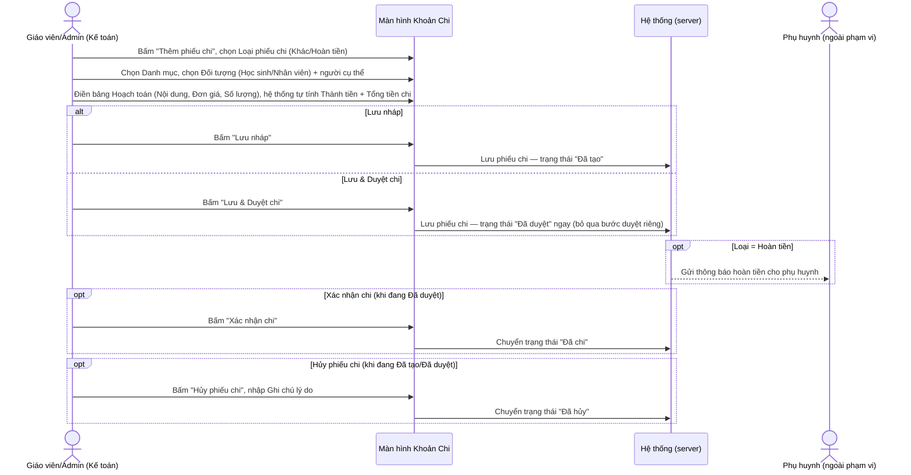
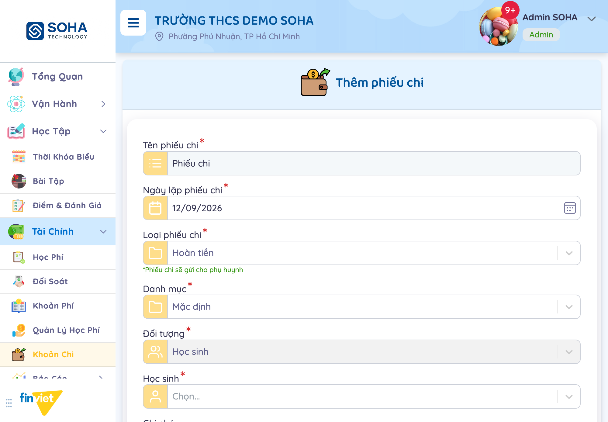
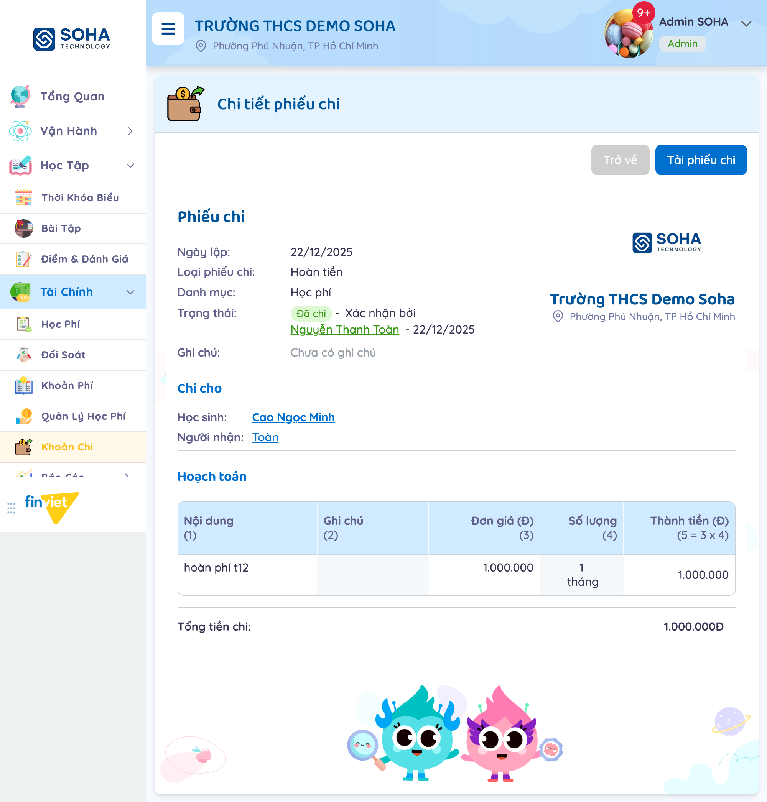
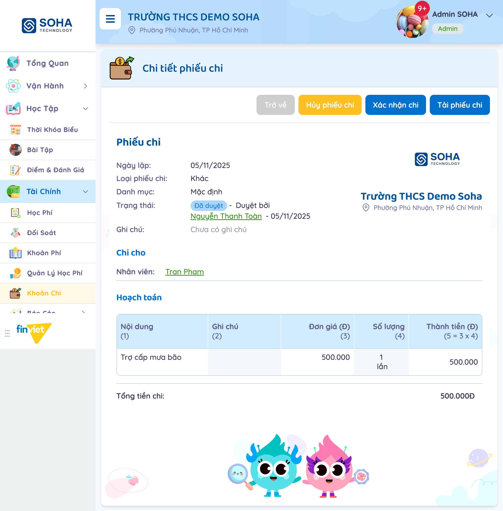
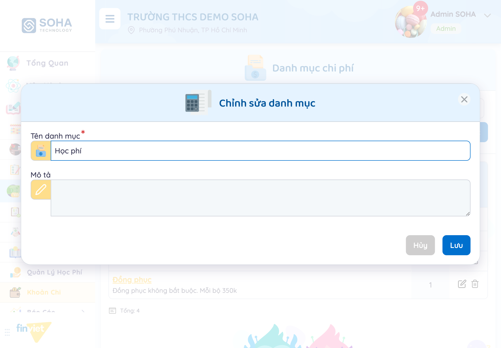
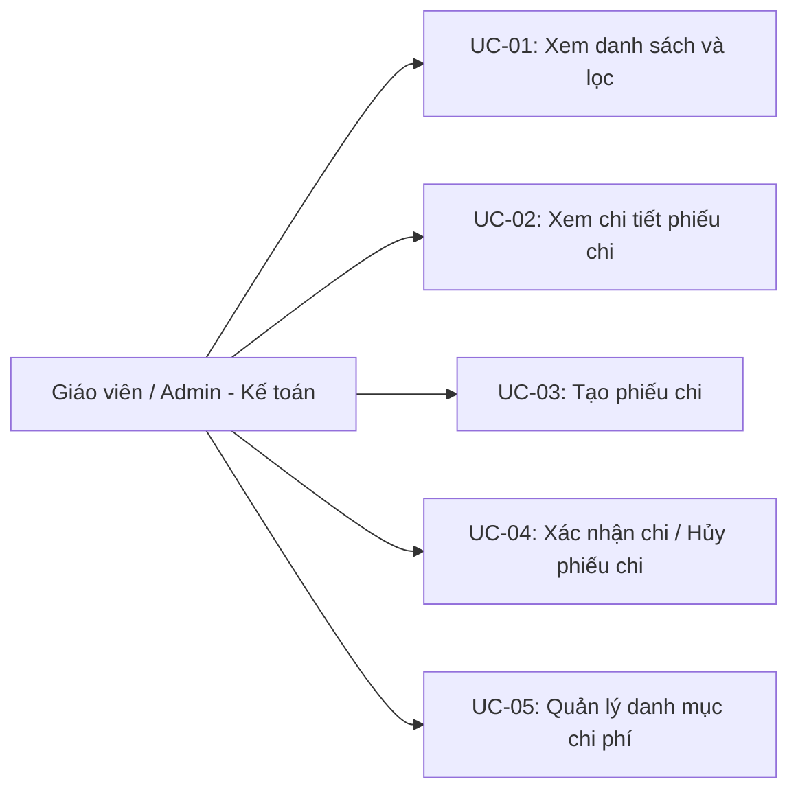
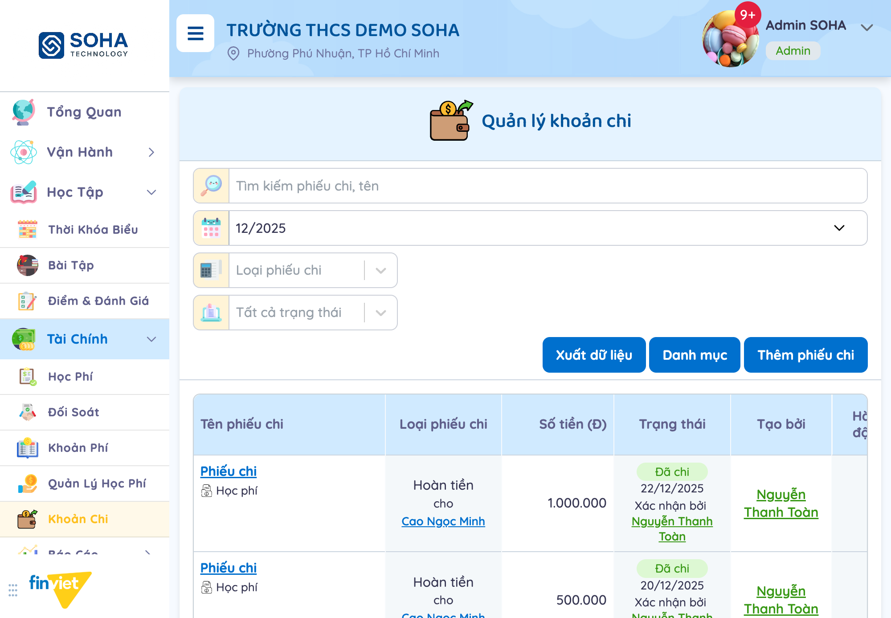

# Tên: Khoản Chi (Tài Chính)

## Mục lục
- [1. Thông tin tổng quan](#1-thông-tin-tổng-quan)
  - [1.1 Giới thiệu chung](#11-giới-thiệu-chung)
  - [1.2 Mục tiêu](#12-mục-tiêu)
  - [1.3 Phạm vi](#13-phạm-vi)
  - [1.4 Tài liệu tham khảo](#14-tài-liệu-tham-khảo)
- [2. Tổng quan nghiệp vụ](#2-tổng-quan-nghiệp-vụ)
  - [2.1 Đối tượng](#21-đối-tượng)
  - [2.2 Luồng nghiệp vụ](#22-luồng-nghiệp-vụ)
  - [2.3 Nguyên tắc nghiệp vụ](#23-nguyên-tắc-nghiệp-vụ)
- [3. Đặc tả tính năng](#3-đặc-tả-tính-năng)
  - [3.1 Phân rã chức năng](#31-phân-rã-chức-năng)
  - [3.2 Acceptance Criteria](#32-acceptance-criteria)
  - [3.3 Use case](#33-use-case)
  - [3.4 Edge Cases & Error Handling](#34-edge-cases--error-handling)
  - [3.5 Non-functional Requirements](#35-non-functional-requirements)
  - [3.6 Quy ước UI chung](#36-quy-ước-ui-chung)

## 1. Thông tin tổng quan

### 1.1 Giới thiệu chung
Khoản Chi quản lý các phiếu chi tiền của trường — từ hoàn tiền học phí cho phụ huynh đến các khoản chi khác (trợ cấp, mua sắm...) cho học sinh hoặc nhân viên. Mỗi phiếu chi đi qua vòng đời Đã tạo → Đã duyệt → Đã chi (có thể Hủy ở 2 bước đầu), kèm bảng hoạch toán chi tiết từng dòng chi phí và danh mục phân loại riêng.

### 1.2 Mục tiêu
- Lập phiếu chi cho 1 học sinh (thường là hoàn tiền học phí) hoặc 1 nhân viên (chi khác), với bảng hoạch toán nhiều dòng, tự tính tổng tiền.
- Vận hành quy trình duyệt chi 3 bước (Đã tạo → Đã duyệt → Đã chi) hoặc duyệt thẳng 1 bước khi tạo, kèm khả năng hủy phiếu ở các bước chưa hoàn tất.
- Phân loại phiếu chi theo Loại phiếu chi (Khác/Hoàn tiền) và theo Danh mục chi phí tự định nghĩa.
- Lọc theo tháng/năm bắt buộc, tìm theo tên phiếu, lọc theo loại và trạng thái.
- Quản lý danh mục chi phí dùng chung: thêm/sửa/xóa danh mục tùy chỉnh (trừ danh mục "Mặc định").
- In/tải phiếu chi ra file để lưu trữ hồ sơ.

### 1.3 Phạm vi
| In scope | Out of scope |
|---|---|
| Xem danh sách phiếu chi theo tháng (bắt buộc chọn tháng/năm), tìm kiếm theo tên, lọc theo Loại phiếu chi (Khác/Hoàn tiền) và Trạng thái (Đã tạo/Đã duyệt/Đã chi/Đã hủy) | Bấm "Lưu nháp"/"Lưu & Duyệt chi" để tạo phiếu chi thật — chỉ điền và quan sát cấu trúc form, không submit để tránh sinh dữ liệu demo |
| Xem chi tiết 2 phiếu chi ở 2 trạng thái khác nhau (Đã chi, Đã duyệt) — xác nhận đúng bộ nút hành động đổi theo trạng thái | Bấm "Xác nhận chi"/"Hủy phiếu chi" thật trên phiếu đang Đã duyệt — chỉ mở modal Hủy phiếu chi để xem cấu trúc, không bấm Xác nhận |
| Mở form "Thêm phiếu chi" đầy đủ, thử đổi Loại phiếu chi (Khác/Hoàn tiền) và Đối tượng (Học sinh/Nhân viên) để quan sát trường thay đổi theo lựa chọn | Bấm "Xuất dữ liệu" thật (tải file Excel danh sách phiếu chi) |
| Mở trang "Danh mục chi phí" xem 4 danh mục có sẵn trong dữ liệu demo, mở form "Chỉnh sửa danh mục" | Lưu thay đổi danh mục, hoặc xóa 1 danh mục thật |

### 1.4 Tài liệu tham khảo
- [docs/operating-portal/00-inventory.md](../00-inventory.md) — mô tả ban đầu "Expense/disbursement vouchers, categorized, with a cancel-voucher flow" — tài liệu này xác nhận đúng, đồng thời bổ sung chi tiết quy trình duyệt 3 bước (Đã tạo/Đã duyệt/Đã chi) mà mô tả ban đầu chưa nhắc tới.
- [docs/operating-portal/tai-chinh/hoc-phi.md](hoc-phi.md) — 2 phiếu chi "Hoàn tiền" quan sát được trong dữ liệu demo (tháng 12/2025, cho học sinh Cao Ngọc Minh) là bằng chứng cụ thể cho luồng "hoàn phí" mà tài liệu Học Phí đã đánh dấu ngoài phạm vi khảo sát trực tiếp — xác nhận Khoản Chi chính là nơi ghi nhận khoản hoàn tiền đó, dù chưa xác nhận được liên kết kỹ thuật ngược lại từ 1 hóa đơn Học Phí cụ thể.

## 2. Tổng quan nghiệp vụ

### 2.1 Đối tượng
| Actor | Vai trò | Trách nhiệm chính |
|---|---|---|
| Giáo viên / Admin trường (kế toán) | Người lập và quản lý phiếu chi | Tạo, duyệt, xác nhận chi, hủy phiếu chi; quản lý danh mục chi phí |
| Học sinh | Đối tượng nhận chi (khi Đối tượng = Học sinh) | Gắn với phiếu chi kiểu hoàn tiền học phí; có thể có "Người nhận" khác tên học sinh |
| Nhân viên | Đối tượng nhận chi (khi Đối tượng = Nhân viên) | Gắn với phiếu chi loại "Khác" (vd. trợ cấp) |
| Phụ huynh | Người nhận thông báo (ngoài phạm vi portal) | Nhận thông báo khi phiếu chi loại "Hoàn tiền" được lập — không quan sát trực tiếp được từ tài khoản Admin |

### 2.2 Luồng nghiệp vụ

#### 2.2.1 Mô hình hóa nghiệp vụ

#### 2.2.2 Mô tả các bước nghiệp vụ
| Bước | Người thực hiện | Mô tả | Kết quả |
|---|---|---|---|
| 1 | Giáo viên/Admin | Bấm "Thêm phiếu chi", chọn Loại phiếu chi, Danh mục, Đối tượng + người nhận cụ thể | Form hiện đúng trường bắt buộc theo Đối tượng đã chọn |
| 2 | Giáo viên/Admin | Điền bảng Hoạch toán: Nội dung, Đơn giá, Số lượng (+ đơn vị) — có thể bấm "Thêm" để thêm nhiều dòng | Thành tiền từng dòng và Tổng tiền chi tự tính (Thành tiền = Đơn giá × Số lượng) |
| 3 | Giáo viên/Admin | Bấm "Lưu nháp" hoặc "Lưu & Duyệt chi" | Phiếu chi được tạo ở trạng thái "Đã tạo" hoặc "Đã duyệt" tương ứng |
| 4 | Giáo viên/Admin | (Nếu đang "Đã duyệt") Bấm "Xác nhận chi" trên trang chi tiết | Trạng thái chuyển "Đã chi", ghi nhận người xác nhận + ngày |
| 5 | Giáo viên/Admin | (Tuỳ chọn, khi chưa "Đã chi") Bấm "Hủy phiếu chi", nhập Ghi chú lý do | Trạng thái chuyển "Đã hủy" |

### 2.3 Nguyên tắc nghiệp vụ
| ID | Nguyên tắc nghiệp vụ |
|---|---|
| BR01 | Có đúng 2 **Loại phiếu chi**: **Khác** và **Hoàn tiền**. Chọn "Hoàn tiền" hiện thêm ghi chú xanh **"*Phiếu chi sẽ gửi cho phụ huynh"** ngay dưới dropdown — "Khác" không có ghi chú này.  |
| BR02 | Trường **Đối tượng** có 2 lựa chọn: **Học sinh** và **Nhân viên** — chọn 1 trong 2 sẽ hiện thêm 1 dropdown bắt buộc (*) tương ứng ("Học sinh" hoặc "Nhân viên") để chọn người cụ thể nhận khoản chi. |
| BR03 | Trên trang chi tiết, phần "Chi cho" hiển thị khác nhau theo Đối tượng đã chọn lúc tạo: **Đối tượng = Học sinh** hiện cả 2 dòng **Học sinh** và **Người nhận** (có thể là 2 người khác nhau — đã kiểm chứng 1 phiếu có Học sinh "Cao Ngọc Minh" nhưng Người nhận là "Toàn"); **Đối tượng = Nhân viên** chỉ hiện 1 dòng **Nhân viên**, không có "Người nhận" riêng.  |
| BR04 | Bảng **Hoạch toán** có cấu trúc cố định 5 cột: Nội dung, Ghi chú, Đơn giá (Đ), Số lượng (kèm đơn vị tự do như "tháng"/"lần"), Thành tiền (Đ) = Đơn giá × Số lượng — cho phép nhiều dòng qua nút "Thêm"; **Tổng tiền chi** ở cuối = tổng Thành tiền tất cả các dòng. |
| BR05 | Phiếu chi có 4 trạng thái theo vòng đời: **Đã tạo** (nháp) → **Đã duyệt** → **Đã chi**, có thể **Đã hủy** ở 2 bước đầu. Bộ nút hành động trên trang chi tiết đổi theo đúng trạng thái — đã kiểm chứng: **Đã duyệt** → đủ 4 nút Trở về/Hủy phiếu chi/Xác nhận chi/Tải phiếu chi; **Đã chi** → chỉ còn Trở về/Tải phiếu chi (không còn Hủy/Xác nhận vì đã là trạng thái cuối).  |
| BR06 | Ở bước tạo, 2 nút lưu tương ứng 2 điểm vào khác nhau trong vòng đời: **"Lưu nháp"** → trạng thái "Đã tạo" (cần duyệt sau); **"Lưu & Duyệt chi"** → bỏ qua bước duyệt riêng, vào thẳng trạng thái "Đã duyệt". |
| BR07 | Bộ lọc tháng ("Chọn thời gian") là **bắt buộc và chỉ chọn được 1 tháng/năm** tại một thời điểm (không có tùy chọn xem toàn bộ nhiều tháng) — đổi tháng sẽ gọi lại danh sách theo đúng khoảng `date_from`–`date_to` của tháng đó. |
| BR08 | Trang "Danh mục chi phí" có danh mục **"Mặc định"** được đánh dấu nhãn riêng và không có icon xóa (chỉ có icon sửa) — không thể xóa, khác các danh mục tự tạo khác (Cơ sở vật chất, Học phí, Đồng phục) có đủ cả 2 icon sửa/xóa. Mỗi danh mục hiện số "Chi phí áp dụng" — số phiếu chi đang thuộc danh mục đó.  |
| BR09 | Nút "Xuất dữ liệu" tự động vô hiệu hóa (disabled) khi danh sách tháng đang chọn không có phiếu chi nào ("Chưa có dữ liệu"), chỉ bật lại khi có ít nhất 1 kết quả — cùng quy ước với nút hành động hàng loạt ở các module Tài Chính khác (ẩn/vô hiệu hóa khi không áp dụng được). |

## 3. Đặc tả tính năng

### 3.1 Phân rã chức năng
| Feature | Platform | Priority | User Story |
|---|---|---|---|
| Xem danh sách phiếu chi theo tháng, tìm kiếm, lọc | Web | Must | Là kế toán trường, tôi muốn xem nhanh các khoản đã/sắp chi trong tháng |
| Tạo phiếu chi (Khác/Hoàn tiền, cho Học sinh/Nhân viên) | Web | Must | Là kế toán trường, tôi muốn lập phiếu chi hoàn tiền học phí hoặc chi khác cho nhân viên |
| Duyệt / Xác nhận chi | Web | Must | Là kế toán trường, tôi muốn kiểm soát phiếu chi qua từng bước trước khi tiền thực sự được chi |
| Hủy phiếu chi | Web | Should | Là kế toán trường, tôi muốn hủy phiếu chi lập nhầm trước khi đã chi |
| Quản lý danh mục chi phí | Web | Should | Là kế toán trường, tôi muốn phân loại phiếu chi theo danh mục để dễ theo dõi |
| Xuất dữ liệu / Tải phiếu chi | Web | Could | Là kế toán trường, tôi muốn xuất danh sách hoặc tải 1 phiếu chi để lưu hồ sơ giấy |

### 3.2 Acceptance Criteria
| User Story | Chức năng | Acceptance Criteria |
|---|---|---|
| Xem danh sách, lọc | Danh sách Khoản Chi | Chọn tháng (bắt buộc) + tìm kiếm/lọc loại/trạng thái → danh sách đúng theo tổ hợp tiêu chí |
| Tạo phiếu chi | Form "Thêm phiếu chi" | Chọn Loại phiếu chi + Đối tượng + điền Hoạch toán → tính đúng Thành tiền/Tổng tiền chi, lưu được ở đúng trạng thái theo nút bấm (xem BR06) |
| Duyệt/Xác nhận chi | Nút "Xác nhận chi" trên trang chi tiết | Chỉ xuất hiện khi phiếu đang "Đã duyệt"; bấm → chuyển "Đã chi" |
| Hủy phiếu chi | Modal "Hủy phiếu chi" | Chỉ xuất hiện khi phiếu chưa "Đã chi"; nhập Ghi chú + Xác nhận → chuyển "Đã hủy" |
| Quản lý danh mục | Trang "Danh mục chi phí" | Thêm/sửa được mọi danh mục; xóa được mọi danh mục trừ "Mặc định" |

### 3.3 Use case

**UC-01**
| Trường | Nội dung |
|---|---|
| Use case ID | UC-01 |
| Use case name | Xem danh sách và lọc |
| Use case description | Giáo viên/Admin xem toàn bộ phiếu chi trong 1 tháng, lọc theo loại/trạng thái |
| Actor | Giáo viên / Admin |
| Happy path | 1. Vào Tài Chính → Khoản Chi (mặc định lọc theo tháng hiện tại).  2. Đổi tháng/năm nếu cần, gõ từ khoá tìm kiếm, hoặc chọn Loại phiếu chi/Trạng thái. 3. Đọc từng dòng: tên phiếu, loại + người nhận, số tiền, trạng thái + người xác nhận, người tạo. |
| Exception | Tháng không có phiếu chi nào hiện "Chưa có dữ liệu", nút "Xuất dữ liệu" tự vô hiệu hóa |
| Trigger | Vào trang Khoản Chi |
| Pre-condition | Không có |
| Post-condition | Danh sách hiển thị đúng bộ lọc |
| Business Rules | BR07, BR09 |

**UC-02**
| Trường | Nội dung |
|---|---|
| Use case ID | UC-02 |
| Use case name | Xem chi tiết phiếu chi |
| Use case description | Giáo viên/Admin mở 1 phiếu chi để xem đầy đủ nội dung, bảng hoạch toán |
| Actor | Giáo viên / Admin |
| Happy path | 1. Bấm vào tên phiếu chi trong danh sách. 2. Xem Ngày lập, Loại phiếu chi, Danh mục, Trạng thái, phần "Chi cho" (Học sinh/Người nhận hoặc Nhân viên).  3. Xem bảng Hoạch toán và Tổng tiền chi. |
| Exception | Không quan sát được |
| Trigger | Bấm vào tên phiếu chi |
| Pre-condition | Không có |
| Post-condition | Chỉ xem, không đổi dữ liệu |
| Business Rules | BR03, BR04 |

**UC-03**
| Trường | Nội dung |
|---|---|
| Use case ID | UC-03 |
| Use case name | Tạo phiếu chi |
| Use case description | Giáo viên/Admin lập 1 phiếu chi mới cho học sinh hoặc nhân viên |
| Actor | Giáo viên / Admin |
| Happy path | 1. Bấm "Thêm phiếu chi". 2. Điền Tên phiếu chi, Ngày lập, chọn Loại phiếu chi + Danh mục + Đối tượng + người nhận cụ thể.  3. Điền bảng Hoạch toán (Nội dung/Đơn giá/Số lượng), bấm "Thêm" nếu cần nhiều dòng. 4. Bấm "Lưu nháp" hoặc "Lưu & Duyệt chi" (không thực hiện trong phiên khảo sát để tránh tạo phiếu chi thật). |
| Exception | Đổi Đối tượng giữa Học sinh/Nhân viên đổi luôn dropdown chọn người nhận tương ứng |
| Trigger | Bấm nút "Thêm phiếu chi" |
| Pre-condition | Không có |
| Post-condition | [Cần xác nhận] — không bấm Lưu để xác nhận |
| Business Rules | BR01, BR02, BR04, BR06 |

**UC-04**
| Trường | Nội dung |
|---|---|
| Use case ID | UC-04 |
| Use case name | Xác nhận chi / Hủy phiếu chi |
| Use case description | Giáo viên/Admin chuyển trạng thái phiếu chi đang "Đã duyệt" sang "Đã chi", hoặc hủy phiếu chưa hoàn tất |
| Actor | Giáo viên / Admin |
| Happy path | 1. Ở trang chi tiết phiếu chi "Đã duyệt", bấm "Xác nhận chi" để hoàn tất, hoặc bấm "Hủy phiếu chi" để hủy.  2. Nếu hủy: nhập Ghi chú lý do, bấm "Xác nhận" (không thực hiện trong phiên khảo sát). |
| Exception | Phiếu chi "Đã chi" không còn nút Hủy/Xác nhận chi — chỉ còn Trở về/Tải phiếu chi |
| Trigger | Bấm "Xác nhận chi" hoặc "Hủy phiếu chi" trên trang chi tiết (hoặc icon tương ứng ở danh sách) |
| Pre-condition | Phiếu chi đang "Đã duyệt" (Xác nhận chi) hoặc chưa "Đã chi" (Hủy) |
| Post-condition | [Cần xác nhận] — không xác nhận thật để tránh đổi dữ liệu demo |
| Business Rules | BR05 |

**UC-05**
| Trường | Nội dung |
|---|---|
| Use case ID | UC-05 |
| Use case name | Quản lý danh mục chi phí |
| Use case description | Giáo viên/Admin xem, thêm, sửa, xóa danh mục dùng để phân loại phiếu chi |
| Actor | Giáo viên / Admin |
| Happy path | 1. Bấm nút "Danh mục" trên trang danh sách. 2. Xem danh sách danh mục hiện có, số "Chi phí áp dụng" mỗi danh mục. 3. Bấm icon sửa để mở modal "Chỉnh sửa danh mục" (Tên danh mục + Mô tả).  4. Bấm "Lưu" (không thực hiện trong phiên khảo sát). |
| Exception | Danh mục "Mặc định" không có icon xóa, chỉ sửa được |
| Trigger | Bấm nút "Danh mục" |
| Pre-condition | Không có |
| Post-condition | [Cần xác nhận] — không lưu thay đổi để xác nhận |
| Business Rules | BR08 |

### 3.4 Edge Cases & Error Handling

#### 3.4.1 Tổng quan
| Nhóm | Tình huống | Xử lý mong đợi |
|---|---|---|
| Không có dữ liệu trong tháng | Tháng đang lọc không có phiếu chi nào | Hiện "Chưa có dữ liệu", "Tổng: 0", nút "Xuất dữ liệu" tự vô hiệu hóa |
| Hành động giới hạn theo trạng thái | Phiếu chi đã ở trạng thái "Đã chi" | Ẩn hoàn toàn nút Hủy phiếu chi/Xác nhận chi trên trang chi tiết, chỉ còn Trở về/Tải phiếu chi |
| Danh mục hệ thống không xóa được | Bấm vào danh mục "Mặc định" trong trang Danh mục chi phí | Không có icon xóa, chỉ sửa được Tên/Mô tả |
| Đối tượng đổi field liên quan | Đổi "Đối tượng" từ Học sinh sang Nhân viên trong form tạo | Dropdown chọn người nhận đổi theo đúng loại đối tượng, không giữ lại lựa chọn cũ khác loại |
| Rời trang có thay đổi chưa lưu | Rời trang tạo phiếu chi hoặc trang Danh mục khi có thay đổi | Banner "Thay đổi của bạn chưa được lưu..." xuất hiện, cần xác nhận rời đi |

#### 3.4.2 Danh sách Thông báo (lỗi/thành công)
| Message ID | Trường hợp lỗi | Rule kiểm tra | Message đề xuất | Hình thức báo | Hành vi hệ thống |
|---|---|---|---|---|---|
| — | Rời trang Thêm phiếu chi/Chỉnh sửa danh mục khi có thay đổi chưa lưu | Form có thay đổi chưa submit | "Thay đổi của bạn chưa được lưu. Vui lòng xác nhận rời khỏi khi chưa lưu!" | Banner cuối trang, 2 nút Hủy bỏ/Xác nhận | Chặn điều hướng cho tới khi người dùng xác nhận rời đi hoặc hủy |

### 3.5 Non-functional Requirements
| ID | Nhóm | Yêu cầu |
|---|---|---|
| NFR01 | Hiệu năng | Đổi tháng lọc gọi lại danh sách ngay, không cần tải lại trang |
| NFR02 | Ngôn ngữ | Giao diện tiếng Việt hoàn toàn, dùng đúng thuật ngữ kế toán (Hoạch toán, Đơn giá, Thành tiền, Danh mục) |
| NFR03 | Minh bạch | Mỗi lần đổi trạng thái (duyệt/xác nhận chi/hủy) đều ghi rõ người thực hiện + ngày, hiển thị ngay trên trang chi tiết |
| NFR04 | Nhất quán dữ liệu | Số tiền hiển thị dạng có dấu chấm phân cách hàng nghìn kèm đơn vị "Đ" — nhất quán với Học Phí/Khoản Phí/Quản Lý Học Phí |

### 3.6 Quy ước UI chung
- Bộ nút hành động trên trang chi tiết đổi theo đúng trạng thái bản ghi (Đã duyệt có Hủy+Xác nhận chi, Đã chi chỉ còn xem/tải) — cùng triết lý "chỉ hiện cái làm được" xuyên suốt các module Tài Chính khác (Học Phí, Khoản Phí, Quản Lý Học Phí).
- Bảng "Hoạch toán" dùng chung cấu trúc Nội dung/Ghi chú/Đơn giá/Số lượng/Thành tiền — cùng mẫu với bảng chi tiết hóa đơn ở Học Phí, cho thấy 2 module dùng chung 1 khuôn mẫu kế toán nội bộ.
- Modal dùng chung bố cục toàn hệ thống: nút hành động chính bên phải, "Hủy"/"Hủy bỏ" xám bên trái.
- Danh mục hệ thống mặc định ("Mặc định") luôn bị khóa xóa — nhất quán với cách Khoản Phí khóa xóa 3 khoản phí hệ thống (Học phí, Tiền ăn, Phí trả học sinh trễ).
- Bộ lọc thời gian bắt buộc chọn đúng 1 tháng/năm, không có chế độ xem nhiều tháng cùng lúc — khác Học Phí (lọc theo "Ngày hóa đơn" nhưng có thêm "Lọc mở rộng" đa tiêu chí không phụ thuộc tháng).
