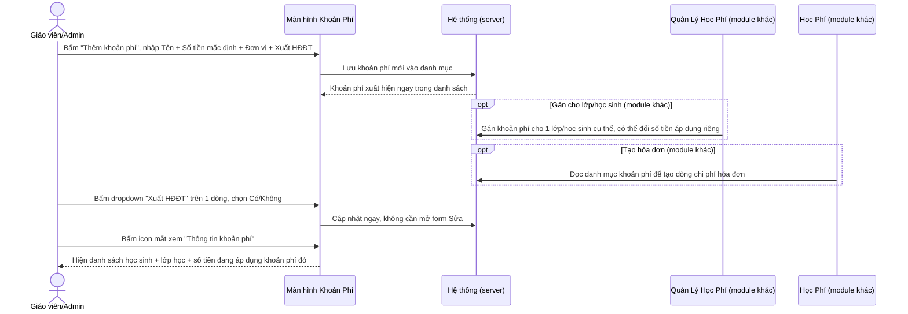
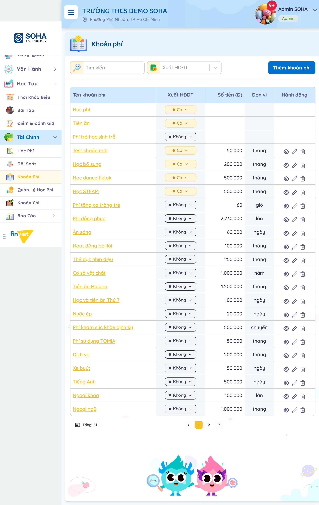
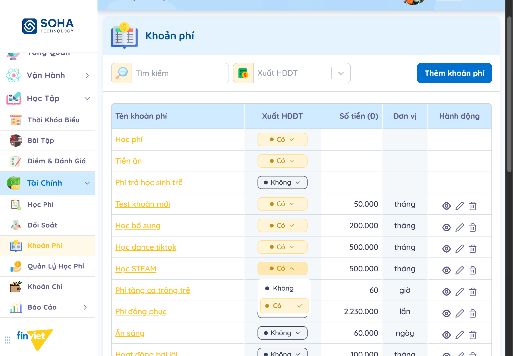
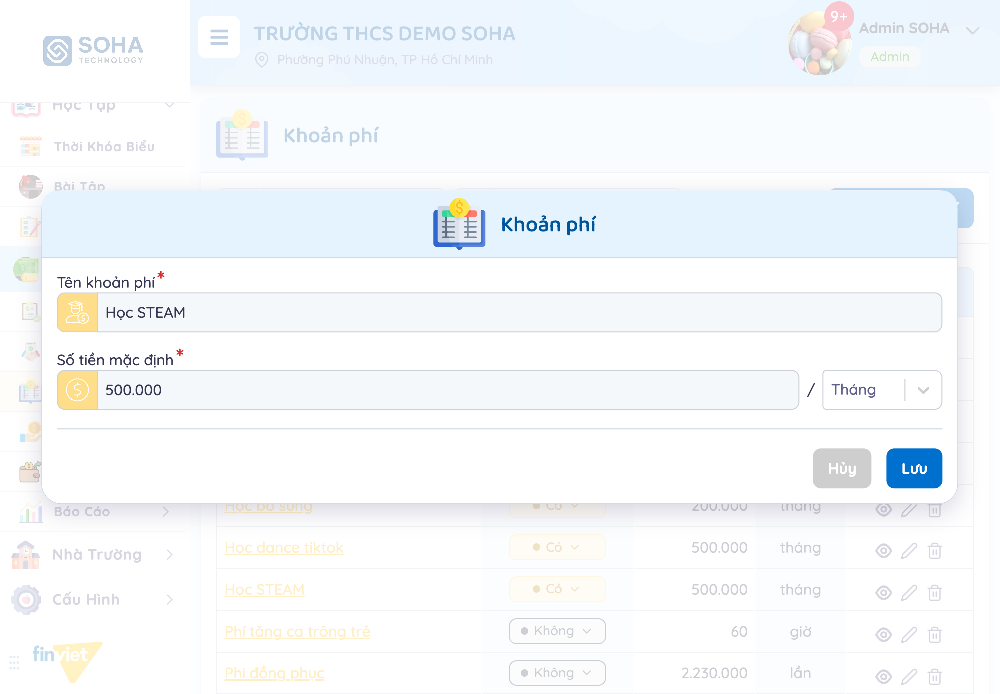
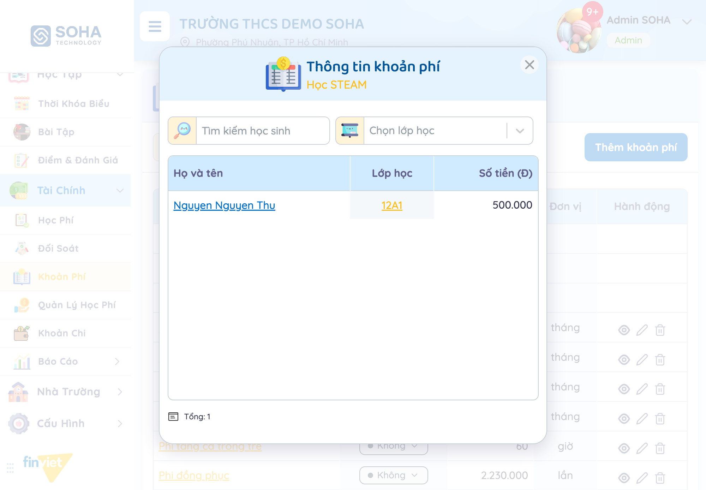
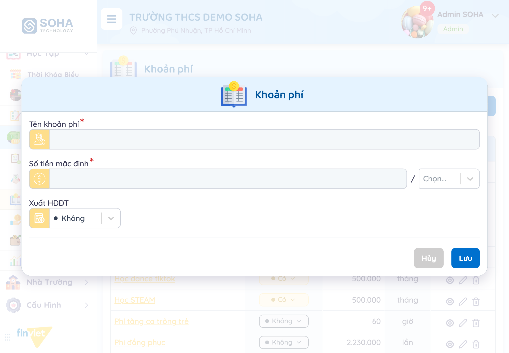
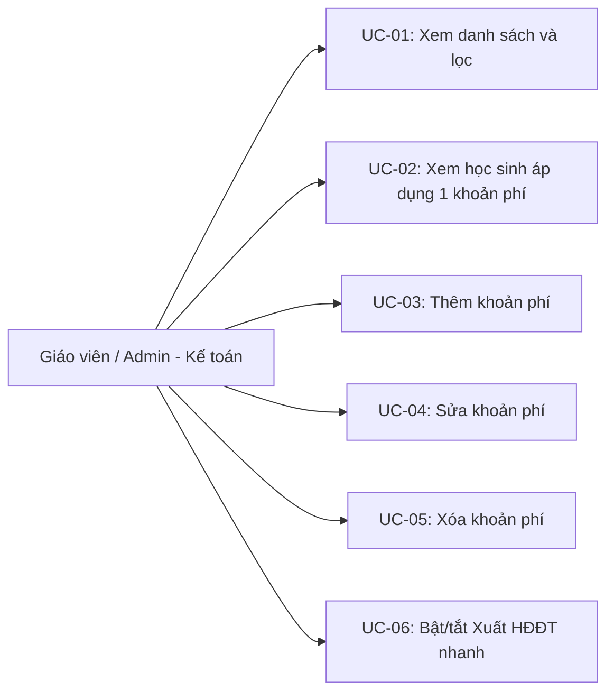

# Tên: Khoản Phí (Tài Chính)

## Mục lục
- [1. Thông tin tổng quan](#1-thông-tin-tổng-quan)
  - [1.1 Giới thiệu chung](#11-giới-thiệu-chung)
  - [1.2 Mục tiêu](#12-mục-tiêu)
  - [1.3 Phạm vi](#13-phạm-vi)
  - [1.4 Tài liệu tham khảo](#14-tài-liệu-tham-khảo)
- [2. Tổng quan nghiệp vụ](#2-tổng-quan-nghiệp-vụ)
  - [2.1 Đối tượng](#21-đối-tượng)
  - [2.2 Luồng nghiệp vụ](#22-luồng-nghiệp-vụ)
  - [2.3 Nguyên tắc nghiệp vụ](#23-nguyên-tắc-nghiệp-vụ)
- [3. Đặc tả tính năng](#3-đặc-tả-tính-năng)
  - [3.1 Phân rã chức năng](#31-phân-rã-chức-năng)
  - [3.2 Acceptance Criteria](#32-acceptance-criteria)
  - [3.3 Use case](#33-use-case)
  - [3.4 Edge Cases & Error Handling](#34-edge-cases--error-handling)
  - [3.5 Non-functional Requirements](#35-non-functional-requirements)
  - [3.6 Quy ước UI chung](#36-quy-ước-ui-chung)

## 1. Thông tin tổng quan

### 1.1 Giới thiệu chung
Khoản Phí là danh mục gốc của mọi khoản thu trong trường: gồm 3 khoản phí hệ thống cố định (Học phí, Tiền ăn, Phí trả học sinh trễ) và các khoản phí tùy chỉnh do trường tự thêm (ngoại khóa, đồng phục, xe đưa đón...). Mỗi khoản phí tùy chỉnh có tên, số tiền mặc định, đơn vị tính, và cấu hình xuất hóa đơn điện tử (Xuất HĐĐT) riêng.

### 1.2 Mục tiêu
- Duy trì 1 danh mục khoản phí dùng chung cho toàn trường, làm nguồn dữ liệu cho các module tạo hóa đơn (Học Phí) và gán phí theo lớp (Quản Lý Học Phí).
- Thêm/sửa khoản phí tùy chỉnh với tên, số tiền mặc định, đơn vị tính (8 lựa chọn).
- Bật/tắt "Xuất HĐĐT" cho từng khoản phí ngay tại danh sách, không cần mở form sửa.
- Xem nhanh 1 khoản phí đang áp dụng cho học sinh/lớp nào, kèm số tiền thực tế đang gán.
- Tìm kiếm theo tên khoản phí, lọc theo trạng thái Xuất HĐĐT.

### 1.3 Phạm vi
| In scope | Out of scope |
|---|---|
| Xem toàn bộ danh mục 24 khoản phí (3 khoản phí hệ thống + 21 khoản phí tùy chỉnh, phân trang 20 dòng/trang), tìm kiếm theo tên, lọc theo Xuất HĐĐT (Có/Không) | Lưu khoản phí mới hoặc lưu thay đổi sửa khoản phí thật — chỉ mở form, điền/so khớp dữ liệu, không bấm "Lưu" để tránh đổi dữ liệu demo |
| Mở modal "Thông tin khoản phí" xem học sinh + lớp học + số tiền đang áp dụng đúng khoản phí đó, có ô tìm kiếm học sinh và dropdown lọc lớp riêng | Xóa khoản phí thật (icon thùng rác) — hành động bị chặn bởi permission classifier của phiên làm việc khi thử, nhất quán với chủ trương không thực hiện thao tác hủy dữ liệu demo |
| Mở form "Thêm khoản phí" xem đầy đủ trường (Tên, Số tiền mặc định, Đơn vị, Xuất HĐĐT) | Đổi thật giá trị "Xuất HĐĐT" qua dropdown inline ở danh sách — chỉ mở dropdown xem 2 lựa chọn (Có/Không), không chọn để tránh đổi cấu hình demo |
| Mở form "Chỉnh sửa" 1 khoản phí tùy chỉnh, xác nhận cấu trúc trường khác với form Thêm | Xác nhận cách khoản phí này được tiêu thụ cụ thể ra sao ở Quản Lý Học Phí/Học Phí (chỉ suy luận qua UI, không xem được mã nguồn/API) |

### 1.4 Tài liệu tham khảo
- [docs/operating-portal/00-inventory.md](../00-inventory.md) — mô tả ban đầu "Master catalog of fee line-items that can be assigned to students" — tài liệu này xác nhận đúng.
- [docs/operating-portal/tai-chinh/hoc-phi.md](hoc-phi.md) — Học Phí liệt kê đúng 6 loại "Nội dung" cố định trong dòng chi phí hóa đơn (Học phí, Tiền ăn, Phí trả học sinh trễ, Ngoại khóa, Cơ sở vật chất, Khác); 3 trong số đó (Học phí, Tiền ăn, Phí trả học sinh trễ) trùng khớp chính xác với 3 khoản phí hệ thống cố định quan sát được ở đây — xác nhận Khoản Phí chính là nguồn cấu hình cho các dòng chi phí trong hóa đơn Học Phí.
- Sidebar Tài Chính còn 3 module liền kề chưa khảo sát: Đối Soát, Quản Lý Học Phí (nhiều khả năng dùng danh mục này để gán số tiền theo từng lớp/học sinh), Khoản Chi.

## 2. Tổng quan nghiệp vụ

### 2.1 Đối tượng
| Actor | Vai trò | Trách nhiệm chính |
|---|---|---|
| Giáo viên / Admin trường | Người quản lý danh mục | Thêm, sửa, xóa khoản phí tùy chỉnh; bật/tắt Xuất HĐĐT |
| Học sinh | Đối tượng được áp dụng khoản phí | Xuất hiện trong modal "Thông tin khoản phí" khi được gán 1 khoản phí cụ thể (qua module khác) |
| Học Phí (module khác) | Bên tiêu thụ danh mục | Đọc danh mục này để tạo dòng chi phí trong hóa đơn |
| Quản Lý Học Phí (module khác) | Bên gán khoản phí theo lớp | [Cần xác nhận] nhiều khả năng dùng danh mục này để gán số tiền áp dụng riêng cho từng lớp/học sinh — sinh ra dữ liệu hiển thị trong modal "Thông tin khoản phí" |

### 2.2 Luồng nghiệp vụ

#### 2.2.1 Mô hình hóa nghiệp vụ

#### 2.2.2 Mô tả các bước nghiệp vụ
| Bước | Người thực hiện | Mô tả | Kết quả |
|---|---|---|---|
| 1 | Giáo viên/Admin | Bấm "Thêm khoản phí", nhập Tên khoản phí (*), Số tiền mặc định (*), Đơn vị, Xuất HĐĐT | Khoản phí mới xuất hiện trong danh mục, sẵn sàng để gán ở module khác |
| 2 | Giáo viên/Admin | (Module khác) Gán khoản phí cho 1 lớp/học sinh cụ thể | Khoản phí xuất hiện trong modal "Thông tin khoản phí" của chính nó |
| 3 | Hệ thống | (Module khác) Học Phí đọc danh mục khi tạo dòng chi phí hóa đơn | Dòng "Nội dung" trong hóa đơn khớp tên khoản phí trong danh mục này |
| 4 | Giáo viên/Admin | Bấm dropdown "Xuất HĐĐT" ngay tại 1 dòng trong danh sách, chọn Có/Không | Cấu hình cập nhật ngay, không cần mở form Sửa |
| 5 | Giáo viên/Admin | Bấm icon mắt (Xem) trên 1 dòng | Mở modal "Thông tin khoản phí" — liệt kê học sinh/lớp/số tiền đang áp dụng đúng khoản phí đó |
| 6 | Giáo viên/Admin | Bấm icon bút chì (Sửa) trên 1 khoản phí tùy chỉnh | Mở form sửa Tên + Số tiền mặc định/Đơn vị (không có trường Xuất HĐĐT) |

### 2.3 Nguyên tắc nghiệp vụ
| ID | Nguyên tắc nghiệp vụ |
|---|---|
| BR01 | Danh mục có đúng 24 khoản phí: **3 khoản phí hệ thống cố định** (Học phí, Tiền ăn, Phí trả học sinh trễ) chỉ hiện được Tên + Xuất HĐĐT — không có Số tiền/Đơn vị và không có icon Hành động nào (Xem/Sửa/Xóa đều vắng mặt); **21 khoản phí tùy chỉnh** có đầy đủ Số tiền, Đơn vị, và 3 icon Hành động.  |
| BR02 | Đơn vị tính có đúng 8 lựa chọn cố định: **Ngày, Tháng, Năm, Lần, Chuyến, Bộ, Khác, Giờ** — quan sát được qua dropdown "Đơn vị" trong form Thêm khoản phí. |
| BR03 | Cột "Xuất HĐĐT" có dropdown đổi nhanh Có/Không ngay tại danh sách (áp dụng cho mọi dòng kể cả 3 khoản phí hệ thống), không cần mở form Sửa.  |
| BR04 | Form "Sửa" (chỉ áp dụng khoản phí tùy chỉnh) có 2 trường: **Tên khoản phí** và **Số tiền mặc định + Đơn vị** — KHÔNG có trường Xuất HĐĐT, khác với form "Thêm khoản phí" có đủ 3 trường (Tên, Số tiền mặc định/Đơn vị, Xuất HĐĐT). Xác nhận Xuất HĐĐT sau khi tạo chỉ đổi được qua dropdown inline ở BR03, không qua form Sửa.  |
| BR05 | Icon mắt mở modal "Thông tin khoản phí" liệt kê Họ và tên/Lớp học/Số tiền đang áp dụng đúng khoản phí đó, có ô tìm kiếm học sinh riêng và dropdown lọc theo 1 trong 17 lớp của trường — đã kiểm chứng với "Học STEAM" (1 học sinh: Nguyen Nguyen Thu, lớp 12A1, 500.000đ) và với "Test khoản mới"/"Đưa đón" (0 học sinh, hiện "Chưa có dữ liệu").  |
| BR06 | Ô "Tìm kiếm" lọc theo tên khoản phí, cập nhật danh sách ngay khi gõ (đã kiểm chứng với từ khóa "STEAM" → còn đúng 1 dòng khớp). |
| BR07 | Bộ lọc "Xuất HĐĐT" phía trên danh sách có 3 lựa chọn (mặc định trống/Có/Không). Khi lọc theo "Có", danh sách vẫn hiện đủ 6 dòng (gồm 2 khoản phí hệ thống Học phí/Tiền ăn + 4 khoản phí tùy chỉnh), nhưng chỉ số **"Tổng"** ở cuối trang chỉ đếm **4** — tức chỉ đếm khoản phí tùy chỉnh (có Số tiền/Đơn vị), loại trừ khoản phí hệ thống dù chúng vẫn hiện trong kết quả lọc. |
| BR08 | Chỉ số "Tổng: 24" ở trạng thái không lọc khớp chính xác với tổng số khoản phí tùy chỉnh trên cả 2 trang (20 dòng trang 1 + 4 dòng trang 2 = 24), không tính 3 khoản phí hệ thống — nhất quán với BR07, xác nhận "Tổng" luôn đếm theo khoản phí tùy chỉnh bất kể có lọc hay không. |
| BR09 | Form "Thêm khoản phí" bắt buộc (*) Tên khoản phí và Số tiền mặc định; Đơn vị mặc định trống ("Chọn..."); Xuất HĐĐT mặc định "Không".  |
| BR10 | [Cần xác nhận] 3 khoản phí hệ thống (Học phí, Tiền ăn, Phí trả học sinh trễ) không có Số tiền mặc định cố định ở đây — nhiều khả năng số tiền của chúng được cấu hình riêng theo từng lớp/học sinh ở module Quản Lý Học Phí (chưa khảo sát), khác các khoản phí tùy chỉnh vốn có 1 Số tiền mặc định chung. |

## 3. Đặc tả tính năng

### 3.1 Phân rã chức năng
| Feature | Platform | Priority | User Story |
|---|---|---|---|
| Xem danh mục khoản phí, tìm kiếm, lọc theo Xuất HĐĐT | Web | Must | Là kế toán trường, tôi muốn xem nhanh toàn bộ khoản phí đang cấu hình cho trường |
| Thêm khoản phí tùy chỉnh | Web | Must | Là kế toán trường, tôi muốn thêm 1 khoản thu mới (vd. học phí ngoại khóa) mà không cần lập trình |
| Sửa khoản phí tùy chỉnh | Web | Must | Là kế toán trường, tôi muốn cập nhật tên/số tiền mặc định khi khoản phí thay đổi |
| Xóa khoản phí tùy chỉnh | Web | Should | Là kế toán trường, tôi muốn xóa khoản phí không còn dùng nữa |
| Bật/tắt Xuất HĐĐT nhanh tại danh sách | Web | Should | Là kế toán trường, tôi muốn đổi nhanh cấu hình hóa đơn điện tử mà không cần mở form sửa |
| Xem học sinh/lớp đang áp dụng 1 khoản phí | Web | Must | Là kế toán trường, tôi muốn biết khoản phí này đang tính cho những học sinh/lớp nào |

### 3.2 Acceptance Criteria
| User Story | Chức năng | Acceptance Criteria |
|---|---|---|
| Xem danh mục, tìm kiếm, lọc | Danh sách Khoản phí | Gõ từ khóa hoặc chọn Xuất HĐĐT → danh sách lọc đúng theo tiêu chí, "Tổng" chỉ đếm khoản phí tùy chỉnh (xem BR07/BR08) |
| Thêm khoản phí | Form "Thêm khoản phí" | Điền Tên + Số tiền mặc định (bắt buộc) + Đơn vị + Xuất HĐĐT → khoản phí mới xuất hiện trong danh mục |
| Sửa khoản phí | Form "Sửa" | Đổi Tên/Số tiền mặc định/Đơn vị → giá trị cập nhật trong danh sách; Xuất HĐĐT không đổi được ở đây (xem BR04) |
| Bật/tắt Xuất HĐĐT nhanh | Dropdown inline trên cột Xuất HĐĐT | Chọn Có/Không ngay tại dòng → cập nhật ngay, không tải lại trang |
| Xem học sinh áp dụng | Modal "Thông tin khoản phí" | Bấm icon mắt → hiện đúng danh sách học sinh/lớp/số tiền đang gán khoản phí đó, lọc được theo lớp/tên học sinh |

### 3.3 Use case

**UC-01**
| Trường | Nội dung |
|---|---|
| Use case ID | UC-01 |
| Use case name | Xem danh sách và lọc |
| Use case description | Giáo viên/Admin xem toàn bộ danh mục khoản phí, tìm kiếm theo tên, lọc theo Xuất HĐĐT |
| Actor | Giáo viên / Admin |
| Happy path | 1. Vào Tài Chính → Khoản Phí.  2. (Tuỳ chọn) Gõ từ khoá vào ô tìm kiếm, hoặc chọn "Xuất HĐĐT" = Có/Không. 3. Đọc từng dòng: tên khoản phí, Xuất HĐĐT, số tiền, đơn vị, bộ icon hành động (chỉ có ở khoản phí tùy chỉnh). |
| Exception | 3 khoản phí hệ thống (Học phí, Tiền ăn, Phí trả học sinh trễ) không có Số tiền/Đơn vị/icon Hành động |
| Trigger | Vào trang Khoản Phí |
| Pre-condition | Không có |
| Post-condition | Danh sách hiển thị đúng bộ lọc; "Tổng" chỉ đếm khoản phí tùy chỉnh |
| Business Rules | BR01, BR02, BR07, BR08 |

**UC-02**
| Trường | Nội dung |
|---|---|
| Use case ID | UC-02 |
| Use case name | Xem học sinh áp dụng 1 khoản phí |
| Use case description | Giáo viên/Admin xem nhanh khoản phí đang tính cho học sinh/lớp nào |
| Actor | Giáo viên / Admin |
| Happy path | 1. Bấm icon mắt (Xem) trên 1 dòng khoản phí tùy chỉnh. 2. Xem bảng Họ và tên/Lớp học/Số tiền.  3. (Tuỳ chọn) Gõ tên học sinh vào ô tìm kiếm, hoặc chọn 1 lớp trong dropdown "Chọn lớp học" để lọc riêng modal này. |
| Exception | Khoản phí chưa được gán cho học sinh nào hiện "Chưa có dữ liệu", Tổng = 0 |
| Trigger | Bấm icon mắt trên 1 dòng khoản phí |
| Pre-condition | Không có |
| Post-condition | Chỉ xem, không đổi dữ liệu |
| Business Rules | BR05 |

**UC-03**
| Trường | Nội dung |
|---|---|
| Use case ID | UC-03 |
| Use case name | Thêm khoản phí |
| Use case description | Giáo viên/Admin thêm 1 khoản phí tùy chỉnh mới vào danh mục |
| Actor | Giáo viên / Admin |
| Happy path | 1. Bấm "Thêm khoản phí". 2. Điền Tên khoản phí (*) và Số tiền mặc định (*), chọn Đơn vị (8 lựa chọn), chọn Xuất HĐĐT (mặc định Không).  3. Bấm "Lưu" (không thực hiện trong phiên khảo sát để tránh tạo khoản phí thật trong dữ liệu demo). |
| Exception | Tên khoản phí và Số tiền mặc định là 2 trường bắt buộc (*) |
| Trigger | Bấm nút "Thêm khoản phí" |
| Pre-condition | Không có |
| Post-condition | [Cần xác nhận] — không bấm Lưu để xác nhận |
| Business Rules | BR02, BR09 |

**UC-04**
| Trường | Nội dung |
|---|---|
| Use case ID | UC-04 |
| Use case name | Sửa khoản phí |
| Use case description | Giáo viên/Admin sửa tên hoặc số tiền mặc định của 1 khoản phí tùy chỉnh |
| Actor | Giáo viên / Admin |
| Happy path | 1. Bấm icon bút chì (Sửa) trên 1 khoản phí tùy chỉnh. 2. Sửa Tên khoản phí và/hoặc Số tiền mặc định/Đơn vị.  3. Bấm "Lưu" (không thực hiện trong phiên khảo sát). |
| Exception | Chỉ khả dụng với khoản phí tùy chỉnh — 3 khoản phí hệ thống không có icon Sửa; form Sửa không có trường Xuất HĐĐT (xem BR04) |
| Trigger | Bấm icon bút chì trên 1 dòng khoản phí tùy chỉnh |
| Pre-condition | Khoản phí đang sửa là khoản phí tùy chỉnh |
| Post-condition | [Cần xác nhận] — không bấm Lưu để xác nhận |
| Business Rules | BR04 |

**UC-05**
| Trường | Nội dung |
|---|---|
| Use case ID | UC-05 |
| Use case name | Xóa khoản phí |
| Use case description | Giáo viên/Admin xóa 1 khoản phí tùy chỉnh không còn dùng |
| Actor | Giáo viên / Admin |
| Happy path | [Cần xác nhận] — xác nhận được icon thùng rác chỉ có ở khoản phí tùy chỉnh trong cột Hành động; không mở modal xác nhận xóa trong phiên khảo sát (hành động bị chặn bởi permission classifier của phiên làm việc khi thử). |
| Exception | 3 khoản phí hệ thống không có icon Xóa |
| Trigger | Bấm icon thùng rác trên 1 dòng khoản phí tùy chỉnh |
| Pre-condition | Khoản phí đang xóa là khoản phí tùy chỉnh |
| Post-condition | [Cần xác nhận] |
| Business Rules | BR01 |

**UC-06**
| Trường | Nội dung |
|---|---|
| Use case ID | UC-06 |
| Use case name | Bật/tắt Xuất HĐĐT nhanh |
| Use case description | Giáo viên/Admin đổi nhanh cấu hình Xuất HĐĐT của 1 khoản phí ngay tại danh sách |
| Actor | Giáo viên / Admin |
| Happy path | 1. Bấm vào badge "Có"/"Không" ở cột Xuất HĐĐT của 1 dòng bất kỳ (kể cả khoản phí hệ thống).  2. Chọn "Có" hoặc "Không" trong dropdown (không chọn trong phiên khảo sát để tránh đổi cấu hình demo). |
| Exception | Áp dụng được cho mọi dòng, kể cả 3 khoản phí hệ thống vốn không có icon Hành động nào khác |
| Trigger | Bấm badge Xuất HĐĐT trên 1 dòng |
| Pre-condition | Không có |
| Post-condition | [Cần xác nhận] — không chọn để xác nhận, nhưng cấu trúc dropdown (2 lựa chọn, dấu check ở lựa chọn hiện tại) cho thấy đây là thao tác cập nhật tức thời, không qua form riêng |
| Business Rules | BR03 |

### 3.4 Edge Cases & Error Handling

#### 3.4.1 Tổng quan
| Nhóm | Tình huống | Xử lý mong đợi |
|---|---|---|
| Khoản phí hệ thống bị giới hạn thao tác | Khoản phí là 1 trong 3 khoản phí hệ thống cố định (Học phí, Tiền ăn, Phí trả học sinh trễ) | Không hiện Số tiền/Đơn vị/icon Hành động nào — chỉ đổi được Xuất HĐĐT qua dropdown inline |
| Khoản phí chưa được gán | Mở modal "Thông tin khoản phí" của 1 khoản phí chưa gán cho học sinh nào | Hiện "Chưa có dữ liệu", Tổng = 0, không lỗi |
| Đếm không khớp số dòng hiển thị | Lọc "Xuất HĐĐT" = Có, danh sách hiện cả khoản phí hệ thống lẫn tùy chỉnh | "Tổng" chỉ đếm khoản phí tùy chỉnh, không khớp số dòng thực tế hiển thị — không phải lỗi, là quy ước đếm riêng (xem BR07) |
| Sửa không đổi được Xuất HĐĐT | Mở form Sửa 1 khoản phí tùy chỉnh, muốn đổi Xuất HĐĐT | Form Sửa không có trường này — phải đóng form, dùng dropdown inline ở danh sách thay thế |

#### 3.4.2 Danh sách Thông báo (lỗi/thành công)
| Message ID | Trường hợp lỗi | Rule kiểm tra | Message đề xuất | Hình thức báo | Hành vi hệ thống |
|---|---|---|---|---|---|
| — | Không quan sát được message lỗi/thành công cụ thể nào trong phiên khảo sát (không submit form thật) | — | — | — | — |

### 3.5 Non-functional Requirements
| ID | Nhóm | Yêu cầu |
|---|---|---|
| NFR01 | Hiệu năng | Đổi Xuất HĐĐT qua dropdown inline cập nhật ngay tại dòng, không cần tải lại trang |
| NFR02 | Ngôn ngữ | Giao diện tiếng Việt hoàn toàn, dùng đúng thuật ngữ kế toán (Xuất HĐĐT, Số tiền mặc định, Đơn vị) |
| NFR03 | Nhất quán dữ liệu | Số tiền hiển thị dạng có dấu chấm phân cách hàng nghìn kèm đơn vị "Đ" — nhất quán với module Học Phí |
| NFR04 | Bảo mật thao tác thật | Thao tác xóa khoản phí bị chặn bởi permission classifier của phiên làm việc khi thử thực hiện, nhất quán với chủ trương không cho phép hành động phá hủy dữ liệu demo |

### 3.6 Quy ước UI chung
- Bộ icon Hành động (Xem/Sửa/Xóa) chỉ hiện với khoản phí tùy chỉnh, ẩn hoàn toàn với khoản phí hệ thống — cùng triết lý "chỉ hiện cái làm được" quan sát thấy ở Học Phí (ẩn/hiện theo trạng thái) và Bài Tập/Thời Khóa Biểu.
- Cấu hình dạng Có/Không (ở đây là Xuất HĐĐT) được đổi nhanh bằng dropdown ngay tại danh sách thay vì bắt buộc mở form riêng — giảm số bước thao tác cho các cấu hình đơn giản, nhị phân.
- Modal xem chi tiết ("Thông tin khoản phí") và form thêm/sửa dùng chung bố cục toàn hệ thống: tiêu đề kèm icon ở đầu, nút hành động chính bên phải, "Hủy" xám bên trái.
- Trường bắt buộc luôn đánh dấu (*) đỏ ngay cạnh nhãn, nhất quán với các form khác trong portal (Học Phí, Bài Tập).
