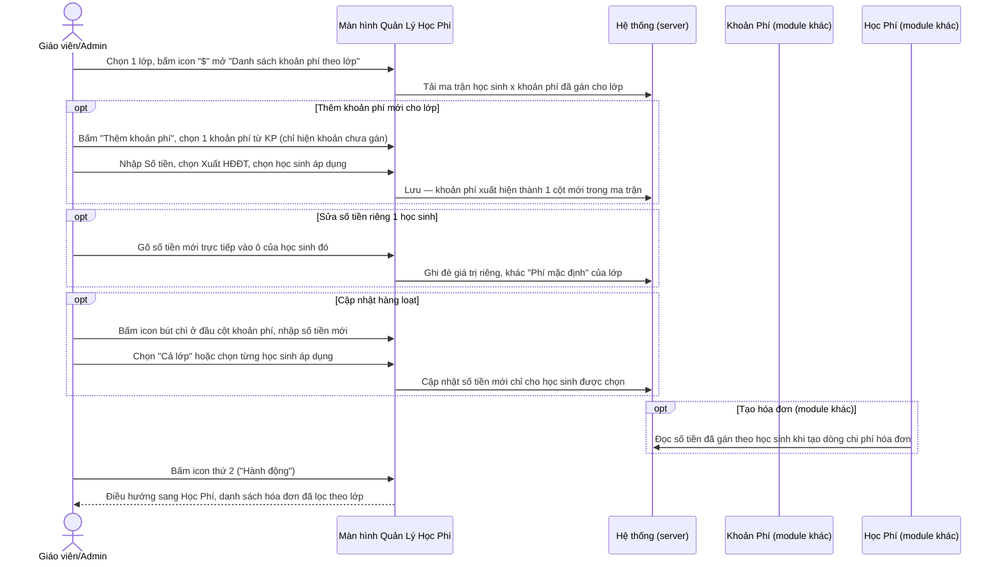
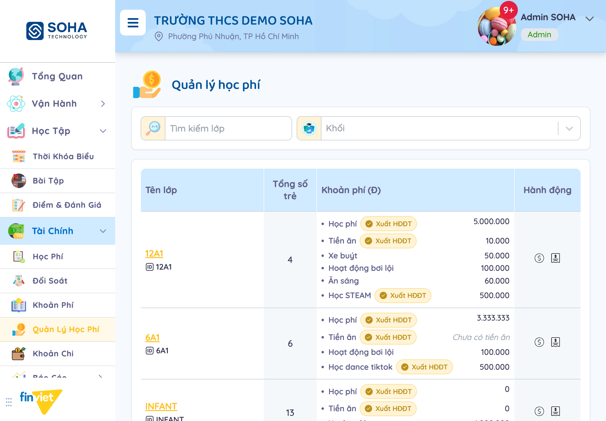
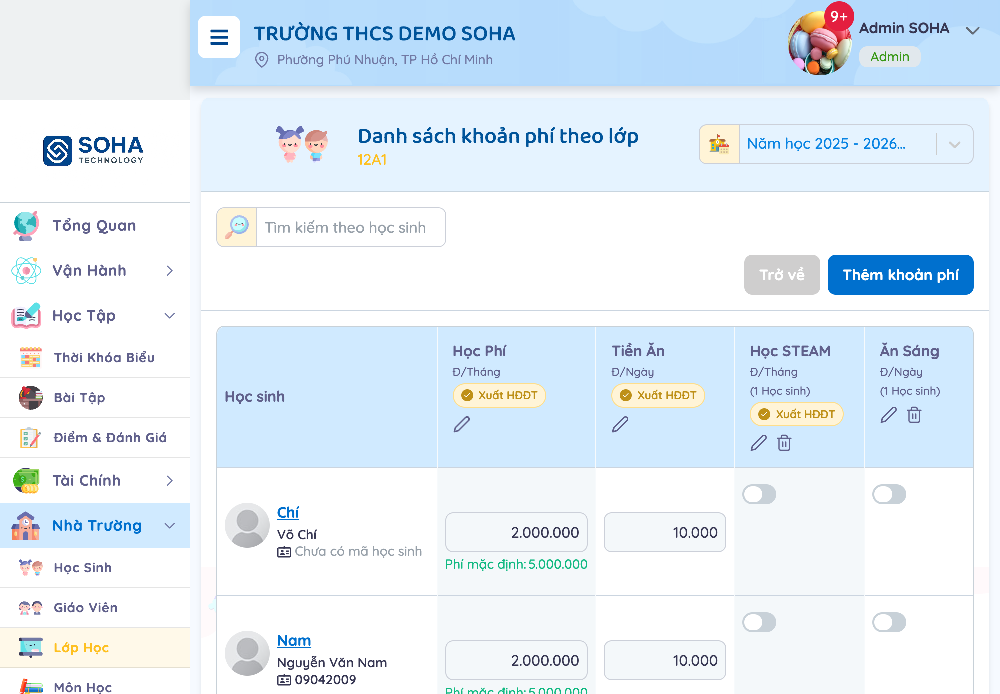
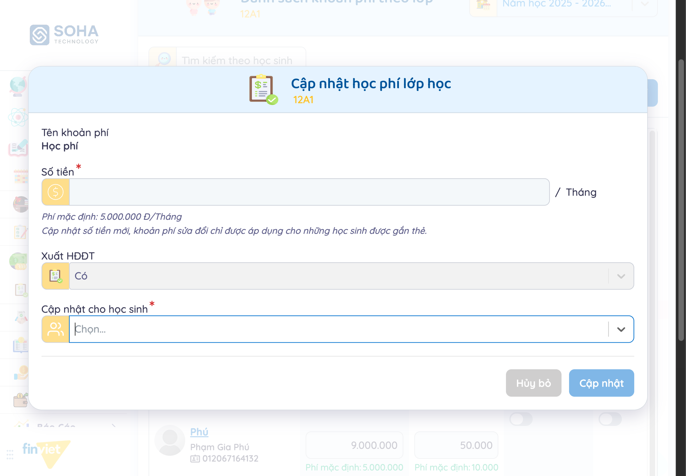
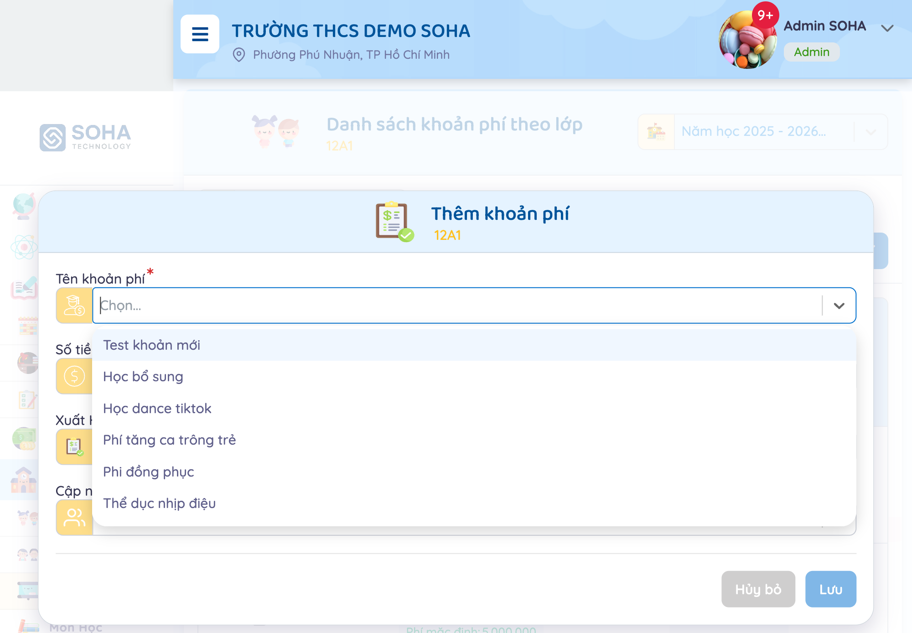
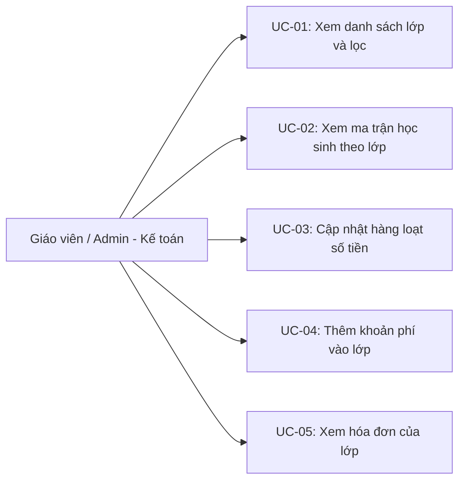

# Tên: Quản Lý Học Phí (Tài Chính)

## Mục lục
- [1. Thông tin tổng quan](#1-thông-tin-tổng-quan)
  - [1.1 Giới thiệu chung](#11-giới-thiệu-chung)
  - [1.2 Mục tiêu](#12-mục-tiêu)
  - [1.3 Phạm vi](#13-phạm-vi)
  - [1.4 Tài liệu tham khảo](#14-tài-liệu-tham-khảo)
- [2. Tổng quan nghiệp vụ](#2-tổng-quan-nghiệp-vụ)
  - [2.1 Đối tượng](#21-đối-tượng)
  - [2.2 Luồng nghiệp vụ](#22-luồng-nghiệp-vụ)
  - [2.3 Nguyên tắc nghiệp vụ](#23-nguyên-tắc-nghiệp-vụ)
- [3. Đặc tả tính năng](#3-đặc-tả-tính-năng)
  - [3.1 Phân rã chức năng](#31-phân-rã-chức-năng)
  - [3.2 Acceptance Criteria](#32-acceptance-criteria)
  - [3.3 Use case](#33-use-case)
  - [3.4 Edge Cases & Error Handling](#34-edge-cases--error-handling)
  - [3.5 Non-functional Requirements](#35-non-functional-requirements)
  - [3.6 Quy ước UI chung](#36-quy-ước-ui-chung)

## 1. Thông tin tổng quan

### 1.1 Giới thiệu chung
Quản Lý Học Phí là nơi gán các khoản phí từ danh mục Khoản Phí vào từng lớp học cụ thể, với khả năng đặt số tiền riêng cho từng học sinh (khác số tiền mặc định của lớp) và bật/tắt từng khoản phí không bắt buộc cho từng học sinh. Đây là mắt xích trung gian biến khoản phí "trừu tượng" (Khoản Phí) thành số tiền cụ thể áp dụng cho một học sinh — dữ liệu này sau đó được Học Phí đọc để tạo dòng chi phí hóa đơn.

### 1.2 Mục tiêu
- Xem nhanh mỗi lớp đang áp dụng những khoản phí nào và tổng quan số tiền, tìm theo tên lớp, lọc theo khối.
- Với từng lớp, xem ma trận học sinh × khoản phí: 2 khoản phí bắt buộc (Học Phí, Tiền Ăn) luôn có ở mọi học sinh, số khoản phí còn lại chỉ áp dụng cho học sinh được bật riêng.
- Sửa số tiền áp dụng cho từng học sinh riêng lẻ ngay trong ô, khác với số tiền mặc định của lớp.
- Cập nhật hàng loạt số tiền một khoản phí cho cả lớp hoặc một nhóm học sinh được chọn, không cần sửa từng ô.
- Thêm 1 khoản phí từ danh mục Khoản Phí vào lớp (chưa có thì mới thêm được), gán ngay cho học sinh nào cần.
- Truy cập nhanh sang danh sách hóa đơn (Học Phí) đã lọc sẵn theo đúng lớp đang xem.

### 1.3 Phạm vi
| In scope | Out of scope |
|---|---|
| Xem danh sách 12 lớp có cấu hình khoản phí, tìm kiếm theo tên lớp, lọc theo Khối (28 khối từ TH/THCS/THPT/GDTX) | Lưu thay đổi số tiền qua ô nhập trực tiếp trên ma trận học sinh × khoản phí — chỉ quan sát cấu trúc và giá trị hiện có, không gõ/lưu số liệu mới |
| Mở trang "Danh sách khoản phí theo lớp" (lớp 12A1) xem đầy đủ ma trận 4 học sinh × 9 khoản phí, phân biệt khoản phí bắt buộc (input luôn hiện) và khoản phí tùy chọn (toggle bật/tắt theo từng học sinh) | Bật/tắt thật 1 toggle khoản phí tùy chọn cho học sinh, hoặc xóa 1 khoản phí khỏi lớp (icon thùng rác) |
| Mở modal "Cập nhật học phí lớp học" (bấm icon bút chì ở cột Học Phí) xem đầy đủ cấu trúc: số tiền mới, Xuất HĐĐT (chỉ đọc), chọn học sinh áp dụng ("Cả lớp" hoặc từng em) | Bấm "Cập nhật" để lưu thay đổi số tiền hàng loạt thật |
| Mở modal "Thêm khoản phí" xem danh sách 17 khoản phí chưa gán cho lớp 12A1 (loại trừ 7 khoản đã có) | Bấm "Lưu" để thêm khoản phí mới vào lớp thật |
| Bấm icon thứ 2 ("Hành động") xác nhận điều hướng sang Học Phí, danh sách hóa đơn đã lọc sẵn theo lớp | Thao tác trên trang Học Phí đã lọc (đã khảo sát đầy đủ ở tài liệu Học Phí) |

### 1.4 Tài liệu tham khảo
- [docs/operating-portal/00-inventory.md](../00-inventory.md) — mô tả ban đầu "Per-class fee schedule — which fee items and amounts apply to each class" — tài liệu này xác nhận đúng, đồng thời phát hiện thêm chiều thứ 3 (theo từng học sinh trong lớp, không chỉ theo lớp).
- [docs/operating-portal/tai-chinh/khoan-phi.md](khoan-phi.md) — 17 khoản phí xuất hiện trong modal "Thêm khoản phí" của lớp 12A1 khớp chính xác với danh mục Khoản Phí trừ đi 7 khoản đã gán cho lớp này — xác nhận Quản Lý Học Phí tiêu thụ trực tiếp danh mục Khoản Phí. Đồng thời, 1 học sinh (Nguyen Nguyen Thu) được bật "Học STEAM" ở đây khớp chính xác với dữ liệu đã quan sát trong modal "Thông tin khoản phí" của Khoản Phí.
- [docs/operating-portal/tai-chinh/hoc-phi.md](hoc-phi.md) — icon thứ 2 ở cột Hành động điều hướng sang đúng trang danh sách hóa đơn (Học Phí) đã lọc theo lớp, xác nhận liên kết trực tiếp giữa 2 module.

## 2. Tổng quan nghiệp vụ

### 2.1 Đối tượng
| Actor | Vai trò | Trách nhiệm chính |
|---|---|---|
| Giáo viên / Admin trường | Người gán khoản phí theo lớp/học sinh | Thêm khoản phí vào lớp, sửa số tiền riêng từng học sinh, bật/tắt khoản phí tùy chọn |
| Học sinh | Đối tượng được áp dụng số tiền cụ thể | Mỗi học sinh có 1 dòng riêng trong ma trận, có thể có số tiền khác mặc định của lớp |
| Khoản Phí (module khác) | Nguồn danh mục | Cung cấp danh sách khoản phí có thể thêm vào lớp (chỉ hiện khoản chưa được gán) |
| Học Phí (module khác) | Bên tiêu thụ dữ liệu | Đọc số tiền đã gán theo học sinh ở đây để tính dòng chi phí khi tạo hóa đơn |

### 2.2 Luồng nghiệp vụ

#### 2.2.1 Mô hình hóa nghiệp vụ

#### 2.2.2 Mô tả các bước nghiệp vụ
| Bước | Người thực hiện | Mô tả | Kết quả |
|---|---|---|---|
| 1 | Giáo viên/Admin | Vào Quản Lý Học Phí, tìm/lọc theo tên lớp hoặc Khối | Danh sách lớp hiện đúng khoản phí + số tiền tổng quan từng lớp |
| 2 | Giáo viên/Admin | Bấm icon "$" trên 1 lớp | Mở "Danh sách khoản phí theo lớp" — ma trận học sinh × khoản phí |
| 3 | Giáo viên/Admin | Bấm "Thêm khoản phí", chọn khoản phí từ Khoản Phí (chỉ hiện khoản chưa gán cho lớp), nhập Số tiền, chọn học sinh áp dụng | Khoản phí mới thành 1 cột trong ma trận, chỉ bật cho học sinh đã chọn |
| 4 | Giáo viên/Admin | Gõ trực tiếp vào ô số tiền của 1 học sinh | Giá trị ghi đè riêng cho học sinh đó, hiện thêm dòng "Phí mặc định: X" bên dưới nếu khác mặc định lớp |
| 5 | Giáo viên/Admin | Bấm icon bút chì ở đầu cột 1 khoản phí, nhập số tiền mới, chọn "Cả lớp" hoặc từng học sinh | Số tiền mới chỉ áp dụng cho học sinh được chọn ("gắn thẻ"), không tự động áp dụng toàn lớp nếu không chọn |
| 6 | Giáo viên/Admin | Bấm icon thứ 2 ("Hành động") trên 1 lớp | Điều hướng sang Học Phí, danh sách hóa đơn đã lọc sẵn theo lớp đó |

### 2.3 Nguyên tắc nghiệp vụ
| ID | Nguyên tắc nghiệp vụ |
|---|---|
| BR01 | Danh sách lớp chỉ hiện **12 lớp** có cấu hình khoản phí, ít hơn tổng số lớp thực tế của trường (17 lớp xuất hiện trong dropdown "Chọn lớp học" ở module Khoản Phí) — [Cần xác nhận] nhiều khả năng lớp chưa được gán bất kỳ khoản phí nào (kể cả Học Phí/Tiền Ăn mặc định) sẽ không xuất hiện trong danh sách này.  |
| BR02 | Mỗi lớp luôn có ít nhất 2 khoản phí bắt buộc **Học phí** và **Tiền ăn** (Đ/Tháng và Đ/Ngày); các khoản phí còn lại là tùy chọn, chỉ hiện khi có ít nhất 1 học sinh trong lớp được gán khoản đó. |
| BR03 | Trên trang "Danh sách khoản phí theo lớp", **Học Phí/Tiền Ăn** hiện input số tiền cho MỌI học sinh (không có toggle bật/tắt); các khoản phí còn lại (Học STEAM, Ăn Sáng, Xe Buýt...) hiện **toggle** riêng từng học sinh — chỉ khi bật mới hiện ô nhập số tiền. Tiêu đề mỗi cột khoản phí tùy chọn có ghi "(N Học sinh)" — số học sinh đang bật khoản đó.  |
| BR04 | Số tiền mỗi ô là **input chỉnh sửa trực tiếp** theo từng học sinh (không dùng chung 1 giá trị cho cả lớp); khi giá trị của học sinh khác với "Phí mặc định" của lớp (hiện ở đầu cột), hệ thống hiện thêm dòng chữ xanh **"Phí mặc định: X"** ngay dưới ô — chỉ hiện khi có chênh lệch, không hiện khi giá trị khớp mặc định (đã kiểm chứng qua nhiều học sinh: Tiền Ăn khớp mặc định → không hiện hint, Học Phí lệch mặc định → hiện hint). |
| BR05 | Icon bút chì ở đầu cột (áp dụng cho mọi khoản phí, kể cả Học Phí/Tiền Ăn) mở modal "Cập nhật học phí lớp học" — cho nhập 1 số tiền mới và chọn học sinh áp dụng ("Cả lớp" hoặc từng em); ghi chú rõ trên modal: **"khoản phí sửa đổi chỉ được áp dụng cho những học sinh được gắn thẻ"** — tức phải chọn tường minh, không mặc định áp dụng toàn lớp dù chọn sửa từ cột chung. Trường Xuất HĐĐT trong modal này chỉ hiển thị (readonly), không sửa được.  |
| BR06 | Modal "Thêm khoản phí" chỉ liệt kê các khoản phí trong danh mục Khoản Phí **chưa được gán** cho lớp đang xem — đã kiểm chứng với lớp 12A1 (đã có 7 khoản: Học Phí, Tiền Ăn, Học STEAM, Ăn Sáng, Xe Buýt, Hoạt Động Bơi Lội, Đồng Phục, Ngoại Khóa, Phí Khám Sức Khỏe Định Kỳ — thực ra 9 khoản) thì dropdown hiện đúng 17 khoản còn lại trong tổng 24 khoản phí tùy chỉnh của danh mục Khoản Phí.  |
| BR07 | Trạng thái "chưa từng đặt số tiền mặc định" (hiện chữ **"Chưa có học phí"/"Chưa có tiền ăn"**) khác với trạng thái "đã đặt số tiền mặc định = 0" (hiện số **"0"**) — 2 trạng thái hiển thị khác nhau dù cùng nghĩa "chưa thu tiền" trên thực tế. |
| BR08 | Cột "Xuất HĐĐT" ở cả trang danh sách lớp lẫn modal "Cập nhật học phí lớp học" đều chỉ **hiển thị** (checkbox disabled / text readonly), phản ánh đúng cấu hình đã đặt ở Khoản Phí — không thể đổi Xuất HĐĐT từ Quản Lý Học Phí. |
| BR09 | Icon thứ 2 ở cột "Hành động" (khác icon "$") điều hướng thẳng sang module Học Phí, danh sách hóa đơn đã lọc sẵn theo đúng lớp vừa bấm — xác nhận qua URL đổi từ `/tuition-management/` sang `/school/class/{id}/fee/` và bộ lọc lớp học đã tự điền sẵn. |
| BR10 | [Cần xác nhận] Trang "Danh sách khoản phí theo lớp" hiện banner "Thay đổi của bạn chưa được lưu..." ngay khi vừa tải trang, chưa có tương tác nào — cùng hiện tượng đã ghi nhận ở trang Cấu hình → Tính Năng trong 00-inventory.md, nhiều khả năng là quirk chung của framework khi trang có nhiều input controlled (toggle/textbox) được khởi tạo cùng lúc, không phải lỗi riêng của module này. |

## 3. Đặc tả tính năng

### 3.1 Phân rã chức năng
| Feature | Platform | Priority | User Story |
|---|---|---|---|
| Xem danh sách lớp có cấu hình khoản phí, tìm kiếm, lọc theo Khối | Web | Must | Là kế toán trường, tôi muốn xem nhanh lớp nào đang thu những khoản phí nào |
| Xem ma trận học sinh × khoản phí của 1 lớp | Web | Must | Là kế toán trường, tôi muốn biết chính xác học sinh nào đang đóng khoản phí nào, bao nhiêu tiền |
| Sửa số tiền riêng cho 1 học sinh | Web | Must | Là kế toán trường, tôi muốn miễn giảm hoặc tăng học phí riêng cho 1 học sinh cụ thể |
| Cập nhật hàng loạt số tiền cho nhiều học sinh | Web | Should | Là kế toán trường, tôi muốn tăng học phí cả lớp trong 1 lần thao tác thay vì sửa từng em |
| Thêm khoản phí mới vào lớp | Web | Must | Là kế toán trường, tôi muốn bắt đầu thu 1 khoản phí mới (vd. ngoại khóa) cho 1 số học sinh trong lớp |
| Truy cập nhanh hóa đơn của lớp | Web | Could | Là kế toán trường, tôi muốn xem ngay hóa đơn của lớp đang xem mà không cần lọc lại từ đầu |

### 3.2 Acceptance Criteria
| User Story | Chức năng | Acceptance Criteria |
|---|---|---|
| Xem danh sách lớp | Danh sách Quản Lý Học Phí | Gõ tên lớp hoặc chọn Khối → danh sách lọc đúng, mỗi lớp hiện đủ khoản phí + số tiền hiện có |
| Xem ma trận theo lớp | Trang "Danh sách khoản phí theo lớp" | Mỗi học sinh có 1 dòng, mỗi khoản phí có 1 cột; khoản bắt buộc luôn có input, khoản tùy chọn có toggle riêng |
| Sửa số tiền 1 học sinh | Input trong ô ma trận | Gõ số mới → giá trị ghi đè riêng học sinh đó, không ảnh hưởng học sinh khác |
| Cập nhật hàng loạt | Modal "Cập nhật học phí lớp học" | Nhập số tiền + chọn học sinh (hoặc Cả lớp) → chỉ học sinh được chọn nhận giá trị mới |
| Thêm khoản phí | Modal "Thêm khoản phí" | Chọn khoản phí (chỉ khoản chưa có) + Số tiền + học sinh áp dụng → khoản phí xuất hiện thành cột mới |

### 3.3 Use case

**UC-01**
| Trường | Nội dung |
|---|---|
| Use case ID | UC-01 |
| Use case name | Xem danh sách lớp và lọc |
| Use case description | Giáo viên/Admin xem tổng quan khoản phí theo từng lớp, tìm kiếm/lọc |
| Actor | Giáo viên / Admin |
| Happy path | 1. Vào Tài Chính → Quản Lý Học Phí.  2. (Tuỳ chọn) Gõ tên lớp vào ô tìm kiếm, hoặc chọn 1 Khối trong dropdown (28 khối từ TH/THCS/THPT/GDTX). 3. Đọc từng dòng: tên lớp, tổng số trẻ, danh sách khoản phí + số tiền, 2 icon Hành động. |
| Exception | Lớp chưa có cấu hình khoản phí nào không xuất hiện trong danh sách (xem BR01) |
| Trigger | Vào trang Quản Lý Học Phí |
| Pre-condition | Không có |
| Post-condition | Danh sách hiển thị đúng bộ lọc |
| Business Rules | BR01, BR02, BR07 |

**UC-02**
| Trường | Nội dung |
|---|---|
| Use case ID | UC-02 |
| Use case name | Xem ma trận học sinh theo lớp |
| Use case description | Giáo viên/Admin xem chi tiết từng học sinh đang đóng khoản phí nào, bao nhiêu tiền |
| Actor | Giáo viên / Admin |
| Happy path | 1. Bấm icon "$" trên 1 lớp. 2. Xem bảng: mỗi hàng 1 học sinh, mỗi cột 1 khoản phí.  3. Với khoản phí bắt buộc (Học Phí/Tiền Ăn), đọc trực tiếp số tiền trong ô, kèm "Phí mặc định" nếu có lệch. 4. Với khoản phí tùy chọn, xem toggle bật/tắt riêng từng học sinh — chỉ học sinh bật mới có ô số tiền. |
| Exception | Khoản phí tùy chọn không hiện cột nếu chưa có học sinh nào trong lớp được bật |
| Trigger | Bấm icon "$" trên 1 lớp |
| Pre-condition | Không có |
| Post-condition | Chỉ xem, không sửa/lưu dữ liệu trong phiên khảo sát |
| Business Rules | BR02, BR03, BR04 |

**UC-03**
| Trường | Nội dung |
|---|---|
| Use case ID | UC-03 |
| Use case name | Cập nhật hàng loạt số tiền |
| Use case description | Giáo viên/Admin đổi số tiền 1 khoản phí cho nhiều học sinh cùng lúc |
| Actor | Giáo viên / Admin |
| Happy path | 1. Ở trang ma trận, bấm icon bút chì ở đầu cột khoản phí muốn sửa. 2. Nhập Số tiền mới.  3. Chọn "Cả lớp" hoặc chọn riêng từng học sinh trong "Cập nhật cho học sinh". 4. Bấm "Cập nhật" (không thực hiện trong phiên khảo sát để tránh đổi dữ liệu demo). |
| Exception | Chỉ học sinh được chọn tường minh mới nhận giá trị mới — không tự áp dụng toàn lớp nếu bỏ trống |
| Trigger | Bấm icon bút chì ở đầu cột 1 khoản phí |
| Pre-condition | Không có |
| Post-condition | [Cần xác nhận] — không bấm Cập nhật để xác nhận |
| Business Rules | BR05 |

**UC-04**
| Trường | Nội dung |
|---|---|
| Use case ID | UC-04 |
| Use case name | Thêm khoản phí vào lớp |
| Use case description | Giáo viên/Admin gán 1 khoản phí mới (từ danh mục Khoản Phí) vào lớp |
| Actor | Giáo viên / Admin |
| Happy path | 1. Bấm "Thêm khoản phí". 2. Chọn 1 khoản phí trong dropdown (chỉ hiện khoản chưa gán cho lớp).  3. Nhập Số tiền, chọn Đơn vị, chọn Xuất HĐĐT. 4. Chọn học sinh áp dụng trong "Cập nhật cho học sinh". 5. Bấm "Lưu" (không thực hiện trong phiên khảo sát). |
| Exception | Khoản phí đã gán cho lớp không còn xuất hiện trong dropdown lựa chọn |
| Trigger | Bấm nút "Thêm khoản phí" |
| Pre-condition | Không có |
| Post-condition | [Cần xác nhận] — không bấm Lưu để xác nhận |
| Business Rules | BR06 |

**UC-05**
| Trường | Nội dung |
|---|---|
| Use case ID | UC-05 |
| Use case name | Xem hóa đơn của lớp |
| Use case description | Giáo viên/Admin chuyển nhanh sang danh sách hóa đơn (Học Phí) đã lọc theo lớp đang xem |
| Actor | Giáo viên / Admin |
| Happy path | 1. Bấm icon thứ 2 ("Hành động") trên 1 lớp. 2. Hệ thống điều hướng sang Học Phí với bộ lọc lớp đã tự điền sẵn đúng lớp vừa chọn. |
| Exception | Không quan sát được |
| Trigger | Bấm icon thứ 2 trên 1 lớp |
| Pre-condition | Không có |
| Post-condition | Trang Học Phí hiển thị danh sách hóa đơn đã lọc theo lớp |
| Business Rules | BR09 |

### 3.4 Edge Cases & Error Handling

#### 3.4.1 Tổng quan
| Nhóm | Tình huống | Xử lý mong đợi |
|---|---|---|
| Lớp chưa cấu hình khoản phí | Lớp không có bất kỳ khoản phí nào (kể cả Học Phí/Tiền Ăn mặc định) | [Cần xác nhận] không xuất hiện trong danh sách Quản Lý Học Phí (xem BR01) |
| Chưa đặt số tiền vs. đã đặt = 0 | Lớp chưa từng cấu hình Học Phí/Tiền Ăn | Hiện chữ "Chưa có học phí"/"Chưa có tiền ăn" thay vì số "0" — phân biệt rõ 2 trạng thái (xem BR07) |
| Cập nhật hàng loạt không chọn học sinh | Mở modal Cập nhật học phí lớp học nhưng không chọn học sinh nào | Nút "Cập nhật" bị vô hiệu hóa (disabled) cho tới khi chọn ít nhất 1 học sinh hoặc "Cả lớp" |
| Khoản phí đã gán không hiện lại | Mở modal Thêm khoản phí sau khi lớp đã có 1 số khoản phí | Dropdown tự loại bỏ các khoản đã gán, chỉ hiện khoản còn lại trong danh mục Khoản Phí |
| Banner chưa lưu xuất hiện không do người dùng | Vừa tải trang ma trận, chưa thao tác gì | Banner "Thay đổi của bạn chưa được lưu..." vẫn hiện — [Cần xác nhận] quirk framework, không phải lỗi dữ liệu (xem BR10) |

#### 3.4.2 Danh sách Thông báo (lỗi/thành công)
| Message ID | Trường hợp lỗi | Rule kiểm tra | Message đề xuất | Hình thức báo | Hành vi hệ thống |
|---|---|---|---|---|---|
| — | Rời trang "Danh sách khoản phí theo lớp" khi có banner chưa lưu | Trang có input controlled đã khởi tạo | "Thay đổi của bạn chưa được lưu. Vui lòng xác nhận rời khỏi khi chưa lưu!" | Banner cố định cuối trang, 2 nút Hủy bỏ/Xác nhận | Không quan sát được hành vi chặn điều hướng thực tế trong phiên khảo sát |

### 3.5 Non-functional Requirements
| ID | Nhóm | Yêu cầu |
|---|---|---|
| NFR01 | Hiệu năng | Toggle bật/tắt khoản phí tùy chọn phản hồi ngay tại ô, không cần tải lại trang |
| NFR02 | Ngôn ngữ | Giao diện tiếng Việt hoàn toàn, dùng đúng thuật ngữ (Xuất HĐĐT, Phí mặc định, Gắn thẻ) |
| NFR03 | Nhất quán dữ liệu | Số tiền hiển thị dạng có dấu chấm phân cách hàng nghìn kèm đơn vị "Đ" — nhất quán với Học Phí và Khoản Phí |
| NFR04 | Toàn vẹn danh mục | Khoản phí trong "Thêm khoản phí" luôn đồng bộ với danh mục Khoản Phí, tự loại khoản đã gán — không cho trùng lặp |

### 3.6 Quy ước UI chung
- Ma trận học sinh × khoản phí là dạng bảng 2 chiều hiếm gặp trong portal (khác các danh sách 1 chiều ở Học Phí/Khoản Phí) — phù hợp với bản chất bài toán "nhiều học sinh, nhiều khoản phí, mỗi cặp 1 giá trị riêng".
- Khoản phí bắt buộc (luôn có input) và khoản phí tùy chọn (cần toggle bật) dùng chung 1 bảng nhưng khác kiểu ô — vẫn theo triết lý "chỉ hiện cái áp dụng được" đã thấy ở Học Phí/Khoản Phí, chỉ khác ở việc thể hiện ngay trong ô dữ liệu thay vì ẩn/hiện icon hành động.
- Giá trị lệch khỏi mặc định được đánh dấu bằng dòng chữ xanh nhỏ ngay dưới ô, không dùng màu nền hay icon cảnh báo — quy ước riêng của module này.
- Modal dùng chung bố cục toàn hệ thống: nút hành động chính bên phải, "Hủy bỏ" xám bên trái; nút chính bị vô hiệu hóa cho tới khi đủ điều kiện bắt buộc (đã chọn học sinh áp dụng).
- Icon "Hành động" dùng 2 icon riêng biệt cho 2 đích khác nhau (sửa cấu hình khoản phí vs. xem hóa đơn) thay vì gộp vào 1 menu dropdown như Học Phí — vì đây là 2 hành vi điều hướng sang ngữ cảnh khác nhau, không phải các biến thể của cùng 1 thao tác.
