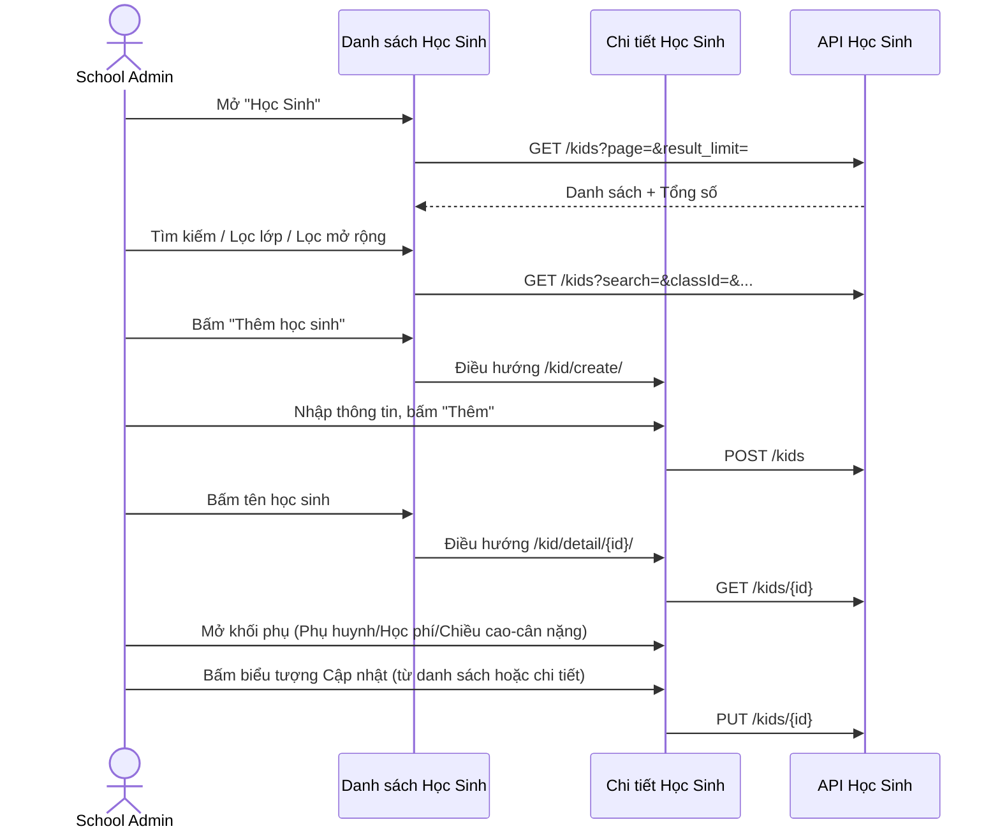
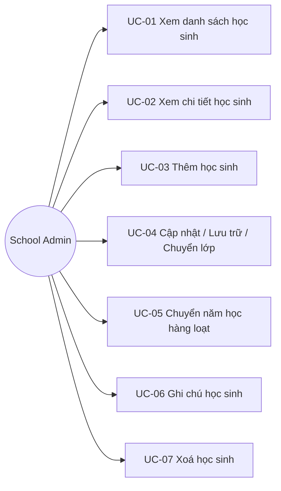

# Tên: Học Sinh (Nhà Trường)

## Mục lục
- [1. Thông tin tổng quan](#1-thông-tin-tổng-quan)
  - [1.1 Giới thiệu chung](#11-giới-thiệu-chung)
  - [1.2 Mục tiêu](#12-mục-tiêu)
  - [1.3 Phạm vi](#13-phạm-vi)
  - [1.4 Tài liệu tham khảo](#14-tài-liệu-tham-khảo)
- [2. Tổng quan nghiệp vụ](#2-tổng-quan-nghiệp-vụ)
  - [2.1 Đối tượng](#21-đối-tượng)
  - [2.2 Luồng nghiệp vụ](#22-luồng-nghiệp-vụ)
  - [2.3 Nguyên tắc nghiệp vụ](#23-nguyên-tắc-nghiệp-vụ)
- [3. Đặc tả tính năng](#3-đặc-tả-tính-năng)
  - [3.1 Phân rã chức năng](#31-phân-rã-chức-năng)
  - [3.2 Acceptance Criteria](#32-acceptance-criteria)
  - [3.3 Use case](#33-use-case)
  - [3.4 Edge Cases & Error Handling](#34-edge-cases--error-handling)
  - [3.5 Non-functional Requirements](#35-non-functional-requirements)
  - [3.6 Quy ước UI chung](#36-quy-ước-ui-chung)

> Quy ước: Mục lục dùng link Markdown chuẩn trỏ tới heading bên dưới (không dùng thẻ HTML `<a id>`).

> Khảo sát trên tenant **demo** (Trường THCS Demo Soha, thương hiệu SOHA/Eco School), tài khoản `adminsoha@demo.com`, vai trò School Admin.

## 1. Thông tin tổng quan

### 1.1 Giới thiệu chung
Học Sinh là module quản lý hồ sơ trẻ/học sinh trung tâm của toàn bộ Operating Portal: lưu thông tin định danh, lớp học, phụ huynh, học phí cơ bản, chỉ số phát triển thể chất, và là điểm trung chuyển (qua các tab) sang các module khác (Hoạt Động, Thư Viện, Điểm Danh, Học Phí) đã được lọc sẵn theo học sinh. Dành cho actor School Admin.

### 1.2 Mục tiêu
- Quản lý danh sách học sinh toàn trường: thêm mới, cập nhật, lưu trữ, xoá.
- Gán/xem lớp học chính và lớp ngoại khóa của học sinh.
- Quản lý phụ huynh/người giám hộ gắn với từng học sinh.
- Ghi nhận học phí mặc định (học phí, tiền ăn) và lịch sử chiều cao/cân nặng.
- Hỗ trợ chuyển lớp và chuyển năm học (đơn lẻ hoặc hàng loạt).
- Cung cấp lối tắt xem nhanh Bảng điểm, ghi chú riêng cho từng học sinh.

### 1.3 Phạm vi
| In scope | Out of scope |
|---|---|
| Danh sách học sinh: tìm kiếm, lọc theo lớp, Lọc mở rộng (Thời gian nhập học, CSDL Sở), phân trang | Không bấm "Xuất dữ liệu" (tải file thật) |
| Xem Chi tiết học sinh (tab Hồ Sơ đầy đủ: thông tin cơ bản, phụ huynh, học phí, chiều cao/cân nặng, thông tin mở rộng) | Không đi sâu nội dung 4 tab tái sử dụng (Hoạt Động, Thư Viện, Điểm Danh, Học Phí) — xem tài liệu module gốc tương ứng |
| Mở form "Thêm học sinh" (trang riêng, xem đầy đủ trường) — không bấm "Thêm" để tạo thật | Không tạo/xoá/lưu trữ học sinh thật trên dữ liệu demo |
| Mở modal "Cập nhật thông tin học sinh", quan sát 2 hành động phụ "Lưu trữ Học sinh"/"Chuyển lớp" — không xác nhận | Không xác nhận modal "Chuyển lớp" hay "Chuyển năm học" |
| Mở và đọc nội dung modal "Ghi chú học sinh" (cả trường hợp có và chưa có ghi chú) | Không thực hiện chỉnh sửa ghi chú |
| Mở modal xác nhận xoá học sinh — bấm "Hủy bỏ" | Không xác nhận xoá |
| Mở modal "Chuyển năm học" (bulk, từ nút "...") — quan sát cấu trúc form | Không áp dụng chuyển năm học/chuyển lớp thật |
| Lối tắt "Bảng điểm" từ cột Hành động | Không đi sâu nội dung Bảng điểm/Điểm & Đánh giá — xem `diem-danh-gia.md` |

### 1.4 Tài liệu tham khảo
- `hoc-tap/diem-danh-gia.md` — nội dung tab "Điểm Danh" trên Chi tiết học sinh và lối tắt "Bảng điểm" đều dẫn tới cùng dữ liệu Điểm & Đánh giá.
- `van-hanh/hoat-dong.md` — tab "Hoạt Động" trên Chi tiết học sinh là view lọc theo học sinh của module Hoạt Động.
- `van-hanh/thu-vien.md` — tab "Thư Viện" tương tự, lọc album theo học sinh.
- `tai-chinh/hoc-phi.md` — tab "Học Phí" trên Chi tiết học sinh là danh sách hóa đơn của riêng học sinh đó, cùng cấu trúc cột với module Học Phí.
- `tai-chinh/quan-ly-hoc-phi.md` — khối "Thông tin học phí" (Học phí/Tiền ăn) trên Chi tiết học sinh là override cấp học sinh của cấu hình phí theo lớp.
- `00-inventory.md` — liệt kê "Lưu Trữ" (`/demo/setting/kid/archived/`) là module riêng chứa học sinh đã lưu trữ; module này chỉ khảo sát điểm khởi tạo (nút "Lưu trữ Học sinh"), không khảo sát trang danh sách lưu trữ.

## 2. Tổng quan nghiệp vụ

### 2.1 Đối tượng
| Actor | Vai trò | Trách nhiệm chính |
|---|---|---|
| School Admin | Người quản trị trường | Thêm/sửa/lưu trữ/xoá học sinh, gán lớp, gán phụ huynh, cấu hình học phí mặc định, ghi nhận chiều cao/cân nặng |
| Học sinh (Kid) | Đối tượng được quản lý | Là chủ thể của hồ sơ; không tự thao tác trên portal này |
| Phụ huynh/Người giám hộ | Actor liên quan | Được gắn vào hồ sơ học sinh với vai trò (mẹ/cha/giám hộ/khác); một tài khoản phụ huynh có thể gắn với nhiều học sinh |
| Module Lớp Học, Điểm & Đánh Giá, Hoạt Động, Thư Viện, Điểm Danh, Học Phí | Hệ thống liên quan trong cùng portal | Được Học Sinh tham chiếu (lớp học) hoặc lồng ghép hiển thị qua các tab/lối tắt trên Chi tiết học sinh |

### 2.2 Luồng nghiệp vụ

#### 2.2.1 Mô hình hóa nghiệp vụ

#### 2.2.2 Mô tả các bước nghiệp vụ
| Bước | Người thực hiện | Mô tả | Kết quả |
|---|---|---|---|
| 1 | Admin | Mở module Học Sinh | Thấy danh sách toàn bộ học sinh của năm học hiện tại |
| 2 | Admin | Tìm kiếm/lọc theo lớp/Lọc mở rộng | Danh sách được lọc theo điều kiện |
| 3 | Admin | Bấm "Thêm học sinh" | Chuyển sang trang tạo mới, nhập hồ sơ + học phí mặc định + chỉ số ban đầu |
| 4 | Admin | Bấm tên một học sinh | Vào Chi tiết học sinh, xem/sửa toàn bộ hồ sơ và điều hướng sang các tab liên quan |
| 5 | Admin | Bấm icon Cập nhật ở danh sách | Mở modal Cập nhật thông tin (kèm 2 lối vào Lưu trữ Học sinh / Chuyển lớp) |
| 6 | Admin | Bấm "..." → "Chuyển năm học" | Mở modal chuyển hàng loạt học sinh giữa năm học/lớp |
| 7 | Admin | Bấm icon Xoá | Yêu cầu xác nhận trước khi xoá học sinh |

### 2.3 Nguyên tắc nghiệp vụ
| ID | Nguyên tắc nghiệp vụ |
|---|---|
| BR01 | Học sinh có tối đa 1 lớp chính quy; nếu có thêm lớp ngoại khóa, danh sách hiển thị thêm dòng "Ngoại khóa: {tên lớp}" bên dưới lớp chính trong cột "Lớp học" (quan sát ở học sinh "Phạm Hoàng Gia An": lớp chính INFANT + ngoại khóa "Lớp vẽ"). |
| BR02 | Icon ghi chú (📄) chỉ xuất hiện cạnh tên học sinh trong danh sách khi trường ghi chú (`kid_note`) có giá trị; học sinh chưa có ghi chú vẫn có nút "Xem ghi chú" nhưng modal hiển thị "Học sinh chưa có ghi chú". |
| BR03 | Icon lối tắt "Bảng điểm" (điều hướng `.../evaluation/`) trong cột Hành động chỉ xuất hiện với học sinh mà lớp đang học có gán mẫu đánh giá (`evaluation_template_id`) — quan sát: "An An" (Lớp 1A7, có mẫu) hiển thị 3 icon hành động, "Thiên Ân" (TODDLER, không có mẫu) chỉ hiển thị 2 icon (Cập nhật, Xoá). |
| BR04 | Trên form Thêm/Cập nhật, "Mã học sinh" và "Số CCCD" được đánh dấu bắt buộc (*), nhưng học sinh hiện có trong danh sách nếu chưa có mã sẽ hiển thị placeholder "Chưa có mã học sinh". |
| BR05 | Modal "Cập nhật thông tin học sinh" (mở từ icon Cập nhật ở danh sách hoặc từ Chi tiết học sinh) tích hợp thêm 2 hành động: "Lưu trữ Học sinh" (chuyển học sinh sang danh sách Lưu Trữ) và "Chuyển lớp" (mở modal Chuyển lớp riêng cho học sinh đang xem). |
| BR06 | Modal "Chuyển năm học" (mở từ nút "..." cạnh "Thêm học sinh", áp dụng hàng loạt) mặc định chọn Năm học hiện tại cho cả cột "Năm học cũ" và "Năm học mới"; phải chọn "Lớp" ở cột cũ trước để danh sách học sinh trong lớp đó xuất hiện cho việc chọn; nút "Áp dụng" bị khoá cho tới khi đủ điều kiện. |
| BR07 | Modal "Chuyển lớp" và "Chuyển năm học" dùng chung 3 dòng cảnh báo: (1) học sinh áp dụng học phí của lớp mới, (2) phụ huynh mất quyền xem chat nhóm lớp cũ, (3) Điểm và Đánh giá chỉ giữ lại cho môn học có ở lớp mới. |
| BR08 | "Lọc mở rộng" gồm 2 tiêu chí: "Thời gian nhập học" (theo ngày ghi danh) và "CSDL Sở" (liên kết CSDL ngành giáo dục cấp Sở). |
| BR09 | Cột "Trạng thái" tồn tại trên danh sách hiển thị trạng thái học tập (Đang học / Tạm nghỉ / Lưu trữ). |
| BR10 | Trang Chi tiết học sinh có 5 tab: "Hồ Sơ" (nội dung riêng của module này) và 4 tab tái sử dụng nguyên trạng UI của module khác nhưng lọc theo học sinh đang xem: "Hoạt Động", "Thư Viện", "Điểm Danh", "Học Phí". |
| BR11 | Khối "Chiều cao / cân nặng" mở modal "Lịch sử phát triển" độc lập: mỗi lần đo gồm ngày ghi nhận, chiều cao (cm), cân nặng (kg), BMI tự tính (= cân nặng / (chiều cao/100)²), người ghi nhận, ghi chú, và cho phép sửa từng dòng. |
| BR12 | Khối "Thông tin phụ huynh" hỗ trợ nhiều vai trò cùng lúc (vd. "Thông tin mẹ", "Thông tin người giám hộ"), mỗi vai trò là 1 thẻ riêng đầy đủ liên hệ (họ tên, SĐT, email, địa chỉ, CCCD, ngày sinh); vai trò "giám hộ" (hoặc phụ huynh dùng chung) còn hiển thị thêm "Phụ huynh của học sinh" — danh sách mọi học sinh khác cùng gắn với phụ huynh đó, xác nhận một tài khoản phụ huynh có thể đại diện nhiều học sinh. |
| BR13 | Form "Thêm học sinh" là một trang riêng (route `/kid/create/`), không phải modal, và không có bước gán phụ huynh ngay khi tạo — phụ huynh được gắn sau, tại trang Chi tiết học sinh qua nút "Thêm phụ huynh". |
| BR14 | Form Thêm/Cập nhật học sinh gồm 2 khối phụ ngay trong cùng form: "Thông tin học phí" (Học phí đ/tháng, Tiền ăn đ/ngày, Ghi chú học phí) và "Chiều cao/Cân nặng" (giá trị khởi tạo) — cho phép khởi tạo học phí override và chỉ số cơ thể đầu tiên ngay khi tạo học sinh. |
| BR15 | Danh sách mặc định hiển thị học sinh của năm học hiện tại ("Năm học 2025 - 2026", gắn nhãn "Hiện tại"); có thể đổi năm học xem qua dropdown ở góc phải tiêu đề trang. |

## 3. Đặc tả tính năng

### 3.1 Phân rã chức năng
| Feature | Platform | Priority | User Story |
|---|---|---|---|
| Danh sách học sinh (tìm kiếm, lọc, phân trang) | Web | High | Là Admin, tôi muốn tìm nhanh một học sinh trong toàn trường |
| Xem chi tiết học sinh | Web | High | Là Admin, tôi muốn xem toàn bộ hồ sơ một học sinh ở một nơi |
| Thêm học sinh | Web | High | Là Admin, tôi muốn tạo hồ sơ học sinh mới kèm học phí mặc định |
| Cập nhật/Lưu trữ/Chuyển lớp | Web | High | Là Admin, tôi muốn sửa hồ sơ hoặc chuyển học sinh sang lớp khác khi cần |
| Chuyển năm học hàng loạt | Web | Medium | Là Admin, tôi muốn lên lớp hàng loạt học sinh vào đầu năm học mới |
| Ghi chú học sinh | Web | Medium | Là Admin, tôi muốn ghi lại lưu ý riêng cho một học sinh |
| Xoá học sinh | Web | Low | Là Admin, tôi muốn xoá một hồ sơ nhập sai |

### 3.2 Acceptance Criteria
| User Story | Chức năng | Acceptance Criteria |
|---|---|---|
| Tìm nhanh học sinh | Tìm kiếm/lọc | Nhập tên vào ô tìm kiếm hoặc chọn lớp học → danh sách cập nhật theo điều kiện; "Lọc mở rộng" bổ sung Thời gian nhập học và CSDL Sở |
| Xem hồ sơ đầy đủ | Chi tiết học sinh | Trang Chi tiết hiển thị thông tin cơ bản, phụ huynh, học phí, chiều cao/cân nặng, thông tin mở rộng; có 4 tab điều hướng sang module khác đã lọc theo học sinh |
| Tạo hồ sơ mới | Thêm học sinh | Form yêu cầu tối thiểu Mã học sinh, Họ và tên, Số CCCD; các trường còn lại (ngày sinh, lớp, học phí, chiều cao/cân nặng) là tùy chọn |
| Sửa/chuyển lớp | Cập nhật | Modal Cập nhật cho sửa toàn bộ trường cơ bản và cung cấp 2 lối vào Lưu trữ/Chuyển lớp ngay trong modal |
| Lên lớp hàng loạt | Chuyển năm học | Modal yêu cầu chọn Lớp ở "Năm học cũ" trước, sau đó chọn học sinh cụ thể và Lớp ở "Năm học mới" trước khi "Áp dụng" được kích hoạt |
| Ghi chú | Ghi chú học sinh | Bấm icon ghi chú → modal hiển thị nội dung hiện có (hoặc thông báo chưa có) kèm nút sửa |
| Xoá | Xoá học sinh | Bấm icon xoá → modal yêu cầu xác nhận nêu rõ tên học sinh trước khi xoá |

### 3.3 Use case

