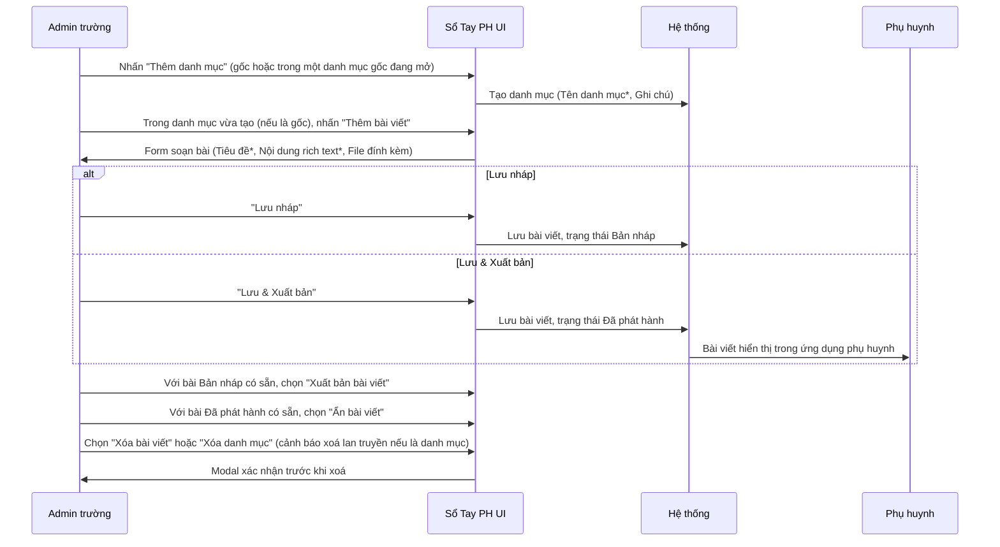
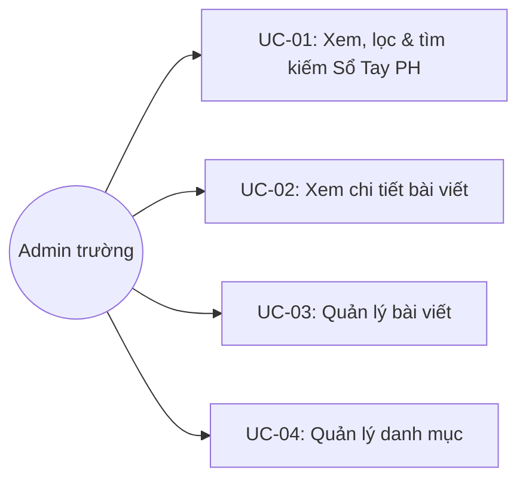

# Tên: Sổ Tay PH

## Mục lục
- [1. Thông tin tổng quan](#1-thông-tin-tổng-quan)
  - [1.1 Giới thiệu chung](#11-giới-thiệu-chung)
  - [1.2 Mục tiêu](#12-mục-tiêu)
  - [1.3 Phạm vi](#13-phạm-vi)
  - [1.4 Tài liệu tham khảo](#14-tài-liệu-tham-khảo)
- [2. Tổng quan nghiệp vụ](#2-tổng-quan-nghiệp-vụ)
  - [2.1 Đối tượng](#21-đối-tượng)
  - [2.2 Luồng nghiệp vụ](#22-luồng-nghiệp-vụ)
  - [2.3 Nguyên tắc nghiệp vụ](#23-nguyên-tắc-nghiệp-vụ)
- [3. Đặc tả tính năng](#3-đặc-tả-tính-năng)
  - [3.1 Phân rã chức năng](#31-phân-rã-chức-năng)
  - [3.2 Acceptance Criteria](#32-acceptance-criteria)
  - [3.3 Use case](#33-use-case)
  - [3.4 Edge Cases & Error Handling](#34-edge-cases--error-handling)
  - [3.5 Non-functional Requirements](#35-non-functional-requirements)
  - [3.6 Quy ước UI chung](#36-quy-ước-ui-chung)

## 1. Thông tin tổng quan

### 1.1 Giới thiệu chung
Sổ Tay PH là nơi nhà trường soạn và tổ chức nội dung dạng cẩm nang/FAQ (hướng dẫn, thông tin chung...) theo cây danh mục tối đa 2 cấp, mỗi danh mục chứa các bài viết nội dung rich text để phụ huynh tham khảo.

### 1.2 Mục tiêu
- Tổ chức nội dung theo cây danh mục (danh mục gốc → danh mục con → bài viết), giúp phụ huynh dễ tra cứu theo chủ đề.
- Soạn bài viết bằng rich text editor đầy đủ định dạng, kèm tệp đính kèm khi cần.
- Cho phép lưu nháp trước khi công bố, và ẩn lại một bài đã công bố mà không cần xoá.
- Hỗ trợ lọc theo trạng thái bài viết và tìm kiếm theo tiêu đề để quản trị nhanh trên cây nội dung nhiều tầng.

### 1.3 Phạm vi
| In scope | Out of scope |
|---|---|
| Xem cây danh mục/bài viết, lọc theo trạng thái, tìm kiếm theo tiêu đề bài viết | Nhắm nội dung tới đối tượng phụ huynh/lớp cụ thể (không thấy tuỳ chọn phạm vi hiển thị) |
| Tạo/Sửa/Xoá danh mục (gốc và con, tối đa 2 cấp) | Tạo danh mục con lồng quá 2 cấp |
| Tạo/Sửa/Xuất bản/Ẩn/Xoá bài viết, đính kèm tệp | Quy trình duyệt nội dung trước khi xuất bản |
| Sắp xếp thủ công thứ tự danh mục con/bài viết trong cùng một danh mục cha | Xem thống kê lượt xem của phụ huynh đối với từng bài viết |
| Xem nội dung bài viết dạng rich text kèm breadcrumb danh mục | Đăng nội dung thay mặt qua Bảng Thông Tin (là 2 module độc lập) |

### 1.4 Tài liệu tham khảo
- [Bảng Thông Tin](SM6-bang-thong-tin.md) — cùng là nơi công bố nội dung cho phụ huynh, nhưng Bảng Thông Tin là thông báo có hạn/gửi theo lớp, còn Sổ Tay PH là nội dung tham khảo dạng cây danh mục lâu dài.
- [Giáo Viên](SM2-giao-vien.md) — nơi cấp tài khoản đăng nhập cho nhân sự soạn nội dung; module này không tạo tài khoản riêng.

## 2. Tổng quan nghiệp vụ

### 2.1 Đối tượng
| Actor | Vai trò | Trách nhiệm chính |
|---|---|---|
| Admin trường | Người soạn nội dung | Tạo/sửa/xoá danh mục và bài viết; xuất bản hoặc ẩn bài viết; sắp xếp thứ tự cây nội dung |
| Phụ huynh | Người xem | Xem nội dung Sổ Tay PH đã xuất bản qua ứng dụng (không thao tác được trên Web Admin) |
| Hệ thống | Bên hỗ trợ | Lọc cây theo trạng thái/từ khoá; giới hạn độ sâu danh mục tối đa 2 cấp |

### 2.2 Luồng nghiệp vụ

#### 2.2.1 Mô hình hóa nghiệp vụ

#### 2.2.2 Mô tả các bước nghiệp vụ
| Bước | Người thực hiện | Mô tả | Kết quả |
|---|---|---|---|
| 1 | Admin | Vào menu Nhà Trường → Sổ Tay PH | Cây danh mục/bài viết hiển thị; danh mục gốc đầu tiên mở sẵn |
| 2 | Admin | Nhấn "Thêm danh mục" (ở cấp gốc hoặc trong một danh mục gốc đang mở) | Danh mục mới được tạo (là gốc hoặc con, tối đa 2 cấp) |
| 3 | Admin | Trong một danh mục (gốc hoặc con), nhấn "Thêm bài viết" | Trang soạn bài mới mở, danh mục đích cố định theo breadcrumb |
| 4 | Admin | Điền Tiêu đề, soạn Nội dung bằng rich text, đính kèm file (tuỳ chọn) | Nội dung bài viết được chuẩn bị |
| 5 | Admin | Nhấn "Lưu nháp" hoặc "Lưu & Xuất bản" | Bài viết lưu với trạng thái Bản nháp hoặc Đã phát hành |
| 6 | Admin | Với bài viết đã có: Sửa, Xuất bản/Ẩn (tuỳ trạng thái hiện tại), hoặc Xoá | Bài viết được cập nhật/đổi trạng thái/gỡ bỏ tương ứng |
| 7 | Admin | Lọc theo "Chọn trạng thái" hoặc gõ "Tìm kiếm bài viết" | Cây thu gọn về đúng các nhánh danh mục chứa bài viết khớp điều kiện |

### 2.3 Nguyên tắc nghiệp vụ
| ID | Nguyên tắc nghiệp vụ |
|---|---|
| BR01 | Nội dung tổ chức theo cây tối đa **2 cấp danh mục** (danh mục gốc → danh mục con); bài viết luôn là node lá, có thể nằm trực tiếp trong danh mục gốc hoặc trong danh mục con. Ở cấp danh mục con, chỉ còn nút "Thêm bài viết" — không còn "Thêm danh mục" — xác nhận giới hạn độ sâu. |
| BR02 | Toàn bộ danh mục (gốc và con) hoạt động theo cơ chế **accordion**: trong cùng một nhóm anh em (cùng danh mục cha), chỉ một danh mục được mở rộng tại một thời điểm; mở một danh mục khác trong cùng nhóm sẽ tự đóng danh mục đang mở, không cho mở nhiều đồng thời. |
| BR03 | Danh mục có thể có "Ghi chú" (mô tả) tuỳ chọn — hiển thị dạng khung viền chấm khi danh mục đang mở, và dạng dòng phụ dưới tên khi danh mục thu gọn. |
| BR04 | Chỉ **danh mục con và bài viết** có icon kéo-thả (☰) để sắp xếp thủ công thứ tự trong cùng danh mục cha; **danh mục gốc không có** icon này trên hàng của nó (không tự sắp xếp lại thứ tự các danh mục gốc qua kéo-thả). |
| BR05 | Bài viết có 2 trạng thái: "Bản nháp" (chữ xám nhạt, kèm badge "Bản nháp") và "Đã phát hành" (chữ màu cam/vàng nổi bật, không có badge). Bộ hành động "..." đổi theo trạng thái: Bản nháp → "Chỉnh sửa bài viết" / **"Xuất bản bài viết"** / "Xóa bài viết"; Đã phát hành → "Chỉnh sửa bài viết" / **"Ẩn bài viết"** / "Xóa bài viết". |
| BR06 | Click vào một bài viết mở nội dung ở panel bên phải kèm breadcrumb đầy đủ đường dẫn danh mục (dạng "Danh mục gốc > Danh mục con >"); nội dung hỗ trợ rich text đầy đủ (heading H1/H2, bold/italic/underline/strikethrough, quote, màu chữ/màu nền, danh sách có/không thứ tự, indent, chèn link) và cho phép đính kèm tệp. |
| BR07 | Form "Thêm bài viết"/"Chỉnh sửa bài viết" cố định danh mục đích — hiển thị dạng breadcrumb chỉ đọc ("Tên danh mục"), không cho đổi sang danh mục khác; danh mục đích xác định bởi đúng nút "+ Thêm bài viết" nào được bấm (query param `category`/`parentCategory` trên URL). |
| BR08 | Khi tạo/sửa một bài viết ở trạng thái Bản nháp, có 2 nút lưu riêng biệt: "Lưu nháp"/"Chỉnh sửa" (giữ hoặc chuyển về Bản nháp) và "Lưu & Xuất bản"/"Chỉnh sửa & Xuất bản" (lưu và chuyển thẳng sang Đã phát hành trong một bước). |
| BR09 | Xoá **danh mục** hiển thị cảnh báo hệ quả xoá lan truyền: "Lưu ý: Tất cả danh mục con và bài viết trong danh mục sẽ bị xóa"; xoá **bài viết** chỉ yêu cầu xác nhận đơn giản không kèm cảnh báo hệ quả (vì bài viết là node lá, không có gì bên trong để mất thêm). |
| BR10 | "Chọn trạng thái" (Bản nháp/Đã phát hành) và ô "Tìm kiếm bài viết" đều lọc theo tiêu đề **bài viết** (không khớp theo tên danh mục — ví dụ tìm đúng tên một danh mục con trả về rỗng) và đều **thu gọn cây về đúng các nhánh chứa bài viết khớp điều kiện**, tự động mở rộng các nhánh đó; danh mục không có bài viết khớp bị ẩn hoàn toàn khỏi cây thay vì chỉ mờ đi. Không có kết quả khớp trả về thông báo "Hiện chưa có danh mục hoặc bài viết nào. Hãy bắt đầu bằng cách tạo danh mục mới". |
| BR11 | Modal "Thêm danh mục"/"Chỉnh sửa danh mục" cho một **danh mục con** hiển thị thêm trường "Danh mục chính" (chỉ đọc, ghi rõ tên danh mục cha); modal cho **danh mục gốc** không có trường này. |
| BR12 | [Cần xác nhận] Chưa xác nhận được liệu "Ẩn bài viết" (chuyển một bài Đã phát hành về ẩn) có yêu cầu xác nhận qua modal hay áp dụng ngay lập tức khi bấm — không thử trực tiếp trên dữ liệu demo để tránh làm thay đổi trạng thái thật của bài viết. |

## 3. Đặc tả tính năng

### 3.1 Phân rã chức năng
| Feature | Platform | Priority | User Story |
|---|---|---|---|
| Xem cây danh mục/bài viết, lọc & tìm kiếm | Web Admin | High | Là Admin trường, tôi muốn xem và lọc nhanh nội dung Sổ Tay PH theo trạng thái hoặc tiêu đề |
| Quản lý danh mục (Tạo/Sửa/Xoá) | Web Admin | High | Là Admin trường, tôi muốn tổ chức nội dung theo danh mục và danh mục con |
| Quản lý bài viết (Tạo/Sửa/Xuất bản/Ẩn/Xoá) | Web Admin | High | Là Admin trường, tôi muốn soạn, công bố hoặc ẩn từng bài viết trong Sổ Tay PH |
| Xem chi tiết bài viết | Web Admin | Medium | Là Admin trường, tôi muốn xem đầy đủ nội dung một bài viết kèm vị trí trong cây danh mục |

### 3.2 Acceptance Criteria
| User Story | Chức năng | Acceptance Criteria |
|---|---|---|
| Xem, lọc & tìm kiếm | Cây danh mục | Lọc trạng thái/tìm kiếm thu gọn đúng về nhánh chứa bài viết khớp; không khớp gì hiển thị thông báo rỗng |
| Quản lý danh mục | Modal Thêm/Sửa danh mục | Danh mục con hiển thị "Danh mục chính" (chỉ đọc); danh mục gốc không có trường này; Tên danh mục là bắt buộc |
| Quản lý bài viết | Form Thêm/Sửa bài viết | Danh mục đích cố định theo breadcrumb; "Lưu nháp" giữ Bản nháp, "Lưu & Xuất bản" chuyển Đã phát hành |
| Xuất bản/Ẩn bài viết | Menu "..." của bài viết | Bài Bản nháp có tuỳ chọn "Xuất bản bài viết"; bài Đã phát hành có tuỳ chọn "Ẩn bài viết" |
| Xoá | Modal xác nhận xoá | Xoá danh mục cảnh báo mất toàn bộ danh mục con/bài viết bên trong; xoá bài viết chỉ xác nhận đơn giản |
| Xem chi tiết bài viết | Panel bên phải | Hiển thị đúng breadcrumb danh mục và nội dung rich text đầy đủ định dạng |

### 3.3 Use case

**UC-01**

| Trường | Nội dung |
|---|---|
| Use case ID | UC-01 |
| Use case name | Xem, lọc & tìm kiếm Sổ Tay PH |
| Use case description | Admin xem cây danh mục/bài viết, lọc theo trạng thái hoặc tìm kiếm theo tiêu đề bài viết |
| Actor | Admin trường |
| Happy path | 1. Admin vào menu Nhà Trường → Sổ Tay PH; danh mục gốc đầu tiên mở sẵn theo cơ chế accordion:    2. Admin chọn "Chọn trạng thái" = "Bản nháp" → cây thu gọn về đúng nhánh danh mục có bài Bản nháp, các nhánh khác bị ẩn:    3. Admin gõ từ khoá đúng tiêu đề bài viết vào "Tìm kiếm bài viết" → cây thu gọn tương tự, chỉ còn bài viết khớp tiêu đề:    4. Nếu từ khoá chỉ khớp **tên danh mục** (không khớp tiêu đề bài viết nào), kết quả trả về rỗng — xác nhận tìm kiếm chỉ áp dụng cho bài viết:   |
| Exception | Không có danh mục/bài viết nào khớp bộ lọc/tìm kiếm → thông báo "Hiện chưa có danh mục hoặc bài viết nào..." |
| Trigger | Admin click menu "Sổ Tay PH" trong nhóm "Nhà Trường" |
| Pre-condition | Admin đã đăng nhập với quyền quản trị trường |
| Post-condition | Cây danh mục/bài viết đúng theo bộ lọc/từ khoá được hiển thị |
| Business Rules | BR01, BR02, BR03, BR10 |

**UC-02**

| Trường | Nội dung |
|---|---|
| Use case ID | UC-02 |
| Use case name | Xem chi tiết bài viết |
| Use case description | Admin xem đầy đủ nội dung một bài viết kèm vị trí của nó trong cây danh mục |
| Actor | Admin trường |
| Happy path | 1. Từ cây danh mục, Admin click vào tiêu đề một bài viết. 2. Panel bên phải hiển thị breadcrumb danh mục đầy đủ, trạng thái, ngày giờ, và nội dung rich text đầy đủ định dạng (heading, link, danh sách...):   |
| Exception | Không có |
| Trigger | Admin click vào tiêu đề một bài viết trong cây |
| Pre-condition | Bài viết tồn tại trong cây đang xem |
| Post-condition | Nội dung đầy đủ của bài viết được hiển thị, không thay đổi dữ liệu |
| Business Rules | BR06 |

**UC-03**

| Trường | Nội dung |
|---|---|
| Use case ID | UC-03 |
| Use case name | Quản lý bài viết |
| Use case description | Admin tạo, sửa, xuất bản, ẩn hoặc xoá một bài viết |
| Actor | Admin trường |
| Happy path | 1. Admin nhấn "Thêm bài viết" trong một danh mục → trang soạn bài mở, danh mục đích cố định theo breadcrumb, có "Lưu nháp" và "Lưu & Xuất bản":    2. Với bài đã Đã phát hành, menu "..." trên panel chi tiết cho phép Chỉnh sửa / **Ẩn bài viết** / Xoá:    3. Với bài đang Bản nháp, menu "..." đổi thành Chỉnh sửa / **Xuất bản bài viết** / Xoá:   4. Chọn "Xóa bài viết" → modal xác nhận đơn giản, không cảnh báo hệ quả thêm:   |
| Exception | Chưa nhập Tiêu đề hoặc Nội dung → nút "Lưu nháp"/"Lưu & Xuất bản" bị vô hiệu hoá [Cần xác nhận, không thử submit thật] |
| Trigger | Admin nhấn "Thêm bài viết" trong một danh mục, hoặc chọn hành động từ menu "..." của một bài viết có sẵn |
| Pre-condition | Danh mục đích đã tồn tại (bài viết luôn thuộc một danh mục cụ thể) |
| Post-condition | Bài viết được tạo/cập nhật/đổi trạng thái/xoá tương ứng |
| Business Rules | BR05, BR06, BR07, BR08, BR09, BR12 |

**UC-04**

| Trường | Nội dung |
|---|---|
| Use case ID | UC-04 |
| Use case name | Quản lý danh mục |
| Use case description | Admin tạo, sửa hoặc xoá một danh mục (gốc hoặc con) |
| Actor | Admin trường |
| Happy path | 1. Admin nhấn "Thêm danh mục" (ở cấp gốc, hoặc trong một danh mục gốc đang mở để tạo danh mục con) → modal hiện ra với "Tên danh mục" (bắt buộc) và "Ghi chú"; nếu tạo danh mục con, modal có thêm "Danh mục chính" (chỉ đọc):   2. Admin mở menu "..." của một danh mục để Chỉnh sửa hoặc Xoá:   3. Chọn "Chỉnh sửa danh mục" → modal hiện đúng "Danh mục chính" (cha) và tên/ghi chú hiện tại để sửa:   4. Chọn "Xóa danh mục" → modal cảnh báo rõ hệ quả xoá lan truyền toàn bộ danh mục con và bài viết bên trong:   |
| Exception | Chưa nhập Tên danh mục → nút "Thêm"/"Cập nhật" bị vô hiệu hoá |
| Trigger | Admin nhấn "Thêm danh mục", hoặc chọn "Chỉnh sửa danh mục"/"Xóa danh mục" từ menu "..." của một danh mục có sẵn |
| Pre-condition | Nếu tạo danh mục con: danh mục gốc chứa nó đã tồn tại và đang mở |
| Post-condition | Danh mục được tạo/cập nhật/xoá (kèm toàn bộ nội dung con nếu xoá) tương ứng |
| Business Rules | BR01, BR02, BR03, BR04, BR09, BR11 |

### 3.4 Edge Cases & Error Handling

#### 3.4.1 Tổng quan
| Nhóm | Tình huống | Xử lý mong đợi |
|---|---|---|
| Cấu trúc cây | Tạo danh mục con trong một danh mục con khác | Không có nút "Thêm danh mục" ở cấp con — giới hạn tối đa 2 cấp danh mục (BR01) |
| Accordion | Mở một danh mục khác trong cùng nhóm anh em | Danh mục đang mở tự đóng lại, chỉ một mở tại một thời điểm (BR02) |
| Tìm kiếm/Lọc | Từ khoá chỉ khớp tên danh mục, không khớp tiêu đề bài viết nào | Trả về rỗng — tìm kiếm/lọc chỉ áp dụng cho bài viết (BR10) |
| Xoá danh mục | Danh mục có chứa danh mục con và/hoặc bài viết | Cảnh báo rõ toàn bộ nội dung con sẽ bị xoá theo (BR09) |
| Bài viết | Chuyển trạng thái Bản nháp ⇄ Đã phát hành | Đổi cả badge trạng thái, màu tiêu đề, và bộ hành động "..." tương ứng (BR05) |

#### 3.4.2 Danh sách Thông báo (lỗi/thành công)
| Message ID | Trường hợp lỗi | Rule kiểm tra | Message đề xuất | Hình thức báo | Hành vi hệ thống |
|---|---|---|---|---|---|
| ST-01 | Xoá một danh mục | Xác nhận trong modal | "Vui lòng xác nhận xóa danh mục {tên danh mục}. Lưu ý: Tất cả danh mục con và bài viết trong danh mục sẽ bị xóa" | Modal xác nhận | Chờ Admin xác nhận hoặc huỷ trước khi gọi API xoá (xoá lan truyền) |
| ST-02 | Xoá một bài viết | Xác nhận trong modal | "Vui lòng xác nhận xóa bài viết {tiêu đề bài viết}" | Modal xác nhận | Chờ Admin xác nhận hoặc huỷ trước khi gọi API xoá |
| ST-03 | Tìm kiếm/lọc không có kết quả | Không có bài viết khớp điều kiện | "Hiện chưa có danh mục hoặc bài viết nào. Hãy bắt đầu bằng cách tạo danh mục mới" | Text trạng thái rỗng trong khung danh sách | Không hiển thị cây, gợi ý tạo danh mục mới |

### 3.5 Non-functional Requirements
| ID | Nhóm | Yêu cầu |
|---|---|---|
| NFR01 | UX | Cây danh mục dùng accordion nhất quán ở mọi cấp, giảm rối mắt khi nội dung nhiều tầng và nhiều mục cùng cấp |
| NFR02 | Content | Rich text editor đầy đủ định dạng (heading, danh sách, link, màu chữ/nền) đáp ứng nhu cầu soạn nội dung cẩm nang dài, có cấu trúc |
| NFR03 | Data integrity | Xoá danh mục cảnh báo rõ hệ quả lan truyền trước khi cho xác nhận, giảm rủi ro mất nội dung ngoài ý muốn |

### 3.6 Quy ước UI chung
- Icon "lớp xếp tầng" (layers) dùng cho mọi hàng danh mục (gốc và con); icon "sách mở" dùng cho mọi hàng bài viết — phân biệt nhanh 2 loại node trong cùng một cây mà không cần đọc chữ.
- Bài viết Bản nháp luôn hiển thị chữ xám nhạt kèm badge "Bản nháp"; bài viết Đã phát hành hiển thị chữ màu cam/vàng nổi bật và không có badge — quy ước màu theo trạng thái nhất quán giữa danh sách và panel chi tiết.
- Đây là module duy nhất trong Nhà Trường mà bài viết/danh mục dùng chỉ một icon "..." kèm menu xổ xuống (2-3 lựa chọn) cho mọi hành động quản trị (Sửa/Xuất bản hoặc Ẩn/Xoá), thay vì bộ icon riêng lẻ xếp cạnh nhau như ở Thực Đơn hay Bảng Thông Tin.
- Form Thêm/Sửa bài viết và Thêm/Sửa danh mục đều dùng cùng biểu tượng "sổ tay có bóng đèn" ở đầu trang/modal — nhất quán với icon module trên sidebar.
- Trường rỗng hiển thị dạng nhãn hướng dẫn thao tác tiếp theo (ví dụ thông báo rỗng gợi ý "Hãy bắt đầu bằng cách tạo danh mục mới") thay vì chỉ để trống — khác với quy ước "Chưa có {trường}" ở một số module khác.
