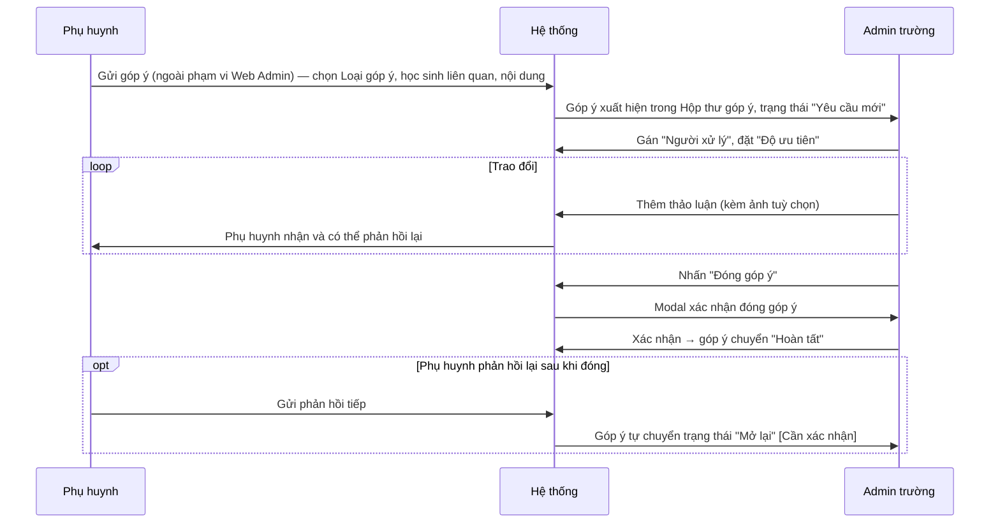
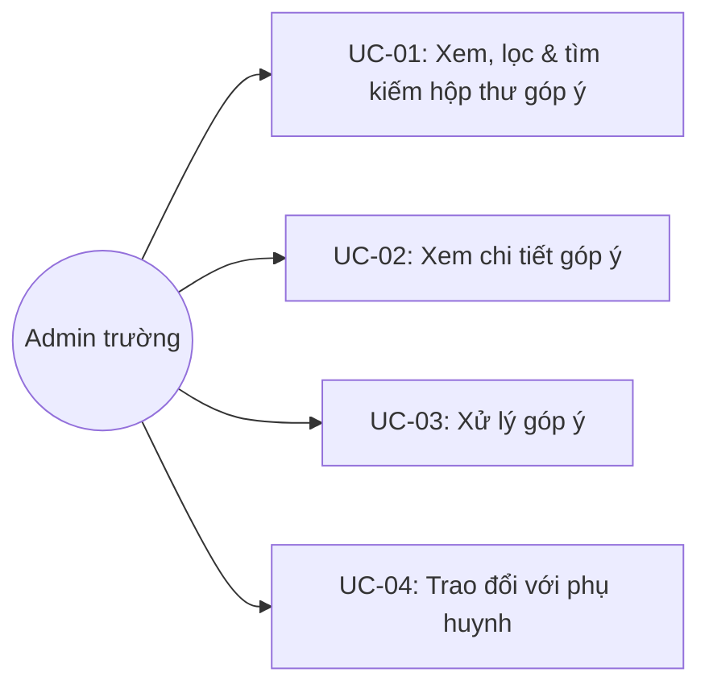

# Tên: Góp Ý

## Mục lục
- [1. Thông tin tổng quan](#1-thông-tin-tổng-quan)
  - [1.1 Giới thiệu chung](#11-giới-thiệu-chung)
  - [1.2 Mục tiêu](#12-mục-tiêu)
  - [1.3 Phạm vi](#13-phạm-vi)
  - [1.4 Tài liệu tham khảo](#14-tài-liệu-tham-khảo)
- [2. Tổng quan nghiệp vụ](#2-tổng-quan-nghiệp-vụ)
  - [2.1 Đối tượng](#21-đối-tượng)
  - [2.2 Luồng nghiệp vụ](#22-luồng-nghiệp-vụ)
  - [2.3 Nguyên tắc nghiệp vụ](#23-nguyên-tắc-nghiệp-vụ)
- [3. Đặc tả tính năng](#3-đặc-tả-tính-năng)
  - [3.1 Phân rã chức năng](#31-phân-rã-chức-năng)
  - [3.2 Acceptance Criteria](#32-acceptance-criteria)
  - [3.3 Use case](#33-use-case)
  - [3.4 Edge Cases & Error Handling](#34-edge-cases--error-handling)
  - [3.5 Non-functional Requirements](#35-non-functional-requirements)
  - [3.6 Quy ước UI chung](#36-quy-ước-ui-chung)

## 1. Thông tin tổng quan

### 1.1 Giới thiệu chung
Góp Ý là hộp thư tiếp nhận và xử lý góp ý/phản hồi từ phụ huynh gửi tới nhà trường, theo mô hình quản lý phiếu (ticket) với trạng thái, độ ưu tiên, người xử lý và luồng trao đổi hai chiều.

### 1.2 Mục tiêu
- Tiếp nhận góp ý của phụ huynh, phân loại theo chủ đề và mức độ ưu tiên.
- Cho phép Admin trường gán người xử lý và theo dõi trạng thái xử lý theo vòng đời phiếu (Yêu cầu mới → Đang xử lý → Hoàn tất, có thể Mở lại).
- Hỗ trợ trao đổi (thảo luận) qua lại giữa nhà trường và phụ huynh ngay trên từng góp ý.
- Cho phép lọc nhanh theo năm học, trạng thái, loại góp ý, người xử lý, độ ưu tiên, và trạng thái chờ phản hồi.

### 1.3 Phạm vi
| In scope | Out of scope |
|---|---|
| Xem, lọc, tìm kiếm danh sách góp ý theo năm học/trạng thái/loại/người xử lý/độ ưu tiên/khoảng ngày | Tạo góp ý mới (chỉ phụ huynh tạo từ ứng dụng phía phụ huynh) |
| Xem chi tiết góp ý kèm thông tin học sinh và phụ huynh liên quan | Chỉnh sửa nội dung góp ý gốc do phụ huynh gửi |
| Gán/đổi người xử lý, đổi độ ưu tiên | Xoá góp ý |
| Trao đổi (thảo luận) qua lại với phụ huynh trên từng góp ý | Mở lại một góp ý đã đóng theo thao tác chủ động của Admin [Cần xác nhận — không tìm thấy nút riêng, có thể do hệ thống tự chuyển khi phụ huynh phản hồi lại] |
| Đóng góp ý khi đã xử lý xong | Thống kê/báo cáo tổng hợp góp ý theo thời gian |

### 1.4 Tài liệu tham khảo
- [Học Sinh](SM1-hoc-sinh.md) — mỗi góp ý gắn với đúng một học sinh; modal "Thông tin học sinh" mở từ trang chi tiết góp ý dùng chung định dạng với module Học Sinh.
- [Lớp Học](SM3-lop-hoc.md) — trường "Lớp học" trong thông tin góp ý link trực tiếp sang trang chi tiết lớp.

## 2. Tổng quan nghiệp vụ

### 2.1 Đối tượng
| Actor | Vai trò | Trách nhiệm chính |
|---|---|---|
| Phụ huynh | Người gửi góp ý | Tạo góp ý từ ứng dụng phụ huynh (ngoài phạm vi Web Admin); trao đổi qua lại với nhà trường |
| Admin trường | Người xử lý | Xem, gán người xử lý, đổi độ ưu tiên, trao đổi, đóng góp ý |
| Hệ thống | Bên hỗ trợ | Theo dõi trạng thái/chờ phản hồi theo từng bên; tính số đếm theo trạng thái |

### 2.2 Luồng nghiệp vụ

#### 2.2.1 Mô hình hóa nghiệp vụ

#### 2.2.2 Mô tả các bước nghiệp vụ
| Bước | Người thực hiện | Mô tả | Kết quả |
|---|---|---|---|
| 1 | Admin | Vào menu Nhà Trường → Góp Ý | Danh sách góp ý của năm học hiện tại hiển thị, kèm 4 số đếm theo trạng thái |
| 2 | Admin | Lọc theo trạng thái (bấm thẻ số đếm), loại góp ý, người xử lý, độ ưu tiên, chờ phản hồi, hoặc khoảng ngày | Danh sách thu hẹp theo đúng điều kiện đã chọn |
| 3 | Admin | Click vào một góp ý | Trang chi tiết hiển thị nội dung, thông tin học sinh/phụ huynh liên quan |
| 4 | Admin | Gán "Người xử lý" và/hoặc đổi "Độ ưu tiên" | Góp ý được cập nhật người phụ trách/mức ưu tiên tương ứng |
| 5 | Admin | Thêm thảo luận trao đổi với phụ huynh | Nội dung trao đổi được ghi vào luồng thảo luận của góp ý |
| 6 | Admin | Nhấn "Đóng góp ý" và xác nhận | Góp ý chuyển trạng thái "Hoàn tất" |

### 2.3 Nguyên tắc nghiệp vụ
| ID | Nguyên tắc nghiệp vụ |
|---|---|
| BR01 | Hộp thư góp ý lọc theo "Năm học" (danh sách năm học đã tạo ở Cấu Hình → Năm Học); năm học hiện tại được đánh dấu "Hiện tại". Chỉ góp ý thuộc năm học đang chọn được hiển thị. |
| BR02 | 4 thẻ trạng thái đầu trang ("Yêu cầu mới", "Đang xử lý", "Hoàn tất", "Mở lại") đồng thời là **bộ lọc bấm được** — chọn một thẻ lọc bảng theo đúng trạng thái đó và hiện link "Xóa bộ lọc" để reset. **[Cần xác nhận — có thể là lỗi hiển thị]** Khi một thẻ được chọn làm bộ lọc, cả 4 số đếm cùng hiển thị theo tập dữ liệu đã lọc (có thể đồng thời về 0) thay vì luôn giữ nguyên số đếm tổng độc lập theo từng trạng thái như lúc chưa lọc. |
| BR03 | Góp ý phân loại theo 8 "Loại góp ý" cố định: Góp ý về nội dung, Hình thức/trình bày, Hiệu suất/chất lượng, Kỹ năng, Thái độ/hành vi, Quy trình, Trải nghiệm người dùng, Mang tính chiến lược. |
| BR04 | Độ ưu tiên có 4 mức cố định kèm màu riêng: Thấp (xanh dương), Trung bình (xanh lá, giá trị mặc định), Cao (vàng/cam), Khẩn cấp (đỏ). Có thể đổi trực tiếp (inline dropdown) ngay tại dòng trong danh sách hoặc trên trang chi tiết, không cần mở form riêng. |
| BR05 | "Chờ phản hồi" là bộ lọc riêng cho biết lượt trao đổi đang chờ bên nào: "Chờ phản hồi từ phụ huynh" hoặc "Chờ phản hồi từ nhà trường" — xác nhận cơ chế thảo luận hai chiều, mỗi lượt gửi qua lại đổi bên "đang chờ". |
| BR06 | Trang chi tiết một góp ý tách 2 khu vực độc lập: (a) Nội dung gốc + luồng thảo luận (thêm bình luận kèm ảnh, nút "Gửi" chỉ bật khi đã nhập nội dung); (b) 3 khung thông tin bên phải — "Thông tin góp ý" (loại, ngày tạo, học sinh, lớp học, người xử lý), "Thông tin người tạo" (họ tên, PH học sinh, email), "Góp ý gần đây" (các góp ý khác từng tạo bởi cùng phụ huynh, nếu có). |
| BR07 | "Đóng góp ý" yêu cầu xác nhận qua modal ("Vui lòng xác nhận Đóng góp ý {tên góp ý}") trước khi đổi trạng thái sang Hoàn tất — khác với gán "Người xử lý"/đổi "Độ ưu tiên" vốn là lựa chọn trực tiếp không qua xác nhận. |
| BR08 | Click vào tên học sinh hoặc tên phụ huynh trong trang chi tiết mở modal thông tin **chỉ đọc** tương ứng ("Thông tin học sinh"/"Thông tin phụ huynh") — cùng quy ước quick-view như các module khác trong Nhà Trường; mỗi modal có icon bút chì cạnh tên [Cần xác nhận công năng, không thử thao tác]. |
| BR09 | Không có nút/luồng để Admin trường tự tạo góp ý mới trên Web Admin — kể cả thẻ "Yêu cầu mới" có icon "+" cũng chỉ đóng vai trò bộ lọc như 3 thẻ còn lại, không mở form tạo. Góp ý chỉ được khởi tạo từ phía phụ huynh. |
| BR10 | Bộ lọc "Người xử lý" liệt kê nhân sự nội bộ nhà trường (Admin/Quản lý/Giáo viên) có thể được gán xử lý, không giới hạn theo một vai trò cụ thể. |
| BR11 | Mỗi góp ý gắn với đúng 1 học sinh và 1 phụ huynh (người tạo); trường "Lớp học" trong thông tin góp ý link trực tiếp sang trang chi tiết lớp tương ứng. |

## 3. Đặc tả tính năng

### 3.1 Phân rã chức năng
| Feature | Platform | Priority | User Story |
|---|---|---|---|
| Xem, lọc & tìm kiếm hộp thư góp ý | Web Admin | High | Là Admin trường, tôi muốn xem và lọc nhanh góp ý theo trạng thái/loại/người xử lý |
| Xem chi tiết góp ý | Web Admin | High | Là Admin trường, tôi muốn xem đầy đủ nội dung góp ý và thông tin học sinh/phụ huynh liên quan |
| Xử lý góp ý (gán người xử lý, đổi độ ưu tiên, đóng) | Web Admin | High | Là Admin trường, tôi muốn phân công xử lý và đóng góp ý khi đã giải quyết xong |
| Trao đổi với phụ huynh | Web Admin | Medium | Là Admin trường, tôi muốn trao đổi thêm thông tin với phụ huynh ngay trên góp ý |

### 3.2 Acceptance Criteria
| User Story | Chức năng | Acceptance Criteria |
|---|---|---|
| Xem, lọc & tìm kiếm | Danh sách + bộ lọc | Bấm một thẻ trạng thái lọc đúng bảng theo trạng thái đó; các bộ lọc khác (loại/người xử lý/độ ưu tiên/chờ phản hồi/ngày) áp dụng độc lập, "Xóa bộ lọc" trả về danh sách đầy đủ |
| Xem chi tiết | Trang chi tiết góp ý | Hiển thị đúng nội dung, breadcrumb trạng thái/độ ưu tiên, và 3 khung thông tin bên phải |
| Xử lý góp ý | Người xử lý / Độ ưu tiên / Đóng góp ý | Gán người xử lý và đổi độ ưu tiên áp dụng ngay; "Đóng góp ý" yêu cầu xác nhận trước khi đổi trạng thái |
| Trao đổi | Ô thảo luận | Nút "Gửi" vô hiệu khi ô trống, bật khi có nội dung |

### 3.3 Use case

**UC-01**

| Trường | Nội dung |
|---|---|
| Use case ID | UC-01 |
| Use case name | Xem, lọc & tìm kiếm hộp thư góp ý |
| Use case description | Admin xem danh sách góp ý và lọc theo năm học, trạng thái, loại góp ý, người xử lý, độ ưu tiên, chờ phản hồi hoặc khoảng ngày |
| Actor | Admin trường |
| Happy path | 1. Admin vào menu Nhà Trường → Góp Ý; danh sách của năm học hiện tại hiển thị kèm 4 số đếm trạng thái:    2. Admin bấm vào thẻ "Đang xử lý" để lọc theo đúng trạng thái đó; số đếm và bảng cùng cập nhật, xuất hiện link "Xóa bộ lọc":    3. Admin mở "Loại góp ý" để lọc theo 1 trong 8 loại cố định:    4. Admin mở bộ lọc "Năm học" ở góc phải trên để xem góp ý của năm học khác:   |
| Exception | Không có góp ý khớp bộ lọc → bảng hiển thị "Chưa có góp ý", "Tổng: 0" |
| Trigger | Admin click menu "Góp Ý" trong nhóm "Nhà Trường" |
| Pre-condition | Admin đã đăng nhập với quyền quản trị trường |
| Post-condition | Danh sách góp ý đúng theo bộ lọc được hiển thị |
| Business Rules | BR01, BR02, BR03 |

**UC-02**

| Trường | Nội dung |
|---|---|
| Use case ID | UC-02 |
| Use case name | Xem chi tiết góp ý |
| Use case description | Admin xem đầy đủ nội dung một góp ý kèm thông tin học sinh và phụ huynh liên quan |
| Actor | Admin trường |
| Happy path | 1. Từ danh sách, Admin click vào tiêu đề một góp ý. 2. Trang chi tiết hiển thị nội dung, luồng thảo luận, và 3 khung thông tin bên phải (Thông tin góp ý / Thông tin người tạo / Góp ý gần đây):    3. Click vào tên học sinh mở modal thông tin học sinh (chỉ đọc):   4. Click vào tên phụ huynh (người tạo) mở modal thông tin phụ huynh (chỉ đọc):   |
| Exception | Không có |
| Trigger | Admin click vào tiêu đề một góp ý từ danh sách |
| Pre-condition | Góp ý tồn tại và Admin có quyền truy cập |
| Post-condition | Thông tin đầy đủ của góp ý được hiển thị, không thay đổi dữ liệu |
| Business Rules | BR06, BR08, BR11 |

**UC-03**

| Trường | Nội dung |
|---|---|
| Use case ID | UC-03 |
| Use case name | Xử lý góp ý |
| Use case description | Admin gán người xử lý, đổi độ ưu tiên, và đóng góp ý khi đã giải quyết xong |
| Actor | Admin trường |
| Happy path | 1. Trên trang chi tiết, Admin mở dropdown "Độ ưu tiên" để chọn 1 trong 4 mức:   2. Admin mở "Chọn người xử lý" để gán một nhân sự phụ trách:   3. Khi đã xử lý xong, Admin nhấn "Đóng góp ý"; modal xác nhận hiện ra trước khi đổi trạng thái:   |
| Exception | Nhấn "Hủy bỏ" trên modal xác nhận → đóng modal, trạng thái không đổi |
| Trigger | Admin thao tác trên các control ở trang chi tiết góp ý |
| Pre-condition | Góp ý đang ở trạng thái cho phép xử lý (Yêu cầu mới/Đang xử lý/Mở lại) |
| Post-condition | Người xử lý/độ ưu tiên được cập nhật; góp ý chuyển "Hoàn tất" nếu xác nhận đóng |
| Business Rules | BR04, BR07, BR09, BR10 |

**UC-04**

| Trường | Nội dung |
|---|---|
| Use case ID | UC-04 |
| Use case name | Trao đổi với phụ huynh |
| Use case description | Admin thêm thảo luận trao đổi thông tin thêm với phụ huynh ngay trên góp ý |
| Actor | Admin trường |
| Happy path | 1. Trên trang chi tiết, Admin nhập nội dung vào ô "Thêm thảo luận" (có thể kèm ảnh qua icon bên trái); nút "Gửi" chuyển từ vô hiệu sang khả dụng:   2. Admin nhấn "Gửi" để thêm vào luồng thảo luận của góp ý. |
| Exception | Ô thảo luận trống → nút "Gửi" vô hiệu hoá, không gửi được |
| Trigger | Admin nhập nội dung vào ô "Thêm thảo luận" trên trang chi tiết |
| Pre-condition | Góp ý đang được xem ở trang chi tiết |
| Post-condition | Nội dung trao đổi được thêm vào luồng thảo luận; trạng thái chờ phản hồi đổi sang phía phụ huynh (BR05) |
| Business Rules | BR05, BR06 |

### 3.4 Edge Cases & Error Handling

#### 3.4.1 Tổng quan
| Nhóm | Tình huống | Xử lý mong đợi |
|---|---|---|
| Bộ lọc trạng thái | Chọn một thẻ trạng thái làm bộ lọc | Bảng lọc đúng trạng thái; [Cần xác nhận] cả 4 số đếm cùng phản ánh tập đã lọc thay vì giữ số đếm tổng độc lập (BR02) |
| Thảo luận | Ô "Thêm thảo luận" để trống | Nút "Gửi" vô hiệu hoá, không cho gửi rỗng (BR06) |
| Đóng góp ý | Nhấn "Hủy bỏ" trên modal xác nhận | Đóng modal, không đổi trạng thái (BR07) |
| Tạo góp ý | Admin trường không có nút tạo góp ý trên Web Admin | Chỉ phụ huynh tạo được góp ý từ ứng dụng khác (BR09) |
| Góp ý gần đây | Phụ huynh/học sinh chưa có góp ý nào khác | Hiển thị "Không có góp ý gần đây" (BR06) |

#### 3.4.2 Danh sách Thông báo (lỗi/thành công)
| Message ID | Trường hợp lỗi | Rule kiểm tra | Message đề xuất | Hình thức báo | Hành vi hệ thống |
|---|---|---|---|---|---|
| GY-01 | Đóng một góp ý | Xác nhận trong modal | "Vui lòng xác nhận Đóng góp ý {tên góp ý}" | Modal xác nhận | Chờ Admin xác nhận hoặc huỷ trước khi đổi trạng thái |
| GY-02 | Không có góp ý khớp bộ lọc | Không có bản ghi khớp điều kiện | "Chưa có góp ý" | Text trạng thái rỗng trong bảng | Hiển thị "Tổng: 0" |

### 3.5 Non-functional Requirements
| ID | Nhóm | Yêu cầu |
|---|---|---|
| NFR01 | UX | Đổi độ ưu tiên/gán người xử lý áp dụng trực tiếp (inline) không qua form riêng, giảm số bước xử lý một phiếu góp ý |
| NFR02 | Traceability | Mỗi góp ý liên kết trực tiếp tới hồ sơ học sinh và phụ huynh liên quan, hỗ trợ tra cứu nhanh bối cảnh khi xử lý |
| NFR03 | Communication | Cơ chế "Chờ phản hồi từ phụ huynh/nhà trường" giúp nhà trường theo dõi được lượt trao đổi nào đang chờ xử lý bên mình |

### 3.6 Quy ước UI chung
- Bộ 4 thẻ trạng thái dùng icon riêng biệt và nhất quán về màu (xanh dương "+"/tím xoay/xanh lá check/vàng xoay lại) cho Yêu cầu mới/Đang xử lý/Hoàn tất/Mở lại — cùng đóng vai trò vừa hiển thị số đếm vừa là bộ lọc, khác với các module khác trong Nhà Trường nơi số đếm chỉ mang tính hiển thị.
- Độ ưu tiên dùng ô màu nhỏ (chip vuông) đặt trước tên mức, nhất quán giữa danh sách và trang chi tiết — cùng quy ước với cách các module khác gắn màu cho trạng thái.
- Modal thông tin học sinh/phụ huynh dùng chung layout avatar-trái + danh sách trường-phải như các module Nhà Trường khác (Học Sinh, Giáo Viên, Điểm Danh NV).
- Trường rỗng hiển thị dạng "Chưa có {trường}" (ví dụ "Chưa có số điện thoại", "Chưa có ngày sinh") — nhất quán với quy ước chung của portal.
