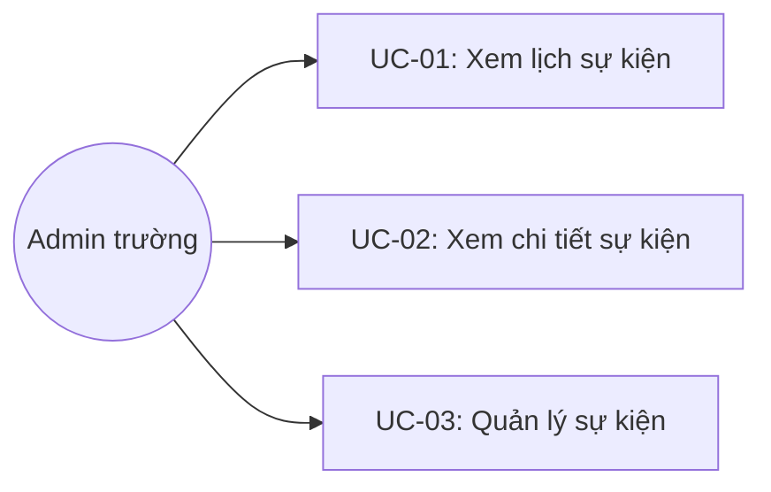

# Tên: Lịch Sự Kiện

## Mục lục
- [1. Thông tin tổng quan](#1-thông-tin-tổng-quan)
  - [1.1 Giới thiệu chung](#11-giới-thiệu-chung)
  - [1.2 Mục tiêu](#12-mục-tiêu)
  - [1.3 Phạm vi](#13-phạm-vi)
  - [1.4 Tài liệu tham khảo](#14-tài-liệu-tham-khảo)
- [2. Tổng quan nghiệp vụ](#2-tổng-quan-nghiệp-vụ)
  - [2.1 Đối tượng](#21-đối-tượng)
  - [2.2 Luồng nghiệp vụ](#22-luồng-nghiệp-vụ)
  - [2.3 Nguyên tắc nghiệp vụ](#23-nguyên-tắc-nghiệp-vụ)
- [3. Đặc tả tính năng](#3-đặc-tả-tính-năng)
  - [3.1 Phân rã chức năng](#31-phân-rã-chức-năng)
  - [3.2 Acceptance Criteria](#32-acceptance-criteria)
  - [3.3 Use case](#33-use-case)
  - [3.4 Edge Cases & Error Handling](#34-edge-cases--error-handling)
  - [3.5 Non-functional Requirements](#35-non-functional-requirements)
  - [3.6 Quy ước UI chung](#36-quy-ước-ui-chung)

## 1. Thông tin tổng quan

### 1.1 Giới thiệu chung
Lịch Sự Kiện quản lý lịch ngày nghỉ và sự kiện của trường theo năm, hiển thị dưới 3 chế độ xem (Năm/Tháng/Danh sách), phân loại theo 3 loại sự kiện màu riêng.

### 1.2 Mục tiêu
- Khai báo trước các ngày nghỉ/lễ và sự kiện của trường theo từng năm.
- Phân loại sự kiện theo 3 nhóm: ngày nghỉ, sự kiện nội bộ, sự kiện có mời phụ huynh — mỗi nhóm một màu để nhận diện nhanh trên lịch.
- Cho phép xem lịch theo năm (toàn cảnh), theo tháng (chi tiết hơn), hoặc theo danh sách phẳng (dễ quản lý/sửa/xoá).
- Cho phép đính kèm mô tả, địa điểm và tệp/ảnh cho mỗi sự kiện.

### 1.3 Phạm vi
| In scope | Out of scope |
|---|---|
| Xem lịch theo 3 chế độ: Năm, Tháng, Sự kiện (danh sách) | Gửi thông báo/nhắc nhở về sự kiện tới phụ huynh hoặc giáo viên (không thấy nút gửi) |
| Lọc theo năm; trong chế độ Sự kiện lọc thêm "Sự kiện sắp tới"/"Tất cả sự kiện" | Đồng bộ với lịch bên ngoài (Google Calendar, Outlook...) |
| Tạo/Sửa/Xoá sự kiện: tên, khoảng ngày, loại, địa điểm, mô tả, ảnh đại diện, file đính kèm | Sự kiện lặp lại định kỳ (recurring event) |
| Xem chi tiết một sự kiện (chỉ đọc) | Phân quyền hiển thị sự kiện theo loại hoặc theo vai trò xem |

### 1.4 Tài liệu tham khảo
- Năm Học (`/demo/setting/season/`) — chưa có tài liệu riêng cho module này. Lịch Sự Kiện chọn theo năm dương lịch độc lập; [Cần xác nhận] chưa rõ có liên kết dữ liệu với năm học hay không.

## 2. Tổng quan nghiệp vụ

### 2.1 Đối tượng
| Actor | Vai trò | Trách nhiệm chính |
|---|---|---|
| Admin trường | Người quản lý lịch | Tạo/sửa/xoá sự kiện; chọn năm/chế độ xem phù hợp |
| Hệ thống | Bên hỗ trợ | Hiển thị đúng màu theo loại sự kiện; tính "Sự kiện sắp tới" theo ngày hiện tại |
| Giáo viên/Phụ huynh | Người xem [Cần xác nhận] | [Cần xác nhận] chưa xác nhận được cách/nơi giáo viên hoặc phụ huynh xem được lịch này từ phía họ |

### 2.2 Luồng nghiệp vụ

#### 2.2.1 Mô hình hóa nghiệp vụ
```mermaid
sequenceDiagram
    participant Admin as Admin trường
    participant UI as Lịch Sự Kiện UI
    participant API as Hệ thống

    Admin->>UI: Chọn năm; chọn chế độ xem (Năm/Tháng/Sự kiện)
    Admin->>UI: Nhấn "Thêm sự kiện"
    UI->>Admin: Form Tên*, Từ ngày*/đến ngày*, Loại sự kiện*, Địa điểm, Mô tả, File đính kèm
    Admin->>UI: Nhấn "Thêm"
    UI->>API: Lưu sự kiện, hiển thị theo màu đúng loại trên lịch
    Admin->>UI: Click vào sự kiện trên lịch (chế độ Năm/Tháng)
    UI->>Admin: Modal "Chi tiết sự kiện" (chỉ đọc)
    Admin->>UI: Bấm icon bút chì trong modal (hoặc icon sửa trực tiếp ở chế độ Sự kiện)
    UI->>Admin: Trang "Chỉnh sửa sự kiện"
    Admin->>UI: Bấm icon xoá (chế độ Sự kiện)
    UI->>Admin: Modal xác nhận xoá
```

#### 2.2.2 Mô tả các bước nghiệp vụ
| Bước | Người thực hiện | Mô tả | Kết quả |
|---|---|---|---|
| 1 | Admin | Vào menu Nhà Trường → Lịch Sự Kiện | Lịch năm hiện tại hiển thị ở chế độ "Năm" theo mặc định |
| 2 | Admin | Chọn năm khác qua bộ chọn năm, hoặc đổi chế độ xem Tháng/Sự kiện | Lịch cập nhật theo đúng năm/chế độ đã chọn |
| 3 | Admin | Nhấn "Thêm sự kiện" | Trang tạo sự kiện mới mở, điền Tên, khoảng ngày, Loại sự kiện, Địa điểm, Mô tả |
| 4 | Admin | Nhấn "Thêm" | Sự kiện mới xuất hiện trên lịch với màu tương ứng loại đã chọn |
| 5 | Admin | Click vào một sự kiện trên lịch | Modal "Chi tiết sự kiện" hiển thị đầy đủ thông tin, chỉ đọc |
| 6 | Admin | Bấm icon sửa hoặc xoá (trong modal hoặc trực tiếp ở chế độ Sự kiện) | Chuyển sang trang chỉnh sửa, hoặc mở modal xác nhận xoá |

### 2.3 Nguyên tắc nghiệp vụ
| ID | Nguyên tắc nghiệp vụ |
|---|---|
| BR01 | Lịch có 3 chế độ xem chuyển đổi bằng tab: "Năm" (12 tháng dạng lưới trong một trang), "Tháng" (1 tháng/trang, mặc định là tháng hiện tại), "Sự kiện" (danh sách phẳng theo thứ tự thời gian, có icon sửa/xoá ngay trên từng dòng). |
| BR02 | Mỗi sự kiện thuộc đúng 1 trong 3 loại cố định, mỗi loại gắn 1 màu dùng nhất quán ở mọi chế độ xem: "Ngày nghỉ" (hồng/đỏ), "Sự kiện nội bộ" (xanh ngọc), "Sự kiện có mời phụ huynh" (cam) — có bảng "Chú thích" màu ở cuối trang chế độ Năm. |
| BR03 | Sự kiện có khoảng ngày Từ–đến, có thể kéo dài nhiều ngày liên tiếp (ví dụ Tết Nguyên Đán 16–20/02). Nếu sự kiện chỉ diễn ra 1 ngày, hệ thống **không tự đặt ngày kết thúc** — chỉ hiển thị ghi chú hướng dẫn Admin tự chọn ngày kết thúc bằng ngày bắt đầu. |
| BR04 | Ở chế độ "Năm"/"Tháng", sự kiện nhiều ngày hiển thị dạng thanh màu kéo dài liên tục qua các ngày trong lưới lịch; click vào thanh màu (hoặc tên sự kiện) mở modal "Chi tiết sự kiện" chỉ đọc (tên, khoảng ngày, loại, địa điểm, mô tả, file đính kèm). |
| BR05 | Ở chế độ "Sự kiện" (danh sách), mỗi dòng có sẵn icon sửa và xoá trực tiếp — khác với chế độ Năm/Tháng phải mở modal chi tiết trước, rồi bấm icon bút chì bên trong modal đó mới vào được trang sửa. |
| BR06 | Bộ lọc riêng của chế độ "Sự kiện" chỉ có 2 lựa chọn phạm vi: "Sự kiện sắp tới" (từ ngày hiện tại thực tế đến hết năm đang chọn — có thể trả về rỗng nếu năm đang chọn không còn sự kiện nào sau hôm nay) và "Tất cả sự kiện" (toàn bộ năm đang chọn); không có lựa chọn lọc theo loại sự kiện. |
| BR07 | Bấm icon sửa điều hướng sang trang riêng "Chỉnh sửa sự kiện" (không phải modal) với đầy đủ: Ảnh đại diện, Tên sự kiện*, Từ ngày*/đến ngày*, Loại sự kiện*, Địa điểm, Mô tả (rich text: bold/italic/underline/link/xoá định dạng), File đính kèm (hình ảnh, PDF). |
| BR08 | [Cần xác nhận] Trang "Chỉnh sửa sự kiện" hiển thị thêm checkbox "Thêm thời gian" ngay dưới khoảng ngày; trang "Thêm sự kiện" (tạo mới) không có checkbox này trong lần khảo sát — chưa xác nhận rõ nguyên nhân khác biệt giữa 2 trang có form tương tự nhau. |
| BR09 | Xoá một sự kiện yêu cầu xác nhận qua modal đơn giản ("Vui lòng xác nhận xóa sự kiện {tên sự kiện}"), không kèm cảnh báo hệ quả bổ sung nào khác. |
| BR10 | Năm có thể chọn trong khoảng rộng (xác nhận được ít nhất 2021–2028 qua bộ chọn năm dạng lưới, có điều hướng xem thêm) — không giới hạn theo năm học hiện tại của trường, và không phải chỉ nhập số năm tự do. |

## 3. Đặc tả tính năng

### 3.1 Phân rã chức năng
| Feature | Platform | Priority | User Story |
|---|---|---|---|
| Xem lịch theo Năm/Tháng/Danh sách | Web Admin | High | Là Admin trường, tôi muốn xem lịch sự kiện ở nhiều mức chi tiết khác nhau |
| Tạo/Sửa/Xoá sự kiện | Web Admin | High | Là Admin trường, tôi muốn khai báo trước các ngày nghỉ và sự kiện của trường |
| Xem chi tiết sự kiện | Web Admin | Medium | Là Admin trường, tôi muốn xem nhanh thông tin một sự kiện từ lịch |

### 3.2 Acceptance Criteria
| User Story | Chức năng | Acceptance Criteria |
|---|---|---|
| Xem lịch | 3 chế độ xem | Chuyển tab Năm/Tháng/Sự kiện hiển thị đúng dữ liệu năm đang chọn; màu sự kiện đúng theo loại |
| Tạo/Sửa/Xoá | Form sự kiện | Tên, Từ ngày, đến ngày, Loại sự kiện là bắt buộc; xoá yêu cầu xác nhận qua modal |
| Xem chi tiết | Modal chi tiết | Hiển thị đúng tên, khoảng ngày, loại, địa điểm, mô tả của sự kiện được click |

### 3.3 Use case


**UC-01**

| Trường | Nội dung |
|---|---|
| Use case ID | UC-01 |
| Use case name | Xem lịch sự kiện |
| Use case description | Admin xem lịch theo 3 chế độ (Năm/Tháng/Sự kiện), chọn năm và lọc phạm vi thời gian |
| Actor | Admin trường |
| Happy path | 1. Admin vào menu Nhà Trường → Lịch Sự Kiện; chế độ "Năm" hiển thị mặc định, 12 tháng trong 1 trang kèm chú thích màu:<br><br><br><br>2. Admin chuyển sang chế độ "Tháng" để xem chi tiết hơn 1 tháng, mặc định là tháng hiện tại:<br><br><br><br>3. Admin chuyển sang chế độ "Sự kiện" để xem danh sách phẳng, mỗi dòng có icon sửa/xoá trực tiếp:<br><br><br><br>4. Trong chế độ "Sự kiện", Admin lọc theo "Sự kiện sắp tới" hoặc "Tất cả sự kiện":<br><br> |
| Exception | Không có sự kiện nào khớp bộ lọc "Sự kiện sắp tới" → hiển thị "Tổng: 0" kèm minh hoạ rỗng |
| Trigger | Admin click menu "Lịch Sự Kiện" trong nhóm "Nhà Trường" |
| Pre-condition | Admin đã đăng nhập với quyền quản trị trường |
| Post-condition | Lịch/danh sách sự kiện đúng theo năm/chế độ/bộ lọc đã chọn được hiển thị |
| Business Rules | BR01, BR02, BR06, BR10 |

**UC-02**

| Trường | Nội dung |
|---|---|
| Use case ID | UC-02 |
| Use case name | Xem chi tiết sự kiện |
| Use case description | Admin xem đầy đủ thông tin một sự kiện từ chế độ Năm/Tháng |
| Actor | Admin trường |
| Happy path | 1. Ở chế độ Năm hoặc Tháng, Admin click vào tên/thanh màu của một sự kiện trên lịch.<br>2. Modal "Chi tiết sự kiện" hiện ra, hiển thị tên, ngày, loại sự kiện, địa điểm, mô tả, file đính kèm (chỉ đọc):<br><br> |
| Exception | Sự kiện chưa có địa điểm/mô tả/file đính kèm → các dòng tương ứng hiển thị trống |
| Trigger | Admin click vào một sự kiện trên lịch (chế độ Năm/Tháng) |
| Pre-condition | Sự kiện tồn tại trong năm đang xem |
| Post-condition | Thông tin đầy đủ của sự kiện được hiển thị, không thay đổi dữ liệu |
| Business Rules | BR04 |

**UC-03**

| Trường | Nội dung |
|---|---|
| Use case ID | UC-03 |
| Use case name | Quản lý sự kiện |
| Use case description | Admin tạo, sửa hoặc xoá một sự kiện trong lịch |
| Actor | Admin trường |
| Happy path | 1. Admin nhấn "Thêm sự kiện" → trang tạo mới mở với đầy đủ trường (Tên*, Từ ngày*/đến ngày*, Loại sự kiện*, Địa điểm, Mô tả, File đính kèm):<br><br><br>2. Admin mở dropdown "Loại sự kiện" để chọn 1 trong 3 loại cố định:<br><br><br>3. Với sự kiện có sẵn, Admin bấm icon sửa để vào trang "Chỉnh sửa sự kiện" (đã điền sẵn dữ liệu):<br><br><br>4. Admin bấm icon xoá (ở chế độ Sự kiện) → modal xác nhận hiện ra trước khi xoá:<br><br> |
| Exception | Chưa nhập Tên sự kiện/khoảng ngày/Loại sự kiện → nút "Thêm"/"Cập nhật" bị vô hiệu hoá |
| Trigger | Admin nhấn "Thêm sự kiện", hoặc bấm icon sửa/xoá trên một sự kiện có sẵn |
| Pre-condition | Admin đang xem đúng năm dự kiến tạo/sửa sự kiện |
| Post-condition | Sự kiện được tạo/cập nhật/xoá tương ứng, hiển thị đúng màu theo loại trên lịch |
| Business Rules | BR02, BR03, BR07, BR08, BR09 |

### 3.4 Edge Cases & Error Handling

#### 3.4.1 Tổng quan
| Nhóm | Tình huống | Xử lý mong đợi |
|---|---|---|
| Tạo/Sửa | Sự kiện chỉ diễn ra 1 ngày | Không tự đặt ngày kết thúc — chỉ hiển thị ghi chú hướng dẫn Admin tự chọn ngày kết thúc = ngày bắt đầu (BR03) |
| Lọc | Chọn "Sự kiện sắp tới" nhưng năm đang chọn không còn sự kiện nào sau hôm nay | Hiển thị "Tổng: 0" kèm minh hoạ rỗng, không báo lỗi (BR06) |
| Xoá | Xác nhận modal xoá | Xoá vĩnh viễn sự kiện khỏi lịch, không có bước khôi phục (BR09) |
| Chi tiết | Sự kiện chưa có Địa điểm/Mô tả/File đính kèm | Modal chi tiết hiển thị dòng trống cho trường tương ứng, không ẩn dòng (BR04) |

#### 3.4.2 Danh sách Thông báo (lỗi/thành công)
| Message ID | Trường hợp lỗi | Rule kiểm tra | Message đề xuất | Hình thức báo | Hành vi hệ thống |
|---|---|---|---|---|---|
| LS-01 | Xoá một sự kiện | Xác nhận trong modal | "Vui lòng xác nhận xóa sự kiện {tên sự kiện}" | Modal xác nhận | Chờ Admin xác nhận hoặc huỷ trước khi gọi API xoá |
| LS-02 | Rời trang tạo/sửa khi chưa lưu | Route change | "Thay đổi của bạn chưa được lưu. Vui lòng xác nhận rời khỏi khi chưa lưu!" | Modal xác nhận | Chờ Admin xác nhận rời trang hoặc ở lại |

### 3.5 Non-functional Requirements
| ID | Nhóm | Yêu cầu |
|---|---|---|
| NFR01 | UX | Màu sắc theo loại sự kiện nhất quán ở cả 3 chế độ xem, giúp nhận diện nhanh loại sự kiện trên lịch dày đặc |
| NFR02 | Data integrity | Xoá sự kiện luôn yêu cầu xác nhận qua modal, tránh xoá nhầm dữ liệu lịch năm học |
| NFR03 | Flexibility | Bộ chọn năm hỗ trợ phạm vi rộng (2021–2028+), phù hợp việc khai báo trước lịch cho nhiều năm học |

### 3.6 Quy ước UI chung
- 3 tab chế độ xem (Năm/Tháng/Sự kiện) dùng cùng một hàng nút bấm chuyển đổi ngay cạnh nút "Thêm sự kiện" — nhất quán vị trí control xuyên suốt module.
- Card ngày trong chế độ "Sự kiện" dùng khối số ngày lớn kèm tên tháng bên dưới (dạng "lịch xé"), khác với ô ngày dạng lưới thường thấy ở chế độ Năm/Tháng — chỉ riêng module này dùng kiểu thẻ ngày này trong Nhà Trường.
- Modal chi tiết và form tạo/sửa đều dùng chung icon "lịch có đồng hồ" ở đầu — nhất quán với icon module trên sidebar và trang chủ.
- Trường rỗng trong modal chi tiết hiển thị nhãn nhưng để trống nội dung (không có text) — khác với quy ước "Chưa có {trường}" phổ biến ở các module khác trong Nhà Trường.
