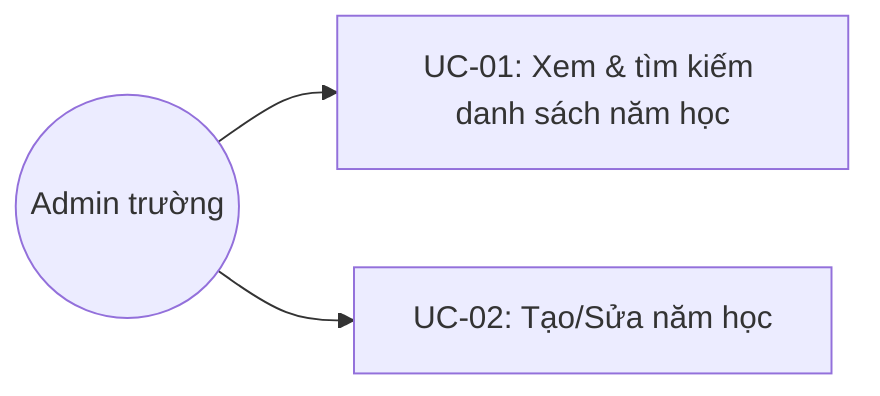

# Tên: Năm Học

## Mục lục
- [1. Thông tin tổng quan](#1-thông-tin-tổng-quan)
  - [1.1 Giới thiệu chung](#11-giới-thiệu-chung)
  - [1.2 Mục tiêu](#12-mục-tiêu)
  - [1.3 Phạm vi](#13-phạm-vi)
  - [1.4 Tài liệu tham khảo](#14-tài-liệu-tham-khảo)
- [2. Tổng quan nghiệp vụ](#2-tổng-quan-nghiệp-vụ)
  - [2.1 Đối tượng](#21-đối-tượng)
  - [2.2 Luồng nghiệp vụ](#22-luồng-nghiệp-vụ)
  - [2.3 Nguyên tắc nghiệp vụ](#23-nguyên-tắc-nghiệp-vụ)
- [3. Đặc tả tính năng](#3-đặc-tả-tính-năng)
  - [3.1 Phân rã chức năng](#31-phân-rã-chức-năng)
  - [3.2 Acceptance Criteria](#32-acceptance-criteria)
  - [3.3 Use case](#33-use-case)
  - [3.4 Edge Cases & Error Handling](#34-edge-cases--error-handling)
  - [3.5 Non-functional Requirements](#35-non-functional-requirements)
  - [3.6 Quy ước UI chung](#36-quy-ước-ui-chung)

## 1. Thông tin tổng quan

### 1.1 Giới thiệu chung
Năm Học quản lý danh sách các mốc thời gian (năm học/kỳ học) của trường, mỗi mốc gồm tên và khoảng ngày bắt đầu–kết thúc, dùng làm bộ lọc "Năm học" ở nhiều module khác trong portal.

### 1.2 Mục tiêu
- Khai báo trước các năm học/kỳ học kèm khoảng ngày cụ thể.
- Tự động xác định năm học "hiện tại" dựa trên ngày hệ thống, không cần chọn thủ công.
- Cung cấp danh sách năm học để các module khác (ví dụ Góp Ý) dùng làm bộ lọc theo năm học.

### 1.3 Phạm vi
| In scope | Out of scope |
|---|---|
| Xem danh sách năm học, tìm kiếm theo tên | Xoá năm học (không có chức năng này trên giao diện) |
| Tạo năm học mới (Tên*, Ngày bắt đầu*, Ngày kết thúc*) | Đặt năm học "hiện tại" thủ công (hệ thống tự tính theo ngày hôm nay) |
| Sửa tên/khoảng ngày của một năm học có sẵn | Gán/quản lý dữ liệu học tập (lớp, môn, điểm...) theo từng năm học từ module này |

### 1.4 Tài liệu tham khảo
- [Góp Ý](SM11-gop-y.md) — dùng danh sách năm học của module này làm bộ lọc "Năm học" trên hộp thư góp ý, năm hiện tại được đánh dấu "Hiện tại".

## 2. Tổng quan nghiệp vụ

### 2.1 Đối tượng
| Actor | Vai trò | Trách nhiệm chính |
|---|---|---|
| Admin trường | Người quản lý | Tạo/sửa năm học; tìm kiếm năm học có sẵn |
| Hệ thống | Bên hỗ trợ | Tự động xác định và gắn badge "Hiện tại" cho năm học chứa ngày hôm nay |

### 2.2 Luồng nghiệp vụ

#### 2.2.1 Mô hình hóa nghiệp vụ
```mermaid
sequenceDiagram
    participant Admin as Admin trường
    participant UI as Năm Học UI
    participant API as Hệ thống

    Admin->>UI: Nhấn "Tạo năm học"
    UI->>Admin: Form Tên năm học*, Ngày bắt đầu*, Ngày kết thúc*
    Admin->>UI: Nhấn "Thêm"
    UI->>API: Lưu năm học mới
    API->>UI: Danh sách cập nhật; nếu khoảng ngày chứa hôm nay, tự gắn badge "Hiện tại"
    Admin->>UI: Bấm icon Sửa trên một năm học có sẵn
    UI->>Admin: Form Chỉnh sửa năm học (đã điền sẵn)
    Admin->>UI: Nhấn "Cập nhật"
    UI->>API: Lưu thay đổi
```

#### 2.2.2 Mô tả các bước nghiệp vụ
| Bước | Người thực hiện | Mô tả | Kết quả |
|---|---|---|---|
| 1 | Admin | Vào menu Nhà Trường → Năm Học | Danh sách năm học hiển thị, năm chứa ngày hôm nay có badge "Hiện tại" |
| 2 | Admin | Gõ từ khoá vào ô "Tìm kiếm năm học" | Danh sách lọc ngay theo tên khớp |
| 3 | Admin | Nhấn "Tạo năm học", điền Tên/Ngày bắt đầu/Ngày kết thúc, nhấn "Thêm" | Năm học mới xuất hiện trong danh sách |
| 4 | Admin | Bấm icon Sửa trên một năm học, cập nhật thông tin, nhấn "Cập nhật" | Năm học được cập nhật theo thông tin mới |

### 2.3 Nguyên tắc nghiệp vụ
| ID | Nguyên tắc nghiệp vụ |
|---|---|
| BR01 | Badge "Hiện tại" được hệ thống **tự động** gắn cho năm học có khoảng [Ngày bắt đầu, Ngày kết thúc] chứa ngày hôm nay — form Tạo/Sửa không có trường hoặc checkbox nào để đặt "hiện tại" thủ công. |
| BR02 | Tên năm học là văn bản tự do, không bắt buộc theo mẫu "Năm học YYYY - YYYY" — dữ liệu demo có cả tên dạng kỳ học ("Kỳ 1 năm học 2026 - 2027") và tên tuỳ ý ("Test"). Tương ứng, khoảng ngày cũng không bắt buộc là một năm trọn vẹn, có thể là một kỳ ngắn hơn. |
| BR03 | Không có chức năng xoá năm học trên giao diện — cột "Hành động" trong danh sách chỉ có icon Sửa, xác nhận qua việc mọi dòng chỉ có một icon `icon_edit_square`, không có icon thùng rác. |
| BR04 | Form Tạo/Sửa năm học chỉ gồm 3 trường, đều bắt buộc: Tên năm học, Ngày bắt đầu, Ngày kết thúc — không có mô tả, không có liên kết chọn lớp/khối hoặc dữ liệu học tập nào khác. |
| BR05 | Ô "Tìm kiếm năm học" lọc theo tên, áp dụng ngay khi gõ (client-side), không cần bấm nút tìm kiếm riêng. |
| BR06 | [Cần xác nhận] Chưa xác nhận được hệ thống có kiểm tra/ngăn chặn tạo năm học với khoảng ngày chồng lấp năm học khác hay không (không thử tạo thật để kiểm tra) — dữ liệu demo hiện có các khoảng ngày nối tiếp nhau, không chồng lấp. |

## 3. Đặc tả tính năng

### 3.1 Phân rã chức năng
| Feature | Platform | Priority | User Story |
|---|---|---|---|
| Xem & tìm kiếm danh sách năm học | Web Admin | High | Là Admin trường, tôi muốn xem và tìm nhanh các năm học đã khai báo |
| Tạo/Sửa năm học | Web Admin | High | Là Admin trường, tôi muốn khai báo hoặc chỉnh sửa mốc thời gian năm học |

### 3.2 Acceptance Criteria
| User Story | Chức năng | Acceptance Criteria |
|---|---|---|
| Xem & tìm kiếm | Danh sách + ô tìm kiếm | Gõ từ khoá lọc đúng theo tên năm học khớp; năm chứa ngày hôm nay có badge "Hiện tại" |
| Tạo/Sửa | Form Tạo/Sửa năm học | Tên/Ngày bắt đầu/Ngày kết thúc là bắt buộc; "Thêm"/"Cập nhật" chỉ bật khi đủ thông tin |

### 3.3 Use case


**UC-01**

| Trường | Nội dung |
|---|---|
| Use case ID | UC-01 |
| Use case name | Xem & tìm kiếm danh sách năm học |
| Use case description | Admin xem danh sách năm học đã khai báo và tìm theo tên |
| Actor | Admin trường |
| Happy path | 1. Admin vào menu Nhà Trường → Năm Học; danh sách hiển thị đầy đủ, năm học chứa ngày hôm nay có badge "Hiện tại":<br><br><br><br>2. Admin gõ từ khoá vào ô "Tìm kiếm năm học" → danh sách lọc ngay theo tên khớp:<br><br> |
| Exception | Không có năm học nào khớp từ khoá → danh sách rỗng, "Tổng: 0" |
| Trigger | Admin click menu "Năm Học" trong nhóm "Nhà Trường" |
| Pre-condition | Admin đã đăng nhập với quyền quản trị trường |
| Post-condition | Danh sách năm học đúng theo từ khoá tìm kiếm được hiển thị |
| Business Rules | BR01, BR05 |

**UC-02**

| Trường | Nội dung |
|---|---|
| Use case ID | UC-02 |
| Use case name | Tạo/Sửa năm học |
| Use case description | Admin khai báo một năm học mới hoặc chỉnh sửa thông tin một năm học có sẵn |
| Actor | Admin trường |
| Happy path | 1. Admin nhấn "Tạo năm học" → form trống hiện ra với 3 trường bắt buộc:<br><br><br>2. Admin điền Tên năm học, Ngày bắt đầu, Ngày kết thúc, nhấn "Thêm".<br>3. Với năm học có sẵn, Admin bấm icon Sửa → form hiện ra với dữ liệu đã điền sẵn:<br><br><br>4. Admin sửa thông tin, nhấn "Cập nhật". |
| Exception | Chưa nhập đủ Tên/Ngày bắt đầu/Ngày kết thúc → nút "Thêm"/"Cập nhật" bị vô hiệu hoá |
| Trigger | Admin nhấn "Tạo năm học", hoặc bấm icon Sửa trên một năm học có sẵn |
| Pre-condition | Admin có quyền quản trị trường |
| Post-condition | Năm học mới được tạo, hoặc năm học có sẵn được cập nhật đúng thông tin |
| Business Rules | BR01, BR02, BR04, BR06 |

### 3.4 Edge Cases & Error Handling

#### 3.4.1 Tổng quan
| Nhóm | Tình huống | Xử lý mong đợi |
|---|---|---|
| Hiện tại | Không có năm học nào chứa ngày hôm nay trong khoảng của nó | Không năm học nào có badge "Hiện tại" [Cần xác nhận, không quan sát được trường hợp này trong dữ liệu demo] (BR01) |
| Tạo/Sửa | Khoảng ngày mới chồng lấp một năm học khác | [Cần xác nhận] Chưa xác nhận được hệ thống có chặn hay cho phép (BR06) |
| Tìm kiếm | Từ khoá không khớp năm học nào | Danh sách rỗng, "Tổng: 0" (BR05) |

#### 3.4.2 Danh sách Thông báo (lỗi/thành công)
| Message ID | Trường hợp lỗi | Rule kiểm tra | Message đề xuất | Hình thức báo | Hành vi hệ thống |
|---|---|---|---|---|---|
| NH-01 | Thiếu trường bắt buộc khi tạo/sửa | Tên/Ngày bắt đầu/Ngày kết thúc trống | Nút "Thêm"/"Cập nhật" bị vô hiệu hoá, không có message text riêng quan sát được | Disabled state | Không cho submit khi thiếu trường |

### 3.5 Non-functional Requirements
| ID | Nhóm | Yêu cầu |
|---|---|---|
| NFR01 | UX | Badge "Hiện tại" tính tự động theo ngày hệ thống, giảm thao tác thủ công và tránh sai sót khi chuyển giao năm học |
| NFR02 | Simplicity | Form chỉ 3 trường bắt buộc, tối giản cho một tác vụ khai báo mốc thời gian ít thay đổi |

### 3.6 Quy ước UI chung
- Đây là module nhỏ nhất trong Nhà Trường về số trường dữ liệu (chỉ 3 trường: Tên, Ngày bắt đầu, Ngày kết thúc), không có modal xác nhận nào (không có hành động xoá hay đổi trạng thái cần xác nhận).
- Tên năm học "hiện tại" được in đậm, màu xanh info kèm badge "Hiện tại" ngay cạnh — chỉ là kiểu hiển thị (styling), không phải link điều hướng dù trông giống link.
- Icon Sửa dùng biểu tượng vuông-bút chì (`icon_edit_square`) nhất quán với các bảng danh sách đơn giản khác trong portal.
