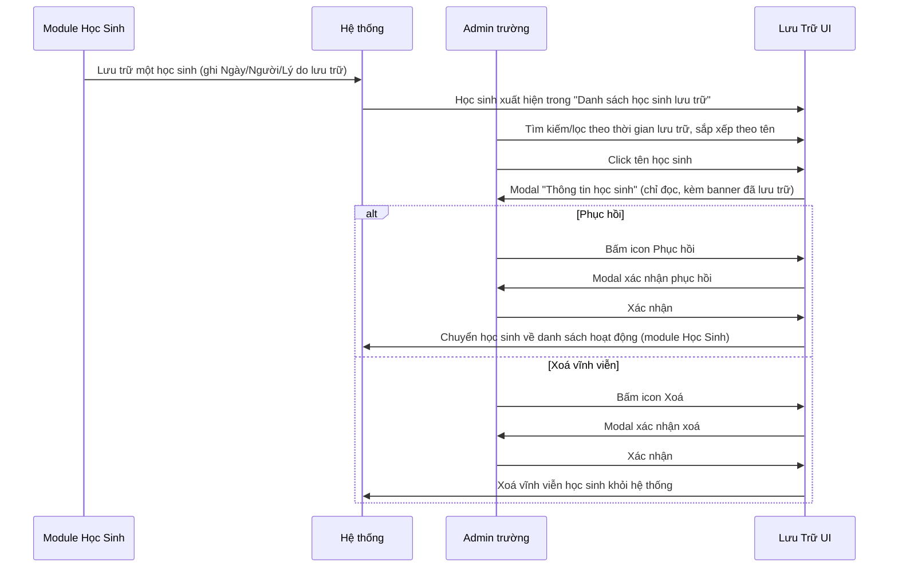
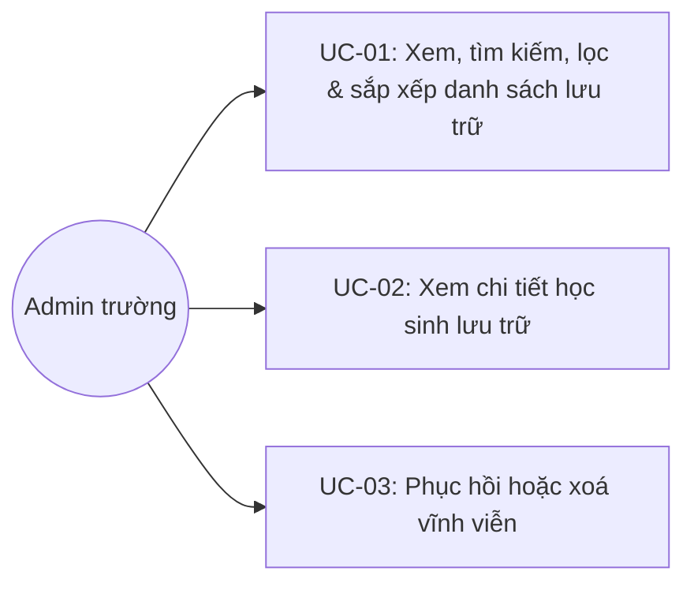

# Tên: Lưu Trữ

## Mục lục
- [1. Thông tin tổng quan](#1-thông-tin-tổng-quan)
  - [1.1 Giới thiệu chung](#11-giới-thiệu-chung)
  - [1.2 Mục tiêu](#12-mục-tiêu)
  - [1.3 Phạm vi](#13-phạm-vi)
  - [1.4 Tài liệu tham khảo](#14-tài-liệu-tham-khảo)
- [2. Tổng quan nghiệp vụ](#2-tổng-quan-nghiệp-vụ)
  - [2.1 Đối tượng](#21-đối-tượng)
  - [2.2 Luồng nghiệp vụ](#22-luồng-nghiệp-vụ)
  - [2.3 Nguyên tắc nghiệp vụ](#23-nguyên-tắc-nghiệp-vụ)
- [3. Đặc tả tính năng](#3-đặc-tả-tính-năng)
  - [3.1 Phân rã chức năng](#31-phân-rã-chức-năng)
  - [3.2 Acceptance Criteria](#32-acceptance-criteria)
  - [3.3 Use case](#33-use-case)
  - [3.4 Edge Cases & Error Handling](#34-edge-cases--error-handling)
  - [3.5 Non-functional Requirements](#35-non-functional-requirements)
  - [3.6 Quy ước UI chung](#36-quy-ước-ui-chung)

## 1. Thông tin tổng quan

### 1.1 Giới thiệu chung
Lưu Trữ là nơi tập trung các học sinh đã bị lưu trữ (rút hồ sơ) khỏi module Học Sinh, cho phép Admin xem lại thông tin, phục hồi về danh sách hoạt động, hoặc xoá vĩnh viễn.

### 1.2 Mục tiêu
- Tách học sinh đã nghỉ/chuyển đi khỏi danh sách học sinh đang hoạt động mà không mất dữ liệu.
- Ghi lại ngữ cảnh lưu trữ: ngày lưu trữ, người thực hiện, lý do.
- Cho phép phục hồi học sinh về trạng thái hoạt động khi cần, hoặc xoá vĩnh viễn khi không còn cần lưu giữ.

### 1.3 Phạm vi
| In scope | Out of scope |
|---|---|
| Xem danh sách học sinh đã lưu trữ, tìm kiếm, lọc theo thời gian lưu trữ, sắp xếp theo tên | Thực hiện hành động lưu trữ một học sinh (thuộc về module Học Sinh, không có ở đây) |
| Xem chi tiết học sinh lưu trữ (chỉ đọc) kèm ngữ cảnh lưu trữ | Chỉnh sửa thông tin học sinh khi đang ở trạng thái lưu trữ |
| Xem thông tin người đã thực hiện lưu trữ | — |
| Phục hồi học sinh về danh sách hoạt động | — |
| Xoá vĩnh viễn học sinh khỏi hệ thống | — |
| Xuất dữ liệu danh sách lưu trữ | — |

### 1.4 Tài liệu tham khảo
- [Học Sinh](SM1-hoc-sinh.md) — nơi thực hiện hành động "lưu trữ" một học sinh (đưa vào danh sách của module này); modal "Thông tin học sinh" ở đây dùng chung layout với module Học Sinh, chỉ thêm banner và các trường ngữ cảnh lưu trữ.

## 2. Tổng quan nghiệp vụ

### 2.1 Đối tượng
| Actor | Vai trò | Trách nhiệm chính |
|---|---|---|
| Admin trường | Người quản lý | Xem, tìm kiếm, phục hồi hoặc xoá vĩnh viễn học sinh đã lưu trữ |
| Hệ thống | Bên hỗ trợ | Ghi nhận ngày/người/lý do lưu trữ tại thời điểm học sinh bị lưu trữ ở module Học Sinh |

### 2.2 Luồng nghiệp vụ

#### 2.2.1 Mô hình hóa nghiệp vụ

#### 2.2.2 Mô tả các bước nghiệp vụ
| Bước | Người thực hiện | Mô tả | Kết quả |
|---|---|---|---|
| 1 | Admin | Vào menu Nhà Trường → Lưu Trữ | Danh sách học sinh đã lưu trữ hiển thị kèm ngày/người/lý do lưu trữ |
| 2 | Admin | Tìm kiếm theo tên, lọc theo "Thời gian lưu trữ", hoặc sắp xếp theo tên | Danh sách cập nhật theo đúng điều kiện |
| 3 | Admin | Click vào tên một học sinh | Modal "Thông tin học sinh" hiện ra, kèm banner "Học sinh đã được lưu trữ" và các trường ngữ cảnh lưu trữ |
| 4 | Admin | Bấm icon Phục hồi, xác nhận trong modal | Học sinh được đưa trở lại danh sách hoạt động ở module Học Sinh |
| 5 | Admin | Bấm icon Xoá, xác nhận trong modal | Học sinh bị xoá vĩnh viễn khỏi hệ thống |

### 2.3 Nguyên tắc nghiệp vụ
| ID | Nguyên tắc nghiệp vụ |
|---|---|
| BR01 | Danh sách chỉ chứa học sinh đã bị lưu trữ từ module Học Sinh — module này không có chức năng tạo mới hay đưa học sinh vào lưu trữ trực tiếp, chỉ tiếp nhận từ hành động lưu trữ đã thực hiện ở nơi khác. |
| BR02 | Mỗi dòng ghi 3 trường ngữ cảnh lưu trữ: "Ngày lưu trữ", "Lưu trữ bởi" (link mở modal thông tin nhân sự), "Lý do" (text tự do, ví dụ "Chuyển nhà", "Tốt nghiệp ra trường"). Cả 3 trường này có thể **trống** đối với một số bản ghi (quan sát được ở các dòng "Huy", "Ngọc", "Thương" thiếu một hoặc nhiều trường) — không phải trường bắt buộc phải có đầy đủ tại thời điểm lưu trữ. |
| BR03 | Click tên học sinh mở modal "Thông tin học sinh" dùng chung layout với module Học Sinh, có thêm banner cảnh báo màu vàng "🔒 Học sinh đã được lưu trữ" ở đầu và 3 trường bổ sung ở cuối: "Lý do lưu trữ", "Ngày lưu trữ", "Ghi chú lưu trữ" — riêng trường "Lưu trữ bởi" hiển thị trong bảng danh sách thì **không** xuất hiện trong modal này. |
| BR04 | Cột "Hành động" có đúng 2 icon: **Phục hồi** (hộp có mũi tên hướng lên) và **Xoá** (thùng rác) — cả hai đều yêu cầu xác nhận qua modal riêng, dùng 2 minh hoạ khác nhau (Phục hồi: hình 2 trẻ em; Xoá: hình 2 trẻ em kèm dấu X đỏ) để phân biệt mức độ hành động. |
| BR05 | "Phục hồi" đưa học sinh trở lại danh sách hoạt động của module Học Sinh. [Cần xác nhận] Chưa xác nhận được học sinh phục hồi có giữ lại lớp học/dữ liệu cũ hay cần gán lại từ đầu — không thực hiện thao tác thật để kiểm tra. |
| BR06 | "Xoá" tại module này là **xoá vĩnh viễn** khỏi hệ thống — nội dung xác nhận "Vui lòng xác nhận xoá học sinh {tên}!" không đề cập chuyển sang trạng thái nào khác, khác về bản chất với hành động "lưu trữ" (vốn có thể phục hồi lại). |
| BR07 | "Lọc mở rộng" chỉ có 1 trường "Thời gian lưu trữ" — chọn theo tháng/năm cụ thể (không phải khoảng ngày tự do), lọc theo tháng ghi nhận lưu trữ. |
| BR08 | Danh sách sắp xếp được theo tên hiển thị (nickname) qua icon mũi tên cạnh cột "Học sinh", đảo chiều A→Z/Z→A qua mỗi lần bấm. |
| BR09 | Có nút "Xuất dữ liệu" ở góc phải trên. [Cần xác nhận] Chưa xác nhận được định dạng file xuất ra (CSV/Excel) vì không thử tải xuống thật. |

## 3. Đặc tả tính năng

### 3.1 Phân rã chức năng
| Feature | Platform | Priority | User Story |
|---|---|---|---|
| Xem, tìm kiếm, lọc & sắp xếp danh sách lưu trữ | Web Admin | High | Là Admin trường, tôi muốn xem và tìm nhanh học sinh đã lưu trữ |
| Xem chi tiết học sinh lưu trữ & người lưu trữ | Web Admin | Medium | Là Admin trường, tôi muốn xem đầy đủ thông tin và ngữ cảnh lưu trữ của một học sinh |
| Phục hồi hoặc xoá vĩnh viễn | Web Admin | High | Là Admin trường, tôi muốn đưa học sinh trở lại hoạt động hoặc xoá hẳn khi không còn cần lưu giữ |
| Xuất dữ liệu | Web Admin | Low | Là Admin trường, tôi muốn xuất danh sách học sinh lưu trữ ra file |

### 3.2 Acceptance Criteria
| User Story | Chức năng | Acceptance Criteria |
|---|---|---|
| Xem, tìm kiếm, lọc & sắp xếp | Danh sách + bộ lọc | Tìm kiếm/lọc theo thời gian lưu trữ trả về đúng tập con; sắp xếp đảo đúng chiều A-Z/Z-A |
| Xem chi tiết | Modal Thông tin học sinh | Hiển thị banner đã lưu trữ và đủ 3 trường Lý do/Ngày lưu trữ/Ghi chú lưu trữ |
| Phục hồi/Xoá | Modal xác nhận | Yêu cầu xác nhận trước khi thực hiện; Hủy bỏ không làm thay đổi dữ liệu |

### 3.3 Use case

**UC-01**

| Trường | Nội dung |
|---|---|
| Use case ID | UC-01 |
| Use case name | Xem, tìm kiếm, lọc & sắp xếp danh sách lưu trữ |
| Use case description | Admin xem danh sách học sinh đã lưu trữ, tìm kiếm, lọc theo thời gian lưu trữ và sắp xếp theo tên |
| Actor | Admin trường |
| Happy path | 1. Admin vào menu Nhà Trường → Lưu Trữ; danh sách hiển thị đầy đủ kèm ngày/người/lý do lưu trữ (có thể trống với một số bản ghi):    2. Admin mở "Lọc mở rộng", chọn "Thời gian lưu trữ" theo tháng/năm:    3. Admin bấm icon mũi tên cạnh cột "Học sinh" để đảo chiều sắp xếp (Z→A):   |
| Exception | Không có học sinh nào khớp tìm kiếm/lọc → danh sách rỗng |
| Trigger | Admin click menu "Lưu Trữ" trong nhóm "Nhà Trường" |
| Pre-condition | Admin đã đăng nhập với quyền quản trị trường |
| Post-condition | Danh sách học sinh lưu trữ đúng theo điều kiện tìm kiếm/lọc/sắp xếp được hiển thị |
| Business Rules | BR01, BR02, BR07, BR08 |

**UC-02**

| Trường | Nội dung |
|---|---|
| Use case ID | UC-02 |
| Use case name | Xem chi tiết học sinh lưu trữ |
| Use case description | Admin xem đầy đủ thông tin một học sinh lưu trữ kèm ngữ cảnh lưu trữ và thông tin người thực hiện |
| Actor | Admin trường |
| Happy path | 1. Từ danh sách, Admin click vào tên một học sinh. 2. Modal "Thông tin học sinh" hiện ra kèm banner "Học sinh đã được lưu trữ" và các trường Lý do/Ngày lưu trữ/Ghi chú lưu trữ ở cuối:   3. Admin click vào tên người ở cột "Lưu trữ bởi" để xem thông tin nhân sự đã thực hiện lưu trữ:   |
| Exception | Trường Lý do/Ghi chú lưu trữ trống → hiển thị "Chưa có ghi chú" hoặc để trống |
| Trigger | Admin click vào tên học sinh hoặc tên người ở cột "Lưu trữ bởi" |
| Pre-condition | Học sinh/người lưu trữ tồn tại trong dữ liệu |
| Post-condition | Thông tin chi tiết được hiển thị, không thay đổi dữ liệu |
| Business Rules | BR02, BR03 |

**UC-03**

| Trường | Nội dung |
|---|---|
| Use case ID | UC-03 |
| Use case name | Phục hồi hoặc xoá vĩnh viễn |
| Use case description | Admin đưa một học sinh lưu trữ trở lại hoạt động, hoặc xoá vĩnh viễn khỏi hệ thống |
| Actor | Admin trường |
| Happy path | 1. Admin bấm icon Phục hồi trên một dòng → modal xác nhận hiện ra:   2. Admin xác nhận → học sinh trở lại danh sách hoạt động ở module Học Sinh. 3. Với dòng cần loại bỏ hẳn, Admin bấm icon Xoá → modal xác nhận riêng, minh hoạ khác biệt (dấu X đỏ):   4. Admin xác nhận → học sinh bị xoá vĩnh viễn. |
| Exception | Nhấn "Hủy bỏ" trên một trong hai modal → đóng modal, không thay đổi dữ liệu |
| Trigger | Admin bấm icon Phục hồi hoặc Xoá trên một dòng học sinh lưu trữ |
| Pre-condition | Học sinh đang ở trạng thái lưu trữ |
| Post-condition | Học sinh được chuyển về hoạt động, hoặc bị xoá vĩnh viễn khỏi hệ thống |
| Business Rules | BR04, BR05, BR06 |

### 3.4 Edge Cases & Error Handling

#### 3.4.1 Tổng quan
| Nhóm | Tình huống | Xử lý mong đợi |
|---|---|---|
| Dữ liệu lưu trữ | Bản ghi thiếu Ngày lưu trữ/Người lưu trữ/Lý do | Vẫn hiển thị bình thường trong danh sách, các ô tương ứng để trống (BR02) |
| Phục hồi | Xác nhận phục hồi | [Cần xác nhận] Chưa rõ lớp học/dữ liệu cũ có được giữ lại nguyên trạng hay không (BR05) |
| Xoá | Xác nhận xoá | Xoá vĩnh viễn, không có bước khôi phục lại được nữa (BR06) |
| Chi tiết | Ghi chú lưu trữ trống | Hiển thị "Chưa có ghi chú" trong modal (BR03) |

#### 3.4.2 Danh sách Thông báo (lỗi/thành công)
| Message ID | Trường hợp lỗi | Rule kiểm tra | Message đề xuất | Hình thức báo | Hành vi hệ thống |
|---|---|---|---|---|---|
| LT-01 | Phục hồi một học sinh | Xác nhận trong modal | "Vui lòng xác nhận phục hồi học sinh {tên học sinh}!" | Modal xác nhận | Chờ Admin xác nhận hoặc huỷ trước khi gọi API phục hồi |
| LT-02 | Xoá vĩnh viễn một học sinh | Xác nhận trong modal | "Vui lòng xác nhận xoá học sinh {tên học sinh}!" | Modal xác nhận | Chờ Admin xác nhận hoặc huỷ trước khi gọi API xoá vĩnh viễn |

### 3.5 Non-functional Requirements
| ID | Nhóm | Yêu cầu |
|---|---|---|
| NFR01 | Data integrity | Cả Phục hồi và Xoá đều yêu cầu xác nhận qua modal riêng biệt, dùng minh hoạ khác nhau để giảm nhầm lẫn giữa 2 hành động có mức độ hậu quả khác nhau |
| NFR02 | Traceability | Ghi nhận ngày/người/lý do lưu trữ ngay tại thời điểm lưu trữ, hỗ trợ tra soát sau này dù các trường này không bắt buộc đầy đủ |

### 3.6 Quy ước UI chung
- Modal "Thông tin học sinh" dùng chung layout với module Học Sinh nhưng thêm banner cảnh báo màu vàng ở đầu — quy ước "banner trạng thái đặc biệt" nhất quán với cách các module khác đánh dấu trạng thái không-bình-thường của một bản ghi.
- Hai hành động Phục hồi/Xoá dùng 2 icon và 2 bộ minh hoạ khác nhau trong modal xác nhận (không dùng chung 1 icon cảnh báo cho mọi hành động) — mức độ trực quan cao hơn so với các module khác chỉ đổi icon nhỏ mà giữ chung minh hoạ.
- Trường rỗng trong bảng danh sách để trống hoàn toàn (không hiển thị "Chưa có {trường}") — khác với modal chi tiết vẫn dùng quy ước "Chưa có {trường}" — cho thấy 2 khu vực hiển thị (bảng vs modal) tuân theo 2 quy ước khác nhau trong cùng module.
