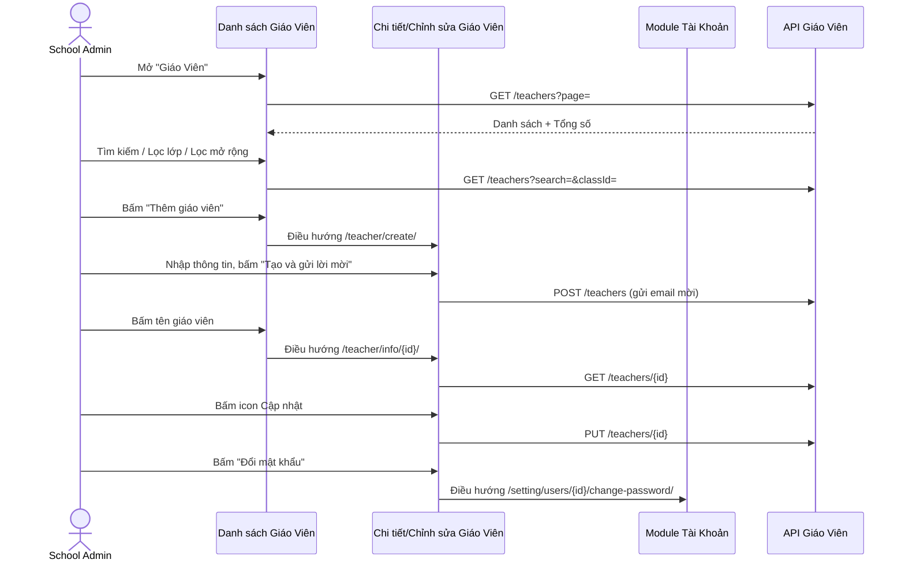

# Tên: Giáo Viên (Nhà Trường)

## Mục lục
- [1. Thông tin tổng quan](#1-thông-tin-tổng-quan)
  - [1.1 Giới thiệu chung](#11-giới-thiệu-chung)
  - [1.2 Mục tiêu](#12-mục-tiêu)
  - [1.3 Phạm vi](#13-phạm-vi)
  - [1.4 Tài liệu tham khảo](#14-tài-liệu-tham-khảo)
- [2. Tổng quan nghiệp vụ](#2-tổng-quan-nghiệp-vụ)
  - [2.1 Đối tượng](#21-đối-tượng)
  - [2.2 Luồng nghiệp vụ](#22-luồng-nghiệp-vụ)
  - [2.3 Nguyên tắc nghiệp vụ](#23-nguyên-tắc-nghiệp-vụ)
- [3. Đặc tả tính năng](#3-đặc-tả-tính-năng)
  - [3.1 Phân rã chức năng](#31-phân-rã-chức-năng)
  - [3.2 Acceptance Criteria](#32-acceptance-criteria)
  - [3.3 Use case](#33-use-case)
  - [3.4 Edge Cases & Error Handling](#34-edge-cases--error-handling)
  - [3.5 Non-functional Requirements](#35-non-functional-requirements)
  - [3.6 Quy ước UI chung](#36-quy-ước-ui-chung)

> Quy ước: Mục lục dùng link Markdown chuẩn trỏ tới heading bên dưới (không dùng thẻ HTML `<a id>`).

> Khảo sát trên tenant **demo** (Trường THCS Demo Soha, thương hiệu SOHA/Eco School), tài khoản `adminsoha@demo.com`, vai trò School Admin.

## 1. Thông tin tổng quan

### 1.1 Giới thiệu chung
Giáo Viên là module quản lý hồ sơ giáo viên/nhân viên của trường: thông tin liên hệ, phân công lớp (chủ nhiệm và phụ trách), phân quyền nội dung (Giáo viên chính/Hỗ trợ), và tài khoản đăng nhập đi kèm (email, mật khẩu, đổi email). Dành cho actor School Admin.

### 1.2 Mục tiêu
- Quản lý danh sách giáo viên toàn trường: thêm mới, cập nhật, xoá.
- Gán lớp chủ nhiệm và lớp phụ trách (giảng dạy) cho từng giáo viên.
- Phân quyền nội dung giáo viên được tạo (Giáo viên chính tự động đăng, Giáo viên hỗ trợ chờ duyệt).
- Cấp và quản lý tài khoản đăng nhập cho giáo viên (mật khẩu khởi tạo, đổi email, đổi mật khẩu).
- Tìm kiếm/lọc nhanh giáo viên theo tên, thông tin liên hệ, hoặc lớp phụ trách.

### 1.3 Phạm vi
| In scope | Out of scope |
|---|---|
| Danh sách giáo viên: tìm kiếm, lọc theo lớp, Lọc mở rộng (CSDL Sở), phân trang/tổng số | Không bấm "Xuất dữ liệu" (tải file thật) |
| Xem Chi tiết giáo viên (thông tin cơ bản, lớp chủ nhiệm/phụ trách, phân quyền, thông tin bổ sung) | — |
| Mở form "Thêm giáo viên mới" (trang riêng, xem đầy đủ trường) — không bấm "Tạo và gửi lời mời" để tạo thật | Không tạo/xoá giáo viên thật trên dữ liệu demo |
| Mở trang "Chỉnh sửa giáo viên", quan sát modal "Thay đổi email" — không xác nhận cập nhật thật | Không xác nhận đổi email/mật khẩu thật |
| Mở lối tắt "Đổi mật khẩu" để xác nhận nó dẫn sang trang riêng của Cấu Hình → Tài Khoản | Không đi sâu nội dung trang đổi mật khẩu hay module Tài Khoản |
| Mở modal xác nhận xoá giáo viên — bấm "Hủy bỏ" | Không xác nhận xoá thật |

### 1.4 Tài liệu tham khảo
- `hoc-sinh.md` — module cùng nhóm Nhà Trường, nhiều quy ước UI dùng chung (modal xác nhận xoá, trạng thái rỗng "Chưa có {trường}", Lọc mở rộng).
- `00-inventory.md` — liệt kê "Lớp Học" (`/demo/school/class/`) và "Tài Khoản" (`/demo/setting/users/`).
- Module "Hoạt Động" (Vận Hành) — trường "Phân quyền" (BR01) ảnh hưởng trực tiếp tới việc bài đăng của giáo viên có cần duyệt hay không.

## 2. Tổng quan nghiệp vụ

### 2.1 Đối tượng
| Actor | Vai trò | Trách nhiệm chính |
|---|---|---|
| School Admin | Người quản trị trường | Thêm/sửa/xoá giáo viên, gán lớp, gán phân quyền, cấp tài khoản đăng nhập |
| Giáo viên (Teacher) | Đối tượng được quản lý, đồng thời là actor hệ thống khác | Là chủ thể của hồ sơ; tài khoản được dùng để đăng nhập ứng dụng Giáo viên và tạo Hoạt Động |
| Module Lớp Học, Tài Khoản, Hoạt Động | Hệ thống liên quan trong cùng portal | "Lớp chủ nhiệm" tham chiếu 2 chiều với Lớp Học; "Đổi mật khẩu" dẫn sang Tài Khoản; "Phân quyền" ảnh hưởng luồng duyệt bài của Hoạt Động |

### 2.2 Luồng nghiệp vụ

#### 2.2.1 Mô hình hóa nghiệp vụ

### 2.3 Nguyên tắc nghiệp vụ
| ID | Nguyên tắc nghiệp vụ |
|---|---|
| BR01 | Trường "Phân quyền" có đúng 2 giá trị: "Giáo viên chính" và "Giáo viên hỗ trợ". Bài viết Hoạt Động do Giáo viên chính tạo được tự động đăng, còn do Giáo viên hỗ trợ tạo sẽ ở chế độ chờ duyệt. |
| BR02 | Trang Chi tiết tách hiển thị "Lớp chủ nhiệm" và "Lớp phụ trách" thành 2 dòng riêng; form Thêm/Chỉnh sửa gộp các lớp vào danh sách chọn "Lớp phụ trách" và liên kết với lớp chủ nhiệm. |
| BR03 | Form "Thêm giáo viên mới" bắt buộc Email*, Mật khẩu*, Họ và tên* — "Mã nhân viên" không bắt buộc. Nút submit là "Tạo và gửi lời mời", gửi email mời giáo viên tự đăng nhập. |
| BR04 | Ô "Tìm kiếm" khớp kiểu substring không phân biệt dấu tiếng Việt, quét cả "Họ và tên" lẫn Email. |
| BR05 | "Chọn lớp học" lọc giáo viên theo cả "Lớp chủ nhiệm" lẫn "Lớp phụ trách". |
| BR06 | Đổi email không sửa trực tiếp trên form Chỉnh sửa mà qua modal riêng "Thay đổi email" (Email hiện tại chỉ đọc + Email mới bắt buộc). |
| BR07 | "Đổi mật khẩu" điều hướng sang trang riêng của Cấu Hình → Tài Khoản (`/setting/users/{id}/change-password/?teacherId={id}`). |
| BR08 | Cột "Trạng thái" hiển thị trạng thái công tác (Đang làm việc / Tạm nghỉ / Đã nghỉ việc). |
| BR09 | "Lọc mở rộng" cung cấp tiêu chí "CSDL Sở". |
| BR10 | Cột "Hành động" gồm 2 icon (Cập nhật, Xoá). |
| BR11 | Trạng thái rỗng dùng chung quy ước "Chưa có {trường}" và "Chưa có thông tin" cho khối Thông tin bổ sung. |

## 3. Đặc tả tính năng

### 3.1 Phân rã chức năng
| Feature | Platform | Priority | User Story |
|---|---|---|---|
| Danh sách giáo viên (tìm kiếm, lọc, phân trang) | Web | High | Là Admin, tôi muốn tìm nhanh một giáo viên trong toàn trường |
| Xem chi tiết giáo viên | Web | High | Là Admin, tôi muốn xem toàn bộ hồ sơ một giáo viên ở một nơi |
| Thêm giáo viên mới | Web | High | Là Admin, tôi muốn tạo tài khoản giáo viên mới và gửi lời mời đăng nhập |
| Cập nhật/Đổi email/Đổi mật khẩu | Web | High | Là Admin, tôi muốn sửa hồ sơ hoặc cấp lại thông tin đăng nhập khi cần |
| Xoá giáo viên | Web | Low | Là Admin, tôi muốn xoá một hồ sơ nhập sai |

### 3.2 Acceptance Criteria
| User Story | Chức năng | Acceptance Criteria |
|---|---|---|
| Tìm nhanh giáo viên | Tìm kiếm/lọc | Nhập từ khóa vào ô tìm kiếm hoặc chọn lớp học → danh sách cập nhật; "Lọc mở rộng" bổ sung CSDL Sở |
| Xem hồ sơ đầy đủ | Chi tiết giáo viên | Trang Chi tiết hiển thị thông tin cơ bản, lớp chủ nhiệm, lớp phụ trách, phân quyền, thông tin bổ sung |
| Tạo tài khoản mới | Thêm giáo viên | Form yêu cầu tối thiểu Email, Mật khẩu, Họ và tên; submit gửi lời mời qua email |
| Sửa/đổi tài khoản | Cập nhật | Trang Chỉnh sửa cho sửa toàn bộ trường cơ bản; đổi email qua modal riêng; đổi mật khẩu điều hướng sang Tài Khoản |
| Xoá | Xoá giáo viên | Bấm icon xoá → modal yêu cầu xác nhận nêu rõ tên giáo viên trước khi xoá |
