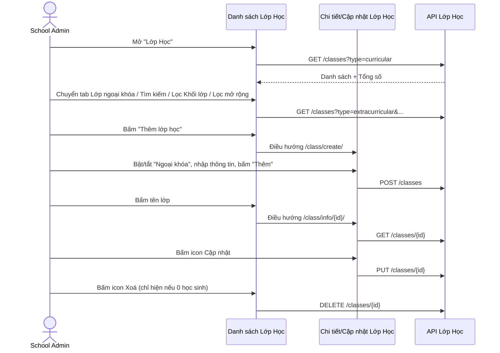

# Tên: Lớp Học (Nhà Trường)

## Mục lục
- [1. Thông tin tổng quan](#1-thông-tin-tổng-quan)
  - [1.1 Giới thiệu chung](#11-giới-thiệu-chung)
  - [1.2 Mục tiêu](#12-mục-tiêu)
  - [1.3 Phạm vi](#13-phạm-vi)
  - [1.4 Tài liệu tham khảo](#14-tài-liệu-tham-khảo)
- [2. Tổng quan nghiệp vụ](#2-tổng-quan-nghiệp-vụ)
  - [2.1 Đối tượng](#21-đối-tượng)
  - [2.2 Luồng nghiệp vụ](#22-luồng-nghiệp-vụ)
  - [2.3 Nguyên tắc nghiệp vụ](#23-nguyên-tắc-nghiệp-vụ)
- [3. Đặc tả tính năng](#3-đặc-tả-tính-năng)
  - [3.1 Phân rã chức năng](#31-phân-rã-chức-năng)
  - [3.2 Acceptance Criteria](#32-acceptance-criteria)
  - [3.3 Use case](#33-use-case)
  - [3.4 Edge Cases & Error Handling](#34-edge-cases--error-handling)
  - [3.5 Non-functional Requirements](#35-non-functional-requirements)
  - [3.6 Quy ước UI chung](#36-quy-ước-ui-chung)

> Quy ước: Mục lục dùng link Markdown chuẩn trỏ tới heading bên dưới (không dùng thẻ HTML `<a id>`).

> Khảo sát trên tenant **demo** (Trường THCS Demo Soha, thương hiệu SOHA/Eco School), tài khoản `adminsoha@demo.com`, vai trò School Admin.

## 1. Thông tin tổng quan

### 1.1 Giới thiệu chung
Lớp Học là module quản lý danh sách lớp của trường, chia làm 2 loại: **Lớp chính khóa** (chương trình giáo dục chính thức, đầy đủ tính năng) và **Lớp ngoại khóa** (hoạt động bổ sung ngoài giờ, chỉ hỗ trợ một phần tính năng). Module này còn là nơi hội tụ dữ liệu từ nhiều module khác cho từng lớp: học phí, danh sách học sinh, đánh giá, phân công bộ môn. Dành cho actor School Admin.

### 1.2 Mục tiêu
- Quản lý danh sách lớp học chính khóa và ngoại khóa: thêm mới, cập nhật, xoá (khi lớp không còn học sinh).
- Gán GV chủ nhiệm cho từng lớp; xem danh sách giáo viên phụ trách.
- Xem nhanh học phí, danh sách học sinh, thông tin đánh giá, phân công bộ môn của một lớp từ một nơi duy nhất.
- Tìm kiếm/lọc lớp theo tên, khối lớp, hoặc vai trò giáo viên (GV thường/GV chủ nhiệm).

### 1.3 Phạm vi
| In scope | Out of scope |
|---|---|
| Danh sách lớp học: 2 tab (Lớp chính khóa/Lớp ngoại khóa), tìm kiếm, lọc Khối lớp, Lọc mở rộng (Phân loại GV, Giáo viên, CSDL Sở) | Không đi sâu nội dung các khối nhúng lại từ module khác |
| Xem Chi tiết lớp học (cả 2 loại, so sánh khác biệt tính năng) | Không đi sâu 3 tab tái sử dụng trên Chi tiết lớp |
| Mở form "Thêm lớp học" (kể cả toggle Ngoại khóa) — không bấm "Thêm" để tạo thật | Không tạo/xoá lớp học thật trên dữ liệu demo |
| Mở trang "Cập nhật lớp học", quan sát dropdown "GV chủ nhiệm" — không bấm "Cập nhật" để lưu thật | Không xác nhận lưu thay đổi thật |
| Mở modal xác nhận xoá lớp học (chỉ khả dụng với lớp 0 học sinh) — bấm "Hủy bỏ" | Không xác nhận xoá thật |

### 1.4 Tài liệu tham khảo
- `hoc-sinh.md`, `giao-vien.md` — cùng nhóm Nhà Trường.
- `00-inventory.md` — Quản Lý Học Phí, Điểm & Đánh Giá, Môn Học, Khối Lớp.

## 2. Tổng quan nghiệp vụ

### 2.1 Đối tượng
| Actor | Vai trò | Trách nhiệm chính |
|---|---|---|
| School Admin | Người quản trị trường | Thêm/sửa/xoá lớp, gán GV chủ nhiệm, xem tổng hợp học phí/học sinh/đánh giá theo lớp |
| Giáo viên (Teacher) | Đối tượng được tham chiếu | Được gán làm GV chủ nhiệm hoặc GV phụ trách của lớp |
| Học sinh (Kid) | Đối tượng được tham chiếu | Thuộc về một lớp; hồ sơ chi tiết xem ở module Học Sinh |

### 2.2 Luồng nghiệp vụ

#### 2.2.1 Mô hình hóa nghiệp vụ

### 2.3 Nguyên tắc nghiệp vụ
| ID | Nguyên tắc nghiệp vụ |
|---|---|
| BR01 | Lớp học chia 2 loại quản lý ở 2 tab riêng: "Lớp chính khóa" và "Lớp ngoại khóa". Lớp ngoại khóa chỉ hỗ trợ điểm danh, hoạt động và thư viện; không có tab Học Phí, không có Đánh giá và Phân công bộ môn. |
| BR02 | Icon Xoá trong cột Hành động chỉ xuất hiện với lớp có 0 học sinh. Lớp có ≥1 học sinh chỉ có icon Học phí và Cập nhật. |
| BR03 | Form Thêm/Cập nhật lớp chính khóa chỉ có trường "GV chủ nhiệm" (single-select). Lớp ngoại khóa có trường "Giáo viên" (multi-select). |
| BR04 | Bộ lọc "Khối lớp" chỉ xuất hiện ở tab Lớp chính khóa. |
| BR05 | "Lọc mở rộng" có 3 tiêu chí: Phân loại GV (GV thường / GV chủ nhiệm), Giáo viên (chọn GV cụ thể), CSDL Sở. |
| BR06 | Khối "Phân công bộ môn" yêu cầu chọn Khối lớp trước; nếu chưa chọn, nút "Thêm môn học" bị khoá. |
| BR07 | Chi tiết lớp chính khóa nhúng lại "Thông tin học phí" (6 khoản) đầy đủ hơn lớp ngoại khóa (1 khoản học phí rút gọn). |
| BR08 | Icon đầu tiên trong cột Hành động điều hướng thẳng tới tab Học Phí của lớp. |
| BR09 | Dropdown GV chủ nhiệm khi cập nhật hiển thị danh sách giáo viên toàn trường. |
| BR10 | Trạng thái rỗng dùng chung quy ước "Chưa có {trường}". |

## 3. Đặc tả tính năng

### 3.1 Phân rã chức năng
| Feature | Platform | Priority | User Story |
|---|---|---|---|
| Danh sách lớp học (2 tab, tìm kiếm, lọc, phân trang) | Web | High | Là Admin, tôi muốn tìm nhanh một lớp học và phân biệt chính khóa/ngoại khóa |
| Xem chi tiết lớp học | Web | High | Là Admin, tôi muốn xem tổng hợp học phí, học sinh, đánh giá của một lớp ở một nơi |
| Thêm lớp học | Web | High | Là Admin, tôi muốn tạo lớp mới, chọn đúng loại chính khóa/ngoại khóa |
| Cập nhật lớp học | Web | High | Là Admin, tôi muốn sửa thông tin lớp hoặc đổi GV chủ nhiệm |
| Xoá lớp học | Web | Low | Là Admin, tôi muốn xoá một lớp tạo nhầm khi chưa có học sinh |
