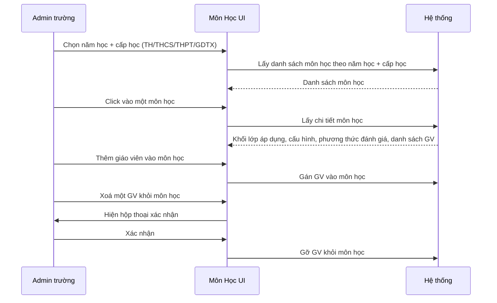

# Tên: Môn Học (Nhà Trường)

## Mục lục
- [1. Thông tin tổng quan](#1-thông-tin-tổng-quan)
  - [1.1 Giới thiệu chung](#11-giới-thiệu-chung)
  - [1.2 Mục tiêu](#12-mục-tiêu)
  - [1.3 Phạm vi](#13-phạm-vi)
  - [1.4 Tài liệu tham khảo](#14-tài-liệu-tham-khảo)
- [2. Tổng quan nghiệp vụ](#2-tổng-quan-nghiệp-vụ)
  - [2.1 Đối tượng](#21-đối-tượng)
  - [2.2 Luồng nghiệp vụ](#22-luồng-nghiệp-vụ)
  - [2.3 Nguyên tắc nghiệp vụ](#23-nguyên-tắc-nghiệp-vụ)
- [3. Đặc tả tính năng](#3-đặc-tả-tính-năng)
  - [3.1 Phân rã chức năng](#31-phân-rã-chức-năng)
  - [3.2 Acceptance Criteria](#32-acceptance-criteria)
  - [3.3 Use case](#33-use-case)
  - [3.4 Edge Cases & Error Handling](#34-edge-cases--error-handling)
  - [3.5 Non-functional Requirements](#35-non-functional-requirements)
  - [3.6 Quy ước UI chung](#36-quy-ước-ui-chung)

## 1. Thông tin tổng quan

### 1.1 Giới thiệu chung
Môn Học là danh mục các môn học/hoạt động giáo dục của trường, được tổ chức theo cấp học (TH/THCS/THPT/GDTX) và theo năm học. Module này dùng cho Admin trường để tra cứu cấu hình môn học (kiểu môn học, cách tính tổng kết, phương thức đánh giá theo từng kỳ) và quản lý danh sách giáo viên được phân công giảng dạy mỗi môn.

### 1.2 Mục tiêu
- Xem toàn bộ danh mục môn học của trường, phân theo cấp học.
- Hiển thị cấu hình đánh giá của từng môn (có tính tổng kết hay không, phương thức đánh giá theo từng kỳ: Điểm/Mức đánh giá/Nhận xét).
- Quản lý (thêm/xoá) giáo viên giảng dạy cho từng môn học.
- Cho biết môn học áp dụng cho khối lớp nào.

### 1.3 Phạm vi
| In scope | Out of scope |
|---|---|
| Xem danh sách môn học theo cấp học (TH/THCS/THPT/GDTX) | Tạo mới môn học (hệ thống khởi tạo) |
| Tìm kiếm môn học theo tên (không phân biệt dấu) | Sửa/xoá môn học |
| Xem chi tiết môn học: mã môn, mô tả, khối lớp áp dụng, cấu hình, phương thức đánh giá | Sửa cấu hình môn học |
| Thêm giáo viên giảng dạy môn học | Quản lý khối lớp áp dụng cho môn học |
| Xoá giáo viên khỏi môn học (có xác nhận) | |
| Chọn năm học để xem dữ liệu tương ứng | |

### 1.4 Tài liệu tham khảo
- `giao-vien.md`, `lop-hoc.md` — cùng nhóm Nhà Trường.
- Điểm & Đánh Giá (`/demo/school/scoreboard/`).

## 2. Tổng quan nghiệp vụ

### 2.1 Đối tượng
| Actor | Vai trò | Trách nhiệm chính |
|---|---|---|
| Admin trường | Người dùng chính | Xem danh mục môn học, quản lý giáo viên giảng dạy từng môn |
| Giáo viên | Actor liên quan | Được gán vào môn học; xuất hiện trong danh sách giáo viên của môn |
| Hệ thống | Tiêu thụ cấu hình | Cung cấp cấu hình môn học để xây dựng bảng điểm và thời khóa biểu |

### 2.2 Luồng nghiệp vụ

#### 2.2.1 Mô hình hóa nghiệp vụ

### 2.3 Nguyên tắc nghiệp vụ
| ID | Nguyên tắc nghiệp vụ |
|---|---|
| BR01 | Môn học được tổ chức theo 4 cấp học độc lập (TH/THCS/THPT/GDTX dưới dạng tab); mỗi cấp có danh mục môn học riêng biệt (mã môn khác nhau dù trùng tên). |
| BR02 | Số lượng môn học khác nhau giữa các cấp học tùy theo chương trình GDPT. |
| BR03 | "Kiểu môn học" gồm: Môn học, Hoạt động giáo dục, Môn tính điểm, Môn nhận xét. |
| BR04 | "Loại môn học" gồm: Bắt buộc, Tự chọn, Lựa chọn. |
| BR05 | Ô tìm kiếm khớp theo tên môn học không phân biệt dấu tiếng Việt. |
| BR06 | Với tài khoản Admin trường, module Môn Học không có chức năng thêm/sửa/xoá bản ghi môn học. Thao tác khả dụng là quản lý danh sách giáo viên giảng dạy. |
| BR07 | Cột "Tên môn học" hiển thị mã môn và tối đa 3 giáo viên, phần còn lại rút gọn "+N GV". |
| BR08 | Chi tiết môn học hiển thị Khối lớp áp dụng, Cấu hình môn học (chỉ đọc), và Phương thức đánh giá (bảng chỉ đọc theo 4 kỳ). |
| BR09 | Dropdown "Chọn giáo viên" trong modal "Thêm giáo viên" chỉ hiển thị các giáo viên chưa được phân công giảng dạy môn học đang xem. |
| BR10 | Xoá giáo viên khỏi môn học yêu cầu xác nhận qua hộp thoại nêu rõ tên giáo viên và tên môn học. |
| BR11 | Bộ chọn năm học ở góc trên bên phải. |

## 3. Đặc tả tính năng

### 3.1 Phân rã chức năng
| Feature | Platform | Priority | User Story |
|---|---|---|---|
| Xem danh sách môn học theo cấp học | Web Admin | High | Là Admin trường, tôi muốn xem danh mục môn học theo từng cấp học |
| Tìm kiếm môn học | Web Admin | Medium | Là Admin trường, tôi muốn tìm nhanh một môn học theo tên |
| Xem chi tiết môn học | Web Admin | High | Là Admin trường, tôi muốn xem cấu hình đầy đủ của môn học |
| Thêm giáo viên vào môn học | Web Admin | High | Là Admin trường, tôi muốn phân công thêm giáo viên giảng dạy môn học |
| Xoá giáo viên khỏi môn học | Web Admin | Medium | Là Admin trường, tôi muốn gỡ một giáo viên khỏi môn học |
