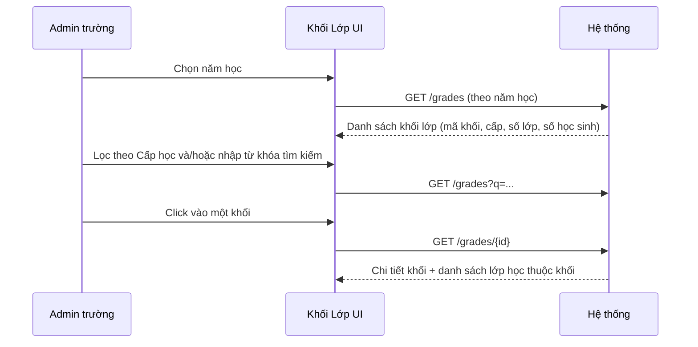

# Tên: Khối Lớp (Nhà Trường)

## Mục lục
- [1. Thông tin tổng quan](#1-thông-tin-tổng-quan)
  - [1.1 Giới thiệu chung](#11-giới-thiệu-chung)
  - [1.2 Mục tiêu](#12-mục-tiêu)
  - [1.3 Phạm vi](#13-phạm-vi)
  - [1.4 Tài liệu tham khảo](#14-tài-liệu-tham-khảo)
- [2. Tổng quan nghiệp vụ](#2-tổng-quan-nghiệp-vụ)
  - [2.1 Đối tượng](#21-đối-tượng)
  - [2.2 Luồng nghiệp vụ](#22-luồng-nghiệp-vụ)
  - [2.3 Nguyên tắc nghiệp vụ](#23-nguyên-tắc-nghiệp-vụ)
- [3. Đặc tả tính năng](#3-đặc-tả-tính-năng)
  - [3.1 Phân rã chức năng](#31-phân-rã-chức-năng)
  - [3.2 Acceptance Criteria](#32-acceptance-criteria)
  - [3.3 Use case](#33-use-case)
  - [3.4 Edge Cases & Error Handling](#34-edge-cases--error-handling)
  - [3.5 Non-functional Requirements](#35-non-functional-requirements)
  - [3.6 Quy ước UI chung](#36-quy-ước-ui-chung)

## 1. Thông tin tổng quan

### 1.1 Giới thiệu chung
Khối Lớp là danh mục các khối (Khối 1, Khối 2, ..., các khối GDTX) của trường, tổ chức theo cấp học (TH/THCS/THPT/GDTX) và theo năm học. Module này cho Admin trường tra cứu số lượng lớp học và học sinh thuộc từng khối, và xem danh sách lớp cụ thể trong một khối.

### 1.2 Mục tiêu
- Cho Admin trường cái nhìn tổng hợp về cấu trúc khối lớp của toàn trường theo từng cấp học.
- Cho biết mỗi khối hiện có bao nhiêu lớp học và bao nhiêu học sinh.
- Xem chi tiết một khối: danh sách lớp học thuộc khối đó, kèm giáo viên chủ nhiệm và số giáo viên của từng lớp.

### 1.3 Phạm vi
| In scope | Out of scope |
|---|---|
| Xem danh sách khối lớp, phân trang | Tạo mới khối lớp (Bộ GD&ĐT / hệ thống chuẩn) |
| Lọc danh sách theo cấp học (TH/THCS/THPT/GDTX) | Sửa/xoá khối lớp |
| Tìm kiếm khối lớp theo tên | Gán/gỡ lớp học vào một khối trực tiếp từ đây |
| Xem chi tiết một khối: mã khối, cấp học, số học sinh, số lớp, danh sách lớp học | Sửa cấu hình khối |
| Chọn năm học để xem dữ liệu tương ứng | |

### 1.4 Tài liệu tham khảo
- `lop-hoc.md`, `giao-vien.md`, `hoc-sinh.md`.

## 2. Tổng quan nghiệp vụ

### 2.1 Đối tượng
| Actor | Vai trò | Trách nhiệm chính |
|---|---|---|
| Admin trường | Người dùng chính | Xem danh mục khối lớp, tra cứu số lớp/số học sinh theo khối |
| Hệ thống | Nguồn dữ liệu | Khởi tạo sẵn danh mục khối theo từng cấp học chuẩn |

### 2.2 Luồng nghiệp vụ

#### 2.2.1 Mô hình hóa nghiệp vụ

### 2.3 Nguyên tắc nghiệp vụ
| ID | Nguyên tắc nghiệp vụ |
|---|---|
| BR01 | Khối lớp được tổ chức theo 4 cấp học (TH/THCS/THPT/GDTX); mỗi khối có "Mã khối" riêng và badge "Cấp: {cấp học}". |
| BR02 | Thống kê số lớp và số học sinh tự động tính toán tổng hợp từ các lớp học thuộc khối. |
| BR03 | Bộ lọc "Cấp học" lọc danh sách khối theo cấp học đã chọn. |
| BR04 | Ô tìm kiếm lọc danh sách khối lớp theo từ khóa tên khối hoặc mã khối (khắc phục lỗi legacy server-side bằng client-side reactive filtering). |
| BR05 | Khi xoá từ khóa tìm kiếm, danh sách tự động khôi phục về trạng thái đầy đủ ngay lập tức. |
| BR06 | Module Khối Lớp là module chỉ đọc đối với danh mục khối. |
| BR07 | Cột "Hành động" có icon con mắt (xem chi tiết); click tên khối dẫn tới cùng trang chi tiết. |
| BR08 | Trang chi tiết khối hiển thị 4 thẻ thông tin tổng hợp (Mã khối, Cấp học, Số học sinh, Số lớp) và bảng "Danh sách lớp học" (Lớp học, GVCN, Số học sinh, Số giáo viên). |
| BR09 | Danh sách phân trang 20 dòng/trang. |
| BR10 | Bộ chọn năm học ở góc trên bên phải. |

## 3. Đặc tả tính năng

### 3.1 Phân rã chức năng
| Feature | Platform | Priority | User Story |
|---|---|---|---|
| Xem danh sách khối lớp theo cấp học | Web Admin | High | Là Admin trường, tôi muốn xem toàn bộ khối lớp của trường, lọc theo cấp học |
| Tìm kiếm khối lớp | Web Admin | Medium | Là Admin trường, tôi muốn tìm nhanh một khối theo tên |
| Xem chi tiết khối lớp | Web Admin | High | Là Admin trường, tôi muốn xem các lớp học thuộc một khối và số học sinh/giáo viên |
