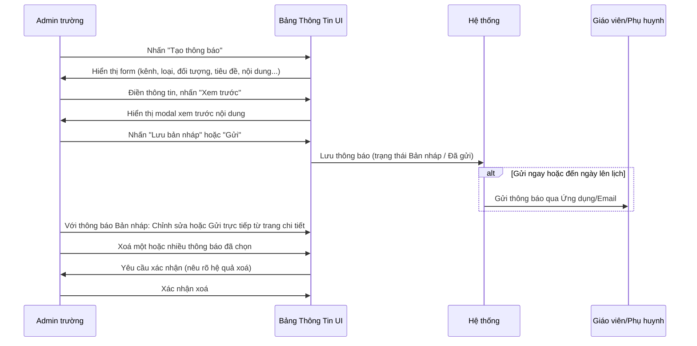
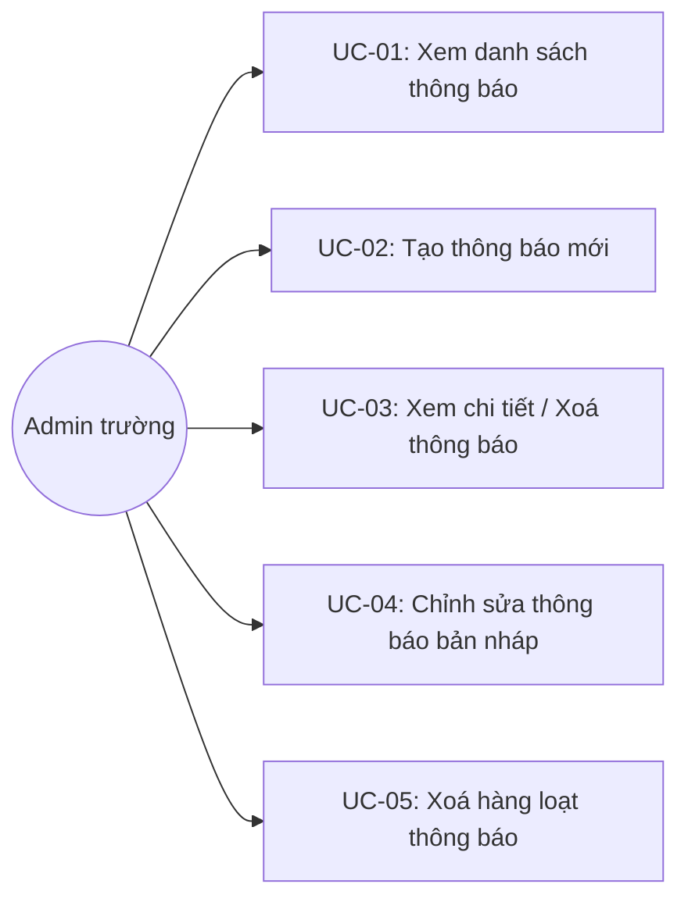

# Tên: Bảng Thông Tin

## Mục lục
- [1. Thông tin tổng quan](#1-thông-tin-tổng-quan)
  - [1.1 Giới thiệu chung](#11-giới-thiệu-chung)
  - [1.2 Mục tiêu](#12-mục-tiêu)
  - [1.3 Phạm vi](#13-phạm-vi)
  - [1.4 Tài liệu tham khảo](#14-tài-liệu-tham-khảo)
- [2. Tổng quan nghiệp vụ](#2-tổng-quan-nghiệp-vụ)
  - [2.1 Đối tượng](#21-đối-tượng)
  - [2.2 Luồng nghiệp vụ](#22-luồng-nghiệp-vụ)
  - [2.3 Nguyên tắc nghiệp vụ](#23-nguyên-tắc-nghiệp-vụ)
- [3. Đặc tả tính năng](#3-đặc-tả-tính-năng)
  - [3.1 Phân rã chức năng](#31-phân-rã-chức-năng)
  - [3.2 Acceptance Criteria](#32-acceptance-criteria)
  - [3.3 Use case](#33-use-case)
  - [3.4 Edge Cases & Error Handling](#34-edge-cases--error-handling)
  - [3.5 Non-functional Requirements](#35-non-functional-requirements)
  - [3.6 Quy ước UI chung](#36-quy-ước-ui-chung)

## 1. Thông tin tổng quan

### 1.1 Giới thiệu chung
Bảng Thông Tin (tiêu đề trang: "Bảng thông tin & sự kiện") là kênh soạn thảo và gửi thông báo của nhà trường tới phụ huynh, giáo viên, hoặc cả trường — qua ứng dụng và/hoặc email. Module cho phép Admin trường soạn thông báo dạng nháp, xem trước, gửi ngay hoặc lên lịch gửi, và theo dõi trạng thái/lượt xem của từng thông báo đã gửi.

### 1.2 Mục tiêu
- Cho phép soạn và gửi thông báo tới nhiều nhóm đối tượng khác nhau (toàn trường, toàn bộ giáo viên, toàn bộ phụ huynh, theo lớp học, hoặc cá nhân).
- Hỗ trợ lưu nháp trước khi gửi, xem trước nội dung, và lên lịch gửi tự động vào một ngày cụ thể.
- Phân loại thông báo theo loại nghiệp vụ (thời khóa biểu, thực đơn, sự kiện, lịch nghỉ, kế hoạch học tập, thông báo chung).
- Theo dõi trạng thái gửi và số lượt xem của thông báo đã gửi.
- Cho phép xoá một hoặc nhiều thông báo cùng lúc.

### 1.3 Phạm vi
| In scope | Out of scope |
|---|---|
| Xem danh sách thông báo, lọc theo trạng thái/loại, tìm kiếm theo tiêu đề | Xem chi tiết ai đã xem thông báo (chỉ thấy tổng số lượt xem, không thấy danh sách người xem) |
| Tạo thông báo mới (soạn, xem trước, lưu nháp, hoặc gửi ngay/lên lịch) | Duyệt (approve) thông báo trước khi gửi |
| Chỉnh sửa thông báo đang ở trạng thái "Bản nháp" | Sửa thông báo đã ở trạng thái "Đã gửi" |
| Gửi trực tiếp một thông báo đang ở trạng thái "Bản nháp" | Thu hồi (unsend) một thông báo đã gửi qua email |
| Xoá một thông báo, hoặc xoá hàng loạt thông báo đã chọn | |
| Đính kèm file vào thông báo | Xem trước file đính kèm ngay trong modal xem trước |

### 1.4 Tài liệu tham khảo
- [Lớp Học](SM3-lop-hoc.md) — khi "Tạo thông báo cho" chọn "Lớp học", trường "Chọn lớp học" tham chiếu tới danh mục lớp học; cột "Gửi đến" trong danh sách link thẳng tới trang chi tiết lớp học.
- Thời Khóa Biểu, Thực Đơn, Học Tập (chưa có tài liệu riêng) — các module này có khả năng tự động sinh thông báo vào Bảng Thông Tin (quan sát được nhiều thông báo "Thời khóa biểu" và "Thực đơn tuần" do các module đó tạo, người tạo hiển thị là tài khoản Admin hoặc giáo viên phụ trách) — [Cần xác nhận] cơ chế tự động tạo chính xác.

## 2. Tổng quan nghiệp vụ

### 2.1 Đối tượng
| Actor | Vai trò | Trách nhiệm chính |
|---|---|---|
| Admin trường / Giáo viên có quyền | Người soạn thông báo | Tạo, chỉnh sửa (khi còn là bản nháp), gửi, xoá thông báo |
| Giáo viên | Người nhận | Nhận thông báo qua ứng dụng/email tùy đối tượng gửi |
| Phụ huynh | Người nhận | Nhận thông báo qua ứng dụng/email tùy đối tượng gửi |
| Hệ thống | Bên gửi tự động | Tự động gửi thông báo vào "Ngày gửi" đã lên lịch nếu có; tự động tạo một số thông báo hệ thống (thời khóa biểu, thực đơn) |

### 2.2 Luồng nghiệp vụ

#### 2.2.1 Mô hình hóa nghiệp vụ

#### 2.2.2 Mô tả các bước nghiệp vụ
| Bước | Người thực hiện | Mô tả | Kết quả |
|---|---|---|---|
| 1 | Admin | Nhấn "Tạo thông báo" | Chuyển tới trang soạn thông báo mới |
| 2 | Admin | Chọn Kênh thông báo, Loại thông báo, đối tượng nhận ("Tạo thông báo cho"); nếu chọn "Lớp học" thì chọn thêm "Người nhận" và "Chọn lớp học" | Form hiển thị đúng các trường phụ thuộc vào đối tượng đã chọn |
| 3 | Admin | Nhập Tiêu đề, Nội dung (rich text), đính kèm file nếu cần, tùy chọn "Ngày gửi" để lên lịch | Nội dung thông báo được soạn đầy đủ |
| 4 | Admin | Nhấn "Xem trước" | Modal hiển thị bản xem trước theo đúng bố cục người nhận sẽ thấy |
| 5 | Admin | Nhấn "Lưu bản nháp" (chưa gửi) hoặc "Gửi" (gửi ngay hoặc theo lịch) | Thông báo được lưu với trạng thái tương ứng: Bản nháp / Chưa gửi (đã lên lịch) / Đã gửi |
| 6 | Admin | Với thông báo Bản nháp, vào trang chi tiết, nhấn "Chỉnh sửa" hoặc "Gửi" | Cập nhật nội dung hoặc chuyển trạng thái sang Đã gửi |
| 7 | Admin | Chọn một hoặc nhiều thông báo bằng checkbox, nhấn "Xóa thông báo" (hoặc icon thùng rác trên từng dòng) | Sau khi xác nhận, (các) thông báo bị xoá — không còn hiển thị trên Web/App (trừ email đã gửi) |

### 2.3 Nguyên tắc nghiệp vụ
| ID | Nguyên tắc nghiệp vụ |
|---|---|
| BR01 | Thông báo có 3 trạng thái: "Bản nháp" (chưa gửi, còn sửa được), "Chưa gửi" (đã lên lịch "Ngày gửi" trong tương lai — [Cần xác nhận] chưa quan sát trực tiếp được thông báo nào ở trạng thái này trong dữ liệu demo), và "Đã gửi" (đã phát hành, kèm ngày giờ gửi thực tế). |
| BR02 | Chỉ thông báo ở trạng thái "Bản nháp" mới có nút "Chỉnh sửa" (cả trên danh sách lẫn trang chi tiết); thông báo "Đã gửi" chỉ có thể xem và xoá, không sửa được nội dung. |
| BR03 | "Tạo thông báo cho" có 5 lựa chọn: Toàn trường, Toàn bộ giáo viên, Toàn bộ phụ huynh, Lớp học, Cá nhân. Riêng khi chọn "Lớp học", form hiện thêm 2 trường bắt buộc liên quan: "Người nhận" (Giáo viên và Phụ huynh / Toàn bộ giáo viên / Toàn bộ phụ huynh của lớp đó) và "Chọn lớp học" (đánh dấu bắt buộc bằng dấu *). |
| BR04 | "Loại thông báo" có 6 giá trị cố định: Thông báo chung, Kế hoạch học tập, Thực đơn, Sự kiện, Lịch nghỉ, Thời khóa biểu — dùng để lọc danh sách và phân loại hiển thị. |
| BR05 | "Kênh thông báo" có 3 lựa chọn: Ứng dụng, Email, Email và ứng dụng — quyết định thông báo được gửi qua app, email, hay cả hai. |
| BR06 | Trường "Ngày gửi" khi để trống nghĩa là gửi ngay lập tức khi nhấn "Gửi"; nếu điền một ngày trong tương lai, hệ thống sẽ tự động gửi vào đúng ngày đó (ghi rõ trong ghi chú trên form). |
| BR07 | Toggle "Hiển thị thông báo cho tài khoản thêm sau" quyết định các tài khoản được thêm vào trường *sau khi* thông báo đã tạo có nhìn thấy thông báo này hay không (mặc định tắt = không hiển thị cho tài khoản mới). |
| BR08 | **[Xác nhận trực tiếp]** Nút "Xem trước" hoạt động được ngay cả khi trường bắt buộc "Chọn lớp học" (khi đối tượng là "Lớp học") còn để trống — chỉ cần có Tiêu đề và Nội dung. Đây là một khoảng hở kiểm tra dữ liệu tại bước xem trước; [Cần xác nhận] liệu nút "Gửi"/"Lưu bản nháp" có thực sự chặn submit khi thiếu "Chọn lớp học" hay không (không kiểm chứng bằng cách gửi thật). |
| BR09 | Nút "Hủy bỏ" trên form tạo/sửa thông báo điều hướng thẳng về danh sách mà **không** hiển thị hộp thoại xác nhận rời trang, mặc dù template cảnh báo "Thay đổi của bạn chưa được lưu..." tồn tại sẵn trong DOM của trang (ẩn) — cảnh báo này dường như chỉ áp dụng cho điều hướng bằng trình duyệt (back/đổi route), không áp dụng cho nút "Hủy bỏ" của chính form. |
| BR10 | Xoá thông báo (đơn lẻ từ danh sách/chi tiết, hoặc hàng loạt) đều hiển thị cùng một cảnh báo: "Người dùng sẽ không thể xem các thông tin liên quan đến thông báo này trên cả Web và App, trừ những email đã được gửi ra" — nghĩa là xoá không thu hồi được email đã gửi trước đó. |
| BR11 | Chọn checkbox ở đầu bảng (header) sẽ chọn tất cả thông báo đang hiển thị trên trang hiện tại và làm xuất hiện nút "Xóa thông báo" (thay thế/thêm cạnh nút "Tạo thông báo") để xoá hàng loạt. |
| BR12 | Ô "Tìm kiếm" khớp theo tiêu đề thông báo, không phân biệt dấu tiếng Việt (ví dụ "thoi khoa bieu" khớp "Thời khóa biểu") — hoạt động đúng, khác với lỗi tìm kiếm quan sát được ở [Khối Lớp](SM5-khoi-lop.md). |
| BR13 | Trang chi tiết thông báo đã gửi hiển thị "Đã xem" kèm số lượt xem (dạng con số, không có danh sách người xem) — cho phép Admin biết mức độ tương tác nhưng không định danh từng người. |

## 3. Đặc tả tính năng

### 3.1 Phân rã chức năng
| Feature | Platform | Priority | User Story |
|---|---|---|---|
| Xem danh sách thông báo, lọc & tìm kiếm | Web Admin | High | Là Admin trường, tôi muốn xem và lọc các thông báo đã tạo theo trạng thái/loại |
| Tạo thông báo mới | Web Admin | High | Là Admin trường, tôi muốn soạn và gửi thông báo tới đúng đối tượng cần thiết |
| Xem trước nội dung thông báo | Web Admin | Medium | Là Admin trường, tôi muốn xem trước thông báo giống như người nhận sẽ thấy trước khi gửi |
| Chỉnh sửa/Gửi thông báo bản nháp | Web Admin | High | Là Admin trường, tôi muốn hoàn thiện một thông báo đã lưu nháp trước đó rồi gửi đi |
| Xem chi tiết thông báo | Web Admin | Medium | Là Admin trường, tôi muốn xem đầy đủ thông tin và trạng thái của một thông báo |
| Xoá thông báo (đơn lẻ/hàng loạt) | Web Admin | Medium | Là Admin trường, tôi muốn xoá các thông báo không còn cần thiết |

### 3.2 Acceptance Criteria
| User Story | Chức năng | Acceptance Criteria |
|---|---|---|
| Xem danh sách, lọc & tìm kiếm | Danh sách | Lọc theo "Trạng thái" (Đã gửi/Chưa gửi/Bản nháp) và "Loại thông báo" trả về đúng tập con; tìm kiếm theo tiêu đề không phân biệt dấu |
| Tạo thông báo mới | Form tạo | Chọn "Lớp học" hiện thêm trường "Người nhận" và "Chọn lớp học" bắt buộc; "Gửi" hoặc "Lưu bản nháp" tạo bản ghi với trạng thái tương ứng |
| Xem trước nội dung | Modal xem trước | Hiển thị đúng Kênh/Loại/Đối tượng/Nội dung đã nhập, không cần điền hết các trường bắt buộc khác |
| Chỉnh sửa/Gửi bản nháp | Trang chi tiết bản nháp | Chỉ bản nháp mới có nút "Chỉnh sửa" và "Gửi"; thông báo đã gửi không có 2 nút này |
| Xem chi tiết | Trang chi tiết | Hiển thị đầy đủ Kênh/Loại/Đối tượng/Người nhận/Trạng thái (+ Đã xem nếu đã gửi)/Nội dung/File đính kèm |
| Xoá thông báo | Xoá đơn/hàng loạt | Yêu cầu xác nhận với cảnh báo hệ quả trước khi xoá; huỷ xác nhận không thay đổi dữ liệu |

### 3.3 Use case

**UC-01**

| Trường | Nội dung |
|---|---|
| Use case ID | UC-01 |
| Use case name | Xem danh sách thông báo |
| Use case description | Admin xem, lọc và tìm kiếm danh sách thông báo đã tạo |
| Actor | Admin trường |
| Happy path | 1. Admin vào menu Nhà Trường → Bảng Thông Tin. 2. Danh sách hiển thị toàn bộ thông báo (167 bản ghi trong dữ liệu demo), phân trang 20 dòng/trang, mặc định không lọc.    3. Admin lọc theo "Chọn trạng thái" → "Bản nháp" để chỉ xem các thông báo chưa gửi; các dòng này có thêm icon "Chỉnh sửa" bên cạnh icon xoá:    4. Admin mở "Chọn loại thông báo" để lọc theo nghiệp vụ:    5. Admin nhập từ khóa không dấu vào ô "Tìm kiếm" — vẫn khớp đúng tiêu đề có dấu:   |
| Exception | Không có thông báo khớp bộ lọc/tìm kiếm → hiển thị trạng thái rỗng tương ứng |
| Trigger | Admin click menu "Bảng Thông Tin" trong nhóm "Nhà Trường" |
| Pre-condition | Admin đã đăng nhập với quyền quản trị trường |
| Post-condition | Danh sách thông báo tương ứng với bộ lọc/tìm kiếm được hiển thị |
| Business Rules | BR01, BR02, BR04, BR12 |

**UC-02**

| Trường | Nội dung |
|---|---|
| Use case ID | UC-02 |
| Use case name | Tạo thông báo mới |
| Use case description | Admin soạn một thông báo mới, xem trước, rồi lưu nháp hoặc gửi |
| Actor | Admin trường |
| Happy path | 1. Admin nhấn "Tạo thông báo" trên danh sách; hệ thống chuyển tới trang soạn thông báo riêng (`/announcement/create/`). 2. Admin chọn "Tạo thông báo cho". Nếu chọn "Lớp học", form hiện thêm "Người nhận" và "Chọn lớp học" (bắt buộc):    Dropdown đầy đủ 5 lựa chọn đối tượng gửi:    3. Admin điền Tiêu đề, Nội dung, tùy chọn File đính kèm và Ngày gửi. 4. Admin nhấn "Xem trước" để kiểm tra nội dung trước khi gửi:    5. Admin nhấn "Lưu bản nháp" để lưu chưa gửi, hoặc "Gửi" để phát hành ngay/theo lịch. |
| Exception | Thiếu Tiêu đề hoặc Nội dung → nút "Lưu bản nháp"/"Gửi" bị vô hiệu hoá; thiếu "Chọn lớp học" khi đối tượng là "Lớp học" → [Cần xác nhận] chưa kiểm chứng có chặn được "Gửi" hay không (xem BR08); nhấn "Hủy bỏ" → về danh sách ngay, không có cảnh báo mất dữ liệu (BR09) |
| Trigger | Admin nhấn nút "Tạo thông báo" |
| Pre-condition | Admin có quyền tạo thông báo |
| Post-condition | Thông báo mới được tạo với trạng thái Bản nháp hoặc Đã gửi/Chưa gửi tùy hành động |
| Business Rules | BR03, BR04, BR05, BR06, BR07, BR08, BR09 |

**UC-03**

| Trường | Nội dung |
|---|---|
| Use case ID | UC-03 |
| Use case name | Xem chi tiết / Xoá thông báo |
| Use case description | Admin xem đầy đủ thông tin một thông báo đã gửi và có thể xoá nó |
| Actor | Admin trường |
| Happy path | 1. Từ danh sách, Admin click vào tiêu đề thông báo để xem chi tiết. 2. Với thông báo đã gửi, trang hiển thị đầy đủ Kênh/Loại/Đối tượng/Gửi đến/Người nhận/Trạng thái (kèm ngày giờ gửi) và số lượt "Đã xem", cùng Nội dung và File đính kèm:    3. Admin nhấn "Xoá" ở góc trên; hệ thống hiển thị cảnh báo hệ quả trước khi xoá:   |
| Exception | Nhấn "Hủy bỏ" trong hộp thoại xác nhận → đóng hộp thoại, thông báo không bị xoá |
| Trigger | Admin click vào một thông báo từ danh sách, hoặc nhấn icon thùng rác |
| Pre-condition | Thông báo tồn tại và Admin có quyền truy cập |
| Post-condition | Xem xong thông tin chi tiết; nếu xác nhận xoá thì thông báo bị gỡ khỏi Web/App |
| Business Rules | BR10, BR13 |

**UC-04**

| Trường | Nội dung |
|---|---|
| Use case ID | UC-04 |
| Use case name | Chỉnh sửa / Gửi thông báo bản nháp |
| Use case description | Admin hoàn thiện một thông báo đang ở trạng thái Bản nháp rồi gửi đi, hoặc gửi thẳng không sửa |
| Actor | Admin trường |
| Happy path | 1. Từ danh sách đã lọc "Bản nháp" (UC-01), Admin vào trang chi tiết một thông báo nháp; trang hiện 3 nút: "Xoá", "Chỉnh sửa", "Gửi":    2. Admin nhấn "Chỉnh sửa"; hệ thống chuyển tới trang chỉnh sửa (`/announcement/edit/{id}/`) với dữ liệu được điền sẵn từ bản nháp:    3. Admin cập nhật nội dung nếu cần rồi "Lưu bản nháp" (giữ nguyên trạng thái nháp) hoặc "Gửi" (chuyển sang Đã gửi). Ngoài ra, có thể nhấn "Gửi" trực tiếp từ trang chi tiết ở bước 1 mà không cần vào trang chỉnh sửa. |
| Exception | Không có gì để chỉnh sửa thêm → có thể "Gửi" trực tiếp từ trang chi tiết mà bỏ qua bước chỉnh sửa |
| Trigger | Admin nhấn "Chỉnh sửa" hoặc "Gửi" trên trang chi tiết một thông báo Bản nháp |
| Pre-condition | Thông báo đang ở trạng thái "Bản nháp" |
| Post-condition | Nội dung thông báo được cập nhật, và/hoặc trạng thái chuyển thành "Đã gửi" |
| Business Rules | BR02 |

**UC-05**

| Trường | Nội dung |
|---|---|
| Use case ID | UC-05 |
| Use case name | Xoá hàng loạt thông báo |
| Use case description | Admin chọn nhiều thông báo cùng lúc và xoá chúng trong một thao tác |
| Actor | Admin trường |
| Happy path | 1. Từ danh sách, Admin chọn checkbox ở đầu bảng (header) để chọn tất cả thông báo trên trang hiện tại (hoặc chọn từng dòng riêng lẻ); nút "Xóa thông báo" xuất hiện cạnh nút "Tạo thông báo":    2. Admin nhấn "Xóa thông báo"; hệ thống hiển thị cùng cảnh báo hệ quả như xoá đơn lẻ ("Vui lòng xác nhận xóa những thông báo đã chọn"). 3. Admin nhấn "Xác nhận" để hoàn tất, hoặc "Hủy bỏ" để huỷ thao tác. |
| Exception | Không chọn thông báo nào → nút "Xóa thông báo" không xuất hiện |
| Trigger | Admin chọn ít nhất một checkbox trên danh sách |
| Pre-condition | Danh sách đang hiển thị ít nhất một thông báo |
| Post-condition | Các thông báo đã chọn bị xoá sau khi xác nhận |
| Business Rules | BR10, BR11 |

### 3.4 Edge Cases & Error Handling

#### 3.4.1 Tổng quan
| Nhóm | Tình huống | Xử lý mong đợi |
|---|---|---|
| Tạo thông báo | Chọn đối tượng "Lớp học" nhưng chưa chọn lớp cụ thể | [Cần xác nhận] "Xem trước" vẫn hoạt động (BR08); chưa kiểm chứng "Gửi" có bị chặn hay không |
| Tạo thông báo | Rời trang khi đang soạn dở, dùng nút "Hủy bỏ" của form | Về danh sách ngay, không cảnh báo mất dữ liệu (BR09) — khác với cảnh báo "Thay đổi chưa được lưu" tồn tại sẵn trong DOM nhưng dường như chỉ áp dụng cho điều hướng khác (back trình duyệt/đổi route) |
| Chỉnh sửa | Thông báo đã chuyển từ Bản nháp sang Đã gửi | Nút "Chỉnh sửa" không còn xuất hiện trên trang chi tiết (BR02) |
| Xoá | Thông báo đã gửi qua email trước khi bị xoá | Bản ghi biến mất khỏi Web/App nhưng email đã gửi tới hộp thư người nhận vẫn còn nguyên (BR10) |
| Tìm kiếm | Từ khóa không dấu | Hoạt động đúng, khớp không phân biệt dấu (BR12) — khác biệt tích cực so với lỗi tìm kiếm ở Khối Lớp |

#### 3.4.2 Danh sách Thông báo (lỗi/thành công)
| Message ID | Trường hợp lỗi | Rule kiểm tra | Message đề xuất | Hình thức báo | Hành vi hệ thống |
|---|---|---|---|---|---|
| BT-01 | Xoá một thông báo | Xác nhận trong hộp thoại | "Vui lòng xác nhận xóa thông báo {tiêu đề}! Lưu ý: Người dùng sẽ không thể xem các thông tin liên quan đến thông báo này trên cả Web và App, trừ những email đã được gửi ra" | Modal xác nhận | Chờ Admin xác nhận hoặc huỷ trước khi gọi API xoá |
| BT-02 | Xoá hàng loạt thông báo đã chọn | Xác nhận trong hộp thoại | "Vui lòng xác nhận xóa những thông báo đã chọn! [cùng lưu ý như BT-01]" | Modal xác nhận | Chờ Admin xác nhận hoặc huỷ trước khi gọi API xoá hàng loạt |
| BT-03 | Rời trang tạo/sửa thông báo khi chưa lưu (điều hướng ngoài nút "Hủy bỏ") | Route change / back trình duyệt | "Thay đổi của bạn chưa được lưu. Vui lòng xác nhận rời khỏi khi chưa lưu!" | Modal xác nhận (ẩn, [Cần xác nhận] điều kiện kích hoạt chính xác) | Chờ Admin xác nhận rời trang hoặc ở lại |

### 3.5 Non-functional Requirements
| ID | Nhóm | Yêu cầu |
|---|---|---|
| NFR01 | UX | Modal "Xem trước nội dung" tái hiện đúng bố cục người nhận sẽ thấy, giúp Admin kiểm tra trước khi gửi tới số đông |
| NFR02 | Data integrity | Cảnh báo rõ ràng trước khi xoá (đơn lẻ và hàng loạt) giúp tránh xoá nhầm, đặc biệt khi đã gửi qua kênh không thể thu hồi (email) |
| NFR03 | Consistency | Ô tìm kiếm áp dụng chuẩn không phân biệt dấu tiếng Việt nhất quán với các module khác trong Nhà Trường |

### 3.6 Quy ước UI chung
- Bố cục danh sách dùng bảng với checkbox chọn dòng ở cột đầu tiên, nhất quán về vị trí với hành động hàng loạt xuất hiện cạnh nút hành động chính ("Tạo thông báo").
- Tiêu đề thông báo hiển thị dưới dạng link cam/vàng có gạch chân, kèm các thông tin phụ (Gửi đến, Người nhận, Kênh thông báo) ngay bên dưới trong cùng ô — giống cách trình bày nhiều dòng phụ trong Môn Học/Giáo Viên.
- Trạng thái "Đã gửi" hiển thị màu xanh dương kèm ngày giờ; "Bản nháp" hiển thị màu xám nhạt — quy ước màu phân biệt trạng thái hoàn tất/chưa hoàn tất nhất quán với các module khác.
- Trang tạo/sửa dùng layout 2 cột cho các trường cấu hình ngắn (Kênh thông báo | Loại thông báo, Tạo thông báo cho | Người nhận) và full-width cho Tiêu đề/Nội dung — cùng quy ước bố cục form với Môn Học, Giáo Viên.
- Mọi hộp thoại xác nhận xoá trong module đều dùng chung một mẫu: biểu tượng loa phóng thanh, dòng tiêu đề nêu rõ đối tượng bị xoá, dòng "Lưu ý" giải thích hệ quả, và 2 nút "Hủy bỏ"/"Xác nhận".
