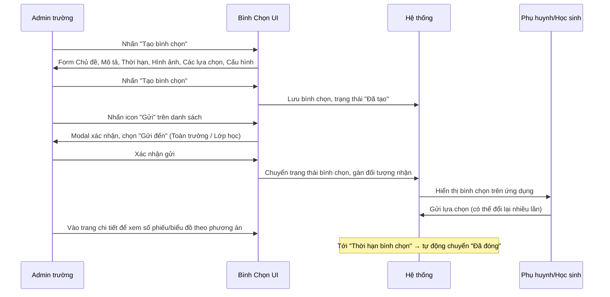
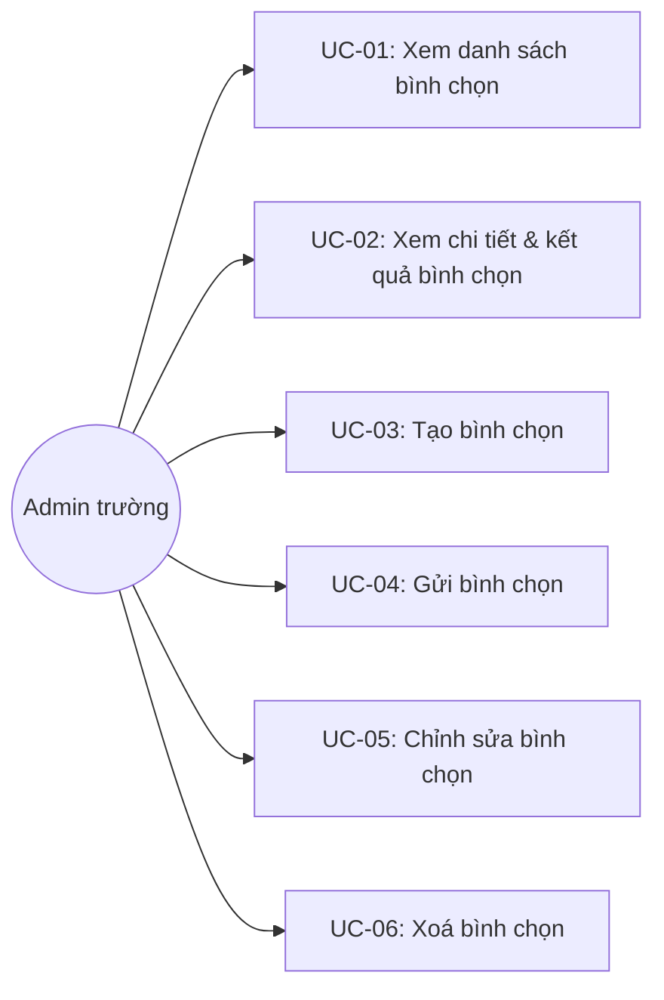

# Tên: Bình Chọn

## Mục lục
- [1. Thông tin tổng quan](#1-thông-tin-tổng-quan)
  - [1.1 Giới thiệu chung](#11-giới-thiệu-chung)
  - [1.2 Mục tiêu](#12-mục-tiêu)
  - [1.3 Phạm vi](#13-phạm-vi)
  - [1.4 Tài liệu tham khảo](#14-tài-liệu-tham-khảo)
- [2. Tổng quan nghiệp vụ](#2-tổng-quan-nghiệp-vụ)
  - [2.1 Đối tượng](#21-đối-tượng)
  - [2.2 Luồng nghiệp vụ](#22-luồng-nghiệp-vụ)
  - [2.3 Nguyên tắc nghiệp vụ](#23-nguyên-tắc-nghiệp-vụ)
- [3. Đặc tả tính năng](#3-đặc-tả-tính-năng)
  - [3.1 Phân rã chức năng](#31-phân-rã-chức-năng)
  - [3.2 Acceptance Criteria](#32-acceptance-criteria)
  - [3.3 Use case](#33-use-case)
  - [3.4 Edge Cases & Error Handling](#34-edge-cases--error-handling)
  - [3.5 Non-functional Requirements](#35-non-functional-requirements)
  - [3.6 Quy ước UI chung](#36-quy-ước-ui-chung)

## 1. Thông tin tổng quan

### 1.1 Giới thiệu chung
Bình Chọn là công cụ khảo sát ý kiến phụ huynh/giáo viên của nhà trường — soạn một câu hỏi kèm các phương án trả lời, gửi tới toàn trường hoặc một số lớp cụ thể, rồi theo dõi kết quả (số phiếu theo từng phương án, ai đã bình chọn) cho tới khi hết hạn.

### 1.2 Mục tiêu
- Cho phép soạn nội dung bình chọn (chủ đề, mô tả, hình ảnh, các phương án) tách rời khỏi việc gửi đi.
- Cho phép gửi bình chọn đã soạn tới toàn trường hoặc tới các lớp học cụ thể vào một thời điểm do Admin chủ động chọn.
- Theo dõi kết quả theo thời gian thực: số phiếu mỗi phương án (dạng thanh tiến trình và biểu đồ tròn khi đã có phiếu), danh sách học sinh đã/chưa bình chọn theo lớp.
- Cho phép xem lịch sử thay đổi lựa chọn của từng học sinh (trường hợp một học sinh/phụ huynh đổi ý nhiều lần trước khi đóng).
- Tự động đóng bình chọn khi hết "Thời hạn bình chọn".

### 1.3 Phạm vi
| In scope | Out of scope |
|---|---|
| Xem danh sách bình chọn, lọc theo trạng thái/lớp học, tìm kiếm theo tên | Duyệt (approve) nội dung bình chọn trước khi gửi |
| Tạo bình chọn (chủ đề, mô tả, thời hạn, hình ảnh, các phương án, cấu hình) | Sửa bình chọn sau khi đã gửi ("Đã gửi"/"Đã đóng") |
| Gửi một bình chọn đang ở trạng thái "Đã tạo" tới Toàn trường hoặc các lớp học cụ thể | Gia hạn/rút ngắn thời hạn của một bình chọn đã gửi |
| Chỉnh sửa/Xoá một bình chọn còn ở trạng thái "Đã tạo" | Bình chọn thay mặt học sinh (nhập hộ phiếu bầu) từ giao diện Admin |
| Xem chi tiết kết quả: số phiếu/biểu đồ theo phương án, danh sách học sinh đã bình chọn theo lớp, lịch sử thay đổi lựa chọn của một học sinh | Xuất báo cáo/tải kết quả bình chọn |

### 1.4 Tài liệu tham khảo
- [Lớp Học](SM3-lop-hoc.md) — "Gửi đến" và bộ lọc "Chọn lớp học" tham chiếu danh mục lớp học; cột "Gửi đến" trong danh sách link thẳng tới trang chi tiết lớp.
- [Học Sinh](SM1-hoc-sinh.md) — danh sách "Danh sách đã bình chọn" trong trang chi tiết liệt kê học sinh theo lớp; một bất thường dữ liệu quan sát được ở đây (tên học sinh bị nối chuỗi bất thường, xem BR11) cũng xuất hiện y hệt khi tra cứu học sinh đó trực tiếp trong module Học Sinh — xác nhận đây là lỗi dữ liệu ở hồ sơ học sinh, không phải lỗi hiển thị riêng của Bình Chọn.

## 2. Tổng quan nghiệp vụ

### 2.1 Đối tượng
| Actor | Vai trò | Trách nhiệm chính |
|---|---|---|
| Admin trường / Giáo viên có quyền | Người soạn & quản lý bình chọn | Tạo, chỉnh sửa, gửi, xoá bình chọn; theo dõi kết quả |
| Phụ huynh / Học sinh | Người bình chọn | Chọn một hoặc nhiều phương án (tùy cấu hình) trên ứng dụng, có thể đổi lựa chọn nhiều lần trước khi đóng |
| Hệ thống | Bên tự động đóng bình chọn | Tự động chuyển trạng thái sang "Đã đóng" khi tới "Thời hạn bình chọn" — [Cần xác nhận] chưa quan sát trực tiếp thời điểm chuyển trạng thái |

### 2.2 Luồng nghiệp vụ

#### 2.2.1 Mô hình hóa nghiệp vụ

#### 2.2.2 Mô tả các bước nghiệp vụ
| Bước | Người thực hiện | Mô tả | Kết quả |
|---|---|---|---|
| 1 | Admin | Nhấn "Tạo bình chọn", điền Chủ đề, Mô tả, Thời hạn bình chọn, các phương án | Bình chọn được tạo với trạng thái "Đã tạo", chưa có ai nhìn thấy |
| 2 | Admin | Trên danh sách, với bình chọn "Đã tạo", nhấn icon gửi (máy bay giấy) | Modal xác nhận hiện ra, chọn đối tượng nhận |
| 3 | Admin | Chọn "Toàn trường" hoặc "Lớp học" (kèm chọn lớp cụ thể), xác nhận | Bình chọn được gửi, hiển thị cho phụ huynh/học sinh thuộc đối tượng đã chọn |
| 4 | Phụ huynh/Học sinh | Chọn một hoặc nhiều phương án (tùy cấu hình "Chọn nhiều phương án") | Phiếu bầu được ghi nhận, có thể đổi lại nhiều lần trước khi đóng |
| 5 | Admin | Vào trang chi tiết bình chọn để xem số phiếu từng phương án và danh sách học sinh đã bình chọn theo lớp | Thấy được kết quả cập nhật theo thời gian thực |
| 6 | Admin | Nhấn icon lịch sử cạnh một lượt bình chọn cụ thể | Modal "Lịch sử bình chọn" hiện toàn bộ các lần đổi lựa chọn của học sinh đó |
| 7 | Hệ thống | Tới "Thời hạn bình chọn" | Bình chọn tự động chuyển trạng thái "Đã đóng", không nhận thêm phiếu |

### 2.3 Nguyên tắc nghiệp vụ
| ID | Nguyên tắc nghiệp vụ |
|---|---|
| BR01 | Bình chọn có 3 trạng thái: "Đã tạo" (mới soạn, chưa gửi cho ai), "Đã gửi" (đang mở, nhận phiếu — [Cần xác nhận] không quan sát được trực tiếp bình chọn nào ở trạng thái này trong dữ liệu demo, toàn bộ đã chuyển thành "Đã đóng"), và "Đã đóng" (hết hạn hoặc bị đóng, không nhận phiếu, chỉ xem kết quả). |
| BR02 | Chỉ bình chọn ở trạng thái "Đã tạo" mới có 3 icon Hành động trên danh sách: Chỉnh sửa (bút chì), Gửi (máy bay giấy), Xoá (thùng rác). Bình chọn "Đã đóng" (và suy luận là "Đã gửi") không có icon hành động nào trên danh sách — chỉ xem được qua trang chi tiết. |
| BR03 | Tạo bình chọn (`Tạo bình chọn`) **không** có bước chọn đối tượng nhận — form chỉ gồm Chủ đề*, Mô tả, Thời hạn bình chọn*, Hình ảnh, Các lựa chọn* (tối thiểu 2, có nút "Thêm" để bổ sung), và Cấu hình bình chọn. Việc chọn đối tượng nhận ("Gửi đến") tách thành một bước riêng (UC-04), thực hiện sau khi đã tạo xong nội dung. |
| BR04 | "Cấu hình bình chọn" gồm 2 toggle: "Chọn nhiều phương án" (bật = cho phép chọn ≥1 phương án cùng lúc, tắt = chỉ chọn 1) và "PH được xem kết quả bình chọn" (bật = phụ huynh thấy được tỉ lệ phiếu, tắt = ẩn kết quả với phụ huynh) — cả hai mặc định tắt khi tạo mới. |
| BR05 | "Gửi đến" khi gửi một bình chọn có 2 lựa chọn: "Toàn trường" (mặc định) hoặc "Lớp học" — chọn "Lớp học" hiện thêm dropdown "Chọn lớp học" để chỉ định lớp cụ thể (một bình chọn có thể được gửi tới nhiều lớp, quan sát thấy ví dụ "INFANT; Lá"). |
| BR06 | Trang chi tiết bình chọn hiển thị số phiếu từng phương án dưới dạng thanh tiến trình; nếu tổng số phiếu > 0, hệ thống hiển thị thêm một biểu đồ tròn trực quan hóa tỉ lệ giữa các phương án — biểu đồ này không xuất hiện khi bình chọn chưa có phiếu nào. |
| BR07 | Mục "Danh sách đã bình chọn" liệt kê toàn bộ học sinh thuộc (các) lớp được gửi, có thể lọc theo tên/lớp học/đã-chọn-phương-án-nào; học sinh chưa bình chọn hiển thị cột "Bình chọn" trống, học sinh đã bình chọn hiển thị tên phương án kèm thời điểm bình chọn gần nhất. |
| BR08 | Cạnh mỗi lượt bình chọn đã ghi nhận có icon nhỏ (tooltip "Lịch sử thay đổi") — click vào đó mở modal "Lịch sử bình chọn" liệt kê toàn bộ các lần học sinh/phụ huynh đó đã đổi lựa chọn, kèm thời gian từng lần. |
| BR09 | Mô tả dài tự động rút gọn với liên kết "Xem thêm"/"Thu gọn" trên trang chi tiết, không hiển thị toàn bộ ngay từ đầu. |
| BR10 | Ô "Tìm kiếm" trên danh sách khớp theo tên bình chọn, không phân biệt dấu tiếng Việt (ví dụ "gia ngoai" khớp "giã ngoại") — nhất quán với quy ước tìm kiếm ở Bảng Thông Tin, Học Sinh, Giáo Viên, Môn Học. |
| BR11 | **[Phát hiện lỗi dữ liệu, không phải hành vi module]** Một học sinh trong "Danh sách đã bình chọn" của bình chọn "Trung thu đoàn viên" có trường tên bị nối chuỗi bất thường ("Nguyễn Hoàng Huyền My Nguyễn Thị Thanh Tâm Phương Uyên Hoài An...") — xác minh qua HTML là một chuỗi văn bản duy nhất, và xác minh chéo tại module Học Sinh cho thấy đây chính là giá trị "Họ và tên" thực tế đang lưu cho hồ sơ học sinh đó (biệt danh "An"/"Be 25"), không phải lỗi hiển thị của riêng Bình Chọn. |

## 3. Đặc tả tính năng

### 3.1 Phân rã chức năng
| Feature | Platform | Priority | User Story |
|---|---|---|---|
| Xem danh sách bình chọn, lọc & tìm kiếm | Web Admin | High | Là Admin trường, tôi muốn xem và lọc các bình chọn đã tạo theo trạng thái/lớp |
| Tạo bình chọn | Web Admin | High | Là Admin trường, tôi muốn soạn một bình chọn với các phương án và cấu hình phù hợp |
| Gửi bình chọn | Web Admin | High | Là Admin trường, tôi muốn gửi một bình chọn đã soạn tới đúng đối tượng cần khảo sát |
| Xem chi tiết & kết quả bình chọn | Web Admin | Medium | Là Admin trường, tôi muốn theo dõi số phiếu và ai đã/chưa bình chọn |
| Xem lịch sử thay đổi lựa chọn | Web Admin | Low | Là Admin trường, tôi muốn biết một học sinh đã đổi lựa chọn bao nhiêu lần |
| Chỉnh sửa/Xoá bình chọn (khi còn là "Đã tạo") | Web Admin | Medium | Là Admin trường, tôi muốn sửa lại nội dung hoặc huỷ một bình chọn chưa gửi |

### 3.2 Acceptance Criteria
| User Story | Chức năng | Acceptance Criteria |
|---|---|---|
| Xem danh sách, lọc & tìm kiếm | Danh sách | Lọc "Chọn trạng thái" (Đã tạo/Đã gửi/Đã đóng) và "Chọn lớp học" trả về đúng tập con; tìm kiếm không phân biệt dấu |
| Tạo bình chọn | Form tạo | Yêu cầu tối thiểu Chủ đề, Thời hạn bình chọn, và ≥2 phương án; tạo xong ở trạng thái "Đã tạo", chưa gửi cho ai |
| Gửi bình chọn | Modal gửi | Chỉ bình chọn "Đã tạo" mới gửi được; chọn "Lớp học" bắt buộc chỉ định lớp cụ thể |
| Xem chi tiết & kết quả | Trang chi tiết | Hiển thị đúng số phiếu từng phương án; biểu đồ tròn chỉ xuất hiện khi có ≥1 phiếu |
| Xem lịch sử thay đổi | Modal lịch sử | Hiển thị đầy đủ các lần đổi lựa chọn theo thời gian của đúng học sinh được chọn |
| Chỉnh sửa/Xoá | Trang sửa / Modal xoá | Chỉ khả dụng với bình chọn "Đã tạo"; xoá yêu cầu xác nhận |

### 3.3 Use case

**UC-01**

| Trường | Nội dung |
|---|---|
| Use case ID | UC-01 |
| Use case name | Xem danh sách bình chọn |
| Use case description | Admin xem, lọc và tìm kiếm danh sách bình chọn |
| Actor | Admin trường |
| Happy path | 1. Admin vào menu Nhà Trường → Bình Chọn. 2. Danh sách hiển thị toàn bộ bình chọn (7 bản ghi trong dữ liệu demo); chỉ bình chọn "Đã tạo" có 3 icon Hành động:    3. Admin mở "Chọn trạng thái" để lọc theo Đã tạo/Đã gửi/Đã đóng:    4. Admin nhập từ khóa không dấu vào ô "Tìm kiếm" — vẫn khớp đúng tên có dấu:   |
| Exception | Không có bình chọn khớp bộ lọc/tìm kiếm → hiển thị trạng thái rỗng |
| Trigger | Admin click menu "Bình Chọn" trong nhóm "Nhà Trường" |
| Pre-condition | Admin đã đăng nhập với quyền quản trị trường |
| Post-condition | Danh sách bình chọn tương ứng với bộ lọc/tìm kiếm được hiển thị |
| Business Rules | BR01, BR02, BR10 |

**UC-02**

| Trường | Nội dung |
|---|---|
| Use case ID | UC-02 |
| Use case name | Xem chi tiết & kết quả bình chọn |
| Use case description | Admin xem nội dung, cấu hình, kết quả và danh sách học sinh đã bình chọn |
| Actor | Admin trường |
| Happy path | 1. Từ danh sách, Admin click vào tên bình chọn. 2. Với bình chọn chưa có phiếu, kết quả hiển thị dạng thanh tiến trình 0 phiếu cho mỗi phương án:    3. Với bình chọn đã có phiếu, hệ thống hiện thêm biểu đồ tròn trực quan:    4. Cuộn xuống "Danh sách đã bình chọn" để xem từng học sinh đã/chưa bình chọn theo lớp:    5. Admin click icon "Lịch sử thay đổi" cạnh một lượt bình chọn để xem toàn bộ lịch sử đổi lựa chọn của học sinh đó:   |
| Exception | Bình chọn chưa có phiếu nào → không hiển thị biểu đồ tròn, chỉ có thanh tiến trình 0 phiếu (BR06) |
| Trigger | Admin click vào một bình chọn từ danh sách |
| Pre-condition | Bình chọn tồn tại và Admin có quyền truy cập |
| Post-condition | Kết quả và danh sách bình chọn chi tiết được hiển thị đầy đủ |
| Business Rules | BR06, BR07, BR08, BR09, BR11 |

**UC-03**

| Trường | Nội dung |
|---|---|
| Use case ID | UC-03 |
| Use case name | Tạo bình chọn |
| Use case description | Admin soạn nội dung một bình chọn mới (chưa gửi cho ai) |
| Actor | Admin trường |
| Happy path | 1. Admin nhấn "Tạo bình chọn" trên danh sách; hệ thống chuyển tới trang tạo riêng (`/school/poll/create/`). 2. Admin điền Chủ đề, Mô tả, và "Thời hạn bình chọn" (bắt buộc):    3. Admin nhập tối thiểu 2 phương án ở "Các lựa chọn" (có thể "Thêm" để bổ sung), và bật/tắt "Chọn nhiều phương án"/"PH được xem kết quả bình chọn" trong "Cấu hình bình chọn":    4. Admin nhấn "Tạo bình chọn" để lưu; bình chọn được tạo với trạng thái "Đã tạo", chưa gửi cho ai. |
| Exception | Thiếu Chủ đề, Thời hạn bình chọn, hoặc chưa đủ phương án → nút "Tạo bình chọn" bị vô hiệu hoá |
| Trigger | Admin nhấn nút "Tạo bình chọn" |
| Pre-condition | Admin có quyền tạo bình chọn |
| Post-condition | Bình chọn mới được tạo với trạng thái "Đã tạo" |
| Business Rules | BR03, BR04 |

**UC-04**

| Trường | Nội dung |
|---|---|
| Use case ID | UC-04 |
| Use case name | Gửi bình chọn |
| Use case description | Admin chọn đối tượng nhận và gửi một bình chọn đang ở trạng thái "Đã tạo" |
| Actor | Admin trường |
| Happy path | 1. Từ danh sách, với bình chọn "Đã tạo", Admin nhấn icon gửi (máy bay giấy). 2. Modal xác nhận hiện ra với "Gửi đến" mặc định "Toàn trường":    3. Nếu chọn "Lớp học", modal hiện thêm dropdown "Chọn lớp học" để chỉ định lớp cụ thể:    4. Admin nhấn "Xác nhận" để gửi, hoặc "Hủy bỏ" để huỷ thao tác. |
| Exception | Chọn "Lớp học" nhưng chưa chọn lớp cụ thể → [Cần xác nhận] chưa kiểm chứng có chặn được "Xác nhận" hay không |
| Trigger | Admin nhấn icon gửi trên một bình chọn "Đã tạo" |
| Pre-condition | Bình chọn đang ở trạng thái "Đã tạo" |
| Post-condition | Bình chọn được gửi tới đối tượng đã chọn, chuyển trạng thái (Đã gửi, hoặc Đã đóng nếu thời hạn đã qua) |
| Business Rules | BR05 |

**UC-05**

| Trường | Nội dung |
|---|---|
| Use case ID | UC-05 |
| Use case name | Chỉnh sửa bình chọn |
| Use case description | Admin sửa nội dung một bình chọn còn ở trạng thái "Đã tạo" |
| Actor | Admin trường |
| Happy path | 1. Từ danh sách, với bình chọn "Đã tạo", Admin nhấn icon bút chì; hệ thống chuyển tới trang chỉnh sửa riêng (`/school/poll/{id}/edit/`) với dữ liệu điền sẵn:    2. Admin cập nhật nội dung, nhấn lưu để hoàn tất. |
| Exception | Bình chọn đã chuyển sang "Đã gửi"/"Đã đóng" → không còn icon Chỉnh sửa trên danh sách (BR02) |
| Trigger | Admin nhấn icon bút chì trên một bình chọn "Đã tạo" |
| Pre-condition | Bình chọn đang ở trạng thái "Đã tạo" |
| Post-condition | Nội dung bình chọn được cập nhật |
| Business Rules | BR02, BR03, BR04 |

**UC-06**

| Trường | Nội dung |
|---|---|
| Use case ID | UC-06 |
| Use case name | Xoá bình chọn |
| Use case description | Admin xoá một bình chọn còn ở trạng thái "Đã tạo" |
| Actor | Admin trường |
| Happy path | 1. Từ danh sách, với bình chọn "Đã tạo", Admin nhấn icon thùng rác. 2. Modal xác nhận đơn giản hiện ra, nêu tên bình chọn:    3. Admin nhấn "Xác nhận" để xoá, hoặc "Hủy bỏ" để huỷ. |
| Exception | Nhấn "Hủy bỏ" → đóng modal, bình chọn không bị xoá |
| Trigger | Admin nhấn icon thùng rác trên một bình chọn "Đã tạo" |
| Pre-condition | Bình chọn đang ở trạng thái "Đã tạo" |
| Post-condition | Bình chọn bị xoá khỏi danh sách sau khi xác nhận |
| Business Rules | BR02 |

### 3.4 Edge Cases & Error Handling

#### 3.4.1 Tổng quan
| Nhóm | Tình huống | Xử lý mong đợi |
|---|---|---|
| Tạo | Nhập thời hạn bình chọn ở quá khứ | [Cần xác nhận] chưa kiểm chứng có bị chặn hay không |
| Gửi | Chọn "Lớp học" nhưng chưa chọn lớp cụ thể | [Cần xác nhận] chưa kiểm chứng "Xác nhận" có bị vô hiệu hoá hay không |
| Kết quả | Chưa có phiếu nào | Chỉ hiện thanh tiến trình 0 phiếu, không hiện biểu đồ tròn (BR06) |
| Dữ liệu học sinh | Tên học sinh bị lỗi nối chuỗi từ dữ liệu gốc | Hiển thị nguyên trạng chuỗi lỗi trong "Danh sách đã bình chọn" — lỗi thuộc phạm vi dữ liệu Học Sinh, không phải lỗi riêng của Bình Chọn (BR11) |
| Danh sách | Bình chọn đã đóng | Không còn thao tác nào khả dụng ngoài xem chi tiết (BR02) |

#### 3.4.2 Danh sách Thông báo (lỗi/thành công)
| Message ID | Trường hợp lỗi | Rule kiểm tra | Message đề xuất | Hình thức báo | Hành vi hệ thống |
|---|---|---|---|---|---|
| BC-01 | Gửi một bình chọn | Xác nhận trong modal | "Vui lòng xác nhận gửi Bình chọn {tên bình chọn}" | Modal xác nhận | Chờ Admin chọn "Gửi đến" và xác nhận trước khi gọi API gửi |
| BC-02 | Xoá một bình chọn | Xác nhận trong modal | "Vui lòng xác nhận xóa bình chọn {tên bình chọn}" | Modal xác nhận (không kèm ghi chú hệ quả chi tiết như ở Bảng Thông Tin) | Chờ Admin xác nhận hoặc huỷ trước khi gọi API xoá |

### 3.5 Non-functional Requirements
| ID | Nhóm | Yêu cầu |
|---|---|---|
| NFR01 | UX | Biểu đồ tròn chỉ hiển thị khi có dữ liệu thực (≥1 phiếu), tránh gây hiểu nhầm về một biểu đồ "rỗng" |
| NFR02 | UX | Mô tả dài được rút gọn mặc định với "Xem thêm", giữ trang chi tiết gọn gàng cho các bình chọn có nội dung dài |
| NFR03 | Traceability | Lịch sử thay đổi lựa chọn theo từng học sinh giúp Admin xác minh được số liệu cuối cùng khi có tranh chấp/nghi vấn |

### 3.6 Quy ước UI chung
- Bộ 3 icon Hành động (Chỉnh sửa/Gửi/Xoá) chỉ xuất hiện có điều kiện theo trạng thái bản ghi (chỉ với "Đã tạo") — cùng quy ước "hành động theo trạng thái" đã thấy ở Bảng Thông Tin (chỉ Bản nháp mới sửa được).
- Tên bình chọn hiển thị dưới dạng link cam/vàng có gạch chân kèm dòng phụ "Bình chọn kết thúc vào {ngày giờ}" ngay bên dưới — cùng quy ước trình bày nhiều dòng phụ trong ô như Bảng Thông Tin, Môn Học.
- Trang tạo/sửa dùng bố cục dọc một cột cho nội dung chính (Chủ đề, Mô tả, Thời hạn, Hình ảnh, Các lựa chọn) và một khối "Cấu hình bình chọn" riêng ở cuối trước hàng nút hành động — khác với bố cục 2 cột ngang thường thấy ở Bảng Thông Tin/Môn Học, phù hợp với nội dung tuần tự của một bảng khảo sát.
- Modal xác nhận dùng chung biểu tượng 3 vòng tròn (xanh lá/đỏ/vàng) ở đầu cho mọi loại xác nhận (gửi, xoá) trong module này, khác với biểu tượng loa phóng thanh dùng ở Bảng Thông Tin.
