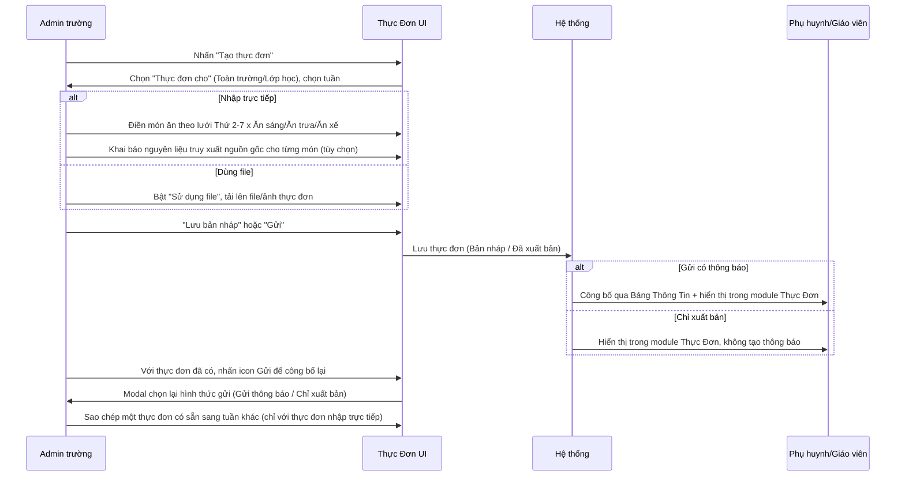
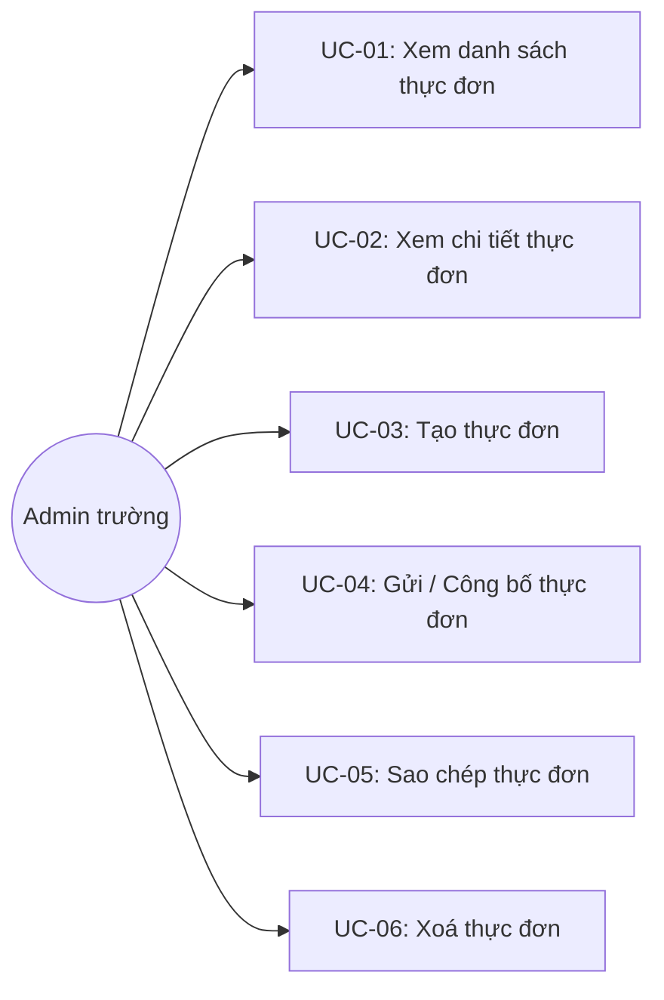

# Tên: Thực Đơn

## Mục lục
- [1. Thông tin tổng quan](#1-thông-tin-tổng-quan)
  - [1.1 Giới thiệu chung](#11-giới-thiệu-chung)
  - [1.2 Mục tiêu](#12-mục-tiêu)
  - [1.3 Phạm vi](#13-phạm-vi)
  - [1.4 Tài liệu tham khảo](#14-tài-liệu-tham-khảo)
- [2. Tổng quan nghiệp vụ](#2-tổng-quan-nghiệp-vụ)
  - [2.1 Đối tượng](#21-đối-tượng)
  - [2.2 Luồng nghiệp vụ](#22-luồng-nghiệp-vụ)
  - [2.3 Nguyên tắc nghiệp vụ](#23-nguyên-tắc-nghiệp-vụ)
- [3. Đặc tả tính năng](#3-đặc-tả-tính-năng)
  - [3.1 Phân rã chức năng](#31-phân-rã-chức-năng)
  - [3.2 Acceptance Criteria](#32-acceptance-criteria)
  - [3.3 Use case](#33-use-case)
  - [3.4 Edge Cases & Error Handling](#34-edge-cases--error-handling)
  - [3.5 Non-functional Requirements](#35-non-functional-requirements)
  - [3.6 Quy ước UI chung](#36-quy-ước-ui-chung)

## 1. Thông tin tổng quan

### 1.1 Giới thiệu chung
Thực Đơn hàng tuần là công cụ soạn và công bố thực đơn ăn uống của trường theo từng tuần — cho toàn trường hoặc riêng từng lớp — kèm khả năng khai báo nguyên liệu để truy xuất nguồn gốc thực phẩm theo từng món ăn.

### 1.2 Mục tiêu
- Cho phép soạn thực đơn theo 2 cách: nhập trực tiếp từng món ăn theo lưới ngày/bữa, hoặc tải lên file/ảnh thực đơn có sẵn.
- Áp dụng thực đơn cho toàn trường (mặc định dùng chung) hoặc riêng cho từng lớp cụ thể (override khi cần thực đơn khác biệt, ví dụ theo độ tuổi/chế độ ăn).
- Cho phép lưu nháp trước khi công bố, và công bố lại/gửi lại bất cứ lúc nào kể cả sau khi đã gửi.
- Cho phép khai báo nguyên liệu của từng món ăn (GTIN + số lô, hoặc mã tem nội bộ) phục vụ truy xuất nguồn gốc thực phẩm, kể cả tra cứu ngược ra tên cơ sở cung cấp.
- Theo dõi lịch sử các lần gửi/công bố của một thực đơn.

### 1.3 Phạm vi
| In scope | Out of scope |
|---|---|
| Xem danh sách thực đơn, lọc theo lớp học/tháng/loại (dùng file hay không), tìm kiếm | Duyệt (approve) thực đơn trước khi công bố |
| Tạo thực đơn thủ công (lưới món ăn theo ngày/bữa) hoặc bằng file/ảnh tải lên | Đặt lịch tự động sinh thực đơn định kỳ |
| Chỉnh sửa, gửi/công bố, sao chép, tải xuống, xoá thực đơn | Sửa thực đơn thông qua Bảng Thông Tin sau khi đã công bố qua đó |
| Khai báo/xem nguyên liệu truy xuất nguồn gốc theo từng món ăn | Quản lý danh mục nhà cung cấp/GTIN tập trung (chỉ nhập tự do theo món) |
| Xem lịch sử gửi của một thực đơn | Xem danh sách người đã xem/nhận thực đơn (khác với Bảng Thông Tin) |
| Gợi ý thực đơn bằng AI (giao diện tồn tại trong mã nguồn) | [Cần xác nhận] Không tìm được nút kích hoạt trực tiếp trong phiên khảo sát này |

### 1.4 Tài liệu tham khảo
- [Bảng Thông Tin](SM6-bang-thong-tin.md) — công bố thực đơn kèm "Gửi thông báo" sẽ tạo một thông báo "Thực đơn tuần: ..." trong Bảng Thông Tin (quan sát chéo được ở cả 2 module); trạng thái thực đơn hiển thị "(qua Bảng thông tin)" khi được gửi theo cách này.
- [Lớp Học](SM3-lop-hoc.md) — thực đơn có thể áp dụng cho một hoặc nhiều lớp cụ thể; cột "Thực đơn cho" link trực tiếp tới trang chi tiết lớp.

## 2. Tổng quan nghiệp vụ

### 2.1 Đối tượng
| Actor | Vai trò | Trách nhiệm chính |
|---|---|---|
| Admin trường / Giáo viên có quyền | Người soạn thực đơn | Tạo, chỉnh sửa, công bố/gửi, sao chép, xoá thực đơn; khai báo nguyên liệu truy xuất nguồn gốc |
| Phụ huynh/Giáo viên (người xem) | Người nhận | Xem thực đơn đã công bố qua ứng dụng/Bảng Thông Tin |
| Hệ thống | Bên hỗ trợ | Gợi ý thực đơn bằng AI theo lứa tuổi/mức giá (tồn tại trong mã nguồn); tự động dùng thực đơn "Toàn trường" làm mặc định cho lớp chưa có thực đơn riêng |

### 2.2 Luồng nghiệp vụ

#### 2.2.1 Mô hình hóa nghiệp vụ

#### 2.2.2 Mô tả các bước nghiệp vụ
| Bước | Người thực hiện | Mô tả | Kết quả |
|---|---|---|---|
| 1 | Admin | Nhấn "Tạo thực đơn"; chọn "Toàn trường" hoặc "Lớp học", chọn tuần (tối đa 8 tuần kể từ hiện tại) | Khung thực đơn cho đúng phạm vi/tuần được khởi tạo |
| 2 | Admin | Điền món ăn vào lưới (Ăn sáng/Ăn trưa/Ăn xế × Thứ 2-7), có thể thêm nhiều món/bữa; hoặc bật "Sử dụng file" để tải lên ảnh/file thực đơn thay vì nhập tay | Nội dung thực đơn được soạn theo 1 trong 2 hình thức |
| 3 | Admin | (Tùy chọn) Với thực đơn dạng lưới, khai báo nguyên liệu từng món: GTIN + số lô hoặc mã tem nội bộ | Món ăn được đánh dấu "Đạt chuẩn"/"Chưa truy xuất" theo từng nguyên liệu |
| 4 | Admin | Nhấn "Lưu bản nháp" hoặc "Gửi" | Thực đơn lưu với trạng thái Bản nháp hoặc Đã xuất bản |
| 5 | Admin | Khi gửi/công bố, chọn hình thức: "Gửi thông báo" (kèm thông báo qua Bảng Thông Tin) hoặc "Chỉ xuất bản" (không thông báo) | Thực đơn hiển thị cho người xem theo đúng hình thức đã chọn |
| 6 | Admin | Với thực đơn đã tồn tại, có thể: Chỉnh sửa, Gửi lại (công bố lại), Sao chép sang tuần khác (chỉ thực đơn dạng lưới), Tải xuống, hoặc Xoá (chỉ khi còn là Bản nháp) | Thực đơn được cập nhật/nhân bản/gỡ bỏ tương ứng |
| 7 | Admin | Mở "Lịch sử gửi thực đơn" của một thực đơn | Xem toàn bộ các lần gửi trước đó kèm người gửi và thời điểm |

### 2.3 Nguyên tắc nghiệp vụ
| ID | Nguyên tắc nghiệp vụ |
|---|---|
| BR01 | Hệ thống chỉ cho tạo trước thực đơn tối đa 8 tuần kể từ tuần hiện tại (ghi rõ trên đầu trang danh sách). |
| BR02 | Mỗi lớp chỉ có 1 thực đơn/tuần; **nếu một lớp không có thực đơn riêng cho tuần đó, hệ thống tự động dùng thực đơn "Toàn trường" của tuần đó làm mặc định** — xác nhận qua ghi chú trực tiếp trên form tạo: "Toàn trường chỉ có thể có 1 thực đơn / tuần. Lớp không có thực đơn riêng sẽ dùng thực đơn toàn trường". |
| BR03 | Thực đơn có 2 trạng thái: "Bản nháp" (chưa công bố) và "Đã xuất bản" (đã công bố, kèm thời điểm); nhà trường có thể sửa và gửi lại một thực đơn đã xuất bản bất cứ lúc nào (không bị khoá sau khi gửi, khác với quy ước "chỉ Bản nháp mới sửa được" ở Bảng Thông Tin/Bình Chọn). |
| BR04 | Thực đơn có 2 hình thức nội dung, loại trừ lẫn nhau qua toggle "Sử dụng file": (a) **Dạng lưới** — nhập từng món ăn theo ô Ngày × Bữa ăn (Ăn sáng/Ăn trưa/Ăn xế), hỗ trợ khai báo nguyên liệu/truy xuất nguồn gốc theo từng món; (b) **Dạng file** — tải lên một file/ảnh thực đơn có sẵn (kèm link tải "Mẫu thực đơn"), không có dữ liệu món ăn có cấu trúc. |
| BR05 | **[Xác nhận qua bộ lọc "Sử dụng file" và đối chiếu chi tiết]** Chỉ thực đơn dạng lưới mới có icon "Sao chép" trong Hành động (4 icon: Gửi/Sửa/Sao chép/Tải xuống nếu đã xuất bản, +Xoá nếu còn nháp); thực đơn dạng file **không có** icon Sao chép (chỉ 3 icon: Gửi/Sửa/Tải xuống, +Xoá nếu còn nháp) — vì không có dữ liệu món ăn có cấu trúc để nhân bản. Trong dữ liệu demo, lọc "Sử dụng file: Bật" trả về đúng 10/109 thực đơn thuộc nhóm này. |
| BR06 | Khi nhấn "Gửi" (công bố) một thực đơn, hệ thống yêu cầu chọn hình thức: "Gửi thông báo" (tạo kèm một thông báo "Thực đơn tuần: ..." trong Bảng Thông Tin) hoặc "Chỉ xuất bản" (chỉ đổi trạng thái, không tạo thông báo). Trạng thái "Đã xuất bản" ghi rõ "(qua Bảng thông tin)" khi được gửi theo hình thức đầu. |
| BR07 | Với món ăn dạng lưới, mỗi nguyên liệu khai báo truy xuất nguồn gốc theo 1 trong 2 hình thức, đều tùy chọn: "GTIN + số lô" (cần điền đủ cả hai) hoặc "Mã tem nội bộ" (chỉ cần 1 ô); để trống cả hai thì nguyên liệu vẫn được lưu nhưng đánh dấu "Chưa truy xuất". Khi đủ thông tin GTIN, hệ thống tự tra cứu và hiển thị được cả "Tên cơ sở" (nhà cung cấp) tương ứng. |
| BR08 | Trang xem nguyên liệu của một món ăn (mở từ icon cạnh tên món, phân biệt với icon bút chì "sửa nguyên liệu") là màn **chỉ đọc**, tổng hợp số nguyên liệu "Đạt chuẩn" / "Chưa truy xuất" và chi tiết GTIN/số lô/tên cơ sở từng nguyên liệu. |
| BR09 | "Lịch sử gửi thực đơn" (mở từ icon đồng hồ cạnh dòng trạng thái "Đã xuất bản") liệt kê đầy đủ mọi lần thực đơn này từng được gửi, kèm người gửi/đặt lịch và thời điểm — xác nhận trực tiếp: một thực đơn trong dữ liệu demo đã được gửi 2 lần (16/07 và 17/07/2026). |
| BR10 | Nút "Hủy bỏ" trên form tạo/sửa thực đơn **có** hiển thị hộp thoại xác nhận "Thay đổi của bạn chưa được lưu..." trước khi rời trang — khác với hành vi của Bảng Thông Tin và Bình Chọn (nơi nút "Hủy bỏ" của form thoát thẳng không cảnh báo). |
| BR11 | Xoá một thực đơn yêu cầu xác nhận đơn giản (không kèm ghi chú hệ quả chi tiết như Bảng Thông Tin); [Cần xác nhận] chỉ quan sát được icon Xoá xuất hiện ở thực đơn "Bản nháp" trong dữ liệu demo, chưa xác nhận được liệu thực đơn "Đã xuất bản" có bao giờ xoá được hay không. |
| BR12 | Mã nguồn của trang tạo thực đơn có sẵn một khối chức năng "Tạo thực đơn AI" hoàn chỉnh (thiết lập số ngày ăn, loại bữa, lứa tuổi, mức giá theo 4 bậc: Tiết kiệm/Phổ thông/Cao cấp/Đặc biệt, sinh thực đơn gợi ý kèm phản hồi Hữu ích/Không) nhưng **[Cần xác nhận] không tìm được nút kích hoạt hiển thị trực tiếp trên giao diện** trong phiên khảo sát này — có thể do điều kiện bật tính năng (feature flag) hoặc gói dịch vụ chưa kích hoạt cho trường demo. |

## 3. Đặc tả tính năng

### 3.1 Phân rã chức năng
| Feature | Platform | Priority | User Story |
|---|---|---|---|
| Xem danh sách thực đơn, lọc & tìm kiếm | Web Admin | High | Là Admin trường, tôi muốn xem và lọc thực đơn theo lớp/tháng/hình thức tạo |
| Tạo thực đơn (dạng lưới hoặc file) | Web Admin | High | Là Admin trường, tôi muốn soạn thực đơn tuần cho toàn trường hoặc từng lớp |
| Khai báo nguyên liệu truy xuất nguồn gốc | Web Admin | Medium | Là Admin trường, tôi muốn khai báo nguồn gốc thực phẩm cho từng món ăn |
| Gửi/công bố thực đơn | Web Admin | High | Là Admin trường, tôi muốn công bố thực đơn, có hoặc không kèm thông báo |
| Chỉnh sửa/Sao chép/Xoá thực đơn | Web Admin | Medium | Là Admin trường, tôi muốn cập nhật, nhân bản hoặc xoá một thực đơn |
| Xem lịch sử gửi | Web Admin | Low | Là Admin trường, tôi muốn biết một thực đơn đã được gửi khi nào và bởi ai |

### 3.2 Acceptance Criteria
| User Story | Chức năng | Acceptance Criteria |
|---|---|---|
| Xem danh sách, lọc & tìm kiếm | Danh sách | Lọc "Chọn lớp học", "Lọc mở rộng" (Thời gian, Sử dụng file) trả về đúng tập con; tổng số khớp với điều kiện lọc |
| Tạo thực đơn | Form tạo | Bật "Sử dụng file" chuyển hẳn sang giao diện tải file, tắt thì hiển thị lưới món ăn; chọn "Lớp học" yêu cầu chọn lớp cụ thể |
| Khai báo nguyên liệu | Modal nguyên liệu | Nhập đủ GTIN + số lô hoặc mã tem nội bộ → đánh dấu "Đạt chuẩn"; để trống → "Chưa truy xuất" |
| Gửi/công bố | Modal chọn hình thức gửi | Chọn "Gửi thông báo" tạo kèm thông báo Bảng Thông Tin; "Chỉ xuất bản" thì không |
| Sao chép | Modal xác nhận sao chép | Chỉ khả dụng với thực đơn dạng lưới; xác nhận sẽ tạo bản sao mới |
| Xoá | Modal xác nhận xoá | Yêu cầu xác nhận; huỷ không làm thay đổi dữ liệu |
| Lịch sử gửi | Modal lịch sử | Liệt kê đầy đủ mọi lần gửi trước đó của đúng thực đơn đang xem |

### 3.3 Use case

**UC-01**

| Trường | Nội dung |
|---|---|
| Use case ID | UC-01 |
| Use case name | Xem danh sách thực đơn |
| Use case description | Admin xem, lọc và tìm kiếm danh sách thực đơn đã tạo |
| Actor | Admin trường |
| Happy path | 1. Admin vào menu Nhà Trường → Thực Đơn. 2. Danh sách hiển thị toàn bộ thực đơn (109 bản ghi trong dữ liệu demo); chỉ thực đơn "Bản nháp" có đủ 5 icon Hành động (gồm cả Xoá):    3. Admin mở "Lọc mở rộng" để lọc theo Thời gian hoặc theo "Sử dụng file":    4. Bật "Sử dụng file" → chỉ còn các thực đơn dạng file (10/109), mỗi dòng chỉ có 3 icon Hành động (không có Sao chép):   |
| Exception | Không có thực đơn khớp bộ lọc → hiển thị trạng thái rỗng |
| Trigger | Admin click menu "Thực Đơn" trong nhóm "Nhà Trường" |
| Pre-condition | Admin đã đăng nhập với quyền quản trị trường |
| Post-condition | Danh sách thực đơn tương ứng với bộ lọc được hiển thị |
| Business Rules | BR01, BR02, BR03, BR05 |

**UC-02**

| Trường | Nội dung |
|---|---|
| Use case ID | UC-02 |
| Use case name | Xem chi tiết thực đơn |
| Use case description | Admin xem nội dung đầy đủ của một thực đơn, bao gồm nguyên liệu truy xuất nguồn gốc và lịch sử gửi |
| Actor | Admin trường |
| Happy path | 1. Từ danh sách, Admin click vào tên thực đơn. 2. Với thực đơn dạng lưới, trang hiển thị bảng món ăn theo ngày/bữa, phân biệt món đã khai báo nguyên liệu ("N thực phẩm") và món chưa ("Chưa nhập"):    3. Click vào món ăn đã có nguyên liệu để xem chi tiết truy xuất nguồn gốc (chỉ đọc), gồm cả tên cơ sở cung cấp được tra cứu từ GTIN:    4. Click icon bút chì cạnh món để chỉnh sửa nguyên liệu (GTIN + số lô hoặc Mã tem nội bộ):    Ví dụ một món đã khai báo đủ nhiều nguyên liệu, có nguyên liệu đủ điều kiện truy xuất và nguyên liệu chưa đủ:    5. Click icon đồng hồ cạnh trạng thái "Đã xuất bản" để xem lịch sử gửi:    6. Với thực đơn dạng file, trang chi tiết chỉ hiển thị file/ảnh đính kèm, không có bảng món ăn:   |
| Exception | Món ăn chưa khai báo nguyên liệu → hiển thị "Chưa nhập", không có icon xem nguyên liệu (chỉ có icon "+" để thêm) |
| Trigger | Admin click vào một thực đơn từ danh sách |
| Pre-condition | Thực đơn tồn tại và Admin có quyền truy cập |
| Post-condition | Thông tin chi tiết thực đơn được hiển thị đầy đủ |
| Business Rules | BR04, BR07, BR08, BR09 |

**UC-03**

| Trường | Nội dung |
|---|---|
| Use case ID | UC-03 |
| Use case name | Tạo thực đơn |
| Use case description | Admin soạn một thực đơn mới cho toàn trường hoặc một/nhiều lớp cụ thể |
| Actor | Admin trường |
| Happy path | 1. Admin nhấn "Tạo thực đơn" (điều hướng sang trang riêng) hoặc mở menu "..." → "Tạo thực đơn bằng file" (mở modal nhanh); cả hai đều có chung 2 lựa chọn "Thực đơn cho": Toàn trường / Lớp học, và ghi chú rõ quy tắc lớp không có thực đơn riêng sẽ dùng thực đơn toàn trường:    2. Trang tạo đầy đủ có cùng toggle "Sử dụng file" để chuyển đổi giữa 2 hình thức nhập:    3. Admin điền món ăn hoặc tải file, sau đó "Lưu bản nháp" hoặc "Gửi". 4. Nếu rời trang khi chưa lưu, hệ thống cảnh báo mất dữ liệu:   |
| Exception | Chưa chọn tuần hoặc chưa nhập nội dung → nút "Lưu bản nháp"/"Gửi" bị vô hiệu hoá |
| Trigger | Admin nhấn "Tạo thực đơn" hoặc "Tạo thực đơn bằng file" |
| Pre-condition | Admin có quyền tạo thực đơn; tuần chọn nằm trong 8 tuần kể từ hiện tại |
| Post-condition | Thực đơn mới được tạo với trạng thái Bản nháp hoặc Đã xuất bản |
| Business Rules | BR01, BR02, BR04, BR10 |

**UC-04**

| Trường | Nội dung |
|---|---|
| Use case ID | UC-04 |
| Use case name | Gửi / Công bố thực đơn |
| Use case description | Admin công bố (hoặc công bố lại) một thực đơn, chọn có kèm thông báo hay không |
| Actor | Admin trường |
| Happy path | 1. Từ danh sách hoặc trang chi tiết, Admin nhấn icon/nút "Gửi". 2. Modal hiện ra yêu cầu chọn hình thức: "Gửi thông báo" hoặc "Chỉ xuất bản":   3. Admin chọn một hình thức; thực đơn chuyển trạng thái "Đã xuất bản" (kèm "(qua Bảng thông tin)" nếu chọn Gửi thông báo). |
| Exception | Không có | 
| Trigger | Admin nhấn icon Gửi trên danh sách hoặc nút "Gửi thực đơn" trên trang chi tiết |
| Pre-condition | Thực đơn đã có nội dung (dạng lưới hoặc file) |
| Post-condition | Thực đơn ở trạng thái "Đã xuất bản"; nếu chọn Gửi thông báo, một thông báo tương ứng được tạo trong Bảng Thông Tin |
| Business Rules | BR03, BR06 |

**UC-05**

| Trường | Nội dung |
|---|---|
| Use case ID | UC-05 |
| Use case name | Sao chép thực đơn |
| Use case description | Admin tạo bản sao của một thực đơn dạng lưới đã có |
| Actor | Admin trường |
| Happy path | 1. Từ danh sách, với thực đơn dạng lưới, Admin nhấn icon "Sao chép". 2. Modal xác nhận đơn giản hiện ra:   3. Admin nhấn "Xác nhận" để tạo bản sao, hoặc "Hủy bỏ" để huỷ. |
| Exception | Thực đơn dạng file → không có icon Sao chép (BR05) |
| Trigger | Admin nhấn icon Sao chép trên một thực đơn dạng lưới |
| Pre-condition | Thực đơn được tạo bằng hình thức nhập lưới (không phải file) |
| Post-condition | Một bản sao thực đơn mới được tạo (ở trạng thái Bản nháp — [Cần xác nhận] chưa kiểm chứng bằng thao tác thật) |
| Business Rules | BR05 |

**UC-06**

| Trường | Nội dung |
|---|---|
| Use case ID | UC-06 |
| Use case name | Xoá thực đơn |
| Use case description | Admin xoá một thực đơn còn ở trạng thái Bản nháp |
| Actor | Admin trường |
| Happy path | 1. Từ danh sách, với thực đơn "Bản nháp", Admin nhấn icon thùng rác. 2. Modal xác nhận hiện ra, nêu tên thực đơn:   3. Admin nhấn "Xác nhận" để xoá, hoặc "Hủy bỏ" để huỷ. |
| Exception | Nhấn "Hủy bỏ" → đóng modal, thực đơn không bị xoá |
| Trigger | Admin nhấn icon thùng rác trên một thực đơn Bản nháp |
| Pre-condition | Thực đơn đang ở trạng thái cho phép xoá (quan sát được: Bản nháp) |
| Post-condition | Thực đơn bị xoá khỏi danh sách sau khi xác nhận |
| Business Rules | BR11 |

### 3.4 Edge Cases & Error Handling

#### 3.4.1 Tổng quan
| Nhóm | Tình huống | Xử lý mong đợi |
|---|---|---|
| Tạo | Lớp không có thực đơn riêng cho tuần hiện tại | Tự động dùng thực đơn "Toàn trường" của tuần đó làm mặc định (BR02) |
| Nguyên liệu | Để trống cả GTIN/số lô lẫn Mã tem nội bộ | Nguyên liệu vẫn được lưu nhưng đánh dấu "Chưa truy xuất", không chặn lưu món ăn (BR07) |
| Sao chép | Thực đơn dạng file | Không hiển thị icon Sao chép — không có dữ liệu có cấu trúc để nhân bản (BR05) |
| Gửi lại | Thực đơn đã "Đã xuất bản" trước đó | Vẫn sửa/gửi lại được bình thường, không bị khoá (BR03) — khác biệt so với Bảng Thông Tin/Bình Chọn |
| Rời trang | Thoát khỏi form tạo/sửa khi chưa lưu | Cảnh báo mất dữ liệu, yêu cầu xác nhận rời khỏi (BR10) |
| AI gợi ý | Tính năng "Tạo thực đơn AI" tồn tại trong mã nguồn | [Cần xác nhận] Không có nút kích hoạt trực tiếp quan sát được trên giao diện (BR12) |

#### 3.4.2 Danh sách Thông báo (lỗi/thành công)
| Message ID | Trường hợp lỗi | Rule kiểm tra | Message đề xuất | Hình thức báo | Hành vi hệ thống |
|---|---|---|---|---|---|
| TD-01 | Xoá một thực đơn | Xác nhận trong modal | "Vui lòng xác nhận xóa thực đơn {tên thực đơn}!" | Modal xác nhận | Chờ Admin xác nhận hoặc huỷ trước khi gọi API xoá |
| TD-02 | Sao chép một thực đơn | Xác nhận trong modal | "Bạn có muốn tạo bản sao thực đơn này không?" | Modal xác nhận | Chờ Admin xác nhận hoặc huỷ trước khi gọi API sao chép |
| TD-03 | Gửi/công bố thực đơn | Chọn hình thức gửi | "Đang chọn gửi {tên thực đơn}. Vui lòng chọn hình thức gửi:" | Modal lựa chọn (2 nút hình thức + Hủy) | Gọi API tương ứng theo hình thức đã chọn |
| TD-04 | Rời trang tạo/sửa khi chưa lưu | Route change / nút "Hủy bỏ" | "Thay đổi của bạn chưa được lưu. Vui lòng xác nhận rời khỏi khi chưa lưu!" | Modal xác nhận | Chờ Admin xác nhận rời trang hoặc ở lại (BR10) |
| TD-05 | Nguyên liệu thiếu thông tin truy xuất | Thiếu GTIN+số lô và Mã tem nội bộ | "Để trống mã GTIN và số lô — nguyên liệu vẫn lưu, nhưng không truy xuất được nguồn gốc" | Text cảnh báo inline (không chặn lưu) | Vẫn lưu nguyên liệu, đánh dấu "Chưa truy xuất" |

### 3.5 Non-functional Requirements
| ID | Nhóm | Yêu cầu |
|---|---|---|
| NFR01 | Data integrity | Truy xuất nguồn gốc thực phẩm theo GTIN cho phép tra ngược ra tên cơ sở cung cấp, hỗ trợ minh bạch an toàn thực phẩm học đường |
| NFR02 | UX | Toggle "Sử dụng file" dùng chung nhất quán ở cả bộ lọc, form tạo nhanh, và form tạo đầy đủ — giảm tải nhận thức khi chuyển đổi ngữ cảnh |
| NFR03 | Flexibility | Cho phép sửa và gửi lại thực đơn đã công bố bất cứ lúc nào, phù hợp thực tế nguồn cung thực phẩm có thể thay đổi (ghi chú ngay trên UI) |

### 3.6 Quy ước UI chung
- Hàng đầu danh sách luôn kèm 2 dòng ghi chú nghiệp vụ quan trọng (giới hạn 8 tuần; quy tắc 1 thực đơn/lớp/tuần) hiển thị thường trực, không cần mở rộng — nhấn mạnh các ràng buộc dễ gây nhầm lẫn.
- Tên thực đơn hiển thị dạng "Thực đơn tuần: {ngày bắt đầu} - {ngày kết thúc}" kèm dòng phụ "Thực đơn cho {đối tượng}" — cùng quy ước trình bày nhiều dòng phụ trong ô như Bảng Thông Tin, Bình Chọn.
- Bộ icon Hành động thay đổi số lượng theo cả trạng thái (Bản nháp thêm icon Xoá) lẫn hình thức nội dung (dạng file bớt icon Sao chép) — một quy ước "hành động theo điều kiện dữ liệu" chi tiết hơn so với các module chỉ xét theo trạng thái đơn thuần.
- Món ăn chưa khai báo nguyên liệu hiển thị nhãn xám "Chưa nhập" kèm icon "+"; món đã khai báo hiển thị badge màu (cam/xanh) "N thực phẩm" kèm icon bút chì — quy ước phân biệt rỗng/có dữ liệu nhất quán với "Chưa có {trường}" ở các module khác, chỉ khác về hình thức thể hiện (badge thay vì text).
- Mọi modal xác nhận trong module đều dùng chung biểu tượng "MENU" (đĩa thức ăn) ở đầu, khác với biểu tượng riêng của từng module khác (loa phóng thanh ở Bảng Thông Tin, 3 vòng tròn ở Bình Chọn).
