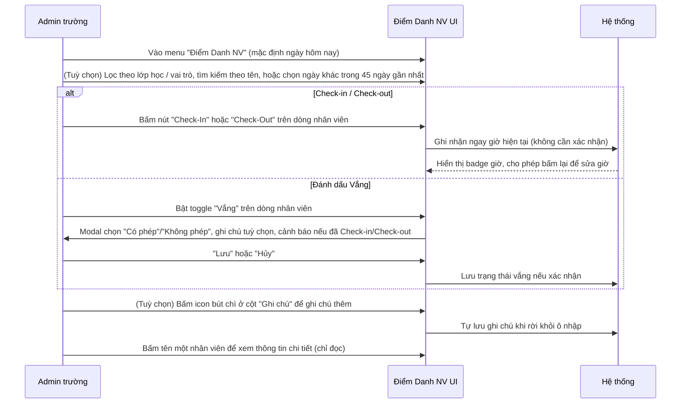
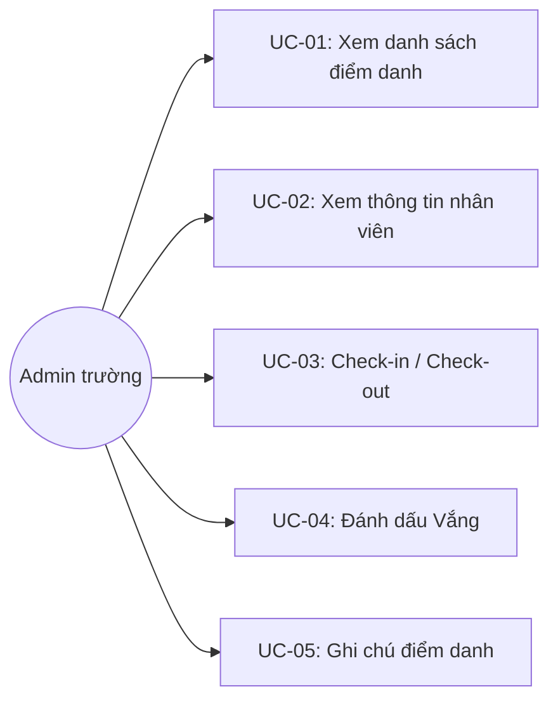

# Tên: Điểm Danh NV

## Mục lục
- [1. Thông tin tổng quan](#1-thông-tin-tổng-quan)
  - [1.1 Giới thiệu chung](#11-giới-thiệu-chung)
  - [1.2 Mục tiêu](#12-mục-tiêu)
  - [1.3 Phạm vi](#13-phạm-vi)
  - [1.4 Tài liệu tham khảo](#14-tài-liệu-tham-khảo)
- [2. Tổng quan nghiệp vụ](#2-tổng-quan-nghiệp-vụ)
  - [2.1 Đối tượng](#21-đối-tượng)
  - [2.2 Luồng nghiệp vụ](#22-luồng-nghiệp-vụ)
  - [2.3 Nguyên tắc nghiệp vụ](#23-nguyên-tắc-nghiệp-vụ)
- [3. Đặc tả tính năng](#3-đặc-tả-tính-năng)
  - [3.1 Phân rã chức năng](#31-phân-rã-chức-năng)
  - [3.2 Acceptance Criteria](#32-acceptance-criteria)
  - [3.3 Use case](#33-use-case)
  - [3.4 Edge Cases & Error Handling](#34-edge-cases--error-handling)
  - [3.5 Non-functional Requirements](#35-non-functional-requirements)
  - [3.6 Quy ước UI chung](#36-quy-ước-ui-chung)

## 1. Thông tin tổng quan

### 1.1 Giới thiệu chung
Điểm Danh NV là màn hình chấm công hàng ngày cho toàn bộ nhân sự nhà trường (Admin, Quản Lý, Giáo Viên, Nhân Viên) — ghi nhận giờ Check-in/Check-out hoặc đánh dấu vắng mặt, theo từng ngày cụ thể.

### 1.2 Mục tiêu
- Ghi nhận nhanh giờ có mặt (Check-in) và giờ ra về (Check-out) của từng nhân viên trong ngày, bằng một thao tác bấm duy nhất.
- Cho phép đánh dấu một nhân viên vắng mặt (có phép/không phép) kèm ghi chú, thay cho Check-in/Check-out.
- Cho phép xem lại và chỉnh sửa dữ liệu điểm danh của các ngày gần đây (trong vòng 45 ngày).
- Hỗ trợ lọc theo lớp học (nhân viên gắn với lớp) hoặc theo vai trò, và tìm kiếm theo tên để thao tác nhanh trên danh sách đông nhân sự.
- Cho phép ghi chú tự do theo từng nhân viên/ngày, độc lập với Check-in/Check-out/Vắng.

### 1.3 Phạm vi
| In scope | Out of scope |
|---|---|
| Xem danh sách nhân viên kèm trạng thái điểm danh của một ngày cụ thể (mặc định hôm nay) | Thêm/xoá nhân viên khỏi danh sách điểm danh (quản lý ở module [Giáo Viên](SM2-giao-vien.md) hoặc nơi khác) |
| Lọc theo lớp học, theo vai trò; tìm kiếm theo tên; sắp xếp theo tên | Chỉnh sửa hồ sơ nhân viên (modal thông tin có icon bút chì nhưng [Cần xác nhận] chưa thử thao tác) |
| Check-in / Check-out trực tiếp; sửa lại giờ đã ghi nhận | Điểm danh cho ngày trong tương lai |
| Đánh dấu Vắng (có phép/không phép) kèm ghi chú | Điểm danh hàng loạt (chọn nhiều dòng cùng lúc) |
| Ghi chú tự do theo từng dòng điểm danh | Xuất báo cáo điểm danh (thuộc mục "Báo Cáo" riêng trong menu Tài Chính) |
| Xem thông tin chi tiết (chỉ đọc) của một nhân viên | Xem lịch sử toàn bộ các lần sửa điểm danh của một nhân viên |

### 1.4 Tài liệu tham khảo
- [Giáo Viên](SM2-giao-vien.md) — nguồn nhân sự Giáo Viên/Quản Lý/Nhân Viên hiển thị trong danh sách điểm danh; modal thông tin nhân viên hiển thị các trường tương tự hồ sơ giáo viên (Email, SĐT, ngày sinh, địa chỉ).
- [Lớp Học](SM3-lop-hoc.md) — bộ lọc "Chọn lớp học" thu hẹp danh sách theo nhân viên gắn với lớp (ví dụ giáo viên chủ nhiệm/bộ môn); modal thông tin của vai trò Quản Lý liệt kê trực tiếp các lớp đang phụ trách, link sang trang chi tiết lớp.

## 2. Tổng quan nghiệp vụ

### 2.1 Đối tượng
| Actor | Vai trò | Trách nhiệm chính |
|---|---|---|
| Admin trường | Người chấm công | Check-in/Check-out hoặc đánh dấu Vắng cho từng nhân viên; ghi chú; xem thông tin nhân viên |
| Nhân viên (Admin/Quản Lý/Giáo Viên/Nhân Viên) | Đối tượng được điểm danh | Xuất hiện trong danh sách với trạng thái điểm danh của ngày đang xem |
| Hệ thống | Bên hỗ trợ | Tự tính giờ hiện tại khi Check-in/Check-out; giới hạn chỉnh sửa trong 45 ngày; khoá các ngày tương lai |

### 2.2 Luồng nghiệp vụ

#### 2.2.1 Mô hình hóa nghiệp vụ

#### 2.2.2 Mô tả các bước nghiệp vụ
| Bước | Người thực hiện | Mô tả | Kết quả |
|---|---|---|---|
| 1 | Admin | Vào menu Nhà Trường → Điểm Danh NV | Danh sách nhân viên của ngày hôm nay hiển thị, kèm 3 bộ đếm Tham dự/Vắng có phép/Vắng không phép |
| 2 | Admin | (Tuỳ chọn) Lọc "Chọn lớp học", "Chọn vai trò", nhập từ khoá tìm kiếm, hoặc đổi ngày xem | Danh sách thu hẹp theo đúng điều kiện lọc/ngày đã chọn |
| 3 | Admin | Bấm "Check-In" hoặc "Check-Out" trên một dòng | Giờ hiện tại được ghi nhận ngay, hiển thị dạng badge có thể bấm lại để sửa |
| 4 | Admin | Bật toggle "Vắng" trên một dòng | Modal xác nhận loại vắng (có phép/không phép) và ghi chú hiện ra; xác nhận "Lưu" mới ghi nhận |
| 5 | Admin | Bấm icon bút chì ở cột "Ghi chú" | Ô nhập ghi chú tự do hiện ra, tự lưu khi rời khỏi ô |
| 6 | Admin | Bấm tên nhân viên | Modal thông tin chi tiết (chỉ đọc) của nhân viên đó hiện ra |

### 2.3 Nguyên tắc nghiệp vụ
| ID | Nguyên tắc nghiệp vụ |
|---|---|
| BR01 | Ngày xem/điểm danh chỉ được chọn từ hôm nay trở về trước; các ngày trong tương lai bị vô hiệu hoá (xám, không bấm được) trên lịch chọn ngày. |
| BR02 | Việc cập nhật điểm danh (Check-in/Check-out/Vắng/Ghi chú) cho một ngày trong quá khứ chỉ được phép trong vòng 45 ngày kể từ hôm nay — hệ thống hiển thị dòng cảnh báo "*Chỉ được cập nhật thông tin điểm danh trong vòng 45 ngày kể từ hôm nay" ngay khi chọn một ngày khác hôm nay. |
| BR03 | Check-in và Check-out là hành động ghi nhận **trực tiếp, một lần bấm, không qua bước xác nhận** — khác với phần lớn hành động tạo/gửi/xoá khác trong portal (luôn có modal xác nhận). |
| BR04 | Sau khi ghi nhận, giờ Check-in/Check-out hiển thị dạng badge kèm icon bút chì; bấm vào badge chuyển thành ô nhập trực tiếp giờ:phút. Hệ thống bắt buộc định dạng giờ hợp lệ — xoá trống rồi rời khỏi ô sẽ báo lỗi "Thời gian không đúng định dạng." và tự khôi phục lại giá trị cũ (không có thao tác xoá hẳn giờ đã ghi nhận qua giao diện này). |
| BR05 | Đánh dấu "Vắng" là hành động **riêng biệt, có modal xác nhận** (chọn "Có phép"/"Không phép" bắt buộc, "Ghi chú" tuỳ chọn, nút Hủy/Lưu) — ngược lại với quy ước một-lần-bấm của Check-in/Check-out. Nếu nhân viên đã có Check-in hoặc Check-out trong ngày đang xem, modal hiển thị thêm dòng cảnh báo tương ứng (ví dụ "Lưu ý: Nhân viên đã check-out lúc {giờ}"). |
| BR06 | Trong lúc modal đánh dấu Vắng của một dòng đang mở, hai nút Check-In/Check-Out của **đúng dòng đó** bị vô hiệu hoá — Vắng và Check-in/Check-out loại trừ thao tác đồng thời trên cùng một dòng. |
| BR07 | Cột "Ghi chú" cho phép sửa trực tiếp tại chỗ (inline), tự lưu ngay khi rời khỏi ô (blur) mà không cần nút Lưu riêng; để trống vẫn được chấp nhận, không báo lỗi (khác với ô giờ Check-in/Check-out ở BR04). |
| BR08 | Một nhân viên có thể đồng thời giữ **nhiều vai trò** — hiển thị đầy đủ các badge vai trò tương ứng (ví dụ vừa "Admin" vừa "Giáo Viên") trên cùng một dòng, không giới hạn 1 vai trò/người. |
| BR09 | Bộ lọc "Chọn lớp học" điều hướng sang URL riêng theo lớp (`/demo/school/{id}/staff-attendance/`) và **thu hẹp hẳn danh sách** chỉ còn nhân viên gắn với lớp đó (ví dụ giáo viên chủ nhiệm/bộ môn) — khác với "Chọn vai trò" và ô "Tìm kiếm" vốn lọc phía client trên cùng một danh sách đầy đủ, không đổi URL và không làm mất phần còn lại của danh sách. |
| BR10 | Khi dùng ô "Tìm kiếm", khối 3 bộ đếm tổng hợp (Tham dự / Vắng có phép / Vắng không phép) ở góc phải trên bị **ẩn đi**; chỉ còn dòng "Tổng: N" ở cuối danh sách phản ánh đúng số kết quả tìm được — bộ lọc lớp học/vai trò/ngày vẫn giữ nguyên 3 bộ đếm. |
| BR11 | Bấm vào tên nhân viên mở modal thông tin **chỉ đọc**; tiêu đề và nội dung modal thay đổi theo vai trò của nhân viên đó: vai trò Admin hiển thị tiêu đề "Thông tin Quản Trị"; các vai trò khác hiển thị "Thông tin người dùng" kèm trường đặc thù theo vai trò (ví dụ "Quản lý lớp" liệt kê các lớp đang phụ trách dưới dạng link, chỉ xuất hiện với vai trò Quản Lý) và trạng thái xác thực tài khoản ("Đã xác thực"). |
| BR12 | Danh sách sắp xếp được theo tên hiển thị (nickname) bằng icon mũi tên cạnh tiêu đề cột "Nhân viên", đảo chiều A→Z / Z→A qua mỗi lần bấm; áp dụng trên toàn bộ danh sách đang lọc, không giới hạn trong trang hiện tại. |

## 3. Đặc tả tính năng

### 3.1 Phân rã chức năng
| Feature | Platform | Priority | User Story |
|---|---|---|---|
| Xem danh sách, lọc & tìm kiếm theo ngày | Web Admin | High | Là Admin trường, tôi muốn xem nhanh trạng thái điểm danh của toàn bộ nhân sự trong một ngày |
| Check-in / Check-out | Web Admin | High | Là Admin trường, tôi muốn ghi nhận giờ có mặt/ra về của nhân viên chỉ bằng một cú bấm |
| Đánh dấu Vắng | Web Admin | High | Là Admin trường, tôi muốn ghi nhận một nhân viên vắng mặt, có phép hoặc không phép |
| Ghi chú điểm danh | Web Admin | Low | Là Admin trường, tôi muốn ghi chú thêm cho một nhân viên trong ngày cụ thể |
| Xem thông tin nhân viên | Web Admin | Medium | Là Admin trường, tôi muốn xem nhanh thông tin liên hệ của một nhân viên từ danh sách điểm danh |

### 3.2 Acceptance Criteria
| User Story | Chức năng | Acceptance Criteria |
|---|---|---|
| Xem danh sách, lọc & tìm kiếm | Danh sách | Lọc "Chọn lớp học" điều hướng URL và thu hẹp theo lớp; "Chọn vai trò"/"Tìm kiếm" lọc ngay phía client; đổi ngày cập nhật đúng dữ liệu của ngày đó |
| Check-in / Check-out | Nút Check-In/Check-Out | Bấm ghi nhận ngay giờ hiện tại, không cần xác nhận; bấm lại vào badge cho sửa giờ; xoá trống báo lỗi định dạng |
| Đánh dấu Vắng | Modal Vắng | Bắt buộc chọn Có phép/Không phép; Hủy không lưu thay đổi; Lưu thì cập nhật toggle và bộ đếm tương ứng |
| Ghi chú | Ô nhập Ghi chú | Rời khỏi ô tự lưu; để trống vẫn được chấp nhận |
| Xem thông tin nhân viên | Modal thông tin | Tiêu đề/nội dung đúng theo vai trò của nhân viên được xem |

### 3.3 Use case

**UC-01**

| Trường | Nội dung |
|---|---|
| Use case ID | UC-01 |
| Use case name | Xem danh sách điểm danh |
| Use case description | Admin xem, lọc, tìm kiếm và sắp xếp danh sách nhân viên kèm trạng thái điểm danh của một ngày cụ thể |
| Actor | Admin trường |
| Happy path | 1. Admin vào menu Nhà Trường → Điểm Danh NV; danh sách mặc định hiển thị ngày hôm nay (37 nhân viên trong dữ liệu demo), kèm 3 bộ đếm Tham dự/Vắng có phép/Vắng không phép:    2. Admin chọn "Chọn lớp học" (ví dụ "6A1") → điều hướng sang danh sách riêng của lớp, chỉ còn nhân viên gắn với lớp đó:    3. Hoặc Admin chọn "Chọn vai trò" (ví dụ "Giáo viên") → danh sách lọc ngay phía client theo vai trò:    4. Hoặc Admin gõ từ khoá vào ô "Tìm kiếm" → danh sách thu hẹp theo tên, 3 bộ đếm bị ẩn, chỉ còn "Tổng: N" ở cuối danh sách:    5. Admin mở lịch chọn ngày; các ngày sau hôm nay bị khoá (Not available):    6. Chọn một ngày trong quá khứ (còn trong 45 ngày) → dữ liệu điểm danh của đúng ngày đó hiển thị, kèm dòng cảnh báo giới hạn 45 ngày:    7. Admin bấm icon mũi tên cạnh cột "Nhân viên" để đảo chiều sắp xếp theo tên (Z→A):   |
| Exception | Không có nhân viên khớp bộ lọc/tìm kiếm → danh sách rỗng, "Tổng: 0" |
| Trigger | Admin click menu "Điểm Danh NV" trong nhóm "Nhà Trường" |
| Pre-condition | Admin đã đăng nhập với quyền quản trị trường |
| Post-condition | Danh sách nhân viên đúng theo bộ lọc/ngày/thứ tự đã chọn được hiển thị |
| Business Rules | BR01, BR02, BR09, BR10, BR12 |

**UC-02**

| Trường | Nội dung |
|---|---|
| Use case ID | UC-02 |
| Use case name | Xem thông tin nhân viên |
| Use case description | Admin xem nhanh thông tin liên hệ (chỉ đọc) của một nhân viên từ danh sách điểm danh |
| Actor | Admin trường |
| Happy path | 1. Từ danh sách, Admin bấm vào tên một nhân viên có vai trò Admin → modal "Thông tin Quản Trị" hiện ra với Email, SĐT, ngày sinh, địa chỉ:    2. Với nhân viên vai trò Quản Lý, modal đổi tiêu đề thành "Thông tin người dùng" và bổ sung trường "Quản lý lớp" (liệt kê các lớp đang phụ trách, link trực tiếp sang trang lớp) cùng trạng thái "Đã xác thực":   |
| Exception | Trường thông tin chưa có dữ liệu (SĐT, ngày sinh, địa chỉ) → hiển thị "Chưa có {trường}" |
| Trigger | Admin bấm vào tên (nickname) một nhân viên trong danh sách |
| Pre-condition | Nhân viên tồn tại trong danh sách đang xem |
| Post-condition | Modal thông tin chi tiết của đúng nhân viên đó được hiển thị, không thay đổi dữ liệu |
| Business Rules | BR11 |

**UC-03**

| Trường | Nội dung |
|---|---|
| Use case ID | UC-03 |
| Use case name | Check-in / Check-out |
| Use case description | Admin ghi nhận giờ có mặt hoặc giờ ra về của một nhân viên trong ngày đang xem |
| Actor | Admin trường |
| Happy path | 1. Trên dòng nhân viên, Admin bấm nút "Check-In" (hoặc "Check-Out") → hệ thống ghi nhận ngay giờ hiện tại, không có bước xác nhận; nút chuyển thành badge giờ kèm icon bút chì. 2. Admin bấm lại vào badge để sửa giờ đã ghi nhận, gõ giờ mới theo định dạng giờ:phút rồi rời khỏi ô để lưu. |
| Exception | Xoá trống ô giờ rồi rời khỏi ô → hệ thống báo lỗi "Thời gian không đúng định dạng." và khôi phục giá trị cũ, không xoá được giờ đã ghi nhận:   |
| Trigger | Admin bấm nút/badge Check-In hoặc Check-Out trên một dòng |
| Pre-condition | Ngày đang xem nằm trong khoảng cho phép cập nhật (hôm nay hoặc trong 45 ngày gần nhất); nhân viên chưa được đánh dấu Vắng cho ngày đó |
| Post-condition | Giờ Check-in/Check-out của nhân viên trong ngày đang xem được ghi nhận hoặc cập nhật; bộ đếm "Tham dự" tăng tương ứng khi có Check-in đầu tiên trong ngày |
| Business Rules | BR01, BR02, BR03, BR04, BR06 |

**UC-04**

| Trường | Nội dung |
|---|---|
| Use case ID | UC-04 |
| Use case name | Đánh dấu Vắng |
| Use case description | Admin ghi nhận một nhân viên vắng mặt trong ngày đang xem, có phép hoặc không phép |
| Actor | Admin trường |
| Happy path | 1. Trên dòng nhân viên, Admin bật toggle "Vắng". 2. Modal hiện ra yêu cầu chọn "Có phép" hoặc "Không phép" (mặc định "Có phép"), kèm ô "Ghi chú" tuỳ chọn; nếu nhân viên đã Check-in/Check-out trong ngày, modal hiển thị thêm dòng cảnh báo tương ứng:   3. Admin bấm "Lưu" để xác nhận, hoặc "Hủy" để huỷ (toggle tự trả về trạng thái tắt). |
| Exception | Nhấn "Hủy" → đóng modal, toggle "Vắng" trở lại trạng thái tắt, không ghi nhận gì |
| Trigger | Admin bật toggle "Vắng" trên một dòng |
| Pre-condition | Ngày đang xem nằm trong khoảng cho phép cập nhật |
| Post-condition | Nhân viên được đánh dấu vắng (có phép/không phép) cho ngày đang xem; hai nút Check-In/Check-Out của dòng đó bị vô hiệu hoá trong lúc modal mở |
| Business Rules | BR01, BR02, BR05, BR06 |

**UC-05**

| Trường | Nội dung |
|---|---|
| Use case ID | UC-05 |
| Use case name | Ghi chú điểm danh |
| Use case description | Admin ghi chú tự do cho một nhân viên trong ngày đang xem, độc lập với Check-in/Check-out/Vắng |
| Actor | Admin trường |
| Happy path | 1. Trên dòng nhân viên, Admin bấm icon bút chì ở cột "Ghi chú" → ô nhập text hiện ra. 2. Admin gõ nội dung ghi chú rồi rời khỏi ô (click ra ngoài hoặc Tab) → nội dung tự lưu, ô trở lại hiển thị dạng icon bút chì (hoặc text đã lưu). |
| Exception | Rời khỏi ô khi để trống → được chấp nhận, không báo lỗi (khác với ô giờ Check-in/Check-out) |
| Trigger | Admin bấm icon bút chì ở cột "Ghi chú" trên một dòng |
| Pre-condition | Ngày đang xem nằm trong khoảng cho phép cập nhật |
| Post-condition | Ghi chú của nhân viên cho ngày đang xem được lưu hoặc giữ nguyên rỗng |
| Business Rules | BR02, BR07 |

### 3.4 Edge Cases & Error Handling

#### 3.4.1 Tổng quan
| Nhóm | Tình huống | Xử lý mong đợi |
|---|---|---|
| Ngày | Chọn ngày trong tương lai | Bị khoá trên lịch chọn ngày, không bấm được (BR01) |
| Ngày | Chọn ngày quá khứ nằm ngoài 45 ngày | [Cần xác nhận] Ngày vẫn chọn được trên lịch trong phiên khảo sát này; dòng cảnh báo 45 ngày luôn hiển thị khi khác hôm nay nhưng chưa xác nhận được liệu ngoài mốc 45 ngày các nút Check-in/Check-out/Vắng có bị vô hiệu hoá thực sự hay chỉ dừng ở cảnh báo (BR02) |
| Check-in/Check-out | Xoá trống giờ đã ghi nhận | Báo lỗi "Thời gian không đúng định dạng.", khôi phục giá trị cũ, không cho lưu rỗng (BR04) |
| Vắng | Nhân viên đã Check-in/Check-out trong ngày | Modal Vắng vẫn cho đánh dấu nhưng hiển thị dòng cảnh báo nêu rõ giờ đã ghi nhận trước đó (BR05) |
| Vắng | Đang mở modal Vắng của một dòng | Check-In/Check-Out của đúng dòng đó bị vô hiệu hoá cho tới khi đóng modal (BR06) |
| Tìm kiếm | Gõ từ khoá không khớp nhân viên nào | Danh sách rỗng, "Tổng: 0", 3 bộ đếm vẫn ẩn (BR10) |
| Vai trò | Nhân viên giữ nhiều vai trò cùng lúc | Hiển thị đầy đủ mọi badge vai trò trên cùng dòng, không rút gọn (BR08) |

#### 3.4.2 Danh sách Thông báo (lỗi/thành công)
| Message ID | Trường hợp lỗi | Rule kiểm tra | Message đề xuất | Hình thức báo | Hành vi hệ thống |
|---|---|---|---|---|---|
| DD-01 | Sửa giờ Check-in/Check-out thành rỗng hoặc sai định dạng | Định dạng giờ:phút hợp lệ | "Thời gian không đúng định dạng." | Toast lỗi (góc trên khu vực nội dung) | Không lưu; khôi phục lại giá trị giờ trước đó |
| DD-02 | Xem/cập nhật điểm danh cho ngày khác hôm nay | Ngày nằm trong 45 ngày gần nhất | "*Chỉ được cập nhật thông tin điểm danh trong vòng 45 ngày kể từ hôm nay" | Text cảnh báo tĩnh dưới hàng bộ lọc | Hiển thị mọi lúc khi ngày đang xem khác hôm nay, không chặn thao tác xem |
| DD-03 | Đánh dấu Vắng cho nhân viên đã Check-in/Check-out | Đối chiếu dữ liệu điểm danh trong ngày | "Lưu ý: Nhân viên đã check-in/check-out lúc {giờ}" | Text cảnh báo trong modal Vắng | Vẫn cho phép Lưu, chỉ mang tính nhắc nhở |

### 3.5 Non-functional Requirements
| ID | Nhóm | Yêu cầu |
|---|---|---|
| NFR01 | Hiệu suất thao tác | Check-in/Check-out là hành động một-lần-bấm không qua xác nhận, tối ưu cho tốc độ chấm công hàng ngày với số lượng nhân sự lớn |
| NFR02 | Toàn vẹn dữ liệu | Giới hạn chỉnh sửa điểm danh trong 45 ngày và khoá ngày tương lai, tránh sửa đổi dữ liệu chấm công quá cũ hoặc chưa phát sinh |
| NFR03 | UX | Ẩn bộ đếm tổng hợp khi đang tìm kiếm để tránh hiểu nhầm số liệu (bộ đếm phản ánh toàn danh sách theo ngày/lớp/vai trò, không phải theo kết quả tìm kiếm) |

### 3.6 Quy ước UI chung
- Mỗi dòng nhân viên gồm avatar, tên hiển thị (nickname, dạng link màu), họ tên đầy đủ, "Mã NV" (hoặc "Chưa có mã NV"), và một hoặc nhiều badge vai trò — cùng quy ước hiển thị card-trong-bảng như các module khác trong Nhà Trường.
- Check-in dùng màu xanh dương, Check-out dùng màu vàng/cam cho cả nút và badge giờ — quy ước màu nhất quán giúp phân biệt nhanh hai loại hành động trên cùng một dòng.
- Đây là module hiếm hoi trong portal có hành động ghi nhận dữ liệu (Check-in/Check-out) **không qua modal xác nhận**, trái với quy ước "luôn xác nhận trước khi ghi nhận" phổ biến ở các module tạo/gửi/xoá khác (Bảng Thông Tin, Bình Chọn, Thực Đơn); riêng hành động đánh dấu Vắng trong module này vẫn giữ modal xác nhận như thông lệ chung.
- Trường rỗng luôn hiển thị dạng "Chưa có {trường}" (ví dụ "Chưa có mã NV", "Chưa có số điện thoại") — quy ước nhất quán với các module khác trong Nhà Trường.
- Modal thông tin nhân viên dùng chung biểu tượng "sổ tay có mặt cười" ở đầu cho mọi vai trò, chỉ khác nhau ở tiêu đề và bộ trường hiển thị theo vai trò.
