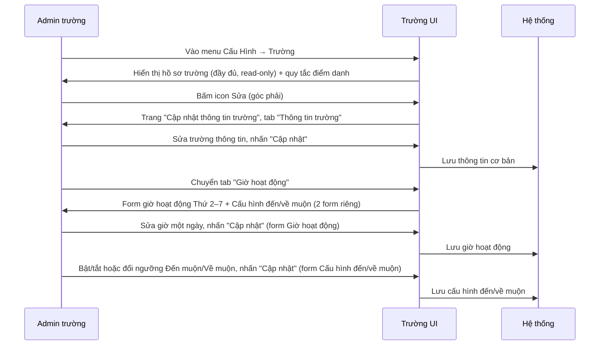
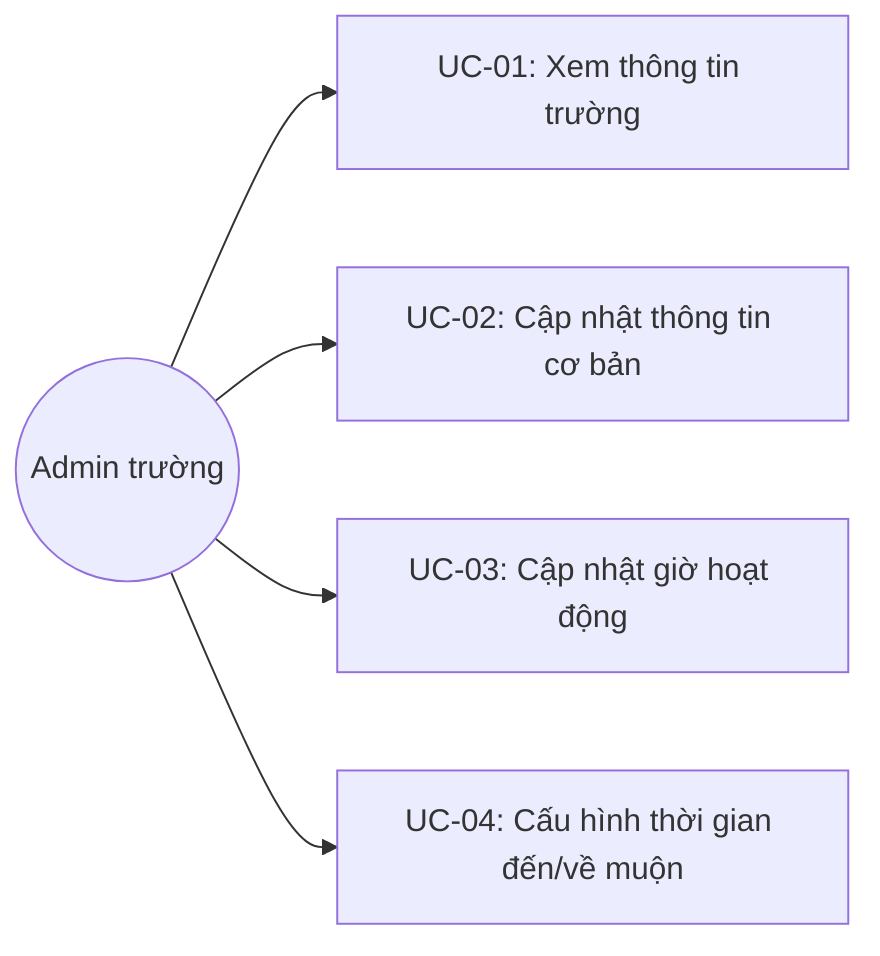
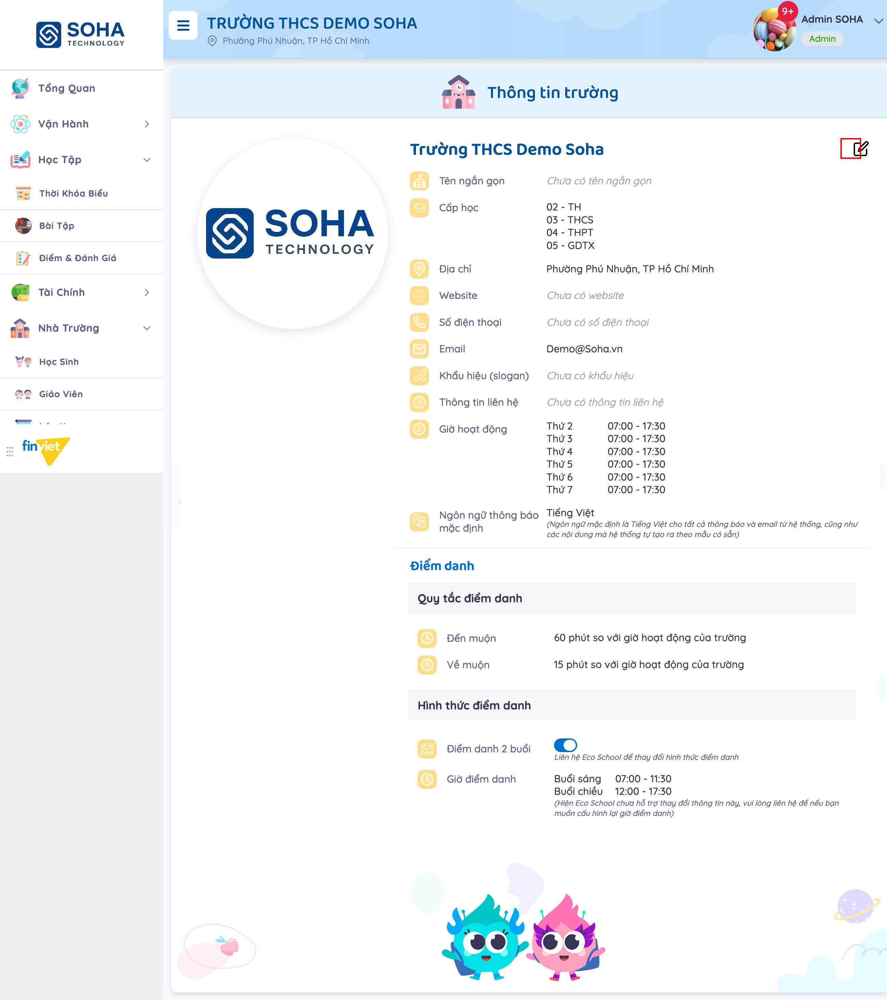
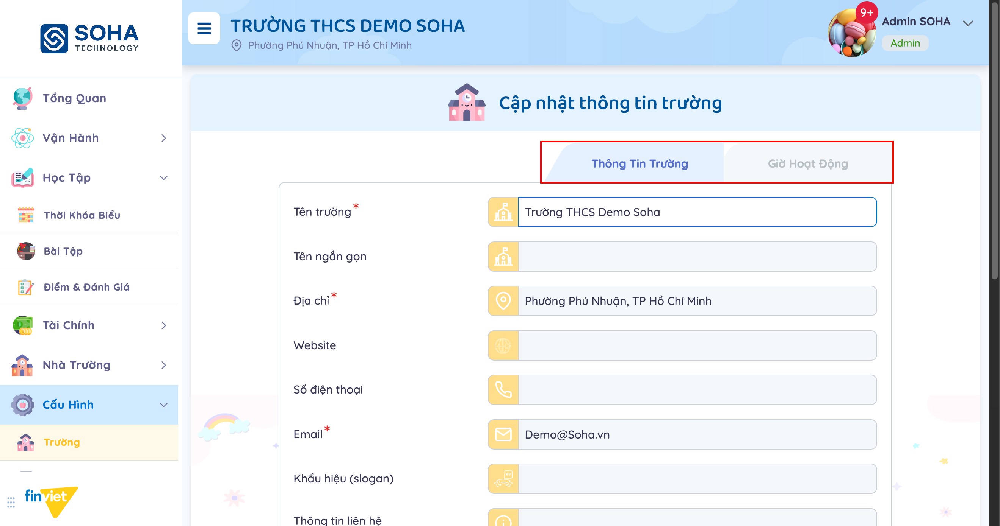
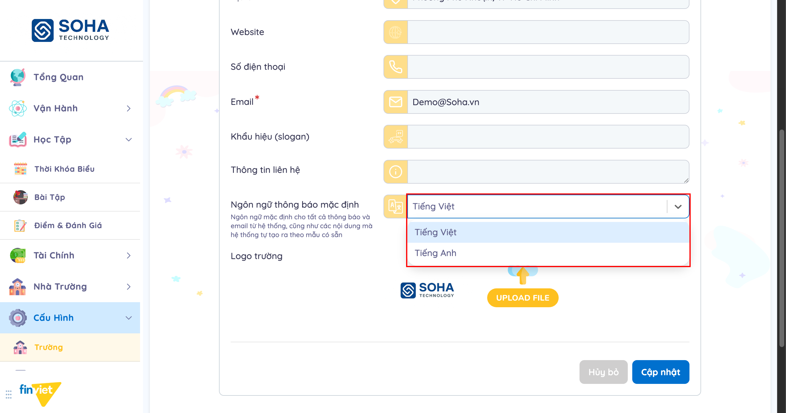
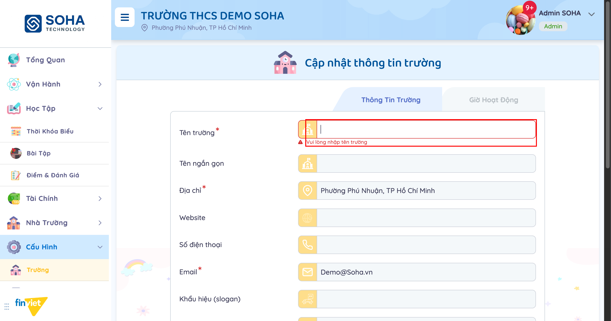
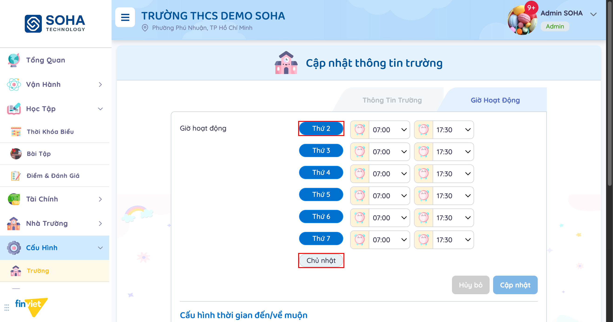
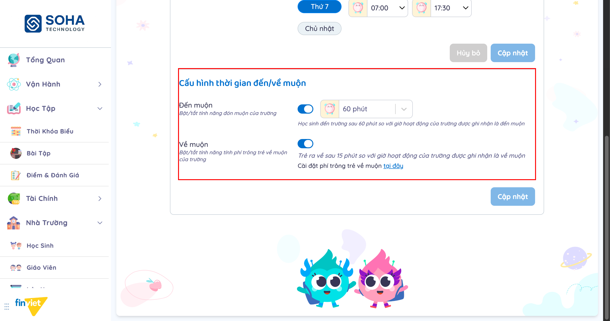
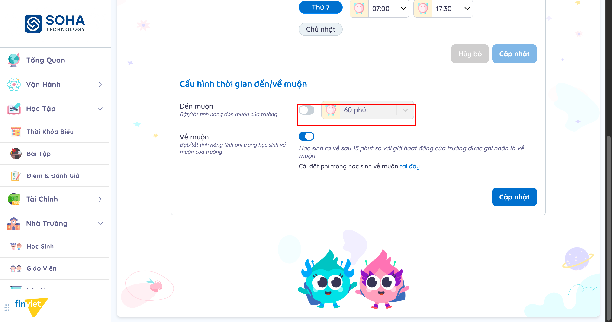

# Tên: Trường

## Mục lục
- [1. Thông tin tổng quan](#1-thông-tin-tổng-quan)
  - [1.1 Giới thiệu chung](#11-giới-thiệu-chung)
  - [1.2 Mục tiêu](#12-mục-tiêu)
  - [1.3 Phạm vi](#13-phạm-vi)
  - [1.4 Tài liệu tham khảo](#14-tài-liệu-tham-khảo)
- [2. Tổng quan nghiệp vụ](#2-tổng-quan-nghiệp-vụ)
  - [2.1 Đối tượng](#21-đối-tượng)
  - [2.2 Luồng nghiệp vụ](#22-luồng-nghiệp-vụ)
  - [2.3 Nguyên tắc nghiệp vụ](#23-nguyên-tắc-nghiệp-vụ)
- [3. Đặc tả tính năng](#3-đặc-tả-tính-năng)
  - [3.1 Phân rã chức năng](#31-phân-rã-chức-năng)
  - [3.2 Acceptance Criteria](#32-acceptance-criteria)
  - [3.3 Use case](#33-use-case)
  - [3.4 Edge Cases & Error Handling](#34-edge-cases--error-handling)
  - [3.5 Non-functional Requirements](#35-non-functional-requirements)
  - [3.6 Quy ước UI chung](#36-quy-ước-ui-chung)

## 1. Thông tin tổng quan

### 1.1 Giới thiệu chung
Trường quản lý hồ sơ định danh của trường (tên, địa chỉ, liên hệ, logo, ngôn ngữ mặc định), giờ hoạt động theo từng ngày trong tuần, và các quy tắc điểm danh đến muộn/về muộn áp dụng toàn trường. Đây là module cấu hình nền tảng, dữ liệu ở đây (đặc biệt giờ hoạt động) được nhiều module Vận Hành/Nhà Trường khác tham chiếu.

### 1.2 Mục tiêu
- Cho phép Admin xem toàn bộ hồ sơ trường trên một trang duy nhất.
- Cho phép Admin cập nhật thông tin định danh cơ bản của trường (tên, địa chỉ, liên hệ, logo, ngôn ngữ thông báo mặc định).
- Cho phép Admin khai báo giờ hoạt động riêng cho từng ngày Thứ 2–Thứ 7.
- Cho phép Admin cấu hình ngưỡng thời gian được tính là "đến muộn"/"về muộn" so với giờ hoạt động.

### 1.3 Phạm vi
| In scope | Out of scope |
|---|---|
| Xem hồ sơ trường đầy đủ (thông tin cơ bản + giờ hoạt động + quy tắc điểm danh) | Cấu hình "Cấp học" (TH/THCS/THPT/GDTX) — hiển thị read-only, không có control chỉnh sửa trong module này |
| Sửa thông tin cơ bản: Tên trường*, Tên ngắn gọn, Địa chỉ*, Website, Số điện thoại, Email*, Khẩu hiệu, Thông tin liên hệ, Ngôn ngữ thông báo mặc định, Logo | Cấu hình "Hình thức điểm danh" (điểm danh 2 buổi) và "Giờ điểm danh" (buổi sáng/chiều) — chỉ xem, ghi chú yêu cầu liên hệ Eco School để đổi |
| Sửa giờ hoạt động Thứ 2–Thứ 7 (giờ bắt đầu/kết thúc mỗi ngày) | Cấu hình giờ hoạt động cho Chủ nhật — không có trường/toggle nào cho ngày này |
| Bật/tắt và chọn ngưỡng phút cho "Đến muộn" | Cấu hình số phút cụ thể cho "Về muộn" từ module này (chỉ có toggle bật/tắt; số phút và phí liên quan cấu hình ở Cấu Hình → Học Phí) |
| Bật/tắt "Về muộn" và liên kết sang cấu hình phí trông muộn | Tạo/xoá trường (đây là hồ sơ đơn — một trường một bản ghi cấu hình) |

### 1.4 Tài liệu tham khảo
- [Cấu Hình → Học Phí](../../operating-portal/M4-tai-chinh/SM1-hoc-phi.md) — nơi cấu hình phí trông học sinh về muộn thực tế, được liên kết trực tiếp từ toggle "Về muộn" qua link "tại đây". [Cần xác nhận: đường link trỏ tới `/demo/setting/fee/`, chưa xác nhận file tài liệu tương ứng đã có hay đúng nội dung phí trông muộn nằm ở đâu trong trang đó]

## 2. Tổng quan nghiệp vụ

### 2.1 Đối tượng
| Actor | Vai trò | Trách nhiệm chính |
|---|---|---|
| Admin trường | Người quản lý | Xem và cập nhật hồ sơ trường, giờ hoạt động, quy tắc đến/về muộn |
| Hệ thống | Bên hỗ trợ | Hiển thị cảnh báo rời trang khi có thay đổi chưa lưu; áp dụng giờ hoạt động/ngưỡng đến-về muộn vào các module điểm danh khác |

### 2.2 Luồng nghiệp vụ

#### 2.2.1 Mô hình hóa nghiệp vụ

#### 2.2.2 Mô tả các bước nghiệp vụ
| Bước | Người thực hiện | Mô tả | Kết quả |
|---|---|---|---|
| 1 | Admin | Vào menu Cấu Hình → Trường | Trang "Thông tin trường" hiển thị đầy đủ hồ sơ, kèm mục "Điểm danh" (quy tắc + hình thức) |
| 2 | Admin | Bấm icon Sửa ở góc phải hồ sơ | Chuyển sang trang "Cập nhật thông tin trường", tab "Thông tin trường" |
| 3 | Admin | Sửa các trường, nhấn "Cập nhật" | Thông tin cơ bản của trường được lưu |
| 4 | Admin | Chuyển sang tab "Giờ hoạt động" | Trang hiển thị 2 form riêng: giờ hoạt động theo ngày, và cấu hình đến/về muộn |
| 5 | Admin | Sửa giờ bắt đầu/kết thúc một ngày, nhấn "Cập nhật" (form giờ hoạt động) | Giờ hoạt động của ngày đó được lưu |
| 6 | Admin | Bật/tắt hoặc đổi ngưỡng phút Đến muộn/Về muộn, nhấn "Cập nhật" (form riêng) | Quy tắc đến/về muộn được lưu, áp dụng cho điểm danh toàn trường |

### 2.3 Nguyên tắc nghiệp vụ
| ID | Nguyên tắc nghiệp vụ |
|---|---|
| BR01 | Trong form "Thông tin trường", 3 trường bắt buộc (đánh dấu `*`): Tên trường, Địa chỉ, Email. Các trường còn lại (Tên ngắn gọn, Website, Số điện thoại, Khẩu hiệu, Thông tin liên hệ) tùy chọn. |
| BR02 | Validate Tên trường diễn ra ngay khi rời khỏi ô trống (inline), không cần bấm "Cập nhật" mới thấy lỗi — viền đỏ + thông báo "Vui lòng nhập tên trường" xuất hiện ngay dưới ô. |
| BR03 | Nút "Cập nhật" của form "Thông tin trường" được bật ngay khi có bất kỳ tương tác nào vào field (kể cả gõ lại đúng giá trị cũ khiến nội dung không đổi thực chất), không gate theo việc form có hợp lệ hay không. [Cần xác nhận] Chưa xác nhận hệ thống có chặn submit thực sự khi Tên trường trống hay không — không thử bấm "Cập nhật" với dữ liệu thiếu để tránh lưu nhầm hồ sơ trường demo. |
| BR04 | "Ngôn ngữ thông báo mặc định" chỉ có 2 lựa chọn cố định: Tiếng Việt, Tiếng Anh. |
| BR05 | "Cấp học" (ví dụ 02-TH, 03-THCS, 04-THPT, 05-GDTX) chỉ hiển thị ở trang xem "Thông tin trường", KHÔNG xuất hiện trong form "Cập nhật thông tin trường" — không có cách sửa cấp học từ giao diện module này. |
| BR06 | Form "Thông tin trường" và form "Giờ hoạt động" nằm trên 2 route riêng (`/demo/school/info/edit/` và `/demo/school/weekdays/edit/`), thể hiện dưới dạng 2 tab của cùng trang "Cập nhật thông tin trường"; chuyển tab là điều hướng trang thật, không phải ẩn/hiện nội dung tại chỗ. |
| BR07 | Giờ hoạt động chỉ cấu hình được cho Thứ 2 đến Thứ 7, mỗi ngày có ô giờ bắt đầu/kết thúc riêng. Chủ nhật hiển thị dưới dạng nhãn xám tĩnh, không có toggle, không có ô giờ — trường mặc định không hoạt động ngày Chủ nhật và không thể đổi từ đây. |
| BR08 | Giờ bắt đầu/kết thúc mỗi ngày chọn qua time-picker dạng danh sách giá trị cố định, bước nhảy 5 phút (ví dụ 06:50, 06:55, 07:00, 07:05...), không gõ tự do. |
| BR09 | Trong tab "Giờ hoạt động", mục "Cấu hình thời gian đến/về muộn" là một form độc lập (nút "Cập nhật" riêng, lưu riêng) nằm dưới form giờ hoạt động theo ngày — sửa giờ hoạt động và sửa quy tắc đến/về muộn là 2 hành động lưu tách biệt dù cùng một trang. |
| BR10 | "Đến muộn": có toggle bật/tắt kèm dropdown chọn ngưỡng phút, các giá trị cố định 5–60 phút (bước 5). Khi tắt toggle, dropdown chuyển sang trạng thái vô hiệu hoá (mờ, không bấm chọn được) nhưng vẫn giữ nguyên giá trị đã chọn trước đó. |
| BR11 | "Về muộn": chỉ có toggle bật/tắt, KHÔNG có dropdown chọn ngưỡng phút trên trang này — số phút (15 phút trong dữ liệu demo) chỉ xuất hiện trong câu mô tả tĩnh; cấu hình số phút/phí thực tế nằm ở trang khác, truy cập qua link "tại đây" (điều hướng sang Cấu Hình → Học Phí). Tắt toggle "Về muộn" chỉ ẩn dòng link "Cài đặt phí... tại đây", không làm mờ câu mô tả phía trên — khác với cách "Đến muộn" vô hiệu hoá cả dropdown. |
| BR12 | Rời trang "Cập nhật thông tin trường" (cả 2 tab) khi đang có thay đổi chưa lưu → hệ thống hiện hộp thoại xác nhận rời trang: "Thay đổi của bạn chưa được lưu. Vui lòng xác nhận rời khỏi khi chưa lưu!". |
| BR13 | [Cần xác nhận] Một số câu mô tả trong "Cấu hình thời gian đến/về muộn" và trong link "Cài đặt phí..." thay đổi cách gọi giữa "học sinh" và "trẻ" ở các lần tải trang khác nhau (ví dụ "Học sinh ra về sau X phút..." so với "Trẻ ra về sau X phút..."), dù dữ liệu cấu hình trường không đổi giữa các lần tải — quan sát thấy lặp lại nhiều lần, có vẻ là nội dung/bản dịch chưa nhất quán phía hệ thống chứ không phải do thao tác của Admin. |
| BR14 | "Hình thức điểm danh" (Điểm danh 2 buổi, có toggle nhưng ghi chú "Liên hệ Eco School để thay đổi") và "Giờ điểm danh" (Buổi sáng/Buổi chiều, ghi chú "Hiện Eco School chưa hỗ trợ thay đổi thông tin này") chỉ hiển thị read-only trên trang "Thông tin trường" — không có control chỉnh sửa nào cho 2 mục này trong toàn bộ module Trường. |

## 3. Đặc tả tính năng

### 3.1 Phân rã chức năng
| Feature | Platform | Priority | User Story |
|---|---|---|---|
| Xem hồ sơ trường | Web Admin | High | Là Admin trường, tôi muốn xem đầy đủ thông tin trường và quy tắc điểm danh trên một trang |
| Cập nhật thông tin cơ bản | Web Admin | High | Là Admin trường, tôi muốn sửa tên, địa chỉ, liên hệ, logo và ngôn ngữ mặc định của trường |
| Cập nhật giờ hoạt động | Web Admin | High | Là Admin trường, tôi muốn khai báo giờ mở/đóng cửa riêng cho từng ngày trong tuần |
| Cấu hình đến/về muộn | Web Admin | Medium | Là Admin trường, tôi muốn đặt ngưỡng thời gian được tính là đến muộn/về muộn so với giờ hoạt động |

### 3.2 Acceptance Criteria
| User Story | Chức năng | Acceptance Criteria |
|---|---|---|
| Xem hồ sơ | Trang "Thông tin trường" | Hiển thị đủ thông tin cơ bản, giờ hoạt động, ngôn ngữ mặc định, và mục Điểm danh (quy tắc + hình thức); trường chưa có dữ liệu hiển thị placeholder "Chưa có..." |
| Cập nhật thông tin cơ bản | Form "Thông tin trường" | Tên trường/Địa chỉ/Email bắt buộc, báo lỗi inline ngay khi để trống; "Cập nhật" bật khi có tương tác |
| Cập nhật giờ hoạt động | Form "Giờ hoạt động" | Thứ 2–7 có ô giờ bắt đầu/kết thúc chọn từ time-picker bước 5 phút; Chủ nhật không có ô giờ |
| Cấu hình đến/về muộn | Form "Cấu hình thời gian đến/về muộn" | Đến muộn có toggle + dropdown ngưỡng phút (5–60, bước 5); Về muộn chỉ có toggle, link sang cấu hình phí ở module khác |

### 3.3 Use case

**UC-01**

| Trường | Nội dung |
|---|---|
| Use case ID | UC-01 |
| Use case name | Xem thông tin trường |
| Use case description | Admin xem toàn bộ hồ sơ trường: thông tin cơ bản, giờ hoạt động, ngôn ngữ mặc định, và quy tắc/hình thức điểm danh |
| Actor | Admin trường |
| Happy path | 1. Admin vào menu Cấu Hình → Trường; trang hiển thị đầy đủ hồ sơ trường kèm icon Sửa ở góc phải, và mục "Điểm danh" (quy tắc đến/về muộn, hình thức điểm danh, giờ điểm danh) phía dưới:   |
| Exception | Trường thông tin chưa có dữ liệu (Website, Số điện thoại, Khẩu hiệu, Thông tin liên hệ, Tên ngắn gọn) → hiển thị placeholder in nghiêng "Chưa có [tên trường thông tin]" |
| Trigger | Admin click menu "Trường" trong nhóm "Cấu Hình" |
| Pre-condition | Admin đã đăng nhập với quyền quản trị trường |
| Post-condition | Không có (chỉ xem) |
| Business Rules | BR05, BR14 |

**UC-02**

| Trường | Nội dung |
|---|---|
| Use case ID | UC-02 |
| Use case name | Cập nhật thông tin cơ bản |
| Use case description | Admin sửa tên, địa chỉ, liên hệ, ngôn ngữ mặc định và logo của trường |
| Actor | Admin trường |
| Happy path | 1. Admin bấm icon Sửa từ trang xem → chuyển sang trang "Cập nhật thông tin trường" với 2 tab, mặc định mở tab "Thông tin trường":   2. Admin sửa các trường (Tên trường*, Tên ngắn gọn, Địa chỉ*, Website, Số điện thoại, Email*, Khẩu hiệu, Thông tin liên hệ). 3. Admin mở dropdown "Ngôn ngữ thông báo mặc định" để chọn 1 trong 2 ngôn ngữ:   4. Admin nhấn "Cập nhật" để lưu. |
| Exception | Để trống Tên trường (trường bắt buộc) → báo lỗi ngay dưới ô, không cần submit:   |
| Trigger | Admin bấm icon Sửa trên trang "Thông tin trường" |
| Pre-condition | Admin có quyền quản trị trường |
| Post-condition | Thông tin cơ bản của trường được cập nhật theo dữ liệu mới |
| Business Rules | BR01, BR02, BR03, BR04, BR12 |

**UC-03**

| Trường | Nội dung |
|---|---|
| Use case ID | UC-03 |
| Use case name | Cập nhật giờ hoạt động |
| Use case description | Admin khai báo giờ mở/đóng cửa riêng cho từng ngày Thứ 2–Thứ 7 |
| Actor | Admin trường |
| Happy path | 1. Admin chuyển sang tab "Giờ hoạt động" → hiển thị 6 dòng Thứ 2–Thứ 7 (mỗi dòng có nhãn ngày màu xanh + ô giờ bắt đầu/kết thúc) và nhãn "Chủ nhật" màu xám không kèm ô giờ:   2. Admin bấm vào ô giờ của một ngày, chọn giá trị mới từ danh sách time-picker (bước 5 phút). 3. Admin nhấn "Cập nhật" (form giờ hoạt động) để lưu. |
| Exception | Không có trường/toggle nào cho Chủ nhật — không thể cấu hình trường hoạt động ngày này từ giao diện |
| Trigger | Admin chuyển tab "Giờ hoạt động" trên trang "Cập nhật thông tin trường" |
| Pre-condition | Admin có quyền quản trị trường |
| Post-condition | Giờ hoạt động của (các) ngày đã sửa được cập nhật |
| Business Rules | BR06, BR07, BR08, BR12 |

**UC-04**

| Trường | Nội dung |
|---|---|
| Use case ID | UC-04 |
| Use case name | Cấu hình thời gian đến/về muộn |
| Use case description | Admin bật/tắt và đặt ngưỡng thời gian được tính là đến muộn hoặc về muộn so với giờ hoạt động |
| Actor | Admin trường |
| Happy path | 1. Trong tab "Giờ hoạt động", cuộn xuống mục "Cấu hình thời gian đến/về muộn": "Đến muộn" có toggle + dropdown ngưỡng phút; "Về muộn" chỉ có toggle kèm link cấu hình phí ở module khác:   2. Admin mở dropdown "Đến muộn" để chọn ngưỡng phút khác (5–60 phút, bước 5). 3. Admin nhấn "Cập nhật" (form riêng của mục này) để lưu. |
| Exception | Tắt toggle "Đến muộn" → dropdown ngưỡng phút bị vô hiệu hoá (mờ, giữ nguyên giá trị cũ):   |
| Trigger | Admin thao tác trên toggle/dropdown trong mục "Cấu hình thời gian đến/về muộn" |
| Pre-condition | Admin có quyền quản trị trường |
| Post-condition | Quy tắc đến/về muộn được cập nhật, áp dụng cho điểm danh toàn trường |
| Business Rules | BR09, BR10, BR11, BR12, BR13 |

### 3.4 Edge Cases & Error Handling

#### 3.4.1 Tổng quan
| Nhóm | Tình huống | Xử lý mong đợi |
|---|---|---|
| Thông tin cơ bản | Để trống Tên trường/Địa chỉ/Email | Báo lỗi inline ngay dưới ô; [Cần xác nhận] chưa xác nhận có chặn được submit thực sự hay không (BR03) |
| Giờ hoạt động | Cấu hình giờ cho Chủ nhật | Không có control — không thể thực hiện (BR07) |
| Đến muộn | Tắt toggle | Dropdown ngưỡng phút bị vô hiệu hoá nhưng giữ giá trị cũ (BR10) |
| Về muộn | Tắt toggle | Chỉ ẩn link cấu hình phí, câu mô tả ngưỡng phút vẫn hiển thị bình thường (BR11) |
| Điều hướng | Rời trang khi form đang có thay đổi chưa lưu | Hộp thoại xác nhận "Thay đổi của bạn chưa được lưu..." (BR12) |
| Nội dung | Thuật ngữ "học sinh"/"trẻ" không nhất quán giữa các lần tải trang | [Cần xác nhận] Không ảnh hưởng dữ liệu, chỉ là hiển thị (BR13) |

#### 3.4.2 Danh sách Thông báo (lỗi/thành công)
| Message ID | Trường hợp lỗi | Rule kiểm tra | Message đề xuất | Hình thức báo | Hành vi hệ thống |
|---|---|---|---|---|---|
| TR-01 | Để trống Tên trường | Tên trường rỗng khi rời khỏi ô | "Vui lòng nhập tên trường" | Inline, viền đỏ dưới ô | Hiện lỗi ngay, không cần chờ submit |
| TR-02 | Rời trang chưa lưu | Form có thay đổi chưa bấm "Cập nhật" | "Thay đổi của bạn chưa được lưu. Vui lòng xác nhận rời khỏi khi chưa lưu!" | Dialog xác nhận rời trang | Chặn điều hướng cho đến khi Admin xác nhận Hủy bỏ hoặc Xác nhận rời đi |

### 3.5 Non-functional Requirements
| ID | Nhóm | Yêu cầu |
|---|---|---|
| NFR01 | Data integrity | Giờ hoạt động và ngưỡng đến/về muộn là dữ liệu nền được các module điểm danh khác tham chiếu — tách thành form lưu riêng theo từng nhóm (thông tin cơ bản / giờ hoạt động / đến-về muộn) để tránh lưu nhầm khi chỉ định sửa một phần |
| NFR02 | UX | Validate inline ngay khi rời ô, không bắt Admin bấm submit mới biết lỗi |
| NFR03 | Consistency | [Cần xác nhận] Thuật ngữ mô tả (học sinh/trẻ) nên nhất quán xuyên suốt cùng một mục cấu hình |

### 3.6 Quy ước UI chung
- Icon Sửa hình vuông-bút chì (`icon_edit_square`) ở góc phải trang xem là lối vào duy nhất để chỉnh sửa — trang xem hoàn toàn read-only.
- Trang "Cập nhật thông tin trường" dùng 2 tab điều hướng bằng route thật (không phải state cục bộ), mỗi tab có (các) form và nút "Cập nhật" riêng — lưu một phần không ảnh hưởng phần còn lại.
- Trường bắt buộc đánh dấu dấu `*` màu đỏ ngay sau nhãn.
- Toggle dùng chung style `tomia-switch` xanh dương khi bật, xám khi tắt, nhất quán với các module Nhà Trường khác (ví dụ Lịch Sự Kiện, Năm Học).
- Mọi ô giờ (giờ hoạt động, giờ điểm danh) đều là time-picker chọn từ danh sách cố định bước 5 phút, không phải input tự do — nhất quán trong toàn module.
