# Tên: Tài Khoản

## Mục lục
- [1. Thông tin tổng quan](#1-thông-tin-tổng-quan)
  - [1.1 Giới thiệu chung](#11-giới-thiệu-chung)
  - [1.2 Mục tiêu](#12-mục-tiêu)
  - [1.3 Phạm vi](#13-phạm-vi)
  - [1.4 Tài liệu tham khảo](#14-tài-liệu-tham-khảo)
- [2. Tổng quan nghiệp vụ](#2-tổng-quan-nghiệp-vụ)
  - [2.1 Đối tượng](#21-đối-tượng)
  - [2.2 Luồng nghiệp vụ](#22-luồng-nghiệp-vụ)
  - [2.3 Nguyên tắc nghiệp vụ](#23-nguyên-tắc-nghiệp-vụ)
- [3. Đặc tả tính năng](#3-đặc-tả-tính-năng)
  - [3.1 Phân rã chức năng](#31-phân-rã-chức-năng)
  - [3.2 Acceptance Criteria](#32-acceptance-criteria)
  - [3.3 Use case](#33-use-case)
  - [3.4 Edge Cases & Error Handling](#34-edge-cases--error-handling)
  - [3.5 Non-functional Requirements](#35-non-functional-requirements)
  - [3.6 Quy ước UI chung](#36-quy-ước-ui-chung)

## 1. Thông tin tổng quan

### 1.1 Giới thiệu chung
Tài Khoản quản lý 2 loại tài khoản đăng nhập tách biệt: tài khoản "Người Dùng" (Admin, Quản lý, Giáo viên, Nhân viên, Phụ huynh — có thể gán nhiều vai trò cùng lúc trên một tài khoản) và tài khoản đăng nhập riêng của "Học Sinh". Đây là module cấu hình quyền truy cập cốt lõi, quyết định ai được vào hệ thống và với vai trò gì.

### 1.2 Mục tiêu
- Cho phép Admin xem, tìm kiếm và lọc toàn bộ tài khoản người dùng của trường.
- Cho phép Admin tạo tài khoản mới và gán một hoặc nhiều vai trò (Quản lý/Phụ huynh/Nhân viên/Giáo viên).
- Cho phép Admin cấp quyền hạn chi tiết hơn cho vai trò Nhân viên (Điểm danh/Kế toán/Thông báo/Chăm sóc-Y tế) và gán lớp phụ trách cho vai trò Quản lý.
- Cho phép Admin khoá/mở lại (đổi trạng thái) hoặc xoá tài khoản không còn cần thiết.
- Cho phép Admin tạo/quản lý tài khoản đăng nhập riêng cho học sinh (tách biệt khỏi tài khoản phụ huynh của các em).

### 1.3 Phạm vi
| In scope | Out of scope |
|---|---|
| Xem/tìm kiếm/lọc danh sách tài khoản Người Dùng (theo vai trò, trạng thái, đồng bộ CSDL Sở) | Tạo tài khoản với vai trò Admin — checkbox "Admin" bị khoá cứng trên form Tạo |
| Tạo/Sửa/Xoá tài khoản Người Dùng, đổi email, đổi mật khẩu | Sửa/Xoá tài khoản có vai trò Admin — chỉ xem được, không có icon Sửa/Xoá |
| Bật/tắt trạng thái hoạt động của tài khoản | Sửa Họ và tên hoặc trạng thái của tài khoản đồng bộ từ CSDL Sở — bị khoá/từ chối |
| Gán "Chức năng nhân viên" và "Lớp phụ trách" theo vai trò | Liên kết tài khoản Phụ huynh với học sinh (thực hiện ở module Học Sinh, không có trên form Tạo/Sửa tài khoản) |
| Xem/Tạo/Sửa/Đổi mật khẩu tài khoản đăng nhập của học sinh (tab Học Sinh) | Đăng nhập thử hoặc mô phỏng trải nghiệm học sinh/phụ huynh sau khi có tài khoản |

### 1.4 Tài liệu tham khảo
- [Trường](SM1-truong.md) — cùng nhóm Cấu Hình.
- [Học Sinh](../M5-nha-truong/SM1-hoc-sinh.md) — nơi liên kết Phụ huynh với học sinh; trang chi tiết học sinh được link tới từ tên học sinh trong cột "Họ và tên" và từ mục "PH của học sinh" trong modal xem chi tiết. [Cần xác nhận: đường dẫn liên kết Phụ huynh–Học sinh thực hiện chính xác ở đâu trong module Học Sinh]

## 2. Tổng quan nghiệp vụ

### 2.1 Đối tượng
| Actor | Vai trò | Trách nhiệm chính |
|---|---|---|
| Admin trường | Người quản lý | Tạo/xem/sửa/xoá tài khoản Người Dùng và tài khoản Học Sinh; gán vai trò, chức năng, trạng thái |
| CSDL Sở | Hệ thống ngoài | Nguồn đồng bộ một số tài khoản Phụ huynh/Học sinh (đánh dấu badge "CSDL Sở"); khoá một số trường và chặn đổi trạng thái với các tài khoản này |
| Hệ thống | Bên hỗ trợ | Gửi lời mời khi tạo tài khoản mới ("Tạo và gửi lời mời"); xác thực và từ chối các thay đổi không hợp lệ (ví dụ với tài khoản CSDL Sở) |

### 2.2 Luồng nghiệp vụ

#### 2.2.1 Mô hình hóa nghiệp vụ
```mermaid
sequenceDiagram
    participant Admin as Admin trường
    participant UI as Tài Khoản UI
    participant API as Hệ thống

    Admin->>UI: Vào menu Cấu Hình → Tài Khoản (tab Người Dùng)
    UI->>Admin: Danh sách tài khoản (mặc định lọc "Đang hoạt động")
    Admin->>UI: Nhấn "Tạo tài khoản"
    UI->>Admin: Form Họ tên*/Email*/Mật khẩu*/Vai trò* (+trường phụ theo vai trò)
    Admin->>UI: Chọn vai trò, điền thông tin, nhấn "Tạo và gửi lời mời"
    UI->>API: Tạo tài khoản + gửi lời mời
    Admin->>UI: Bấm icon Sửa trên một tài khoản có sẵn (không phải Admin)
    UI->>Admin: Form Sửa (đã điền sẵn; khoá bớt trường nếu là tài khoản CSDL Sở)
    Admin->>UI: Sửa thông tin/đổi trạng thái, nhấn "Cập nhật"
    UI->>Admin: Modal "Vui lòng xác nhận cập nhật tài khoản này!"
    Admin->>UI: Xác nhận
    UI->>API: Lưu thay đổi (từ chối nếu là tài khoản CSDL Sở và trường bị khoá)
    Admin->>UI: Chuyển tab "Học Sinh"
    UI->>Admin: Danh sách học sinh kèm tên tài khoản (nếu có)
    Admin->>UI: Bấm icon "+" trên một học sinh chưa có tài khoản
    UI->>Admin: Modal "Tạo tài khoản" (Tên tài khoản*, Mật khẩu*, Nhập lại mật khẩu*)
    Admin->>UI: Điền thông tin, nhấn "Tạo tài khoản"
    UI->>API: Tạo tài khoản đăng nhập cho học sinh
```

#### 2.2.2 Mô tả các bước nghiệp vụ
| Bước | Người thực hiện | Mô tả | Kết quả |
|---|---|---|---|
| 1 | Admin | Vào menu Cấu Hình → Tài Khoản | Danh sách tài khoản Người Dùng hiển thị, mặc định chỉ tài khoản đang hoạt động |
| 2 | Admin | Lọc theo vai trò/trạng thái, hoặc mở "Lọc mở rộng" lọc theo CSDL Sở | Danh sách thu hẹp theo tiêu chí đã chọn |
| 3 | Admin | Nhấn "Tạo tài khoản", điền thông tin và (các) vai trò | Tài khoản mới được tạo, lời mời được gửi |
| 4 | Admin | Bấm icon Sửa trên một tài khoản (không phải Admin), sửa thông tin, nhấn "Cập nhật", xác nhận | Tài khoản được cập nhật (trừ trường bị khoá nếu là CSDL Sở) |
| 5 | Admin | Bấm icon Xoá trên một tài khoản, xác nhận | Tài khoản bị xoá khỏi hệ thống |
| 6 | Admin | Bật/tắt toggle "Trạng thái" ngay trên danh sách | Trạng thái đổi tức thì (trừ tài khoản CSDL Sở — bị từ chối) |
| 7 | Admin | Chuyển tab "Học Sinh", bấm "+" hoặc icon Sửa trên một học sinh | Tạo mới hoặc sửa tên tài khoản/mật khẩu đăng nhập của học sinh đó |

### 2.3 Nguyên tắc nghiệp vụ
| ID | Nguyên tắc nghiệp vụ |
|---|---|
| BR01 | Trang "Tài khoản" có 2 tab cấp cao trên 2 route khác nhau: "Người Dùng" (`/demo/setting/users/` — tài khoản Admin/Quản lý/Giáo viên/Nhân viên/Phụ huynh) và "Học Sinh" (`/demo/school/kid/accounts/` — tài khoản đăng nhập riêng của học sinh). Đây là 2 loại tài khoản độc lập, không dùng chung form. |
| BR02 | Một tài khoản Người Dùng có thể mang đồng thời nhiều vai trò (ví dụ vừa Admin vừa Phụ Huynh, vừa Giáo Viên vừa Phụ Huynh) — cột "Vai trò" hiển thị nhiều badge trên cùng một dòng, và form Sửa dùng checkbox (chọn nhiều) chứ không phải radio. |
| BR03 | Tài khoản có vai trò Admin chỉ có icon Xem (con mắt) ở cột "Hành động" — không có icon Sửa/Xoá dù đang đăng nhập bằng một Admin khác. Tài khoản không mang vai trò Admin có đủ 3 icon Xem/Sửa/Xoá. |
| BR04 | Checkbox vai trò "Admin" bị khoá cứng (disabled) trên form "Tạo tài khoản" — không thể tạo tài khoản Admin mới từ giao diện Tài Khoản của trường. |
| BR05 | Badge "CSDL Sở" đánh dấu tài khoản được đồng bộ từ cơ sở dữ liệu ngành. Trên form Sửa, các tài khoản này hiện banner cảnh báo "Dữ liệu được đồng bộ từ CSDL Sở, một số thông tin không thể chỉnh sửa" và trường "Họ và tên" bị khoá hoàn toàn (input disabled, không hiện lỗi khi bỏ qua). |
| BR06 | Toggle "Trạng thái" ngay trên trang danh sách áp dụng **tức thì, không có modal xác nhận** — khác biệt rõ với mọi hành động sửa/xoá khác trong module. Với tài khoản có badge "CSDL Sở", thao tác này bị hệ thống từ chối và hiện thông báo lỗi "Không thể cập nhật với đối tượng được đồng bộ từ CSDL ngành", trạng thái thực tế không đổi. |
| BR07 | Ngược lại, đổi "Trạng thái" (hay bất kỳ trường nào khác) từ **trang Sửa** rồi nhấn "Cập nhật" luôn hiện modal xác nhận riêng: "Vui lòng xác nhận cập nhật tài khoản này!" trước khi lưu thật. |
| BR08 | Trường Email không sửa trực tiếp trong form Sửa — chỉ hiện dạng text kèm link "Thay đổi" mở modal riêng "Thay đổi email" (hiện Email hiện tại + ô nhập Email mới*). |
| BR09 | Đổi mật khẩu là một **trang riêng** (không phải modal), truy cập qua link "Đổi mật khẩu" trong mục "BẢO MẬT" của form Sửa — có cảnh báo "Đổi mật khẩu cho tài khoản này thì tài khoản sẽ không thể đăng nhập với mật khẩu cũ" và 2 ô Mật khẩu mới*/Nhập lại mật khẩu mới* (có icon ẩn/hiện). |
| BR10 | Chọn vai trò "Nhân viên" hiện thêm mục "Chức năng nhân viên" — checkbox chọn 1 hoặc nhiều trong 4 quyền cố định: Điểm danh, Kế toán, Thông báo, Chăm sóc/Y tế; mỗi quyền có icon (ⓘ) giải thích phạm vi truy cập tương ứng khi hover. Bắt buộc chọn ít nhất 1 chức năng — hiện lỗi "Vui lòng chọn chức năng" ngay khi chưa chọn, không cần submit. |
| BR11 | [Bug quan sát được] Tooltip giải thích quyền "Chăm sóc/Y tế" hiển thị một placeholder chưa được thay thế: "Nhân viên có quyền Chăm Sóc/Y tế sẽ được phép truy cập vào Chăm sóc {{{object}}}" — lỗi nội dung/template phía hệ thống, 3 tooltip còn lại (Điểm danh, Kế toán, Thông báo) hiển thị đúng câu hoàn chỉnh. |
| BR12 | Chọn vai trò "Quản lý" hiện thêm trường riêng "Lớp phụ trách" (dropdown chọn lớp) — vai trò "Giáo viên" và "Nhân viên" không có trường này, chỉ có "Mã nhân viên" dùng chung. |
| BR13 | Vai trò "Nhân viên" và "Giáo viên" đều mở thêm mục "Thông tin bổ sung" (thu gọn mặc định, có mũi tên mở/đóng) gồm 6 trường tùy chọn: Số CCCD, Chức vụ, Ngày vào làm, Bằng cấp, Các kỹ năng khác, Bộ phận. |
| BR14 | Nút "Cập nhật"/"Tạo và gửi lời mời" được bật ngay khi có bất kỳ tương tác nào (kể cả chỉ tick 1 checkbox vai trò), không gate theo việc toàn bộ form đã hợp lệ hay chưa — validate các trường bắt buộc (Họ tên/Email/Mật khẩu/Vai trò) hiện lỗi ngay dưới từng ô, không cần đợi submit. [Cần xác nhận] Chưa thử bấm nút với dữ liệu thiếu để xem hệ thống có chặn được submit thực sự hay không. |
| BR15 | Xoá tài khoản hiện modal xác nhận nêu rõ tên tài khoản sẽ xoá: "Vui lòng xác nhận xoá tài khoản [Họ tên]!" — không có cảnh báo hệ quả liên đới nào khác (ví dụ ảnh hưởng tới học sinh liên kết). |
| BR16 | Bộ lọc "Trạng thái" mặc định là "Đang hoạt động" (giá trị thật, không phải placeholder rỗng) — tài khoản bị vô hiệu hoá biến mất khỏi danh sách mặc định; phải chủ động chọn "Ngừng hoạt động" mới thấy lại. |
| BR17 | "Lọc mở rộng" hiện tại chỉ có đúng 1 tiêu chí: "CSDL Sở" (Có/Không). |
| BR18 | Với dòng có vai trò Phụ Huynh, cột "Họ và tên" hiển thị kèm danh sách tên (các) học sinh liên kết dưới dạng link điều hướng sang trang chi tiết học sinh; vai trò Nhân viên/Giáo viên/Quản lý không có danh sách liên kết này. |
| BR19 | Tab "Học Sinh" quản lý tài khoản đăng nhập của **chính học sinh** — khác hoàn toàn với tài khoản Phụ huynh của em đó. Mỗi học sinh có tối đa 1 tài khoản: chưa có thì cột "Hành động" hiện icon "+" (Tạo tài khoản), đã có thì hiện icon bút chì (Chỉnh sửa tài khoản) kèm tên tài khoản hiển thị ở cột "Tên tài khoản". |
| BR20 | Form Tạo/Sửa tài khoản học sinh yêu cầu "Tên tài khoản" theo định dạng: email hoặc chuỗi chỉ gồm chữ cái, số, dấu gạch ngang (-) và gạch dưới (_) — ghi chú định dạng hiện màu xanh ngay dưới ô nhập (không phải thông báo lỗi). |
| BR21 | Bộ lọc riêng của tab Học Sinh — "Tất cả học sinh / Đã có tài khoản / Chưa có tài khoản" — lọc theo tình trạng đã tạo tài khoản đăng nhập hay chưa, độc lập với bộ lọc "Chọn lớp học". |

## 3. Đặc tả tính năng

### 3.1 Phân rã chức năng
| Feature | Platform | Priority | User Story |
|---|---|---|---|
| Xem & lọc danh sách tài khoản | Web Admin | High | Là Admin trường, tôi muốn xem, tìm kiếm và lọc tài khoản người dùng theo vai trò/trạng thái/CSDL Sở |
| Tạo/Sửa tài khoản Người Dùng | Web Admin | High | Là Admin trường, tôi muốn tạo tài khoản mới hoặc sửa tài khoản có sẵn với đúng vai trò và quyền hạn |
| Đổi trạng thái & Xoá tài khoản | Web Admin | High | Là Admin trường, tôi muốn khoá tạm hoặc xoá hẳn một tài khoản không còn cần thiết |
| Quản lý tài khoản đăng nhập học sinh | Web Admin | Medium | Là Admin trường, tôi muốn tạo và quản lý tài khoản đăng nhập riêng cho học sinh |

### 3.2 Acceptance Criteria
| User Story | Chức năng | Acceptance Criteria |
|---|---|---|
| Xem & lọc | Danh sách + bộ lọc | Mặc định chỉ hiện tài khoản "Đang hoạt động"; lọc theo vai trò và CSDL Sở hoạt động đúng theo lựa chọn |
| Tạo/Sửa | Form Tạo/Sửa tài khoản | Vai trò Nhân viên/Quản lý hiện đúng trường phụ tương ứng (Chức năng nhân viên / Lớp phụ trách); tài khoản CSDL Sở khoá đúng trường Họ và tên |
| Đổi trạng thái & Xoá | Toggle + modal xoá | Toggle trên danh sách đổi tức thì (trừ CSDL Sở); Xoá luôn có modal xác nhận nêu tên tài khoản |
| Tài khoản học sinh | Tab Học Sinh | Học sinh chưa có tài khoản hiện icon "+"; đã có hiện icon Sửa kèm tên tài khoản; validate đúng định dạng Tên tài khoản |

### 3.3 Use case
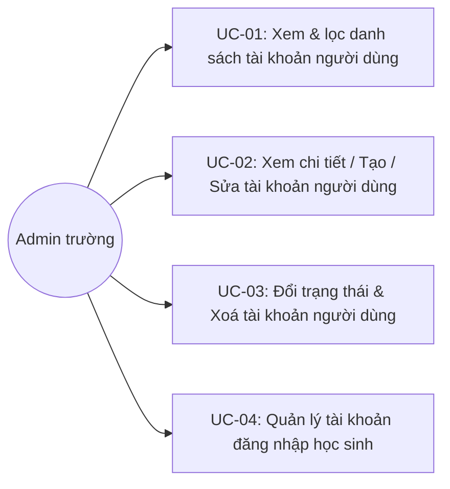

**UC-01**

| Trường | Nội dung |
|---|---|
| Use case ID | UC-01 |
| Use case name | Xem & lọc danh sách tài khoản người dùng |
| Use case description | Admin xem danh sách tài khoản, tìm kiếm và lọc theo vai trò, trạng thái, hoặc nguồn đồng bộ CSDL Sở |
| Actor | Admin trường |
| Happy path | 1. Admin vào menu Cấu Hình → Tài Khoản, tab "Người Dùng" mặc định; tài khoản mang vai trò Admin chỉ có icon Xem, các tài khoản khác có đủ 3 icon Xem/Sửa/Xoá:<br><br>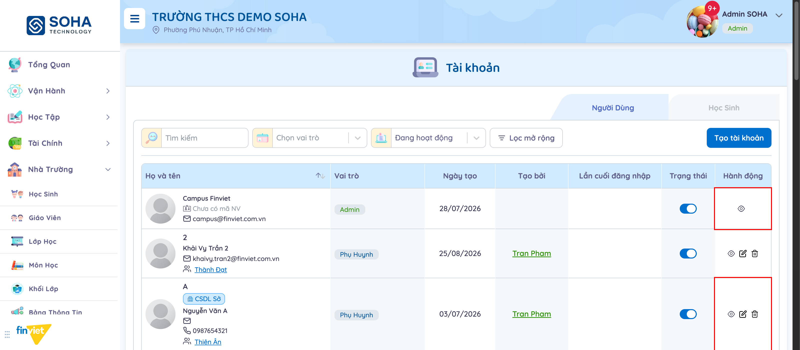<br><br>2. Admin mở dropdown "Chọn vai trò" để lọc theo 1 trong 5 vai trò cố định:<br><br>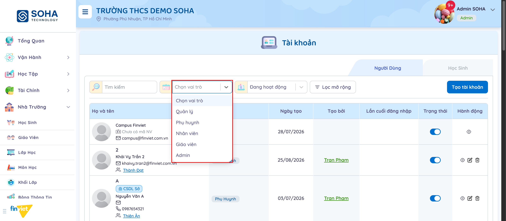<br>3. Admin mở dropdown "Đang hoạt động" — đây là bộ lọc trạng thái thật (không phải placeholder), mặc định đã chọn "Đang hoạt động":<br><br>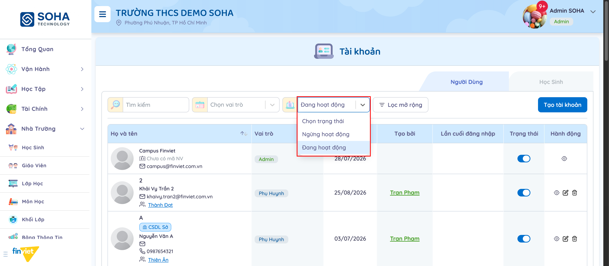<br>4. Admin mở "Lọc mở rộng" để lọc theo "CSDL Sở" (Có/Không):<br><br>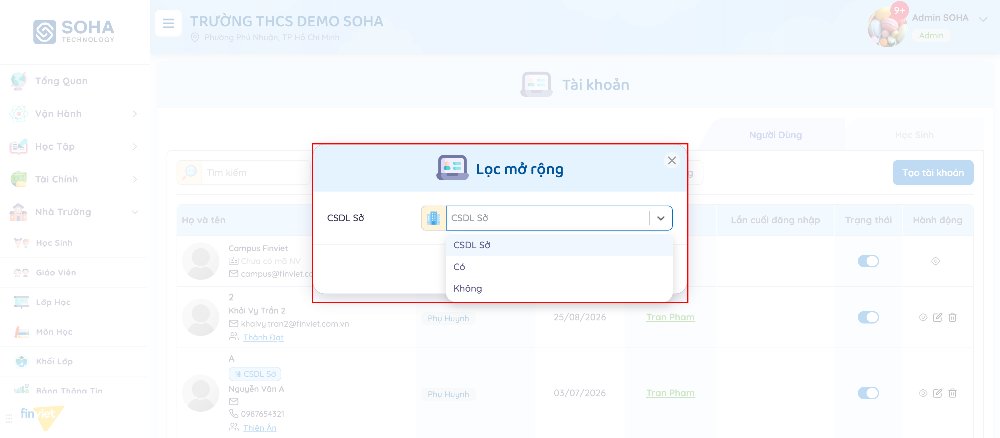 |
| Exception | Không có tài khoản nào khớp bộ lọc → danh sách rỗng |
| Trigger | Admin click menu "Tài Khoản" trong nhóm "Cấu Hình" |
| Pre-condition | Admin đã đăng nhập với quyền quản trị trường |
| Post-condition | Danh sách hiển thị đúng theo tiêu chí lọc |
| Business Rules | BR01, BR02, BR03, BR16, BR17, BR18 |

**UC-02**

| Trường | Nội dung |
|---|---|
| Use case ID | UC-02 |
| Use case name | Xem chi tiết / Tạo / Sửa tài khoản người dùng |
| Use case description | Admin xem thông tin đầy đủ, tạo tài khoản mới, hoặc sửa tài khoản có sẵn (không phải Admin) |
| Actor | Admin trường |
| Happy path | 1. Admin bấm icon Xem trên một tài khoản Phụ huynh → modal chỉ đọc hiện đầy đủ thông tin kèm học sinh liên kết:<br><br>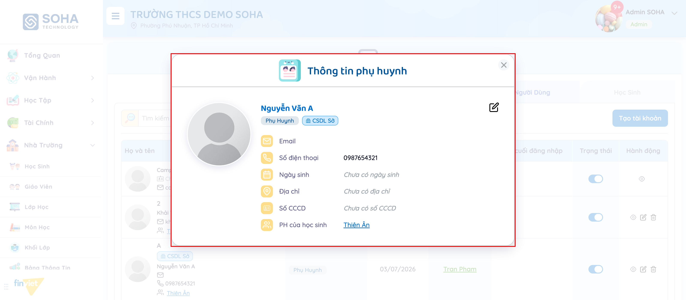<br>2. Admin nhấn "Tạo tài khoản" hoặc icon Sửa, tick vai trò "Nhân viên" → hiện thêm "Chức năng nhân viên" (bắt buộc chọn ít nhất 1) và "Mã nhân viên":<br><br>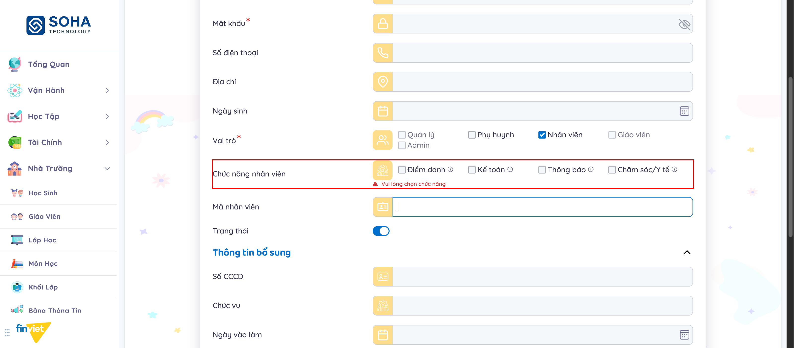<br>3. Admin hover icon (ⓘ) cạnh "Chăm sóc/Y tế" để xem giải thích quyền hạn.<br>4. Admin tick vai trò "Quản lý" thay vì "Nhân viên" → hiện trường riêng "Lớp phụ trách":<br><br>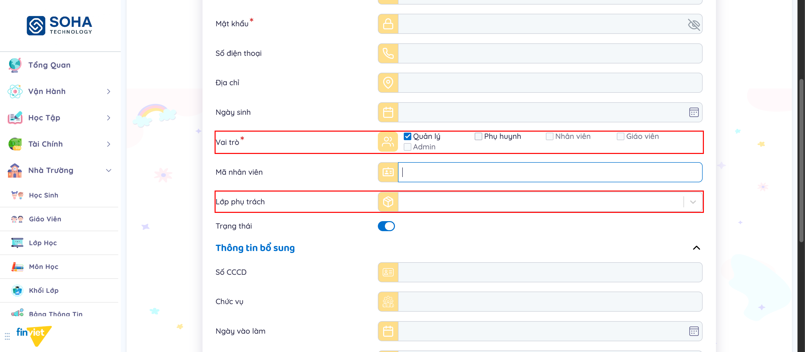<br>5. Trên form Sửa, Admin bấm "Thay đổi" cạnh Email → modal "Thay đổi email" riêng:<br><br>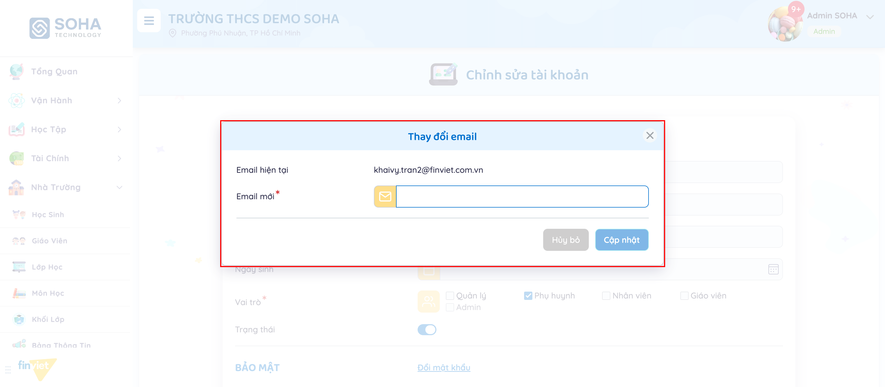<br>6. Admin bấm "Đổi mật khẩu" trong mục BẢO MẬT → chuyển sang trang riêng nhập mật khẩu mới:<br><br>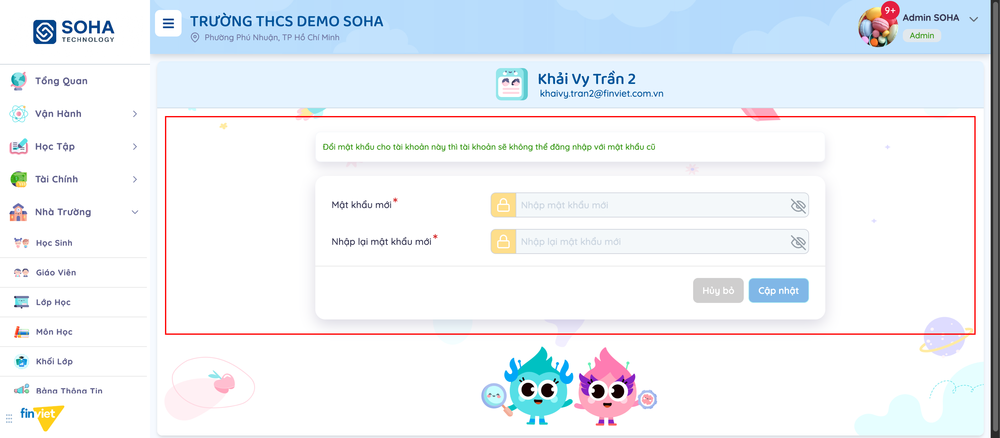<br>7. Admin sửa thông tin và nhấn "Cập nhật" → modal xác nhận trước khi lưu:<br><br>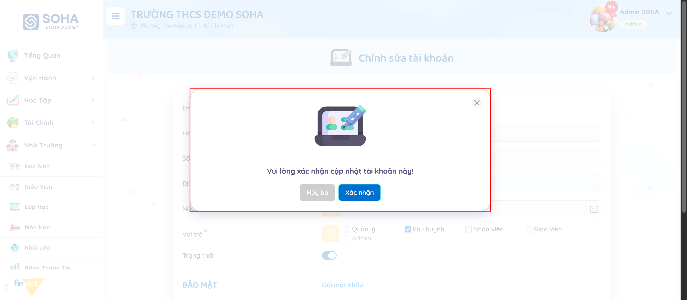 |
| Exception | 1. Không tick vai trò nào → nút "Admin" luôn bị khoá sẵn, lỗi "Vui lòng chọn vai trò" hiện ngay:<br><br>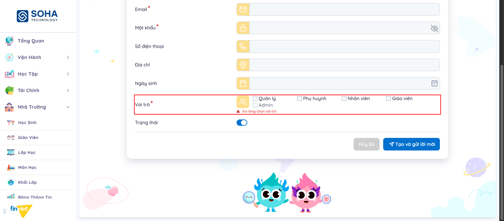<br>2. [Bug] Tooltip quyền "Chăm sóc/Y tế" hiện placeholder chưa thay thế `{{{object}}}`:<br><br>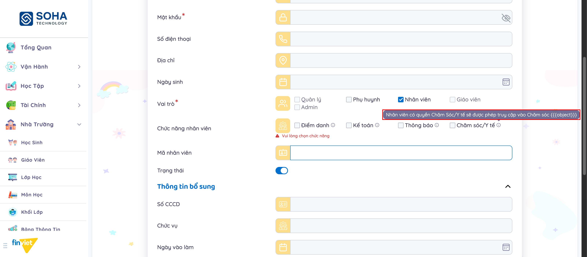<br>3. Sửa tài khoản có badge "CSDL Sở" → trường Họ và tên bị khoá, banner cảnh báo hiện phía trên form |
| Trigger | Admin bấm icon Xem/Sửa trên một tài khoản, hoặc bấm "Tạo tài khoản" |
| Pre-condition | Admin có quyền quản trị trường; với Sửa, tài khoản đó không mang vai trò Admin |
| Post-condition | Tài khoản mới được tạo (kèm gửi lời mời), hoặc tài khoản có sẵn được cập nhật đúng thông tin |
| Business Rules | BR04, BR05, BR07, BR08, BR09, BR10, BR11, BR12, BR13, BR14 |

**UC-03**

| Trường | Nội dung |
|---|---|
| Use case ID | UC-03 |
| Use case name | Đổi trạng thái & Xoá tài khoản người dùng |
| Use case description | Admin bật/tắt nhanh trạng thái hoạt động ngay trên danh sách, hoặc xoá hẳn một tài khoản |
| Actor | Admin trường |
| Happy path | 1. Admin bấm toggle "Trạng thái" ngay trên dòng tài khoản → đổi tức thì, không cần xác nhận, thông báo "Cập nhật trạng thái người dùng thành công".<br>2. Admin bấm icon Xoá trên một tài khoản → modal xác nhận nêu rõ tên tài khoản:<br><br>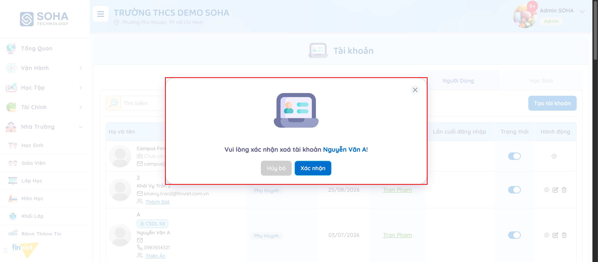<br>3. Admin nhấn "Xác nhận" → tài khoản bị xoá khỏi danh sách. |
| Exception | Bấm toggle trên tài khoản có badge "CSDL Sở" → hệ thống từ chối, hiện lỗi "Không thể cập nhật với đối tượng được đồng bộ từ CSDL ngành", trạng thái không đổi |
| Trigger | Admin bấm toggle "Trạng thái" hoặc icon Xoá trên một dòng tài khoản (không phải Admin) |
| Pre-condition | Admin có quyền quản trị trường; tài khoản đó không mang vai trò Admin |
| Post-condition | Trạng thái được đổi, hoặc tài khoản bị xoá vĩnh viễn |
| Business Rules | BR03, BR05, BR06, BR15 |

**UC-04**

| Trường | Nội dung |
|---|---|
| Use case ID | UC-04 |
| Use case name | Quản lý tài khoản đăng nhập học sinh |
| Use case description | Admin tạo mới hoặc chỉnh sửa tên tài khoản/mật khẩu đăng nhập riêng của một học sinh |
| Actor | Admin trường |
| Happy path | 1. Admin chuyển sang tab "Học Sinh"; lọc theo lớp hoặc theo tình trạng đã có tài khoản:<br><br>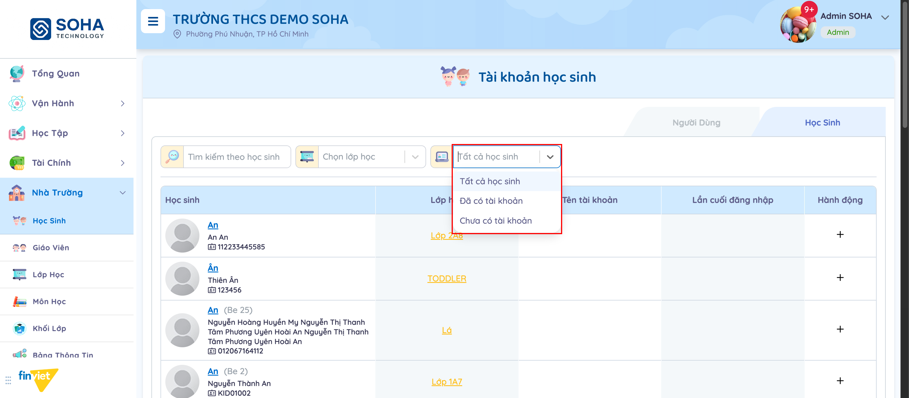<br>2. Với học sinh chưa có tài khoản, Admin bấm icon "+" → modal "Tạo tài khoản" (Tên tài khoản*, Mật khẩu*, Nhập lại mật khẩu*):<br><br>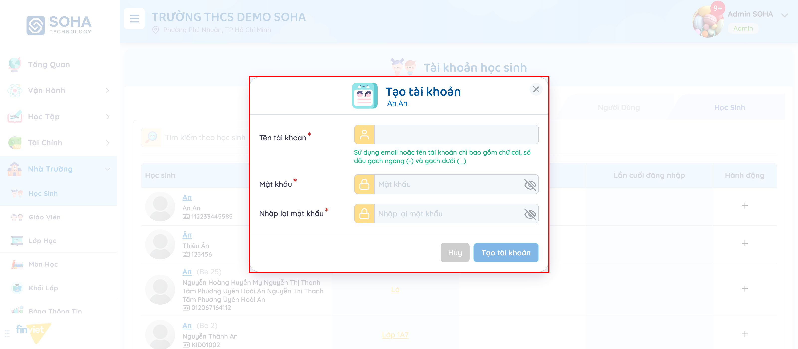<br>3. Với học sinh đã có tài khoản, Admin bấm icon bút chì → modal "Chỉnh sửa tài khoản" (sửa Tên tài khoản hoặc Đổi mật khẩu):<br><br>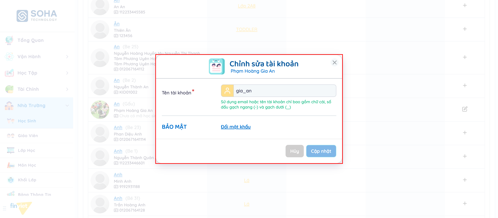<br>4. Admin nhấn "Tạo tài khoản"/"Cập nhật" để lưu. |
| Exception | Tên tài khoản không đúng định dạng (không phải email và chứa ký tự ngoài chữ/số/`-`/`_`) → [Cần xác nhận] chưa quan sát được message lỗi cụ thể khi nhập sai, chỉ thấy ghi chú định dạng hiển thị sẵn |
| Trigger | Admin bấm icon "+" hoặc bút chì trên một dòng học sinh trong tab "Học Sinh" |
| Pre-condition | Admin có quyền quản trị trường |
| Post-condition | Tài khoản đăng nhập của học sinh được tạo mới hoặc cập nhật |
| Business Rules | BR19, BR20, BR21 |

### 3.4 Edge Cases & Error Handling

#### 3.4.1 Tổng quan
| Nhóm | Tình huống | Xử lý mong đợi |
|---|---|---|
| Vai trò | Không tick vai trò nào | Lỗi "Vui lòng chọn vai trò" (BR14) |
| Vai trò Nhân viên | Không tick chức năng nào | Lỗi "Vui lòng chọn chức năng" (BR10) |
| CSDL Sở | Sửa Họ và tên hoặc đổi trạng thái tài khoản CSDL Sở | Trường bị khoá / thao tác bị từ chối kèm thông báo lỗi (BR05, BR06) |
| Admin | Sửa/Xoá/Tạo tài khoản Admin | Không có control tương ứng — không thể thực hiện (BR03, BR04) |
| Toggle danh sách | Bật/tắt trạng thái ngay trên danh sách | Áp dụng tức thì, KHÔNG có bước xác nhận — rủi ro thao tác nhầm cao hơn các hành động khác (BR06) |
| Nội dung | Tooltip "Chăm sóc/Y tế" hiện `{{{object}}}` | [Cần xác nhận] Lỗi hiển thị, không ảnh hưởng chức năng (BR11) |
| Tài khoản học sinh | Tên tài khoản sai định dạng | [Cần xác nhận] Chưa quan sát được message lỗi cụ thể (BR20) |

#### 3.4.2 Danh sách Thông báo (lỗi/thành công)
| Message ID | Trường hợp lỗi | Rule kiểm tra | Message đề xuất | Hình thức báo | Hành vi hệ thống |
|---|---|---|---|---|---|
| TK-01 | Không chọn vai trò | Vai trò rỗng | "Vui lòng chọn vai trò" | Inline dưới nhóm checkbox | Hiện ngay, không cần submit |
| TK-02 | Vai trò Nhân viên không chọn chức năng | Chức năng nhân viên rỗng | "Vui lòng chọn chức năng" | Inline dưới nhóm checkbox | Hiện ngay, không cần submit |
| TK-03 | Đổi trạng thái tài khoản CSDL Sở | Tài khoản có `synced = true` | "Không thể cập nhật với đối tượng được đồng bộ từ CSDL ngành" | Banner đỏ đầu trang | Toggle không đổi trạng thái thực |
| TK-04 | Xoá tài khoản | — | "Vui lòng xác nhận xoá tài khoản [Họ tên]!" | Modal xác nhận | Chặn cho đến khi Admin xác nhận hoặc huỷ |
| TK-05 | Cập nhật tài khoản qua form Sửa | — | "Vui lòng xác nhận cập nhật tài khoản này!" | Modal xác nhận | Chặn cho đến khi Admin xác nhận hoặc huỷ |
| TK-06 | Đổi trạng thái thành công (toggle danh sách) | — | "Cập nhật trạng thái người dùng thành công" | Banner xanh, tự ẩn | Áp dụng ngay, không cần xác nhận thêm |
| TK-07 | Cập nhật tài khoản thành công (qua form) | — | "Tài khoản đã được cập nhật thành công" | Banner xanh, tự ẩn | — |

### 3.5 Non-functional Requirements
| ID | Nhóm | Yêu cầu |
|---|---|---|
| NFR01 | Data integrity | Tài khoản đồng bộ từ CSDL Sở được bảo vệ khỏi việc sửa Họ và tên hoặc đổi trạng thái từ phía trường, tránh lệch dữ liệu với nguồn ngành |
| NFR02 | Security | Đổi mật khẩu tách thành trang riêng có cảnh báo rõ ràng về việc mất hiệu lực mật khẩu cũ |
| NFR03 | UX consistency | [Cần xác nhận] Toggle trạng thái trên danh sách nên có xác nhận tương tự trang Sửa, vì đây là thao tác có thể ảnh hưởng ngay tới khả năng đăng nhập của người dùng khác |
| NFR04 | Access control | Vai trò Admin được bảo vệ 2 lớp: không tạo được (checkbox khoá) và không sửa/xoá được tài khoản đã có (chỉ xem) từ giao diện trường |

### 3.6 Quy ước UI chung
- Form Tạo và form Sửa dùng chung layout, chỉ khác: form Sửa hiện thêm mục "BẢO MẬT" (Đổi mật khẩu) và email dạng text+link thay vì ô nhập trống.
- Trường phụ theo vai trò (Chức năng nhân viên, Lớp phụ trách, Thông tin bổ sung) chỉ xuất hiện SAU khi tick checkbox vai trò tương ứng — form thay đổi động theo lựa chọn, không hiển thị sẵn toàn bộ trường có thể có.
- Mọi modal xác nhận (Cập nhật, Xoá) dùng chung minh hoạ + layout 2 nút "Hủy bỏ"/"Xác nhận" — nút xác nhận luôn màu xanh dương ở bên phải.
- Badge vai trò dùng màu riêng theo loại (Admin: xanh lá, Phụ Huynh: xanh dương nhạt, Nhân Viên/Giáo Viên: tương tự) nhất quán với cách hiển thị vai trò ở các module khác trong Nhà Trường.
- Icon Hành động dùng chung bộ 3 icon Xem (con mắt)/Sửa (bút chì)/Xoá (thùng rác) xuyên suốt cả 2 tab, chỉ khác số lượng icon hiển thị theo quyền của từng dòng.
