# Tên: Cấu Hình - Học Phí

## Mục lục
- [1. Thông tin tổng quan](#1-thông-tin-tổng-quan)
  - [1.1 Giới thiệu chung](#11-giới-thiệu-chung)
  - [1.2 Mục tiêu](#12-mục-tiêu)
  - [1.3 Phạm vi](#13-phạm-vi)
  - [1.4 Tài liệu tham khảo](#14-tài-liệu-tham-khảo)
- [2. Tổng quan nghiệp vụ](#2-tổng-quan-nghiệp-vụ)
  - [2.1 Đối tượng](#21-đối-tượng)
  - [2.2 Luồng nghiệp vụ](#22-luồng-nghiệp-vụ)
  - [2.3 Nguyên tắc nghiệp vụ](#23-nguyên-tắc-nghiệp-vụ)
- [3. Đặc tả tính năng](#3-đặc-tả-tính-năng)
  - [3.1 Phân rã chức năng](#31-phân-rã-chức-năng)
  - [3.2 Acceptance Criteria](#32-acceptance-criteria)
  - [3.3 Use case](#33-use-case)
  - [3.4 Edge Cases & Error Handling](#34-edge-cases--error-handling)
  - [3.5 Non-functional Requirements](#35-non-functional-requirements)
  - [3.6 Quy ước UI chung](#36-quy-ước-ui-chung)

## 1. Thông tin tổng quan

### 1.1 Giới thiệu chung
Sub-module "Học Phí" nằm trong nhóm Cấu Hình, cho phép Admin trường cấu hình các thiết lập liên quan đến hóa đơn học phí: ghi chú in trên hóa đơn, tích hợp thanh toán tự động Sepay, hóa đơn điện tử (SInvoice), phí trông trẻ về muộn, hoàn tiền ăn khi báo vắng, và danh sách email nhận đối soát học phí.

### 1.2 Mục tiêu
- Cho phép trường tùy biến nội dung ghi chú hiển thị dưới cùng mỗi hóa đơn học phí.
- Cho phép xem thông tin kết nối thanh toán tự động qua Sepay và tra cứu lịch sử giao dịch Sepay.
- Cho phép cấu hình xuất hóa đơn điện tử (HĐĐT) qua SInvoice: mã số thuế, tài khoản, mẫu/loại/ký hiệu hóa đơn.
- Cho phép bật/tắt và cấu hình phí trông học sinh về muộn (theo giờ cố định hoặc theo khung giờ).
- Cho phép bật/tắt và cấu hình chính sách hoàn tiền ăn khi phụ huynh báo vắng trước một mốc thời gian.
- Cho phép khai báo tối đa 3 email nhận dữ liệu đối soát học phí.

### 1.3 Phạm vi
| In scope | Out of scope |
|---|---|
| Ghi chú hóa đơn học phí | Cấu hình mã QR thanh toán riêng (chỉ hiển thị banner giới thiệu, liên hệ Finviet để cấu hình) |
| Xem thông tin/Chuỗi bí mật, Webhook Sepay (dạng ẩn, có thể hiện/ẩn) và lịch sử giao dịch Sepay | Kết nối/thiết lập mới tài khoản Sepay (không có form nhập, chỉ xem) |
| Cấu hình hóa đơn điện tử (SInvoice): mã số thuế, tài khoản, mật khẩu, mẫu/loại/ký hiệu hóa đơn, tự động tạo HĐĐT, tách HĐĐT | Nội dung/khuôn dạng bản thân hóa đơn điện tử |
| Cấu hình phí trông học sinh về muộn (theo giờ cố định / theo khung giờ) | Cấu hình "Giờ hoạt động" của trường (chỉ hiển thị tham chiếu, sửa tại module Trường) |
| Cấu hình hoàn tiền ăn khi báo vắng trước một số giờ | Xử lý nghiệp vụ báo vắng thực tế (thực hiện ở module khác, trong "trao đổi") |
| Danh sách email nhận đối soát học phí (tối đa 3) | Nội dung/định dạng file đối soát |
| — | Cấu hình thông báo học phí (là một sub-module Cấu Hình riêng: Thông Báo, chỉ có link tắt tại đây) |

### 1.4 Tài liệu tham khảo
- [M6-cau-hinh/SM1-truong.md](SM1-truong.md) — "Giờ hoạt động" của trường được tham chiếu (read-only) trong UC-04 của tài liệu này.
- [M6-cau-hinh/SM2-tai-khoan.md](SM2-tai-khoan.md) — cùng nhóm Cấu Hình, cùng quy ước Lưu/xác nhận.
- Sub-module Thông Báo (`/demo/setting/notification/`) — được liên kết tắt từ mục "Cấu hình thông báo học phí" ở cuối trang, nhưng là một sub-module Cấu Hình độc lập, không thuộc phạm vi tài liệu này.

## 2. Tổng quan nghiệp vụ

### 2.1 Đối tượng
| Actor | Vai trò | Trách nhiệm chính |
|---|---|---|
| Admin trường | Người quản trị cấu hình | Xem và cập nhật toàn bộ cấu hình học phí của trường |
| Dịch vụ Sepay | Hệ thống bên thứ ba | Xử lý thanh toán tự động; trả về Chuỗi bí mật/Webhook cho tích hợp; là nguồn dữ liệu Lịch sử giao dịch |
| SInvoice | Hệ thống bên thứ ba | Phát hành hóa đơn điện tử dựa trên cấu hình tài khoản HĐĐT |
| Hệ thống | Xử lý nghiệp vụ | Áp dụng ghi chú vào hóa đơn, tính phí về muộn, tính hoàn tiền báo vắng, gửi dữ liệu đối soát tới email đã khai báo |

### 2.2 Luồng nghiệp vụ

#### 2.2.1 Mô hình hóa nghiệp vụ
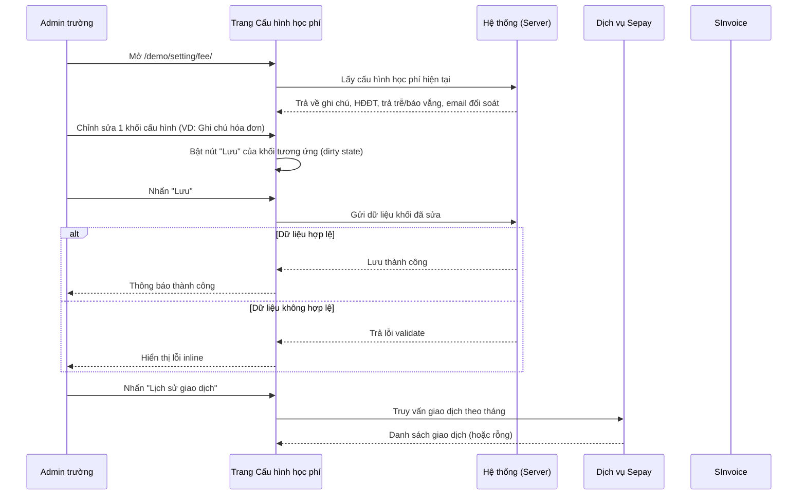

#### 2.2.2 Mô tả các bước nghiệp vụ
| Bước | Người thực hiện | Mô tả | Kết quả |
|---|---|---|---|
| 1 | Admin trường | Mở trang Cấu hình học phí | Hiển thị 5 khối cấu hình độc lập, mỗi khối có nút Lưu riêng |
| 2 | Admin trường | Sửa dữ liệu trong 1 khối | Nút "Lưu" của khối đó chuyển từ disabled sang enabled |
| 3 | Admin trường | Nhấn "Lưu" | Hệ thống lưu riêng khối đó; các khối khác không bị ảnh hưởng |
| 4 | Admin trường | Rời trang khi còn thay đổi chưa lưu | Hệ thống hiện hộp thoại xác nhận rời khi chưa lưu |
| 5 | Admin trường | Nhấn "Lịch sử giao dịch" (Sepay) | Điều hướng sang trang riêng `/demo/setting/fee/payment-history/`, lọc theo tháng |

### 2.3 Nguyên tắc nghiệp vụ
| ID | Nguyên tắc nghiệp vụ |
|---|---|
| BR01 | Trang Cấu hình học phí gồm nhiều form độc lập (Ghi chú hóa đơn, Cấu hình hóa đơn điện tử, Cấu hình trả trễ và báo vắng, Cấu hình đối soát học phí); mỗi form có nút "Lưu" riêng, chỉ enable khi form đó có thay đổi (dirty) |
| BR02 | Khối "Cấu hình thanh toán tự động - Dịch vụ Sepay" không có nút Lưu — chỉ hiển thị Chuỗi bí mật/Webhook (dạng ẩn, có icon con mắt để hiện/ẩn) và link "Lịch sử giao dịch" |
| BR03 | Rời trang khi còn dữ liệu chưa lưu ở bất kỳ form nào sẽ hiện hộp thoại xác nhận "Thay đổi của bạn chưa được lưu. Vui lòng xác nhận rời khỏi khi chưa lưu!" |
| BR04 | Tắt toggle "Cấu hình hóa đơn điện tử" sẽ thu gọn toàn bộ khối, ẩn hết các trường bên trong (chỉ còn tiêu đề, toggle, link hướng dẫn và nút Lưu) |
| BR05 | Các trường trong "Cấu hình hóa đơn điện tử" (Mã số thuế, Tên tài khoản, Mật khẩu, Mẫu hóa đơn, Loại hóa đơn, Ký hiệu hóa đơn) đều bắt buộc (đánh dấu *) |
| BR06 | "Mật khẩu (SInvoice)" hiển thị dạng ẩn cố định, không có icon hiện/ẩn — khác với Chuỗi bí mật/Webhook của Sepay (có icon hiện/ẩn) [Cần xác nhận] |
| BR07 | "Về muộn" có 2 phương thức tính phí loại trừ nhau: "Theo giờ cố định" (1 mốc thời gian trễ + 1 đơn giá áp dụng chung) và "Theo khung giờ" (bảng nhiều khung Giờ bắt đầu - Giờ kết thúc - Số tiền, có thể thêm nhiều dòng) |
| BR08 | Tắt toggle "Về muộn" sẽ vô hiệu hóa (disable, không ẩn) toàn bộ control bên trong khối đó (phương thức tính phí, thời gian trả trễ, số tiền) |
| BR09 | Danh sách "Giờ hoạt động" (Thứ 2 - Thứ 7, tham chiếu từ module Trường) chỉ hiển thị khi "Báo vắng" đang bật; ẩn hoàn toàn khi "Báo vắng" tắt |
| BR10 | Khi "Báo vắng" bật: hệ thống chỉ hoàn tiền ăn cho các ngày nghỉ được báo qua tính năng Báo vắng và trước mốc thời gian đã chọn. Khi "Báo vắng" tắt: hệ thống tự hoàn tiền ăn cho toàn bộ ngày nghỉ trong hóa đơn (không cần báo trước) |
| BR11 | "Thời gian trả trễ" (Về muộn) nhận giá trị 5-60 phút, bước nhảy 5 phút (13 lựa chọn) |
| BR12 | "Báo vắng trước" nhận giá trị 0-100 giờ (101 lựa chọn), là ô combobox có thể gõ tìm |
| BR13 | Bảng "Phí giữ học sinh muộn" (chế độ Theo khung giờ): dòng đầu tiên không có icon xóa; icon xóa (thùng rác) ở cột "Hành động" chỉ xuất hiện khi có từ 2 dòng trở lên |
| BR14 | Email nhận đối soát: tối đa 3 email; email không đúng định dạng bị chặn với thông báo "Email không hợp lệ" và không được thêm vào danh sách; khi đã đủ 3 email, ô nhập bị vô hiệu hóa (disabled) hoàn toàn |
| BR15 | Mục "Cấu hình thông báo học phí" ở cuối trang không phải là 1 form của sub-module này, mà là link tắt điều hướng sang sub-module Cấu Hình → Thông Báo (`/demo/setting/notification/`) |
| BR16 | "Lịch sử giao dịch" Sepay là 1 trang riêng, lọc theo tháng (mặc định tháng hiện tại), hiển thị Ngày thanh toán/Số HĐ/Số tiền/Trạng thái/Hành động; dữ liệu Sepay chưa được kết nối thực tế trên tenant demo nên luôn hiển thị "Không tìm thấy dữ liệu" [Cần xác nhận] |

## 3. Đặc tả tính năng

### 3.1 Phân rã chức năng
| Feature | Platform | Priority | User Story |
|---|---|---|---|
| Cập nhật ghi chú hóa đơn | Web Admin | Trung bình | Là Admin trường, tôi muốn tùy biến ghi chú in trên hóa đơn để phụ huynh nắm rõ chính sách thanh toán |
| Xem thông tin thanh toán tự động Sepay | Web Admin | Thấp | Là Admin trường, tôi muốn xem Chuỗi bí mật/Webhook và lịch sử giao dịch Sepay để đối chiếu khi cần |
| Cấu hình hóa đơn điện tử | Web Admin | Cao | Là Admin trường, tôi muốn cấu hình tài khoản SInvoice để hệ thống tự động xuất HĐĐT |
| Cấu hình trả trễ và báo vắng | Web Admin | Cao | Là Admin trường, tôi muốn thiết lập phí trông trẻ về muộn và chính sách hoàn tiền báo vắng |
| Cấu hình đối soát học phí | Web Admin | Trung bình | Là Admin trường, tôi muốn khai báo email nhận dữ liệu đối soát học phí định kỳ |

### 3.2 Acceptance Criteria
| User Story | Chức năng | Acceptance Criteria |
|---|---|---|
| Cập nhật ghi chú hóa đơn | Sửa nội dung ghi chú | Nút Lưu chỉ enable khi nội dung thay đổi; nội dung mới hiển thị dưới cùng hóa đơn sau khi lưu |
| Cấu hình hóa đơn điện tử | Bật/tắt HĐĐT | Tắt toggle ẩn toàn bộ trường cấu hình bên trong; các trường bắt buộc phải nhập đủ mới lưu được |
| Cấu hình trả trễ | Chọn phương thức tính phí | Chuyển đổi giữa "Theo giờ cố định" và "Theo khung giờ" thay đổi hoàn toàn bộ control hiển thị bên dưới |
| Cấu hình báo vắng | Bật/tắt Báo vắng | Tắt Báo vắng ẩn bảng Giờ hoạt động và đổi mô tả hoàn tiền sang "hoàn toàn bộ ngày nghỉ" |
| Đối soát học phí | Thêm email | Email sai định dạng bị chặn kèm thông báo lỗi; đủ 3 email thì khóa ô nhập |

### 3.3 Use case
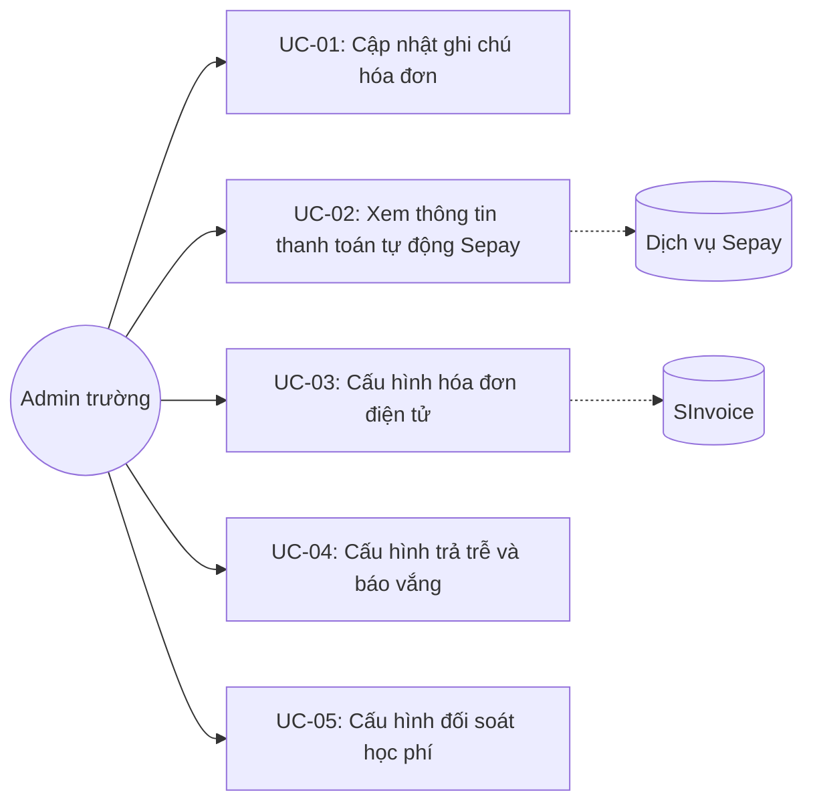

---

| Trường | Nội dung |
|---|---|
| Use case ID | UC-01 |
| Use case name | Cập nhật ghi chú hóa đơn |
| Use case description | Admin trường chỉnh sửa nội dung ghi chú hiển thị dưới cùng mỗi hóa đơn học phí |
| Actor | Admin trường |
| Happy path | 1. Vào Cấu Hình → Học Phí. 2. Trong khối "CẤU HÌNH HÓA ĐƠN HỌC PHÍ", sửa nội dung ô "Ghi chú hóa đơn":  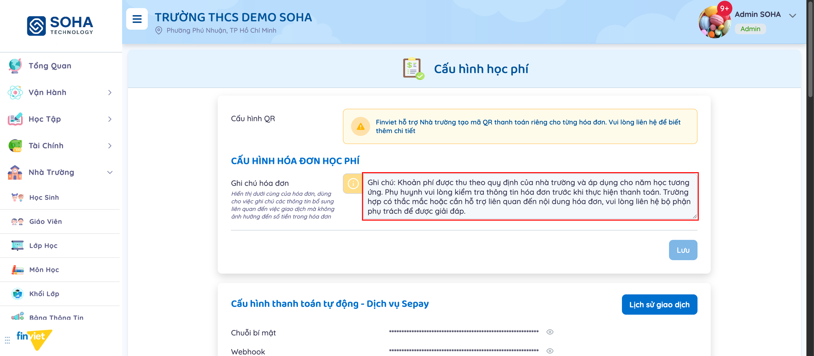 3. Nút "Lưu" của khối chuyển sang enabled. 4. Nhấn "Lưu" để lưu thay đổi. |
| Exception | Rời trang khi chưa lưu → hệ thống hiện hộp thoại xác nhận rời |
| Trigger | Admin trường cần thay đổi nội dung ghi chú hóa đơn |
| Pre-condition | Đã đăng nhập với quyền Admin trường |
| Post-condition | Ghi chú mới được áp dụng cho các hóa đơn phát sinh sau đó |
| Business Rules | BR01, BR03 |

---

| Trường | Nội dung |
|---|---|
| Use case ID | UC-02 |
| Use case name | Xem thông tin thanh toán tự động Sepay |
| Use case description | Admin trường xem Chuỗi bí mật/Webhook tích hợp Sepay (dạng ẩn) và tra cứu lịch sử giao dịch |
| Actor | Admin trường, Dịch vụ Sepay |
| Happy path | 1. Trong khối "Cấu hình thanh toán tự động - Dịch vụ Sepay", nhấn icon con mắt để hiện/ẩn Chuỗi bí mật hoặc Webhook. 2. Nhấn "Lịch sử giao dịch" để mở trang riêng, xem danh sách giao dịch theo tháng:  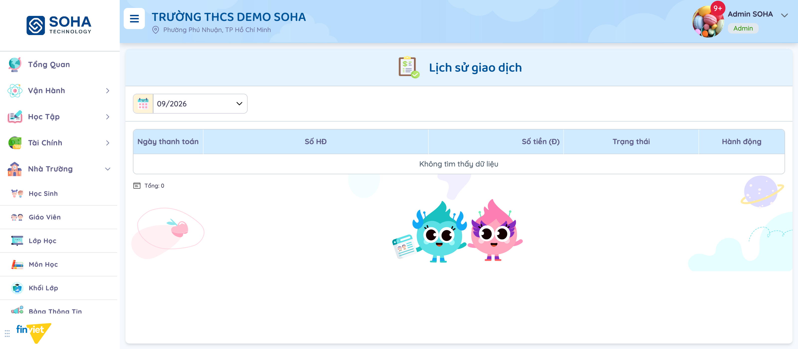 |
| Exception | Chưa kết nối Sepay thực tế → danh sách giao dịch luôn rỗng ("Không tìm thấy dữ liệu") [Cần xác nhận] |
| Trigger | Admin trường cần đối chiếu thông tin tích hợp hoặc lịch sử thanh toán Sepay |
| Pre-condition | Đã đăng nhập với quyền Admin trường |
| Post-condition | Không thay đổi dữ liệu — chỉ xem |
| Business Rules | BR02, BR16 |

---

| Trường | Nội dung |
|---|---|
| Use case ID | UC-03 |
| Use case name | Cấu hình hóa đơn điện tử |
| Use case description | Admin trường bật/tắt và cấu hình tài khoản SInvoice để xuất hóa đơn điện tử |
| Actor | Admin trường, SInvoice |
| Happy path | 1. Trong khối "Cấu hình hóa đơn điện tử", bật toggle ở góc phải để kích hoạt:  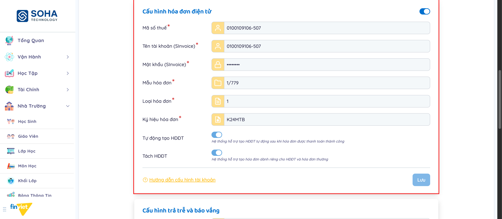 2. Nhập Mã số thuế, Tên tài khoản, Mật khẩu, Mẫu hóa đơn, Loại hóa đơn, Ký hiệu hóa đơn. 3. Bật/tắt "Tự động tạo HĐĐT" và "Tách HĐĐT" theo nhu cầu. 4. Nhấn "Lưu". |
| Exception | Tắt toggle chính → toàn bộ trường bên trong bị ẩn, chỉ còn nút Lưu và link hướng dẫn:  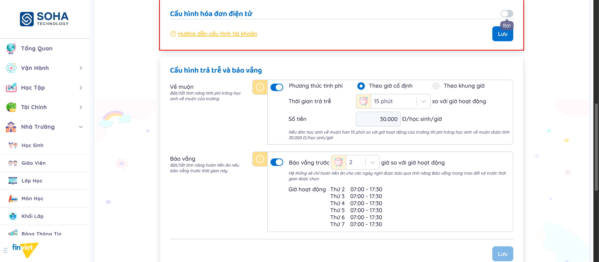 |
| Trigger | Admin trường cần thiết lập/điều chỉnh tích hợp hóa đơn điện tử |
| Pre-condition | Đã đăng nhập với quyền Admin trường; có tài khoản SInvoice hợp lệ |
| Post-condition | Hệ thống dùng cấu hình này để phát hành HĐĐT cho các hóa đơn tiếp theo |
| Business Rules | BR04, BR05, BR06 |

---

| Trường | Nội dung |
|---|---|
| Use case ID | UC-04 |
| Use case name | Cấu hình trả trễ và báo vắng |
| Use case description | Admin trường cấu hình phí trông học sinh về muộn và chính sách hoàn tiền ăn khi báo vắng |
| Actor | Admin trường |
| Happy path | 1. Bật toggle "Về muộn". 2. Chọn phương thức tính phí: "Theo giờ cố định" — chọn thời gian trả trễ 5-60 phút từ dropdown và nhập số tiền/học sinh/giờ:  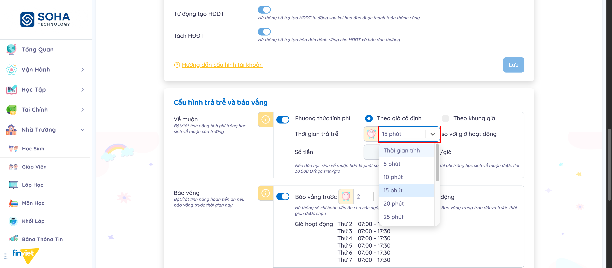 hoặc "Theo khung giờ" — khai báo nhiều khung Giờ bắt đầu - Giờ kết thúc - Số tiền:  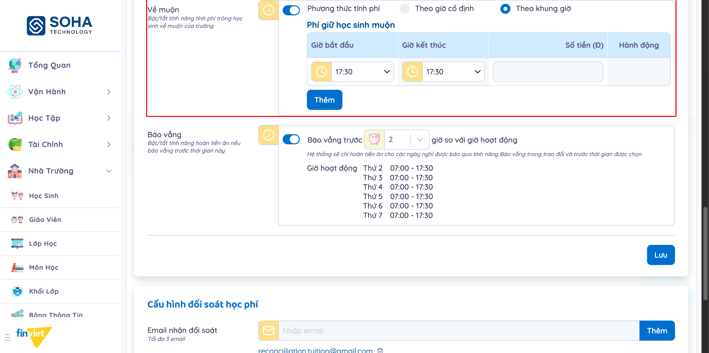 nhấn "Thêm" để thêm dòng mới (icon xóa chỉ xuất hiện khi có từ 2 dòng trở lên):  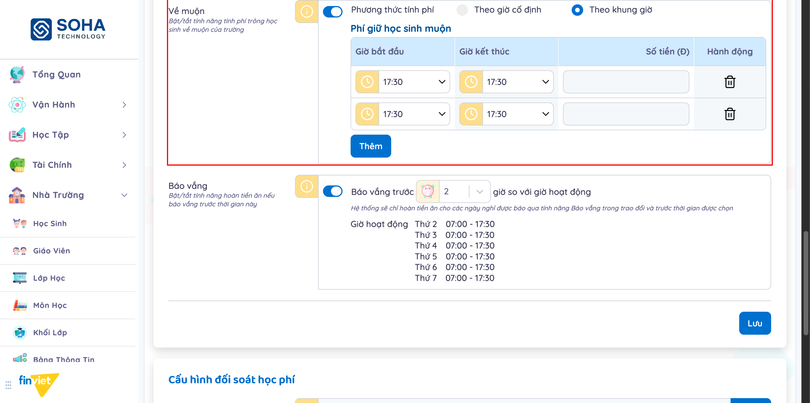 3. Bật toggle "Báo vắng", chọn số giờ báo trước (0-100 giờ) từ combobox có thể gõ tìm:  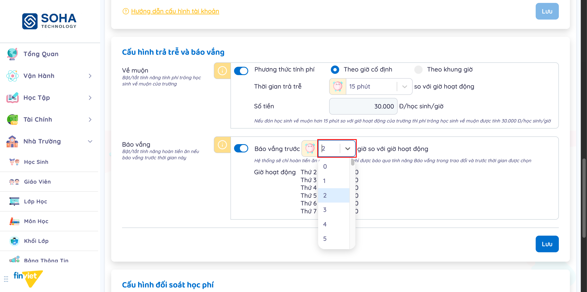 4. Xem bảng Giờ hoạt động tham chiếu (chỉ hiện khi Báo vắng bật). 5. Nhấn "Lưu". |
| Exception | Tắt "Về muộn" → các control liên quan bị vô hiệu hóa (disabled), không ẩn:  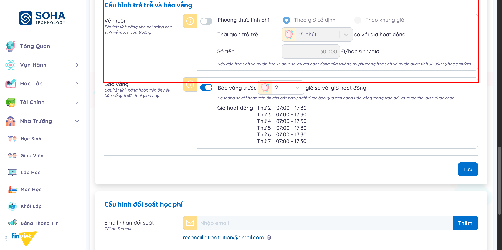 Tắt "Báo vắng" → ẩn bảng Giờ hoạt động, đổi mô tả hoàn tiền sang áp dụng cho toàn bộ ngày nghỉ:  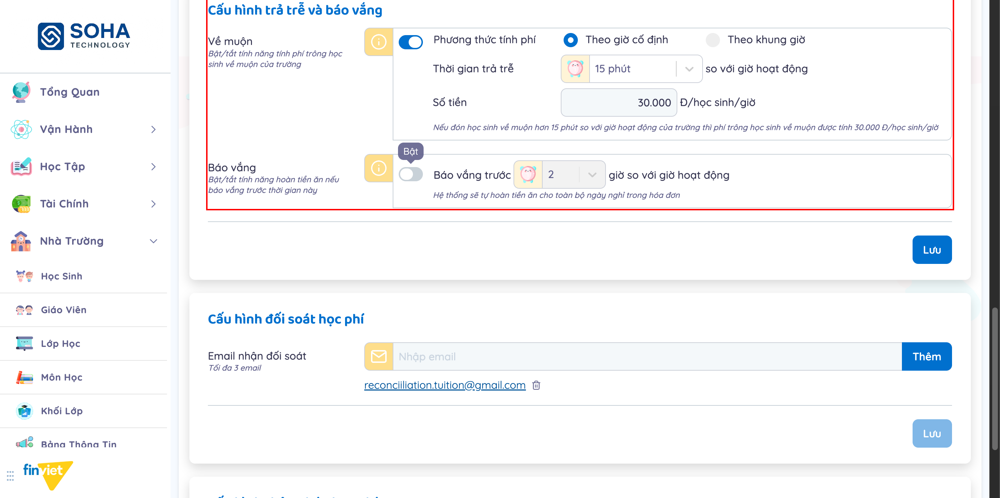 |
| Trigger | Admin trường cần thiết lập chính sách phí về muộn/hoàn tiền báo vắng đầu năm học hoặc khi thay đổi chính sách |
| Pre-condition | Đã đăng nhập với quyền Admin trường |
| Post-condition | Hệ thống áp dụng chính sách mới cho các lượt tính phí/hoàn tiền tiếp theo |
| Business Rules | BR07, BR08, BR09, BR10, BR11, BR12, BR13 |

---

| Trường | Nội dung |
|---|---|
| Use case ID | UC-05 |
| Use case name | Cấu hình đối soát học phí |
| Use case description | Admin trường khai báo email nhận dữ liệu đối soát học phí định kỳ |
| Actor | Admin trường |
| Happy path | 1. Trong khối "Cấu hình đối soát học phí", nhập email vào ô "Nhập email". 2. Nhấn "Thêm" để thêm vào danh sách (tối đa 3). 3. Nhấn icon thùng rác cạnh 1 email để xóa khỏi danh sách. 4. Nhấn "Lưu" để lưu danh sách. |
| Exception | Nhập email sai định dạng và nhấn "Thêm" → hiển thị lỗi "Email không hợp lệ", email không được thêm vào danh sách:  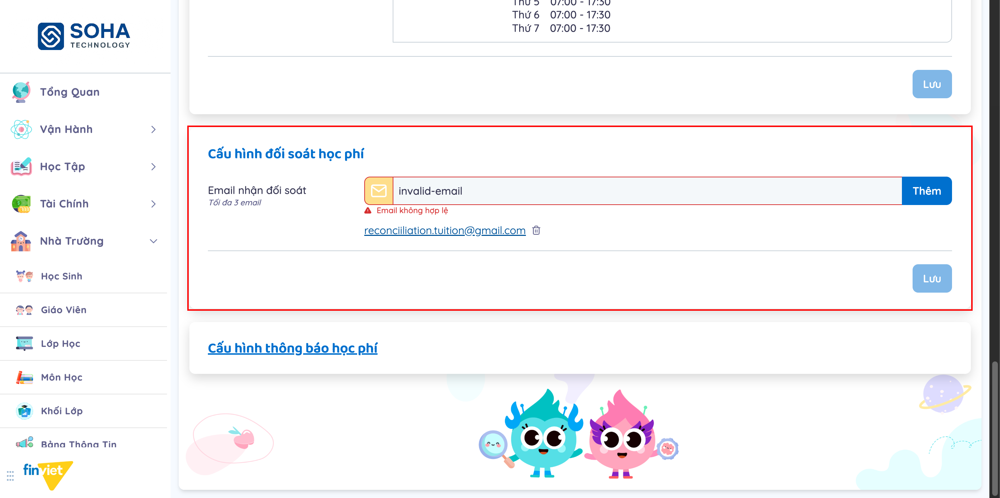 Đã có đủ 3 email → ô nhập bị vô hiệu hóa hoàn toàn:  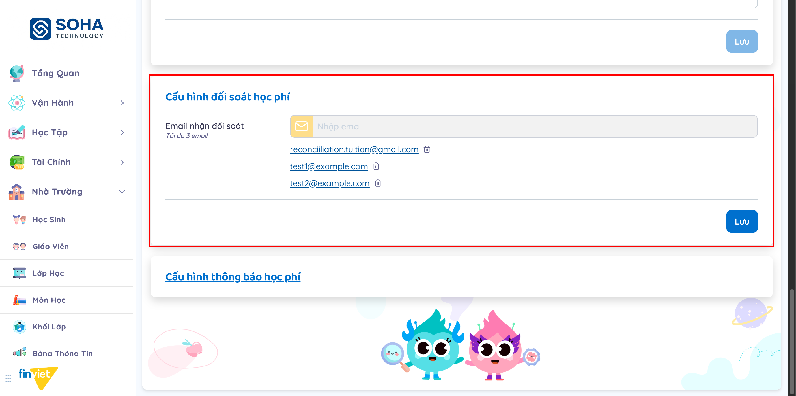 |
| Trigger | Admin trường cần thêm/bớt người nhận dữ liệu đối soát học phí |
| Pre-condition | Đã đăng nhập với quyền Admin trường |
| Post-condition | Danh sách email nhận đối soát được cập nhật |
| Business Rules | BR14 |

### 3.4 Edge Cases & Error Handling

#### 3.4.1 Tổng quan
| Nhóm | Tình huống | Xử lý mong đợi |
|---|---|---|
| Form độc lập | Sửa 1 khối, chưa lưu, rồi sửa khối khác | Mỗi khối theo dõi trạng thái dirty riêng; nút Lưu của từng khối enable độc lập |
| Rời trang | Rời trang/tải lại khi còn thay đổi chưa lưu ở bất kỳ khối nào | Hiện hộp thoại xác nhận "Thay đổi của bạn chưa được lưu..."; xác nhận rời sẽ mất thay đổi (không gọi API) |
| Hóa đơn điện tử | Tắt toggle chính khi đang có dữu liệu hợp lệ | Ẩn toàn bộ trường, không xóa dữ liệu đã nhập trước đó cho tới khi Lưu |
| Về muộn | Chuyển từ "Theo khung giờ" (nhiều dòng) sang "Theo giờ cố định" | Bảng khung giờ bị thay thế hoàn toàn bằng control đơn (thời gian trả trễ + số tiền); dữ liệu bảng khung giờ có khả năng mất nếu không lưu trước khi chuyển [Cần xác nhận] |
| Báo vắng | Tắt Báo vắng | Bảng Giờ hoạt động (tham chiếu) bị ẩn; mô tả hoàn tiền chuyển từ có điều kiện sang vô điều kiện |
| Đối soát học phí | Xóa email vừa thêm (chưa lưu) | Email biến mất khỏi danh sách hiển thị ngay; chỉ ghi nhận thật khi nhấn Lưu |
| Đối soát học phí | Thêm email đã tồn tại trong danh sách | [Cần xác nhận — chưa kiểm thử trùng lặp] |

#### 3.4.2 Danh sách Thông báo (lỗi/thành công)
| Message ID | Trường hợp lỗi | Rule kiểm tra | Message đề xuất | Hình thức báo | Hành vi hệ thống |
|---|---|---|---|---|---|
| ERR-HP-01 | Nhập email sai định dạng vào ô "Nhập email" rồi nhấn "Thêm" | Định dạng email | "Email không hợp lệ" | Text đỏ dưới ô nhập + viền ô nhập chuyển đỏ | Không thêm email vào danh sách |

### 3.5 Non-functional Requirements
| ID | Nhóm | Yêu cầu |
|---|---|---|
| NFR01 | Bảo mật | Chuỗi bí mật/Webhook Sepay và Mật khẩu SInvoice mặc định hiển thị dạng ẩn (masked); Chuỗi bí mật/Webhook có thể hiện tạm thời qua icon con mắt |
| NFR02 | Toàn vẹn dữ liệu | Mỗi khối cấu hình lưu độc lập — lỗi ở 1 khối không ảnh hưởng tới các khối đã lưu trước đó |
| NFR03 | UX | Trạng thái dirty (nút Lưu enable) phản hồi tức thời khi người dùng thay đổi bất kỳ control nào trong khối, kể cả toggle/radio (không chỉ input text) |

### 3.6 Quy ước UI chung
- Mỗi khối cấu hình là 1 form riêng với nút "Lưu" độc lập, mặc định disabled, chỉ enable khi có thay đổi trong chính khối đó.
- Toggle bật/tắt tính năng dùng chung 1 kiểu switch xanh dương; hành vi khi tắt không đồng nhất giữa các khối: có khối ẩn toàn bộ nội dung con (Cấu hình hóa đơn điện tử), có khối chỉ disable control con (Về muộn, Báo vắng) — cần đọc kỹ ngữ cảnh từng khối.
- Trường bắt buộc được đánh dấu bằng dấu * màu đỏ ngay sau label.
- Giá trị dạng số lượng lớn lựa chọn (phút, giờ) dùng combobox có thể gõ tìm (react-select), không phải `<select>` thuần.
- Danh sách có thể thêm/xóa nhiều dòng (khung giờ, email) chỉ hiện icon xóa khi có từ 2 phần tử trở lên trong danh sách.
- Rời trang khi còn dữ liệu chưa lưu ở bất kỳ form nào trong trang sẽ hiện hộp thoại xác nhận dùng chung toàn hệ thống ("Thay đổi của bạn chưa được lưu...").
