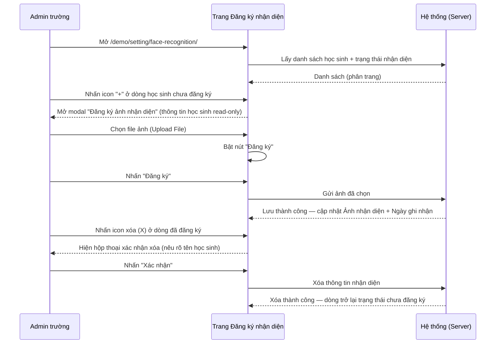
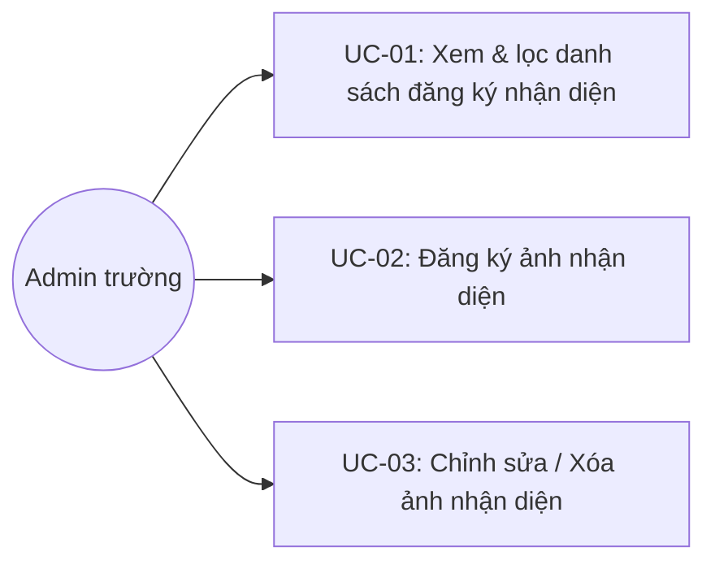
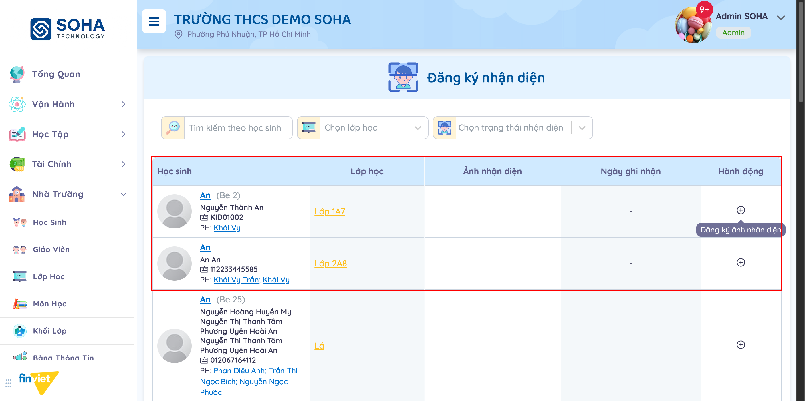
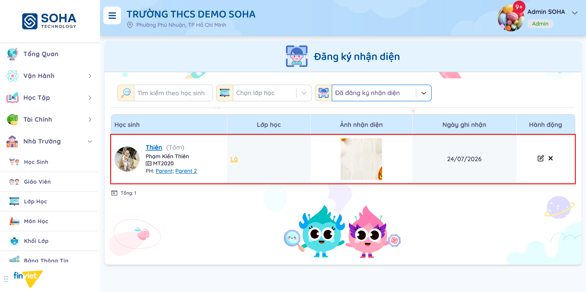
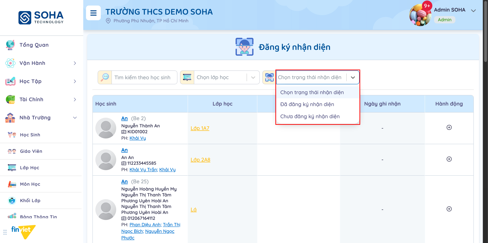
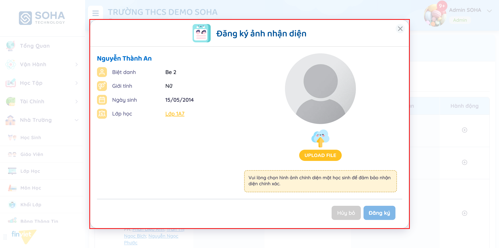
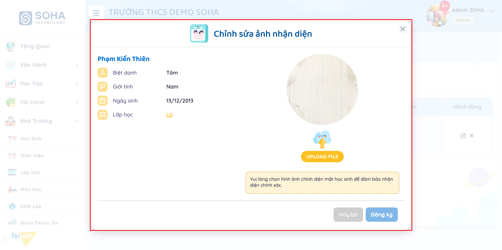
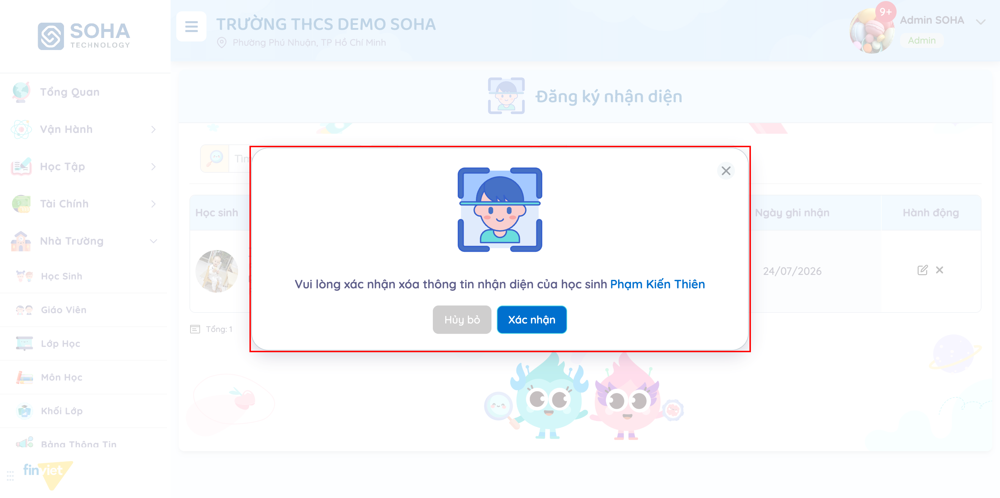

# Tên: Cấu Hình - Nhận Diện

## Mục lục
- [1. Thông tin tổng quan](#1-thông-tin-tổng-quan)
  - [1.1 Giới thiệu chung](#11-giới-thiệu-chung)
  - [1.2 Mục tiêu](#12-mục-tiêu)
  - [1.3 Phạm vi](#13-phạm-vi)
  - [1.4 Tài liệu tham khảo](#14-tài-liệu-tham-khảo)
- [2. Tổng quan nghiệp vụ](#2-tổng-quan-nghiệp-vụ)
  - [2.1 Đối tượng](#21-đối-tượng)
  - [2.2 Luồng nghiệp vụ](#22-luồng-nghiệp-vụ)
  - [2.3 Nguyên tắc nghiệp vụ](#23-nguyên-tắc-nghiệp-vụ)
- [3. Đặc tả tính năng](#3-đặc-tả-tính-năng)
  - [3.1 Phân rã chức năng](#31-phân-rã-chức-năng)
  - [3.2 Acceptance Criteria](#32-acceptance-criteria)
  - [3.3 Use case](#33-use-case)
  - [3.4 Edge Cases & Error Handling](#34-edge-cases--error-handling)
  - [3.5 Non-functional Requirements](#35-non-functional-requirements)
  - [3.6 Quy ước UI chung](#36-quy-ước-ui-chung)

## 1. Thông tin tổng quan

### 1.1 Giới thiệu chung
Sub-module "Nhận Diện" (tiêu đề trang: "Đăng ký nhận diện") nằm trong nhóm Cấu Hình, cho phép Admin trường quản lý ảnh nhận diện khuôn mặt của học sinh — phục vụ các tính năng nhận diện tự động (VD: điểm danh, đón trả) ở nơi khác trong hệ thống. Trang hiển thị danh sách toàn bộ học sinh của trường kèm trạng thái đã/chưa đăng ký ảnh nhận diện.

### 1.2 Mục tiêu
- Cho phép xem danh sách học sinh cùng trạng thái đăng ký ảnh nhận diện (đã đăng ký / chưa đăng ký).
- Cho phép tìm kiếm theo tên học sinh, lọc theo lớp học và theo trạng thái nhận diện.
- Cho phép đăng ký ảnh nhận diện mới cho học sinh chưa có.
- Cho phép chỉnh sửa (thay ảnh) hoặc xóa ảnh nhận diện đã đăng ký.

### 1.3 Phạm vi
| In scope | Out of scope |
|---|---|
| Danh sách học sinh + trạng thái nhận diện, tìm kiếm/lọc, phân trang | Nơi sử dụng dữ liệu nhận diện (điểm danh, đón trả...) |
| Đăng ký ảnh nhận diện mới cho 1 học sinh | Đăng ký/xử lý theo lô (bulk) nhiều học sinh cùng lúc — không thấy control này |
| Chỉnh sửa (thay ảnh) ảnh nhận diện đã có | Xem/preview ảnh ở kích thước đầy đủ ngoài modal |
| Xóa thông tin nhận diện của 1 học sinh (có xác nhận) | Thông tin cơ bản học sinh (biệt danh, giới tính, ngày sinh, lớp học) — chỉ hiển thị read-only, sửa tại module Học Sinh |

### 1.4 Tài liệu tham khảo
- Module Học Sinh (`/demo/school/kid/`) — nguồn dữ liệu Biệt danh/Giới tính/Ngày sinh/Lớp học hiển thị read-only trong modal đăng ký/chỉnh sửa.
- Module Lớp Học (`/demo/school/class/`) — link "Lớp học" trong danh sách và trong modal trỏ tới trang chi tiết lớp.

## 2. Tổng quan nghiệp vụ

### 2.1 Đối tượng
| Actor | Vai trò | Trách nhiệm chính |
|---|---|---|
| Admin trường | Người quản trị | Xem danh sách, đăng ký/chỉnh sửa/xóa ảnh nhận diện học sinh |
| Hệ thống | Xử lý nghiệp vụ | Lưu ảnh nhận diện, ghi nhận ngày đăng ký, cung cấp dữ liệu cho các tính năng nhận diện khác |

### 2.2 Luồng nghiệp vụ

#### 2.2.1 Mô hình hóa nghiệp vụ

#### 2.2.2 Mô tả các bước nghiệp vụ
| Bước | Người thực hiện | Mô tả | Kết quả |
|---|---|---|---|
| 1 | Admin trường | Mở trang Đăng ký nhận diện | Hiển thị danh sách toàn bộ học sinh, phân trang |
| 2 | Admin trường | Tìm kiếm/lọc theo học sinh, lớp học, trạng thái nhận diện | Danh sách được lọc theo điều kiện |
| 3 | Admin trường | Nhấn icon "+" ở dòng chưa đăng ký | Mở modal đăng ký, thông tin học sinh hiển thị sẵn (read-only) |
| 4 | Admin trường | Chọn ảnh và nhấn "Đăng ký" | Ảnh được lưu; cột Ảnh nhận diện/Ngày ghi nhận được cập nhật; Hành động đổi thành icon sửa + xóa |
| 5 | Admin trường | Nhấn icon sửa (bút) ở dòng đã đăng ký | Mở modal "Chỉnh sửa ảnh nhận diện", hiển thị ảnh hiện có; phải chọn ảnh mới thì nút "Đăng ký" mới bật |
| 6 | Admin trường | Nhấn icon xóa (X) ở dòng đã đăng ký, xác nhận | Xóa thông tin nhận diện; dòng trở lại trạng thái chưa đăng ký |

### 2.3 Nguyên tắc nghiệp vụ
| ID | Nguyên tắc nghiệp vụ |
|---|---|
| BR01 | Cột "Ảnh nhận diện" và "Ngày ghi nhận" hiển thị "-" khi học sinh chưa đăng ký; hiển thị ảnh thumbnail thật + ngày khi đã đăng ký |
| BR02 | Cột "Hành động" thay đổi theo trạng thái: chỉ 1 icon "+" (tooltip "Đăng ký ảnh nhận diện") khi chưa đăng ký; 2 icon — bút (sửa) và X (xóa) — khi đã đăng ký |
| BR03 | Modal đăng ký/chỉnh sửa luôn hiển thị read-only 4 trường thông tin học sinh lấy từ hồ sơ: Biệt danh, Giới tính, Ngày sinh, Lớp học (Lớp học là link tới trang chi tiết lớp) — không sửa được tại đây |
| BR04 | Nút "Đăng ký" trong modal (cả trường hợp đăng ký mới và chỉnh sửa) luôn disabled cho đến khi người dùng chọn một file ảnh mới qua "UPLOAD FILE" — ở chế độ chỉnh sửa, chỉ xem ảnh hiện có không đủ để bật nút, phải chọn ảnh mới |
| BR05 | Modal chỉnh sửa hiển thị đúng ảnh nhận diện hiện tại của học sinh trong khung preview (thay cho ảnh đại diện mặc định ở modal đăng ký mới) |
| BR06 | Xóa thông tin nhận diện yêu cầu xác nhận qua hộp thoại riêng, nêu rõ tên học sinh: "Vui lòng xác nhận xóa thông tin nhận diện của học sinh {Họ tên}" (Hủy bỏ / Xác nhận) |
| BR07 | Bộ lọc "Chọn trạng thái nhận diện" có đúng 2 giá trị: "Đã đăng ký nhận diện" và "Chưa đăng ký nhận diện" |
| BR08 | Danh sách có thể tìm theo tên học sinh, lọc theo lớp học, lọc theo trạng thái nhận diện — các điều kiện áp dụng đồng thời (kết hợp AND) [Cần xác nhận] |
| BR09 | Danh sách phân trang; tổng số học sinh của trường hiển thị ở "Tổng:" phía dưới bảng |

## 3. Đặc tả tính năng

### 3.1 Phân rã chức năng
| Feature | Platform | Priority | User Story |
|---|---|---|---|
| Xem & lọc danh sách đăng ký nhận diện | Web Admin | Trung bình | Là Admin trường, tôi muốn xem nhanh học sinh nào đã/chưa đăng ký ảnh nhận diện |
| Đăng ký ảnh nhận diện | Web Admin | Cao | Là Admin trường, tôi muốn đăng ký ảnh khuôn mặt cho học sinh để phục vụ nhận diện tự động |
| Chỉnh sửa ảnh nhận diện | Web Admin | Trung bình | Là Admin trường, tôi muốn thay ảnh nhận diện khi ảnh cũ không còn chính xác |
| Xóa ảnh nhận diện | Web Admin | Thấp | Là Admin trường, tôi muốn xóa thông tin nhận diện khi không còn cần thiết |

### 3.2 Acceptance Criteria
| User Story | Chức năng | Acceptance Criteria |
|---|---|---|
| Xem & lọc danh sách | Tìm kiếm/lọc | Kết quả danh sách và "Tổng:" cập nhật đúng theo điều kiện tìm kiếm/lọc |
| Đăng ký ảnh nhận diện | Chọn ảnh + Đăng ký | Nút "Đăng ký" chỉ bật khi đã chọn file; sau khi đăng ký, dòng học sinh hiển thị ảnh + ngày ghi nhận và đổi icon hành động |
| Chỉnh sửa ảnh nhận diện | Chọn ảnh mới + Đăng ký | Modal hiển thị ảnh hiện tại; phải chọn ảnh mới mới lưu được |
| Xóa ảnh nhận diện | Xác nhận xóa | Phải xác nhận qua hộp thoại nêu tên học sinh; sau khi xóa, dòng trở lại trạng thái chưa đăng ký |

### 3.3 Use case

---

| Trường | Nội dung |
|---|---|
| Use case ID | UC-01 |
| Use case name | Xem & lọc danh sách đăng ký nhận diện |
| Use case description | Admin trường xem danh sách học sinh kèm trạng thái nhận diện, có thể tìm kiếm/lọc |
| Actor | Admin trường |
| Happy path | 1. Vào Cấu Hình → Nhận Diện. 2. Xem danh sách học sinh; cột Ảnh nhận diện/Ngày ghi nhận hiển thị "-" và Hành động chỉ có icon "+" nếu chưa đăng ký:   học sinh đã đăng ký thì hiện ảnh thật, ngày ghi nhận, và 2 icon sửa/xóa:   3. Gõ tên vào "Tìm kiếm theo học sinh" và/hoặc chọn "Chọn lớp học" và/hoặc chọn "Chọn trạng thái nhận diện" để lọc:   4. Chuyển trang qua control phân trang phía dưới. |
| Exception | Không có kết quả phù hợp → danh sách rỗng [Cần xác nhận] |
| Trigger | Admin trường cần kiểm tra tiến độ đăng ký nhận diện của trường |
| Pre-condition | Đã đăng nhập với quyền Admin trường |
| Post-condition | Không thay đổi dữ liệu — chỉ xem |
| Business Rules | BR01, BR02, BR07, BR08, BR09 |

---

| Trường | Nội dung |
|---|---|
| Use case ID | UC-02 |
| Use case name | Đăng ký ảnh nhận diện |
| Use case description | Admin trường đăng ký ảnh khuôn mặt mới cho một học sinh chưa có ảnh nhận diện |
| Actor | Admin trường |
| Happy path | 1. Ở dòng học sinh chưa đăng ký, nhấn icon "+". 2. Modal "Đăng ký ảnh nhận diện" mở, hiển thị Biệt danh/Giới tính/Ngày sinh/Lớp học (read-only) của học sinh:   3. Nhấn "UPLOAD FILE" và chọn ảnh chính diện khuôn mặt. 4. Nút "Đăng ký" chuyển sang enabled. 5. Nhấn "Đăng ký" để lưu. |
| Exception | Chưa chọn ảnh → nút "Đăng ký" vẫn disabled, không thể lưu |
| Trigger | Admin trường cần bổ sung ảnh nhận diện cho học sinh mới hoặc học sinh chưa có ảnh |
| Pre-condition | Đã đăng nhập với quyền Admin trường; học sinh chưa có ảnh nhận diện |
| Post-condition | Học sinh có ảnh nhận diện; danh sách cập nhật ảnh + ngày ghi nhận |
| Business Rules | BR02, BR03, BR04 |

---

| Trường | Nội dung |
|---|---|
| Use case ID | UC-03 |
| Use case name | Chỉnh sửa / Xóa ảnh nhận diện |
| Use case description | Admin trường thay ảnh nhận diện đã có, hoặc xóa hoàn toàn thông tin nhận diện của một học sinh |
| Actor | Admin trường |
| Happy path (Chỉnh sửa) | 1. Ở dòng học sinh đã đăng ký, nhấn icon bút (sửa). 2. Modal "Chỉnh sửa ảnh nhận diện" mở, hiển thị ảnh hiện tại trong khung preview:   3. Nhấn "UPLOAD FILE" chọn ảnh mới. 4. Nút "Đăng ký" chuyển sang enabled. 5. Nhấn "Đăng ký" để lưu ảnh mới. |
| Happy path (Xóa) | 1. Ở dòng học sinh đã đăng ký, nhấn icon X (xóa). 2. Hộp thoại xác nhận hiện ra, nêu tên học sinh:   3. Nhấn "Xác nhận" để xóa. |
| Exception | Trong modal chỉnh sửa, không chọn ảnh mới → nút "Đăng ký" vẫn disabled dù ảnh cũ vẫn đang hiển thị. Ở hộp thoại xóa, nhấn "Hủy bỏ" → không xóa, dữ liệu giữ nguyên |
| Trigger | Ảnh nhận diện cũ không còn chính xác (cần đổi ảnh), hoặc không còn cần lưu thông tin nhận diện của học sinh |
| Pre-condition | Đã đăng nhập với quyền Admin trường; học sinh đã có ảnh nhận diện |
| Post-condition | Chỉnh sửa: ảnh nhận diện được thay mới. Xóa: học sinh trở lại trạng thái chưa đăng ký, Ảnh nhận diện/Ngày ghi nhận trở lại "-" |
| Business Rules | BR02, BR03, BR04, BR05, BR06 |

### 3.4 Edge Cases & Error Handling

#### 3.4.1 Tổng quan
| Nhóm | Tình huống | Xử lý mong đợi |
|---|---|---|
| Đăng ký/Chỉnh sửa | Mở modal nhưng đóng (Hủy bỏ / nút X) trước khi chọn ảnh | Không có gì được lưu, danh sách giữ nguyên trạng thái |
| Chỉnh sửa | Mở modal chỉnh sửa nhưng không chọn ảnh mới | Nút "Đăng ký" vẫn disabled — không thể "lưu lại ảnh cũ" mà không đổi ảnh |
| Xóa | Nhấn icon xóa rồi nhấn "Hủy bỏ" ở hộp thoại xác nhận | Không xóa; thông tin nhận diện của học sinh giữ nguyên (đã xác minh trực tiếp trên tenant demo) |
| Lọc | Kết hợp đồng thời tìm kiếm tên + lọc lớp + lọc trạng thái | [Cần xác nhận] — chưa quan sát được ưu tiên/loại kết hợp giữa các điều kiện |

#### 3.4.2 Danh sách Thông báo (lỗi/thành công)
| Message ID | Trường hợp lỗi | Rule kiểm tra | Message đề xuất | Hình thức báo | Hành vi hệ thống |
|---|---|---|---|---|---|
| — | Chưa quan sát được message lỗi cụ thể (VD: sai định dạng/kích thước ảnh) trong phạm vi khảo sát này | | | | [Cần xác nhận] |

### 3.5 Non-functional Requirements
| ID | Nhóm | Yêu cầu |
|---|---|---|
| NFR01 | An toàn dữ liệu | Xóa thông tin nhận diện là hành động không thể hoàn tác qua UI — được bảo vệ bằng hộp thoại xác nhận nêu rõ đối tượng bị xóa |
| NFR02 | UX | Cột Hành động đổi icon theo trạng thái (chỉ "+" khi chưa đăng ký; bút+X khi đã đăng ký) giúp phân biệt nhanh thao tác khả dụng |

### 3.6 Quy ước UI chung
- Danh sách dùng bố cục quen thuộc: thanh tìm kiếm/lọc phía trên, bảng dữ liệu, "Tổng: N" và phân trang phía dưới — nhất quán với các sub-module khác trong Cấu Hình.
- Ảnh đại diện học sinh trong bảng dùng ảnh mặc định (default-user-small) khi hồ sơ chưa có ảnh riêng.
- Icon hành động dạng vòng tròn có tooltip mô tả hành động khi hover (VD: "Đăng ký ảnh nhận diện").
- Mọi hành động xóa trong sub-module này đều đi qua hộp thoại xác nhận riêng, nêu rõ đối tượng bị ảnh hưởng bằng tên — không xóa ngay khi bấm icon.
