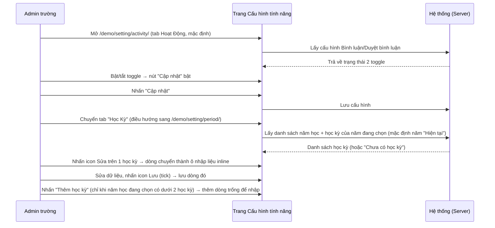
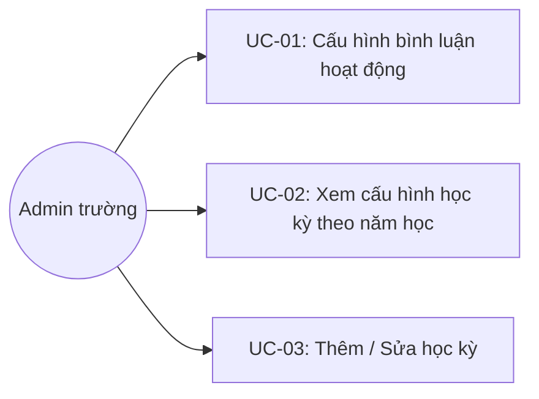
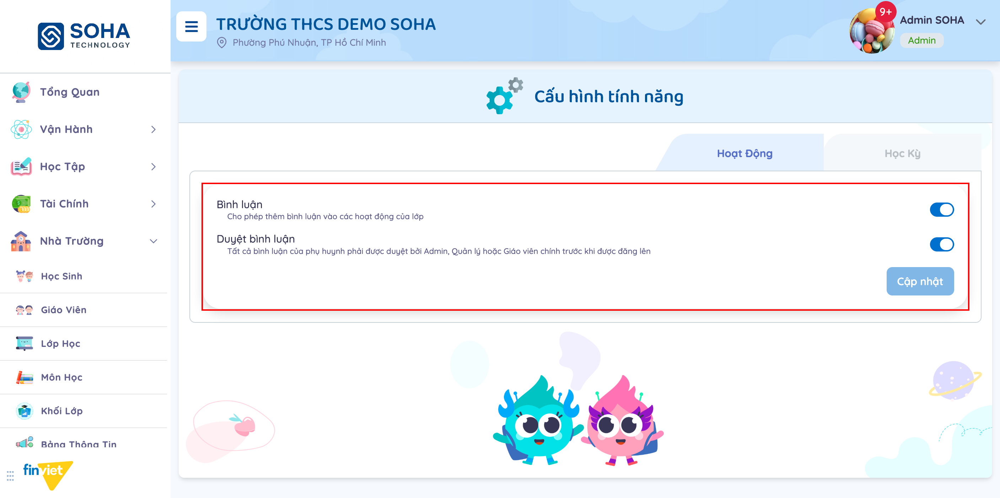
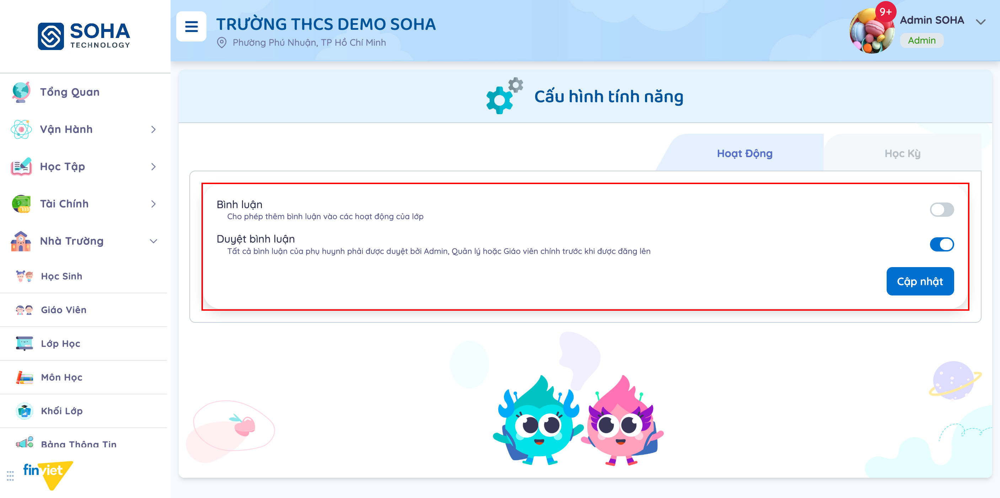
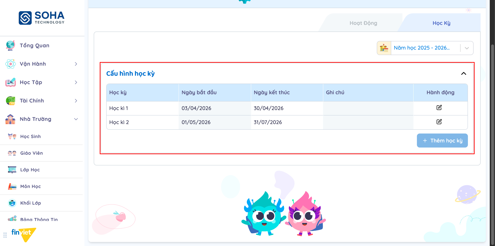
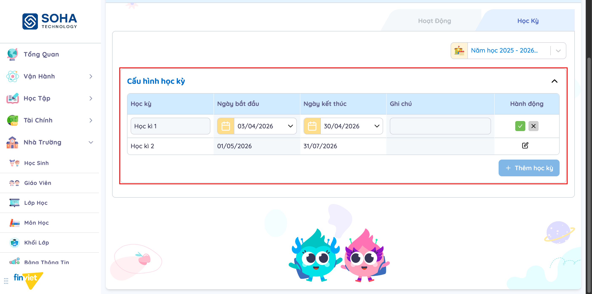
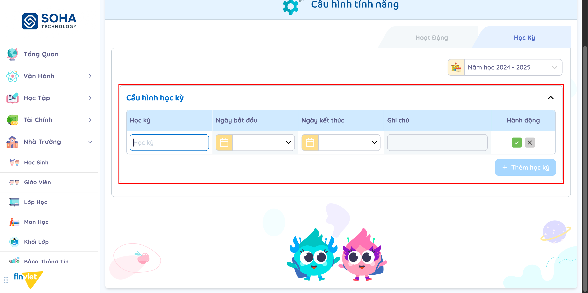

# Tên: Cấu Hình - Tính Năng

## Mục lục
- [1. Thông tin tổng quan](#1-thông-tin-tổng-quan)
  - [1.1 Giới thiệu chung](#11-giới-thiệu-chung)
  - [1.2 Mục tiêu](#12-mục-tiêu)
  - [1.3 Phạm vi](#13-phạm-vi)
  - [1.4 Tài liệu tham khảo](#14-tài-liệu-tham-khảo)
- [2. Tổng quan nghiệp vụ](#2-tổng-quan-nghiệp-vụ)
  - [2.1 Đối tượng](#21-đối-tượng)
  - [2.2 Luồng nghiệp vụ](#22-luồng-nghiệp-vụ)
  - [2.3 Nguyên tắc nghiệp vụ](#23-nguyên-tắc-nghiệp-vụ)
- [3. Đặc tả tính năng](#3-đặc-tả-tính-năng)
  - [3.1 Phân rã chức năng](#31-phân-rã-chức-năng)
  - [3.2 Acceptance Criteria](#32-acceptance-criteria)
  - [3.3 Use case](#33-use-case)
  - [3.4 Edge Cases & Error Handling](#34-edge-cases--error-handling)
  - [3.5 Non-functional Requirements](#35-non-functional-requirements)
  - [3.6 Quy ước UI chung](#36-quy-ước-ui-chung)

## 1. Thông tin tổng quan

### 1.1 Giới thiệu chung
Sub-module "Tính Năng" (tiêu đề trang: "Cấu hình tính năng") nằm trong nhóm Cấu Hình, gồm 2 tab độc lập: "Hoạt Động" (bật/tắt tính năng bình luận trên hoạt động lớp) và "Học Kỳ" (khai báo mốc thời gian học kỳ cho từng năm học).

### 1.2 Mục tiêu
- Cho phép bật/tắt tính năng bình luận trên hoạt động lớp, và yêu cầu duyệt bình luận trước khi hiển thị.
- Cho phép khai báo/chỉnh sửa ngày bắt đầu - kết thúc của từng học kỳ theo từng năm học.

### 1.3 Phạm vi
| In scope | Out of scope |
|---|---|
| Bật/tắt "Bình luận" và "Duyệt bình luận" trên hoạt động lớp | Nội dung/kiểm duyệt bình luận thực tế (thực hiện ở module Hoạt Động) |
| Xem/thêm/sửa học kỳ theo từng năm học | Tạo/sửa/xóa năm học (thực hiện ở module Năm Học, nhóm Nhà Trường) |
| — | Xóa học kỳ đã lưu — không có control này trên UI |

### 1.4 Tài liệu tham khảo
- Module Năm Học (`/demo/setting/season/`, nhóm Nhà Trường) — nguồn dữ liệu cho dropdown "Năm học" ở tab Học Kỳ; xem thêm [M5-nha-truong/SM13-nam-hoc.md](../M5-nha-truong/SM13-nam-hoc.md).

## 2. Tổng quan nghiệp vụ

### 2.1 Đối tượng
| Actor | Vai trò | Trách nhiệm chính |
|---|---|---|
| Admin trường | Người quản trị | Bật/tắt tính năng bình luận; khai báo học kỳ cho từng năm học |
| Hệ thống | Xử lý nghiệp vụ | Áp dụng cấu hình bình luận vào hoạt động lớp; dùng mốc học kỳ cho các tính năng liên quan đến học kỳ (báo cáo, học tập...) |

### 2.2 Luồng nghiệp vụ

#### 2.2.1 Mô hình hóa nghiệp vụ

#### 2.2.2 Mô tả các bước nghiệp vụ
| Bước | Người thực hiện | Mô tả | Kết quả |
|---|---|---|---|
| 1 | Admin trường | Mở trang, mặc định vào tab "Hoạt Động" | Hiển thị 2 toggle Bình luận/Duyệt bình luận |
| 2 | Admin trường | Bật/tắt toggle | Nút "Cập nhật" chuyển sang enabled |
| 3 | Admin trường | Chuyển sang tab "Học Kỳ" | Điều hướng route riêng `/demo/setting/period/`, mặc định chọn năm học đang "Hiện tại" |
| 4 | Admin trường | Chọn năm học khác từ dropdown | Bảng học kỳ cập nhật theo năm học được chọn |
| 5 | Admin trường | Sửa/Thêm học kỳ | Dòng chuyển sang chế độ nhập liệu inline; lưu hoặc hủy bằng icon tick/X |

### 2.3 Nguyên tắc nghiệp vụ
| ID | Nguyên tắc nghiệp vụ |
|---|---|
| BR01 | Trang có 2 tab điều hướng qua 2 route riêng: "Hoạt Động" (`/demo/setting/activity/`) và "Học Kỳ" (`/demo/setting/period/`) — cùng mô hình 2-tab-2-route như module Trường |
| BR02 | Tab Hoạt Động có 2 toggle độc lập, không phụ thuộc lẫn nhau: tắt "Bình luận" không làm vô hiệu hóa "Duyệt bình luận" (đã kiểm chứng trực tiếp — toggle "Duyệt bình luận" vẫn bật và tương tác được dù "Bình luận" đang tắt) |
| BR03 | Nút "Cập nhật" (tab Hoạt Động) mặc định disabled, chỉ enable khi có ít nhất 1 toggle thay đổi so với trạng thái đã lưu |
| BR04 | Dropdown "Năm học" ở tab Học Kỳ lấy dữ liệu từ danh sách năm học thực tế của trường (module Năm Học); năm học đang là năm hiện hành có nhãn "Hiện tại" và được chọn mặc định khi vào trang |
| BR05 | Mỗi năm học tối đa 2 học kỳ — nút "Thêm học kỳ" tự động disabled khi năm học đang chọn đã có đủ 2 học kỳ |
| BR06 | Sửa 1 học kỳ chuyển dòng đó thành ô nhập liệu inline ngay trong bảng (không phải modal riêng), gồm Học kỳ (tên), Ngày bắt đầu, Ngày kết thúc, Ghi chú, và 2 icon Lưu (dấu tick xanh)/Hủy (dấu X) |
| BR07 | Trong lúc 1 học kỳ đang ở chế độ sửa, icon Sửa của học kỳ còn lại trong cùng năm học bị vô hiệu hóa — chỉ sửa được 1 học kỳ tại 1 thời điểm |
| BR08 | "Thêm học kỳ" cũng tạo 1 dòng nhập liệu inline trống (không phải modal); khi đang thêm, nút "Thêm học kỳ" tự vô hiệu hóa để tránh thêm nhiều dòng cùng lúc |
| BR09 | Không có chức năng xóa học kỳ đã lưu — cột "Hành động" của dòng đã lưu chỉ có 1 icon Sửa, không có icon Xóa |
| BR10 | Năm học chưa khai báo học kỳ nào hiển thị dòng "Chưa có học kỳ" trong bảng thay vì bảng trống |

## 3. Đặc tả tính năng

### 3.1 Phân rã chức năng
| Feature | Platform | Priority | User Story |
|---|---|---|---|
| Cấu hình bình luận hoạt động | Web Admin | Trung bình | Là Admin trường, tôi muốn bật/tắt bình luận và yêu cầu duyệt trước khi đăng |
| Xem cấu hình học kỳ theo năm học | Web Admin | Trung bình | Là Admin trường, tôi muốn xem mốc thời gian học kỳ của từng năm học |
| Thêm/Sửa học kỳ | Web Admin | Cao | Là Admin trường, tôi muốn khai báo hoặc điều chỉnh ngày bắt đầu/kết thúc học kỳ |

### 3.2 Acceptance Criteria
| User Story | Chức năng | Acceptance Criteria |
|---|---|---|
| Cấu hình bình luận | Bật/tắt toggle + Cập nhật | Nút "Cập nhật" chỉ enable khi có thay đổi; 2 toggle hoạt động độc lập |
| Xem học kỳ theo năm học | Chọn năm học | Bảng học kỳ hiển thị đúng dữ liệu của năm học được chọn, hoặc "Chưa có học kỳ" nếu rỗng |
| Thêm/Sửa học kỳ | Nhập liệu inline | Chỉ thao tác được 1 dòng tại 1 thời điểm; tối đa 2 học kỳ/năm học |

### 3.3 Use case

---

| Trường | Nội dung |
|---|---|
| Use case ID | UC-01 |
| Use case name | Cấu hình bình luận hoạt động |
| Use case description | Admin trường bật/tắt tính năng bình luận và yêu cầu duyệt bình luận trên hoạt động lớp |
| Actor | Admin trường |
| Happy path | 1. Vào Cấu Hình → Tính Năng, mặc định ở tab "Hoạt Động":   2. Bật/tắt toggle "Bình luận" (cho phép thêm bình luận vào hoạt động lớp) và/hoặc "Duyệt bình luận" (yêu cầu duyệt trước khi đăng). 3. Nhấn "Cập nhật" để lưu. |
| Exception | Rời trang khi chưa lưu → hệ thống hiện hộp thoại xác nhận rời |
| Trigger | Admin trường cần thay đổi chính sách bình luận trên hoạt động lớp |
| Pre-condition | Đã đăng nhập với quyền Admin trường |
| Post-condition | Cấu hình bình luận mới được áp dụng cho hoạt động lớp |
| Business Rules | BR01, BR02, BR03 |

---

| Trường | Nội dung |
|---|---|
| Use case ID | UC-02 |
| Use case name | Xem cấu hình học kỳ theo năm học |
| Use case description | Admin trường xem danh sách học kỳ đã khai báo cho một năm học cụ thể |
| Actor | Admin trường |
| Happy path | 1. Chuyển sang tab "Học Kỳ". 2. Trang mặc định chọn năm học đang "Hiện tại", hiển thị bảng học kỳ:   3. Mở dropdown "Năm học" để xem/chọn năm học khác. 4. Nếu năm học chưa có học kỳ nào, bảng hiển thị "Chưa có học kỳ". |
| Exception | Không có |
| Trigger | Admin trường cần kiểm tra mốc thời gian học kỳ của một năm học |
| Pre-condition | Đã đăng nhập với quyền Admin trường; trường đã có ít nhất 1 năm học được khai báo |
| Post-condition | Không thay đổi dữ liệu — chỉ xem |
| Business Rules | BR01, BR04, BR10 |

---

| Trường | Nội dung |
|---|---|
| Use case ID | UC-03 |
| Use case name | Thêm / Sửa học kỳ |
| Use case description | Admin trường khai báo học kỳ mới hoặc chỉnh sửa mốc thời gian học kỳ đã có |
| Actor | Admin trường |
| Happy path (Sửa) | 1. Trong bảng học kỳ, nhấn icon Sửa trên 1 dòng → dòng chuyển thành ô nhập liệu inline (Học kỳ, Ngày bắt đầu, Ngày kết thúc, Ghi chú); icon Sửa của dòng còn lại tạm khóa:   2. Chỉnh sửa giá trị. 3. Nhấn icon tick (xanh) để lưu, hoặc icon X để hủy. |
| Happy path (Thêm) | 1. Nhấn "Thêm học kỳ" (chỉ khả dụng khi năm học đang chọn có dưới 2 học kỳ) → thêm 1 dòng trống ở cuối bảng:   2. Nhập Học kỳ, Ngày bắt đầu, Ngày kết thúc, Ghi chú (tùy chọn). 3. Nhấn icon tick để lưu, hoặc icon X để hủy (dòng bị xóa khỏi form, không lưu). |
| Exception | Năm học đã có đủ 2 học kỳ → nút "Thêm học kỳ" bị vô hiệu hóa. Đang sửa/thêm 1 dòng → không thể sửa/thêm dòng khác cho tới khi lưu hoặc hủy dòng đang thao tác |
| Trigger | Admin trường cần khai báo học kỳ mới đầu năm học, hoặc điều chỉnh ngày do thay đổi kế hoạch |
| Pre-condition | Đã đăng nhập với quyền Admin trường |
| Post-condition | Bảng học kỳ của năm học được chọn cập nhật theo dữ liệu mới |
| Business Rules | BR05, BR06, BR07, BR08, BR09 |

### 3.4 Edge Cases & Error Handling

#### 3.4.1 Tổng quan
| Nhóm | Tình huống | Xử lý mong đợi |
|---|---|---|
| Thêm/Sửa học kỳ | Nhấn icon X khi đang thêm dòng mới | Dòng vừa thêm biến mất, không lưu; "Thêm học kỳ" trở lại enabled (đã xác minh trực tiếp trên tenant demo) |
| Thêm/Sửa học kỳ | Nhấn icon X khi đang sửa dòng có sẵn | Dòng trở lại hiển thị dữ liệu cũ, không lưu thay đổi (đã xác minh trực tiếp) |
| Học kỳ | Ngày kết thúc học kỳ này trùng/chồng lấn ngày bắt đầu học kỳ kia | [Cần xác nhận] — chưa kiểm thử do rủi ro ảnh hưởng dữ liệu học kỳ thật đang được các module khác tham chiếu |
| Học kỳ | Năm học đã đủ 2 học kỳ | Nút "Thêm học kỳ" disabled — không có thông báo giải thích lý do disabled trên UI [Cần xác nhận] |

#### 3.4.2 Danh sách Thông báo (lỗi/thành công)
| Message ID | Trường hợp lỗi | Rule kiểm tra | Message đề xuất | Hình thức báo | Hành vi hệ thống |
|---|---|---|---|---|---|
| — | Chưa quan sát được message lỗi cụ thể (VD: bỏ trống Học kỳ/Ngày bắt đầu khi lưu) trong phạm vi khảo sát này | | | | [Cần xác nhận] |

### 3.5 Non-functional Requirements
| ID | Nhóm | Yêu cầu |
|---|---|---|
| NFR01 | Toàn vẹn dữ liệu | Chỉ 1 dòng học kỳ được phép ở chế độ chỉnh sửa/thêm mới tại 1 thời điểm, tránh xung đột khi lưu |
| NFR02 | UX | Thao tác sửa/thêm học kỳ diễn ra ngay trong bảng (inline), không cần điều hướng hay mở modal riêng |

### 3.6 Quy ước UI chung
- 2 tab điều hướng bằng route riêng (không phải client-side tab state) — url đổi khi chuyển tab, giống quy ước đã thấy ở module Trường.
- Toggle dùng chung kiểu switch xanh dương; nút submit ("Cập nhật") mặc định ở dạng nhạt màu (disabled) và chỉ đậm màu khi có thay đổi (dirty).
- Bảng có thao tác inline dùng cặp icon tick (xanh, Lưu) / X (xám, Hủy) thay vì nút text — khác với các bảng dùng modal riêng ở các sub-module khác trong Cấu Hình.
- Rời trang khi còn dữ liệu chưa lưu sẽ hiện hộp thoại xác nhận dùng chung toàn hệ thống ("Thay đổi của bạn chưa được lưu...").
