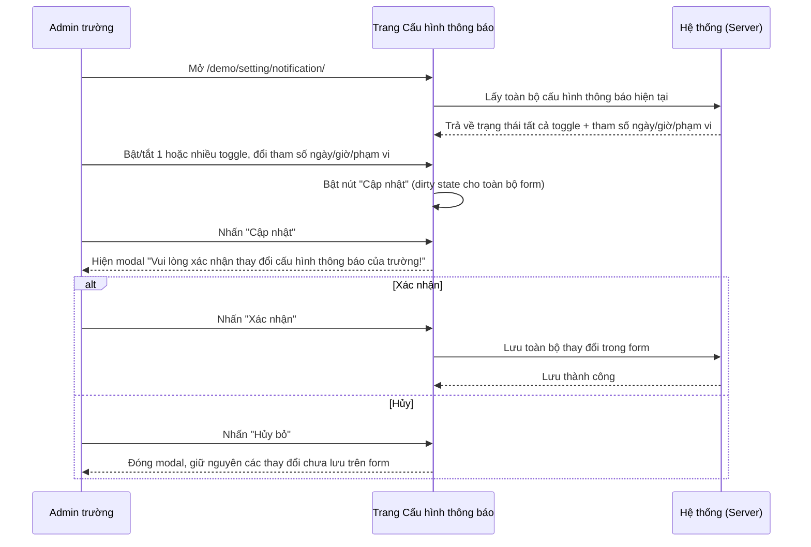
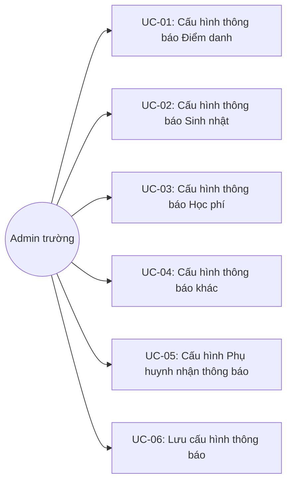
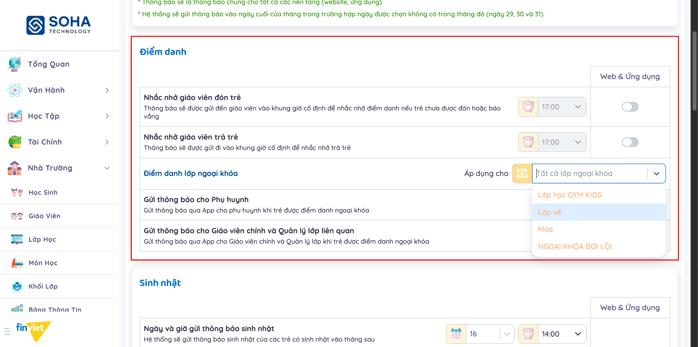
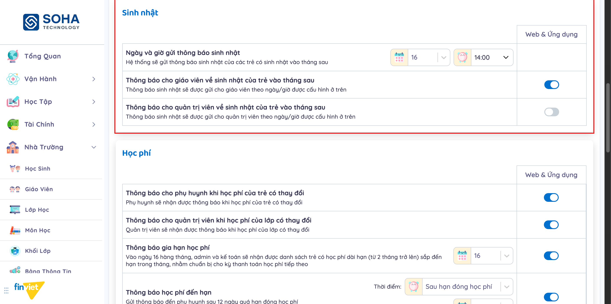
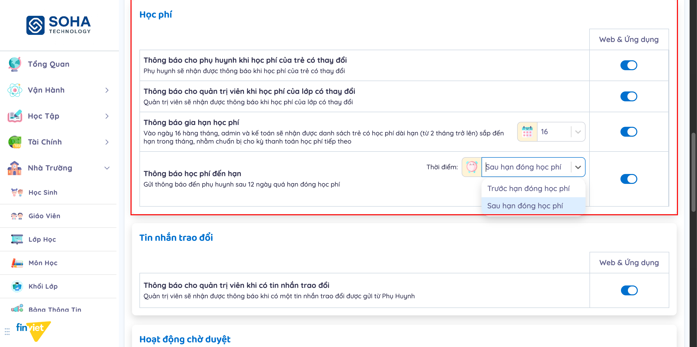
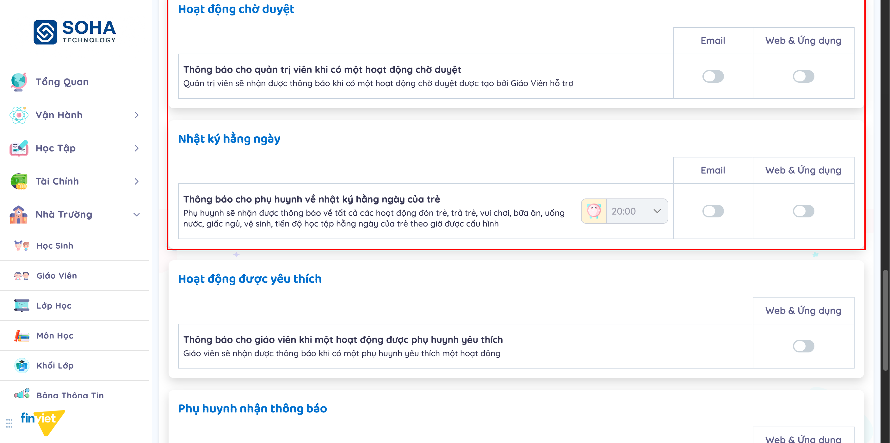
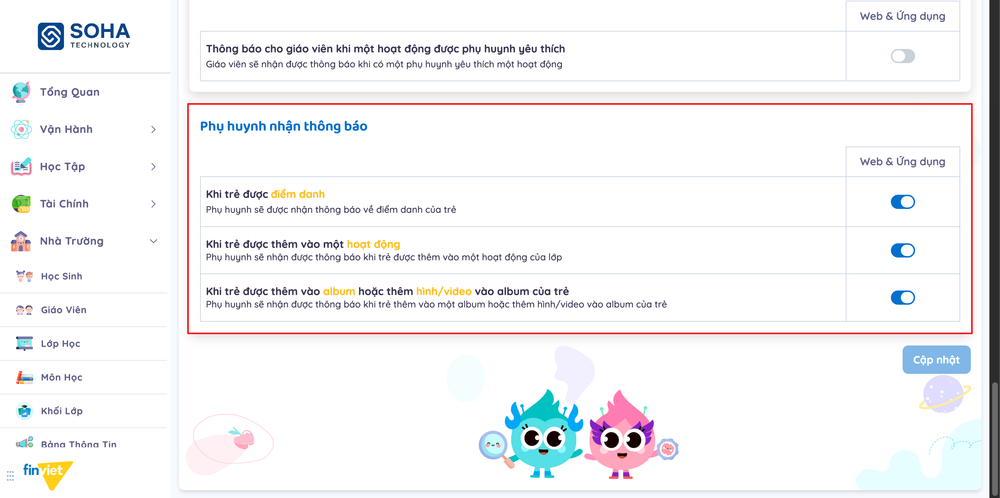
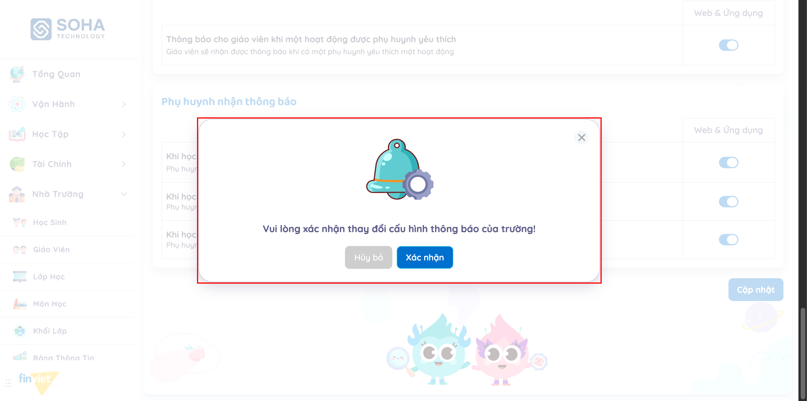

# Tên: Cấu Hình - Thông Báo

## Mục lục
- [1. Thông tin tổng quan](#1-thông-tin-tổng-quan)
  - [1.1 Giới thiệu chung](#11-giới-thiệu-chung)
  - [1.2 Mục tiêu](#12-mục-tiêu)
  - [1.3 Phạm vi](#13-phạm-vi)
  - [1.4 Tài liệu tham khảo](#14-tài-liệu-tham-khảo)
- [2. Tổng quan nghiệp vụ](#2-tổng-quan-nghiệp-vụ)
  - [2.1 Đối tượng](#21-đối-tượng)
  - [2.2 Luồng nghiệp vụ](#22-luồng-nghiệp-vụ)
  - [2.3 Nguyên tắc nghiệp vụ](#23-nguyên-tắc-nghiệp-vụ)
- [3. Đặc tả tính năng](#3-đặc-tả-tính-năng)
  - [3.1 Phân rã chức năng](#31-phân-rã-chức-năng)
  - [3.2 Acceptance Criteria](#32-acceptance-criteria)
  - [3.3 Use case](#33-use-case)
  - [3.4 Edge Cases & Error Handling](#34-edge-cases--error-handling)
  - [3.5 Non-functional Requirements](#35-non-functional-requirements)
  - [3.6 Quy ước UI chung](#36-quy-ước-ui-chung)

## 1. Thông tin tổng quan

### 1.1 Giới thiệu chung
Sub-module "Thông Báo" (tiêu đề trang: "Cấu hình thông báo") nằm trong nhóm Cấu Hình, là trang cấu hình tập trung cho toàn bộ thông báo tự động của hệ thống — điểm danh, sinh nhật, học phí, tin nhắn trao đổi, hoạt động chờ duyệt, nhật ký hằng ngày, hoạt động được yêu thích, và các thông báo gửi cho phụ huynh. Đây là trang cấu hình lớn nhất trong nhóm Cấu Hình, gồm 1 form duy nhất trải dài toàn trang.

### 1.2 Mục tiêu
- Cho phép bật/tắt từng loại thông báo theo từng kênh (Web & Ứng dụng, và với một số loại còn có thêm Email).
- Cho phép cấu hình mốc thời gian (ngày/giờ) áp dụng cho các thông báo định kỳ (sinh nhật, gia hạn học phí).
- Cho phép giới hạn phạm vi áp dụng cho một số thông báo (VD: điểm danh lớp ngoại khóa theo lớp cụ thể).
- Đảm bảo mọi thay đổi cấu hình thông báo — vốn ảnh hưởng toàn trường — đều phải qua bước xác nhận trước khi lưu.

### 1.3 Phạm vi
| In scope | Out of scope |
|---|---|
| Bật/tắt thông báo theo nhóm: Điểm danh, Sinh nhật, Học phí, Tin nhắn trao đổi, Hoạt động chờ duyệt, Nhật ký hằng ngày, Hoạt động được yêu thích, Phụ huynh nhận thông báo | Nội dung/mẫu văn bản của từng thông báo (không có control chỉnh sửa mẫu) |
| Cấu hình ngày/giờ gửi cho thông báo định kỳ (sinh nhật, gia hạn học phí) | Lịch sử thông báo đã gửi |
| Giới hạn phạm vi theo lớp cho điểm danh ngoại khóa | Cấu hình kênh gửi mới (VD: SMS, Zalo...) — chỉ có Email và Web & Ứng dụng |
| Xác nhận và lưu toàn bộ thay đổi cấu hình thông báo | — |

### 1.4 Tài liệu tham khảo
- [M5-nha-truong/SM13-nam-hoc.md](../M5-nha-truong/SM13-nam-hoc.md) và [M6-cau-hinh/SM1-truong.md](SM1-truong.md) — cùng ghi nhận hiện tượng nội dung mô tả đổi qua lại giữa "học sinh" và "trẻ" không nhất quán giữa các lần tải trang.

## 2. Tổng quan nghiệp vụ

### 2.1 Đối tượng
| Actor | Vai trò | Trách nhiệm chính |
|---|---|---|
| Admin trường | Người quản trị | Bật/tắt và cấu hình mốc thời gian/phạm vi cho từng loại thông báo |
| Hệ thống | Xử lý nghiệp vụ | Gửi thông báo tới đúng đối tượng (giáo viên, quản trị viên, phụ huynh) theo kênh và mốc thời gian đã cấu hình |

### 2.2 Luồng nghiệp vụ

#### 2.2.1 Mô hình hóa nghiệp vụ

#### 2.2.2 Mô tả các bước nghiệp vụ
| Bước | Người thực hiện | Mô tả | Kết quả |
|---|---|---|---|
| 1 | Admin trường | Mở trang Cấu hình thông báo | Hiển thị toàn bộ nhóm thông báo trong 1 form duy nhất |
| 2 | Admin trường | Bật/tắt bất kỳ toggle nào, hoặc đổi tham số ngày/giờ/phạm vi | Nút "Cập nhật" (duy nhất, cuối trang) chuyển sang enabled |
| 3 | Admin trường | Nhấn "Cập nhật" | Hệ thống hiện modal xác nhận trước khi lưu |
| 4 | Admin trường | Nhấn "Xác nhận" trong modal | Toàn bộ thay đổi trong form được lưu cùng lúc |

### 2.3 Nguyên tắc nghiệp vụ
| ID | Nguyên tắc nghiệp vụ |
|---|---|
| BR01 | Toàn bộ trang là 1 form duy nhất với 1 nút "Cập nhật" duy nhất ở cuối trang — khác với sub-module Học Phí (nhiều form độc lập, mỗi form 1 nút Lưu riêng) |
| BR02 | Nhấn "Cập nhật" luôn hiện modal xác nhận "Vui lòng xác nhận thay đổi cấu hình thông báo của trường!" (Hủy bỏ/Xác nhận) trước khi lưu thật, bất kể thay đổi ở mục nào trong trang |
| BR03 | Banner đầu trang nêu rõ 3 nguyên tắc áp dụng toàn hệ thống: (1) cấu hình áp dụng cho toàn bộ tài khoản trong trường, (2) thông báo dùng chung cho mọi nền tảng (website, ứng dụng), (3) nếu ngày cấu hình không tồn tại trong một tháng cụ thể (29, 30, 31) thì hệ thống gửi vào ngày cuối cùng của tháng đó |
| BR04 | Một số dòng cấu hình không có toggle riêng mà chỉ là tham số dùng chung cho các dòng con bên dưới — VD "Ngày và giờ gửi thông báo sinh nhật" không có toggle, chỉ cấu hình ngày/giờ dùng chung cho 2 dòng thông báo (giáo viên, quản trị viên) ngay bên dưới |
| BR05 | Phần lớn các mục chỉ có 1 cột kênh gửi "Web & Ứng dụng"; riêng "Hoạt động chờ duyệt" và "Nhật ký hằng ngày" có thêm cột "Email" độc lập — 2 toggle riêng biệt cho cùng 1 dòng thông báo |
| BR06 | Các trường giờ cố định (VD: 17:00 cho nhắc đón/trả trẻ, 20:00 cho nhật ký hằng ngày) là readonly — hiển thị như ô nhập liệu nhưng không thể chỉnh sửa qua UI |
| BR07 | "Điểm danh lớp ngoại khóa" có control "Áp dụng cho" để giới hạn phạm vi: mặc định "Tất cả lớp ngoại khóa", hoặc chọn riêng 1 lớp ngoại khóa cụ thể trong danh sách lớp thực tế của trường |
| BR08 | "Thông báo học phí đến hạn" kết hợp 2 tham số: "Thời điểm" (Trước hạn đóng học phí / Sau hạn đóng học phí) và "Số ngày" (giá trị số, khoảng 1-31) để xác định chính xác mốc gửi thông báo |
| BR09 | Nội dung mô tả một số dòng dùng từ "học sinh" hoặc "trẻ" không nhất quán giữa các lần tải lại trang cho cùng một cấu hình (đã quan sát trực tiếp, tự đổi qua lại không do người dùng thao tác) — cùng hiện tượng đã ghi nhận ở SM1-truong.md BR13 [Cần xác nhận nguyên nhân] |

## 3. Đặc tả tính năng

### 3.1 Phân rã chức năng
| Feature | Platform | Priority | User Story |
|---|---|---|---|
| Cấu hình thông báo Điểm danh | Web Admin | Cao | Là Admin trường, tôi muốn cấu hình nhắc nhở giáo viên đón/trả trẻ và thông báo điểm danh ngoại khóa |
| Cấu hình thông báo Sinh nhật | Web Admin | Trung bình | Là Admin trường, tôi muốn hệ thống tự nhắc giáo viên/quản trị viên về sinh nhật học sinh sắp tới |
| Cấu hình thông báo Học phí | Web Admin | Cao | Là Admin trường, tôi muốn phụ huynh và admin được thông báo kịp thời về thay đổi/gia hạn/đến hạn học phí |
| Cấu hình thông báo khác (Tin nhắn, Hoạt động chờ duyệt, Nhật ký, Yêu thích) | Web Admin | Trung bình | Là Admin trường, tôi muốn bật/tắt các thông báo vận hành hàng ngày còn lại |
| Cấu hình "Phụ huynh nhận thông báo" | Web Admin | Cao | Là Admin trường, tôi muốn kiểm soát các thông báo mà phụ huynh nhận được về con em mình |
| Lưu cấu hình thông báo | Web Admin | Cao | Là Admin trường, tôi muốn được xác nhận lại trước khi áp dụng thay đổi cho toàn trường |

### 3.2 Acceptance Criteria
| User Story | Chức năng | Acceptance Criteria |
|---|---|---|
| Cấu hình Điểm danh | Bật/tắt + Áp dụng cho | Đổi phạm vi "Áp dụng cho" không ảnh hưởng các mục khác trong trang |
| Cấu hình Sinh nhật | Đổi ngày/giờ dùng chung | Ngày/giờ cấu hình áp dụng cho cả 2 dòng thông báo giáo viên/quản trị viên bên dưới |
| Cấu hình Học phí | Cấu hình Thời điểm + Số ngày | 2 tham số kết hợp đúng như mô tả hiển thị ("Gửi thông báo đến phụ huynh sau N ngày quá hạn đóng học phí") |
| Lưu cấu hình | Nhấn Cập nhật | Luôn hiện modal xác nhận; chỉ lưu khi nhấn "Xác nhận" trong modal |

### 3.3 Use case

---

| Trường | Nội dung |
|---|---|
| Use case ID | UC-01 |
| Use case name | Cấu hình thông báo Điểm danh |
| Use case description | Admin trường cấu hình nhắc nhở giáo viên đón/trả trẻ và thông báo điểm danh lớp ngoại khóa |
| Actor | Admin trường |
| Happy path | 1. Trong khối "Điểm danh", bật/tắt "Nhắc nhở giáo viên đón trẻ" và "Nhắc nhở giáo viên trả trẻ" (giờ gửi cố định 17:00, readonly). 2. Ở "Điểm danh lớp ngoại khóa", chọn phạm vi "Áp dụng cho" — mặc định "Tất cả lớp ngoại khóa" hoặc chọn 1 lớp cụ thể:   3. Bật/tắt "Gửi thông báo cho Phụ huynh" và "Gửi thông báo cho Giáo viên chính và Quản lý lớp liên quan". |
| Exception | Không có |
| Trigger | Admin trường cần điều chỉnh nhắc nhở điểm danh hoặc phạm vi thông báo điểm danh ngoại khóa |
| Pre-condition | Đã đăng nhập với quyền Admin trường |
| Post-condition | Cấu hình chờ trong form, chỉ có hiệu lực sau khi hoàn tất UC-06 |
| Business Rules | BR03, BR06, BR07 |

---

| Trường | Nội dung |
|---|---|
| Use case ID | UC-02 |
| Use case name | Cấu hình thông báo Sinh nhật |
| Use case description | Admin trường cấu hình ngày/giờ gửi thông báo sinh nhật học sinh của tháng sau, và bật/tắt người nhận |
| Actor | Admin trường |
| Happy path | 1. Trong khối "Sinh nhật", chọn "Ngày và giờ gửi thông báo sinh nhật" (dòng này không có toggle, chỉ là tham số dùng chung). 2. Bật/tắt "Thông báo cho giáo viên..." và "Thông báo cho quản trị viên...":   |
| Exception | Chọn ngày 29/30/31 nhưng tháng sau không có ngày đó → hệ thống tự gửi vào ngày cuối tháng (theo banner đầu trang) [Cần xác nhận — chưa kiểm thử thực tế do phụ thuộc lịch] |
| Trigger | Admin trường cần bật tính năng nhắc sinh nhật hoặc đổi mốc giờ gửi |
| Pre-condition | Đã đăng nhập với quyền Admin trường |
| Post-condition | Cấu hình chờ trong form, chỉ có hiệu lực sau khi hoàn tất UC-06 |
| Business Rules | BR03, BR04 |

---

| Trường | Nội dung |
|---|---|
| Use case ID | UC-03 |
| Use case name | Cấu hình thông báo Học phí |
| Use case description | Admin trường cấu hình thông báo thay đổi học phí, gia hạn học phí, và học phí đến hạn |
| Actor | Admin trường |
| Happy path | 1. Bật/tắt "Thông báo cho phụ huynh khi học phí của trẻ có thay đổi" và "...cho quản trị viên khi học phí của lớp có thay đổi". 2. Cấu hình ngày gửi cho "Thông báo gia hạn học phí" (mặc định ngày 16 hàng tháng). 3. Ở "Thông báo học phí đến hạn", chọn "Thời điểm" (Trước/Sau hạn đóng học phí) và "Số ngày" tương ứng:   |
| Exception | Không có |
| Trigger | Admin trường cần điều chỉnh chính sách nhắc học phí đầu năm học hoặc khi thay đổi quy định |
| Pre-condition | Đã đăng nhập với quyền Admin trường |
| Post-condition | Cấu hình chờ trong form, chỉ có hiệu lực sau khi hoàn tất UC-06 |
| Business Rules | BR03, BR08 |

---

| Trường | Nội dung |
|---|---|
| Use case ID | UC-04 |
| Use case name | Cấu hình thông báo khác (Tin nhắn trao đổi, Hoạt động chờ duyệt, Nhật ký hằng ngày, Hoạt động được yêu thích) |
| Use case description | Admin trường bật/tắt các thông báo vận hành hàng ngày còn lại, một số mục có thêm kênh Email riêng |
| Actor | Admin trường |
| Happy path | 1. Bật/tắt "Thông báo cho quản trị viên khi có tin nhắn trao đổi" (chỉ có cột Web & Ứng dụng). 2. Ở "Hoạt động chờ duyệt" và "Nhật ký hằng ngày", bật/tắt độc lập 2 cột "Email" và "Web & Ứng dụng" cho cùng 1 dòng thông báo:   3. Bật/tắt "Thông báo cho giáo viên khi một hoạt động được phụ huynh yêu thích". |
| Exception | Không có |
| Trigger | Admin trường cần điều chỉnh thông báo vận hành hàng ngày |
| Pre-condition | Đã đăng nhập với quyền Admin trường |
| Post-condition | Cấu hình chờ trong form, chỉ có hiệu lực sau khi hoàn tất UC-06 |
| Business Rules | BR03, BR05 |

---

| Trường | Nội dung |
|---|---|
| Use case ID | UC-05 |
| Use case name | Cấu hình "Phụ huynh nhận thông báo" |
| Use case description | Admin trường bật/tắt các thông báo gửi trực tiếp cho phụ huynh liên quan đến con em mình |
| Actor | Admin trường |
| Happy path | 1. Trong khối "Phụ huynh nhận thông báo", bật/tắt độc lập 3 dòng: khi trẻ được điểm danh, khi trẻ được thêm vào một hoạt động, khi trẻ được thêm vào album hoặc thêm hình/video vào album:   |
| Exception | Không có |
| Trigger | Admin trường cần điều chỉnh những gì phụ huynh được thông báo về con em |
| Pre-condition | Đã đăng nhập với quyền Admin trường |
| Post-condition | Cấu hình chờ trong form, chỉ có hiệu lực sau khi hoàn tất UC-06 |
| Business Rules | BR03 |

---

| Trường | Nội dung |
|---|---|
| Use case ID | UC-06 |
| Use case name | Lưu cấu hình thông báo |
| Use case description | Admin trường xác nhận và lưu toàn bộ thay đổi đã thực hiện trên trang |
| Actor | Admin trường |
| Happy path | 1. Sau khi thay đổi bất kỳ mục nào ở UC-01 đến UC-05, nút "Cập nhật" (duy nhất, cuối trang) chuyển sang enabled. 2. Nhấn "Cập nhật" → hệ thống hiện modal xác nhận:   3. Nhấn "Xác nhận" để lưu toàn bộ thay đổi trong form cùng lúc. |
| Exception | Nhấn "Hủy bỏ" trong modal → đóng modal, các thay đổi chưa lưu vẫn còn nguyên trên form (không mất, nhưng cũng chưa lưu vào hệ thống — đã xác minh trực tiếp trên tenant demo). Rời trang khi form còn thay đổi chưa lưu → hệ thống hiện hộp thoại xác nhận rời riêng (khác với modal xác nhận cập nhật) |
| Trigger | Admin trường hoàn tất chỉnh sửa và muốn áp dụng thay đổi |
| Pre-condition | Đã đăng nhập với quyền Admin trường; form đang ở trạng thái dirty (có ít nhất 1 thay đổi) |
| Post-condition | Toàn bộ thay đổi trong form được lưu; áp dụng ngay cho toàn trường trên mọi nền tảng |
| Business Rules | BR01, BR02 |

### 3.4 Edge Cases & Error Handling

#### 3.4.1 Tổng quan
| Nhóm | Tình huống | Xử lý mong đợi |
|---|---|---|
| Lưu cấu hình | Thay đổi nhiều mục ở nhiều khối khác nhau rồi mới nhấn Cập nhật | Tất cả thay đổi được gộp và lưu cùng lúc trong 1 lần xác nhận (do chỉ có 1 form/1 nút Cập nhật) |
| Lưu cấu hình | Nhấn "Hủy bỏ" ở modal xác nhận | Không lưu; giữ nguyên các thay đổi chưa lưu trên form để người dùng tiếp tục chỉnh sửa hoặc rời trang (đã xác minh trực tiếp) |
| Sinh nhật / Gia hạn học phí | Ngày cấu hình là 29, 30 hoặc 31 nhưng tháng sau không có ngày đó | Hệ thống gửi vào ngày cuối cùng của tháng đó (theo banner đầu trang) [Cần xác nhận — chưa kiểm thử thực tế] |
| Điểm danh ngoại khóa | Không còn lớp ngoại khóa nào trong trường | [Cần xác nhận] — chưa quan sát được hành vi dropdown "Áp dụng cho" khi danh sách lớp rỗng |

#### 3.4.2 Danh sách Thông báo (lỗi/thành công)
| Message ID | Trường hợp lỗi | Rule kiểm tra | Message đề xuất | Hình thức báo | Hành vi hệ thống |
|---|---|---|---|---|---|
| — | Chưa quan sát được message lỗi cụ thể trong phạm vi khảo sát này (chỉ quan sát được modal xác nhận thành công, không thử submit dữ liệu invalid vì các control đều là toggle/dropdown có sẵn giá trị hợp lệ) | | | | [Cần xác nhận] |

### 3.5 Non-functional Requirements
| ID | Nhóm | Yêu cầu |
|---|---|---|
| NFR01 | An toàn thay đổi | Mọi thay đổi cấu hình thông báo — dù nhỏ (1 toggle) hay lớn (nhiều mục) — đều bắt buộc qua modal xác nhận trước khi lưu, do phạm vi ảnh hưởng là toàn trường |
| NFR02 | Nhất quán dữ liệu | Toàn bộ thay đổi trong form được lưu như 1 giao dịch duy nhất khi xác nhận Cập nhật, tránh trạng thái lưu dở dang giữa các mục |

### 3.6 Quy ước UI chung
- Toàn trang là 1 form lớn duy nhất, chia thành nhiều khối theo nhóm chức năng (Điểm danh, Sinh nhật, Học phí...), mỗi khối có tiêu đề riêng nhưng dùng chung 1 nút "Cập nhật" ở cuối trang — khác với các sub-module Cấu Hình khác dùng nhiều form/nút Lưu độc lập.
- Cột kênh gửi hiển thị dạng bảng ở góc phải mỗi khối: mặc định chỉ "Web & Ứng dụng"; một số khối có thêm cột "Email".
- Trường giờ cố định không thể chỉnh sửa được tô nền xám nhạt (readonly) dù trông giống ô nhập liệu thông thường.
- Từ khóa mô tả hành động kích hoạt thông báo (VD: "điểm danh", "hoạt động", "album", "hình/video") được tô màu cam để nhấn mạnh trong khối "Phụ huynh nhận thông báo".
- Mọi hành động lưu đều đi qua modal xác nhận riêng nêu rõ phạm vi ảnh hưởng ("...của trường"), nhất quán với quy ước xác nhận trước khi lưu đã thấy ở các sub-module Cấu Hình khác.
