# Tên: Khác

## Mục lục
- [1. Thông tin tổng quan](#1-thông-tin-tổng-quan)
  - [1.1 Giới thiệu chung](#11-giới-thiệu-chung)
  - [1.2 Mục tiêu](#12-mục-tiêu)
  - [1.3 Phạm vi](#13-phạm-vi)
  - [1.4 Tài liệu tham khảo](#14-tài-liệu-tham-khảo)
- [2. Tổng quan nghiệp vụ](#2-tổng-quan-nghiệp-vụ)
  - [2.1 Đối tượng](#21-đối-tượng)
  - [2.2 Luồng nghiệp vụ](#22-luồng-nghiệp-vụ)
  - [2.3 Nguyên tắc nghiệp vụ](#23-nguyên-tắc-nghiệp-vụ)
- [3. Đặc tả tính năng](#3-đặc-tả-tính-năng)
  - [3.1 Phân rã chức năng](#31-phân-rã-chức-năng)
  - [3.2 Acceptance Criteria](#32-acceptance-criteria)
  - [3.3 Use case](#33-use-case)
  - [3.4 Edge Cases & Error Handling](#34-edge-cases--error-handling)
  - [3.5 Non-functional Requirements](#35-non-functional-requirements)
  - [3.6 Quy ước UI chung](#36-quy-ước-ui-chung)

## 1. Thông tin tổng quan

### 1.1 Giới thiệu chung
"Khác" là tên gọi trong tài liệu này cho nhóm chức năng cấp tài khoản người dùng — không nằm trong sidebar điều hướng chính (Tổng Quan, Vận Hành, Học Tập, Tài Chính, Nhà Trường, Cấu Hình) mà được truy cập qua **menu dropdown của avatar** ở góc trên-phải mọi trang. Menu này gồm 4 mục cố định: **Tài khoản**, **Thông báo**, **Ngôn ngữ**, **Đăng xuất**. Ngoài ra, tài liệu này cũng ghi nhận thêm trang **"Thông báo hệ thống"** (`/demo/system/announcement/`) — một kênh thông báo riêng từ nhà cung cấp (Finviet/SOHA) tới trường, tồn tại trên hệ thống nhưng không tìm thấy link điều hướng tới nó từ sidebar hay từ menu avatar.

### 1.2 Mục tiêu
- Cho phép Admin trường xem và chỉnh sửa thông tin cá nhân, đổi mật khẩu.
- Cho phép xem danh sách thông báo cá nhân (tin nhắn, báo vắng, dặn thuốc, hóa đơn...) phân theo 4 nhóm.
- Cho phép đổi ngôn ngữ hiển thị của toàn bộ giao diện (Tiếng Việt / English).
- Cho phép đăng xuất khỏi hệ thống một cách an toàn (có xác nhận).

### 1.3 Phạm vi
| In scope | Out of scope |
|---|---|
| Menu dropdown avatar: Tài khoản, Thông báo, Ngôn ngữ, Đăng xuất | Quản lý tài khoản của người dùng khác (đã thuộc M6-SM2 Tài Khoản) |
| Xem/chỉnh sửa thông tin cá nhân, đổi mật khẩu của chính tài khoản đang đăng nhập | Thực hiện đổi mật khẩu thật (chỉ khảo sát form, không submit) |
| Xem danh sách thông báo cá nhân theo 4 tab, đánh dấu đã đọc khi nhấn vào | Thực hiện xóa/đánh dấu-tất-cả-đã-đọc hàng loạt (chỉ quan sát UI, không thực thi để tránh xóa dữ liệu demo) |
| Đổi ngôn ngữ giao diện (đã thử nghiệm và khôi phục lại Tiếng Việt) | Đăng xuất thật khỏi hệ thống (chỉ mở modal xác nhận rồi Hủy bỏ) |
| Trang "Thông báo hệ thống" (thông báo từ nhà cung cấp) | Cách nhà cung cấp gửi thông báo hệ thống — không có dữ liệu mẫu để khảo sát |

### 1.4 Tài liệu tham khảo
- [M6-cau-hinh/SM2-tai-khoan.md](../M6-cau-hinh/SM2-tai-khoan.md) — quản lý tài khoản của *người khác* (Admin quản lý nhân sự), khác với mục "Tài khoản" trong tài liệu này (tự quản lý tài khoản của chính mình).
- [M6-cau-hinh/SM5-tinh-nang.md](../M6-cau-hinh/SM5-tinh-nang.md) — nơi đầu tiên ghi nhận hiện tượng banner "unsaved changes" xuất hiện ngay khi tải trang dù chưa chỉnh sửa gì; hiện tượng này tái xuất hiện ở trang "Chỉnh sửa thông tin cá nhân" và "Đổi mật khẩu" trong module này.
- [M1-tong-quan/SM1-tong-quan.md](../M1-tong-quan/SM1-tong-quan.md) — cùng ghi nhận hiện tượng nội dung mô tả đổi qua lại giữa "học sinh"/"trẻ" không nhất quán giữa các lần tải trang.

## 2. Tổng quan nghiệp vụ

### 2.1 Đối tượng
| Actor | Vai trò | Trách nhiệm chính |
|---|---|---|
| Admin trường | Người dùng | Xem/sửa thông tin cá nhân, đổi mật khẩu, xem thông báo, đổi ngôn ngữ, đăng xuất |
| Hệ thống | Xử lý nghiệp vụ | Lưu ngôn ngữ theo tài khoản, tổng hợp thông báo cá nhân, xác thực đăng xuất |

### 2.2 Luồng nghiệp vụ

#### 2.2.1 Mô hình hóa nghiệp vụ
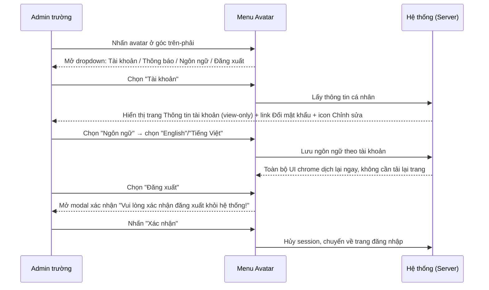

#### 2.2.2 Mô tả các bước nghiệp vụ
| Bước | Người thực hiện | Mô tả | Kết quả |
|---|---|---|---|
| 1 | Admin trường | Nhấn vào avatar/tên tài khoản ở góc trên-phải (mọi trang) | Mở dropdown 4 mục |
| 2 | Admin trường | Chọn "Tài khoản" | Điều hướng sang `/demo/user/profile/` — xem thông tin, có thể bấm icon bút để sang trang Chỉnh sửa |
| 3 | Admin trường | Chọn "Thông báo" | Điều hướng sang `/demo/user/notification/` — danh sách thông báo cá nhân theo 4 tab |
| 4 | Admin trường | Chọn "Ngôn ngữ" | Mở submenu con (trượt sang trái) với 2 lựa chọn: English / Tiếng Việt, có dấu ✓ ở lựa chọn hiện tại |
| 5 | Admin trường | Chọn "Đăng xuất" | Mở modal xác nhận; "Xác nhận" mới thực sự đăng xuất, "Hủy bỏ" đóng modal và giữ nguyên session |

### 2.3 Nguyên tắc nghiệp vụ
| ID | Nguyên tắc nghiệp vụ |
|---|---|
| BR01 | Nhóm chức năng "Khác" không nằm trong sidebar điều hướng chính — chỉ truy cập qua avatar/tên tài khoản ở góc trên-phải mọi trang trong hệ thống |
| BR02 | Dropdown avatar gồm 4 mục theo thứ tự: Tài khoản, Thông báo (kèm badge số chưa đọc), Ngôn ngữ, và Đăng xuất (tách riêng bằng 1 đường kẻ phân cách) |
| BR03 | Mục "Ngôn ngữ" có icon mũi tên "‹" gợi ý mở rộng — khi nhấn, submenu 2 lựa chọn (English/Tiếng Việt) trượt ra ở **bên trái** của mục "Ngôn ngữ" (không phải bên dưới hay bên phải như dropdown thông thường) |
| BR04 | Trang "Tài khoản" (`/demo/user/profile/`) chỉ hiển thị thông tin (view-only): Địa chỉ, Số điện thoại, Email, Ngày sinh, và nhóm "Thông tin bổ sung" (Số CCCD, Chức vụ, Ngày vào làm, Bằng cấp, Kỹ năng khác, Bộ phận) — trường trống hiển thị "Chưa có thông tin"/"Chưa có địa chỉ"/... |
| BR05 | Icon bút chì (tooltip "Chỉnh sửa") cạnh tên tài khoản trên trang Tài khoản điều hướng sang **trang riêng** `/demo/user/edit-profile/` (không phải modal); trang này có nút "UPLOAD FILE" để đổi ảnh đại diện và toàn bộ các field ở trang xem, cộng nút "Hủy bỏ"/"Cập nhật" |
| BR06 | Trang "Chỉnh sửa thông tin cá nhân" và trang "Đổi mật khẩu" đều hiển thị banner "Thay đổi của bạn chưa được lưu. Vui lòng xác nhận rời khỏi khi chưa lưu!" **ngay khi vừa tải trang**, dù chưa có tương tác nào — cùng hiện tượng đã ghi nhận ở trang Cấu Hình → Tính Năng (SM5) |
| BR07 | Đổi ngôn ngữ (English ⇄ Tiếng Việt) dịch lại toàn bộ **UI chrome** (menu sidebar, tiêu đề trang, nhãn, tên vai trò "Admin"→"Administrator") ngay lập tức, không cần tải lại trang; ngôn ngữ được lưu theo tài khoản (persist qua tab mới/tải lại trang) |
| BR08 | Đổi ngôn ngữ **không** dịch dữ liệu do tenant tự nhập: tên trường ("TRƯỜNG THCS DEMO SOHA"), địa chỉ, tên lớp học ("Lá", "Nhà trẻ", "TODDLER"...) luôn giữ nguyên nội dung gốc bất kể ngôn ngữ giao diện |
| BR09 | Trang "Thông báo" (`/demo/user/notification/`) có 4 tab cố định: Hoạt Động, Trao Đổi, Học Phí, Khác — mỗi tab hiển thị badge số thông báo chưa đọc riêng (không hiện badge nếu bằng 0); tổng số ở tiêu đề trang = tổng chưa đọc của tất cả các tab |
| BR10 | Nhấn vào một thông báo trong danh sách sẽ **đánh dấu đã đọc ngay lập tức** (badge giảm 1) và **không điều hướng** sang trang/nhóm chat liên quan, không mở chi tiết — hành động này không có cách hoàn tác (không có nút "đánh dấu chưa đọc") |
| BR11 | Góc phải tiêu đề "Thông báo" có 2 icon hành động hàng loạt: icon "đánh dấu tất cả đã đọc" (list kèm dấu tick) và icon "xóa" (thùng rác) — chỉ hiện khi tab đang chọn có thông báo [Cần xác nhận hành vi chi tiết — chưa thực thi để tránh xóa dữ liệu thật của tenant demo] |
| BR12 | Đăng xuất luôn yêu cầu xác nhận qua modal "Vui lòng xác nhận đăng xuất khỏi hệ thống!" với 2 nút Hủy bỏ/Xác nhận; nhấn "Hủy bỏ" hoặc icon X đóng modal mà không đăng xuất |
| BR13 | "Thông báo hệ thống" (`/demo/system/announcement/`) là kênh thông báo riêng từ nhà cung cấp (Finviet/SOHA) gửi tới trường — khác với "Bảng Thông Tin" (thông báo của trường gửi phụ huynh, thuộc M5) và khác với "Thông báo" cá nhân trong dropdown avatar; trang tồn tại và tải được nhưng không tìm thấy link điều hướng tới nó từ sidebar hay avatar dropdown ở bất kỳ đâu trong portal [Cần xác nhận điểm truy cập thực tế — có thể chỉ xuất hiện dưới dạng banner/badge khi có thông báo mới] |

## 3. Đặc tả tính năng

### 3.1 Phân rã chức năng
| Feature | Platform | Priority | User Story |
|---|---|---|---|
| Mở menu tài khoản (avatar dropdown) | Web Admin | Cao | Là Admin trường, tôi muốn truy cập nhanh các tác vụ cá nhân từ bất kỳ trang nào |
| Xem & chỉnh sửa thông tin tài khoản | Web Admin | Trung bình | Là Admin trường, tôi muốn xem và cập nhật thông tin cá nhân, đổi mật khẩu |
| Đổi ngôn ngữ giao diện | Web Admin | Trung bình | Là Admin trường, tôi muốn dùng hệ thống bằng ngôn ngữ mình quen thuộc |
| Xem thông báo cá nhân | Web Admin | Cao | Là Admin trường, tôi muốn xem các thông báo liên quan tới mình theo từng nhóm |
| Đăng xuất khỏi hệ thống | Web Admin | Cao | Là Admin trường, tôi muốn đăng xuất an toàn, có xác nhận trước khi rời hệ thống |
| Xem thông báo hệ thống từ nhà cung cấp | Web Admin | Thấp | Là Admin trường, tôi muốn biết khi nhà cung cấp có thông báo quan trọng cho trường |

### 3.2 Acceptance Criteria
| User Story | Chức năng | Acceptance Criteria |
|---|---|---|
| Mở menu tài khoản | Nhấn avatar | Dropdown mở đúng 4 mục; nhấn ra ngoài đóng dropdown |
| Đổi ngôn ngữ | Chọn English/Tiếng Việt | Toàn bộ UI chrome dịch lại ngay; dữ liệu tenant không đổi; lựa chọn giữ nguyên sau khi tải lại trang |
| Xem thông báo | Chuyển tab / nhấn 1 thông báo | Nội dung đổi đúng theo tab; nhấn thông báo giảm đúng 1 ở badge của tab đó và badge tổng |
| Đăng xuất | Nhấn Đăng xuất → Xác nhận/Hủy bỏ | "Hủy bỏ" giữ nguyên session; "Xác nhận" mới thực sự đăng xuất |

### 3.3 Use case
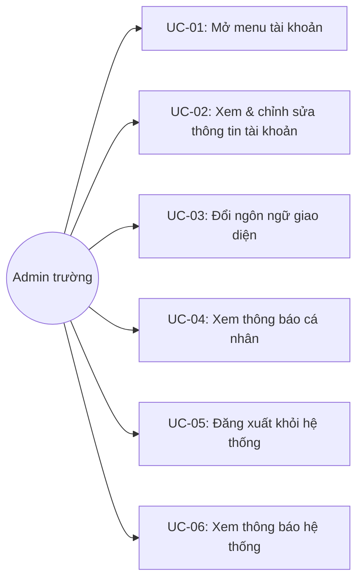

---

| Trường | Nội dung |
|---|---|
| Use case ID | UC-01 |
| Use case name | Mở menu tài khoản (avatar dropdown) |
| Use case description | Admin trường nhấn vào avatar/tên tài khoản để mở menu truy cập nhanh các tác vụ cá nhân |
| Actor | Admin trường |
| Happy path | 1. Từ bất kỳ trang nào, nhấn vào avatar hoặc tên "Admin SOHA" ở góc trên-phải:  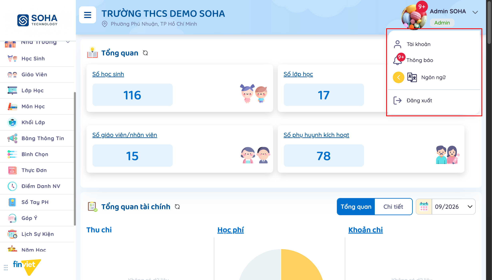 2. Dropdown hiển thị 4 mục: Tài khoản, Thông báo (kèm badge), Ngôn ngữ, Đăng xuất. 3. Nhấn ra ngoài dropdown để đóng lại. |
| Exception | Không có thông báo chưa đọc → mục "Thông báo" không hiện badge số |
| Trigger | Admin trường cần truy cập nhanh thông tin cá nhân, thông báo, đổi ngôn ngữ hoặc đăng xuất |
| Pre-condition | Đã đăng nhập |
| Post-condition | Không thay đổi dữ liệu — chỉ mở/đóng menu |
| Business Rules | BR01, BR02 |

---

| Trường | Nội dung |
|---|---|
| Use case ID | UC-02 |
| Use case name | Xem & chỉnh sửa thông tin tài khoản |
| Use case description | Admin trường xem thông tin cá nhân, chỉnh sửa thông tin hoặc đổi mật khẩu của chính tài khoản đang đăng nhập |
| Actor | Admin trường |
| Happy path | 1. Từ dropdown avatar, chọn "Tài khoản" → xem trang Thông tin tài khoản (view-only):  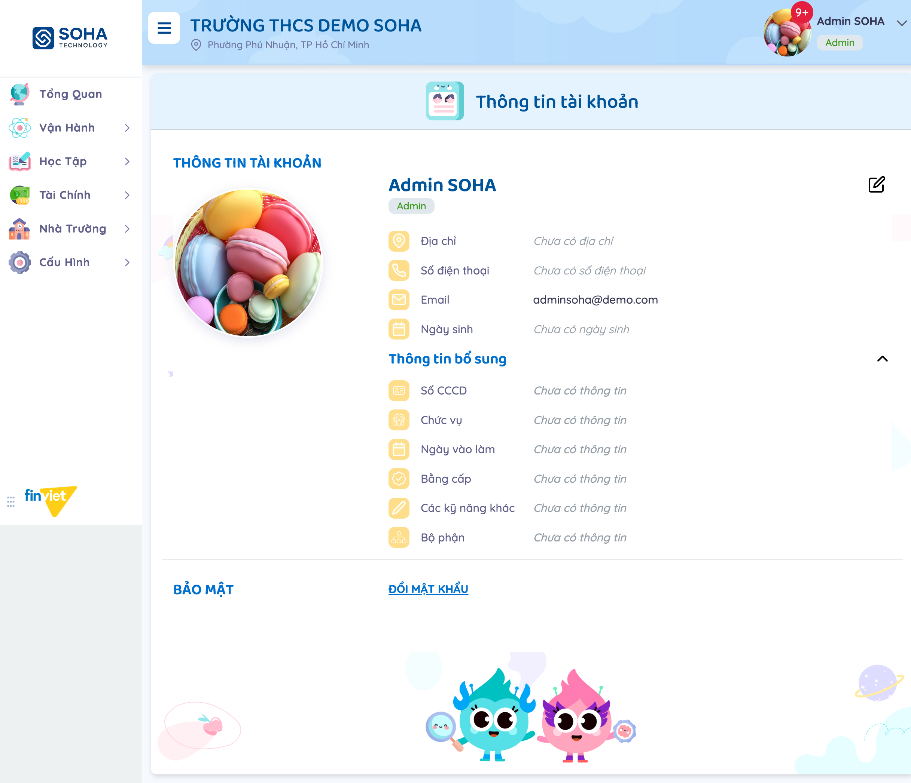 2. Nhấn icon bút chì (Chỉnh sửa) cạnh tên → điều hướng sang trang Chỉnh sửa thông tin cá nhân, chỉnh sửa được toàn bộ field và ảnh đại diện:  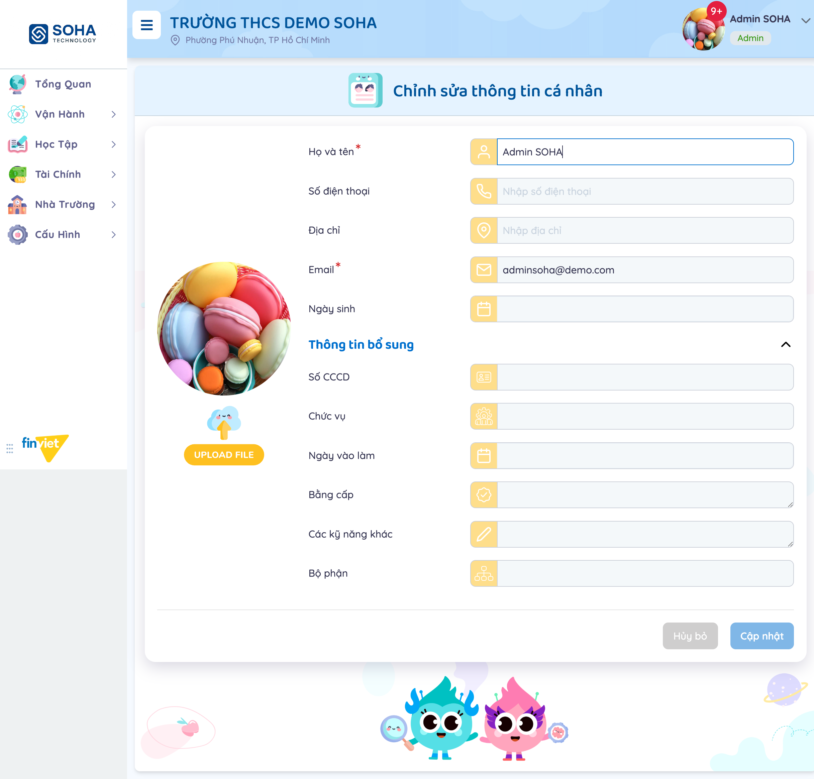 3. Nhấn "Hủy bỏ" để rời trang mà không lưu. 4. Từ trang Thông tin tài khoản, nhấn "ĐỔI MẬT KHẨU" → điền Mật khẩu hiện tại/Mật khẩu mới/Nhập lại mật khẩu mới:  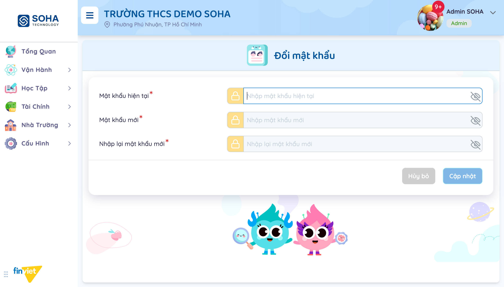 |
| Exception | Chưa nhập đủ 3 field bắt buộc (đánh dấu *) → nút "Cập nhật" không submit được [Cần xác nhận thông báo lỗi cụ thể — chưa thử submit thật] |
| Trigger | Admin trường cần cập nhật thông tin cá nhân hoặc đổi mật khẩu |
| Pre-condition | Đã đăng nhập |
| Post-condition | Không có thay đổi nào được lưu trong quá trình khảo sát (đã Hủy bỏ trước khi Cập nhật) |
| Business Rules | BR04, BR05, BR06 |

---

| Trường | Nội dung |
|---|---|
| Use case ID | UC-03 |
| Use case name | Đổi ngôn ngữ giao diện |
| Use case description | Admin trường đổi ngôn ngữ hiển thị của toàn bộ giao diện quản trị giữa Tiếng Việt và English |
| Actor | Admin trường |
| Happy path | 1. Từ dropdown avatar, nhấn "Ngôn ngữ" → submenu trượt ra bên trái với 2 lựa chọn, dấu ✓ ở lựa chọn hiện tại:  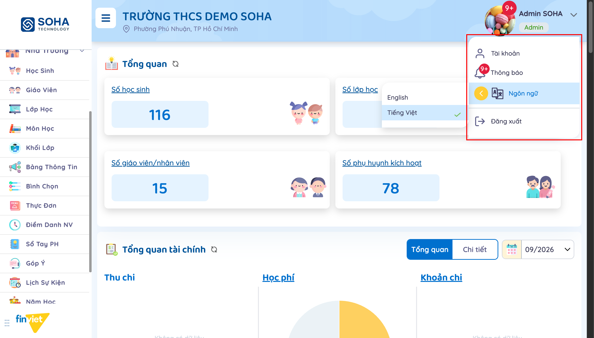 2. Chọn "English" → toàn bộ UI chrome (sidebar, tiêu đề, nhãn, vai trò) dịch sang tiếng Anh ngay, không cần tải lại trang:  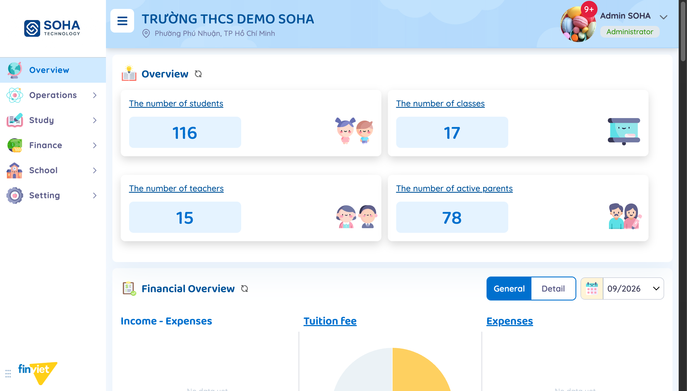 3. Mở lại dropdown → Ngôn ngữ → chọn "Tiếng Việt" để khôi phục. |
| Exception | Không có — chỉ 2 lựa chọn cố định, luôn có 1 lựa chọn đang active |
| Trigger | Admin trường muốn dùng hệ thống bằng ngôn ngữ quen thuộc |
| Pre-condition | Đã đăng nhập |
| Post-condition | Ngôn ngữ được lưu theo tài khoản, áp dụng cho các lần đăng nhập/tải trang sau |
| Business Rules | BR03, BR07, BR08 |

---

| Trường | Nội dung |
|---|---|
| Use case ID | UC-04 |
| Use case name | Xem thông báo cá nhân |
| Use case description | Admin trường xem danh sách thông báo cá nhân, phân theo 4 nhóm, và đánh dấu đã đọc |
| Actor | Admin trường |
| Happy path | 1. Từ dropdown avatar, chọn "Thông báo" → tab "Hoạt Động" mặc định (có thể trống):  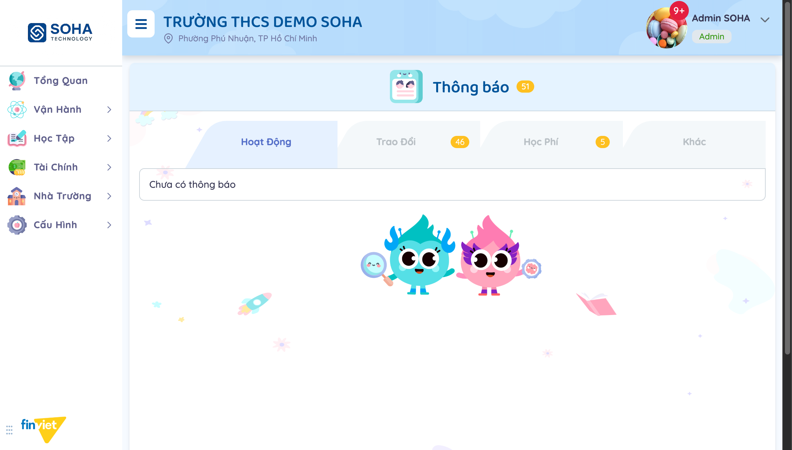 2. Chuyển sang tab "Trao Đổi" → danh sách thông báo tin nhắn/báo vắng/dặn thuốc..., mỗi dòng có checkbox riêng:  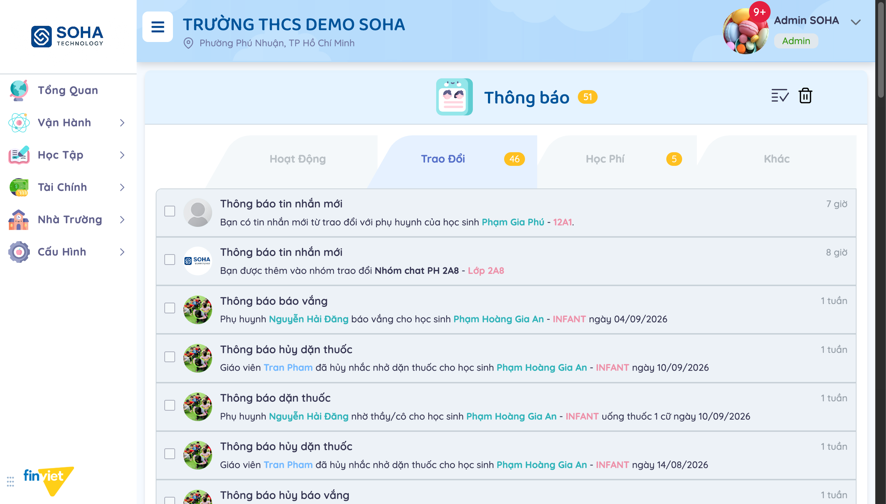 3. Chuyển sang tab "Học Phí" → danh sách thông báo tạo hóa đơn thành công theo lớp:  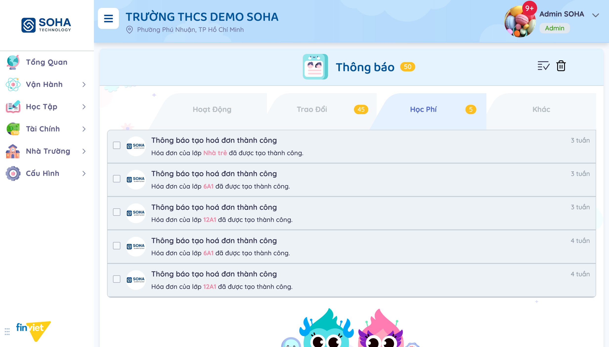 4. Chuyển sang tab "Khác" → trống trong dữ liệu demo:  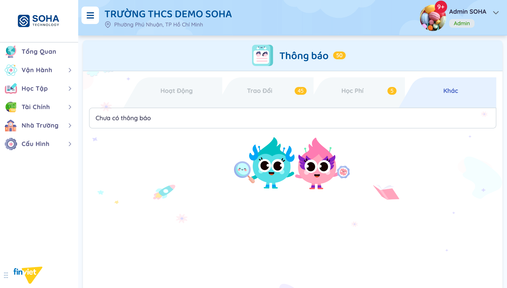 5. Nhấn vào 1 thông báo bất kỳ → thông báo được đánh dấu đã đọc, badge của tab và badge tổng giảm 1 ngay lập tức, không điều hướng đi đâu. |
| Exception | Tab không có thông báo → hiển thị "Chưa có thông báo"; tab không có thông báo chưa đọc → không hiện badge số |
| Trigger | Admin trường cần theo dõi các cập nhật liên quan tới mình (tin nhắn, báo vắng, dặn thuốc, hóa đơn...) |
| Pre-condition | Đã đăng nhập |
| Post-condition | Thông báo được nhấn chuyển trạng thái đã đọc (không hoàn tác được qua UI) |
| Business Rules | BR09, BR10, BR11 |

---

| Trường | Nội dung |
|---|---|
| Use case ID | UC-05 |
| Use case name | Đăng xuất khỏi hệ thống |
| Use case description | Admin trường đăng xuất khỏi hệ thống, có bước xác nhận để tránh đăng xuất nhầm |
| Actor | Admin trường |
| Happy path | 1. Từ dropdown avatar, nhấn "Đăng xuất" → modal xác nhận hiện ra:  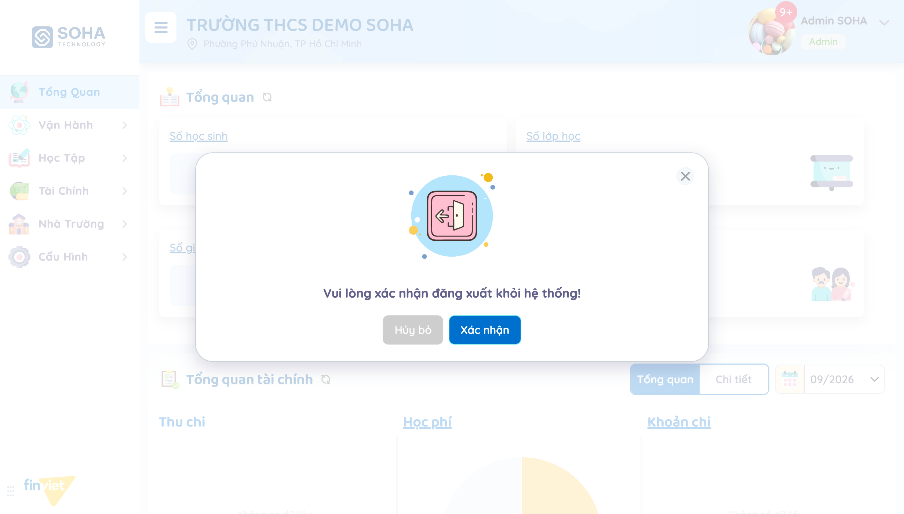 2. Nhấn "Xác nhận" → hệ thống hủy session và chuyển về trang đăng nhập [Cần xác nhận — chưa thực thi để giữ session khảo sát]. |
| Exception | Nhấn "Hủy bỏ" hoặc icon X → đóng modal, giữ nguyên session hiện tại (đã kiểm thử) |
| Trigger | Admin trường muốn kết thúc phiên làm việc |
| Pre-condition | Đã đăng nhập |
| Post-condition | Xác nhận → session bị hủy; Hủy bỏ → không có gì thay đổi |
| Business Rules | BR12 |

---

| Trường | Nội dung |
|---|---|
| Use case ID | UC-06 |
| Use case name | Xem thông báo hệ thống từ nhà cung cấp |
| Use case description | Admin trường xem các thông báo do nhà cung cấp (Finviet/SOHA) gửi tới trường, tách biệt khỏi thông báo cá nhân và Bảng Thông Tin của trường |
| Actor | Admin trường |
| Happy path | 1. Truy cập trang "Thông báo hệ thống" (`/demo/system/announcement/`):  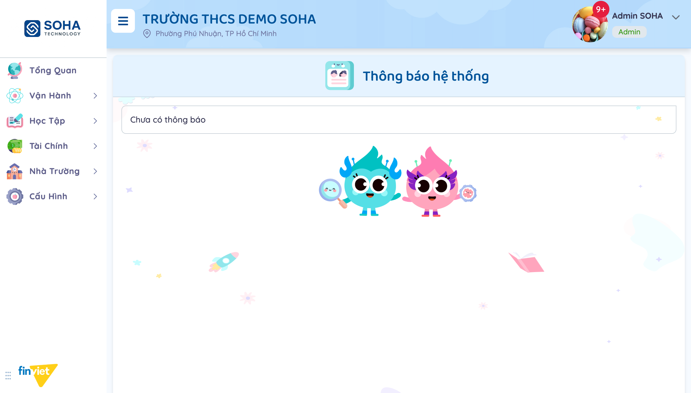 2. Xem danh sách thông báo từ nhà cung cấp (nếu có). |
| Exception | Không có thông báo nào từ nhà cung cấp → hiển thị "Chưa có thông báo" (trạng thái quan sát được trong tenant demo) |
| Trigger | Nhà cung cấp cần thông báo thông tin quan trọng (bảo trì, cập nhật tính năng...) tới trường |
| Pre-condition | Đã đăng nhập |
| Post-condition | Không thay đổi dữ liệu — chỉ xem |
| Business Rules | BR13 |

### 3.4 Edge Cases & Error Handling

#### 3.4.1 Tổng quan
| Nhóm | Tình huống | Xử lý mong đợi |
|---|---|---|
| Chỉnh sửa tài khoản / Đổi mật khẩu | Banner "Thay đổi của bạn chưa được lưu" xuất hiện ngay khi tải trang, chưa có tương tác | [Đã xác nhận là bug UI tái diễn — xem BR06 và tài liệu SM5-tinh-nang.md]; nút "Cập nhật" vẫn ở trạng thái disabled cho tới khi có thay đổi thật |
| Đổi ngôn ngữ | Đổi ngôn ngữ khi đang ở 1 trang có dữ liệu tenant (VD: tên lớp, tên trường) | Chỉ UI chrome đổi ngôn ngữ; dữ liệu tenant giữ nguyên — có thể gây cảm giác giao diện "nửa Anh nửa Việt" nếu tenant dùng tên lớp/trường tiếng Việt |
| Thông báo | Nhấn vào 1 thông báo — không có xác nhận, không có undo | Người dùng không thể khôi phục trạng thái "chưa đọc" qua UI sau khi đã nhấn nhầm [Cần xác nhận UX] |
| Thông báo | Icon "đánh dấu tất cả đã đọc" và "xóa" ở góc phải header | [Cần xác nhận hành vi chi tiết — không thực thi trong quá trình khảo sát để tránh xóa/thay đổi dữ liệu thật của tenant demo] |
| Đăng xuất | Đăng xuất khi đang có form dở dang ở trang khác (VD: đang gõ giữa form Chỉnh sửa thông tin cá nhân) | [Cần xác nhận — chưa thử nghiệm tổ hợp này] |
| Thông báo hệ thống | Không tìm thấy link điều hướng tới `/demo/system/announcement/` từ sidebar hay avatar dropdown | [Cần xác nhận điểm truy cập thật — trang chỉ được phát hiện qua URL ghi nhận ở tài liệu inventory, chưa xác nhận được luồng điều hướng chính thức] |

#### 3.4.2 Danh sách lỗi/thành công
| Message ID | Trường hợp lỗi | Rule kiểm tra | Message đề xuất | Hình thức báo | Hành vi hệ thống |
|---|---|---|---|---|---|
| — | Không quan sát được message lỗi cụ thể nào — các form (Chỉnh sửa thông tin, Đổi mật khẩu) không được submit thật trong quá trình khảo sát | | | | — |

### 3.5 Non-functional Requirements
| ID | Nhóm | Yêu cầu |
|---|---|---|
| NFR01 | UX | Đổi ngôn ngữ áp dụng ngay (real-time), không cần tải lại trang, giúp người dùng xem trước kết quả trước khi rời trang |
| NFR02 | UX | Đăng xuất luôn có bước xác nhận để tránh mất phiên làm việc do bấm nhầm |
| NFR03 | Hiệu năng | Đánh dấu đã đọc 1 thông báo cập nhật badge ngay trên client, không cần tải lại toàn bộ danh sách |

### 3.6 Quy ước UI chung
- Menu avatar luôn ở góc trên-phải, hiển thị trên mọi trang của portal — là điểm truy cập duy nhất cho các tác vụ tài khoản/ngôn ngữ/đăng xuất.
- Submenu con (Ngôn ngữ) là ngoại lệ về hướng mở — trượt sang bên trái thay vì xuống dưới như các dropdown thông thường khác trong hệ thống.
- Các trang chỉnh sửa thông tin cá nhân dùng chung layout: icon minh họa + tiêu đề ở khối trên, form ở khối dưới, nút "Hủy bỏ" (viền xám) / nút hành động chính (nền xanh) ở góc phải dưới form.
- Modal xác nhận hành động quan trọng (đăng xuất) dùng chung kiểu overlay trắng, icon minh họa lớn ở giữa, câu hỏi xác nhận, 2 nút Hủy bỏ/Xác nhận — nhất quán với modal xác nhận ở các module khác (VD: Cập nhật cấu hình thông báo ở M6-SM6).
- Badge số (chưa đọc) dùng chung màu vàng/cam trên nền tròn, chỉ hiện khi giá trị > 0.
