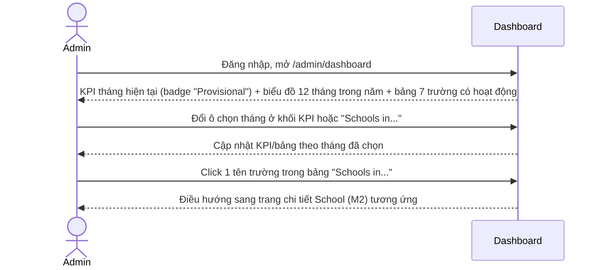
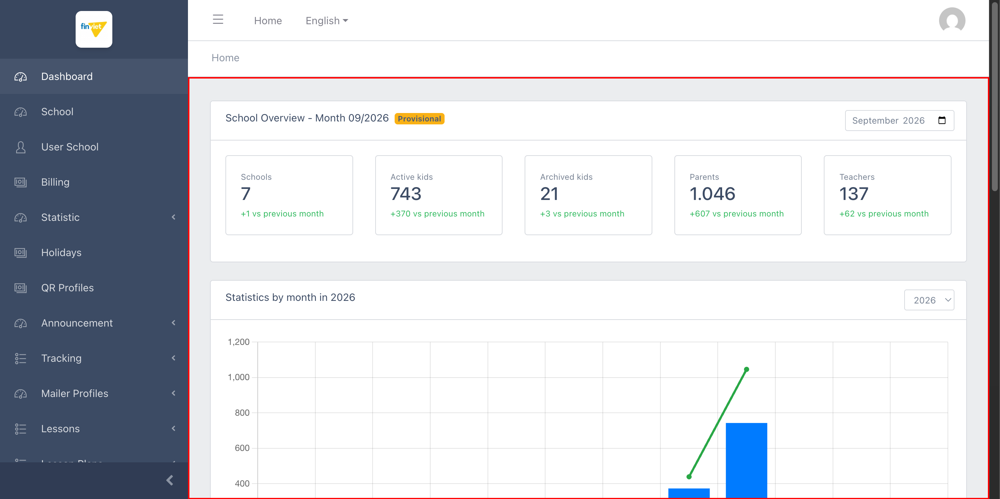
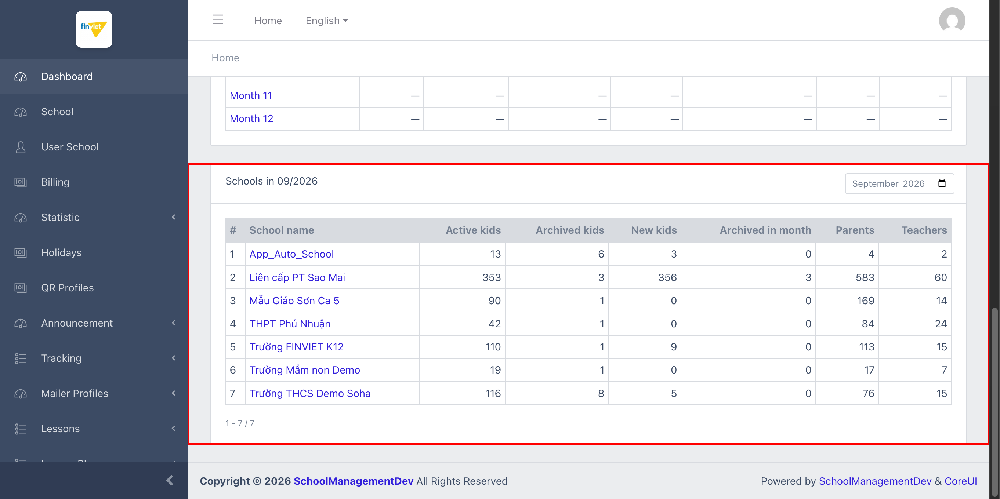

# M1 – Dashboard (Managing Portal)

> Phạm vi: module **Dashboard** (`/admin/dashboard`), trang chủ của Managing Portal, không có sub-module. Đây là **module cuối cùng** được tài liệu hoá trong chuỗi khảo sát M2→M20→M1. Về mặt thiết kế, đây là trang **được đầu tư UI/UX tốt nhất** trong toàn bộ dự án — kết hợp KPI card, biểu đồ combo (bar + line), và 2 bảng dữ liệu, tất cả đều có liên kết điều hướng chéo hợp lý tới các module đã khảo sát trước đó.

## Mục lục

- [1. Tổng quan](#1-tổng-quan)
  - [1.1 Giới thiệu](#11-giới-thiệu)
  - [1.2 Actors](#12-actors)
  - [1.3 Phạm vi](#13-phạm-vi)
- [2. Business Flow](#2-business-flow)
  - [2.1 Sequence Diagram](#21-sequence-diagram)
  - [2.2 Business Steps](#22-business-steps)
  - [2.3 Business Rules](#23-business-rules)
- [3. Feature Breakdown](#3-feature-breakdown)
  - [3.1 Acceptance Criteria](#31-acceptance-criteria)
  - [3.2 Danh sách Use Case](#32-danh-sách-use-case)
  - [3.3 Edge Cases](#33-edge-cases)
  - [3.4 UI Conventions](#34-ui-conventions)

---

## 1. Tổng quan

### 1.1 Giới thiệu

Dashboard hiển thị tổng quan hoạt động của toàn nền tảng, gồm 3 khối:

1. **"School Overview - Month {MM/YYYY}"**: 5 KPI card (Schools, Active kids, Archived kids, Parents, Teachers) cho 1 tháng cụ thể (mặc định tháng hiện tại), mỗi card có so sánh tăng/giảm so với tháng trước (`+X vs previous month`, màu xanh lá). Có ô chọn tháng (`September 2026`) để xem tháng khác.
2. **"Statistics by month in {YYYY}"**: biểu đồ combo (Parents/Teachers dạng đường, Active kids/Archived kids dạng cột) + bảng chi tiết 12 tháng, có dropdown chọn năm (2020-2026). Các tháng chưa có dữ liệu hiển thị `—`.
3. **"Schools in {MM/YYYY}"**: bảng liệt kê **7 trường có hoạt động thực tế** trong tháng, với breakdown Active/Archived/New kids, Parents, Teachers riêng từng trường — tên trường là link điều hướng thẳng tới trang School (M2).

**Phát hiện quan trọng — phân biệt "trường thật" và "trường test/tenant":** bảng "Schools in 09/2026" chỉ liệt kê **7 trường**, dù toàn hệ thống có **27 trường/tenant** (đã thấy xuyên suốt dự án — dropdown chọn trường ở M11, M14, M15...). Điều này xác nhận: chỉ 7 trong 27 tenant thực sự có dữ liệu hoạt động (kids/parents/teachers), số còn lại (`mamnon20260828a`...`h`, `queue_newschool*`, `newschooldev*`...) là môi trường test/demo/queue trống — giải thích hợp lý cho quy mô dữ liệu nhỏ (chỉ vài chục bản ghi) quan sát được ở hầu hết module liên quan tới trường trong suốt dự án, dù danh sách trường luôn hiển thị đủ 27.

**Phát hiện — nhãn "Provisional":** tháng hiện tại (Month 9/2026) được đánh dấu badge cam **"Provisional"** (tạm tính) ở cả khối KPI lẫn dòng tương ứng trong bảng 12 tháng — cho thấy hệ thống phân biệt rõ dữ liệu tháng đã chốt (Month 8: 6 trường, 373 active kids) và dữ liệu tháng đang chạy dở chưa chốt sổ (Month 9: 7 trường, 743 active kids, tăng gần gấp đôi do có thêm dữ liệu mới nhập giữa tháng).

### 1.2 Actors

| Actor | Mô tả |
|---|---|
| Finviet/SOHA Admin | Xem tổng quan sức khoẻ nền tảng theo tháng/năm, điều hướng nhanh tới 1 trường cụ thể. |

### 1.3 Phạm vi

| Trong phạm vi | Ngoài phạm vi |
|---|---|
| Xem đầy đủ 3 khối nội dung, xác nhận cấu trúc biểu đồ (legend, trục) | Đổi tháng/năm xem dữ liệu khác (không cần thiết vì dữ liệu tĩnh, đã đọc đủ qua bảng 12 tháng) |
| Xác nhận link điều hướng (School name, Month) trỏ đúng nơi qua đọc `href` | Kiểm chứng công thức tính "+X vs previous month" (không có dữ liệu tháng trước độc lập để đối chiếu) |

---

## 2. Business Flow

### 2.1 Sequence Diagram

### 2.2 Business Steps

1. Admin đăng nhập, được đưa thẳng tới Dashboard.
2. Admin xem nhanh 5 chỉ số KPI của tháng hiện tại và mức tăng/giảm so với tháng trước.
3. Admin xem xu hướng theo tháng qua biểu đồ (đổi năm nếu cần) hoặc bảng chi tiết 12 tháng.
4. Admin xem breakdown theo từng trường có hoạt động trong tháng, click vào tên trường để xem chi tiết.

### 2.3 Business Rules

| ID | Mô tả |
|---|---|
| BR01 | Khối KPI có 5 chỉ số: Schools, Active kids, Archived kids, Parents, Teachers — mỗi chỉ số kèm delta so với tháng trước (định dạng `+X vs previous month`, luôn màu xanh lá trong dữ liệu mẫu — chưa quan sát được trường hợp giảm). |
| BR02 | Bảng 12 tháng có 7 cột: Schools, Active kids, Archived kids, New kids, Archived in month, Parents, Teachers — tháng chưa có dữ liệu hiển thị `—`; nhãn "Month" mỗi dòng là link điều hướng (`?month=YYYY-MM&year=YYYY&school_month=...`) dùng để đổi khối KPI/bảng trường sang tháng đó. |
| BR03 | Biểu đồ combo dùng 2 kiểu hiển thị trên cùng 1 trục: Parents (đường xanh lá) và Teachers (đường cam) dạng line, Active kids (cột xanh dương) và Archived kids (cột xám) dạng bar — layout trực quan hoá dữ liệu tinh tế nhất trong toàn dự án. |
| BR04 | **[Phân biệt trường thật vs trường test]** Bảng "Schools in {tháng}" chỉ liệt kê các trường có dữ liệu hoạt động thực tế trong tháng đó (7/27 tổng số trường/tenant hệ thống) — xác nhận phần lớn 27 trường thấy được ở các module khác (M11, M14, M15) là môi trường test/demo/queue, không có hoạt động kids/parents/teachers thật. |
| BR05 | Nhãn "Provisional" (màu cam) xuất hiện đồng thời ở khối KPI và dòng tương ứng trong bảng 12 tháng khi xem tháng hiện tại (chưa kết thúc) — phân biệt rõ dữ liệu tạm tính (có thể còn thay đổi) với dữ liệu tháng đã chốt hoàn toàn (Month 8 trở về trước). |
| BR06 | Tên trường trong bảng "Schools in..." là link trực tiếp tới `/admin/school/{id}` — xác nhận điều hướng chéo hợp lệ với module School (M2), đóng vòng khảo sát toàn bộ Managing Portal (M2→M20→M1). |

---

## 3. Feature Breakdown

### 3.1 Acceptance Criteria

- KPI phải phản ánh đúng số liệu tháng hiện tại và có so sánh với tháng trước — đạt.
- Biểu đồ/bảng 12 tháng phải phân biệt rõ tháng có/không có dữ liệu — đạt (dùng `—` nhất quán).
- Bảng theo trường phải điều hướng đúng sang trang chi tiết trường — đạt, xác nhận qua `href`.

### 3.2 Danh sách Use Case

| Mã | Tên | Actor | Mô tả | Happy Path | Exception | Business Rules |
|---|---|---|---|---|---|---|
| UC-01 | Xem tổng quan KPI và biểu đồ theo tháng/năm | Admin | Xem 5 chỉ số KPI tháng hiện tại và xu hướng 12 tháng trong năm. | 1. Admin mở `/admin/dashboard`. 2. Trang hiển thị 5 KPI card (badge "Provisional") và biểu đồ combo 12 tháng, năm 2026.   | Các tháng chưa có dữ liệu (Month 1-7, 10-12) hiển thị `—` nhất quán trên cả bảng và biểu đồ (không vẽ điểm/cột). | BR01, BR02, BR03, BR05 |
| UC-02 | Xem breakdown theo từng trường có hoạt động | Admin | Xem chi tiết Active/Archived/New kids, Parents, Teachers theo từng trường trong tháng. | 1. Admin cuộn xuống khối "Schools in 09/2026". 2. Bảng hiển thị 7 trường có hoạt động thật (trong tổng 27 trường hệ thống), tên trường là link.   | Không có, dữ liệu hiển thị đầy đủ 7/7 trường không cần phân trang. | BR04, BR06 |

### 3.3 Edge Cases

| # | Tình huống | Quan sát / Rủi ro |
|---|---|---|
| 1 | 20/27 trường không xuất hiện trong bảng "Schools in..." vì không có hoạt động (BR04) | Admin mới có thể nhầm tưởng hệ thống chỉ có 7 trường nếu chỉ xem Dashboard mà không biết tới danh sách đầy đủ ở module School (M2) — nên cân nhắc ghi chú rõ "X/27 trường có hoạt động" thay vì chỉ hiển thị số 7 trần trụi ở KPI card "Schools". `[Cần xác nhận]` ý định thiết kế. |
| 2 | Chưa quan sát được trường hợp delta âm (giảm so với tháng trước) | Toàn bộ 5 KPI card trong dữ liệu mẫu đều tăng (+1 đến +607) — không biết giao diện hiển thị thế nào khi có chỉ số giảm (màu đỏ? mũi tên khác?). `[Cần xác nhận]`. |

### 3.4 UI Conventions

- Đây là trang duy nhất trong dự án dùng biểu đồ combo (line + bar) kết hợp — biểu đồ khác (Audit Log M13) chỉ dùng area chart đơn giản.
- Badge "Provisional" màu cam là mẫu thiết kế nhất quán, dùng lặp lại ở 2 vị trí (KPI header, bảng 12 tháng) cho cùng 1 khái niệm — mức độ nhất quán UI cao hơn phần lớn module khác trong dự án.
- Bố cục 3 khối card xếp dọc (KPI → biểu đồ/bảng năm → bảng trường) rõ ràng, mạch lạc — không có yếu tố nào gây nhầm lẫn về phạm vi dữ liệu đang xem (luôn có tiêu đề ghi rõ tháng/năm ở mỗi khối).
