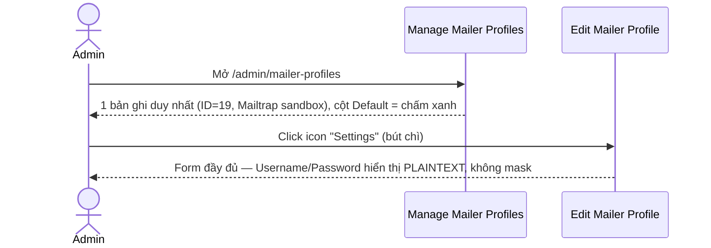
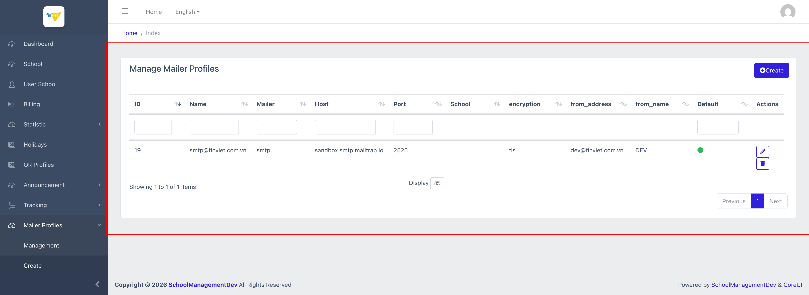
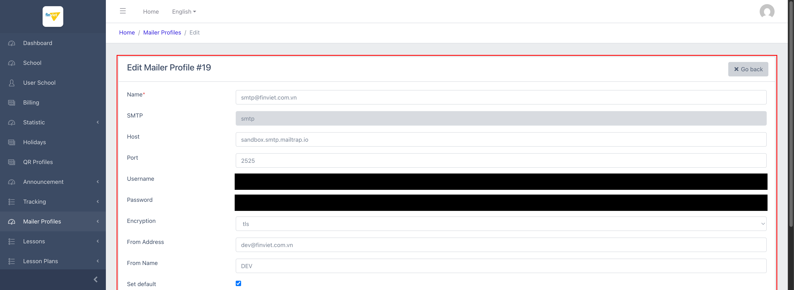

# M10.1 – Mailer Profiles: Management (Managing Portal)

> Phạm vi: sub-module **Management** (`/admin/mailer-profiles`), sub-module đầu tiên trong 2 sub-module của module **Mailer Profiles**. Quản lý các bộ cấu hình SMTP dùng để hệ thống gửi email tự động (hoá đơn, thông báo...). **Cùng lỗ hổng bảo mật đã ghi nhận ở M7 QR Profiles**: Username/Password SMTP hiển thị plaintext trên form Edit.

## Mục lục

- [1. Tổng quan](#1-tổng-quan)
  - [1.1 Giới thiệu](#11-giới-thiệu)
  - [1.2 Actors](#12-actors)
  - [1.3 Phạm vi](#13-phạm-vi)
- [2. Business Flow](#2-business-flow)
  - [2.1 Sequence Diagram](#21-sequence-diagram)
  - [2.2 Business Steps](#22-business-steps)
  - [2.3 Business Rules](#23-business-rules)
- [3. Feature Breakdown](#3-feature-breakdown)
  - [3.1 Acceptance Criteria](#31-acceptance-criteria)
  - [3.2 Danh sách Use Case](#32-danh-sách-use-case)
  - [3.3 Edge Cases](#33-edge-cases)
  - [3.4 UI Conventions](#34-ui-conventions)

---

## 1. Tổng quan

### 1.1 Giới thiệu

Mailer Profiles lưu các bộ cấu hình SMTP (host, port, username, password, mã hoá, địa chỉ/tên người gửi) mà hệ thống dùng để gửi email tự động. Trên dataset dev chỉ có **duy nhất 1 profile** (ID=19, tên `smtp@finviet.com.vn`), trỏ tới **Mailtrap** (`sandbox.smtp.mailtrap.io`) — 1 dịch vụ SMTP sandbox/testing phổ biến, không phải dịch vụ email thật, xác nhận đây đúng là cấu hình môi trường dev/test chứ không phải production thật.

**Phát hiện bảo mật:** Form Edit hiển thị **Username và Password SMTP dạng plaintext** — trường Password thậm chí dùng `<input type="text">` (không phải `type="password"`), nghĩa là không được trình duyệt tự động che dấu. Đây là cùng loại lỗ hổng đã ghi nhận nghiêm trọng ở `M7-qr-profiles/SM1-qr-profiles.md` (Client ID/API Key VietQR lộ plaintext) — tuy mức độ rủi ro thấp hơn nhiều vì đây là credential của Mailtrap sandbox (chỉ gửi được email test vào hộp thư ảo, không có khả năng gây hại tài chính hay truy cập hệ thống thật), nhưng **cùng 1 pattern lặp lại ở module thứ 2** cho thấy đây có thể là vấn đề thiết kế chung của Managing Portal (không mask/ẩn field credential trên các form quản lý tích hợp bên thứ 3) chứ không phải sự cố đơn lẻ. Toàn bộ giá trị Username/Password trong tài liệu này đã được **redact (che đen)** trước khi lưu ảnh.

### 1.2 Actors

| Actor | Mô tả |
|---|---|
| Finviet/SOHA Admin/Dev | Cấu hình SMTP dùng để hệ thống gửi email tự động; chỉ 1 admin/dev vận hành, không phải tính năng dành cho end-user trường học. |

### 1.3 Phạm vi

| Trong phạm vi | Ngoài phạm vi |
|---|---|
| Xem danh sách (1 bản ghi), xem form Edit (đã redact Username/Password) | Thực hiện Edit/Delete thật |
| Kiểm chứng bộ lọc Name và cấu trúc nút Delete | Xác định các email tự động nào thực sự dùng profile này để gửi (ngoài phạm vi UI) |

---

## 2. Business Flow

### 2.1 Sequence Diagram

### 2.2 Business Steps

1. Admin xem danh sách các bộ cấu hình SMTP đã tạo.
2. Admin mở Edit để kiểm tra/cập nhật thông tin kết nối SMTP của 1 profile.
3. Nếu có nhiều profile, admin có thể đánh dấu 1 profile làm "Default" — dùng khi hệ thống gửi email mà không chỉ định profile cụ thể.

### 2.3 Business Rules

| ID | Mô tả |
|---|---|
| BR01 | Danh sách có 10 cột: ID, Name, Mailer, Host, Port, School, encryption, from_address, from_name, Default, Actions (Edit/Delete). |
| BR02 | Cột **School** luôn trống trên bản ghi hiện có — cùng pattern "cột tồn tại trong header nhưng chưa từng có dữ liệu" đã ghi nhận nhiều lần ở M9 Tracking (Assistant AI, Hook Logs). Form Create/Edit **không có trường nào để gán School** cho 1 mailer profile — xác nhận đây không phải lỗi hiển thị mà tính năng gán-theo-trường chưa được triển khai ở tầng form, dù cột đã tồn tại sẵn trong bảng. |
| BR03 | Cột **Default** hiển thị chấm tròn màu xanh lá (không phải checkbox/text) cho profile đang là mặc định — dùng khi hệ thống cần gửi email nhưng không có profile nào được chỉ định cụ thể cho ngữ cảnh đó. |
| BR04 | **[Rủi ro bảo mật — lặp lại từ M7]** Form Edit hiển thị Username và Password SMTP dạng **plaintext không mask** (trường Password dùng `<input type="text">` thay vì `type="password"`) — bất kỳ ai xem qua vai admin có quyền truy cập trang này đều thấy được credential SMTP đầy đủ. Mức độ rủi ro thấp hơn M7 (đây là Mailtrap sandbox, không phải cổng thanh toán thật) nhưng cùng pattern thiết kế. |
| BR05 | Trường "SMTP" (mailer driver) là **readonly, cố định giá trị "smtp"** trên cả Create lẫn Edit — hệ thống hiện chỉ hỗ trợ đúng 1 loại driver gửi mail (SMTP thuần), không có lựa chọn khác (ví dụ SES, Mailgun, sendmail) dù trường này trông như 1 input có thể sửa. |
| BR06 | Ô tìm kiếm cột **Name hoạt động đúng** — xác nhận qua thử nghiệm nhập giá trị không khớp ("nonexistent") + Enter → đúng "No items to show". |
| BR07 | Nút Delete submit **POST** `_method=DELETE` tới `/admin/mailer-profiles/{id}/destroy` (route tên "destroy", khác chút so với "delete" đã thấy ở các module khác) — không phát hiện thuộc tính xác nhận nào trong DOM, cùng pattern chưa-xác-nhận-được đã ghi nhận nhiều lần trước đó. |

---

## 3. Feature Breakdown

### 3.1 Acceptance Criteria

- Danh sách phải hiển thị đúng thông tin cấu hình SMTP đã lưu — đạt.
- Ô tìm kiếm Name phải trả về đúng kết quả — đạt (BR06).
- `[Không đạt về bảo mật]` Credential (Username/Password) không được che giấu trên form Edit (BR04).

### 3.2 Danh sách Use Case

| Mã | Tên | Actor | Mô tả | Happy Path | Exception | Business Rules |
|---|---|---|---|---|---|---|
| UC-01 | Xem danh sách Mailer Profiles | Admin | Xem toàn bộ cấu hình SMTP đã tạo. | 1. Admin mở `/admin/mailer-profiles`. 2. Trang hiển thị 1 bản ghi duy nhất (Mailtrap sandbox), cột School trống, Default = chấm xanh.   | Tìm theo Name không khớp → "No items to show" đúng như kỳ vọng. | BR01, BR02, BR03, BR06 |
| UC-02 | Sửa Mailer Profile (Edit) | Admin | Cập nhật thông tin kết nối SMTP của 1 profile đã có. | 1. Admin click icon Settings trên dòng ID=19. 2. Form hiển thị đầy đủ Name/SMTP(readonly)/Host/Port/Username/Password/Encryption/From Address/From Name/Set default — Username và Password đã được redact khi lưu ảnh do lộ plaintext trên trang thật.   | Không thử submit Save thật để tránh thay đổi cấu hình SMTP thật của môi trường dev. Nút Delete không có xác nhận rõ ràng trong DOM (BR07) — không thử bấm. | BR04, BR05, BR07 |

### 3.3 Edge Cases

| # | Tình huống | Quan sát / Rủi ro |
|---|---|---|
| 1 | Credential SMTP lộ plaintext (BR04) | Lặp lại đúng pattern đã ghi nhận nghiêm trọng ở M7 QR Profiles — dù rủi ro thực tế thấp hơn (sandbox, không phải cổng thanh toán), nên gộp chung vào báo cáo bảo mật tổng thể gửi đội dev vì đây là lỗi thiết kế lặp lại ở ít nhất 2 module khác nhau, khả năng cao còn xuất hiện ở các module tích hợp bên thứ 3 khác chưa khảo sát. |
| 2 | Chỉ 1 mailer profile tồn tại, không có ví dụ nào cho cơ chế "School" hoặc chuyển đổi "Default" giữa nhiều profile | Không thể quan sát trực tiếp hành vi khi có ≥2 profile (ví dụ: điều gì xảy ra nếu bỏ tick Default ở profile hiện tại mà không chọn profile khác làm default — hệ thống gửi mail có dùng fallback nào không). `[Cần xác nhận]` |

### 3.4 UI Conventions

- Cùng layout bảng DataTables tiêu chuẩn với ô lọc theo từng cột (trừ Mailer/School/encryption/from_address/from_name/Actions không có ô lọc riêng) đã thấy xuyên suốt Managing Portal.
- Form Edit/Create dùng chung 1 bộ trường — không có sự khác biệt cấu trúc nào giữa 2 form ngoài việc Edit hiển thị sẵn giá trị đã lưu (bao gồm cả credential plaintext).
