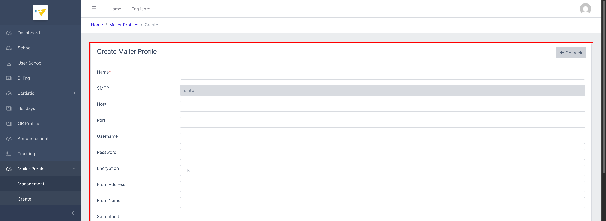

# M10.2 – Mailer Profiles: Create (Managing Portal)

> Phạm vi: sub-module **Create** (`/admin/mailer-profiles/create`), sub-module thứ hai trong 2 sub-module của module **Mailer Profiles**. Đây là 1 shortcut sidebar dẫn thẳng tới form tạo mới — cùng form đã được liệt kê cấu trúc ở `M10-mailer-profiles/SM1-management.md` UC-02 (Edit), chỉ khác các trường đều để trống.

## Mục lục

- [1. Tổng quan](#1-tổng-quan)
  - [1.1 Giới thiệu](#11-giới-thiệu)
  - [1.2 Actors](#12-actors)
  - [1.3 Phạm vi](#13-phạm-vi)
- [2. Business Flow](#2-business-flow)
  - [2.1 Sequence Diagram](#21-sequence-diagram)
  - [2.2 Business Steps](#22-business-steps)
  - [2.3 Business Rules](#23-business-rules)
- [3. Feature Breakdown](#3-feature-breakdown)
  - [3.1 Acceptance Criteria](#31-acceptance-criteria)
  - [3.2 Danh sách Use Case](#32-danh-sách-use-case)
  - [3.3 Edge Cases](#33-edge-cases)
  - [3.4 UI Conventions](#34-ui-conventions)

---

## 1. Tổng quan

### 1.1 Giới thiệu

Create là mục sidebar riêng dẫn thẳng tới form tạo mới 1 Mailer Profile — về mặt kỹ thuật đây là cùng 1 URL (`/admin/mailer-profiles/create`) mà nút "Create" ở trang Management cũng trỏ tới; việc tách thành 1 mục sidebar độc lập chỉ giúp truy cập nhanh hơn (bớt 1 cú click), không phải 1 tính năng khác biệt.

**Phát hiện đáng chú ý:** tiêu đề tab trình duyệt của trang này là **"SchoolManagementDev | Create School"** — hoàn toàn sai, không liên quan gì tới Mailer Profile. Đây là lỗi cùng loại đã ghi nhận nhiều lần trước đó (M6 Holidays: "Manage kid"; M8 Announcement Show: "Manage School") — củng cố thêm bằng chứng rằng nhiều view trong Managing Portal được tạo bằng cách copy từ view khác (ở đây nhiều khả năng copy từ view Create của module School) mà quên cập nhật `<title>`.

### 1.2 Actors

| Actor | Mô tả |
|---|---|
| Finviet/SOHA Admin/Dev | Tạo mới 1 bộ cấu hình SMTP. |

### 1.3 Phạm vi

| Trong phạm vi | Ngoài phạm vi |
|---|---|
| Xem cấu trúc form Create (rỗng, không có dữ liệu nhạy cảm cần redact) | Thực hiện submit Save thật để tránh tạo dữ liệu thật trong môi trường dev |

---

## 2. Business Flow

### 2.1 Sequence Diagram

```mermaid
sequenceDiagram
    actor Admin
    participant Create as Create Mailer Profile

    Admin->>Create: Click "Create" trên sidebar (hoặc nút Create ở trang Management)
    Create-->>Admin: Form trống — Name*, SMTP(readonly="smtp"), Host, Port, Username, Password, Encryption, From Address, From Name, Set default
    Admin->>Create: Điền đầy đủ thông tin, click Save
    Create->>Create: POST tạo bản ghi mới, điều hướng về danh sách
```

### 2.2 Business Steps

1. Admin điền thông tin kết nối SMTP của 1 dịch vụ gửi mail (host, port, username, password, mã hoá).
2. Admin đặt tên gợi nhớ (Name), địa chỉ/tên hiển thị người gửi (From Address/From Name).
3. Admin tuỳ chọn tick "Set default" nếu muốn profile này trở thành mặc định.
4. Admin bấm Save để tạo mới.

### 2.3 Business Rules

| ID | Mô tả |
|---|---|
| BR01 | Form gồm 10 trường: Name* (bắt buộc), SMTP (readonly, luôn "smtp"), Host, Port, Username, Password, Encryption (dropdown: tls/ssl/STARTTLS/PLAIN/SMTPS), From Address, From Name, Set default (checkbox) — chỉ Name được đánh dấu bắt buộc (`*`) trên giao diện, dù về nghiệp vụ Host/Port/Username/Password gần như chắc chắn cần thiết để kết nối SMTP thành công. |
| BR02 | Dropdown Encryption có 5 lựa chọn: tls, ssl, STARTTLS, PLAIN, SMTPS — phong phú hơn nhiều so với chỉ 2 loại (tls/ssl) thường thấy ở các form SMTP đơn giản, cho thấy hệ thống được thiết kế để tương thích nhiều loại mail server khác nhau dù trường "SMTP" (mailer driver) lại bị khoá cứng chỉ 1 lựa chọn (BR05 ở `SM1-management.md`). |
| BR03 | **[Lỗi tiêu đề trang]** Tiêu đề tab trình duyệt hiển thị sai: "Create School" thay vì liên quan tới Mailer Profile — trang Management (List) và Edit đều có tiêu đề đúng ("Manage Mailer Profiles", "Manage Mailer Profile"), chỉ riêng Create bị sai. |
| BR04 | Không có trường "School" nào trong form — khớp với phát hiện ở `SM1-management.md` BR02 rằng cột School trên danh sách chưa từng có cách nào để set giá trị. |

---

## 3. Feature Breakdown

### 3.1 Acceptance Criteria

- Form phải hiển thị đầy đủ 10 trường như đã liệt kê, với SMTP luôn readonly = "smtp" — đạt.
- Tiêu đề trang phải phản ánh đúng nội dung — **không đạt** (BR03).

### 3.2 Danh sách Use Case

| Mã | Tên | Actor | Mô tả | Happy Path | Exception | Business Rules |
|---|---|---|---|---|---|---|
| UC-01 | Tạo mới Mailer Profile | Admin | Thêm 1 bộ cấu hình SMTP mới. | 1. Admin click "Create" trên sidebar.<br>2. Form trống hiển thị đầy đủ 10 trường, SMTP readonly = "smtp", Encryption mặc định "tls".<br><br> | Không thử submit Save thật để tránh tạo dữ liệu thật trong môi trường dev. | BR01, BR02, BR03, BR04 |

### 3.3 Edge Cases

| # | Tình huống | Quan sát / Rủi ro |
|---|---|---|
| 1 | Chỉ Name được đánh dấu bắt buộc, các trường kết nối quan trọng (Host/Port/Username/Password) không có dấu `*` | Nếu validation phía server cũng lỏng lẻo tương tự, admin có thể tạo được 1 profile "rỗng" không thể dùng để gửi mail thật mà không có cảnh báo ngay tại thời điểm tạo. `[Cần xác nhận]`, không kiểm chứng vì không submit form. |
| 2 | Tiêu đề trang sai "Create School" (BR03) | Lỗi nhỏ không ảnh hưởng chức năng, nhưng là dấu hiệu thứ 3 (sau M6, M8) của việc code các trang Create/Show trong Managing Portal được sao chép từ nhau mà thiếu bước rà soát tiêu đề — nên được gộp vào 1 danh sách lỗi nhỏ cần dọn dẹp đồng loạt thay vì sửa lẻ tẻ từng trang. |

### 3.4 UI Conventions

- Cùng bộ trường và thứ tự hiển thị với form Edit (`M10-mailer-profiles/SM1-management.md` UC-02) — chỉ khác giá trị mặc định rỗng và tiêu đề "Create Mailer Profile" thay vì "Edit Mailer Profile #{id}".
