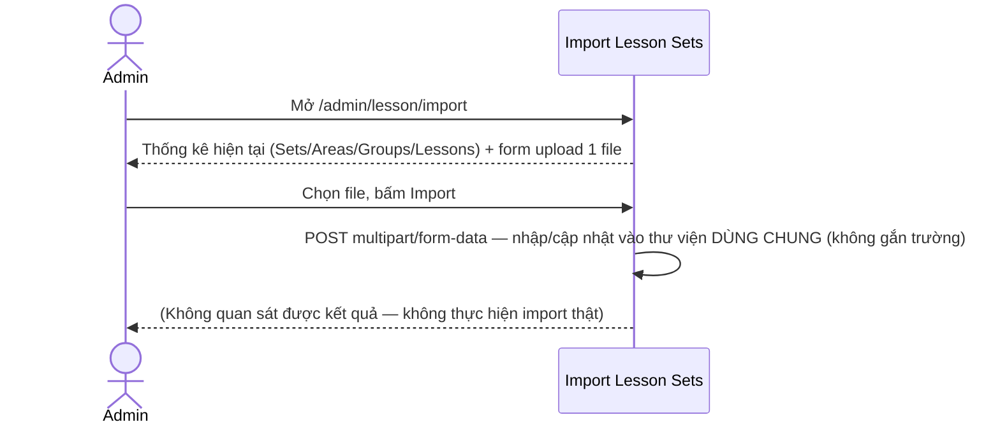
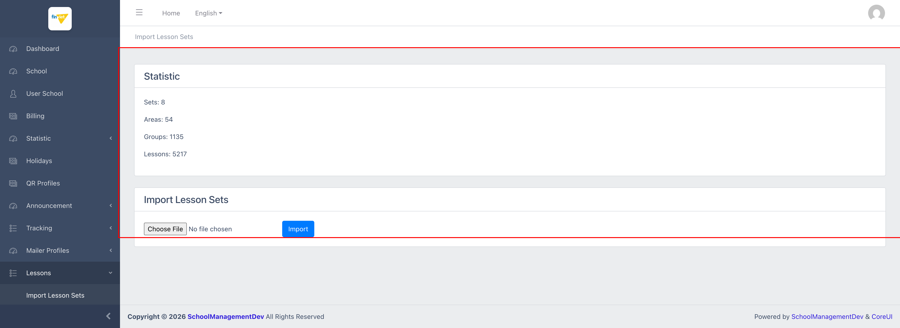

# M11.1 – Lessons: Import Lesson Sets (Managing Portal)

> Phạm vi: sub-module **Import Lesson Sets** (`/admin/lesson/import`), sub-module đầu tiên trong 6 sub-module của module **Lessons**. Đây là công cụ nhập hàng loạt (bulk import) nội dung chương trình học **dùng chung toàn nền tảng** (không gắn với 1 trường cụ thể) — khác với sub-module thứ 2 "Import Lesson Sets For Tenant" (nhập riêng cho 1 trường).

## Mục lục

- [1. Tổng quan](#1-tổng-quan)
  - [1.1 Giới thiệu](#11-giới-thiệu)
  - [1.2 Actors](#12-actors)
  - [1.3 Phạm vi](#13-phạm-vi)
- [2. Business Flow](#2-business-flow)
  - [2.1 Sequence Diagram](#21-sequence-diagram)
  - [2.2 Business Steps](#22-business-steps)
  - [2.3 Business Rules](#23-business-rules)
- [3. Feature Breakdown](#3-feature-breakdown)
  - [3.1 Acceptance Criteria](#31-acceptance-criteria)
  - [3.2 Danh sách Use Case](#32-danh-sách-use-case)
  - [3.3 Edge Cases](#33-edge-cases)
  - [3.4 UI Conventions](#34-ui-conventions)

---

## 1. Tổng quan

### 1.1 Giới thiệu

Module Lessons quản lý 1 thư viện nội dung chương trình học theo cấu trúc phân cấp: **Lesson Set** (bộ chương trình, ví dụ "Montessori 0-3 tuổi") → **Lesson Area** (lĩnh vực/môn học, ví dụ Toán học, Tiếng Việt) → **Lesson Group** (nhóm bài học/chủ đề) → **Lesson** (bài học cụ thể). Đây là **thư viện nội dung dùng chung toàn nền tảng** — không phải dữ liệu riêng của 1 trường — dùng làm nguồn tham chiếu khi các trường xây dựng giáo án (Lesson Plans, module M12).

Trang "Import Lesson Sets" hiển thị 1 khối thống kê tổng quan (Statistic) và form upload 1 file để nhập/cập nhật hàng loạt nội dung vào thư viện dùng chung này.

**Quy mô dữ liệu:** tại thời điểm khảo sát, thư viện có **8 Lesson Sets, 54 Lesson Areas, 1.135 Lesson Groups, và 5.217 Lessons** — đây là bộ dữ liệu nội dung lớn nhất từng ghi nhận trong Managing Portal (vượt xa cả Hook Logs 6.550 bản ghi log về khối lượng "nội dung nghiệp vụ" thực sự, dù Hook Logs có nhiều dòng hơn).

### 1.2 Actors

| Actor | Mô tả |
|---|---|
| Finviet/SOHA Admin/Content team | Nhập/cập nhật hàng loạt nội dung chương trình học dùng chung cho toàn nền tảng. |

### 1.3 Phạm vi

| Trong phạm vi | Ngoài phạm vi |
|---|---|
| Xem khối thống kê tổng quan (Sets/Areas/Groups/Lessons) | Thực hiện upload/import file thật (tránh thay đổi dữ liệu thật trong môi trường dev) |
| Xem cấu trúc form import (1 trường file, không giới hạn định dạng ở tầng HTML) | Xác định định dạng file chính xác được chấp nhận (không có tài liệu hướng dẫn trên trang, cần thử nghiệm thật hoặc xem source code) |

---

## 2. Business Flow

### 2.1 Sequence Diagram

### 2.2 Business Steps

1. Admin chuẩn bị 1 file chứa dữ liệu Lesson Set/Area/Group/Lesson theo định dạng hệ thống yêu cầu (không rõ định dạng cụ thể — có thể Excel/CSV, không kiểm chứng được vì không có tài liệu hướng dẫn trên trang).
2. Admin chọn file và bấm "Import" để nhập vào thư viện dùng chung.
3. `[Cần xác nhận]` — hành vi khi import trùng dữ liệu đã có (ghi đè, bỏ qua, hay báo lỗi) không quan sát được vì không thực hiện import thật.

### 2.3 Business Rules

| ID | Mô tả |
|---|---|
| BR01 | Khối "Statistic" hiển thị 4 chỉ số tổng: Sets, Areas, Groups, Lessons — phản ánh đúng số liệu thực tế của thư viện dùng chung (khớp với số liệu quan sát trực tiếp ở sub-module Lesson Sets: 8 bộ). |
| BR02 | Form chỉ có 1 trường bắt buộc: file input `lesson_import_file` (`required`), không có thuộc tính `accept` giới hạn định dạng file ở tầng HTML — trình duyệt cho phép chọn bất kỳ loại file nào, việc validate định dạng (nếu có) chỉ có thể xảy ra phía server sau khi submit. |
| BR03 | Form submit dạng `POST multipart/form-data` tới chính URL `/admin/lesson/import` — import vào thư viện **dùng chung toàn nền tảng**, không có bước chọn trường/tenant nào (khác biệt với sub-module `Import Lesson Sets For Tenant`, xem `M11-lessons/SM2-import-lesson-sets-tenant.md`). |
| BR04 | Không có preview, lịch sử import, hay xác nhận trước khi ghi đè — quy trình chỉ gồm đúng 2 bước (chọn file → Import), không có bước rà soát trung gian nào. |

---

## 3. Feature Breakdown

### 3.1 Acceptance Criteria

- Khối thống kê phải phản ánh đúng số liệu hiện tại của thư viện — đạt, xác nhận chéo với sub-module Lesson Sets.
- Form phải chấp nhận upload 1 file và submit đúng endpoint — đạt về mặt cấu trúc (không kiểm chứng hành vi xử lý phía server).

### 3.2 Danh sách Use Case

| Mã | Tên | Actor | Mô tả | Happy Path | Exception | Business Rules |
|---|---|---|---|---|---|---|
| UC-01 | Nhập hàng loạt Lesson Sets vào thư viện dùng chung | Admin | Upload 1 file để nhập/cập nhật nội dung chương trình học dùng chung toàn nền tảng. | 1. Admin mở `/admin/lesson/import`. 2. Trang hiển thị Statistic (Sets: 8, Areas: 54, Groups: 1135, Lessons: 5217) và form upload.   | Không thử submit Import thật để tránh thay đổi thư viện dùng chung trong môi trường dev — quy mô dữ liệu lớn (5.217 lessons) khiến rủi ro của 1 thao tác ghi nhầm cao hơn hẳn các module khác. | BR01, BR02, BR03, BR04 |

### 3.3 Edge Cases

| # | Tình huống | Quan sát / Rủi ro |
|---|---|---|
| 1 | Không có tài liệu hướng dẫn định dạng file trên trang | Admin mới có thể không biết cấu trúc file cần chuẩn bị (cột nào, sheet nào, định dạng ngày tháng...) mà không tham khảo tài liệu ngoài UI. `[Cần xác nhận]` |
| 2 | Không có bước xác nhận/preview trước khi ghi vào thư viện dùng chung 5.217 lessons | Do đây là dữ liệu **dùng chung toàn nền tảng** (ảnh hưởng tất cả trường tham chiếu tới), 1 file import sai định dạng hoặc chứa dữ liệu lỗi có thể gây ảnh hưởng diện rộng ngay lập tức mà không có cơ chế rollback/preview nào quan sát được trên UI. |

### 3.4 UI Conventions

- Layout đơn giản gồm 2 khối card xếp dọc: Statistic (chỉ đọc) và form Import — không có bảng dữ liệu nào trên chính trang này, khác với phần lớn module khác trong Managing Portal.
