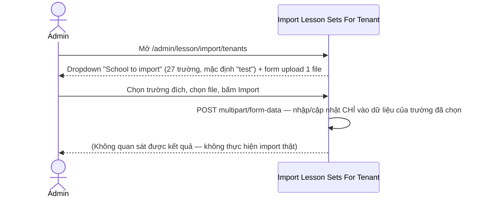
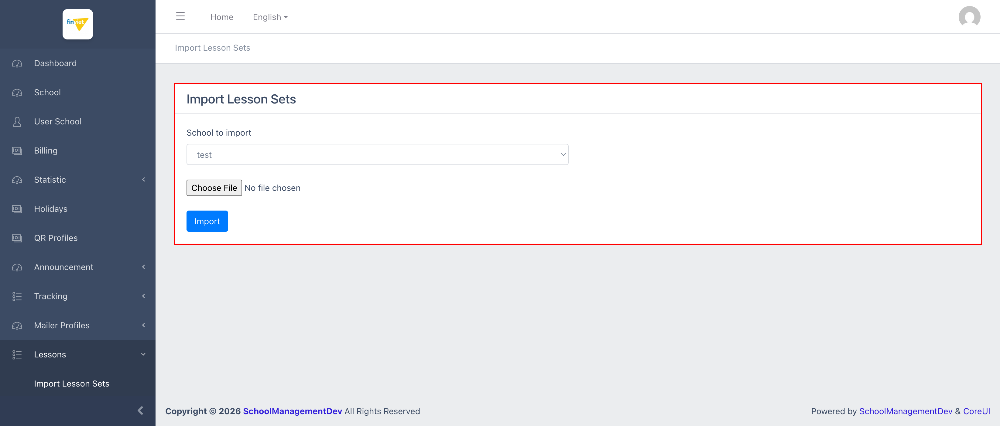

# M11.2 – Lessons: Import Lesson Sets For Tenant (Managing Portal)

> Phạm vi: sub-module **Import Lesson Sets For Tenant** (`/admin/lesson/import/tenants`), sub-module thứ hai trong 6 sub-module của module **Lessons**. Biến thể **nhập riêng cho 1 trường** của công cụ import ở `M11-lessons/SM1-import-lesson-sets.md` — cùng cơ chế nhập nội dung chương trình học, nhưng có thêm bước chọn trường (tenant) đích.

## Mục lục

- [1. Tổng quan](#1-tổng-quan)
  - [1.1 Giới thiệu](#11-giới-thiệu)
  - [1.2 Actors](#12-actors)
  - [1.3 Phạm vi](#13-phạm-vi)
- [2. Business Flow](#2-business-flow)
  - [2.1 Sequence Diagram](#21-sequence-diagram)
  - [2.2 Business Steps](#22-business-steps)
  - [2.3 Business Rules](#23-business-rules)
- [3. Feature Breakdown](#3-feature-breakdown)
  - [3.1 Acceptance Criteria](#31-acceptance-criteria)
  - [3.2 Danh sách Use Case](#32-danh-sách-use-case)
  - [3.3 Edge Cases](#33-edge-cases)
  - [3.4 UI Conventions](#34-ui-conventions)

---

## 1. Tổng quan

### 1.1 Giới thiệu

Trang "Import Lesson Sets For Tenant" cho phép Admin nhập/cập nhật nội dung chương trình học (Lesson Set/Area/Group/Lesson) **cho riêng 1 trường (tenant) cụ thể**, khác với sub-module đầu tiên nhập vào thư viện dùng chung toàn nền tảng. Form chỉ gồm 2 trường: dropdown chọn trường ("School to import") và file input.

**Phát hiện đáng chú ý — tiêu đề trang không phân biệt 2 sub-module:** cả tiêu đề tab trình duyệt (`<title>`) lẫn heading H4 trong nội dung trang đều hiển thị **"Import Lesson Sets"** — giống hệt sub-module 1 (global), không có chữ "For Tenant" hay bất kỳ dấu hiệu nào phân biệt đây là biến thể theo trường. Nếu admin mở nhiều tab cùng lúc hoặc dựa vào tiêu đề để xác nhận đang ở đúng trang, rất dễ nhầm giữa 2 công cụ có tác động phạm vi hoàn toàn khác nhau (toàn nền tảng vs. 1 trường).

### 1.2 Actors

| Actor | Mô tả |
|---|---|
| Finviet/SOHA Admin/Content team | Nhập/cập nhật nội dung chương trình học riêng cho 1 trường cụ thể. |

### 1.3 Phạm vi

| Trong phạm vi | Ngoài phạm vi |
|---|---|
| Xem cấu trúc form (dropdown School + file input), xác nhận danh sách trường trong dropdown | Thực hiện upload/import file thật (tránh thay đổi dữ liệu thật trong môi trường dev) |
| Đối chiếu cấu trúc form với sub-module Import Lesson Sets (global) | Xác định định dạng file chính xác được chấp nhận (không có tài liệu hướng dẫn trên trang) |

---

## 2. Business Flow

### 2.1 Sequence Diagram

### 2.2 Business Steps

1. Admin chọn trường (tenant) đích cần nhập dữ liệu từ dropdown "School to import" (mặc định là "test").
2. Admin chuẩn bị và chọn 1 file chứa dữ liệu Lesson Set/Area/Group/Lesson theo định dạng hệ thống yêu cầu (không rõ định dạng cụ thể — không có tài liệu hướng dẫn trên trang, giống sub-module 1).
3. Admin bấm "Import" để nhập vào dữ liệu riêng của trường đã chọn.
4. `[Cần xác nhận]` — hành vi khi import trùng dữ liệu đã có, và liệu nội dung nhập theo trường này có tách biệt hoàn toàn khỏi thư viện dùng chung hay tham chiếu ngược vào đó — không quan sát được vì không thực hiện import thật.

### 2.3 Business Rules

| ID | Mô tả |
|---|---|
| BR01 | **[Lỗi tiêu đề trang]** Tiêu đề tab (`<title>`) và heading H4 trên trang đều là **"Import Lesson Sets"** — trùng hệt với sub-module 1 (global), không có bất kỳ dấu hiệu phân biệt "For Tenant" nào trên chính giao diện trang; chỉ URL (`/admin/lesson/import/tenants`) và sự hiện diện của dropdown School mới phân biệt được 2 trang. |
| BR02 | Dropdown "School to import" (`name="tenant"`) có **27 trường**, mặc định chọn "test" — cùng danh sách trường dạng subdomain/tenant code đã thấy ở các module khác (ví dụ `mamnon20260828a`...`h`, `newschooldev1`...`3`), xác nhận đây là cơ chế multi-tenant chuẩn của hệ thống. |
| BR03 | Form field file input tên `lesson_import_file` — **trùng tên field với sub-module 1** (`SM1-import-lesson-sets.md` BR02), gợi ý cả 2 sub-module dùng chung 1 định dạng file import, chỉ khác việc có/không có tham số `tenant` đi kèm khi submit. Không có thuộc tính `accept` giới hạn định dạng, field `required`. |
| BR04 | Form submit `POST multipart/form-data` tới `/admin/lesson/import/tenants` — khác endpoint với sub-module 1 (`/admin/lesson/import`), xác nhận đây là 2 route xử lý riêng biệt ở backend dù giao diện gần như giống hệt nhau. |
| BR05 | Không có khối "Statistic" (Sets/Areas/Groups/Lessons) như sub-module 1 — trang này chỉ gồm đúng 2 trường (School, File) và nút Import, không có số liệu tổng quan nào để đối chiếu trước khi import. |
| BR06 | Không có preview, lịch sử import, hay xác nhận trước khi ghi đè — quy trình chỉ gồm 3 bước (chọn trường → chọn file → Import), giống pattern BR04 của sub-module 1. |

---

## 3. Feature Breakdown

### 3.1 Acceptance Criteria

- Dropdown "School to import" phải liệt kê đầy đủ các trường hiện có trên hệ thống — đạt, xác nhận 27 trường.
- Form phải chấp nhận upload 1 file và submit đúng endpoint riêng cho tenant (không dùng chung endpoint với global import) — đạt về mặt cấu trúc.
- Tiêu đề trang phải phân biệt được với sub-module global — **không đạt** (BR01).

### 3.2 Danh sách Use Case

| Mã | Tên | Actor | Mô tả | Happy Path | Exception | Business Rules |
|---|---|---|---|---|---|---|
| UC-01 | Nhập hàng loạt Lesson Sets cho 1 trường cụ thể | Admin | Upload 1 file để nhập/cập nhật nội dung chương trình học riêng cho 1 trường. | 1. Admin mở `/admin/lesson/import/tenants`. 2. Trang hiển thị dropdown "School to import" (mặc định "test") và form upload file.   | Không thử submit Import thật để tránh thay đổi dữ liệu thật của bất kỳ trường nào trong môi trường dev. | BR01, BR02, BR03, BR04, BR05, BR06 |

### 3.3 Edge Cases

| # | Tình huống | Quan sát / Rủi ro |
|---|---|---|
| 1 | Tiêu đề trang trùng với sub-module global, không phân biệt "For Tenant" (BR01) | Admin có thể nhầm lẫn đang ở trang import global khi thực chất đang ở trang import theo trường (hoặc ngược lại) nếu chỉ dựa vào tiêu đề tab — rủi ro thao tác nhầm phạm vi (nhập nhầm vào 1 trường thay vì toàn nền tảng, hoặc ngược lại). |
| 2 | Không có khối Statistic để đối chiếu trước khi import (BR05) | Khác với sub-module 1 (có thể đối chiếu số liệu Sets/Areas/Groups/Lessons trước/sau import), ở đây admin không có cách nào trên UI để biết trường đã chọn hiện có bao nhiêu Lesson Set/Area/Group/Lesson trước khi ghi đè. `[Cần xác nhận]` |

### 3.4 UI Conventions

- Layout đơn giản gồm 1 card duy nhất chứa toàn bộ form (dropdown School + file input + nút Import) — không có khối Statistic tách riêng như sub-module 1, và không có bảng dữ liệu nào trên trang.
- Cùng bố cục 2 trường + nút submit như sub-module 1, chỉ thêm đúng 1 trường dropdown "School to import" ở đầu form.
