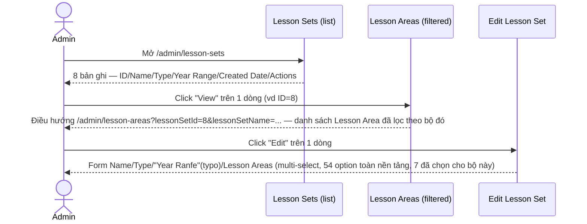
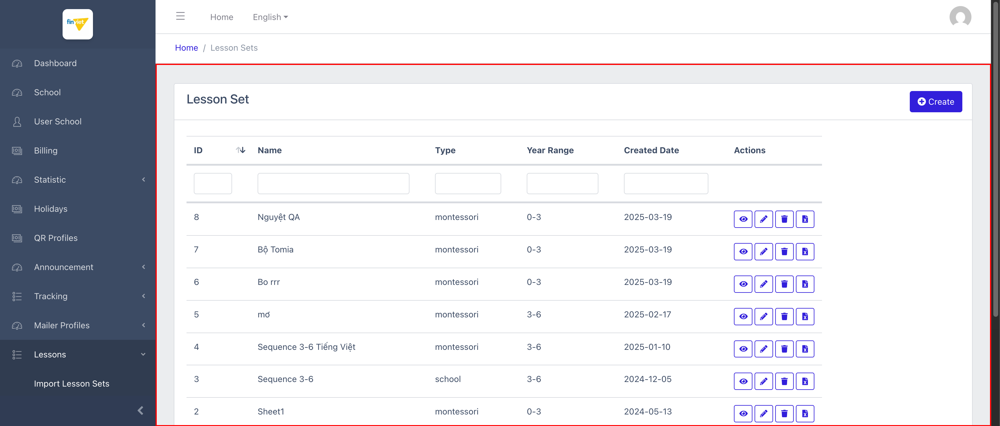
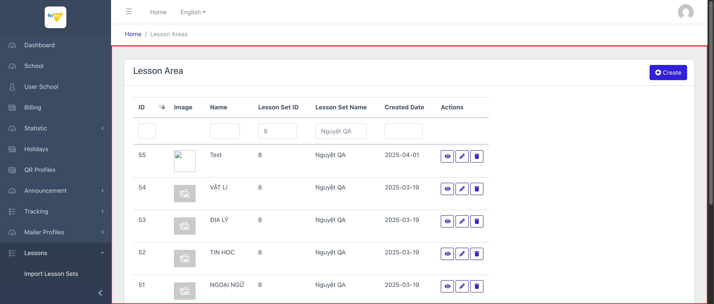
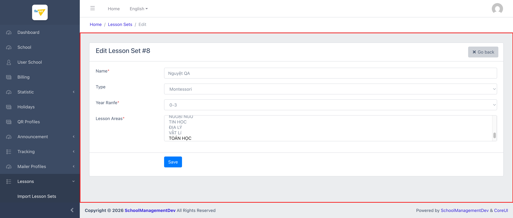

# M11.3 – Lessons: Lesson Sets (Managing Portal)

> Phạm vi: sub-module **Lesson Sets** (`/admin/lesson-sets`), sub-module thứ ba trong 6 sub-module của module **Lessons**. Quản lý danh sách các "bộ chương trình học" — cấp cao nhất trong 4 cấp của thư viện nội dung dùng chung (xem `M11-lessons/SM1-import-lesson-sets.md` §1.1). Có **2 lỗi tiêu đề trang khác nhau** ghi nhận được trong sub-module này.

## Mục lục

- [1. Tổng quan](#1-tổng-quan)
  - [1.1 Giới thiệu](#11-giới-thiệu)
  - [1.2 Actors](#12-actors)
  - [1.3 Phạm vi](#13-phạm-vi)
- [2. Business Flow](#2-business-flow)
  - [2.1 Sequence Diagram](#21-sequence-diagram)
  - [2.2 Business Steps](#22-business-steps)
  - [2.3 Business Rules](#23-business-rules)
- [3. Feature Breakdown](#3-feature-breakdown)
  - [3.1 Acceptance Criteria](#31-acceptance-criteria)
  - [3.2 Danh sách Use Case](#32-danh-sách-use-case)
  - [3.3 Edge Cases](#33-edge-cases)
  - [3.4 UI Conventions](#34-ui-conventions)

---

## 1. Tổng quan

### 1.1 Giới thiệu

Lesson Sets là danh sách các "bộ chương trình học" (ví dụ "Nguyệt QA", "Sequence 3-6") — mỗi bộ có Type (montessori/tradition/school) và Year Range (0-3/3-6), và được gán 1 tập con các **Lesson Area** (lĩnh vực/môn học) thông qua trường multi-select trên form Create/Edit. Tại thời điểm khảo sát có đúng **8 bộ** (ID 1-8), khớp với số liệu "Sets: 8" ở khối Statistic của sub-module Import (`SM1-import-lesson-sets.md` BR01).

**Phát hiện quan trọng — không có trang Detail riêng:** action "View" trên danh sách **không** dẫn tới 1 trang chi tiết của riêng Lesson Set, mà **điều hướng sang danh sách Lesson Areas**, tự động lọc theo `lessonSetId` và `lessonSetName` của bộ đó (query string, giá trị đã được điền sẵn vào 2 ô filter tương ứng). Đây là bằng chứng cấu trúc trực tiếp xác nhận quan hệ 1 Lesson Set → nhiều Lesson Area đã nêu ở `SM1-import-lesson-sets.md`.

**Phát hiện lỗi — 2 lỗi tiêu đề khác nhau:** tiêu đề tab trình duyệt ở trang danh sách là **"Lesson Set"** (số ít, không khớp label sidebar "Lesson Sets" số nhiều); ở trang Edit, tiêu đề tab lại là **"ManageLesson Set"** (thiếu dấu cách giữa "Manage" và "Lesson Set" — lỗi ghép chuỗi). Heading H4 hiển thị trong nội dung trang (ví dụ "Edit Lesson Set #8") thì đúng — lỗi chỉ nằm ở `<title>` tab, không ảnh hưởng nội dung chính.

**Phát hiện lỗi tái diễn — typo nhãn trường:** form Create/Edit có nhãn **"Year Ranfe*"** thay vì "Year Range*" — cùng lỗi đã ghi nhận trên cả 2 trang (Create và Edit), xác nhận đây là 1 Blade partial dùng chung.

### 1.2 Actors

| Actor | Mô tả |
|---|---|
| Finviet/SOHA Admin/Content team | Tạo/sửa/xoá/xuất các bộ chương trình học dùng chung, gán Lesson Area cho từng bộ. |

### 1.3 Phạm vi

| Trong phạm vi | Ngoài phạm vi |
|---|---|
| Xem danh sách, xác nhận cấu trúc cột/action | Thực hiện Create/Edit/Delete/Export thật |
| Xác nhận action "View" điều hướng sang Lesson Areas đã lọc | Xác định logic chọn Lesson Area nào hợp lệ cho 1 Type/Year Range cụ thể (không có ràng buộc rõ trên UI) |
| Xác nhận typo "Year Ranfe" và lỗi tiêu đề qua DOM (`document.title`, `<label>`) | |

---

## 2. Business Flow

### 2.1 Sequence Diagram

### 2.2 Business Steps

1. Admin xem danh sách các bộ chương trình học đã tạo.
2. Admin bấm "View" để xem các Lesson Area thuộc 1 bộ — thực chất là mở danh sách Lesson Areas đã lọc sẵn.
3. Admin bấm "Edit" để đổi Name/Type/Year Range hoặc thay đổi tập Lesson Area gán cho bộ.
4. Admin có thể bấm "Export" (GET `/admin/lesson-sets/{id}/export`) hoặc "Delete" (POST `_method=DELETE` tới `/admin/lesson-sets/{id}/destroy`) trên từng dòng.

### 2.3 Business Rules

| ID | Mô tả |
|---|---|
| BR01 | Danh sách có 6 cột: ID (sort được), Name, Type, Year Range, Created Date, Actions (View/Edit/Delete/Export) — 8/8 bản ghi hiển thị trên 1 trang (Display=50), khớp số liệu Statistic "Sets: 8". |
| BR02 | **[Không có trang Detail riêng]** Action "View" điều hướng sang `/admin/lesson-areas?lessonSetId={id}&lessonSetName={name}` — 1 instance của danh sách Lesson Areas được lọc sẵn qua query string (giá trị hiển thị ngay trong 2 ô filter "Lesson Set ID"/"Lesson Set Name"), không có view chi tiết nào thuộc riêng Lesson Set. |
| BR03 | **[Lỗi tiêu đề #1]** Tiêu đề tab trang danh sách là **"Lesson Set"** (số ít) — không khớp label sidebar "Lesson Sets" (số nhiều) và tên module. |
| BR04 | **[Lỗi tiêu đề #2]** Tiêu đề tab trang Edit là **"ManageLesson Set"** — thiếu dấu cách, lỗi ghép chuỗi rõ ràng (khác loại lỗi với BR03, cả 2 đều tồn tại trong cùng sub-module). Heading H4 trong nội dung trang ("Edit Lesson Set #8") thì hiển thị đúng. |
| BR05 | **[Lỗi typo — lặp lại]** Nhãn trường "Year Ranfe*" (đúng ra là "Year Range*") xuất hiện trên **cả Create và Edit** — xác nhận qua đọc trực tiếp `<label>` trong DOM, không phải lỗi hiển thị tạm thời. |
| BR06 | Multi-select "Lesson Areas*" (`name="lesson_area_ids[]"`) có **54 option** trên toàn nền tảng (khớp Statistic "Areas: 54") — trong đó bộ "Nguyệt QA" (ID=8) có đúng 7 option đã chọn, khớp 1:1 với 7 dòng thấy được qua action View (BR02). Danh sách ID option có 1 khoảng trống (nhảy từ 42 sang 44) — gợi ý 1 Lesson Area đã bị xoá/ẩn khỏi option nhưng không dồn lại ID. `[Cần xác nhận]` |
| BR07 | Nút Delete submit `POST` với `_method=DELETE` tới `/admin/lesson-sets/{id}/destroy` — không phát hiện thuộc tính xác nhận nào trong DOM, cùng pattern chưa-xác-nhận-được đã ghi nhận nhiều lần ở các module khác. |
| BR08 | Nút Export là 1 link GET thường tới `/admin/lesson-sets/{id}/export` — không thử nhấn để tránh trigger tải file thật. |

---

## 3. Feature Breakdown

### 3.1 Acceptance Criteria

- Danh sách phải hiển thị đúng 8 bộ hiện có, khớp Statistic — đạt.
- Action View phải cho thấy được các Lesson Area thuộc bộ đó — đạt, nhưng thực hiện qua điều hướng gián tiếp (không có trang Detail riêng).
- Nhãn trường trên form phải đúng chính tả — **không đạt** (BR05).
- Tiêu đề trang phải nhất quán và mô tả đúng nội dung — **không đạt** (BR03, BR04).

### 3.2 Danh sách Use Case

| Mã | Tên | Actor | Mô tả | Happy Path | Exception | Business Rules |
|---|---|---|---|---|---|---|
| UC-01 | Xem danh sách Lesson Sets | Admin | Xem toàn bộ các bộ chương trình học đã tạo. | 1. Admin mở `/admin/lesson-sets`. 2. Trang hiển thị 8 bản ghi với 4 action (View/Edit/Delete/Export) mỗi dòng.   | Không thử Delete/Export thật. | BR01, BR03, BR07, BR08 |
| UC-02 | Xem các Lesson Area thuộc 1 Lesson Set | Admin | Click "View" để xem nội dung con của 1 bộ. | 1. Admin click icon View trên dòng ID=8 ("Nguyệt QA"). 2. Điều hướng sang danh sách Lesson Areas đã lọc sẵn theo bộ này — 7 dòng.   | Không có, hành vi xảy ra tức thì qua redirect. | BR02, BR06 |
| UC-03 | Sửa 1 Lesson Set | Admin | Cập nhật Name/Type/Year Range/Lesson Areas của 1 bộ. | 1. Admin click icon Edit trên dòng ID=8. 2. Form hiển thị đầy đủ, nhãn "Year Ranfe*" (typo), multi-select hiển thị 7 area đã chọn trong tổng 54.   | Không thử submit Save thật để tránh thay đổi dữ liệu thư viện dùng chung. | BR04, BR05, BR06 |

### 3.3 Edge Cases

| # | Tình huống | Quan sát / Rủi ro |
|---|---|---|
| 1 | Action "View" không có trang Detail riêng, chỉ redirect sang danh sách khác (BR02) | Admin có thể bối rối khi bấm "View" 1 Lesson Set nhưng lại thấy mình đang ở trang "Lesson Areas" — nếu không chú ý URL/breadcrumb, dễ nhầm là đã điều hướng sai trang. |
| 2 | Tiêu đề tab không nhất quán giữa các trang trong cùng sub-module (BR03, BR04) | Nếu admin mở nhiều tab Lesson Sets/Areas/Groups/Lessons cùng lúc, tiêu đề tab sai/không nhất quán khiến khó phân biệt tab nào đang mở trang nào — vấn đề nhỏ nhưng lặp lại ở ít nhất 2 dạng lỗi khác nhau chỉ trong 1 sub-module. |
| 3 | Không có ràng buộc hiển thị giữa Type/Year Range và các Lesson Area hợp lệ có thể chọn | Multi-select hiển thị đủ 54 option bất kể Type/Year Range của bộ đang sửa là gì — không rõ hệ thống có validate logic nào ở backend để tránh gán area không phù hợp (vd gán area tiếng Anh cho bộ "school" tiếng Việt) hay không. `[Cần xác nhận]` |

### 3.4 UI Conventions

- Danh sách dùng chung layout DataTables tiêu chuẩn với ô lọc theo cột (trừ Actions), giống các module khác trong Managing Portal.
- Form Create/Edit dùng chung 1 bộ trường (Name/Type/Year Range/Lesson Areas) — Create để trống, Edit điền sẵn giá trị đã lưu; cả 2 đều mang lỗi typo "Year Ranfe" (BR05).
