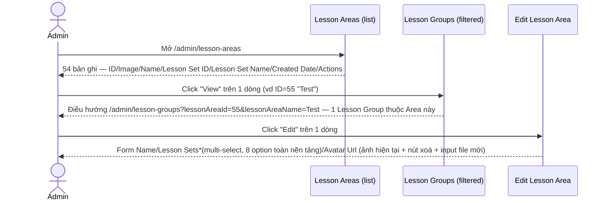
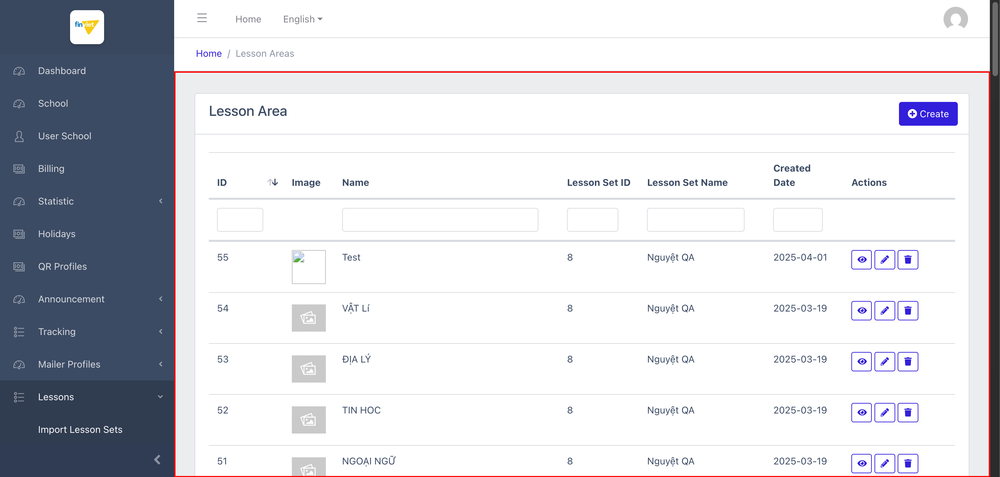
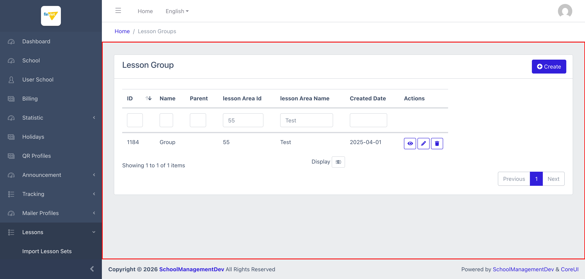
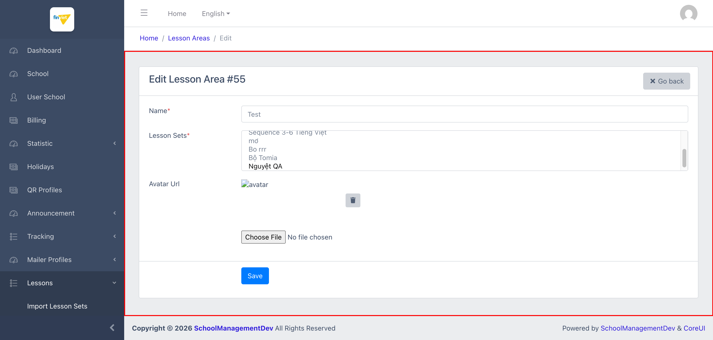

# M11.4 – Lessons: Lesson Areas (Managing Portal)

> Phạm vi: sub-module **Lesson Areas** (`/admin/lesson-areas`), sub-module thứ tư trong 6 sub-module của module **Lessons**. Quản lý danh sách các "lĩnh vực/môn học" — cấp thứ hai trong 4 cấp của thư viện nội dung dùng chung. Xác nhận được đây là quan hệ **nhiều-nhiều thực sự** giữa Lesson Set và Lesson Area (không phải 1-nhiều như suy đoán ban đầu).

## Mục lục

- [1. Tổng quan](#1-tổng-quan)
  - [1.1 Giới thiệu](#11-giới-thiệu)
  - [1.2 Actors](#12-actors)
  - [1.3 Phạm vi](#13-phạm-vi)
- [2. Business Flow](#2-business-flow)
  - [2.1 Sequence Diagram](#21-sequence-diagram)
  - [2.2 Business Steps](#22-business-steps)
  - [2.3 Business Rules](#23-business-rules)
- [3. Feature Breakdown](#3-feature-breakdown)
  - [3.1 Acceptance Criteria](#31-acceptance-criteria)
  - [3.2 Danh sách Use Case](#32-danh-sách-use-case)
  - [3.3 Edge Cases](#33-edge-cases)
  - [3.4 UI Conventions](#34-ui-conventions)

---

## 1. Tổng quan

### 1.1 Giới thiệu

Lesson Areas là danh sách các "lĩnh vực/môn học" (ví dụ VẬT LÍ, ĐỊA LÝ, TOÁN HỌC) — mỗi Area có 1 ảnh đại diện (Avatar) và có thể được gán vào 1 hoặc nhiều Lesson Set. Tại thời điểm khảo sát có đúng **54 Area**, khớp số liệu "Areas: 54" ở Statistic (`SM1-import-lesson-sets.md` BR01).

**Phát hiện quan trọng — quan hệ nhiều-nhiều thực sự:** form Edit của Lesson Area có trường multi-select **"Lesson Sets*"** (`lesson_set_ids[]`) liệt kê đủ 8 Lesson Set hiện có, cho phép gán 1 Area vào **nhiều Set cùng lúc**. Kết hợp với multi-select "Lesson Areas*" đã thấy ở form Edit Lesson Set (`SM3-lesson-sets.md` BR06), xác nhận đây là quan hệ **many-to-many 2 chiều** — cả 2 phía đều có thể chỉnh sửa cùng 1 bảng liên kết, không phải quan hệ 1-nhiều một chiều như suy đoán ban đầu ở `SM1-import-lesson-sets.md`.

**Phát hiện quan trọng — cấu trúc phân cấp tiếp tục xuống Lesson Group:** giống pattern đã thấy ở Lesson Set, action "View" trên Lesson Area **không có trang Detail riêng** mà điều hướng sang danh sách **Lesson Groups** đã lọc theo `lessonAreaId`/`lessonAreaName` — xác nhận trực tiếp bước tiếp theo trong chuỗi phân cấp Set → Area → **Group** → Lesson.

**Phát hiện lỗi:**
- Cùng lỗi tiêu đề "ManageLesson X" (thiếu dấu cách) đã thấy ở Lesson Set — ở đây là **"ManageLesson Area"** trên trang Edit, xác nhận đây là lỗi ở layout Blade dùng chung cho toàn bộ các trang Edit trong module Lessons, không phải lỗi riêng lẻ của 1 sub-module.
- Trang danh sách Lesson Groups (đích của action View) có 2 cột tiêu đề viết sai kiểu chữ: **"lesson Area Id"** và **"lesson Area Name"** (chữ "l" thường ở đầu) — rò rỉ tên biến/key trực tiếp ra giao diện thay vì dùng label chuẩn "Lesson Area ID"/"Lesson Area Name".
- Nhãn "Name*" và "Lesson Sets*" trên form Edit đều có dấu `*` nhưng **không có trường nào mang thuộc tính HTML `required`** — kể cả trường Name.

### 1.2 Actors

| Actor | Mô tả |
|---|---|
| Finviet/SOHA Admin/Content team | Tạo/sửa/xoá Lesson Area, gán Area vào 1 hoặc nhiều Lesson Set, quản lý ảnh đại diện. |

### 1.3 Phạm vi

| Trong phạm vi | Ngoài phạm vi |
|---|---|
| Xem danh sách, xác nhận cấu trúc cột/action, xác nhận số lượng 54 | Thực hiện Create/Edit/Delete thật, hoặc upload/xoá avatar thật |
| Xác nhận action "View" điều hướng sang Lesson Groups đã lọc | |
| Xác nhận quan hệ nhiều-nhiều với Lesson Set qua DOM (`lesson_set_ids[]`) | |

---

## 2. Business Flow

### 2.1 Sequence Diagram

### 2.2 Business Steps

1. Admin xem danh sách các Lesson Area đã tạo.
2. Admin bấm "View" để xem các Lesson Group thuộc 1 Area — thực chất mở danh sách Lesson Groups đã lọc sẵn (giống pattern View của Lesson Set).
3. Admin bấm "Edit" để đổi Name, thay đổi tập Lesson Set mà Area này thuộc về, hoặc thay ảnh đại diện (xoá ảnh cũ qua icon thùng rác, hoặc chọn file mới).

### 2.3 Business Rules

| ID | Mô tả |
|---|---|
| BR01 | Danh sách có 6 cột dữ liệu: ID (sort được), Image, Name, Lesson Set ID, Lesson Set Name, Created Date, cộng Actions (View/Edit/Delete — **không có Export**, khác với Lesson Sets). Tổng 54/54 bản ghi, khớp Statistic "Areas: 54". |
| BR02 | **[Không có trang Detail riêng]** Action "View" điều hướng sang `/admin/lesson-groups?lessonAreaId={id}&lessonAreaName={name}` — cùng pattern đã ghi nhận ở Lesson Set (BR02, `SM3-lesson-sets.md`), xác nhận bước tiếp theo của chuỗi phân cấp là Lesson Group. |
| BR03 | **[Quan hệ nhiều-nhiều]** Form Edit có multi-select `lesson_set_ids[]` với đủ **8 option** (toàn bộ Lesson Set hiện có) — 1 Lesson Area có thể thuộc về nhiều Lesson Set cùng lúc, xác nhận qua DOM đây là quan hệ many-to-many 2 chiều với Lesson Set (đối chiếu `SM3-lesson-sets.md` BR06). |
| BR04 | **[Lỗi tiêu đề]** Tiêu đề tab trang Edit là **"ManageLesson Area"** (thiếu dấu cách) — cùng loại lỗi đã ghi nhận ở Lesson Set (`SM3-lesson-sets.md` BR04), xác nhận lỗi nằm ở Blade layout dùng chung cho các trang Edit trong toàn module Lessons. |
| BR05 | **[Lỗi tiêu đề cột]** 2 cột trên trang Lesson Groups (đích của action View) hiển thị sai kiểu chữ: **"lesson Area Id"**, **"lesson Area Name"** (chữ thường ở đầu) thay vì "Lesson Area ID"/"Lesson Area Name" — khả năng cao do code lấy trực tiếp tên biến/query param làm label thay vì chuỗi dịch chuẩn. |
| BR06 | Trường Avatar: khi Edit, ảnh hiện tại (nếu có) hiển thị kèm 1 icon thùng rác riêng để xoá ảnh, tách biệt với input `type="file"` để chọn ảnh mới — 2 hành động độc lập (xoá ảnh cũ / thêm ảnh mới) không bắt buộc phải làm cùng lúc. |
| BR07 | Nhãn "Name*" và "Lesson Sets*" đều có dấu `*` nhưng **không trường nào có thuộc tính HTML `required`** (xác nhận qua DOM) — kể cả Name, khác biệt nhỏ so với Lesson Set (nơi Name/Year Range/Lesson Areas đều `required` thật). `[Cần xác nhận]` mức độ validate thực tế phía server. |
| BR08 | Phần lớn Lesson Area không có ảnh đại diện tuỳ chỉnh — hiển thị 1 icon ảnh mặc định màu xám giống nhau cho nhiều dòng (xác nhận qua kiểm tra `naturalWidth`: ảnh tải thành công, không phải lỗi broken-image, chỉ là ảnh placeholder dùng chung); chỉ số ít Area (ví dụ ID=55 "Test") có ảnh tuỳ chỉnh riêng. |

---

## 3. Feature Breakdown

### 3.1 Acceptance Criteria

- Danh sách phải hiển thị đúng 54 Area hiện có, khớp Statistic — đạt.
- Action View phải cho thấy được nội dung con (Lesson Group) của Area đó — đạt, qua điều hướng gián tiếp giống Lesson Set.
- Form Edit phải cho phép gán Area vào đúng tập Lesson Set mong muốn — đạt về cấu trúc (multi-select đầy đủ 8 option).
- Tiêu đề/label trên các trang phải nhất quán và đúng chính tả — **không đạt** (BR04, BR05).

### 3.2 Danh sách Use Case

| Mã | Tên | Actor | Mô tả | Happy Path | Exception | Business Rules |
|---|---|---|---|---|---|---|
| UC-01 | Xem danh sách Lesson Areas | Admin | Xem toàn bộ các lĩnh vực/môn học đã tạo. | 1. Admin mở `/admin/lesson-areas`. 2. Trang hiển thị 54 bản ghi với 3 action (View/Edit/Delete) mỗi dòng.   | Không thử Delete thật. | BR01, BR08 |
| UC-02 | Xem các Lesson Group thuộc 1 Lesson Area | Admin | Click "View" để xem nội dung con của 1 Area. | 1. Admin click icon View trên dòng ID=55 ("Test"). 2. Điều hướng sang danh sách Lesson Groups đã lọc sẵn theo Area này — 1 dòng, 2 cột tiêu đề sai kiểu chữ.   | Không có, hành vi xảy ra tức thì qua redirect. | BR02, BR05 |
| UC-03 | Sửa 1 Lesson Area | Admin | Cập nhật Name, tập Lesson Set liên kết, hoặc ảnh đại diện. | 1. Admin click icon Edit trên dòng ID=55. 2. Form hiển thị Name/Lesson Sets*(multi-select, "Nguyệt QA" đã chọn trong 8 option)/Avatar hiện tại + nút xoá + input file mới.   | Không thử submit Save thật, không thử xoá/upload avatar thật để tránh thay đổi dữ liệu thư viện dùng chung. | BR03, BR04, BR06, BR07 |

### 3.3 Edge Cases

| # | Tình huống | Quan sát / Rủi ro |
|---|---|---|
| 1 | Quan hệ nhiều-nhiều giữa Set và Area được chỉnh sửa độc lập từ cả 2 phía (BR03) | Nếu admin sửa danh sách Area từ phía Lesson Set và admin khác sửa danh sách Set từ phía Lesson Area cùng lúc, có thể xảy ra tình huống ghi đè lẫn nhau (race condition) mà UI không cảnh báo. `[Cần xác nhận]`, không kiểm chứng vì không submit form thật. |
| 2 | Cột tiêu đề "lesson Area Id"/"lesson Area Name" sai kiểu chữ (BR05) | Lỗi nhỏ về thẩm mỹ/nhất quán, nhưng là dấu hiệu code sinh label trực tiếp từ tên biến/query param thay vì qua lớp dịch chuẩn — rủi ro tương tự có thể lặp lại ở các trang lọc-qua-URL khác trong module Lessons (Lesson Groups, Lessons) chưa khảo sát. |
| 3 | Asterisk (*) trên nhãn nhưng không có `required` ở tầng HTML (BR07) | Nếu validate phía server cũng lỏng, admin có thể lưu 1 Lesson Area không tên hoặc không gán Set nào — không kiểm chứng được vì không submit form thật. |

### 3.4 UI Conventions

- Danh sách dùng chung layout DataTables tiêu chuẩn với ô lọc theo cột, giống các module khác.
- Cột "Image" hiển thị thumbnail nhỏ, không có ô lọc riêng (giống cột Actions).
- Form Edit dùng bố cục 1 cột nhãn - 1 cột input giống Lesson Set, nhưng thêm phần xử lý ảnh (preview + xoá + upload) không có ở Lesson Set.
