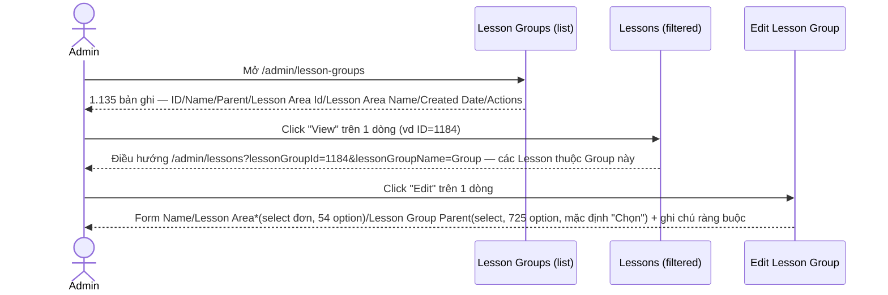
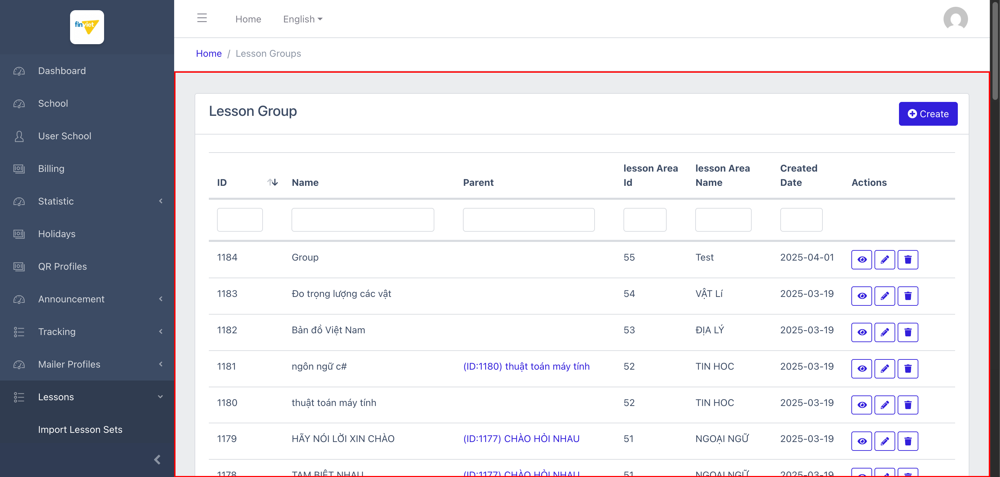
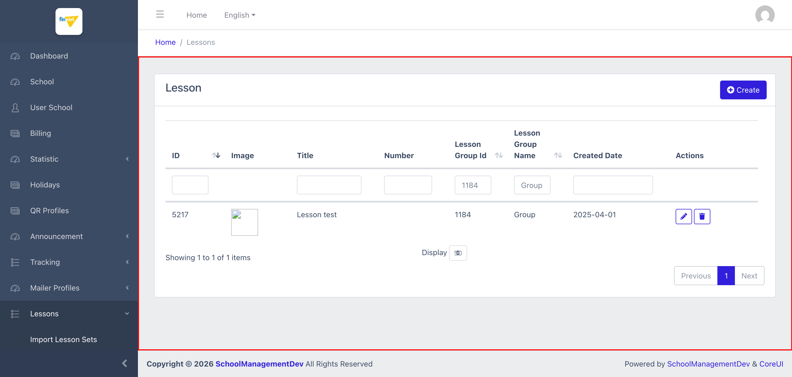
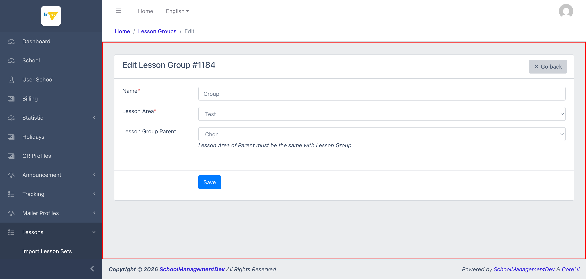

# M11.5 – Lessons: Lesson Groups (Managing Portal)

> Phạm vi: sub-module **Lesson Groups** (`/admin/lesson-groups`), sub-module thứ năm trong 6 sub-module của module **Lessons**. Quản lý danh sách các "nhóm/chủ đề bài học" — cấp thứ ba trong 4 cấp của thư viện nội dung dùng chung. Sub-module này hỗ trợ **tự tham chiếu (self-referencing) để tạo cây phân cấp nhóm con**, và có 1 ràng buộc nghiệp vụ hiển thị rõ ngay trên form (hiếm gặp so với các sub-module trước).

## Mục lục

- [1. Tổng quan](#1-tổng-quan)
  - [1.1 Giới thiệu](#11-giới-thiệu)
  - [1.2 Actors](#12-actors)
  - [1.3 Phạm vi](#13-phạm-vi)
- [2. Business Flow](#2-business-flow)
  - [2.1 Sequence Diagram](#21-sequence-diagram)
  - [2.2 Business Steps](#22-business-steps)
  - [2.3 Business Rules](#23-business-rules)
- [3. Feature Breakdown](#3-feature-breakdown)
  - [3.1 Acceptance Criteria](#31-acceptance-criteria)
  - [3.2 Danh sách Use Case](#32-danh-sách-use-case)
  - [3.3 Edge Cases](#33-edge-cases)
  - [3.4 UI Conventions](#34-ui-conventions)

---

## 1. Tổng quan

### 1.1 Giới thiệu

Lesson Groups là danh sách các "nhóm/chủ đề bài học" (ví dụ "PHÉP CỘNG", "CHÀO HỎI NHAU") — mỗi Group thuộc về đúng 1 Lesson Area, và có thể tuỳ chọn 1 Group cha (Parent) để tạo cấu trúc phân cấp con-cha. Tại thời điểm khảo sát có đúng **1.135 Group**, khớp số liệu "Groups: 1135" ở Statistic (`SM1-import-lesson-sets.md` BR01).

**Phát hiện quan trọng — quan hệ khác kiểu với Area:** khác với quan hệ nhiều-nhiều giữa Lesson Set và Lesson Area (`SM4-lesson-areas.md` BR03), 1 Lesson Group chỉ thuộc về **đúng 1** Lesson Area — form Edit dùng `<select>` đơn (`lesson_area_id`, 54 option) chứ không phải multi-select.

**Phát hiện quan trọng — tự tham chiếu tạo cây phân cấp:** trường "Lesson Group Parent" (`parent_lesson_group_id`) cho phép chọn 1 Group khác làm cha — quan sát mẫu dữ liệu cho thấy cấu trúc thực tế đang dùng là **2 cấp** (Group cha không có Parent riêng, Group con trỏ về đúng 1 Group cha) chứ chưa thấy ví dụ nào lồng sâu hơn 2 cấp. `[Cần xác nhận]` liệu hệ thống có giới hạn cứng ở 2 cấp hay cho phép lồng sâu tuỳ ý.

**Phát hiện quan trọng — ràng buộc nghiệp vụ hiển thị ngay trên form:** form Edit/Create có dòng chú thích **"Lesson Area of Parent must be the same with Lesson Group"** — đây là lần đầu tiên trong toàn bộ module Lessons 1 ràng buộc nghiệp vụ được ghi rõ trực tiếp trên UI thay vì phải suy luận qua hành vi.

**Phát hiện lỗi:**
- Cùng lỗi tiêu đề "ManageLesson Group" (thiếu dấu cách) ở trang Edit — lần xuất hiện thứ 3 của cùng 1 lỗi Blade layout dùng chung (sau Lesson Set, Lesson Area).
- Placeholder mặc định của dropdown "Lesson Group Parent" là **"Chọn"** (tiếng Việt) trong khi toàn bộ giao diện còn lại là tiếng Anh — lỗi trộn ngôn ngữ.
- Giá trị cột "Parent" trên danh sách hiển thị dạng link `(ID:{id}) {name}`, nhưng link thực tế lọc theo **tên** (`?parentGroup={name}`), không phải theo ID như nhãn gợi ý — rủi ro nếu 2 Group cha trùng tên.

### 1.2 Actors

| Actor | Mô tả |
|---|---|
| Finviet/SOHA Admin/Content team | Tạo/sửa/xoá Lesson Group, gán Group vào 1 Lesson Area, thiết lập quan hệ cha-con giữa các Group. |

### 1.3 Phạm vi

| Trong phạm vi | Ngoài phạm vi |
|---|---|
| Xem danh sách, xác nhận cấu trúc cột/action, xác nhận số lượng 1.135 | Thực hiện Create/Edit/Delete thật |
| Xác nhận action "View" điều hướng sang Lessons đã lọc | Xác nhận hệ thống có giới hạn số cấp lồng Parent hay không (không đủ dữ liệu mẫu) |
| Xác nhận ràng buộc "Lesson Area of Parent must be the same" qua đọc trực tiếp nội dung trang | |

---

## 2. Business Flow

### 2.1 Sequence Diagram

### 2.2 Business Steps

1. Admin xem danh sách các Lesson Group đã tạo, có thể xem quan hệ cha-con qua cột Parent.
2. Admin bấm "View" để xem các Lesson thuộc 1 Group — điều hướng sang danh sách Lessons đã lọc sẵn.
3. Admin bấm "Edit" để đổi Name, đổi Lesson Area, hoặc gán/đổi Group cha — lưu ý ràng buộc "Lesson Area của Group cha phải trùng với Lesson Area của Group con".
4. Admin có thể bấm vào giá trị "(ID:{id}) {name}" ở cột Parent để lọc nhanh toàn bộ Group con của 1 Group cha cụ thể.

### 2.3 Business Rules

| ID | Mô tả |
|---|---|
| BR01 | Danh sách có 6 cột dữ liệu: ID (sort được), Name, Parent, Lesson Area Id, Lesson Area Name, Created Date, cộng Actions (View/Edit/Delete — không có Export). Tổng 1.135/1.135 bản ghi, khớp Statistic "Groups: 1135". |
| BR02 | **[Không có trang Detail riêng]** Action "View" điều hướng sang `/admin/lessons?lessonGroupId={id}&lessonGroupName={name}` — cùng pattern đã ghi nhận ở Lesson Set và Lesson Area, xác nhận bước cuối của chuỗi phân cấp là Lesson. |
| BR03 | **[Quan hệ nhiều-một với Area]** Form Edit dùng `<select>` đơn `lesson_area_id` (54 option) — khác quan hệ nhiều-nhiều của Area↔Set, 1 Group chỉ thuộc đúng 1 Area. |
| BR04 | **[Tự tham chiếu]** Trường "Lesson Group Parent" (`parent_lesson_group_id`, 725/1.135 option khả dụng làm cha) cho phép 1 Group trỏ tới 1 Group khác làm cha, tạo cấu trúc cây — dữ liệu mẫu quan sát được chỉ có tối đa 2 cấp (Group cha không tự có Parent). `[Cần xác nhận]` giới hạn độ sâu tối đa. |
| BR05 | **[Ràng buộc hiển thị trên UI]** Form hiển thị ghi chú rõ: *"Lesson Area of Parent must be the same with Lesson Group"* — Group con chỉ được chọn Group cha thuộc cùng 1 Lesson Area. Đây là ràng buộc nghiệp vụ đầu tiên được ghi công khai trên UI trong toàn module Lessons (các sub-module trước không có ghi chú tương tự). |
| BR06 | **[Lỗi tiêu đề]** Tiêu đề tab trang Edit là "ManageLesson Group" (thiếu dấu cách) — lần xuất hiện thứ 3 của lỗi Blade layout dùng chung (sau Lesson Set BR04, Lesson Area BR04). |
| BR07 | **[Lỗi trộn ngôn ngữ]** Placeholder mặc định của dropdown "Lesson Group Parent" là **"Chọn"** (tiếng Việt, nghĩa "Choose") — toàn bộ phần còn lại của giao diện là tiếng Anh, đây là điểm trộn ngôn ngữ duy nhất ghi nhận được trong module Lessons tính đến sub-module này. |
| BR08 | **[Lọc theo tên, không phải ID]** Giá trị cột "Parent" hiển thị dạng `(ID:{id}) {name}` nhưng link bấm vào thực chất trỏ tới `/admin/lesson-groups?parentGroup={name}` (lọc theo **tên**, xác nhận qua đọc `href` trực tiếp) — nhãn hiển thị gây hiểu lầm là lọc theo ID. |
| BR09 | Danh sách Lessons (đích của action View) dùng header "Lesson Group Id"/"Lesson Group Name" viết hoa chữ cái đầu đúng chuẩn — khác với lỗi "lesson Area Id"/"lesson Area Name" viết thường đã ghi nhận ở `SM4-lesson-areas.md` BR05, cho thấy lỗi viết thường chỉ xảy ra ở các cột liên quan tới Lesson Area, không phải lỗi hệ thống áp dụng cho mọi cột lọc-qua-URL. |

---

## 3. Feature Breakdown

### 3.1 Acceptance Criteria

- Danh sách phải hiển thị đúng 1.135 Group hiện có, khớp Statistic — đạt.
- Action View phải cho thấy được nội dung con (Lesson) của Group đó — đạt, qua điều hướng gián tiếp giống các sub-module trước.
- Ràng buộc "Parent cùng Lesson Area" phải được truyền đạt rõ cho admin — đạt, có ghi chú trực tiếp trên form (khác biệt tích cực so với các sub-module trước).
- Ngôn ngữ giao diện phải nhất quán — **không đạt** (BR07).

### 3.2 Danh sách Use Case

| Mã | Tên | Actor | Mô tả | Happy Path | Exception | Business Rules |
|---|---|---|---|---|---|---|
| UC-01 | Xem danh sách Lesson Groups | Admin | Xem toàn bộ nhóm/chủ đề bài học đã tạo, bao gồm quan hệ cha-con. | 1. Admin mở `/admin/lesson-groups`. 2. Trang hiển thị 1.135 bản ghi, cột Parent hiển thị link "(ID:xxx) Tên" cho các Group con.   | Không thử Delete thật. | BR01, BR08, BR09 |
| UC-02 | Xem các Lesson thuộc 1 Lesson Group | Admin | Click "View" để xem nội dung con của 1 Group. | 1. Admin click icon View trên dòng ID=1184 ("Group"). 2. Điều hướng sang danh sách Lessons đã lọc sẵn theo Group này — 1 dòng.   | Không có, hành vi xảy ra tức thì qua redirect. | BR02, BR09 |
| UC-03 | Sửa 1 Lesson Group | Admin | Cập nhật Name, Lesson Area, hoặc Group cha. | 1. Admin click icon Edit trên dòng ID=1184. 2. Form hiển thị Name/Lesson Area*(select đơn, "Test" đã chọn)/Lesson Group Parent (mặc định "Chọn") + ghi chú ràng buộc Area phải trùng.   | Không thử submit Save thật để tránh thay đổi dữ liệu thư viện dùng chung. | BR03, BR04, BR05, BR06, BR07 |

### 3.3 Edge Cases

| # | Tình huống | Quan sát / Rủi ro |
|---|---|---|
| 1 | Link cột Parent lọc theo tên thay vì ID dù nhãn hiển thị "(ID:xxx)" (BR08) | Nếu 2 Group cha khác nhau (ID khác nhau) vô tình trùng tên, click vào link Parent của 1 trong 2 sẽ trả về kết quả gộp cả 2 (hoặc sai lệch), gây hiểu lầm cho admin. `[Cần xác nhận]`, không kiểm chứng bằng dữ liệu trùng tên thật vì không có mẫu sẵn. |
| 2 | Không rõ giới hạn độ sâu lồng Parent (BR04) | Dữ liệu hiện có chỉ cho thấy tối đa 2 cấp; nếu admin cố tình tạo chuỗi lồng sâu hơn (Group A → cha B → cha C...), không rõ hệ thống có chặn vòng lặp (circular reference) hay giới hạn độ sâu hay không. `[Cần xác nhận]`, không thử nghiệm vì không submit form thật. |
| 3 | Trộn ngôn ngữ "Chọn" giữa giao diện tiếng Anh (BR07) | Lỗi nhỏ về nhất quán ngôn ngữ, nhưng là điểm trộn ngôn ngữ duy nhất phát hiện được trong cả module Lessons — gợi ý placeholder này có thể được thêm sau bởi 1 dev khác không theo cùng convention. |

### 3.4 UI Conventions

- Danh sách dùng chung layout DataTables tiêu chuẩn với ô lọc theo cột, giống các sub-module khác.
- Cột "Parent" là cột duy nhất trong toàn module Lessons hiển thị nội dung dạng link điều hướng ngay trong ô dữ liệu (không phải icon Action) — dùng để lọc nhanh theo Group cha.
- Form Edit là sub-module đầu tiên trong Lessons có dòng chú thích ràng buộc nghiệp vụ hiển thị trực tiếp dưới field (in nghiêng, màu xám nhạt).
