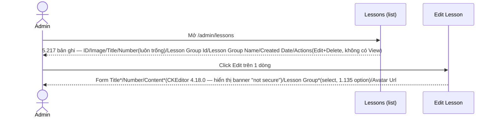
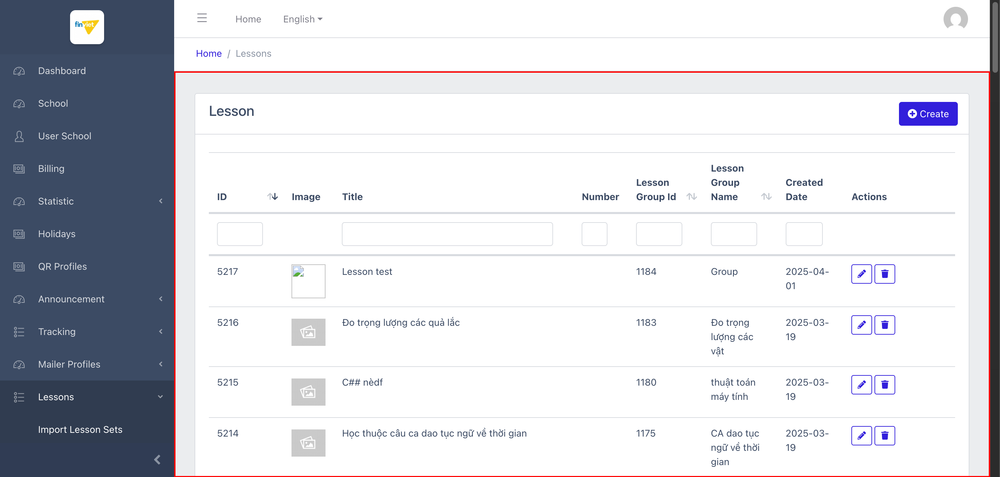
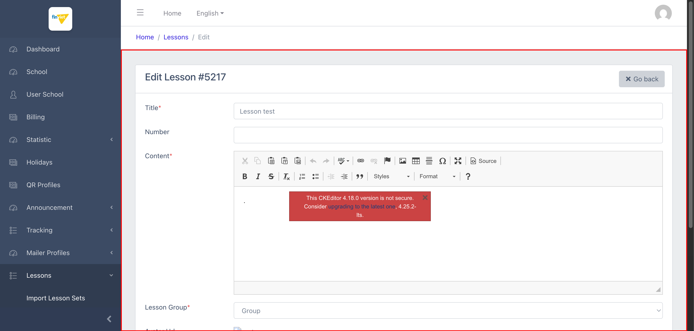

# M11.6 – Lessons: Lessons (Managing Portal)

> Phạm vi: sub-module **Lessons** (`/admin/lessons`), sub-module thứ sáu và cuối cùng trong 6 sub-module của module **Lessons**. Đây là cấp thấp nhất (lá) trong chuỗi phân cấp 4 cấp Set → Area → Group → **Lesson**, chứa nội dung bài học thực tế qua trình soạn thảo văn bản phong phú (rich text editor). **Phát hiện bảo mật đáng chú ý:** chính trình soạn thảo hiển thị cảnh báo công khai rằng phiên bản đang dùng không an toàn.

## Mục lục

- [1. Tổng quan](#1-tổng-quan)
  - [1.1 Giới thiệu](#11-giới-thiệu)
  - [1.2 Actors](#12-actors)
  - [1.3 Phạm vi](#13-phạm-vi)
- [2. Business Flow](#2-business-flow)
  - [2.1 Sequence Diagram](#21-sequence-diagram)
  - [2.2 Business Steps](#22-business-steps)
  - [2.3 Business Rules](#23-business-rules)
- [3. Feature Breakdown](#3-feature-breakdown)
  - [3.1 Acceptance Criteria](#31-acceptance-criteria)
  - [3.2 Danh sách Use Case](#32-danh-sách-use-case)
  - [3.3 Edge Cases](#33-edge-cases)
  - [3.4 UI Conventions](#34-ui-conventions)

---

## 1. Tổng quan

### 1.1 Giới thiệu

Lessons là danh sách các bài học cụ thể — cấp thấp nhất trong chuỗi phân cấp nội dung dùng chung (Set → Area → Group → Lesson). Mỗi Lesson có Title, nội dung (Content) soạn bằng rich text editor, thuộc về đúng 1 Lesson Group, và có thể có ảnh đại diện. Tại thời điểm khảo sát có đúng **5.217 bài học**, khớp số liệu "Lessons: 5217" ở Statistic (`SM1-import-lesson-sets.md` BR01) — đây cũng là con số lớn nhất trong toàn bộ 4 cấp.

**Phát hiện bảo mật quan trọng:** trường "Content" dùng **CKEditor phiên bản 4.18.0**, và chính editor này hiển thị 1 banner cảnh báo đỏ ngay trong khung soạn thảo: *"This CKEditor 4.18.0 version is not secure. Consider upgrading to the latest one, 4.25.2-lts."* — đây là cảnh báo do chính nhà cung cấp thư viện phát ra (không phải suy luận của người khảo sát), cho thấy Managing Portal đang dùng 1 phiên bản thư viện bên thứ ba đã được nhà cung cấp xác nhận có vấn đề bảo mật, admin nào mở form Edit/Create Lesson đều nhìn thấy trực tiếp.

**Phát hiện — không có action View, cột "Number" luôn trống:** khác với 3 sub-module trước (Set/Area/Group), danh sách Lessons **không có action View** (chỉ Edit/Delete) — hợp lý vì đây là cấp lá, không còn nội dung con nào để drill-down. Cột "Number" (có thể dùng để sắp thứ tự bài học trong 1 Group) **luôn trống trên mọi bản ghi quan sát được** — cùng pattern "cột tồn tại nhưng chưa từng có dữ liệu" đã ghi nhận nhiều lần ở các module khác (M9 Tracking, M10 Mailer Profiles).

**Phát hiện lỗi tái diễn:** tiêu đề tab trang Edit là **"ManageLesson"** (thiếu dấu cách) — lần xuất hiện thứ 4 liên tiếp của cùng 1 lỗi Blade layout dùng chung trên khắp module Lessons (Set, Area, Group, và nay là Lesson).

### 1.2 Actors

| Actor | Mô tả |
|---|---|
| Finviet/SOHA Admin/Content team | Soạn thảo nội dung bài học cụ thể, gán vào 1 Lesson Group, quản lý ảnh đại diện. |

### 1.3 Phạm vi

| Trong phạm vi | Ngoài phạm vi |
|---|---|
| Xem danh sách, xác nhận cấu trúc cột/action, xác nhận số lượng 5.217 | Thực hiện Create/Edit/Delete thật, hoặc nhập nội dung thật vào CKEditor |
| Xác nhận CKEditor và banner cảnh báo bảo mật qua quan sát trực tiếp trên trang | Đánh giá mức độ rủi ro bảo mật cụ thể của CKEditor 4.18.0 (ngoài phạm vi khảo sát UI) |

---

## 2. Business Flow

### 2.1 Sequence Diagram

### 2.2 Business Steps

1. Admin xem danh sách các bài học đã tạo, có thể lọc theo Lesson Group.
2. Admin bấm Edit để soạn/sửa Title, nội dung (Content) qua CKEditor, đổi Lesson Group, hoặc thay ảnh đại diện.
3. Admin có thể bấm Delete để xoá 1 bài học.

### 2.3 Business Rules

| ID | Mô tả |
|---|---|
| BR01 | Danh sách có 6 cột dữ liệu: ID (sort được), Image, Title, Number, Lesson Group Id (sort được), Lesson Group Name (sort được), Created Date, cộng Actions (**chỉ Edit/Delete, không có View và không có Export**). Tổng 5.217/5.217 bản ghi, khớp Statistic "Lessons: 5217". |
| BR02 | **[Không có action View]** Khác với Set/Area/Group, Lesson không có action View — hợp lý vì đây là cấp lá cuối cùng của chuỗi phân cấp, không còn cấp con nào để điều hướng tới. |
| BR03 | **[Cột luôn trống]** Cột "Number" trống trên toàn bộ bản ghi quan sát được — form Edit có trường "Number" tương ứng (không bắt buộc, không có dấu `*`) nhưng dữ liệu hiện có chưa từng sử dụng trường này. `[Cần xác nhận]` mục đích thực tế của trường (có thể dùng để sắp thứ tự hiển thị bài học trong 1 Group). |
| BR04 | **[Rủi ro bảo mật — cảnh báo từ chính thư viện]** Trường "Content*" dùng CKEditor 4.18.0; chính editor hiển thị banner: *"This CKEditor 4.18.0 version is not secure. Consider upgrading to the latest one, 4.25.2-lts."* — xác nhận trực tiếp qua quan sát UI, không phải suy luận. Đây là cảnh báo bảo mật rõ ràng nhất phát hiện được trong toàn bộ Managing Portal tính đến module này (khác với các rủi ro plaintext credential ở M7/M10, đây là cảnh báo do chính nhà cung cấp thư viện phát hành). |
| BR05 | Form Edit gồm 5 trường: Title* (text), Number (text, optional), Content* (CKEditor rich text, `required` ở tầng nhãn nhưng không xác nhận được validate server), Lesson Group* (select đơn, 1.135 option — toàn bộ Group hiện có), Avatar Url (ảnh hiện tại + input file mới, cùng pattern với Lesson Area). |
| BR06 | **[Lỗi tiêu đề — lần thứ 4]** Tiêu đề tab trang Edit là **"ManageLesson"** (thiếu dấu cách) — xác nhận lỗi Blade layout dùng chung xuất hiện nhất quán trên cả 4 sub-module có trang Edit trong module Lessons (Lesson Set, Lesson Area, Lesson Group, Lesson). |
| BR07 | Nút Delete submit `POST` tới `/admin/lessons/{id}/destroy` — không phát hiện thuộc tính xác nhận nào trong DOM, cùng pattern chưa-xác-nhận-được đã ghi nhận xuyên suốt Managing Portal. |

---

## 3. Feature Breakdown

### 3.1 Acceptance Criteria

- Danh sách phải hiển thị đúng 5.217 Lesson hiện có, khớp Statistic — đạt.
- Nội dung bài học phải soạn thảo được qua rich text editor — đạt về chức năng, nhưng **không đạt về bảo mật** do phiên bản thư viện đã lỗi thời và tự cảnh báo (BR04).
- Tiêu đề trang phải nhất quán — **không đạt** (BR06, lặp lại từ 3 sub-module trước).

### 3.2 Danh sách Use Case

| Mã | Tên | Actor | Mô tả | Happy Path | Exception | Business Rules |
|---|---|---|---|---|---|---|
| UC-01 | Xem danh sách Lessons | Admin | Xem toàn bộ bài học đã tạo. | 1. Admin mở `/admin/lessons`. 2. Trang hiển thị 5.217 bản ghi, cột Number luôn trống, Actions chỉ có Edit/Delete.   | Không thử Delete thật. | BR01, BR02, BR03 |
| UC-02 | Sửa nội dung 1 Lesson | Admin | Cập nhật Title/Content/Lesson Group/ảnh đại diện của 1 bài học. | 1. Admin click icon Edit trên dòng ID=5217. 2. Form hiển thị Title/Number/Content (CKEditor — banner cảnh báo bảo mật hiển thị ngay trong khung soạn thảo)/Lesson Group*.   | Không thử submit Save thật, không nhập nội dung thật vào CKEditor để tránh thay đổi dữ liệu thư viện dùng chung. | BR04, BR05, BR06, BR07 |

### 3.3 Edge Cases

| # | Tình huống | Quan sát / Rủi ro |
|---|---|---|
| 1 | CKEditor 4.18.0 tự cảnh báo không an toàn (BR04) | Nên báo cáo ưu tiên cao cho đội dev — đây là rủi ro bảo mật thư viện bên thứ ba được xác nhận bởi chính nhà cung cấp, không phải suy đoán; ảnh hưởng tới mọi admin thao tác trên trang Edit/Create Lesson. Nên kiểm tra thêm liệu CKEditor cùng phiên bản có được dùng ở các trường rich text khác trong Managing Portal hay không (ngoài phạm vi sub-module này). |
| 2 | Cột "Number" tồn tại nhưng chưa từng có dữ liệu (BR03) | Nếu tính năng sắp xếp thứ tự bài học trong 1 Group dựa vào trường này, việc chưa từng điền dữ liệu có thể khiến thứ tự hiển thị bài học phía người dùng cuối (Operating Portal) không như mong đợi hoặc mặc định theo ID. `[Cần xác nhận]`. |

### 3.4 UI Conventions

- Danh sách dùng chung layout DataTables tiêu chuẩn với ô lọc theo cột, giống các sub-module khác — riêng Actions chỉ có 2 icon (Edit/Delete) thay vì 3 (View/Edit/Delete) như Set/Area/Group.
- Form Edit là sub-module duy nhất trong toàn bộ module Lessons dùng rich text editor (CKEditor) thay vì input/textarea thường — cũng là nơi duy nhất phát hiện cảnh báo bảo mật hiển thị trực tiếp trên UI.
