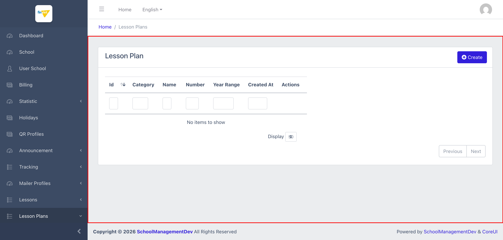
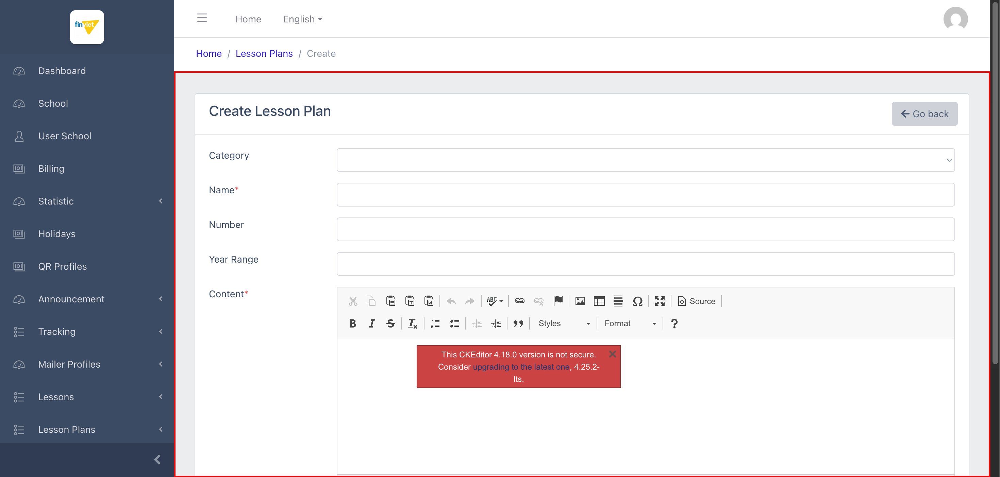

# M12.1 – Lesson Plans: Management (Managing Portal)

> Phạm vi: sub-module **Management** (`/admin/lesson-plans`), sub-module đầu tiên trong 2 sub-module của module **Lesson Plans**. Khác với module M11 Lessons (thư viện nội dung dùng chung, dữ liệu rất lớn), Lesson Plans là tính năng **hoàn toàn trống dữ liệu** trên môi trường dev tại thời điểm khảo sát — 0 bản ghi. Cùng phát hiện bảo mật CKEditor đã ghi nhận ở `M11-lessons/SM6-lessons.md`.

## Mục lục

- [1. Tổng quan](#1-tổng-quan)
  - [1.1 Giới thiệu](#11-giới-thiệu)
  - [1.2 Actors](#12-actors)
  - [1.3 Phạm vi](#13-phạm-vi)
- [2. Business Flow](#2-business-flow)
  - [2.1 Sequence Diagram](#21-sequence-diagram)
  - [2.2 Business Steps](#22-business-steps)
  - [2.3 Business Rules](#23-business-rules)
- [3. Feature Breakdown](#3-feature-breakdown)
  - [3.1 Acceptance Criteria](#31-acceptance-criteria)
  - [3.2 Danh sách Use Case](#32-danh-sách-use-case)
  - [3.3 Edge Cases](#33-edge-cases)
  - [3.4 UI Conventions](#34-ui-conventions)

---

## 1. Tổng quan

### 1.1 Giới thiệu

Lesson Plans (Management) quản lý danh sách "giáo án" — nội dung do giáo viên/trường soạn dựa trên thư viện Lessons dùng chung (M11). Mỗi Lesson Plan có Category (tuỳ chọn), Name, Number, Year Range, và nội dung (Content) soạn qua rich text editor.

**Phát hiện quan trọng — module trống hoàn toàn:** tại thời điểm khảo sát, danh sách hiển thị **"No items to show"** — không có bất kỳ Lesson Plan nào được tạo trên môi trường dev, khác biệt rõ rệt so với module Lessons (M11) vốn có tới 5.217 bản ghi. Dropdown "Category" trên form Create cũng có **0 option** (khớp với việc sub-module Categories cũng trống — xem `SM2-categories.md`).

**Phát hiện bảo mật — lặp lại từ M11:** trường "Content*" dùng CKEditor 4.18.0, và **cùng banner cảnh báo bảo mật** đã ghi nhận ở `M11-lessons/SM6-lessons.md` BR04 xuất hiện lại tại đây: *"This CKEditor 4.18.0 version is not secure. Consider upgrading to the latest one, 4.25.2-lts."* — xác nhận đây là 1 thư viện dùng chung trên toàn Managing Portal (nhúng ở ít nhất 2 module khác nhau), không phải vấn đề riêng lẻ của module Lessons.

### 1.2 Actors

| Actor | Mô tả |
|---|---|
| Finviet/SOHA Admin/Content team | Tạo/quản lý giáo án mẫu; trên môi trường dev hiện chưa có bản ghi nào được tạo. |

### 1.3 Phạm vi

| Trong phạm vi | Ngoài phạm vi |
|---|---|
| Xem trạng thái danh sách trống, xác nhận cấu trúc cột | Thực hiện Create thật (không có dữ liệu mẫu sẵn để xem Edit/View) |
| Xem cấu trúc form Create, xác nhận CKEditor và banner cảnh báo | Xác nhận hành vi khi có dữ liệu thật (sort, filter với kết quả khớp) — không kiểm chứng được vì không có bản ghi |

---

## 2. Business Flow

### 2.1 Sequence Diagram

```mermaid
sequenceDiagram
    actor Admin
    participant List as Lesson Plans (list)
    participant Create as Create Lesson Plan

    Admin->>List: Mở /admin/lesson-plans
    List-->>Admin: "No items to show" — 0 bản ghi trên môi trường dev
    Admin->>Create: Click "+ Create"
    Create-->>Admin: Form Category(dropdown rỗng, 0 option)/Name*/Number/Year Range/Content*(CKEditor — banner "not secure")
```

### 2.2 Business Steps

1. Admin xem danh sách các Lesson Plan đã tạo (hiện tại trống trên dev).
2. Admin bấm "+ Create" để soạn 1 Lesson Plan mới: chọn Category (nếu có), đặt Name, Number, Year Range, và soạn Content qua CKEditor.
3. `[Cần xác nhận]` hành vi Edit/View/Delete trên 1 bản ghi thật — không kiểm chứng được vì không có dữ liệu mẫu.

### 2.3 Business Rules

| ID | Mô tả |
|---|---|
| BR01 | Danh sách có 6 cột: Id (sort được), Category, Name, Number, Year Range, Created At, cộng Actions — tại thời điểm khảo sát **0/0 bản ghi**, hiển thị "No items to show". |
| BR02 | Form Create gồm 5 trường: Category (dropdown, **không bắt buộc**, hiện có 0 option do sub-module Categories trống — xem `SM2-categories.md`), Name* (bắt buộc), Number (text, không bắt buộc), Year Range (text tự do, không phải dropdown cố định như Lesson Set ở M11), Content* (CKEditor, bắt buộc). |
| BR03 | **[Rủi ro bảo mật — lặp lại]** Trường Content dùng CKEditor 4.18.0 với cùng banner cảnh báo *"not secure"* đã ghi nhận ở `M11-lessons/SM6-lessons.md` BR04 — xác nhận đây là vấn đề ở tầng thư viện dùng chung toàn Managing Portal, không giới hạn ở module Lessons. |
| BR04 | Trường "Year Range" ở đây là **text input tự do**, khác với Lesson Set (M11) nơi Year Range là dropdown cố định 2 giá trị (0-3/3-6) — cho thấy Lesson Plan không dùng chung validation Year Range với Lesson Set dù cùng thuộc hệ sinh thái nội dung giáo dục. |
| BR05 | Tiêu đề trang Create đúng và nhất quán ("Create Lesson Plan") — không lặp lại lỗi thiếu dấu cách đã ghi nhận ở các trang Edit của module Lessons (M11), phù hợp với quan sát trước đó rằng lỗi đó chỉ xảy ra ở trang Edit, không phải Create. |

---

## 3. Feature Breakdown

### 3.1 Acceptance Criteria

- Danh sách phải phản ánh đúng trạng thái dữ liệu hiện có — đạt ("No items to show" là chính xác vì thực sự chưa có bản ghi).
- Form Create phải hiển thị đầy đủ trường cần thiết để soạn 1 giáo án — đạt về cấu trúc.
- Cảnh báo bảo mật thư viện phải được xử lý (nâng cấp phiên bản) — **không đạt**, lặp lại vấn đề đã ghi nhận ở M11.

### 3.2 Danh sách Use Case

| Mã | Tên | Actor | Mô tả | Happy Path | Exception | Business Rules |
|---|---|---|---|---|---|---|
| UC-01 | Xem danh sách Lesson Plans (trống) | Admin | Xem trạng thái hiện tại của danh sách giáo án. | 1. Admin mở `/admin/lesson-plans`.<br>2. Trang hiển thị đủ 6 cột nhưng "No items to show".<br><br> | Không có dữ liệu để thử filter/sort thật. | BR01 |
| UC-02 | Xem form tạo mới Lesson Plan | Admin | Xem cấu trúc form Create. | 1. Admin click "+ Create".<br>2. Form hiển thị Category(rỗng)/Name*/Number/Year Range/Content*(CKEditor — banner cảnh báo bảo mật).<br><br> | Không thử submit Save thật. | BR02, BR03, BR04, BR05 |

### 3.3 Edge Cases

| # | Tình huống | Quan sát / Rủi ro |
|---|---|---|
| 1 | Toàn bộ module Lesson Plans trống dữ liệu (0 Lesson Plan, 0 Category) | Không thể kiểm chứng hành vi thực tế của tính năng (sort/filter với kết quả khớp, Edit, View nếu có, quan hệ với Category) — tất cả các quan sát trong tài liệu này chỉ dựa trên cấu trúc form/danh sách trống. `[Cần xác nhận]` toàn bộ hành vi khi có dữ liệu thật. |
| 2 | Category không bắt buộc và hiện có 0 option khả dụng | Vì sub-module Categories không có cách tạo mới qua UI (xem `SM2-categories.md`), admin hiện tại **không thể** gán Category cho bất kỳ Lesson Plan nào cho tới khi có Category được tạo (qua kênh khác ngoài UI này, ví dụ seed dữ liệu trực tiếp). |

### 3.4 UI Conventions

- Layout danh sách dùng chung DataTables tiêu chuẩn với ô lọc theo cột, giống các module khác.
- Form Create dùng bố cục 1 cột nhãn - 1 cột input, cùng CKEditor 4.18.0 đã thấy ở module Lessons (M11) cho trường nội dung dài.
