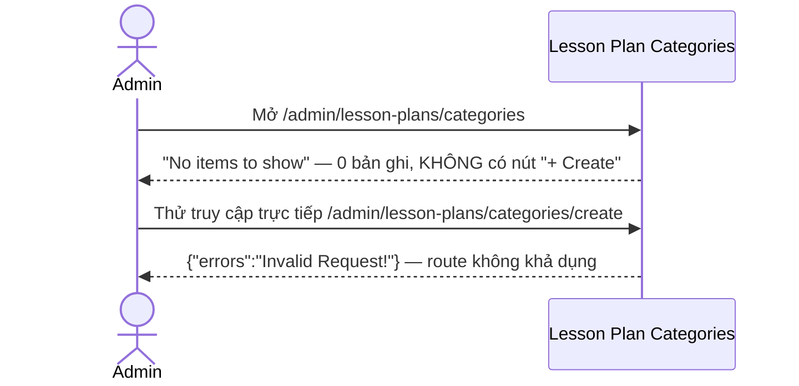
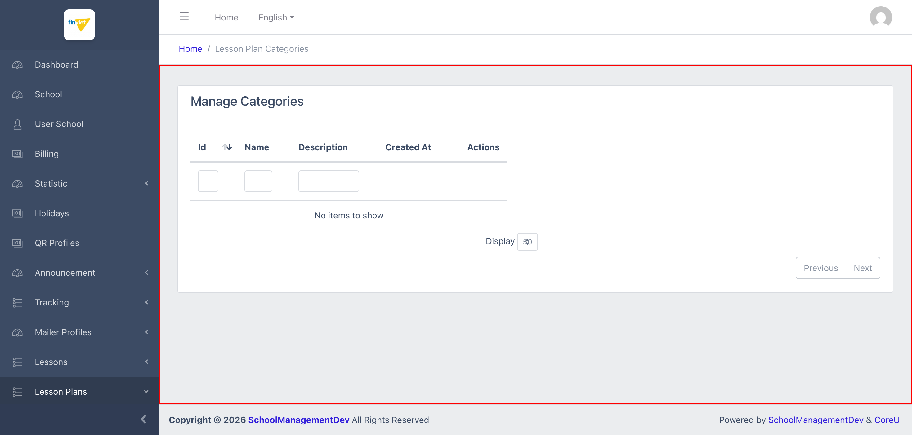

# M12.2 – Lesson Plans: Categories (Managing Portal)

> Phạm vi: sub-module **Categories** (`/admin/lesson-plans/categories`), sub-module thứ hai trong 2 sub-module của module **Lesson Plans**. **Phát hiện đáng chú ý nhất:** sub-module này **không có bất kỳ cách nào để tạo mới 1 Category qua giao diện** — không có nút Create, và thử truy cập trực tiếp URL quy ước cũng trả về lỗi.

## Mục lục

- [1. Tổng quan](#1-tổng-quan)
  - [1.1 Giới thiệu](#11-giới-thiệu)
  - [1.2 Actors](#12-actors)
  - [1.3 Phạm vi](#13-phạm-vi)
- [2. Business Flow](#2-business-flow)
  - [2.1 Sequence Diagram](#21-sequence-diagram)
  - [2.2 Business Steps](#22-business-steps)
  - [2.3 Business Rules](#23-business-rules)
- [3. Feature Breakdown](#3-feature-breakdown)
  - [3.1 Acceptance Criteria](#31-acceptance-criteria)
  - [3.2 Danh sách Use Case](#32-danh-sách-use-case)
  - [3.3 Edge Cases](#33-edge-cases)
  - [3.4 UI Conventions](#34-ui-conventions)

---

## 1. Tổng quan

### 1.1 Giới thiệu

Categories quản lý danh mục phân loại cho Lesson Plans (ví dụ dùng để nhóm giáo án theo chủ đề). Danh sách gồm 4 cột dữ liệu: Id, Name, Description, Created At.

**Phát hiện quan trọng — không có chức năng Create:** khác với **mọi** danh sách khác đã khảo sát trong toàn bộ Managing Portal (luôn có nút "+ Create" ở góc phải card-header), trang Categories **hoàn toàn không có nút Create nào** — xác nhận qua đọc trực tiếp HTML của card-header (không có link nào ngoài Previous/Next phân trang). Thử truy cập trực tiếp URL quy ước `/admin/lesson-plans/categories/create` cũng trả về lỗi `{"errors":"Invalid Request!"}` (response JSON thô, không có `<title>` trang) — xác nhận đây không phải lỗi ẩn nút mà route tạo mới **không tồn tại hoặc không được implement theo quy ước REST thông thường**. Kết hợp với việc danh sách Lesson Plans (`SM1-management.md`) trống hoàn toàn và dropdown Category ở đó có 0 option, có thể suy ra **quản trị viên hiện không có cách nào tạo Category mới qua Managing Portal** — category (nếu có) phải được tạo qua kênh khác (seed dữ liệu, migration, hoặc 1 giao diện khác chưa được biết tới).

### 1.2 Actors

| Actor | Mô tả |
|---|---|
| Finviet/SOHA Admin | Xem danh mục phân loại Lesson Plan — hiện không có khả năng tạo mới qua UI này. |

### 1.3 Phạm vi

| Trong phạm vi | Ngoài phạm vi |
|---|---|
| Xem trạng thái danh sách trống, xác nhận cấu trúc cột | Xác định kênh thực sự dùng để tạo Category (nếu có, ngoài phạm vi UI Managing Portal) |
| Xác nhận không có nút Create qua đọc HTML trực tiếp | |
| Thử truy cập URL `/create` quy ước để xác nhận route không khả dụng | Thử các phương thức khác (API trực tiếp, Postman) để tìm route ẩn — ngoài phạm vi khảo sát UI |

---

## 2. Business Flow

### 2.1 Sequence Diagram

### 2.2 Business Steps

1. Admin xem danh sách Category hiện có (hiện tại trống trên dev).
2. `[Không khả dụng]` Không có bước tạo mới Category nào được xác nhận là hoạt động qua UI Managing Portal.

### 2.3 Business Rules

| ID | Mô tả |
|---|---|
| BR01 | Danh sách có 4 cột dữ liệu: Id (sort được), Name, Description, Created At, cộng Actions — tại thời điểm khảo sát **0/0 bản ghi**, hiển thị "No items to show". |
| BR02 | **[Không có chức năng Create]** Card-header của trang không chứa link/nút Create nào (xác nhận qua đọc HTML trực tiếp) — khác biệt với **tất cả** các danh sách khác đã khảo sát trong Managing Portal tính đến thời điểm này (M2-M11), vốn luôn có nút "+ Create". |
| BR03 | Truy cập trực tiếp `GET /admin/lesson-plans/categories/create` (URL quy ước Laravel resource route) trả về **`{"errors":"Invalid Request!"}`** dạng JSON thô, không có tiêu đề trang — xác nhận route này không được xử lý như 1 trang thông thường, khác hẳn hành vi 404 hoặc trang lỗi có giao diện đầy đủ đã thấy ở các trường hợp lỗi khác trong dự án. |
| BR04 | Heading H4 trên trang là "Manage Categories" (không có chữ "Lesson Plan") trong khi `<title>` tab và breadcrumb đều ghi đầy đủ "Lesson Plan Categories" — heading generic hơn nhưng không sai, không phải lỗi nghiêm trọng. |

---

## 3. Feature Breakdown

### 3.1 Acceptance Criteria

- Danh sách phải phản ánh đúng trạng thái dữ liệu hiện có — đạt.
- Admin phải có khả năng tạo Category mới để phục vụ phân loại Lesson Plan — **không đạt**, không tìm thấy đường dẫn UI nào khả dụng (BR02, BR03).

### 3.2 Danh sách Use Case

| Mã | Tên | Actor | Mô tả | Happy Path | Exception | Business Rules |
|---|---|---|---|---|---|---|
| UC-01 | Xem danh sách Categories (trống, không có Create) | Admin | Xem trạng thái hiện tại của danh mục Lesson Plan. | 1. Admin mở `/admin/lesson-plans/categories`. 2. Trang hiển thị đủ 4 cột nhưng "No items to show", không có nút Create.   | Thử truy cập trực tiếp URL `/create` quy ước → nhận lỗi JSON thô `{"errors":"Invalid Request!"}`, xác nhận route không khả dụng theo cách thông thường. | BR01, BR02, BR03 |

### 3.3 Edge Cases

| # | Tình huống | Quan sát / Rủi ro |
|---|---|---|
| 1 | Không có cách tạo Category mới qua UI (BR02, BR03) | Đây là điểm khác biệt lớn nhất phát hiện được trong module Lesson Plans — nếu đây không phải chủ đích thiết kế (ví dụ Category được quản lý qua 1 hệ thống khác hoặc chưa triển khai xong tính năng), toàn bộ khả năng phân loại Lesson Plan theo Category sẽ không dùng được trong thực tế. Nên xác nhận với đội dev đây là tính năng chưa hoàn thiện hay chủ đích thiết kế. `[Cần xác nhận]` |
| 2 | Danh sách Lesson Plans (`SM1-management.md`) phụ thuộc dữ liệu Category nhưng Category không tạo được | Tạo ra 1 vòng phụ thuộc không thể phá vỡ qua UI: Lesson Plan có thể tạo được (Category không bắt buộc) nhưng sẽ không bao giờ có Category nào để gán trừ khi dữ liệu được nhập từ nguồn khác ngoài Managing Portal. |

### 3.4 UI Conventions

- Layout danh sách dùng chung DataTables tiêu chuẩn với ô lọc theo cột, nhưng **thiếu nút Create** — ngoại lệ duy nhất trong toàn bộ các danh sách đã khảo sát từ M2 đến nay.
