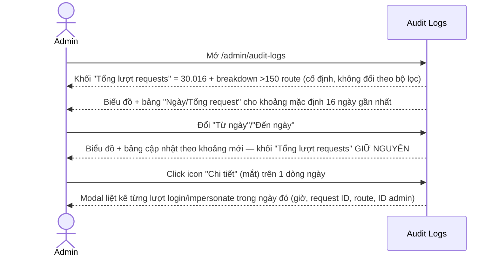
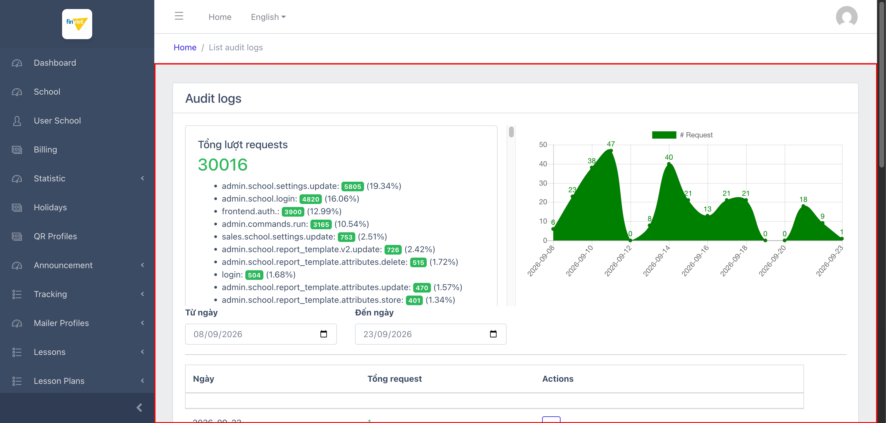
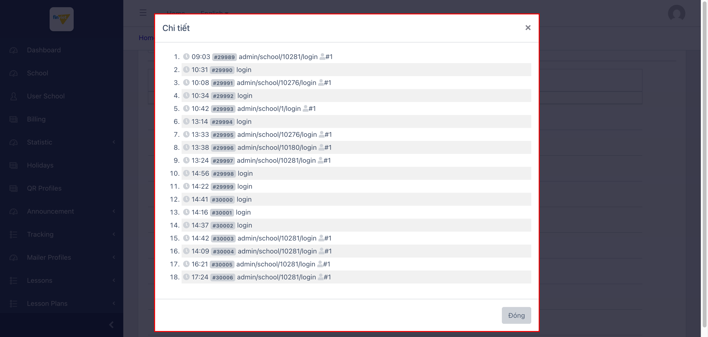

# M13 – Audit Log (Managing Portal)

> Phạm vi: module **Audit Log** (`/admin/audit-logs`), không có sub-module (chỉ 1 mục sidebar duy nhất). **Phát hiện quan trọng nhất:** trang gồm **2 phần dữ liệu độc lập, phạm vi khác nhau, không được phân tách rõ bằng tiêu đề** — (1) thống kê tổng lượt request theo route name (dường như toàn thời gian, không đổi khi lọc ngày) và (2) bảng số lượt "login" theo từng ngày (lọc được theo khoảng ngày). Tên gọi "Audit Log" có phần gây hiểu lầm: trang **không** ghi lại nội dung thay đổi dữ liệu (before/after) mà chỉ đếm số lượt gọi route và liệt kê chi tiết các lượt đăng nhập/impersonate.

## Mục lục

- [1. Tổng quan](#1-tổng-quan)
  - [1.1 Giới thiệu](#11-giới-thiệu)
  - [1.2 Actors](#12-actors)
  - [1.3 Phạm vi](#13-phạm-vi)
- [2. Business Flow](#2-business-flow)
  - [2.1 Sequence Diagram](#21-sequence-diagram)
  - [2.2 Business Steps](#22-business-steps)
  - [2.3 Business Rules](#23-business-rules)
- [3. Feature Breakdown](#3-feature-breakdown)
  - [3.1 Acceptance Criteria](#31-acceptance-criteria)
  - [3.2 Danh sách Use Case](#32-danh-sách-use-case)
  - [3.3 Edge Cases](#33-edge-cases)
  - [3.4 UI Conventions](#34-ui-conventions)

---

## 1. Tổng quan

### 1.1 Giới thiệu

Audit Log là trang thống kê lượt gọi request trong hệ thống, gồm 2 khối nội dung riêng biệt trên cùng 1 trang:

1. **Khối "Tổng lượt requests"** (thẻ bên trái): hiển thị tổng số **30.016** request, kèm danh sách hơn 150 route name (ví dụ `admin.school.settings.update`, `admin.school.login`, `frontend.auth.`, `admin.commands.run`...) cùng số lượt và phần trăm tương ứng, cuộn được trong 1 khung cố định.
2. **Khối biểu đồ + bảng theo ngày** (bên phải/bên dưới): biểu đồ vùng (area chart) và bảng "Ngày / Tổng request / Actions" hiển thị số lượt **đăng nhập** (login + impersonate-login) theo từng ngày, lọc được qua 2 ô "Từ ngày"/"Đến ngày" (mặc định 16 ngày gần nhất). Mỗi dòng có action "Chi tiết" (icon mắt) mở modal liệt kê từng lượt đăng nhập cụ thể trong ngày đó (giờ, request ID, route, và icon người dùng kèm ID admin thực hiện).

**Phát hiện quan trọng — 2 phạm vi dữ liệu độc lập:** đã xác nhận qua thử nghiệm trực tiếp — thay đổi khoảng "Từ ngày"/"Đến ngày" từ 16 ngày xuống còn 2 ngày làm bảng theo ngày cập nhật đúng (16 dòng → 2 dòng), nhưng khối "Tổng lượt requests" ở bên trái **hoàn toàn không đổi** (vẫn giữ nguyên 30.016 và toàn bộ breakdown phần trăm). Điều này xác nhận khối tổng số liệu là 1 thống kê **độc lập với bộ lọc ngày**, khả năng cao là tổng từ khi hệ thống bắt đầu ghi nhận (toàn thời gian) hoặc theo 1 khoảng thời gian cố định khác không hiển thị trên UI — không có nhãn nào trên trang phân biệt rõ 2 phạm vi này.

**Phát hiện quan trọng — nội dung "Chi tiết" chỉ gồm sự kiện đăng nhập:** dữ liệu mẫu ở cả 2 ngày có request (2026-09-21: 18 lượt, 2026-09-22: 9 lượt) đều **chỉ chứa 2 loại route**: `login` (admin tự đăng nhập) và `admin/school/{id}/login #1` (admin đăng nhập/impersonate vào 1 trường cụ thể, số `#1` khả năng là ID admin thực hiện) — khớp với 2 route hàng đầu trong khối tổng số liệu (`admin.school.login`: 4.820 lượt, `login`: 504 lượt). Bảng theo ngày + modal Chi tiết dường như được thiết kế **chuyên biệt để theo dõi hoạt động đăng nhập/impersonate**, không phải nhật ký đầy đủ mọi hành động (create/update/delete) như tên "Audit Log" gợi ý — các route khác (vd `admin.school.settings.update`, `admin.school.delete`...) chỉ xuất hiện ở khối thống kê tổng, không có chi tiết từng lượt tương ứng trên UI này.

### 1.2 Actors

| Actor | Mô tả |
|---|---|
| Finviet/SOHA Admin | Theo dõi tổng quan lượt sử dụng hệ thống theo route, và kiểm tra lịch sử đăng nhập/impersonate theo ngày. |

### 1.3 Phạm vi

| Trong phạm vi | Ngoài phạm vi |
|---|---|
| Xem khối thống kê tổng, xác nhận phạm vi độc lập với bộ lọc ngày qua thử nghiệm trực tiếp | Xác định chính xác khoảng thời gian mà khối "Tổng lượt requests" bao phủ (không có nhãn trên UI, không truy cập được backend/DB) |
| Xem bảng theo ngày, mở modal Chi tiết, xác nhận nội dung chỉ gồm sự kiện đăng nhập | Xác nhận route `admin.school.settings.update` (đứng đầu breakdown, 19.34%) có được ghi log chi tiết ở đâu khác trong hệ thống hay không |

---

## 2. Business Flow

### 2.1 Sequence Diagram

### 2.2 Business Steps

1. Admin mở trang để xem tổng quan lượt request toàn hệ thống theo route name (khối bên trái).
2. Admin tuỳ chọn thu hẹp/mở rộng khoảng ngày để xem số lượt đăng nhập theo ngày (biểu đồ + bảng).
3. Admin bấm "Chi tiết" trên 1 ngày cụ thể để xem từng lượt đăng nhập/impersonate riêng lẻ trong ngày đó.

### 2.3 Business Rules

| ID | Mô tả |
|---|---|
| BR01 | Khối "Tổng lượt requests" hiển thị tổng 30.016 request và breakdown theo route name (hơn 150 route, sắp xếp giảm dần theo số lượt) kèm % — xác nhận qua thử nghiệm là **không đổi khi thay đổi bộ lọc "Từ ngày"/"Đến ngày"**, tức đây là 1 thống kê độc lập, phạm vi thời gian không hiển thị rõ trên UI. `[Cần xác nhận]` khoảng thời gian chính xác (toàn thời gian hay 1 kỳ cố định khác). |
| BR02 | Biểu đồ vùng (area chart) và bảng "Ngày / Tổng request / Actions" bên dưới **có lọc theo khoảng ngày** (input `type="date"`, mặc định 16 ngày gần nhất) — xác nhận qua thử nghiệm thu hẹp khoảng ngày làm cả biểu đồ và bảng cập nhật đúng số dòng. |
| BR03 | **[Phạm vi hẹp hơn tên gọi]** Nội dung modal "Chi tiết" (mở từ action duy nhất trên mỗi dòng) chỉ liệt kê 2 loại route: `login` và `admin/school/{id}/login` — bảng theo ngày thực chất là **nhật ký đăng nhập/impersonate**, không phải nhật ký đầy đủ mọi thao tác ghi dữ liệu (create/update/delete) như tên module "Audit Log" có thể gợi ý. |
| BR04 | Mỗi dòng trong modal Chi tiết gồm: giờ (HH:mm), request ID dạng `#NNNNN` (đánh số tuần tự toàn cục, không reset theo ngày), route, và với các lượt `admin/school/{id}/login` có thêm icon người dùng kèm số ID (vd `#1`) — khả năng là ID của admin thực hiện hành động impersonate. `[Cần xác nhận]` ý nghĩa chính xác của số ID này. |
| BR05 | Trang không có action Create/Edit/Delete nào — đây là trang **chỉ đọc** (read-only reporting), action duy nhất là "Chi tiết" (xem thêm), phù hợp với vai trò thống kê/theo dõi thay vì quản lý dữ liệu. |
| BR06 | Tên gọi module không nhất quán qua 3 vị trí: sidebar "Audit log" (a, thường), breadcrumb "List audit logs" (không viết hoa "List"), heading H4 trong trang "Audit logs" — 3 cách viết khác nhau cho cùng 1 khái niệm, lỗi nhỏ về nhất quán nhưng không ảnh hưởng chức năng. |
| BR07 | Toàn bộ nhãn trên trang này (Tổng lượt requests, Từ ngày, Đến ngày, Ngày, Tổng request, Chi tiết, Đóng) đều bằng **tiếng Việt** — khác biệt với phần lớn Managing Portal dùng tiếng Anh, đây là module có tỷ lệ tiếng Việt cao nhất phát hiện được từ đầu dự án tới nay. |

---

## 3. Feature Breakdown

### 3.1 Acceptance Criteria

- Khối thống kê tổng phải phản ánh đúng dữ liệu hệ thống — không kiểm chứng được tuyệt đối vì không truy cập DB, nhưng số liệu nhất quán qua nhiều lần tải trang.
- Bộ lọc ngày phải chỉ ảnh hưởng đúng phần dữ liệu liên quan (biểu đồ + bảng) — đạt, xác nhận qua thử nghiệm; khối tổng số liệu bên trái đúng như thiết kế là không bị ảnh hưởng (hoặc đây có thể là hành vi không chủ đích — xem Edge Case #1).
- Modal "Chi tiết" phải hiển thị đúng số lượng mục khớp với số "Tổng request" của ngày đó — đạt, xác nhận 18 mục trong modal khớp giá trị "18" ở dòng 2026-09-21.

### 3.2 Danh sách Use Case

| Mã | Tên | Actor | Mô tả | Happy Path | Exception | Business Rules |
|---|---|---|---|---|---|---|
| UC-01 | Xem tổng quan thống kê request + biểu đồ/bảng theo ngày | Admin | Xem tổng lượt request toàn hệ thống theo route, và số lượt đăng nhập theo ngày. | 1. Admin mở `/admin/audit-logs`. 2. Trang hiển thị khối "Tổng lượt requests" (30.016, breakdown route) và biểu đồ + bảng theo ngày (mặc định 16 ngày, khoảng 08/09/2026-23/09/2026).   | Đổi khoảng ngày còn 2 ngày → biểu đồ/bảng cập nhật đúng, khối tổng số liệu không đổi (xác nhận BR01). | BR01, BR02, BR06, BR07 |
| UC-02 | Xem chi tiết các lượt đăng nhập trong 1 ngày | Admin | Click "Chi tiết" để xem từng lượt login/impersonate cụ thể. | 1. Admin click icon "Chi tiết" trên dòng 2026-09-21 (18 lượt). 2. Modal hiển thị đủ 18 mục: giờ, request ID, route, ID admin (nếu là impersonate).   | Ngày có 0 lượt (vd 2026-09-20) → modal mở nhưng danh sách trống. | BR03, BR04, BR05 |

### 3.3 Edge Cases

| # | Tình huống | Quan sát / Rủi ro |
|---|---|---|
| 1 | Khối "Tổng lượt requests" không phản hồi bộ lọc ngày trong khi nằm chung 1 trang với phần có lọc (BR01) | Admin có thể lầm tưởng số 30.016 và breakdown route phản ánh đúng khoảng ngày đang chọn ở "Từ ngày"/"Đến ngày" — thực tế không phải vậy. Nên làm rõ trên UI (vd thêm nhãn "toàn thời gian" hoặc khoảng thời gian cụ thể) để tránh hiểu lầm. `[Cần xác nhận]` đây là hành vi chủ đích hay thiếu sót khi phát triển. |
| 2 | Tên module "Audit Log" gợi ý nhật ký đầy đủ mọi thao tác, nhưng phần chi tiết (Chi tiết modal) chỉ có dữ liệu đăng nhập (BR03) | Nếu đội vận hành cần tra cứu "ai đã sửa gì" (ví dụ ai đã xoá 1 trường học, khớp route `admin.school.delete` xuất hiện trong breakdown với 212 lượt), trang này **không cung cấp** thông tin đó ở mức chi tiết từng lượt — chỉ có tổng số lượt gọi route đó, không có timestamp/actor/target cụ thể như với route login. Nên xác nhận với đội dev liệu có nhật ký chi tiết hơn ở nơi khác (vd log file, DB riêng) hay tính năng này chưa hoàn thiện. |
| 3 | Số ID người dùng trong modal Chi tiết (vd `#1`) không có tooltip hay link giải thích | Không thể xác nhận trực tiếp trên UI đây có phải admin ID hay không, hoặc admin nào tương ứng — chỉ suy luận qua ngữ cảnh (route đều là `admin/school/*/login` gắn liền patterns "đăng nhập hộ trường"). `[Cần xác nhận]`. |

### 3.4 UI Conventions

- Toàn bộ nhãn trên trang bằng tiếng Việt (BR07) — khác biệt rõ rệt với phần lớn Managing Portal.
- Khối "Tổng lượt requests" dùng danh sách cuộn dọc trong khung cố định (nhiều hơn 150 mục) thay vì bảng DataTables tiêu chuẩn — cách trình bày riêng biệt so với mọi module khác trong dự án.
- Biểu đồ vùng (area chart) là loại biểu đồ trực quan hoá dữ liệu **đầu tiên** xuất hiện trong toàn bộ Managing Portal tính đến thời điểm khảo sát (các module trước đều chỉ dùng bảng/số liệu dạng text).
- Action "Chi tiết" dùng `` với `data-toggle="modal"` thay vì thẻ `<a>` hay `<button>` chuẩn — không ảnh hưởng chức năng nhưng là điểm khác biệt nhỏ về ngữ nghĩa HTML so với các action khác trong dự án (thường dùng `<a>` cho View, `<form><button>` cho Delete).
