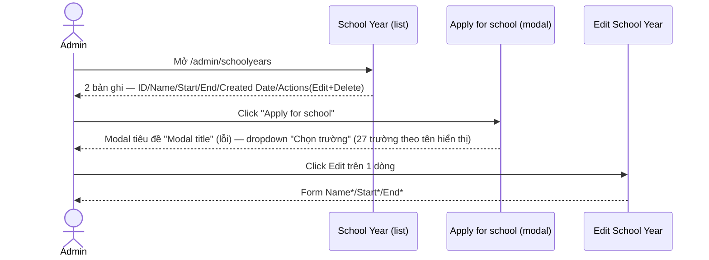
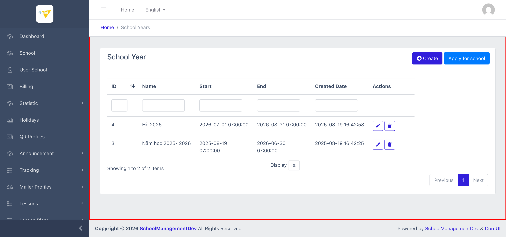
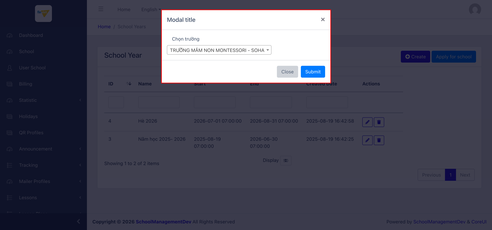
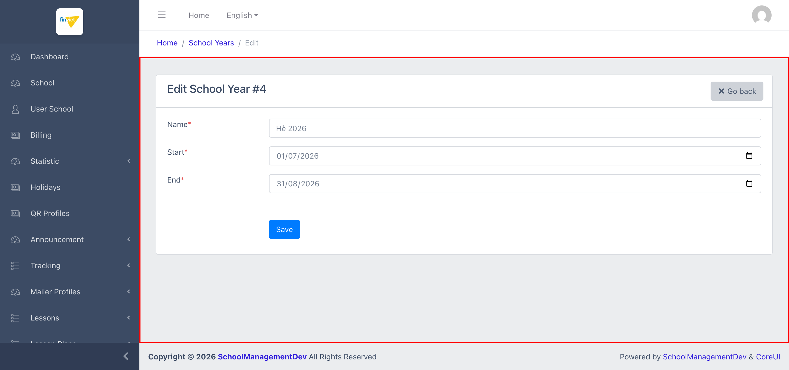

# M14 – School Year (Managing Portal)

> Phạm vi: module **School Year** (`/admin/schoolyears`), không có sub-module (chỉ 1 mục sidebar duy nhất). Quản lý các "năm học"/kỳ học dùng chung, và có 1 chức năng "Apply for school" để áp dụng năm học cho 1 trường cụ thể — chức năng này có 1 **lỗi rất rõ ràng**: modal hiển thị tiêu đề mặc định "Modal title" chưa từng được sửa.

## Mục lục

- [1. Tổng quan](#1-tổng-quan)
  - [1.1 Giới thiệu](#11-giới-thiệu)
  - [1.2 Actors](#12-actors)
  - [1.3 Phạm vi](#13-phạm-vi)
- [2. Business Flow](#2-business-flow)
  - [2.1 Sequence Diagram](#21-sequence-diagram)
  - [2.2 Business Steps](#22-business-steps)
  - [2.3 Business Rules](#23-business-rules)
- [3. Feature Breakdown](#3-feature-breakdown)
  - [3.1 Acceptance Criteria](#31-acceptance-criteria)
  - [3.2 Danh sách Use Case](#32-danh-sách-use-case)
  - [3.3 Edge Cases](#33-edge-cases)
  - [3.4 UI Conventions](#34-ui-conventions)

---

## 1. Tổng quan

### 1.1 Giới thiệu

School Year quản lý danh sách các "năm học"/kỳ học (ví dụ "Năm học 2025-2026", "Hè 2026") dùng làm mốc thời gian tham chiếu cho các tính năng khác trong hệ thống (lịch học, báo cáo theo năm học...). Tại thời điểm khảo sát có **2 bản ghi**. Ngoài Create/Edit/Delete tiêu chuẩn, trang có thêm 1 nút đặc biệt **"Apply for school"** để áp dụng (gán) năm học cho 1 trường cụ thể — khớp với route `admin.schoolyears.apply-to-school` đã thấy trong breakdown thống kê ở `M13-audit-log/SM1-audit-log.md` (9 lượt gọi).

**Phát hiện lỗi rõ ràng — placeholder chưa sửa:** modal mở ra khi bấm "Apply for school" hiển thị tiêu đề đúng nguyên văn **"Modal title"** — text mẫu mặc định của Bootstrap, chưa từng được thay bằng tiêu đề thực tế (ví dụ "Áp dụng năm học cho trường"). Modal cũng dùng `id="exampleModal"` — cùng tên mặc định trong tài liệu Bootstrap — 2 dấu hiệu cùng xác nhận đây là code được copy từ boilerplate/mẫu và chưa hoàn thiện bước tuỳ biến.

**Phát hiện — lỗi tiêu đề tái diễn:** trang Edit có tiêu đề tab **"ManageSchool Year"** (thiếu dấu cách) — cùng loại lỗi Blade layout đã ghi nhận nhiều lần ở module Lessons (M11: Lesson Set/Area/Group/Lesson đều có lỗi "Manage{Entity}" tương tự). Việc lỗi này xuất hiện ở **module hoàn toàn khác** (School Year, không liên quan gì tới Lessons) xác nhận đây là 1 component/layout dùng chung cho **toàn bộ trang Edit trong Managing Portal**, không giới hạn ở 1 module cụ thể.

### 1.2 Actors

| Actor | Mô tả |
|---|---|
| Finviet/SOHA Admin | Tạo/sửa/xoá năm học dùng chung, và gán 1 năm học cho 1 trường cụ thể qua "Apply for school". |

### 1.3 Phạm vi

| Trong phạm vi | Ngoài phạm vi |
|---|---|
| Xem danh sách, xác nhận cấu trúc cột/action | Thực hiện Create/Edit/Delete thật |
| Mở modal "Apply for school", xác nhận cấu trúc form và lỗi "Modal title" | Bấm Submit thật trên modal Apply for school (tránh gán năm học thật cho 1 trường trong môi trường dev) |
| Xác nhận qua DOM: field nào bắt buộc thực sự (`required`) | Xác định chính xác điều gì xảy ra ở backend khi Submit (ví dụ có tạo Holiday/Lesson Plan mặc định theo năm học hay không) |

---

## 2. Business Flow

### 2.1 Sequence Diagram

### 2.2 Business Steps

1. Admin xem danh sách các năm học đã tạo.
2. Admin bấm "+ Create" để tạo năm học mới (Name, Start, End), hoặc Edit để sửa năm học đã có.
3. Admin bấm "Apply for school" → chọn 1 trường từ dropdown → Submit để áp dụng năm học cho trường đó. `[Cần xác nhận]` áp dụng năm học nào cụ thể (modal không có trường chọn School Year, chỉ chọn School) — có thể áp dụng toàn bộ năm học hiện có, hoặc 1 năm học mặc định/active nào đó ở backend.

### 2.3 Business Rules

| ID | Mô tả |
|---|---|
| BR01 | Danh sách có 5 cột: ID (sort được), Name, Start, End, Created Date, cộng Actions (**chỉ Edit/Delete, không có View/Export**). Tổng 2/2 bản ghi. |
| BR02 | Card-header có **2 nút**: "+ Create" (tạo năm học mới) và **"Apply for school"** (gán năm học cho 1 trường) — nút thứ 2 là tính năng đặc biệt chưa thấy ở module nào khác trong dự án tính đến nay. |
| BR03 | **[Lỗi rõ ràng — placeholder chưa sửa]** Modal "Apply for school" hiển thị tiêu đề nguyên văn **"Modal title"** (text mẫu Bootstrap mặc định) và dùng `id="exampleModal"` — xác nhận qua đọc trực tiếp DOM, không phải lỗi hiển thị tạm thời. |
| BR04 | Modal "Apply for school" chỉ có **1 trường**: "Chọn trường" (`name="school"`, select đơn, 27 option) — dropdown hiển thị **tên trường đầy đủ dạng chữ hoa** (vd "TRƯỜNG MẦM NON MONTESSORI - SOHA"), khác với dropdown chọn trường ở M11 (Import Lesson Sets For Tenant) vốn hiển thị theo mã tenant (vd "mamnon20260828a") — 2 nơi khác nhau dùng 2 nguồn dữ liệu hiển thị khác nhau cho cùng khái niệm "trường". Form submit `POST` tới `/admin/schoolyears/apply-to-school`. |
| BR05 | Form không có trường nào để chọn **năm học cụ thể** cần áp dụng — modal được mở từ nút chung ở card-header (không phải từ 1 dòng cụ thể trong bảng), nên không rõ hành động Submit sẽ áp dụng năm học nào trong 2 năm học hiện có. `[Cần xác nhận]`. |
| BR06 | Form Create/Edit gồm 3 trường: Name*, Start* (date picker), End* (date picker) — cả 3 đều có dấu `*` trên nhãn nhưng **không có thuộc tính HTML `required`** thực sự (xác nhận qua DOM) — cùng pattern "asterisk không đi kèm required" đã ghi nhận ở Lesson Area (M11) và Mailer Profiles (M10). |
| BR07 | **[Lỗi tiêu đề — xác nhận lỗi xuyên module]** Tiêu đề tab trang Edit là "ManageSchool Year" (thiếu dấu cách) — cùng loại lỗi đã ghi nhận nhiều lần ở module Lessons (M11), nay xuất hiện ở 1 module hoàn toàn khác, xác nhận đây là lỗi ở tầng layout/component Edit dùng chung **toàn Managing Portal**. |
| BR08 | Nút Delete submit `POST` với `_method=DELETE` tới `/admin/schoolyears/{id}/destroy` — không phát hiện thuộc tính xác nhận nào trong DOM, cùng pattern chưa-xác-nhận-được đã ghi nhận xuyên suốt dự án. |

---

## 3. Feature Breakdown

### 3.1 Acceptance Criteria

- Danh sách phải hiển thị đúng các năm học hiện có — đạt.
- Modal "Apply for school" phải có tiêu đề rõ ràng, mô tả đúng chức năng — **không đạt** (BR03).
- Tiêu đề trang Edit phải nhất quán — **không đạt** (BR07, lặp lại từ M11).

### 3.2 Danh sách Use Case

| Mã | Tên | Actor | Mô tả | Happy Path | Exception | Business Rules |
|---|---|---|---|---|---|---|
| UC-01 | Xem danh sách School Years | Admin | Xem toàn bộ năm học đã tạo. | 1. Admin mở `/admin/schoolyears`. 2. Trang hiển thị 2 bản ghi, 2 nút "+ Create"/"Apply for school" ở card-header.   | Không thử Delete thật. | BR01, BR02 |
| UC-02 | Mở modal "Apply for school" | Admin | Xem cấu trúc chức năng gán năm học cho 1 trường. | 1. Admin click "Apply for school". 2. Modal hiện ra với tiêu đề lỗi "Modal title" và dropdown "Chọn trường" (27 option).   | Không bấm Submit thật để tránh gán năm học thật cho 1 trường trong môi trường dev. | BR03, BR04, BR05 |
| UC-03 | Sửa 1 School Year | Admin | Cập nhật Name/Start/End của 1 năm học. | 1. Admin click icon Edit trên dòng ID=4. 2. Form hiển thị Name*/Start*/End* với giá trị hiện có.   | Không thử submit Save thật. | BR06, BR07, BR08 |

### 3.3 Edge Cases

| # | Tình huống | Quan sát / Rủi ro |
|---|---|---|
| 1 | Tiêu đề modal "Modal title" chưa sửa (BR03) | Lỗi hiển thị rõ ràng nhất phát hiện được trong dự án tính đến nay — bất kỳ admin nào bấm "Apply for school" đều thấy ngay text mẫu chưa hoàn thiện, ảnh hưởng tới độ tin cậy cảm nhận của tính năng dù bản thân chức năng có thể hoạt động đúng. Nên ưu tiên sửa vì đây là lỗi rất dễ nhận thấy và dễ sửa. |
| 2 | Không rõ modal áp dụng năm học nào khi có nhiều năm học tồn tại (BR05) | Nếu trong tương lai có nhiều hơn 2 năm học, admin sẽ hoàn toàn không biết chức năng này áp dụng năm học nào cho trường đã chọn — có thể gây nhầm lẫn nghiêm trọng nếu áp nhầm năm học. `[Cần xác nhận]` với đội dev về logic backend thực tế. |
| 3 | Dropdown "Chọn trường" trong modal dùng tên hiển thị đầy đủ, khác với dropdown mã tenant ở M11 (BR04) | Không phải lỗi, nhưng là điểm không nhất quán về cách chọn trường giữa 2 tính năng khác nhau trong cùng Managing Portal — 1 nơi dùng tên đầy đủ dễ đọc, 1 nơi dùng mã tenant kỹ thuật. |

### 3.4 UI Conventions

- Danh sách dùng chung layout DataTables tiêu chuẩn với ô lọc theo cột, giống các module khác.
- Đây là module đầu tiên trong dự án có 2 nút hành động ở card-header (thay vì chỉ 1 nút "+ Create" như thông thường).
- Form Create/Edit dùng bố cục 1 cột nhãn - 1 cột input tiêu chuẩn, với Start/End dùng date picker HTML chuẩn (không phải text input tự do như Year Range ở Lesson Plan, M12).
