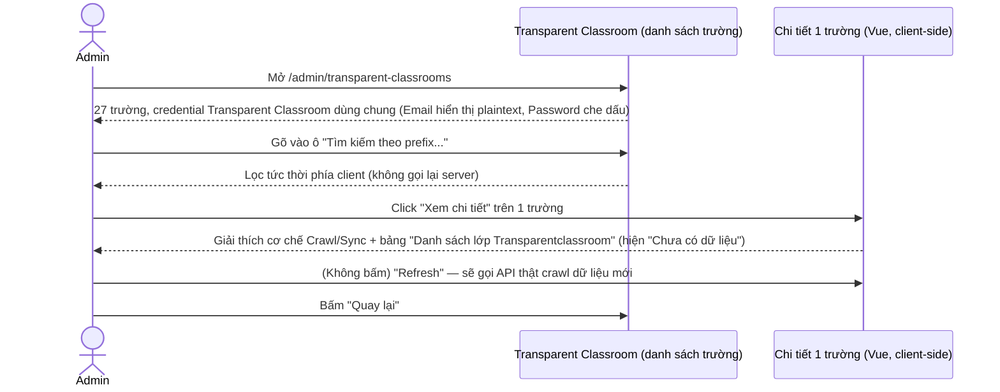
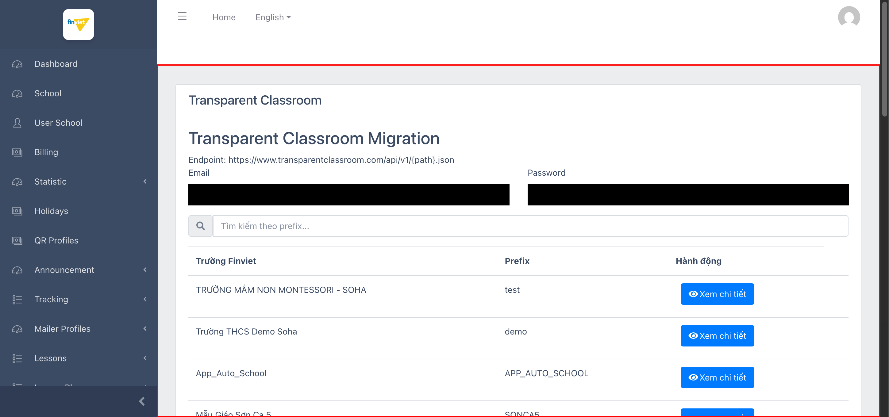
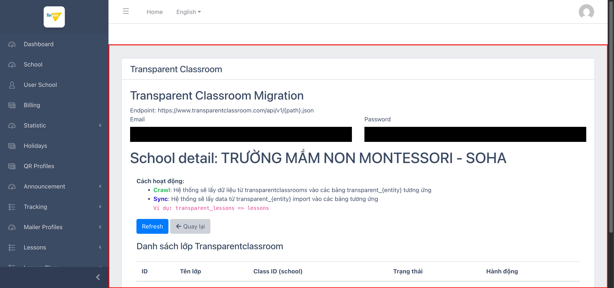

# M15 – Transparent Classroom (Managing Portal)

> Phạm vi: module **Transparent Classroom** (`/admin/transparent-classrooms`), không có sub-module (chỉ 1 mục sidebar duy nhất). Đây là công cụ **crawl + sync dữ liệu từ 1 dịch vụ bên thứ ba thật** (transparentclassroom.com) vào hệ thống — và là module **đầu tiên trong toàn dự án được xây dựng bằng Vue.js** (client-side rendering) thay vì Blade server-rendered như mọi module trước. **Phát hiện bảo mật:** lộ email thật (dạng plaintext, đã redact khi lưu ảnh) của tài khoản tích hợp dùng chung cho toàn bộ 27 trường.

## Mục lục

- [1. Tổng quan](#1-tổng-quan)
  - [1.1 Giới thiệu](#11-giới-thiệu)
  - [1.2 Actors](#12-actors)
  - [1.3 Phạm vi](#13-phạm-vi)
- [2. Business Flow](#2-business-flow)
  - [2.1 Sequence Diagram](#21-sequence-diagram)
  - [2.2 Business Steps](#22-business-steps)
  - [2.3 Business Rules](#23-business-rules)
- [3. Feature Breakdown](#3-feature-breakdown)
  - [3.1 Acceptance Criteria](#31-acceptance-criteria)
  - [3.2 Danh sách Use Case](#32-danh-sách-use-case)
  - [3.3 Edge Cases](#33-edge-cases)
  - [3.4 UI Conventions](#34-ui-conventions)

---

## 1. Tổng quan

### 1.1 Giới thiệu

Transparent Classroom là công cụ di trú (migration) dữ liệu từ **Transparent Classroom** — 1 phần mềm quản lý lớp học Montessori có thật của bên thứ ba (`https://www.transparentclassroom.com`) — vào Managing Portal. Trang liệt kê 27 trường (khớp danh sách tenant đã thấy ở `M11-lessons/SM2-import-lesson-sets-tenant.md`), mỗi trường có nút "Xem chi tiết" để xem/đồng bộ dữ liệu lớp học Transparent Classroom tương ứng với trường đó.

**Phát hiện kỹ thuật quan trọng — module đầu tiên dùng Vue.js:** khác với mọi module trước (server-rendered Blade + DataTables), trang này được phát hiện là 1 component Vue.js (xác nhận qua các comment `<!---->` — dấu vết render có điều kiện `v-if`/`v-else` của Vue — còn sót lại trong DOM). Điều hướng giữa danh sách trường và trang chi tiết 1 trường xảy ra **hoàn toàn phía client** (không đổi URL, không tải lại trang).

**Phát hiện quan trọng — cơ chế Crawl → Sync 2 bước, liên kết trực tiếp tới M11 Lessons:** trang chi tiết giải thích rõ cơ chế hoạt động (hiếm thấy văn bản giải thích trực tiếp trên UI admin):
- **Crawl**: hệ thống lấy dữ liệu từ Transparent Classroom vào các bảng tạm `transparent_{entity}`.
- **Sync**: hệ thống lấy dữ liệu từ `transparent_{entity}` import vào các bảng chính thức tương ứng — ví dụ nêu rõ: **`transparent_lessons => lessons`**.

Đây là bằng chứng trực tiếp xác nhận Transparent Classroom là **1 trong các nguồn dữ liệu đầu vào** cho thư viện Lessons dùng chung đã khảo sát ở `M11-lessons/SM6-lessons.md` (5.217 bài học) — khớp với 2 route đã thấy trong breakdown Audit Log (`M13-audit-log/SM1-audit-log.md`): `admin.transparent-classrooms.sync` (357 lượt) và `admin.transparent-classrooms.sync-activities` (127 lượt).

**Phát hiện bảo mật — credential dùng chung, lộ email plaintext:** phía trên danh sách trường có 2 trường **Email/Password** hiển thị **1 tài khoản Transparent Classroom duy nhất, dùng chung cho toàn bộ 27 trường** (xác nhận qua tải lại trang: giá trị Email hiện sẵn ngay từ đầu, không đổi dù xem chi tiết trường nào). Trường Email hiển thị **plaintext thật trên UI** (đã redact khi lưu ảnh tài liệu này); trường Password dùng `type="password"` nên được trình duyệt che dấu chấm tròn trên màn hình — khác với các trường hợp lộ password plaintext hoàn toàn đã ghi nhận ở M7/M10, nhưng việc hiển thị công khai địa chỉ email thật gắn với 1 tài khoản dịch vụ bên thứ ba vẫn là rủi ro cần lưu ý.

### 1.2 Actors

| Actor | Mô tả |
|---|---|
| Finviet/SOHA Admin | Quản lý việc crawl/sync dữ liệu lớp học từ Transparent Classroom vào hệ thống cho từng trường. |

### 1.3 Phạm vi

| Trong phạm vi | Ngoài phạm vi |
|---|---|
| Xem danh sách trường, xác nhận ô tìm kiếm theo prefix hoạt động đúng | Bấm nút "Refresh" thật (sẽ gọi API thật tới transparentclassroom.com — tránh gây side-effect tới dịch vụ bên thứ ba thật) |
| Xem trang chi tiết 1 trường, xác nhận cơ chế Crawl/Sync qua văn bản trên UI | Xác nhận dữ liệu thực tế sau khi Sync thành công (môi trường dev hiện chưa có trường nào có dữ liệu lớp học đã crawl) |
| Xác nhận credential dùng chung qua thử nghiệm tải lại trang | |

---

## 2. Business Flow

### 2.1 Sequence Diagram

### 2.2 Business Steps

1. Admin xem danh sách 27 trường, có thể tìm nhanh theo prefix (mã tenant).
2. Admin bấm "Xem chi tiết" trên 1 trường để xem trạng thái đồng bộ dữ liệu Transparent Classroom của trường đó.
3. Admin có thể bấm "Refresh" để crawl dữ liệu mới nhất từ Transparent Classroom (không thử nghiệm thật).
4. Admin bấm "Quay lại" để trở về danh sách trường.

### 2.3 Business Rules

| ID | Mô tả |
|---|---|
| BR01 | Danh sách chính có 3 cột: Trường Finviet, Prefix, Hành động ("Xem chi tiết") — 27/27 trường, khớp danh sách tenant đã thấy ở M11. |
| BR02 | Ô "Tìm kiếm theo prefix..." lọc **tức thời phía client** (xác nhận qua thử nghiệm gõ "SONCA5" → còn đúng 1 dòng ngay lập tức, không có độ trễ gọi server) — khác với các module trước dùng DataTables server-side filtering có độ trễ round-trip. |
| BR03 | **[Kiến trúc khác biệt]** Trang được xây dựng bằng Vue.js (component client-side), xác nhận qua comment `<!---->` (dấu vết Vue conditional rendering) trong DOM — điều hướng List↔Detail không đổi URL, không tải lại trang. Đây là module Vue.js đầu tiên phát hiện được trong toàn bộ Managing Portal. |
| BR04 | **[Credential dùng chung, lộ email plaintext]** 2 trường Email/Password ở đầu trang đại diện cho **1 tài khoản Transparent Classroom duy nhất dùng chung cho tất cả 27 trường** (không đổi theo trường đang xem) — trường Email hiển thị giá trị thật dạng plaintext ngay trên UI; trường Password được `type="password"` che dấu hiển thị nhưng giá trị thật vẫn truy xuất được qua DOM. |
| BR05 | Trang chi tiết giải thích rõ cơ chế 2 bước: **Crawl** (lấy dữ liệu thô vào bảng `transparent_{entity}`) → **Sync** (import vào bảng chính thức, ví dụ `transparent_lessons => lessons`) — xác nhận Transparent Classroom là nguồn dữ liệu đầu vào cho thư viện Lessons dùng chung (M11). |
| BR06 | Bảng "Danh sách lớp Transparentclassroom" trong trang chi tiết có 5 cột: ID, Tên lớp, Class ID (school), Trạng thái, Hành động — tại 2 trường đã thử (`test`, `SONCA5`) đều hiển thị **"Chưa có dữ liệu"**, cho thấy chưa có trường nào từng chạy Crawl thành công trên môi trường dev. |
| BR07 | Nút "Refresh" trong trang chi tiết là hành động gọi API thật tới endpoint bên thứ ba (`https://www.transparentclassroom.com/api/v1/{path}.json`) — khác với mọi nút "Refresh"/"Sync" khác trong dự án (vốn chỉ thao tác nội bộ), đây là nút duy nhất có khả năng gọi ra ngoài hệ thống Managing Portal. |

---

## 3. Feature Breakdown

### 3.1 Acceptance Criteria

- Danh sách phải hiển thị đúng 27 trường và lọc đúng theo prefix — đạt, xác nhận qua thử nghiệm trực tiếp.
- Trang chi tiết phải giải thích rõ cơ chế hoạt động cho admin — đạt, hiếm có ở mức chi tiết này trong toàn dự án.
- Credential tích hợp bên thứ ba không nên hiển thị plaintext trên UI — **không đạt** với trường Email (BR04).

### 3.2 Danh sách Use Case

| Mã | Tên | Actor | Mô tả | Happy Path | Exception | Business Rules |
|---|---|---|---|---|---|---|
| UC-01 | Xem danh sách trường + tìm kiếm theo prefix | Admin | Xem toàn bộ trường có thể đồng bộ Transparent Classroom, tìm nhanh theo prefix. | 1. Admin mở `/admin/transparent-classrooms`. 2. Trang hiển thị 27 trường, credential dùng chung (đã redact khi lưu ảnh), ô tìm kiếm hoạt động đúng.   | Không có, tìm kiếm hoạt động đúng như kỳ vọng. | BR01, BR02, BR04 |
| UC-02 | Xem chi tiết đồng bộ của 1 trường | Admin | Xem cơ chế Crawl/Sync và trạng thái lớp học đã đồng bộ. | 1. Admin click "Xem chi tiết" trên 1 trường (vd "test"). 2. Trang hiển thị giải thích Crawl/Sync, credential dùng chung, và bảng lớp học (hiện "Chưa có dữ liệu").   | Không bấm "Refresh" thật để tránh gọi API thật tới transparentclassroom.com. | BR03, BR04, BR05, BR06, BR07 |

### 3.3 Edge Cases

| # | Tình huống | Quan sát / Rủi ro |
|---|---|---|
| 1 | Email tài khoản tích hợp hiển thị plaintext công khai trên UI (BR04) | Bất kỳ admin nào có quyền truy cập trang này đều thấy được địa chỉ email thật của tài khoản Transparent Classroom dùng chung — nên xem xét ẩn 1 phần (mask) địa chỉ email tương tự cách Password đang được xử lý, đặc biệt nếu tài khoản này có quyền truy cập dữ liệu thật của nhiều trường trên transparentclassroom.com. |
| 2 | Không trường nào có dữ liệu Crawl thành công trên môi trường dev (BR06) | Không thể quan sát trực tiếp luồng dữ liệu thực tế khi Crawl/Sync chạy thành công (ví dụ lớp học/bài học nào được tạo ra ở bảng `lessons`) — toàn bộ hiểu biết về luồng này dựa trên văn bản mô tả trên UI, chưa được kiểm chứng bằng dữ liệu thật. `[Cần xác nhận]`. |
| 3 | Nút "Refresh" gọi API thật ra ngoài hệ thống | Nếu bấm nhầm trên môi trường dev với credential thật, có thể vô tình tạo lưu lượng thật tới tài khoản Transparent Classroom production — rủi ro vận hành cần lưu ý khi thao tác trên trang này, khác với hầu hết action khác trong Managing Portal (vốn chỉ ảnh hưởng nội bộ). |

### 3.4 UI Conventions

- Đây là module **duy nhất tính đến nay dùng kiến trúc Vue.js** thay vì Blade + DataTables — điều hướng List↔Detail mượt, không tải lại trang, nhưng cũng đồng nghĩa nhiều quy ước đã quen thuộc ở nơi khác (DataTables filter theo cột, phân trang chuẩn) không áp dụng ở đây (thay bằng 1 ô tìm kiếm đơn theo prefix).
- Toàn bộ nhãn trên trang bằng tiếng Việt (Tìm kiếm theo prefix, Trường Finviet, Hành động, Danh sách lớp, Chưa có dữ liệu, Quay lại) — cùng xu hướng với Audit Log (M13), 2 module có tỷ lệ tiếng Việt cao nhất dự án.
- Là module duy nhất có văn bản giải thích cơ chế hoạt động (Crawl/Sync) trực tiếp trên giao diện admin, thay vì chỉ có form/bảng thuần tuý như các module khác.
