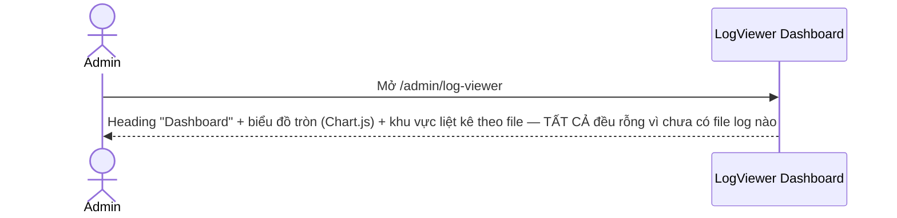
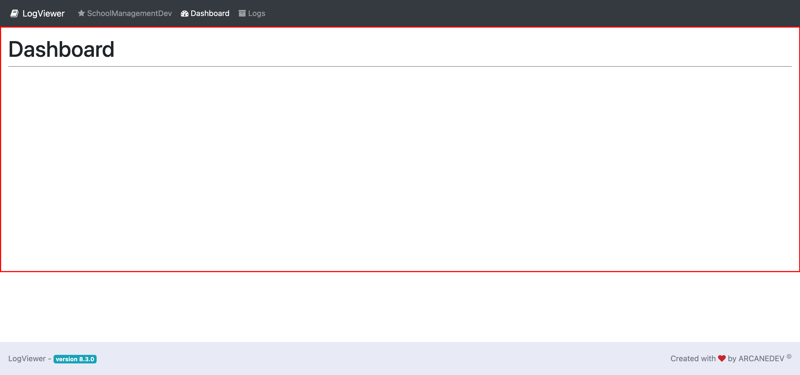

# M16.1 – Logs: Dashboard (Managing Portal)

> Phạm vi: sub-module **Dashboard** (`/admin/log-viewer`), sub-module đầu tiên trong 4 sub-module của module **Logs**. Đây là trang chủ của gói mã nguồn mở **ArcaneDev LogViewer v8.3.0** được nhúng trực tiếp vào Managing Portal — **khác hoàn toàn về giao diện** so với mọi module khác (không dùng layout CoreUI/Blade của Finviet). Nội dung trang **trống hoàn toàn** vì môi trường dev hiện chưa có file log nào.

## Mục lục

- [1. Tổng quan](#1-tổng-quan)
  - [1.1 Giới thiệu](#11-giới-thiệu)
  - [1.2 Actors](#12-actors)
  - [1.3 Phạm vi](#13-phạm-vi)
- [2. Business Flow](#2-business-flow)
  - [2.1 Sequence Diagram](#21-sequence-diagram)
  - [2.2 Business Steps](#22-business-steps)
  - [2.3 Business Rules](#23-business-rules)
- [3. Feature Breakdown](#3-feature-breakdown)
  - [3.1 Acceptance Criteria](#31-acceptance-criteria)
  - [3.2 Danh sách Use Case](#32-danh-sách-use-case)
  - [3.3 Edge Cases](#33-edge-cases)
  - [3.4 UI Conventions](#34-ui-conventions)

---

## 1. Tổng quan

### 1.1 Giới thiệu

Dashboard là trang chủ của gói **ArcaneDev LogViewer** (`<title>LogViewer - Created by ARCANEDEV</title>`, footer ghi rõ "LogViewer - version 8.3.0") — 1 công cụ mã nguồn mở dùng để xem log file Laravel (`storage/logs/*.log`) qua giao diện web, được tích hợp thẳng vào Managing Portal ở đường dẫn `/admin/log-viewer`.

**Phát hiện quan trọng — giao diện hoàn toàn khác biệt:** trang này **không dùng sidebar/layout CoreUI** của Finviet như mọi module khác (M2-M15) — thay vào đó là 1 thanh nav riêng của package LogViewer (nền tối, logo "LogViewer", 3 mục: SchoolManagementDev/Dashboard/Logs) và toàn bộ style Bootstrap 4 mặc định, không có branding Finviet. Đây là module đầu tiên trong dự án có giao diện tách biệt hoàn toàn khỏi phần còn lại của Managing Portal.

**Phát hiện quan trọng — trang trống do chưa có dữ liệu:** đọc trực tiếp HTML nguồn xác nhận trang có 1 biểu đồ tròn (doughnut chart, dùng Chart.js) và 1 khu vực liệt kê log theo file, nhưng dữ liệu truyền vào chart là **mảng rỗng hoàn toàn** (`{"labels":[],"datasets":[{"data":[],...}]}`) và khu vực liệt kê cũng rỗng. Xác nhận chéo qua sub-module Logs (`SM2-logs.md`): trang đó hiển thị thông báo **"The list of logs is empty!"** — tức môi trường dev hiện **không có bất kỳ file log nào**, giải thích chính xác vì sao Dashboard hiển thị trống hoàn toàn (đây là trạng thái đúng như thiết kế khi không có log, không phải lỗi hiển thị).

### 1.2 Actors

| Actor | Mô tả |
|---|---|
| Finviet/SOHA Dev/Admin | Xem tổng quan thống kê log lỗi hệ thống theo mức độ (Emergency/Alert/Critical/Error/Warning/Notice/Info/Debug) — hiện chưa có dữ liệu để xem trên môi trường dev. |

### 1.3 Phạm vi

| Trong phạm vi | Ngoài phạm vi |
|---|---|
| Xem trạng thái trống của Dashboard, xác nhận nguyên nhân qua đọc HTML nguồn (chart data rỗng) | Xem Dashboard khi có dữ liệu log thật (không có trên môi trường dev tại thời điểm khảo sát) |
| Xác nhận đây là package ArcaneDev LogViewer v8.3.0 qua title/footer | Đánh giá bảo mật của việc để lộ log file hệ thống qua giao diện web (ngoài phạm vi khảo sát UI/UX) |

---

## 2. Business Flow

### 2.1 Sequence Diagram

### 2.2 Business Steps

1. Admin mở Dashboard để xem tổng quan log lỗi hệ thống (khi có dữ liệu).
2. `[Không quan sát được]` Hành vi khi có log thật (biểu đồ phân bổ theo mức độ, danh sách file) — môi trường dev hiện không có dữ liệu.

### 2.3 Business Rules

| ID | Mô tả |
|---|---|
| BR01 | Trang dùng package mã nguồn mở **ArcaneDev LogViewer v8.3.0** — xác nhận qua `<title>` và footer, khác hẳn với kiến trúc Blade/CoreUI tự phát triển của các module còn lại. |
| BR02 | **[Giao diện tách biệt hoàn toàn]** Không có sidebar/topbar Finviet — thay bằng nav bar riêng của package (nền tối, 3 mục: SchoolManagementDev/Dashboard/Logs) và Bootstrap 4 mặc định, không branding. |
| BR03 | Dashboard gồm 1 biểu đồ tròn (`id="stats-doughnut-chart"`, Chart.js 2.7.1) dự kiến hiển thị phân bổ log theo mức độ, và 1 khu vực bên cạnh dự kiến liệt kê thống kê theo từng file log — cả 2 đều **rỗng dữ liệu** tại thời điểm khảo sát (xác nhận qua đọc trực tiếp script khởi tạo chart trong HTML nguồn: `data: []`). |
| BR04 | Nguyên nhân trang trống được xác nhận chéo: sub-module Logs (`SM2-logs.md`) hiển thị thông báo "The list of logs is empty!" — môi trường dev chưa từng phát sinh file log nào, không phải lỗi hiển thị của Dashboard. |
| BR05 | Mục "SchoolManagementDev" trên nav bar của LogViewer dẫn ngược về `/admin/dashboard` (Dashboard chính của Managing Portal, module M1) — là đường quay lại duy nhất tới giao diện Finviet từ package LogViewer. |

---

## 3. Feature Breakdown

### 3.1 Acceptance Criteria

- Dashboard phải phản ánh đúng trạng thái dữ liệu log hiện có — đạt (trống đúng vì thực sự không có log).
- `[Không kiểm chứng được]` Dashboard phải hiển thị đúng biểu đồ phân bổ khi có log thật — không có dữ liệu mẫu để xác nhận trên môi trường dev.

### 3.2 Danh sách Use Case

| Mã | Tên | Actor | Mô tả | Happy Path | Exception | Business Rules |
|---|---|---|---|---|---|---|
| UC-01 | Xem Dashboard LogViewer (trống) | Admin/Dev | Xem tổng quan thống kê log — hiện trống do chưa có file log. | 1. Admin mở `/admin/log-viewer`. 2. Trang hiển thị heading "Dashboard", biểu đồ và khu vực thống kê đều trống.   | Không có dữ liệu để thử nghiệm hành vi khi có log thật. | BR01, BR02, BR03, BR04 |

### 3.3 Edge Cases

| # | Tình huống | Quan sát / Rủi ro |
|---|---|---|
| 1 | Toàn bộ Dashboard trống do 0 file log (BR03, BR04) | Không thể kiểm chứng được giao diện/hành vi thực tế khi có log thật (ví dụ biểu đồ có hiển thị đúng tỷ lệ theo mức độ hay không, khu vực theo file có phân trang hay không). `[Cần xác nhận]` toàn bộ hành vi khi có dữ liệu. |
| 2 | Giao diện LogViewer tách biệt hoàn toàn khỏi Managing Portal (BR02) | Admin mới có thể bối rối khi thấy giao diện hoàn toàn khác lạ (không sidebar, không branding Finviet) khi click vào "Logs" > "Dashboard" từ sidebar chính — trải nghiệm không liền mạch so với phần còn lại của hệ thống. |

### 3.4 UI Conventions

- Layout hoàn toàn khác biệt: nav bar tối đơn giản (không sidebar), nội dung dùng Bootstrap 4 thuần, không có bất kỳ yếu tố thiết kế nào của CoreUI/Finviet.
- Đây là module đầu tiên trong dự án nhúng nguyên 1 package mã nguồn mở bên thứ ba (giao diện + logic) thay vì tự xây dựng UI riêng.
