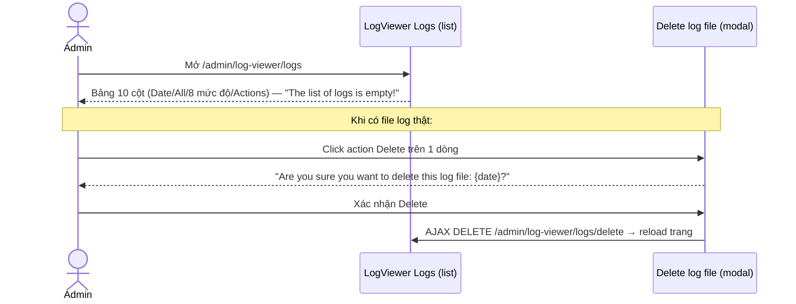
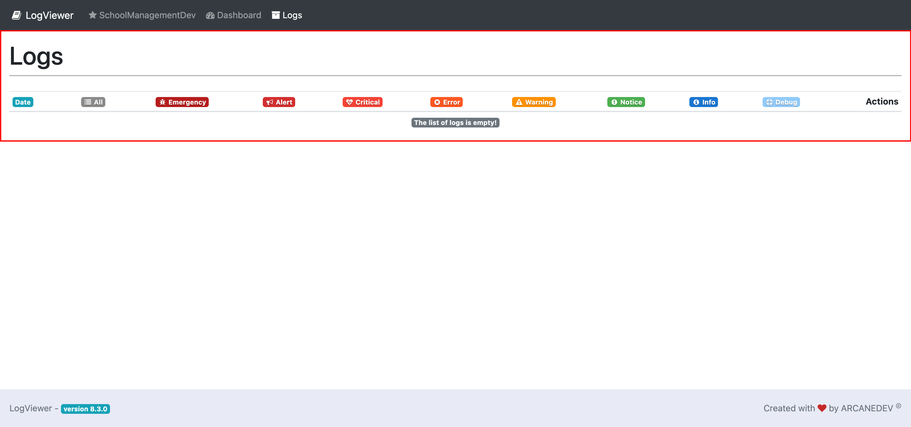

# M16.2 – Logs: Logs (Managing Portal)

> Phạm vi: sub-module **Logs** (`/admin/log-viewer/logs`), sub-module thứ hai trong 4 sub-module của module **Logs**. Trang liệt kê các file log Laravel theo ngày, phân loại theo 8 mức độ (Emergency→Debug) — hiện trống vì môi trường dev chưa phát sinh file log nào. **Phát hiện tích cực:** đây là nơi hiếm hoi trong toàn dự án có modal xác nhận đầy đủ trước khi xoá.

## Mục lục

- [1. Tổng quan](#1-tổng-quan)
  - [1.1 Giới thiệu](#11-giới-thiệu)
  - [1.2 Actors](#12-actors)
  - [1.3 Phạm vi](#13-phạm-vi)
- [2. Business Flow](#2-business-flow)
  - [2.1 Sequence Diagram](#21-sequence-diagram)
  - [2.2 Business Steps](#22-business-steps)
  - [2.3 Business Rules](#23-business-rules)
- [3. Feature Breakdown](#3-feature-breakdown)
  - [3.1 Acceptance Criteria](#31-acceptance-criteria)
  - [3.2 Danh sách Use Case](#32-danh-sách-use-case)
  - [3.3 Edge Cases](#33-edge-cases)
  - [3.4 UI Conventions](#34-ui-conventions)

---

## 1. Tổng quan

### 1.1 Giới thiệu

Logs liệt kê các file log Laravel (thường 1 file/ngày) kèm số lượng bản ghi theo từng mức độ nghiêm trọng: All, Emergency, Alert, Critical, Error, Warning, Notice, Info, Debug — mỗi mức có 1 badge màu riêng (đỏ đậm cho Emergency/Alert/Critical/Error, cam cho Warning, xanh lá cho Notice, xanh dương cho Info/Debug). Tại thời điểm khảo sát, danh sách **trống hoàn toàn** ("The list of logs is empty!") — khớp với việc Dashboard (`SM1-dashboard.md`) cũng hiển thị biểu đồ rỗng, xác nhận môi trường dev chưa từng phát sinh file log nào.

**Phát hiện tích cực — có modal xác nhận trước khi xoá:** đọc trực tiếp HTML nguồn cho thấy trang có sẵn 1 modal "Delete log file" đầy đủ, với thông điệp xác nhận động **"Are you sure you want to delete this log file: {date}?"**, xử lý qua AJAX (`DELETE /admin/log-viewer/logs/delete`), và tự động `location.reload()` sau khi xoá thành công. Đây là lần đầu tiên trong toàn bộ dự án (M2-M15) phát hiện 1 action Delete có **modal xác nhận rõ ràng với nội dung động** — trái ngược hoàn toàn với pattern "không phát hiện thuộc tính xác nhận nào" đã ghi nhận lặp lại ở gần như mọi module tự phát triển khác (Lesson Set, Lesson Area, Mailer Profiles, School Year...). Vì đây là hành vi của package mã nguồn mở ArcaneDev LogViewer (không phải code tự viết của Finviet), điều này gợi ý đội dev Finviet có thể tham khảo pattern UX này cho các action Delete tự phát triển khác trong Managing Portal.

### 1.2 Actors

| Actor | Mô tả |
|---|---|
| Finviet/SOHA Dev/Admin | Xem/xoá file log hệ thống theo ngày — hiện chưa có file nào để thao tác trên môi trường dev. |

### 1.3 Phạm vi

| Trong phạm vi | Ngoài phạm vi |
|---|---|
| Xem trạng thái trống, xác nhận cấu trúc 10 cột | Xem/xoá 1 file log thật (không có dữ liệu mẫu) |
| Xác nhận cơ chế modal xác nhận Delete qua đọc HTML/JS nguồn | Kiểm chứng hành vi AJAX Delete thật (không có file để xoá) |

---

## 2. Business Flow

### 2.1 Sequence Diagram

### 2.2 Business Steps

1. Admin xem danh sách file log theo ngày, kèm số lượng bản ghi theo từng mức độ nghiêm trọng.
2. `[Không quan sát được]` Admin bấm vào 1 mức độ hoặc file để xem chi tiết nội dung log — không có dữ liệu mẫu để kiểm chứng đường dẫn này.
3. `[Không quan sát được]` Admin bấm Delete trên 1 dòng → modal xác nhận hiện ra với tên ngày cụ thể → xác nhận để xoá file log đó.

### 2.3 Business Rules

| ID | Mô tả |
|---|---|
| BR01 | Bảng có 10 cột: Date, All, Emergency, Alert, Critical, Error, Warning, Notice, Info, Debug, Actions — mỗi cột mức độ có icon + màu badge riêng biệt (`badge-level-{level}`). |
| BR02 | Tại thời điểm khảo sát: **0 file log**, hiển thị "The list of logs is empty!" — khớp chéo với Dashboard (`SM1-dashboard.md` BR03/BR04) cùng phản ánh 1 thực trạng dữ liệu. |
| BR03 | **[Điểm tích cực về UX]** Action Delete có modal xác nhận đầy đủ, nội dung động nêu rõ ngày file sẽ bị xoá, xử lý qua AJAX với thông báo lỗi (`alert('AJAX ERROR...')`) nếu request thất bại — mức độ hoàn thiện UX cao hơn hẳn các action Delete khác trong Managing Portal tự phát triển. |
| BR04 | Modal Delete dùng `id="delete-log-modal"` (không phải tên mặc định kiểu "exampleModal" như đã thấy ở `M14-schoolyear/SM1-schoolyear.md` BR03) — cho thấy package bên thứ ba này được đặt tên biến/id nghiêm túc hơn code tự viết của dự án ở 1 số chỗ. |
| BR05 | Route Delete là `DELETE /admin/log-viewer/logs/delete` — nhận tham số `date` để xác định file log cần xoá, không dùng ID số như quy ước REST thông thường của các module Finviet tự viết (vốn dùng `/{id}/destroy`). |

---

## 3. Feature Breakdown

### 3.1 Acceptance Criteria

- Bảng phải phản ánh đúng trạng thái dữ liệu log hiện có — đạt (trống đúng thực trạng).
- Action Delete phải có xác nhận trước khi thực hiện — đạt, vượt trội so với phần lớn module khác trong dự án.

### 3.2 Danh sách Use Case

| Mã | Tên | Actor | Mô tả | Happy Path | Exception | Business Rules |
|---|---|---|---|---|---|---|
| UC-01 | Xem danh sách file log (trống) | Admin/Dev | Xem trạng thái log hệ thống theo ngày và mức độ. | 1. Admin mở `/admin/log-viewer/logs`. 2. Bảng hiển thị đủ 10 cột với badge màu, nhưng "The list of logs is empty!".   | Không có file log để thử xem chi tiết/xoá thật. | BR01, BR02 |

### 3.3 Edge Cases

| # | Tình huống | Quan sát / Rủi ro |
|---|---|---|
| 1 | Không có file log nào để kiểm chứng luồng Delete thật (BR02) | Toàn bộ hiểu biết về modal Delete (BR03) dựa trên đọc mã nguồn HTML/JS tĩnh, chưa được xác nhận bằng thao tác thật trên dữ liệu thật. `[Cần xác nhận]` hành vi thực tế khi AJAX thành công/thất bại. |
| 2 | Việc để trống hoàn toàn log trong môi trường dev trong thời gian dài | Nếu đây là môi trường dev đang hoạt động thật (không phải mới khởi tạo), việc 0 log tồn tại có thể có nghĩa là log level cấu hình quá cao (chỉ ghi Error trở lên) hoặc log bị xoá định kỳ — không thể xác nhận nguyên nhân chính xác vì ngoài phạm vi khảo sát UI. `[Cần xác nhận]`. |

### 3.4 UI Conventions

- Cùng giao diện package LogViewer tách biệt đã thấy ở Dashboard (`SM1-dashboard.md` BR02) — không sidebar, không branding Finviet.
- Sử dụng badge màu theo mức độ nghiêm trọng (semantic color coding: đỏ = nghiêm trọng, cam = cảnh báo, xanh lá/dương = thông tin) — quy ước màu sắc trực quan tốt hơn phần lớn bảng dữ liệu thuần văn bản ở các module Finviet tự phát triển.
