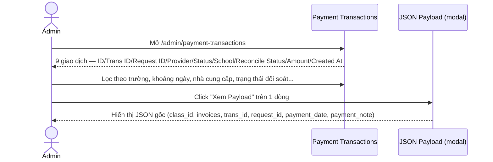
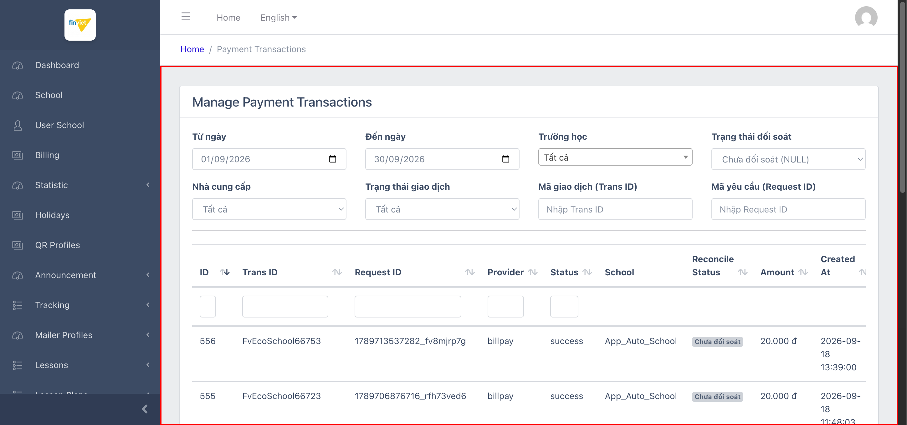
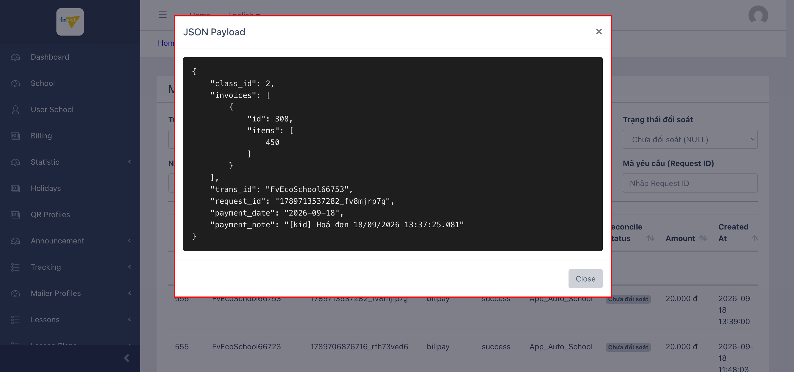

# M16.3 – Logs: Payment Transactions (Managing Portal)

> Phạm vi: sub-module **Payment Transactions** (`/admin/payment-transactions`), sub-module thứ ba trong 4 sub-module của module **Logs**. Đây là công cụ **chỉ đọc** để tra cứu giao dịch thanh toán học phí thực tế (qua 2 cổng thanh toán Ecopay/Billpay), có bộ lọc phong phú nhất trong dự án tính đến nay, và liên kết trực tiếp tới sub-module **Reconciliation Logs** (`SM4-reconciliation-logs.md`) qua trạng thái "Đối soát".

## Mục lục

- [1. Tổng quan](#1-tổng-quan)
  - [1.1 Giới thiệu](#11-giới-thiệu)
  - [1.2 Actors](#12-actors)
  - [1.3 Phạm vi](#13-phạm-vi)
- [2. Business Flow](#2-business-flow)
  - [2.1 Sequence Diagram](#21-sequence-diagram)
  - [2.2 Business Steps](#22-business-steps)
  - [2.3 Business Rules](#23-business-rules)
- [3. Feature Breakdown](#3-feature-breakdown)
  - [3.1 Acceptance Criteria](#31-acceptance-criteria)
  - [3.2 Danh sách Use Case](#32-danh-sách-use-case)
  - [3.3 Edge Cases](#33-edge-cases)
  - [3.4 UI Conventions](#34-ui-conventions)

---

## 1. Tổng quan

### 1.1 Giới thiệu

Payment Transactions liệt kê các giao dịch thanh toán học phí thực tế đã xử lý qua cổng thanh toán bên thứ ba — 2 nhà cung cấp quan sát được: **Ecopay** và **Billpay**. Tại thời điểm khảo sát có **9 giao dịch**, toàn bộ đều ở trạng thái `success` (Thành công), số tiền từ 20.000đ đến 2.000.000đ, gắn với các trường dev/test (App_Auto_School, THPT Phú Nhuận, Trường THCS Demo Soha).

**Phát hiện quan trọng — liên kết trực tiếp với Reconciliation Logs:** cột "Reconcile Status" (Trạng thái đối soát) có 3 giá trị khả dĩ: **Chưa đối soát (NULL)**, **Đối soát khớp (Success)**, **Đối soát lệch (Failed)** — toàn bộ 9 giao dịch hiện tại đều ở trạng thái "Chưa đối soát". Đây là bằng chứng trực tiếp cho thấy module này **là nguồn dữ liệu đầu vào** cho quy trình đối soát (reconciliation) được thực hiện ở sub-module `Reconciliation Logs` (`SM4-reconciliation-logs.md`) — 1 giao dịch thanh toán được ghi nhận ở đây trước, sau đó mới được đối chiếu với dữ liệu từ phía cổng thanh toán/ngân hàng.

**Phát hiện — action duy nhất là xem payload, không có Edit/Delete:** mỗi dòng chỉ có 1 action **"Xem Payload"** (icon con mắt) mở modal hiển thị nguyên văn JSON payload gốc của giao dịch (class_id, invoices, trans_id, request_id, payment_date, payment_note) — xác nhận đây là trang **chỉ đọc** (read-only reporting), không có khả năng sửa/xoá giao dịch thanh toán, phù hợp với tính chất dữ liệu tài chính nhạy cảm.

### 1.2 Actors

| Actor | Mô tả |
|---|---|
| Finviet/SOHA Admin/Kế toán | Tra cứu, đối chiếu giao dịch thanh toán học phí đã xử lý qua cổng thanh toán. |

### 1.3 Phạm vi

| Trong phạm vi | Ngoài phạm vi |
|---|---|
| Xem danh sách, xác nhận cấu trúc 10 cột và bộ lọc | Xác định chính xác cơ chế đối soát tự động chạy khi nào/như thế nào (ngoài phạm vi UI) |
| Mở modal "Xem Payload", xác nhận nội dung JSON không chứa thông tin thẻ/ngân hàng nhạy cảm | Xác nhận hành vi khi có giao dịch ở trạng thái "Thất bại" hoặc "Đối soát lệch" (không có dữ liệu mẫu) |

---

## 2. Business Flow

### 2.1 Sequence Diagram

### 2.2 Business Steps

1. Admin/Kế toán lọc giao dịch theo khoảng ngày, trường, nhà cung cấp, trạng thái giao dịch, hoặc trạng thái đối soát.
2. Admin xem "Xem Payload" để kiểm tra chi tiết kỹ thuật của 1 giao dịch (dùng để tra cứu/debug khi có khiếu nại về thanh toán).
3. `[Ngoài phạm vi UI này]` Quy trình đối soát tự động/thủ công cập nhật cột "Reconcile Status" — xem thêm `SM4-reconciliation-logs.md`.

### 2.3 Business Rules

| ID | Mô tả |
|---|---|
| BR01 | Danh sách có 9 cột dữ liệu: ID, Trans ID, Request ID, Provider, Status, School, Reconcile Status, Amount, Created At — cộng Actions (chỉ "Xem Payload", không Edit/Delete/Export). Tổng 9/9 giao dịch, toàn bộ `status = success`. |
| BR02 | Bộ lọc gồm **8 tiêu chí**: Từ ngày/Đến ngày, Trường học (27 option), Trạng thái đối soát (3 giá trị), Nhà cung cấp (Ecopay/Billpay), Trạng thái giao dịch (Thành công/Thất bại), Mã giao dịch (Trans ID), Mã yêu cầu (Request ID) — bộ lọc phong phú nhất trong toàn dự án tính đến nay. |
| BR03 | **[Liên kết Reconciliation]** Cột "Reconcile Status" có 3 giá trị: Chưa đối soát (NULL) / Đối soát khớp (Success) / Đối soát lệch (Failed) — toàn bộ 9/9 giao dịch hiện tại đều "Chưa đối soát", xác nhận module này là nguồn dữ liệu cho quy trình đối soát ở `SM4-reconciliation-logs.md`. |
| BR04 | Action "Xem Payload" hiển thị nguyên văn JSON gốc của request thanh toán (`class_id`, `invoices[]`, `trans_id`, `request_id`, `payment_date`, `payment_note`) — **không chứa thông tin thẻ/tài khoản ngân hàng** nào, chỉ chứa tham chiếu nội bộ (ID lớp, ID hoá đơn) — không cần redact khi lưu ảnh tài liệu. |
| BR05 | 2 nhà cung cấp thanh toán quan sát được: **Ecopay** và **Billpay** — cả 9 giao dịch mẫu đều thuộc Billpay; không có dữ liệu mẫu nào từ Ecopay để đối chiếu cấu trúc payload có giống nhau giữa 2 nhà cung cấp hay không. `[Cần xác nhận]`. |
| BR06 | Trang là **chỉ đọc hoàn toàn** — không có action Create/Edit/Delete nào, phù hợp với vai trò tra cứu dữ liệu tài chính nhạy cảm thay vì quản lý trực tiếp. |

---

## 3. Feature Breakdown

### 3.1 Acceptance Criteria

- Danh sách phải hiển thị đúng các giao dịch đã xử lý — đạt.
- Bộ lọc phải cho phép tra cứu theo nhiều tiêu chí khác nhau — đạt về cấu trúc (8 tiêu chí lọc). `[Cần xác nhận]` độ chính xác khi lọc thật với dữ liệu lớn hơn.
- Payload phải hiển thị đủ thông tin kỹ thuật để debug mà không lộ dữ liệu tài chính nhạy cảm (số thẻ, tài khoản) — đạt.

### 3.2 Danh sách Use Case

| Mã | Tên | Actor | Mô tả | Happy Path | Exception | Business Rules |
|---|---|---|---|---|---|---|
| UC-01 | Xem và lọc danh sách giao dịch thanh toán | Admin/Kế toán | Tra cứu giao dịch theo nhiều tiêu chí. | 1. Admin mở `/admin/payment-transactions`. 2. Trang hiển thị 9 giao dịch, đầy đủ bộ lọc 8 tiêu chí, mặc định khoảng ngày tháng hiện tại.   | Không có dữ liệu giao dịch "Thất bại" hoặc "Đối soát lệch" để kiểm chứng hiển thị các trạng thái đó. | BR01, BR02, BR03, BR06 |
| UC-02 | Xem chi tiết payload JSON của 1 giao dịch | Admin/Kế toán | Kiểm tra dữ liệu kỹ thuật gốc của giao dịch. | 1. Admin click "Xem Payload" trên dòng ID=556. 2. Modal hiển thị JSON đầy đủ (class_id, invoices, trans_id, request_id, payment_date, payment_note).   | Không có, dữ liệu hiển thị tức thời từ `data-payload` đã có sẵn trong HTML. | BR04, BR05 |

### 3.3 Edge Cases

| # | Tình huống | Quan sát / Rủi ro |
|---|---|---|
| 1 | Toàn bộ 9 giao dịch mẫu đều "success" và cùng 1 nhà cung cấp (Billpay) | Không thể kiểm chứng trực quan cách trang hiển thị giao dịch thất bại hoặc từ Ecopay — cấu trúc payload có thể khác nhau giữa 2 nhà cung cấp. `[Cần xác nhận]`. |
| 2 | Dữ liệu payload chứa trực tiếp trong thuộc tính HTML `data-payload` (không gọi AJAX riêng khi mở modal) | Toàn bộ payload của TẤT CẢ giao dịch trên trang đều đã tải sẵn trong DOM ngay khi tải trang danh sách (kể cả giao dịch chưa xem) — không phải rủi ro bảo mật nghiêm trọng vì không chứa dữ liệu nhạy cảm (BR04), nhưng là điểm khác biệt về cách tải dữ liệu so với các modal khác trong dự án (thường load qua AJAX riêng khi cần). |

### 3.4 UI Conventions

- Bộ lọc dùng nhãn tiếng Việt (Từ ngày, Đến ngày, Trường học, Trạng thái đối soát, Nhà cung cấp...) trong khi cột bảng dữ liệu dùng tiếng Anh (ID, Trans ID, Provider, Status...) — cùng pattern trộn ngôn ngữ đã thấy ở nhiều module khác trong dự án.
- Modal "Xem Payload" hiển thị JSON đã format đẹp (indent, dấu ngoặc rõ ràng) trong khối nền tối — dễ đọc hơn hầu hết cách hiển thị dữ liệu thô khác trong dự án.
