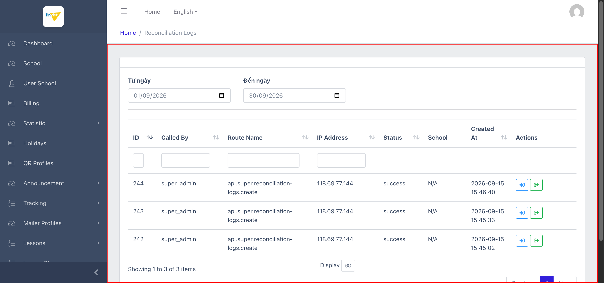

# M16.4 – Logs: Reconciliation Logs (Managing Portal)

> Phạm vi: sub-module **Reconciliation Logs** (`/admin/reconciliation-logs`), sub-module thứ tư và cuối cùng trong 4 sub-module của module **Logs**. Ghi lại mỗi lần quy trình **đối soát giao dịch thanh toán** được gọi qua API — xác nhận đây chính là cơ chế cập nhật cột "Reconcile Status" đã thấy ở `SM3-payment-transactions.md`, và quy trình này được **kích hoạt bởi hệ thống (super_admin qua API)**, không phải thao tác tay của admin qua UI.

## Mục lục

- [1. Tổng quan](#1-tổng-quan)
  - [1.1 Giới thiệu](#11-giới-thiệu)
  - [1.2 Actors](#12-actors)
  - [1.3 Phạm vi](#13-phạm-vi)
- [2. Business Flow](#2-business-flow)
  - [2.1 Sequence Diagram](#21-sequence-diagram)
  - [2.2 Business Steps](#22-business-steps)
  - [2.3 Business Rules](#23-business-rules)
- [3. Feature Breakdown](#3-feature-breakdown)
  - [3.1 Acceptance Criteria](#31-acceptance-criteria)
  - [3.2 Danh sách Use Case](#32-danh-sách-use-case)
  - [3.3 Edge Cases](#33-edge-cases)
  - [3.4 UI Conventions](#34-ui-conventions)

---

## 1. Tổng quan

### 1.1 Giới thiệu

Reconciliation Logs ghi lại lịch sử mỗi lần quy trình đối soát giao dịch thanh toán được gọi, gồm: ai/hệ thống nào gọi (Called By), route API nào được gọi, IP nguồn, trạng thái, trường liên quan, và thời điểm. Tại thời điểm khảo sát có **3 bản ghi**, toàn bộ đều: `Called By = super_admin`, `Route Name = api.super.reconciliation-logs.create`, cùng 1 IP (`118.69.77.144`), `Status = success`, `School = N/A`, xảy ra trong cùng buổi (2026-09-15, cách nhau vài phút).

**Phát hiện quan trọng — cơ chế xác nhận qua bằng chứng chéo:** action "Xem Request" trên dòng ID=244 hiển thị payload `{"to":"2026-09-15","from":"2026-09-15","ref_id":"ecoschool-reconcile:2026-09-15"}` — xác nhận quy trình đối soát chạy theo **khoảng ngày** (ở đây là đối soát cho đúng 1 ngày), không theo từng giao dịch riêng lẻ. Action "Xem Response" hiển thị `{"total_transactions":1,"reconciled_transactions":1}` — tức lần gọi này xử lý 1 giao dịch và đối soát khớp cả 1. Kết hợp với `SM3-payment-transactions.md` BR03 (toàn bộ 9 giao dịch hiện có đều "Chưa đối soát"), có thể suy luận: quy trình đối soát chạy theo lịch (khả năng hàng ngày, dựa vào tên route `api.super.reconciliation-logs.create` và giá trị `ref_id` dạng `ecoschool-reconcile:{date}`), được gọi bởi 1 tài khoản/service hệ thống (`super_admin`) qua API — **không có action nào trên UI Managing Portal để admin tự tay kích hoạt đối soát**.

**Phát hiện — School luôn "N/A":** khác với Payment Transactions (mỗi giao dịch gắn 1 trường cụ thể), Reconciliation Logs ghi nhận **cấp độ 1 lần gọi batch** (không gắn với 1 trường cụ thể) — hợp lý vì 1 lần gọi API có thể đối soát nhiều giao dịch của nhiều trường khác nhau cùng lúc.

### 1.2 Actors

| Actor | Mô tả |
|---|---|
| Hệ thống (super_admin, qua API) | Tự động gọi API đối soát giao dịch thanh toán theo khoảng ngày (không phải admin thao tác tay qua UI). |
| Finviet/SOHA Admin/Kế toán | Xem lại lịch sử các lần đối soát đã chạy để kiểm tra/debug. |

### 1.3 Phạm vi

| Trong phạm vi | Ngoài phạm vi |
|---|---|
| Xem danh sách, xác nhận cấu trúc cột và bộ lọc theo ngày | Xác định lịch trình chính xác (cron schedule) của quy trình đối soát tự động (ngoài phạm vi UI) |
| Xác nhận nội dung Request/Response payload qua 1 dòng mẫu | Tìm nơi kích hoạt đối soát thủ công (nếu có) — không tìm thấy action nào trên toàn bộ Managing Portal tính đến nay |

---

## 2. Business Flow

### 2.1 Sequence Diagram

```mermaid
sequenceDiagram
    participant System as Hệ thống (super_admin, qua API)
    participant API as api.super.reconciliation-logs.create
    participant Log as Reconciliation Logs (list)
    actor Admin

    System->>API: Gọi API đối soát với {from, to, ref_id} theo ngày
    API-->>Log: Ghi log lần gọi (Called By/Route Name/IP/Status/Created At) + Request/Response payload
    Admin->>Log: Mở /admin/reconciliation-logs, lọc theo khoảng ngày
    Log-->>Admin: 3 bản ghi (2026-09-15), đều success
    Admin->>Log: Click "Xem Request"/"Xem Response" trên 1 dòng
    Log-->>Admin: Modal JSON — Request: {to, from, ref_id}; Response: {total_transactions, reconciled_transactions}
```

### 2.2 Business Steps

1. Hệ thống tự động gọi API đối soát theo khoảng ngày (khả năng hàng ngày, dựa vào `ref_id` dạng `ecoschool-reconcile:{date}`).
2. Mỗi lần gọi được ghi lại thành 1 dòng trong Reconciliation Logs.
3. Admin/Kế toán xem lại lịch sử này để xác nhận đối soát đã chạy đúng, hoặc debug khi có sai lệch (dùng Request/Response payload).

### 2.3 Business Rules

| ID | Mô tả |
|---|---|
| BR01 | Danh sách có 7 cột dữ liệu: ID, Called By, Route Name, IP Address, Status, School, Created At — cộng Actions (2 nút: "Xem Request", "Xem Response"). Tổng 3/3 bản ghi, đều `success`. |
| BR02 | Bộ lọc chỉ có **Từ ngày/Đến ngày** — đơn giản hơn nhiều so với `SM3-payment-transactions.md` (8 tiêu chí), phù hợp vì đây là log cấp hệ thống, không cần lọc theo trường/giao dịch cụ thể. |
| BR03 | **[Kích hoạt bởi hệ thống, không phải UI]** Toàn bộ 3/3 bản ghi có `Called By = super_admin` và `Route Name = api.super.reconciliation-logs.create` — xác nhận đối soát được kích hoạt qua **API bởi 1 tài khoản/service hệ thống**, không tìm thấy nút/action nào trên Managing Portal để admin tự kích hoạt thủ công. |
| BR04 | Request payload có dạng `{"to": "{date}", "from": "{date}", "ref_id": "ecoschool-reconcile:{date}"}` — xác nhận đối soát chạy theo **khoảng ngày** (ref_id gợi ý chạy theo lịch hàng ngày). Response payload có dạng `{"total_transactions": N, "reconciled_transactions": N}` — tóm tắt số giao dịch đã xử lý/đối soát thành công trong lần gọi đó. |
| BR05 | Cột "School" luôn hiển thị **"N/A"** trên cả 3 bản ghi — vì đối soát hoạt động ở cấp batch (nhiều giao dịch/nhiều trường trong 1 lần gọi), không gắn với 1 trường cụ thể, khác với Payment Transactions (`SM3` — mỗi giao dịch gắn 1 trường). |
| BR06 | Cả 3 bản ghi cùng 1 IP (`118.69.77.144`) và xảy ra trong vòng vài phút cùng ngày — dữ liệu vận hành (không phải PII cá nhân người dùng cuối), phù hợp để ghi lại nguyên văn trong tài liệu (không cần redact). |
| BR07 | Trang là **chỉ đọc hoàn toàn**, không có Create/Edit/Delete — cùng pattern read-only reporting đã thấy ở `SM3-payment-transactions.md` và `M13-audit-log/SM1-audit-log.md`. |

---

## 3. Feature Breakdown

### 3.1 Acceptance Criteria

- Danh sách phải ghi lại đúng lịch sử các lần gọi đối soát — đạt, xác nhận qua 3 bản ghi mẫu nhất quán.
- Request/Response payload phải đủ chi tiết để debug khi có sai lệch đối soát — đạt về cấu trúc (tổng số giao dịch xử lý/đối soát khớp).

### 3.2 Danh sách Use Case

| Mã | Tên | Actor | Mô tả | Happy Path | Exception | Business Rules |
|---|---|---|---|---|---|---|
| UC-01 | Xem lịch sử các lần gọi đối soát | Admin/Kế toán | Tra cứu các lần hệ thống chạy đối soát giao dịch thanh toán. | 1. Admin mở `/admin/reconciliation-logs`.<br>2. Trang hiển thị 3 bản ghi (2026-09-15), đều `success`, `Called By = super_admin`.<br><br> | Không có bản ghi nào ở trạng thái thất bại để kiểm chứng hiển thị lỗi. | BR01, BR02, BR03, BR07 |
| UC-02 | Xem chi tiết Request/Response của 1 lần đối soát | Admin/Kế toán | Kiểm tra tham số đầu vào và kết quả tóm tắt của 1 lần gọi. | 1. Admin click "Xem Request" trên dòng ID=244 → `{"to":"2026-09-15","from":"2026-09-15","ref_id":"ecoschool-reconcile:2026-09-15"}`.<br>2. Click "Xem Response" → `{"total_transactions":1,"reconciled_transactions":1}`. | Không có, dữ liệu hiển thị tức thời từ `data-payload` có sẵn (cùng cơ chế modal đã thấy ở `SM3-payment-transactions.md` UC-02). | BR04, BR06 |

### 3.3 Edge Cases

| # | Tình huống | Quan sát / Rủi ro |
|---|---|---|
| 1 | Không tìm thấy action thủ công để admin tự kích hoạt đối soát (BR03) | Nếu quy trình tự động gặp lỗi/bỏ lỡ 1 ngày, admin có thể không có cách nào tự chạy lại đối soát qua UI Managing Portal — chỉ có thể xem log, không có nút "Chạy lại". `[Cần xác nhận]` liệu có cơ chế trigger thủ công ở nơi khác (API trực tiếp, cron console) ngoài phạm vi UI. |
| 2 | Chỉ có dữ liệu mẫu ở trạng thái "success", cùng 1 ngày | Không thể quan sát trực quan cách trang hiển thị 1 lần đối soát thất bại hoặc lệch (`total_transactions` ≠ `reconciled_transactions`) — chưa rõ giao diện có cảnh báo nổi bật (màu đỏ, badge) cho trường hợp này hay không. `[Cần xác nhận]`. |

### 3.4 UI Conventions

- Cùng bố cục bảng DataTables + modal JSON Payload đã thấy ở `SM3-payment-transactions.md` — 2 action riêng biệt (Request/Response) thay vì 1 action "Xem Payload" chung, phản ánh đúng bản chất log API (có cả đầu vào lẫn đầu ra).
- Bộ lọc tối giản (chỉ 2 ô ngày) — mức độ đơn giản tỷ lệ nghịch với vai trò log hệ thống cấp thấp, khác với bộ lọc phong phú của Payment Transactions vốn phục vụ tra cứu nghiệp vụ hàng ngày.
