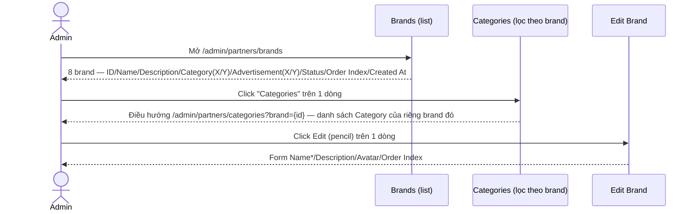
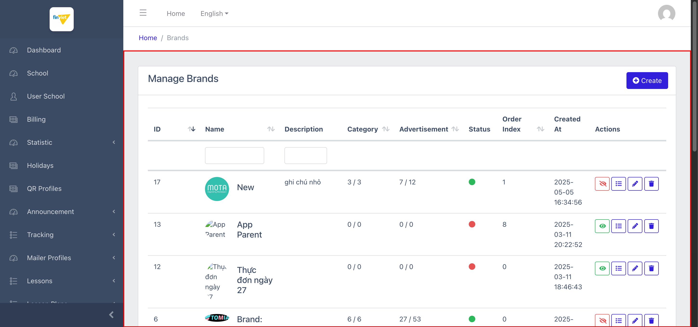
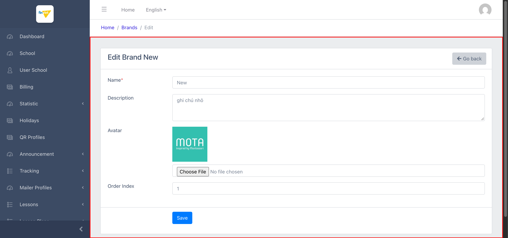

# M17.1 – Partner: Brands (Managing Portal)

> Phạm vi: sub-module **Brands** (`/admin/partners/brands`), sub-module đầu tiên trong 2 sub-module của module **Partner**. Quản lý các "thương hiệu đối tác" — mỗi Brand có thể có nhiều **Category** (danh mục quảng cáo), và mỗi Category lại có nhiều **Advertisement** (quảng cáo cụ thể, chưa phải sub-module riêng, xem Edge Case #1).

## Mục lục

- [1. Tổng quan](#1-tổng-quan)
  - [1.1 Giới thiệu](#11-giới-thiệu)
  - [1.2 Actors](#12-actors)
  - [1.3 Phạm vi](#13-phạm-vi)
- [2. Business Flow](#2-business-flow)
  - [2.1 Sequence Diagram](#21-sequence-diagram)
  - [2.2 Business Steps](#22-business-steps)
  - [2.3 Business Rules](#23-business-rules)
- [3. Feature Breakdown](#3-feature-breakdown)
  - [3.1 Acceptance Criteria](#31-acceptance-criteria)
  - [3.2 Danh sách Use Case](#32-danh-sách-use-case)
  - [3.3 Edge Cases](#33-edge-cases)
  - [3.4 UI Conventions](#34-ui-conventions)

---

## 1. Tổng quan

### 1.1 Giới thiệu

Brands quản lý danh sách thương hiệu đối tác (ví dụ "BeeKids", "MOTA Edu Solutions") hiển thị quảng cáo trên nền tảng. Tại thời điểm khảo sát có **8 Brand**. Mỗi Brand có Avatar (logo), có thể Ẩn/Hiện (toggle Status), và liên kết tới các Category quảng cáo riêng của brand đó qua action "Categories".

**Phát hiện quan trọng — công thức đếm "X / Y" đã được xác minh:** cột Category và Advertisement hiển thị dạng `active / total` (ví dụ "3 / 3", "7 / 12"). Đã xác minh trực tiếp bằng cách đối chiếu số học: Brand "New" (ID=17) hiển thị Category "3/3" và Advertisement "7/12" — khi mở danh sách Category lọc theo brand này (`?brand=17`), đúng 3 Category tồn tại (đều đang active/xanh), và tổng Advertisement của 3 Category đó là 4/5 + 1/2 + 2/5 = **7/12**, khớp chính xác. Đây không phải suy đoán mà là kết quả đối chiếu số liệu thực tế.

**Phát hiện — action toggle Status có màu sắc theo ngữ cảnh:** nút đầu tiên trong Actions đổi cả icon lẫn màu tuỳ trạng thái hiện tại — Brand đang **active** (chấm xanh) hiển thị icon mắt-gạch-chéo **màu đỏ** (title "Hide Brand"); Brand đang **ẩn** (chấm đỏ) hiển thị icon mắt thường **màu xanh** (title "Show Brand", suy luận từ tính đối xứng). Đây là 1 pattern UX tốt (màu nút phản ánh hành động sắp thực hiện, không phải trạng thái hiện tại) — khác biệt tích cực so với nhiều toggle khác trong dự án chỉ dùng 1 màu cố định.

**Phát hiện — quy ước URL khác biệt:** action Edit dẫn tới `/admin/partners/brands/{id}` (không có hậu tố `/edit`), và Delete submit thẳng `DELETE` tới cùng URL đó (không có hậu tố `/destroy`) — đây là quy ước RESTful chuẩn Laravel, khác với đa số module Finviet tự viết trong dự án (thường dùng `/{id}/edit` và `/{id}/destroy` tường minh).

### 1.2 Actors

| Actor | Mô tả |
|---|---|
| Finviet/SOHA Admin | Quản lý thương hiệu đối tác, ẩn/hiện brand, điều hướng nhanh tới Category của từng brand. |

### 1.3 Phạm vi

| Trong phạm vi | Ngoài phạm vi |
|---|---|
| Xem danh sách, xác nhận cấu trúc cột/action, xác minh công thức đếm Category/Advertisement | Thực hiện Create/Edit/Delete/toggle Status thật |
| Xem form Edit, xác nhận không có lỗi tiêu đề "EditBrand" (khác với module Lessons/SchoolYear) | Khảo sát đầy đủ tính năng Advertisement (chưa có sub-module riêng, xem Edge Case #1) |

---

## 2. Business Flow

### 2.1 Sequence Diagram

### 2.2 Business Steps

1. Admin xem danh sách brand, theo dõi nhanh số Category/Advertisement đang active trên tổng số qua cột đếm.
2. Admin bấm "Categories" để xem/quản lý các danh mục quảng cáo thuộc riêng 1 brand.
3. Admin bấm Edit để đổi Name/Description/Avatar/Order Index, hoặc bấm toggle Status để ẩn/hiện brand, hoặc Delete để xoá.

### 2.3 Business Rules

| ID | Mô tả |
|---|---|
| BR01 | Danh sách có 8 cột dữ liệu: ID (sort được), Name (sort được), Description, Category (sort được, dạng "active/total"), Advertisement (sort được, dạng "active/total"), Status (icon tròn xanh/đỏ), Order Index (sort được), Created At. Tổng 8/8 brand. |
| BR02 | **[Đã xác minh bằng số học]** Cột Category/Advertisement hiển thị `{số active}/{tổng số}` — xác nhận qua đối chiếu trực tiếp brand "New" (3/3 Category, 7/12 Advertisement) với danh sách Category lọc theo brand đó (3 Category, tổng Advertisement 4+1+2=7 trên 5+2+5=12). |
| BR03 | Action đầu tiên là toggle Status (POST `PUT` tới `/admin/partners/brands/{id}/status`) — icon/màu đổi theo ngữ cảnh: brand active → icon mắt-gạch-chéo đỏ (title "Hide Brand"); brand ẩn → icon mắt xanh (title suy luận "Show Brand"). |
| BR04 | Action "Categories" (icon danh sách) điều hướng sang `/admin/partners/categories?brand={id}` — danh sách Category đã lọc sẵn theo brand, tương tự pattern "View điều hướng sang danh sách con đã lọc" đã thấy nhiều lần ở module Lessons (M11). |
| BR05 | **[Quy ước RESTful khác biệt]** Edit dùng URL `/admin/partners/brands/{id}` (không `/edit`), Delete dùng `DELETE` trực tiếp tới cùng URL (không `/destroy`) — khác với hầu hết module Finviet tự viết khác trong dự án (vốn luôn có hậu tố `/edit`, `/destroy` tường minh). |
| BR06 | Form Create/Edit gồm 4 trường: Name* (bắt buộc), Description (textarea, không bắt buộc), Avatar (file, hiển thị ảnh hiện tại nếu có), Order Index (number, không bắt buộc) — không có trường quản lý Category/Advertisement trực tiếp trên form Brand. |
| BR07 | **[Không có lỗi tiêu đề]** Trang Edit có tiêu đề đúng, đầy đủ dấu cách ("Edit Brand BeeKids", xác nhận với brand ID=2) — khác với lỗi "Manage{Entity}" (thiếu dấu cách) đã ghi nhận lặp lại nhiều lần ở module Lessons (M11) và School Year (M14), cho thấy module Partner dùng 1 layout/component Edit khác, không bị ảnh hưởng bởi lỗi đó. |

---

## 3. Feature Breakdown

### 3.1 Acceptance Criteria

- Danh sách phải hiển thị đúng số liệu Category/Advertisement active/tổng — đạt, xác minh bằng đối chiếu số học thực tế.
- Toggle Status phải phản ánh đúng trạng thái và hành động sắp thực hiện qua màu sắc/icon — đạt.
- Tiêu đề trang phải chính xác, không lỗi layout dùng chung — đạt (khác biệt tích cực so với M11/M14).

### 3.2 Danh sách Use Case

| Mã | Tên | Actor | Mô tả | Happy Path | Exception | Business Rules |
|---|---|---|---|---|---|---|
| UC-01 | Xem danh sách Brands | Admin | Xem toàn bộ thương hiệu đối tác và số liệu Category/Advertisement. | 1. Admin mở `/admin/partners/brands`. 2. Trang hiển thị 8 brand, cột đếm Category/Advertisement, toggle Status màu theo ngữ cảnh.   | Không thử toggle Status/Delete thật. | BR01, BR02, BR03 |
| UC-02 | Sửa 1 Brand | Admin | Cập nhật Name/Description/Avatar/Order Index. | 1. Admin click Edit trên dòng ID=17 ("New"). 2. Form hiển thị đầy đủ 4 trường với giá trị hiện có, tiêu đề đúng "Edit Brand New".   | Không thử submit Save thật. | BR05, BR06, BR07 |

### 3.3 Edge Cases

| # | Tình huống | Quan sát / Rủi ro |
|---|---|---|
| 1 | Advertisement không có sub-module quản lý riêng trên sidebar | Quảng cáo cụ thể (Advertisement) chỉ được đếm số lượng ở cấp Brand/Category, chưa xác định được UI quản lý chi tiết từng Advertisement nằm ở đâu — có thể nằm trong 1 trang con chưa được liên kết trực tiếp từ sidebar, hoặc thuộc phạm vi sub-module Categories (`SM2-categories.md`) sẽ khảo sát tiếp. `[Cần xác nhận]`. |
| 2 | Brand "App Parent" và "Thực đơn ngày 27" đang ở trạng thái ẩn (đỏ) với 0/0 Category và Advertisement | Trạng thái ẩn nhất quán với việc chưa có nội dung con nào — hợp lý, không phải bug, nhưng cũng có thể là brand test/nháp chưa hoàn thiện bị bỏ quên trên môi trường dev. |

### 3.4 UI Conventions

- Danh sách dùng chung layout DataTables tiêu chuẩn, nhưng có thêm cột đếm dạng "X/Y" chưa từng thấy ở module nào khác trong dự án.
- Cột Avatar hiển thị logo brand thật (không phải icon placeholder chung) cho các brand có upload ảnh — khác với Lesson Area (M11) nơi phần lớn dùng ảnh placeholder mặc định.
