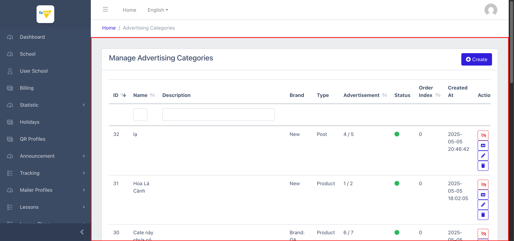
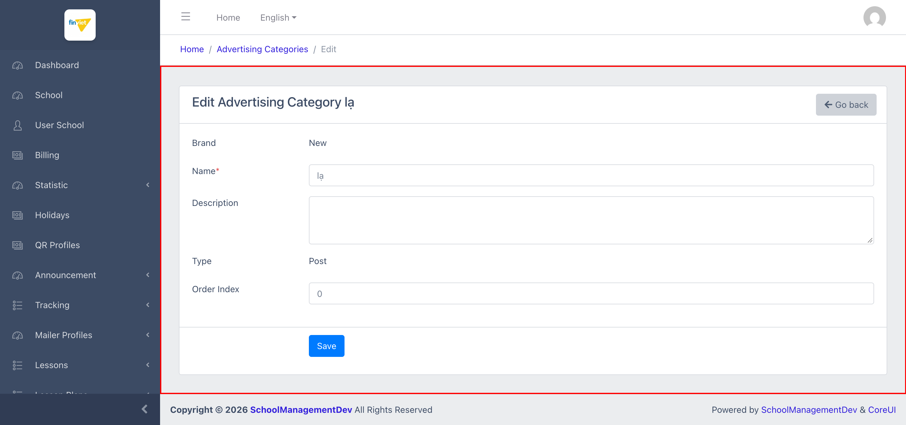

# M17.2 – Partner: Categories (Managing Portal)

> Phạm vi: sub-module **Categories** (`/admin/partners/categories`), sub-module thứ hai trong 2 sub-module của module **Partner**. Quản lý danh mục quảng cáo (mỗi Category thuộc 1 Brand, có 1 Type cố định: Post/Product). **Phát hiện quan trọng:** đã tìm ra trang **Advertisements** — nơi quản lý từng quảng cáo cụ thể — tồn tại thật nhưng **không có mục sidebar riêng**, chỉ truy cập được qua action "Advertisements" từ trang này.

## Mục lục

- [1. Tổng quan](#1-tổng-quan)
  - [1.1 Giới thiệu](#11-giới-thiệu)
  - [1.2 Actors](#12-actors)
  - [1.3 Phạm vi](#13-phạm-vi)
- [2. Business Flow](#2-business-flow)
  - [2.1 Sequence Diagram](#21-sequence-diagram)
  - [2.2 Business Steps](#22-business-steps)
  - [2.3 Business Rules](#23-business-rules)
- [3. Feature Breakdown](#3-feature-breakdown)
  - [3.1 Acceptance Criteria](#31-acceptance-criteria)
  - [3.2 Danh sách Use Case](#32-danh-sách-use-case)
  - [3.3 Edge Cases](#33-edge-cases)
  - [3.4 UI Conventions](#34-ui-conventions)

---

## 1. Tổng quan

### 1.1 Giới thiệu

Categories quản lý danh mục quảng cáo (ví dụ "Khuyến mãi", "Recipe") — mỗi Category thuộc về đúng 1 Brand (`SM1-brands.md`) và có 1 Type cố định (**Post** hoặc **Product**). Tại thời điểm khảo sát có **10 Category** trải trên nhiều brand khác nhau (New, Brand: QA, BeeKids...). Trang có thể mở dạng lọc theo brand qua query string `?brand={id}` (dùng bởi action "Categories" ở `SM1-brands.md` BR04) hoặc xem toàn bộ không lọc.

**Phát hiện quan trọng — Brand và Type bị khoá sau khi tạo:** form Create có đầy đủ 2 dropdown "Brand" (8 option, brand cụ thể) và "Type" (Post/Product) để chọn khi tạo mới — nhưng trên form **Edit**, cả 2 trường này hiển thị dạng **text tĩnh, không thể sửa** (xác nhận qua đọc trực tiếp HTML: `<div class="col-10">New</div>` thay vì `<select>`). Đây là 1 ràng buộc nghiệp vụ rõ ràng: **1 Category, sau khi tạo, không thể đổi sang Brand khác hoặc đổi Type khác** — chỉ có thể sửa Name/Description/Order Index.

**Phát hiện quan trọng — tìm ra trang Advertisements "ẩn":** action "Advertisements" (icon "Ad") trên mỗi dòng điều hướng tới `/admin/partners/advertisements?category={id}` — 1 trang quản lý đầy đủ (Title/Content/Image/Link/Expiration/Status/Order Index/Actions) các quảng cáo cụ thể thuộc 1 Category. Trang này **không có mục sidebar riêng** (khác với Lesson Areas/Groups/Lessons ở M11 — vốn tuy cũng truy cập qua action "View" nhưng VẪN có mục sidebar riêng) — chỉ truy cập được gián tiếp qua Categories. Việc khảo sát sâu Advertisements nằm ngoài phạm vi 2 sub-module được yêu cầu (Brands, Categories) nên chỉ ghi nhận cấu trúc cột ở mức tổng quan tại đây; xem Edge Case #1.

### 1.2 Actors

| Actor | Mô tả |
|---|---|
| Finviet/SOHA Admin | Quản lý danh mục quảng cáo theo brand, ẩn/hiện category, điều hướng nhanh tới quản lý Advertisement cụ thể. |

### 1.3 Phạm vi

| Trong phạm vi | Ngoài phạm vi |
|---|---|
| Xem danh sách (lọc và không lọc theo brand), xác nhận cấu trúc cột/action | Thực hiện Create/Edit/Delete/toggle Status thật |
| Xác nhận Brand/Type bị khoá sau khi tạo qua đối chiếu Create vs Edit | Khảo sát đầy đủ UC/BR của trang Advertisements (chỉ ghi nhận cấu trúc cột ở mức tổng quan) |

---

## 2. Business Flow

### 2.1 Sequence Diagram

```mermaid
sequenceDiagram
    actor Admin
    participant List as Categories (list, có thể lọc ?brand=)
    participant Create as Create Category
    participant Edit as Edit Category
    participant Ads as Advertisements (lọc theo category)

    Admin->>List: Mở /admin/partners/categories (hoặc ?brand={id} từ Brands)
    List-->>Admin: 10 category — ID/Name/Description/Brand/Type/Advertisement(X/Y)/Status/Order Index/Actions
    Admin->>Create: Click "+ Create"
    Create-->>Admin: Form với Brand*(dropdown 8 option)/Name*/Description/Type*(Post/Product)/Order Index
    Admin->>Edit: Click Edit trên 1 dòng đã tạo
    Edit-->>Admin: Brand/Type hiển thị TĨNH (không sửa được) — chỉ Name/Description/Order Index sửa được
    Admin->>Ads: Click "Advertisements" trên 1 dòng
    Ads-->>Admin: Điều hướng /admin/partners/advertisements?category={id} — danh sách quảng cáo cụ thể
```

### 2.2 Business Steps

1. Admin xem danh sách category (toàn bộ hoặc lọc theo 1 brand cụ thể).
2. Admin tạo mới 1 category: chọn Brand, đặt Name, chọn Type (Post/Product) — 2 lựa chọn này **cố định vĩnh viễn** sau khi lưu.
3. Admin có thể sửa Name/Description/Order Index của category đã tạo, hoặc ẩn/hiện qua toggle Status.
4. Admin bấm "Advertisements" để quản lý các quảng cáo cụ thể thuộc category đó.

### 2.3 Business Rules

| ID | Mô tả |
|---|---|
| BR01 | Danh sách có 9 cột dữ liệu: ID, Name, Description, Brand, Type, Advertisement (dạng active/total, đã xác minh công thức ở `SM1-brands.md` BR02), Status, Order Index, Created At — cộng Actions (4 nút: toggle Status, Advertisements, Edit, Delete). Tổng 10/10 category. |
| BR02 | **[Ràng buộc bất biến]** Brand và Type là dropdown bắt buộc khi Create (8 brand, 2 type: Post/Product), nhưng chuyển thành **text tĩnh không sửa được** trên Edit — xác nhận qua đọc trực tiếp HTML (`<div>` thay vì `<select>`), không phải suy đoán từ giao diện. |
| BR03 | **[Trang con không có sidebar riêng]** Action "Advertisements" dẫn tới `/admin/partners/advertisements?category={id}` — trang quản lý đầy đủ CRUD từng quảng cáo (cột: ID/Title/Content/Image/Link/Expiration/Status/Order Index/Actions, action gộp thành nút "More") nhưng **không xuất hiện ở sidebar** dưới mục Partner, khác với cách Lesson Areas/Groups/Lessons (M11) vẫn có mục sidebar riêng dù cũng truy cập qua action tương tự. |
| BR04 | Trường "Expiration" (ngày hết hạn) trên trang Advertisements xác nhận quảng cáo có thể được đặt lịch tự động hết hạn — không quan sát được cơ chế ẩn tự động khi hết hạn (ngoài phạm vi khảo sát chi tiết). |
| BR05 | Cùng pattern toggle Status theo ngữ cảnh (icon/màu đổi theo trạng thái hiện tại) và quy ước RESTful (`/{id}` không hậu tố `/edit`, `/destroy`) đã ghi nhận ở `SM1-brands.md` BR03/BR05 — xác nhận đây là component dùng chung cho cả 2 sub-module Brand và Category. |

---

## 3. Feature Breakdown

### 3.1 Acceptance Criteria

- Danh sách phải hiển thị đúng category và cho phép lọc theo brand qua query string — đạt.
- Brand/Type phải không thể thay đổi sau khi tạo (nếu đây là chủ đích thiết kế) — đạt, xác nhận bằng chứng rõ ràng qua DOM.

### 3.2 Danh sách Use Case

| Mã | Tên | Actor | Mô tả | Happy Path | Exception | Business Rules |
|---|---|---|---|---|---|---|
| UC-01 | Xem danh sách Categories (toàn bộ) | Admin | Xem tất cả category trên mọi brand. | 1. Admin mở `/admin/partners/categories`.<br>2. Trang hiển thị 10 category với đủ cột Brand/Type/Advertisement.<br><br> | Không thử toggle Status/Delete thật. | BR01, BR03 |
| UC-02 | Sửa 1 Category — xác nhận Brand/Type bị khoá | Admin | Cập nhật Name/Description/Order Index; xác nhận không đổi được Brand/Type. | 1. Admin click Edit trên dòng ID=32 ("lạ").<br>2. Form hiển thị Brand="New" và Type="Post" dạng text tĩnh, chỉ Name/Description/Order Index là input sửa được.<br><br> | Không thử submit Save thật. | BR02 | 

### 3.3 Edge Cases

| # | Tình huống | Quan sát / Rủi ro |
|---|---|---|
| 1 | Trang Advertisements tồn tại nhưng không có sidebar riêng (BR03) | Nếu admin không biết click vào action "Advertisements" từ Categories, họ sẽ không bao giờ tìm thấy trang quản lý quảng cáo cụ thể — không có đường dẫn trực tiếp nào khác được phát hiện. Đề xuất bổ sung mục sidebar riêng nếu đây là tính năng được dùng thường xuyên. Sub-module này chưa được khảo sát đầy đủ (nằm ngoài phạm vi "Brands, Categories" được yêu cầu) — có thể cần 1 phiên khảo sát riêng nếu cần tài liệu hoá đầy đủ. |
| 2 | Brand/Type bị khoá vĩnh viễn sau khi tạo (BR02) | Nếu admin tạo nhầm Category dưới sai Brand hoặc chọn nhầm Type, cách duy nhất để sửa là **xoá và tạo lại** — không có cách "chuyển" category sang brand/type khác. `[Cần xác nhận]` đây có phải chủ đích thiết kế (tránh phá vỡ liên kết Advertisement đã gán) hay là hạn chế chưa hoàn thiện. |

### 3.4 UI Conventions

- Cùng layout DataTables + toggle Status + quy ước RESTful đã thấy ở `SM1-brands.md`.
- Cột "Actions" trên danh sách Categories bị cắt chữ thành "Actio" do độ rộng cột hẹp (nhiều action hơn Brands: 4 nút cộng thêm nút "Ad") — lỗi hiển thị nhỏ về responsive layout, không ảnh hưởng chức năng.
