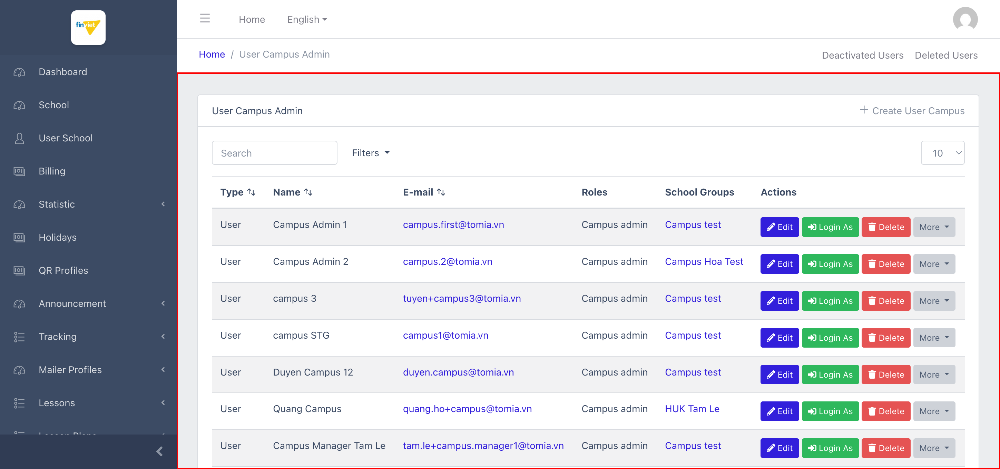
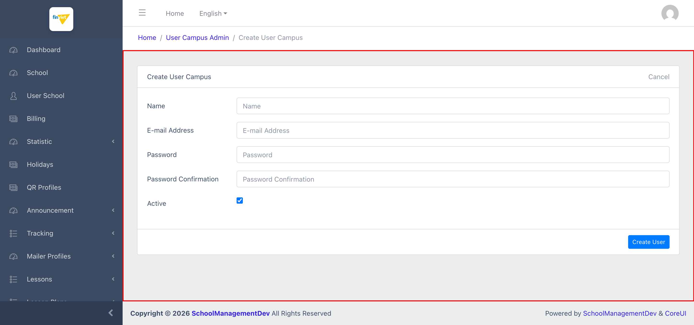

# M18 – Campus User Management (Managing Portal)

> Phạm vi: module **Campus User Management** (`/admin/auth/user`), không có sub-module (mục sidebar đơn, nằm dưới nhóm "CAMPUS"). Đây là module **đầu tiên và duy nhất tính đến nay yêu cầu xác nhận lại mật khẩu** (Laravel `password.confirm`) trước khi truy cập — phù hợp vì đây là nơi quản lý tài khoản Campus Admin với các quyền hạn rất mạnh (impersonate, đổi mật khẩu người khác, "Hidden Password").

## Mục lục

- [1. Tổng quan](#1-tổng-quan)
  - [1.1 Giới thiệu](#11-giới-thiệu)
  - [1.2 Actors](#12-actors)
  - [1.3 Phạm vi](#13-phạm-vi)
- [2. Business Flow](#2-business-flow)
  - [2.1 Sequence Diagram](#21-sequence-diagram)
  - [2.2 Business Steps](#22-business-steps)
  - [2.3 Business Rules](#23-business-rules)
- [3. Feature Breakdown](#3-feature-breakdown)
  - [3.1 Acceptance Criteria](#31-acceptance-criteria)
  - [3.2 Danh sách Use Case](#32-danh-sách-use-case)
  - [3.3 Edge Cases](#33-edge-cases)
  - [3.4 UI Conventions](#34-ui-conventions)

---

## 1. Tổng quan

### 1.1 Giới thiệu

Campus User Management quản lý tài khoản **Campus Admin** — 1 loại tài khoản riêng biệt (khác User School ở M3) gắn với "School Groups" (cụm trường, xem thêm module tiếp theo). Tại thời điểm khảo sát có **10 user**, toàn bộ đều `Type = User`, `Roles = Campus admin`.

**Phát hiện quan trọng — lớp bảo mật riêng biệt:** truy cập `/admin/auth/user` lần đầu trong phiên yêu cầu **xác nhận lại mật khẩu** ("Please confirm your password before continuing.") qua route Laravel chuẩn `password.confirm` — đây là module **duy nhất trong toàn bộ dự án (M2-M17)** có lớp bảo vệ này. Hợp lý vì các action trong module cho phép: impersonate bất kỳ Campus Admin nào ("Login As"), đổi mật khẩu người khác, và 1 cơ chế **"Hidden Password"** (xem BR05) — đều là các năng lực có rủi ro cao nếu bị lạm dụng.

**Phát hiện quan trọng — kiến trúc UI khác biệt thứ 4:** trang danh sách dùng thanh "Search" + dropdown "Filters" (không phải hàng ô lọc theo từng cột của DataTables tiêu chuẩn đã thấy ở mọi module Finviet khác), và trang Create/Edit dùng Alpine.js (`x-data`) thay vì jQuery/Blade thuần. Đây là kiến trúc UI **thứ 4** phát hiện được trong dự án (sau: 1. Blade+DataTables chuẩn, 2. Vue.js ở M15 Transparent Classroom, 3. Package LogViewer nhúng ở M16, 4. **Alpine.js** ở đây) — gợi ý module này được xây bằng 1 package/scaffold quản trị user khác (kiểu Laravel Backpack/tương tự) thay vì code Blade tự viết như phần lớn Managing Portal.

**Phát hiện — 2 view phụ trợ trống:** liên kết "Deactivated Users" (`/admin/auth/user/deactivated`) và "Deleted Users" (`/admin/auth/user/deleted`) ở góc phải breadcrumb đều tồn tại và dùng chung cấu trúc cột, nhưng hiện **trống** ("No items found. Try to broaden your search.") — xác nhận cơ chế deactivate/soft-delete tồn tại nhưng chưa từng được dùng trên môi trường dev.

### 1.2 Actors

| Actor | Mô tả |
|---|---|
| Finviet/SOHA Super Admin | Quản lý tài khoản Campus Admin — tạo mới, sửa, xoá, đổi mật khẩu, impersonate, kích hoạt/vô hiệu hoá. Yêu cầu xác nhận lại mật khẩu trước khi truy cập module. |

### 1.3 Phạm vi

| Trong phạm vi | Ngoài phạm vi |
|---|---|
| Xác nhận lại mật khẩu để truy cập (dùng chính mật khẩu admin đang đăng nhập) | Bấm "Login As" thật (sẽ tạo phiên impersonate thật) |
| Xem danh sách, xác nhận cấu trúc cột/action, xem 2 view Deactivated/Deleted Users | Thực hiện Create/Edit/Delete/Deactivate/Clear Session/đổi mật khẩu thật |
| Xem cấu trúc form Create/Edit qua đọc DOM | Xác định chính xác mục đích/cơ chế "Hidden Password" (không có tài liệu trên UI) |

---

## 2. Business Flow

### 2.1 Sequence Diagram

```mermaid
sequenceDiagram
    actor Admin
    participant Confirm as Xác nhận mật khẩu
    participant List as User Campus Admin (list)
    participant Create as Create User Campus

    Admin->>Confirm: Mở /admin/auth/user lần đầu trong phiên
    Confirm-->>Admin: "Please confirm your password before continuing."
    Admin->>Confirm: Nhập lại mật khẩu hiện tại
    Confirm-->>List: Xác nhận thành công, vào được danh sách
    List-->>Admin: 10 user — Type/Name/E-mail/Roles/School Groups/Actions
    Admin->>Create: Click "+ Create User Campus"
    Create-->>Admin: Form Name/E-mail/Password/Password Confirmation/Active — Role cố định ẩn = "Campus admin"
```

### 2.2 Business Steps

1. Admin xác nhận lại mật khẩu hiện tại để vào module (1 lần/phiên).
2. Admin xem danh sách Campus Admin, có thể tìm kiếm (Search) và lọc (Filters).
3. Admin tạo mới 1 Campus Admin: Name, E-mail, Password — vai trò tự động là "Campus admin", không chọn được.
4. Admin có thể: Edit (chỉ Name/Email), "Login As" (impersonate), Delete, hoặc qua "More": View, Change Password, Generate/Set/Clear Hidden Password, Clear Session, Deactivate.
5. `[Ngoài phạm vi UI này]` Gán Campus Admin vào 1 "School Groups" cụ thể — không có field nào trên Create/Edit form của user; khả năng thực hiện từ phía module School Groups (xem module tiếp theo).

### 2.3 Business Rules

| ID | Mô tả |
|---|---|
| BR01 | Truy cập module lần đầu trong phiên yêu cầu xác nhận lại mật khẩu qua Laravel `password.confirm` — module bảo mật chặt nhất trong toàn dự án tính đến nay. |
| BR02 | Danh sách có 6 cột: Type, Name, E-mail, Roles, School Groups (link tới School Groups tương ứng), Actions — dùng Search + Filters dropdown thay vì ô lọc theo cột DataTables tiêu chuẩn. Tổng 10 user, toàn bộ `Roles = Campus admin`. |
| BR03 | Actions gồm 3 nút chính (Edit, **Login As** — impersonate, mở tab mới, Delete) và 1 dropdown "More" với 7 mục: View, Change Password, **Generate Hidden Password**, **Set Hidden Password**, **Clear Hidden Password**, Clear Session, Deactivate. |
| BR04 | Form Create chỉ gồm: Name, E-mail Address, Password, Password Confirmation, Active (checkbox, mặc định tick) — trường `roles[]` là **input ẩn cố định giá trị "2"** (Campus admin), không có UI để chọn role khác hoặc gán School Groups ngay khi tạo. |
| BR05 | **[Cơ chế chưa rõ mục đích]** "Hidden Password" là 1 cơ chế mật khẩu phụ có thể Generate/Set/Clear độc lập với mật khẩu chính (Change Password) — không có mô tả nào trên UI giải thích mục đích (có thể dùng cho tích hợp API, hoặc truy cập hỗ trợ kỹ thuật). `[Cần xác nhận]` với đội dev về mục đích và phạm vi sử dụng thực tế, vì đây là 1 năng lực bảo mật đáng chú ý. |
| BR06 | Form Edit chỉ cho sửa **Name và E-mail** — không có trường Password (đổi mật khẩu tách riêng thành action "Change Password" ở dropdown More) và không có trường Role/School Groups. |
| BR07 | 2 view "Deactivated Users" và "Deleted Users" tồn tại với cùng cấu trúc cột, xác nhận cơ chế deactivate (action "Deactivate", PATCH `/mark/0`) và soft-delete riêng biệt — cả 2 đều trống trên môi trường dev. |
| BR08 | Trang Create/Edit dùng Alpine.js (`x-data="{userType: 'user'}"`) — phát hiện thêm 1 đoạn code **đã comment (vô hiệu hoá)** cho tính năng "E-mail Verified"/"Send Confirmation E-mail" trong HTML nguồn — tính năng đã được viết nhưng chưa bật, không ảnh hưởng UI hiện tại. |

---

## 3. Feature Breakdown

### 3.1 Acceptance Criteria

- Module phải yêu cầu xác thực bổ sung trước khi truy cập — đạt, phù hợp mức độ nhạy cảm của dữ liệu.
- Danh sách phải hiển thị đúng user và cho phép tìm kiếm/lọc — đạt về cấu trúc.
- `[Cần xác nhận]` Cơ chế Hidden Password phải có tài liệu rõ ràng cho admin sử dụng đúng mục đích — hiện không có mô tả nào trên UI.

### 3.2 Danh sách Use Case

| Mã | Tên | Actor | Mô tả | Happy Path | Exception | Business Rules |
|---|---|---|---|---|---|---|
| UC-01 | Xác nhận mật khẩu và xem danh sách Campus Admin | Super Admin | Truy cập module và xem toàn bộ tài khoản Campus Admin. | 1. Admin mở `/admin/auth/user`, xác nhận lại mật khẩu.<br>2. Trang hiển thị 10 user với đầy đủ action (Edit/Login As/Delete/More).<br><br> | Không thử "Login As", Delete, Deactivate, hay các action trong "More" thật. | BR01, BR02, BR03, BR07 |
| UC-02 | Xem form tạo mới Campus Admin | Super Admin | Xem cấu trúc form Create. | 1. Admin click "+ Create User Campus".<br>2. Form hiển thị Name/E-mail/Password/Password Confirmation/Active — role cố định ẩn.<br><br> | Không thử submit Create thật. | BR04, BR08 |

### 3.3 Edge Cases

| # | Tình huống | Quan sát / Rủi ro |
|---|---|---|
| 1 | Cơ chế "Hidden Password" không có tài liệu trên UI (BR05) | Đây là năng lực bảo mật mạnh (tạo/đặt/xoá 1 mật khẩu phụ) nhưng admin sử dụng module có thể không hiểu rõ hậu quả nếu dùng sai mục đích — nên bổ sung tooltip/hướng dẫn hoặc giới hạn quyền truy cập tính năng này chặt hơn nữa. `[Cần xác nhận]`. |
| 2 | Không có UI để gán Campus Admin vào School Groups từ trang User | Nếu module School Groups (tiếp theo) cũng không có UI gán ngược, đây có thể là 1 khoảng trống chức năng — cần xác nhận khi khảo sát module đó. |
| 3 | "Login As" mở tab mới và impersonate ngay lập tức, không có bước xác nhận trung gian | Rủi ro thao tác nhầm cao hơn các action khác (bấm nhầm sẽ ngay lập tức đăng nhập với danh tính người khác) — không giống như Delete (còn có bước xác nhận ở nhiều nơi khác trong dự án, dù không phải luôn có). `[Cần xác nhận]` liệu có dialog xác nhận nào xuất hiện trước khi mở tab mới (không kiểm chứng vì không bấm thật). |

### 3.4 UI Conventions

- Đây là module đầu tiên dùng thanh Search + dropdown Filters thay vì hàng ô lọc theo cột DataTables — gợi ý 1 package quản trị user khác với phần còn lại của Managing Portal.
- Action "More" dạng dropdown gộp nhiều thao tác ít dùng — mật độ action cao nhất trong toàn dự án (10 action khả dụng/user: Edit, Login As, Delete, View, Change Password, Generate/Set/Clear Hidden Password, Clear Session, Deactivate).
