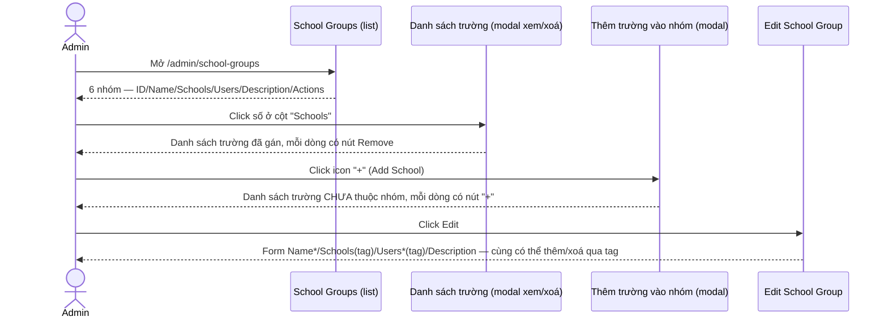
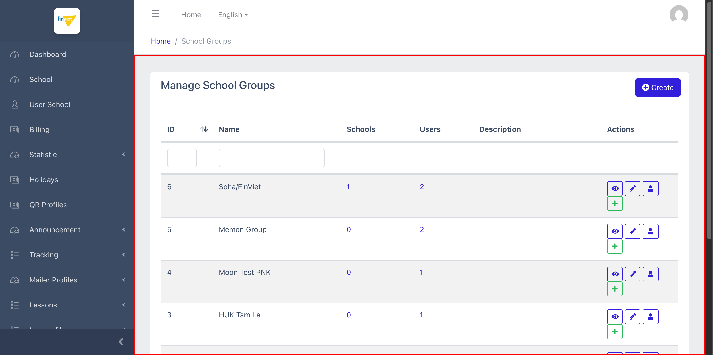
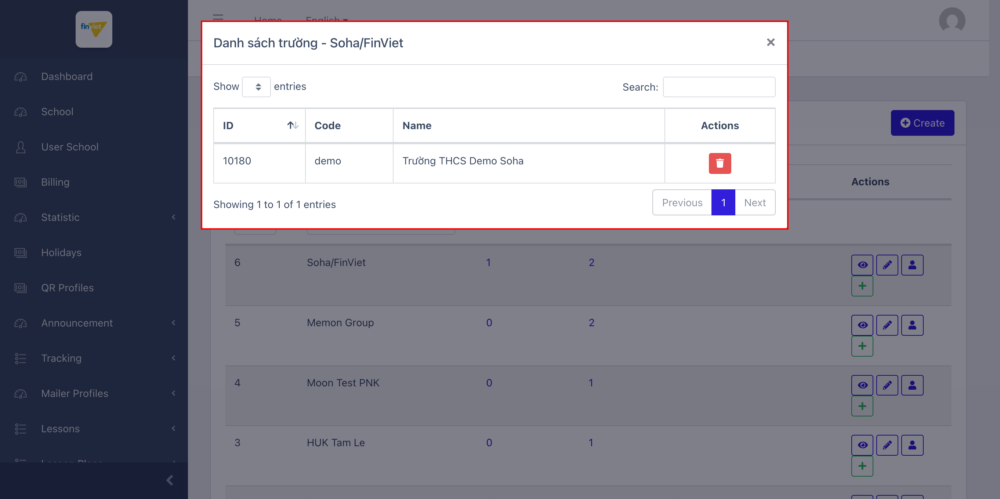
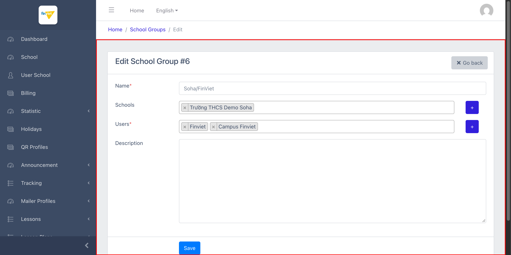

# M19 – School Groups (Managing Portal)

> Phạm vi: module **School Groups** (`/admin/school-groups`), không có sub-module (mục sidebar đơn, nằm dưới nhóm "CAMPUS", ngay sau Campus User Management). Đây là nơi **thực sự trả lời câu hỏi bỏ ngỏ** ở `M18-campus-user-management/SM1-campus-user-management.md` Edge Case #2: gán Campus Admin (và trường) vào 1 nhóm được thực hiện **từ phía module này**, không phải từ trang User.

## Mục lục

- [1. Tổng quan](#1-tổng-quan)
  - [1.1 Giới thiệu](#11-giới-thiệu)
  - [1.2 Actors](#12-actors)
  - [1.3 Phạm vi](#13-phạm-vi)
- [2. Business Flow](#2-business-flow)
  - [2.1 Sequence Diagram](#21-sequence-diagram)
  - [2.2 Business Steps](#22-business-steps)
  - [2.3 Business Rules](#23-business-rules)
- [3. Feature Breakdown](#3-feature-breakdown)
  - [3.1 Acceptance Criteria](#31-acceptance-criteria)
  - [3.2 Danh sách Use Case](#32-danh-sách-use-case)
  - [3.3 Edge Cases](#33-edge-cases)
  - [3.4 UI Conventions](#34-ui-conventions)

---

## 1. Tổng quan

### 1.1 Giới thiệu

School Groups quản lý các "cụm trường" (ví dụ "Soha/FinViet", "Campus test") — mỗi nhóm có thể chứa nhiều trường và nhiều Campus Admin (User). Tại thời điểm khảo sát có **6 nhóm**, quy mô rất khác nhau: từ 0-1 trường/1-2 user (đa số) tới nhóm "Campus test" với **29 user**.

**Phát hiện quan trọng — trả lời câu hỏi bỏ ngỏ từ M18:** form Edit có 2 trường multi-select dạng "tag" (Select2): **Schools** và **Users\*** — xác nhận đây chính là nơi gán Campus Admin (từ M18) và trường vào 1 nhóm, không phải từ trang User Campus Admin (vốn không có field tương ứng). Đã xác minh trực tiếp bằng tương tác thật: click vào ô tìm kiếm trong tag "Schools" (không chọn/lưu gì) hiển thị đầy đủ 25+ trường khác chưa thuộc nhóm — xác nhận đây là Select2 với toàn bộ dữ liệu tải sẵn phía client, không phải giới hạn chỉ hiển thị trường đã gán như nhìn thoáng qua DOM tĩnh ban đầu tưởng vậy.

**Phát hiện — 2 cơ chế thêm/xoá trường song song:** ngoài Select2 tag trên form Edit, danh sách chính còn có **2 modal riêng biệt** dùng DataTables: click vào số ở cột "Schools" mở modal **"Danh sách trường - {tên nhóm}"** (xem + xoá từng trường qua icon thùng rác); click icon "+" xanh mở modal **"Thêm trường vào nhóm - {tên nhóm}"** (danh sách các trường CHƯA thuộc nhóm, mỗi dòng có nút "+" để thêm). Đây là 2 con đường khác nhau dẫn tới cùng 1 kết quả (gán/xoá trường khỏi nhóm) — 1 qua form Edit tổng thể, 1 qua modal thao tác nhanh ngay tại danh sách.

**Phát hiện — không có action Delete cho School Group:** khác với hầu hết danh sách khác trong dự án, Actions chỉ có 4 nút: View, Edit, Users (link `/admin/auth/user?school_group_id={id}` — xác nhận chiều liên kết ngược với M18), và Add School — **không có nút Delete** nào ở cả danh sách lẫn trang View/Edit.

### 1.2 Actors

| Actor | Mô tả |
|---|---|
| Finviet/SOHA Super Admin | Tạo/sửa cụm trường, gán/xoá trường và Campus Admin vào/khỏi từng nhóm. |

### 1.3 Phạm vi

| Trong phạm vi | Ngoài phạm vi |
|---|---|
| Xem danh sách, View, Edit; xác nhận 2 cơ chế thêm/xoá trường (Select2 + modal) | Thực hiện Create/Edit/thêm/xoá trường hoặc user thật |
| Xác nhận liên kết ngược với Campus User Management (M18) qua action "Users" | Xác định vì sao nhóm "Campus test" có tới 29 user trong khi các nhóm khác chỉ 1-2 (không có thêm dữ liệu để phân tích) |

---

## 2. Business Flow

### 2.1 Sequence Diagram

### 2.2 Business Steps

1. Admin xem danh sách nhóm, theo dõi số trường/user thuộc mỗi nhóm.
2. Admin thêm/xoá trường khỏi 1 nhóm qua modal nhanh (click số cột Schools để xoá, click "+" để thêm) HOẶC qua form Edit đầy đủ (Select2 tag).
3. Admin xem chi tiết User Campus Admin thuộc 1 nhóm bằng cách bấm "Users" — điều hướng sang Campus User Management (M18) đã lọc theo `school_group_id`.

### 2.3 Business Rules

| ID | Mô tả |
|---|---|
| BR01 | Danh sách có 5 cột dữ liệu: ID (sort được), Name (sort được), Schools (số, dạng link mở modal xem/xoá), Users (số, dạng link mở modal — xem BR03), Description — cộng Actions (View/Edit/Users/Add School, **không có Delete**). Tổng 6/6 nhóm. |
| BR02 | **[Đã xác minh bằng tương tác thật]** Trường "Schools" trên form Edit dùng Select2 — tương tác trực tiếp (click vào ô tìm kiếm) xác nhận đầy đủ các trường chưa gán đều khả dụng để thêm, không giới hạn như phân tích DOM tĩnh ban đầu (vốn chỉ thấy 1 option đã chọn trong `<select>` gốc). |
| BR03 | Cột "Users" trên danh sách chính là **link điều hướng trực tiếp** (không phải modal) tới `/admin/auth/user?school_group_id={id}` — mở trong tab mới, xác nhận liên kết 2 chiều hoàn chỉnh với `M18-campus-user-management/SM1-campus-user-management.md` BR02 (cột "School Groups" ở đó cũng link ngược lại module này). |
| BR04 | **[2 cơ chế song song]** Thêm/xoá trường khỏi nhóm có thể thực hiện qua (a) Select2 tag trên form Edit (yêu cầu bấm Save để lưu), hoặc (b) modal AJAX riêng ở danh sách chính (icon "+"/thùng rác — có khả năng lưu tức thời không cần Save, do dùng route riêng `POST` cho add/remove). `[Cần xác nhận]` liệu modal (b) có submit AJAX tức thời hay cũng cần thao tác Save riêng. |
| BR05 | **[Không có Delete]** School Group không có action xoá ở bất kỳ đâu (danh sách, View, Edit) — khác biệt với hầu hết entity khác trong dự án, có thể là chủ đích thiết kế để tránh xoá nhầm 1 cụm trường đang có user/school hoạt động gắn kèm. |
| BR06 | Nút "+" cạnh mỗi trường Select2 (Schools/Users) trên form Edit là link **Tạo mới** (`/admin/school/create`, `/admin/auth/user/create`, mở tab mới) — không phải nút mở picker chọn trường/user đã tồn tại (việc đó thực hiện qua chính ô tìm kiếm Select2). |
| BR07 | Tiêu đề trang Edit đúng, đầy đủ dấu cách ("Edit School Groups", "Edit School Group #6") — không có lỗi "Manage{Entity}" đã ghi nhận ở M11/M14, cùng nhóm với Partner (M17) không bị ảnh hưởng bởi lỗi layout đó. |

---

## 3. Feature Breakdown

### 3.1 Acceptance Criteria

- Danh sách phải hiển thị đúng số trường/user mỗi nhóm — đạt.
- Phải có cách gán/xoá trường và user khỏi nhóm — đạt, có tới 2 cơ chế song song (Select2 + modal nhanh).
- Liên kết 2 chiều với Campus User Management phải nhất quán — đạt, xác nhận qua `school_group_id` query param khớp ở cả 2 module.

### 3.2 Danh sách Use Case

| Mã | Tên | Actor | Mô tả | Happy Path | Exception | Business Rules |
|---|---|---|---|---|---|---|
| UC-01 | Xem danh sách School Groups | Admin | Xem toàn bộ cụm trường và số trường/user. | 1. Admin mở `/admin/school-groups`. 2. Trang hiển thị 6 nhóm, cột Schools/Users dạng link.   | Không thử thêm/xoá thật. | BR01, BR03, BR05 |
| UC-02 | Xem/xoá trường thuộc 1 nhóm qua modal nhanh | Admin | Kiểm tra trường đã gán, có action xoá. | 1. Admin click số "1" ở cột Schools, dòng "Soha/FinViet". 2. Modal "Danh sách trường - Soha/FinViet" hiện ra với 1 trường, nút Remove màu đỏ.   | Không bấm Remove thật. | BR01, BR04 |
| UC-03 | Sửa 1 School Group — xác nhận Select2 tag hoạt động đầy đủ | Admin | Cập nhật Name/Schools/Users/Description. | 1. Admin click Edit trên dòng ID=6. 2. Form hiển thị Schools/Users dạng tag; click vào ô tìm kiếm Schools xác nhận hiển thị đầy đủ trường khác chưa gán.   | Không thử submit Save thật, không chọn thêm tag nào. | BR02, BR06, BR07 |

### 3.3 Edge Cases

| # | Tình huống | Quan sát / Rủi ro |
|---|---|---|
| 1 | 2 cơ chế thêm/xoá trường song song (Select2 trên Edit vs modal nhanh trên danh sách) (BR04) | Nếu 1 trong 2 cơ chế lưu tức thời (AJAX) còn cơ chế kia cần bấm Save, admin có thể bối rối về việc thay đổi đã được lưu hay chưa nếu thao tác cả 2 cách trong cùng phiên làm việc. `[Cần xác nhận]`. |
| 2 | Không có action Delete cho School Group (BR05) | Nếu cần xoá 1 nhóm không còn dùng, không có cách nào thực hiện qua UI Managing Portal — có thể là chủ đích (an toàn dữ liệu) nhưng cũng có thể là tính năng còn thiếu. `[Cần xác nhận]`. |
| 3 | Nhóm "Campus test" có 29 user trong khi các nhóm khác chỉ 1-2 | Sự chênh lệch quy mô lớn gợi ý đây có thể là nhóm "mặc định"/dùng chung cho nhiều tài khoản test, không phản ánh cách dùng thực tế trong production. `[Cần xác nhận]`, không có thêm dữ liệu để xác nhận. |

### 3.4 UI Conventions

- Modal quản lý trường dùng tiêu đề tiếng Việt ("Danh sách trường", "Thêm trường vào nhóm") trong khi phần còn lại của trang là tiếng Anh — cùng pattern trộn ngôn ngữ đã thấy ở nhiều module khác.
- Trường Select2 tag (chip có nút × để xoá) là kiểu multi-select trực quan nhất trong dự án tính đến nay, khác hẳn multi-select `<select multiple>` thô đã thấy ở Lesson Set/Area (M11).
